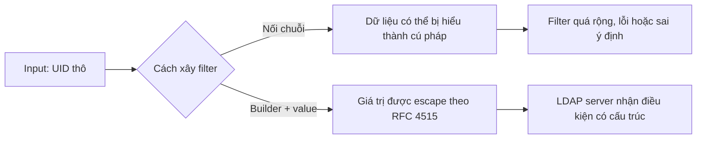

# Query builder và escaping giá trị

## Mục tiêu bài học

Trong **SPRING_LDAP**, ứng dụng thường nhận mã tài khoản, họ tên hoặc mã phòng ban từ người dùng rồi chuyển thành **LDAP search filter**. Một giá trị tưởng như bình thường, chẳng hạn `lan*` hoặc `lan)(uid=*)`, có thể khiến truy vấn mang ý nghĩa khác nếu lập trình viên nối trực tiếp nó vào chuỗi filter.

**`LdapQueryBuilder`** giúp tách *cấu trúc truy vấn* khỏi *giá trị cần so sánh*. Khi dùng đúng API, những ký tự đặc biệt trong giá trị được biểu diễn theo quy tắc LDAP filter thay vì trở thành toán tử ngoài ý định. Bài này thuộc chương **Query builder** và liên hệ trực tiếp với các phần khác của module: DN, schema, `LdapTemplate`, `LdapClient`, ODM, `ContextSource`, xác thực, TLS, xử lý lỗi và kiểm thử truy cập thư mục an toàn.

Sau bài học, bạn có thể:

1. Phân tích cấu trúc LDAP filter theo RFC 4515 và giải thích vì sao **escape giá trị** khác với **escape DN**.
2. Tạo equality filter từ dữ liệu động qua `LdapQueryBuilder.where(...).is(...)` mà không nối chuỗi thủ công.
3. Phân biệt **giá trị có ký tự `*` thật** với **wildcard trong substring filter**.
4. Xây nhiều điều kiện AND/OR với cấu trúc rõ ràng và chỉ dùng tên thuộc tính, base DN, scope đã được cho phép.
5. Tích hợp query builder với `LdapTemplate.search`, mapping kết quả và giới hạn dữ liệu trả về.
6. Kiểm thử các giá trị chứa dấu sao, ngoặc, dấu gạch chéo ngược, NUL, Unicode và phân biệt lỗi filter với lỗi quyền/kết nối.

## 1. Ba thứ không được nhầm: filter, DN và giá trị

LDAP (*Lightweight Directory Access Protocol*) lưu các entry trong **Directory Information Tree (DIT)**. Mỗi entry có một **DN** (*Distinguished Name*) và tập attribute tuân theo schema. Khi tìm kiếm, client chỉ định:

| Thành phần | Ví dụ | Ý nghĩa |
| --- | --- | --- |
| **Base DN** | `ou=People,dc=example,dc=org` | Bắt đầu tìm ở nhánh nào |
| **Scope** | `SUBTREE` | Xét bao nhiêu cấp từ base |
| **Filter** | `(&(objectClass=inetOrgPerson)(uid=lan))` | Entry nào thỏa điều kiện |
| **Returned attributes** | `uid`, `cn`, `mail` | Những thuộc tính nào được trả về |
| **Giới hạn** | 100 entry, thời gian phù hợp | Kiểm soát phạm vi tác động và tải |

Trong filter `(uid=lan)`, `uid` là **tên thuộc tính**, `lan` là **giá trị assertion**. Cặp ngoặc và dấu `=` là một phần **cú pháp**. Nếu giá trị do người dùng cung cấp bị chèn thẳng vào cú pháp, ranh giới này có thể bị phá vỡ.

DN như `uid=lan,ou=People,dc=example,dc=org` có **quy tắc biểu diễn riêng** (RFC 4514). LDAP filter dùng RFC 4515. Do đó:

- Dùng **`LdapNameBuilder`** hoặc JNDI `Rdn` để xây DN/RDN.
- Dùng **`LdapQueryBuilder`**, bộ lọc có cấu trúc hoặc cơ chế truyền tham số phù hợp để xây search filter.
- Không dùng hàm escape DN làm hàm escape filter và ngược lại.
- Không mặc định một giá trị hợp lệ về cú pháp nghĩa là có quyền truy cập dữ liệu mà nó mô tả.

## 2. Vì sao nối chuỗi filter thủ công nguy hiểm?

Ví dụ một service tra cứu theo UID:

```java
// KHÔNG NÊN: uidFromRequest là dữ liệu không tin cậy.
String filter = "(uid=" + uidFromRequest + ")";
```

Nếu `uidFromRequest = "lan"` thì filter là `(uid=lan)`, có vẻ đúng. Nhưng nếu đầu vào là **một dấu sao** (`*`), chuỗi trở thành:

```ldap
(uid=*)
```

Trong cú pháp LDAP, `(uid=*)` là **presence filter**: chọn các entry có thuộc tính `uid`, không phải tìm một UID có giá trị bằng dấu sao. Từ một truy vấn tìm một người, ứng dụng có thể vô tình tạo truy vấn rộng trả về nhiều người.

Những đầu vào chứa dấu ngoặc hoặc dấu gạch chéo ngược có thể làm filter sai cú pháp; trong một số cách ghép điều kiện phức tạp, chúng còn có thể làm thay đổi cấu trúc biểu thức. Đây là một dạng **LDAP filter injection**.



**Điểm cần nhớ:** Không chỉ có kẻ tấn công mới nhập ký tự đặc biệt. UID, tên, chuỗi tìm kiếm hoặc các giá trị tích hợp có thể chứa những ký tự ấy một cách hợp lệ. Viết mã an toàn nghĩa là giữ **đúng giá trị gốc** trong điều kiện so sánh.

## 3. RFC 4515: các ký tự đặc biệt trong assertion value

Với **LDAP filter**, những byte/ký tự sau phải được encode khi chúng được dùng như **dữ liệu của giá trị** thay vì cú pháp:

| Ký tự/byte trong giá trị | Cách biểu diễn trong filter | Vì sao |
| --- | --- | --- |
| `*` (dấu sao) | `\2a` | Nếu không escape có thể là wildcard/presence |
| `(` (ngoặc mở) | `\28` | Ngăn bị hiểu là mở một filter con |
| `)` (ngoặc đóng) | `\29` | Ngăn bị hiểu là đóng một filter |
| Dấu gạch chéo ngược `\` | `\5c` | Vì dấu này dùng để escape trong filter |
| Byte NUL (0x00) | `\00` | Không cho NUL bị đưa vào cú pháp không escape |

Các ký hiệu như `\2a` là **ký hiệu hex escape** trong chuỗi filter được truyền qua giao thức; chúng **không phải** nội dung người dùng phải tự thêm vào ô nhập liệu.

Ví dụ một giá trị UID thực sự là `lan*`:

```text
Giá trị gốc     : lan*
Filter sai ý định: (uid=lan*)      # substring bắt đầu bằng lan
Filter equality : (uid=lan\2a)    # UID bằng chuỗi lan*
```

Trong Java source code, một string literal chứa ký tự gạch chéo ngược của filter phải biểu diễn gạch chéo ngược theo cú pháp Java nữa. **Vì vậy không nên tự viết các chuỗi `\\2a` thủ công.** Hãy truyền giá trị gốc cho builder và để thư viện tạo chuỗi filter.

### 3.1. Unicode có cần escape mọi ký tự không?

Không. RFC 4515 biểu diễn filter với UTF-8; nhiều ký tự Unicode hợp lệ có thể xuất hiện trực tiếp. Với byte không hợp lệ trong chuỗi UTF-8 hoặc những tình huống mã hóa đặc biệt, phải tuân thủ cách escape octet của chuẩn. Ứng dụng nên dùng thư viện mã hóa thay vì tự biến mỗi ký tự Java thành một escape hex không phù hợp.

Ví dụ tên `Nguyễn Văn An` không phải tự động “nguy hiểm” chỉ vì có dấu tiếng Việt. Điều quan trọng là filter builder bảo toàn **ý nghĩa giá trị**, kể cả Unicode và ký tự đặc biệt.

### 3.2. Escaping không giống validation

Một giá trị được escape đúng vẫn có thể **không được phép theo nghiệp vụ**:

- UID rỗng hoặc quá dài.
- Mã phòng ban ở định dạng không hợp lệ.
- Giá trị tìm kiếm khiến truy vấn rất rộng hay tốn tài nguyên.
- Tên thuộc tính, nhánh DN hoặc scope do caller cố gắng chọn ngoài phạm vi cho phép.

**Escaping** ngăn dữ liệu phá cấu trúc filter. **Validation và authorization** quyết định yêu cầu có hợp lệ và được phép hay không. Phải dùng cả hai, không lấy cái này thay cái kia.

## 4. LdapQueryBuilder: tách cấu trúc và dữ liệu

`LdapQueryBuilder` của Spring LDAP cung cấp DSL dựng truy vấn tìm kiếm. Với điều kiện equality, dùng `.where("uid").is(rawUid)`, truyền **giá trị thô**; không tự escape trước.

```java
import static org.springframework.ldap.query.LdapQueryBuilder.query;

import org.springframework.ldap.query.LdapQuery;
import org.springframework.ldap.query.SearchScope;

String rawUid = "lan*";   // Dữ liệu nhập thật, có một dấu sao.

LdapQuery ldapQuery = query()
        .base("ou=People")
        .searchScope(SearchScope.SUBTREE)
        .attributes("uid", "cn", "mail")
        .where("objectClass").is("inetOrgPerson")
        .and("uid").is(rawUid);

// Các phần điều kiện được dựng có cấu trúc.
// rawUid là giá trị equality, không phải một mảnh cú pháp filter.
```

Trong ví dụ:

1. `base("ou=People")` giới hạn nhánh tìm, **tương đối** so với base DN của `ContextSource`.
2. `searchScope(SUBTREE)` cho phép tìm cả các entry trong OU con.
3. `attributes("uid", "cn", "mail")` chỉ yêu cầu các attribute cần trả về.
4. `where("objectClass").is(...).and("uid").is(rawUid)` biểu diễn hai equality assertion kết hợp AND; giá trị động không bị diễn giải thành cấu trúc filter.

Nếu `rawUid = "lan*"`, builder phải tạo **equality assertion với ký tự sao là dữ liệu**, chứ không phải substring assertion `(uid=lan*)`. Việc đó được xác minh trong integration test với fixture có UID đặc biệt.

### 4.1. Kết nối với LdapTemplate

Giả sử ứng dụng Spring Boot đã cấu hình Spring LDAP và một `ContextSource` phù hợp. Cấu hình minh họa:

```properties
spring.ldap.urls=ldaps://ldap.example.org:636
spring.ldap.base=dc=example,dc=org
spring.ldap.username=cn=svc-reader,ou=Services,dc=example,dc=org
spring.ldap.password=${LDAP_BIND_PASSWORD}
```

Khi `spring.ldap.base` là `dc=example,dc=org`, query dùng `base("ou=People")` tương ứng:

```text
ou=People,dc=example,dc=org
```

Không viết lặp lại hậu tố `dc=example,dc=org` vào base tương đối; việc ghép sai base có thể gây không tìm thấy entry.

Ví dụ truy vấn và mapping an toàn với attribute thiếu:

```java
import static org.springframework.ldap.query.LdapQueryBuilder.query;

import java.util.List;
import javax.naming.NamingException;
import javax.naming.directory.Attribute;
import javax.naming.directory.Attributes;
import org.springframework.ldap.core.LdapTemplate;
import org.springframework.ldap.query.LdapQuery;
import org.springframework.ldap.query.SearchScope;

record UserPreview(String uid, String displayName, String email) {}

class DirectorySearchService {
    private final LdapTemplate ldapTemplate;

    DirectorySearchService(LdapTemplate ldapTemplate) {
        this.ldapTemplate = ldapTemplate;
    }

    List<UserPreview> findByUid(String rawUid) {
        if (rawUid == null || rawUid.isBlank()) {
            throw new IllegalArgumentException("uid must not be blank");
        }

        LdapQuery q = query()
                .base("ou=People")
                .searchScope(SearchScope.SUBTREE)
                .attributes("uid", "cn", "mail")
                .where("objectClass").is("inetOrgPerson")
                .and("uid").is(rawUid);

        return ldapTemplate.search(q, (Attributes attrs) ->
                new UserPreview(
                        firstString(attrs, "uid"),
                        firstString(attrs, "cn"),
                        firstString(attrs, "mail")
                ));
    }

    static String firstString(Attributes attrs, String id)
            throws NamingException {
        Attribute attr = attrs.get(id);
        if (attr == null || attr.size() == 0) {
            return null;
        }
        Object first = attr.get();
        return first instanceof String ? (String) first : null;
    }
}
```

Giải thích:

- Đây là **server-side filter**: LDAP server chọn entry trước khi truyền dữ liệu.
- `AttributesMapper` chuyển những giá trị được trả về thành `UserPreview`, không phải cách bảo vệ trước filter injection.
- Một attribute có thể vắng mặt vì entry thiếu dữ liệu, truy vấn chưa yêu cầu nó hoặc ACL không cho đọc. Mapper phải có hành vi rõ thay vì gọi `get()` vô điều kiện.
- Nếu nghiệp vụ cần duy nhất một UID, phải xử lý riêng kết quả **0, 1 hoặc nhiều entry**, không lấy phần tử đầu tùy tiện.
- Cấu hình TLS ở client và quyền của tài khoản dịch vụ vẫn cần kiểm chứng riêng; query builder không có nhiệm vụ xác thực hay cấp quyền.

### 4.2. Xây AND và OR

Một filter LDAP có thể kết hợp các điều kiện:

```ldap
(&(objectClass=inetOrgPerson)(departmentNumber=42))
(|(uid=lan)(uid=mai))
```

Với query builder, chẳng hạn cần tìm người thuộc phòng `42`:

```java
LdapQuery departmentQuery = query()
        .base("ou=People")
        .attributes("uid", "cn")
        .where("objectClass").is("inetOrgPerson")
        .and("departmentNumber").is("42");
```

Khi cần OR phức tạp hoặc kết hợp nhóm biểu thức lồng nhau, có thể dùng các lớp `AndFilter`, `OrFilter`, `EqualsFilter` rồi truyền kết quả filter đã encode qua overload `LdapTemplate.search` thích hợp. Không nên tự nối các cặp ngoặc theo input.

```java
import org.springframework.ldap.filter.AndFilter;
import org.springframework.ldap.filter.EqualsFilter;
import org.springframework.ldap.filter.OrFilter;

String firstUid = "lan";
String secondUid = "mai";

OrFilter alternatives = new OrFilter();
alternatives.or(new EqualsFilter("uid", firstUid));
alternatives.or(new EqualsFilter("uid", secondUid));

AndFilter all = new AndFilter();
all.and(new EqualsFilter("objectClass", "inetOrgPerson"));
all.and(alternatives);

String filter = all.encode();
// Kết quả tương đương một biểu thức AND của objectClass và OR trên UID.
```

Các giá trị `firstUid` và `secondUid` được đưa vào `EqualsFilter` như **giá trị**, không phải cấu trúc filter. Chỉ tạo các điều kiện OR khi nghiệp vụ thực sự yêu cầu; tránh xây hàng nghìn nhánh OR thiếu giới hạn, gây truy vấn tốn tài nguyên trên server.

## 5. Equality và substring: dấu sao có hai ý nghĩa khác nhau

Tình huống dễ nhầm nhất là chức năng tìm kiếm “chính xác mã tài khoản” và chức năng “tên bắt đầu bằng một chuỗi” đều nhận input dạng text, nhưng **hợp đồng so sánh** không giống nhau.

| Nhu cầu | Filter mong muốn | Ý nghĩa |
| --- | --- | --- |
| UID đúng bằng `lan` | `(uid=lan)` | Equality |
| UID đúng bằng **chuỗi `lan*`** | `(uid=lan\2a)` | Dấu sao là dữ liệu |
| Tên bắt đầu bằng `Lan` | `(cn=Lan*)` | Dấu sao là wildcard do code chủ động đưa vào |
| Có email | `(mail=*)` | Presence |
| Tên kết thúc bằng `Nguyen` | `(cn=*Nguyen)` | Substring, phụ thuộc matching rule |

### 5.1. Equality: dùng `.is(rawValue)`

```java
String rawUid = "lan*";
var q = query().base("ou=People")
        .where("uid").is(rawUid);
```

Builder biểu diễn ký tự sao của `rawUid` như dữ liệu literal. Không thay `.is(...)` bằng cách ghép `(uid=...)` trực tiếp từ request.

### 5.2. Substring: wildcard là quyết định của ứng dụng

Với **mẫu cố định do developer đặt ra**, query builder có thể dùng `like`:

```java
// Wildcard ở đây có chủ đích: tìm tên bắt đầu bằng "Lan".
var q = query().base("ou=People")
        .where("cn").like("Lan*");
```

**Không làm như sau với input chưa tin cậy:**

```java
// Không nên coi đây là an toàn: input có thể chứa '*' ngoài ý muốn.
String rawPrefix = inputFromRequest;
var q = query().base("ou=People")
        .where("cn").like(rawPrefix + "*");
```

Phương thức `like` nhận **mẫu substring**, trong đó wildcard có ý nghĩa. Nếu `rawPrefix` đã có dấu sao, điều kiện cuối có thể rộng hơn mong đợi. Kể cả khi API có builder, việc **chọn sai toán tử** vẫn có thể tạo lỗi nghiệp vụ.

Để xây **prefix search với giá trị literal từ người dùng**, cần:

1. Quy định hợp đồng là tìm *các tên bắt đầu bằng giá trị người dùng nhập*.
2. Encode **toàn bộ giá trị literal** theo RFC 4515.
3. Sau đó thêm **duy nhất wildcard cố ý** bằng code.
4. Giới hạn độ dài input, scope, số kết quả và tần suất tìm kiếm.

Một cách minh họa với Spring LDAP encoder (đối chiếu API của phiên bản thư viện đang dùng):

```java
import org.springframework.ldap.support.LdapEncoder;

String rawPrefix = inputFromRequest;
if (rawPrefix == null || rawPrefix.isBlank()
        || rawPrefix.length() > 64) {
    throw new IllegalArgumentException("Invalid name prefix");
}

String encodedLiteral = LdapEncoder.filterEncode(rawPrefix);
String filter = "(cn=" + encodedLiteral + "*)";
// Chỉ dấu '*' do code thêm cuối chuỗi là wildcard.
// Tên thuộc tính "cn" là hằng số đáng tin cậy.
```

Ở đây mã chỉ xây **một mẫu substring có chủ đích**, không ghép một chuỗi filter tùy ý từ người dùng. Giá trị literal được encode trước; tên attribute và phần cú pháp vẫn do developer kiểm soát. Nếu không cần substring, **ưu tiên equality builder** vì đơn giản hơn và tránh các giả định về wildcard.

**Lưu ý hiệu năng:** Substring filter như `(cn=*abc*)` có thể đắt, nhất là wildcard ở đầu. Directory server có thể hoặc không có index phù hợp, tùy sản phẩm và cấu hình. Cần giới hạn độ dài mẫu, kết quả và tải server; không tự cho rằng chỉ vì filter được escape đúng thì nó đủ rẻ để công bố trên API công khai.

## 6. Escaping DN và escaping filter là hai công việc khác

Một DN có thể chứa dấu phẩy trong **giá trị RDN**. Ví dụ UID thật là `lan,admin`:

```text
Giá trị thô       : lan,admin
DN biểu diễn      : uid=lan\,admin,ou=People,dc=example,dc=org
Filter equality   : (uid=lan,admin)
```

**Dấu phẩy** có ý nghĩa phân cách RDN trong DN nhưng **không cần được escape chỉ vì là dấu phẩy** trong LDAP filter. Với một số ký tự khác, cách biểu diễn escaping lại khác giữa hai ngữ cảnh.

Dựng DN với `LdapNameBuilder`:

```java
import javax.naming.Name;
import org.springframework.ldap.support.LdapNameBuilder;

String rawUid = "lan,admin";
Name relativeDn = LdapNameBuilder.newInstance()
        .add("ou", "People")
        .add("uid", rawUid)
        .build();

// DN hiệu dụng có 2 RDN tương đối:
// uid=lan\,admin,ou=People
```

Tìm entry theo UID với query builder:

```java
var queryByUid = query().base("ou=People")
        .where("uid").is(rawUid);
```

Không truyền `relativeDn.toString()` trực tiếp làm giá trị `uid`: DN đầy đủ và giá trị UID là **hai đối tượng khác nhau**.

### 6.1. Khi một attribute trong filter chứa DN

Một nhóm kiểu `groupOfNames` có thể chứa thuộc tính `member` là **DN của người dùng**. Muốn tìm nhóm có thành viên đó, trước tiên cần có DN chính xác, rồi đưa biểu diễn DN làm **giá trị equality của filter**:

```java
import javax.naming.Name;
import org.springframework.ldap.support.LdapNameBuilder;

Name memberDn = LdapNameBuilder
        .newInstance("dc=example,dc=org")
        .add("ou", "People")
        .add("uid", rawUid)
        .build();

var groupQuery = query()
        .base("ou=Groups")
        .where("objectClass").is("groupOfNames")
        .and("member").is(memberDn.toString());
```

Trong hai bước này:

1. `LdapNameBuilder` biểu diễn **DN** đúng cú pháp, kể cả khi UID chứa ký tự đặc biệt.
2. `.is(memberDn.toString())` xử lý **chuỗi DN như giá trị của LDAP filter**, với escaping theo ngữ cảnh filter.

**Không escape DN theo RFC 4515 trước khi đưa vào builder DN** và cũng không dùng bản thân DN builder để tạo filter. Đó là hai tầng encoding khác nhau.

Đoạn mã giả định giá trị `member` lưu DN đầy đủ và server hỗ trợ matching rule cho DN. Một số schema nhóm dùng `uniqueMember`, `memberUid` hoặc quy tắc riêng, nên cần kiểm tra server đích. DN và so sánh DN còn có tính chuẩn hóa theo schema, không chỉ là so sánh chuỗi Java thuần túy.

## 7. Query builder không tự kiểm tra mọi phần của truy vấn

Các builder có thể xử lý escaping **giá trị assertion**, nhưng không nên để request quyết định tự do:

- Tên attribute cần lọc: `uid`, `cn`, `mail` hay `userPassword`.
- Base DN: `ou=People`, `ou=Groups` hay một nhánh khác.
- Search scope: `BASE`, `ONELEVEL`, `SUBTREE`.
- Danh sách attribute yêu cầu trả về.
- Count limit, time limit, phân trang và loại operation (read/write).

Ví dụ API cho phép tìm theo một số trường đã duyệt:

```java
import java.util.Set;

final class SearchFieldPolicy {
    private static final Set<String> SEARCHABLE_FIELDS =
            Set.of("uid", "cn", "mail");

    private SearchFieldPolicy() {}

    static String validateSearchField(String field) {
        if (!SEARCHABLE_FIELDS.contains(field)) {
            throw new IllegalArgumentException("Unsupported search field");
        }
        return field;
    }
}
```

Rồi chỉ dùng tên attribute đã được kiểm tra:

```java
String field = SearchFieldPolicy.validateSearchField(fieldFromRequest);

var q = query()
        .base("ou=People")
        .attributes("uid", "cn", "mail")
        .where("objectClass").is("inetOrgPerson")
        .and(field).is(valueFromRequest);
```

Trong ví dụ, `field` được **allowlist**, còn `valueFromRequest` được xử lý dưới dạng giá trị bởi query builder. Đây là hai lớp kiểm soát khác nhau. Phải bổ sung validation kiểu dữ liệu, giới hạn độ dài và quyền ứng dụng nếu nghiệp vụ yêu cầu.

### 7.1. Không cho caller tự chọn filter thô

Một endpoint như `GET /directory?filter=<chuỗi bất kỳ>` có thể khiến client truy vấn thuộc tính nhạy cảm hoặc tạo truy vấn rất rộng, dù mọi dấu ngoặc đều hợp lệ. Việc chấp nhận **cú pháp filter hoàn chỉnh** từ caller đòi hỏi chính sách riêng và parser/allowlist chặt chẽ; mặc định nên cung cấp tham số nghiệp vụ rõ ràng (`uid`, `namePrefix`, `department`) rồi server ứng dụng chủ động tạo filter.

Escaping chỉ giữ cấu trúc đúng đối với **giá trị**. Nó không biến một **mẫu filter hoàn chỉnh do người dùng cung cấp** thành một yêu cầu an toàn và được phép.

### 7.2. Tìm kiếm có cấu trúc không thay thế ACL

Một filter chỉ chọn entry. Nếu service account có quyền đọc quá rộng và ứng dụng làm:

```java
List<Profile> all = readEverythingFromDirectory();
return all.stream().filter(this::mayCurrentUserSee).toList();
```

thì dữ liệu không cần thiết đã truyền vào ứng dụng trước khi lọc Java. Để giảm rủi ro:

1. Dùng LDAP identity **quyền tối thiểu**, ACL giới hạn nhánh và attribute.
2. Đưa điều kiện có thể biểu diễn được vào LDAP filter để thu hẹp tập server trả.
3. Chỉ yêu cầu các attribute cần thiết; không trả toàn bộ `Attributes` vào API/log.
4. Thực hiện application authorization riêng; query builder không xác thực caller.
5. Dùng TLS có xác thực chứng chỉ/hostname để bảo vệ credential và dữ liệu.

Kết quả `ldapTemplate.search` có entry **không chứng minh người dùng đã xác thực thành công**. Authentication có thể dùng Bind hoặc cơ chế SSO phù hợp. Một password rỗng không được coi là một lần xác thực hợp lệ chỉ vì một server hỗ trợ unauthenticated simple bind.

## 8. JNDI có cơ chế tham số hóa, không bắt buộc nối filter

Nếu dự án còn dùng JNDI trực tiếp, bạn vẫn có cách truyền dữ liệu vào filter an toàn hơn nối chuỗi. Một số overload của `DirContext.search` hỗ trợ **filter expression với placeholder**:

```java
import javax.naming.directory.SearchControls;
import javax.naming.directory.DirContext;

SearchControls controls = new SearchControls();
controls.setSearchScope(SearchControls.SUBTREE_SCOPE);
controls.setReturningAttributes(new String[] {"uid", "cn", "mail"});
controls.setCountLimit(100);
controls.setTimeLimit(3000);

String filterExpr = "(&(objectClass=inetOrgPerson)(uid={0}))";
Object[] args = {rawUid};

// ctx là DirContext đã được khởi tạo và quản lý vòng đời đúng cách.
var rows = ctx.search(
        "ou=People,dc=example,dc=org",
        filterExpr,
        args,
        controls
);
```

JNDI provider thay `{0}` bằng **giá trị đã được biểu diễn cho filter**, không phải nối thêm cấu trúc filter từ input. Khi dùng JNDI trực tiếp, vẫn phải đóng `NamingEnumeration` và `DirContext` đúng cách, xử lý `NamingException` và kiểm soát cấu hình TLS.

Với ứng dụng Spring LDAP thông thường, `LdapQueryBuilder` + `LdapTemplate` giúp giảm các bước hạ tầng lặp lại. **Ý tưởng chung ở cả hai cách là tham số hóa/encode giá trị ở đúng ngữ cảnh.**

## 9. Giá trị có nhiều dạng và matching rule

Builder đảm nhiệm biểu diễn cú pháp filter, nhưng **directory server quyết định cách so sánh** dựa trên loại thuộc tính và matching rule của schema.

| Trường hợp | Điều cần hiểu |
| --- | --- |
| Chữ hoa/thường | Một số attribute dùng so sánh không phân biệt hoa/thường; Java `String.equals` thì có phân biệt |
| Khoảng trắng | Một matching rule có thể chuẩn hóa khoảng trắng khác với Java |
| Unicode | Cách biểu diễn UTF-8 và chuẩn hóa theo server có thể ảnh hưởng kết quả |
| Thuộc tính dạng số/thời gian | Không nên ép chuỗi rồi giả định cùng thứ tự so sánh với kiểu dữ liệu |
| DN-valued attribute | Filter có thể dùng DN chuẩn hóa theo matching rule của LDAP |
| Attribute đa trị | Equality có thể khớp nếu một giá trị trong tập phù hợp |
| Attribute không tồn tại | Kết quả khác với lỗi filter sai cú pháp hoặc không có quyền đọc |

Ví dụ một nhóm:

```ldif
dn: cn=Developers,ou=Groups,dc=example,dc=org
objectClass: groupOfNames
cn: Developers
member: uid=lan,ou=People,dc=example,dc=org
member: uid=mai,ou=People,dc=example,dc=org
```

Filter `(member=uid=mai,ou=People,dc=example,dc=org)` có thể khớp nếu ít nhất một giá trị `member` thỏa quy tắc equality của schema. Nếu đưa dữ liệu về Java rồi chỉ gọi `attrs.get("member").get()`, ứng dụng có thể **bỏ sót các giá trị còn lại**. Nếu cần duyệt đầy đủ, phải xử lý mọi giá trị của attribute.

### 9.1. Kết quả rỗng không chứng minh escaping đúng hay sai

Ví dụ `uid=lan*` đã được builder escape đúng, nhưng LDAP server không có entry nào có UID literal `lan*`, nên kết quả **rỗng là chính xác**. Đây không phải lỗi của escaping.

Ngược lại, một filter không được escape có thể trả rất nhiều entry nếu dấu sao bị coi là wildcard. Vì vậy nên kiểm thử cả:

- **Cấu trúc filter đã encode** ở unit test.
- **Tập entry server trả về** ở integration test, gồm fixture có giá trị literal chứa ký tự đặc biệt.

Đừng chỉ kiểm tra “không exception” để kết luận input đã được bảo vệ.

## 10. Quy mô truy vấn và xử lý lỗi

Một filter an toàn về cú pháp vẫn có thể quá rộng, ví dụ tìm theo `(objectClass=person)` trên toàn bộ DIT. Đối với chức năng tìm kiếm công khai hoặc có lưu lượng cao, phải kiểm soát nhiều chiều:

| Biện pháp | Trách nhiệm |
| --- | --- |
| **Base DN hẹp** | Chỉ tìm ở nhánh nghiệp vụ cần thiết |
| **Scope phù hợp** | `ONELEVEL` nếu chỉ cần con trực tiếp; `SUBTREE` nếu thực sự cần hậu duệ |
| **Filter đủ cụ thể** | Ưu tiên equality trên thuộc tính được hỗ trợ/index, tránh substring quá rộng |
| **Attributes projection** | Yêu cầu đúng `uid`, `cn`, `mail` nếu chỉ hiển thị danh bạ |
| **Count/time limit** | Giới hạn số entry và thời gian search |
| **Kết nối timeout** | Cấu hình connect/read timeout tách biệt với time limit của search |
| **Paged results** | Khi khối lượng lớn và server hỗ trợ; không dùng `List.subList` thay thế |
| **Rate limit/quan sát** | Hạn chế lặp truy vấn đắt và giám sát lỗi bất thường |

Ví dụ thao tác search bằng filter đã được dựng với `EqualsFilter` và `SearchControls`:

```java
import javax.naming.directory.SearchControls;
import org.springframework.ldap.filter.EqualsFilter;

SearchControls controls = new SearchControls();
controls.setSearchScope(SearchControls.ONELEVEL_SCOPE);
controls.setReturningAttributes(new String[] {"uid", "cn", "mail"});
controls.setCountLimit(50);
controls.setTimeLimit(3000); // mili giây

String safeFilter = new EqualsFilter("uid", rawUid).encode();

List<UserPreview> users = ldapTemplate.search(
        "ou=People",
        safeFilter,
        controls,
        (Attributes attrs) -> new UserPreview(
                DirectorySearchService.firstString(attrs, "uid"),
                DirectorySearchService.firstString(attrs, "cn"),
                DirectorySearchService.firstString(attrs, "mail")
        )
);
```

Ví dụ là đoạn mã đặt trong phạm vi class/method có sẵn `ldapTemplate` và `rawUid`, cùng package với helper ở mục 4.1. Nó giúp so sánh cách **Filter builder + SearchControls** với cách `LdapQueryBuilder`. Khi code thực tế, tránh lặp logic dựng query và mapping trên nhiều service.

### 10.1. Không che lỗi bằng kết quả rỗng

Tập kết quả rỗng có thể hợp lệ, nhưng LDAP có thể bị lỗi theo những cách khác:

| Tình huống | Kỳ vọng ứng dụng |
| --- | --- |
| Search thành công, không có entry phù hợp | Danh sách rỗng có chủ đích |
| Giá trị được escape đúng nhưng không tồn tại | Danh sách rỗng; **không tự fallback sang wildcard** |
| Filter sai cú pháp | Báo lỗi truy vấn/lập trình, không coi là not-found |
| Account không có quyền search | Xử lý lỗi quyền hoặc visibility theo server |
| Search vượt size/time limit | Không âm thầm coi kết quả chưa đủ là đầy đủ |
| TLS handshake hoặc connect timeout lỗi | Báo lỗi kết nối, không tự bỏ TLS |
| Mapper gặp attribute thiếu | Xử lý nullable/validation đúng hợp đồng |

**Không nên**:

```java
try {
    return directorySearchService.findByUid(uid);
} catch (Exception ignored) {
    return List.of();  // Sai: làm lỗi hạ tầng trông như không có người dùng.
}
```

Spring LDAP chuyển nhiều ngoại lệ JNDI thành exception runtime, nhưng mapping cụ thể tùy thư viện/server. Bắt lỗi theo loại nguyên nhân, giữ ngữ cảnh an toàn (loại operation, thời điểm, correlation ID), không ghi mật khẩu hay toàn bộ dữ liệu entry trong log.

## 11. Kiểm thử escaping có chủ đích

Một bài test tốt không chỉ thử `uid="lan"` mà còn phải kiểm tra **đầu vào có ý nghĩa cú pháp LDAP**.

### 11.1. Ma trận đầu vào

| Input thật | Điều muốn kiểm tra | Rủi ro nếu ghép chuỗi |
| --- | --- | --- |
| `lan` | Equality thông thường | Thường không bộc lộ lỗi |
| `lan*` | Dấu sao literal | Bị diễn giải thành substring |
| `*` | Một giá trị dấu sao literal | Biến thành presence filter |
| `a(b)` | Hai dấu ngoặc nằm trong dữ liệu | Sai cấu trúc filter |
| `north\south` | Dấu gạch chéo ngược literal | Bị xem như tiền tố escape |
| Chuỗi có byte NUL | NUL được encode hoặc bị validation từ chối đúng quy tắc | Sai cú pháp/truyền dữ liệu |
| `Nguyễn Văn An` | Unicode và khoảng trắng | Mất dữ liệu do tự encode sai |
| Chuỗi rỗng | Quy tắc validate UID | Truy vấn vô nghĩa hoặc quá rộng |
| Chuỗi quá dài | Giới hạn input/tài nguyên | Truy vấn nặng, không phù hợp nghiệp vụ |

Nếu directory server/schema không cho tạo entry có một giá trị đặc biệt, hãy **tách test escaping ở unit level** và test tích hợp trên tập giá trị được server chấp nhận. Không thay đổi schema production chỉ để có fixture thử injection.

### 11.2. Unit test filter builder

Ví dụ với JUnit 5, không cần kết nối LDAP:

```java
import static org.junit.jupiter.api.Assertions.*;
import static org.springframework.ldap.query.LdapQueryBuilder.query;

import java.util.Locale;
import org.junit.jupiter.api.Test;
import org.springframework.ldap.query.LdapQuery;

class LdapQueryEscapingTest {
    @Test
    void asteriskInEqualityValueIsNotWildcard() {
        LdapQuery q = query().where("uid").is("lan*");
        String encoded = q.filter().toLowerCase(Locale.ROOT);

        assertTrue(encoded.contains("\\2a"));
        assertFalse(encoded.contains("(uid=lan*)"));
    }

    @Test
    void parenthesesAreEscapedAsData() {
        String encoded = query()
                .where("uid").is("a(b)")
                .filter().toLowerCase(Locale.ROOT);

        assertTrue(encoded.contains("\\28"));
        assertTrue(encoded.contains("\\29"));
    }
}
```

Đây là **kiểm tra biểu diễn của filter**; số liệu escaping và mã hex trong test phù hợp với RFC 4515. Các phiên bản/thư viện khác có thể dùng chữ hex hoa/thường hoặc dạng biểu diễn tương đương; khi thay thư viện, cần đối chiếu API và kiểm chứng ngữ nghĩa thay vì giả định chỉ một string format.

Đặc biệt, test chỉ chứng minh builder có sinh **escape marker**. Nó chưa chứng minh LDAP server thực hiện đúng matching rule, ACL hay giới hạn dữ liệu.

### 11.3. Integration test trên directory thử nghiệm

Với fixture `uid=lan`, `uid=mai` và nếu schema cho phép, một UID literal có dấu sao, chạy:

1. Search equality `uid=lan`; xác nhận chỉ entry Lan khớp.
2. Search equality từ input `*`; xác nhận không trở thành truy vấn lấy mọi entry có `uid`.
3. Search equality từ `lan*`; xác nhận không vô tình trả mọi UID bắt đầu bằng Lan.
4. Search có ngoặc, dấu gạch chéo ngược và Unicode; xác nhận filter không bị phá cấu trúc.
5. So sánh response với `ldapsearch` dùng filter được mã hóa tương ứng.
6. Kiểm tra tài khoản chỉ đọc không thể truy cập các entry/attribute bị ACL hạn chế, dù filter hợp lệ.
7. Kiểm tra base DN/scope không cho phép query tràn sang nhánh ngoài nghiệp vụ.
8. Thử TLS certificate không được tin cậy và server mất kết nối; giữ lỗi hạ tầng riêng với kết quả rỗng.
9. Thử size/time limit; không coi kết quả bị cắt là đầy đủ.

### Một ví dụ ldapsearch tương ứng

```bash
ldapsearch -LLL -x \
  -H ldaps://ldap.example.org:636 \
  -D "cn=svc-reader,ou=Services,dc=example,dc=org" -W \
  -b "ou=People,dc=example,dc=org" -s sub \
  "(&(objectClass=inetOrgPerson)(uid=lan))" \
  uid cn mail
```

Trong công cụ dòng lệnh, filter ở đây là **hằng số do người thực hành kiểm soát**. Nếu cần đưa giá trị động vào filter, hãy tạo chuỗi đã encode theo đúng RFC 4515; cũng không được ghép input thô vào câu lệnh shell. `-W` cho phép nhập mật khẩu qua prompt; không ghi mật khẩu trong câu lệnh hoặc lịch sử shell.

## 12. Các sai lầm thường gặp khi dùng query builder

| Sai lầm | Vì sao nguy hiểm hoặc sai | Cách khắc phục |
| --- | --- | --- |
| Ghép `"(uid=" + raw + ")"` | Input có `*`, ngoặc hoặc gạch chéo ngược làm thay đổi ý nghĩa filter | `.where("uid").is(raw)` hoặc `EqualsFilter` |
| Escape thủ công rồi truyền cho `.is(...)` | Có thể **double-escape** và tìm sai giá trị | Truyền giá trị **thô** cho builder |
| Dùng `.like(raw + "*")` với raw chưa kiểm soát | Dấu sao từ người dùng có thể trở thành wildcard | Escape phần literal trước, chỉ thêm wildcard có chủ đích |
| Cho caller đặt tên attribute tùy ý | Có thể tìm các thuộc tính ngoài chức năng, kể cả attribute nhạy cảm | Allowlist tên attribute và kiểm tra quyền |
| Cho caller đặt base DN tùy ý | Phạm vi tìm kiếm có thể vượt nhánh nghiệp vụ | Base từ cấu hình và nhánh đã duyệt |
| Dùng `LdapNameBuilder` để escape filter | DN và filter có quy tắc khác nhau | DN builder cho DN; filter/query builder cho filter |
| Lấy kết quả rồi `Stream.filter` tất cả trong Java | Dữ liệu dư đã được truyền, dễ lỗi paging | Đẩy điều kiện phù hợp xuống LDAP search |
| Đặt filter equality nhưng lại chờ substring | Chọn sai toán tử, không phải lỗi escaping | Xác định rõ hợp đồng equality/prefix/substring |
| Đọc cả entry khi chỉ cần email | Dữ liệu nhạy cảm có thể được tải thừa | Chọn `attributes(...)` phù hợp |
| Coi search rỗng là credential sai | Search không xác thực người dùng | Tách authentication khỏi search |
| Bắt mọi exception rồi trả rỗng | Che lỗi TLS, ACL, timeout, schema | Phân loại lỗi, báo cáo trạng thái phù hợp |
| Chỉ test input thông thường | Không phát hiện injection hay escaping sai | Test dấu sao, ngoặc, backslash, NUL, Unicode |

## 13. Bài tập tổng hợp: tìm nhân viên theo bộ lọc an toàn

**Bối cảnh:** Một API nội bộ dùng `Spring LDAP` và `LdapTemplate` để tra cứu nhân viên trong `ou=People,dc=example,dc=org`. Người dùng có thể gửi UID hoặc tên bắt đầu bằng một chuỗi; ứng dụng chỉ được trả `uid`, `cn`, `mail`.

**Yêu cầu thực hành:**

1. Cấu hình `ContextSource` với base `dc=example,dc=org`, service account chỉ đọc và LDAPS có xác minh chứng chỉ.
2. Viết `findByUid(String rawUid)` bằng `LdapQueryBuilder` và toán tử equality; từ chối UID rỗng, đặt giới hạn độ dài.
3. Viết `findByNamePrefix(String rawPrefix)`, bảo đảm chỉ dấu sao do code thêm vào được dùng như wildcard, còn dấu sao có sẵn trong input là literal.
4. Không cho client tự chọn attribute name hoặc base DN. Nếu API hỗ trợ chọn trường tìm, chỉ cho những giá trị trong allowlist.
5. Áp `attributes("uid", "cn", "mail")`; xử lý `mail` vắng mặt.
6. Thực hiện cùng truy vấn equality bằng `EqualsFilter` để so sánh cách tạo filter và kết quả với query builder.
7. Thêm test cho `uid="*"`, `uid="lan*"`, `uid="a(b)"`, giá trị có dấu gạch chéo ngược và tên Unicode.
8. Chứng minh test riêng cho cấu trúc filter và test trên directory server thử nghiệm có mục tiêu khác nhau.
9. Giới hạn scope, số entry, thời gian và xử lý riêng lỗi ACL/TLS/timeout; không biến lỗi directory thành kết quả rỗng.
10. So sánh một truy vấn equality an toàn với truy vấn substring có wildcard đầu/cuối trên cùng fixture; ghi nhận số entry, độ trễ và những attribute thực sự được trả.

**Tiêu chí nghiệm thu:**

- Input có dấu sao **không** tự biến phép so sánh bằng thành wildcard.
- Escape filter và escape DN được áp **đúng ngữ cảnh**, không double-escape.
- Search chỉ chạm nhánh được cấp quyền, chỉ trả thuộc tính nghiệp vụ cần thiết.
- Không có chỗ nào ghép filter thô từ request hoặc cho phép client chọn cú pháp filter hoàn chỉnh.
- Có test cấu trúc filter, integration test kết quả và ca lỗi LDAP thực tế.
- Trường hợp chưa tìm thấy được phân biệt với lỗi kết nối, xác thực và thiếu quyền.

### Câu hỏi tự kiểm tra

**Câu 1.** Vì sao `(uid=*)` không có nghĩa tìm UID thật là dấu sao?

**Đáp án:** Trong LDAP filter, `(uid=*)` là presence assertion. Muốn tìm giá trị literal `*`, phải dùng equality builder hoặc biểu diễn dấu sao theo RFC 4515 như `(uid=\2a)`.

**Câu 2.** Khi dùng `query().where("uid").is(rawUid)`, có cần gọi `LdapEncoder.filterEncode(rawUid)` trước không?

**Đáp án:** Không. Hãy truyền giá trị **thô** để builder encode đúng một lần. Encode trước có thể khiến dấu gạch chéo ngược của escape bị encode tiếp.

**Câu 3.** `.like("Lan*")` và `.is("Lan*")` khác nhau thế nào?

**Đáp án:** `like` biểu diễn mẫu substring có wildcard; `is` biểu diễn equality với giá trị literal bao gồm dấu sao.

**Câu 4.** Dùng `LdapQueryBuilder` có đủ để ngăn một endpoint đọc entry ngoài nhánh được phép không?

**Đáp án:** Không. Builder bảo vệ cấu trúc filter/giá trị; ứng dụng vẫn phải cố định/kiểm tra base DN, scope, attribute trả về, quyền caller và LDAP ACL.

**Câu 5.** Khi lọc theo thuộc tính `uid`, muốn hiển thị UID có cần yêu cầu nó trong `attributes(...)` không?

**Đáp án:** Có. Attribute dùng trong filter không mặc nhiên được trả về nếu projection không yêu cầu nó.

**Câu 6.** Vì sao cùng filter đúng có thể ra kết quả khác trên hai LDAP server?

**Đáp án:** Schema, matching rule, ACL, cấu trúc DIT, dữ liệu, giới hạn và cách triển khai có thể khác. Escaping đúng chỉ bảo đảm biểu diễn cú pháp giá trị, không định nghĩa mọi quy tắc so sánh.

**Câu 7.** Nếu `uid=lan*` được escape đúng mà query trả rỗng, có thể tự fallback sang `(uid=lan*)` không?

**Đáp án:** Không nên. Điều đó đổi hợp đồng từ equality thành substring, có thể trả thêm entry ngoài ý định. Nếu sản phẩm muốn tìm gần đúng, hãy triển khai thành chức năng riêng có giới hạn rõ.

**Câu 8.** Có thể dùng `LdapNameBuilder` để escape giá trị của `(member=...)` không?

**Đáp án:** Nếu giá trị là DN, dùng DN builder **trước** để tạo tên đúng. Sau đó truyền chuỗi DN như **giá trị** cho filter builder; không bỏ qua bước encode của filter.

## Tổng kết

**Query builder và escaping giá trị** là cách giữ ranh giới giữa **dữ liệu do người dùng cung cấp** và **cú pháp LDAP filter**. Trong Spring LDAP, hãy ưu tiên `LdapQueryBuilder.where(...).is(rawValue)` hoặc các lớp `EqualsFilter`, `AndFilter`, `OrFilter` khi xây điều kiện động. Truyền **giá trị thô** cho builder; chỉ dùng wildcard khi nghiệp vụ chủ động chọn substring search, và escape mọi phần literal của mẫu.

Với DN/RDN, dùng `LdapNameBuilder` thay vì escape filter. Sau khi đã dựng query đúng, hệ thống còn cần base DN/scope giới hạn, attribute projection, LDAP ACL, authorization của ứng dụng, TLS, timeout, paging, pooling phù hợp và kiểm thử đối chiếu directory server thực tế. Builder giúp tránh **filter injection**, nhưng **không** thay thế việc thiết kế quyền truy cập hay vận hành directory một cách an toàn.

### Tài liệu tham khảo

- **RFC 4515 — LDAP: String Representation of Search Filters**: cú pháp và escaping assertion value.
- **RFC 4511 — LDAP: The Protocol**: SearchRequest, filter và giới hạn thao tác.
- **RFC 4512 — LDAP: Directory Information Models**: entry, schema, attribute và matching rule.
- **RFC 4514 — LDAP: String Representation of Distinguished Names**: DN/RDN và biểu diễn giá trị trong tên.
- **RFC 4517 — LDAP: Syntaxes and Matching Rules**: quy tắc so sánh giá trị.
- **Spring LDAP Reference Documentation**: `LdapQueryBuilder`, `LdapTemplate`, `LdapClient`, bộ lọc có cấu trúc, ODM và cách dùng `ContextSource`.
- **Spring LDAP Javadoc**: `org.springframework.ldap.query.LdapQueryBuilder`, `org.springframework.ldap.filter.EqualsFilter`, `org.springframework.ldap.support.LdapEncoder` và `LdapNameBuilder` (đối chiếu đúng phiên bản thư viện).
- **Java SE JNDI API**: `javax.naming.directory.DirContext`, `SearchControls` và filter arguments.
