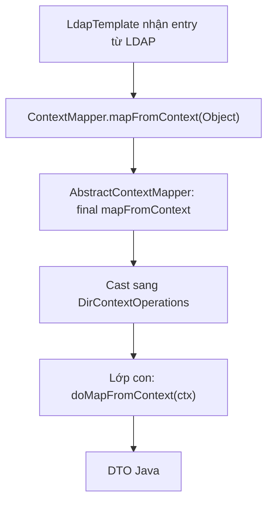
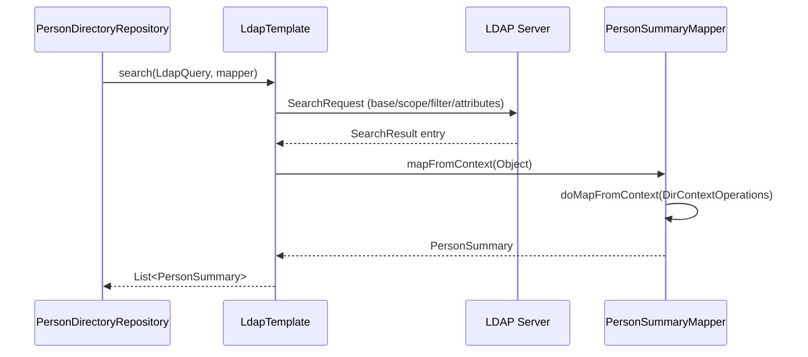

# AbstractContextMapper và template method

## Mục tiêu bài học

Trong **SPRING_LDAP**, một truy vấn `LdapTemplate.search(...)` có thể trả về hàng chục entry LDAP, nhưng ứng dụng Java thường chỉ cần một danh sách DTO như `PersonSummary`. Vấn đề không đơn giản là lấy `cn` hay `mail`: DTO còn có thể cần **DN**, thuộc tính **đa trị**, chính sách xử lý trường thiếu và quy tắc mapping thống nhất giữa `search` và `lookup`.

**`AbstractContextMapper<T>`** trong Spring LDAP là một lớp cơ sở giúp viết mapper từ LDAP context sang đối tượng Java. Nó minh họa một ứng dụng cụ thể của mẫu thiết kế **Template Method**: lớp cha cố định phần chung, lớp con định nghĩa bước biến đổi dữ liệu riêng.

Bài thuộc chương **Mapping kết quả**. Dựa trên phần kiến thức DN, schema, filter và truy vấn bằng `LdapTemplate`, người học sẽ triển khai một mapper có thể tái sử dụng, hiểu vai trò của `ContextSource`, đồng thời tránh những lỗi về quyền đọc, TLS, giá trị thiếu, đa trị và vòng đời context. Các nguyên tắc này cũng hữu ích khi chọn `LdapClient` hoặc LDAP ODM.

Sau bài học, bạn có thể:

1. So sánh `AttributesMapper<T>`, `ContextMapper<T>` và `AbstractContextMapper<T>`.
2. Giải thích đúng vai trò của `final mapFromContext(Object)` và `protected doMapFromContext(DirContextOperations)` trong mẫu Template Method.
3. Map DN, thuộc tính chuỗi, thuộc tính tùy chọn và nhiều giá trị bằng `DirContextOperations`.
4. Dùng cùng một mapper cho `LdapTemplate.search` và `LdapTemplate.lookup`.
5. Xác định khi nào một mapper có thể thất bại vì `DirObjectFactory` tùy chỉnh hoặc dữ liệu không đúng schema/ACL.
6. Viết unit test với `DirContextAdapter` và integration test với LDAP server thử nghiệm.

## 1. Bài toán: từ LDAP entry thành DTO của ứng dụng

Giả sử directory server thử nghiệm có cây:

```text
dc=example,dc=org
├── ou=People
│   ├── uid=lan
│   └── uid=mai
└── ou=Groups
    └── cn=Developers
```

Một entry người dùng có dữ liệu:

```ldif
dn: uid=lan,ou=People,dc=example,dc=org
objectClass: inetOrgPerson
uid: lan
cn: Lan Nguyen
sn: Nguyen
mail: lan@example.org
telephoneNumber: +84 28 5555 0101
telephoneNumber: +84 28 5555 0199
```

Đây là dữ liệu minh họa. Tên và giá trị attribute cần được kiểm tra theo schema, giới hạn và chính sách quyền của directory server đang sử dụng.

Ứng dụng cần trả một DTO:

```java
import java.util.List;

record PersonSummary(
        String relativeDn,
        String uid,
        String displayName,
        String email,
        List<String> phoneNumbers
) {}
```

Chúng ta muốn:

- `relativeDn` lưu DN **tương đối so với base của `ContextSource`**, để có thể tham chiếu entry khi cần.
- `uid` và `displayName` là dữ liệu **bắt buộc đối với hợp đồng DTO**; nếu không đọc được, mapper cần báo dữ liệu không đạt yêu cầu.
- `email` có thể thiếu: DTO dùng `null` hoặc thiết kế một kiểu tùy chọn tùy hợp đồng API.
- `phoneNumbers` phải lưu **toàn bộ các số** được phép đọc, không chỉ một giá trị đầu tiên.
- Mapper không tự kết nối LDAP và không nắm giữ context sau khi thao tác đã kết thúc.

Tách nhiệm vụ theo tầng:

| Tầng | Trách nhiệm |
| --- | --- |
| `ContextSource` | Cấp LDAP context theo URL, base DN, danh tính và cấu hình |
| `LdapTemplate` | Thực hiện `search`/`lookup`, điều phối kết quả và tài nguyên |
| Query/filter | Xác định base DN, scope, entry khớp và attribute cần trả |
| `AbstractContextMapper` | Chuyển **một entry context** thành **một DTO** |
| Service nghiệp vụ | Quy định trường bắt buộc, 0/1/nhiều kết quả, quyền và phản hồi lỗi |

**Mapper không thay thế LDAP filter.** Nếu tìm kiếm trả 10.000 entry rồi mapper chỉ chọn hai thuộc tính, dữ liệu dư vẫn có thể đã đi qua mạng. Để giảm payload, cần đặt `attributes(...)` trong chính yêu cầu tìm kiếm.

## 2. Vì sao có nhiều loại mapper trong Spring LDAP?

Spring LDAP hỗ trợ các cách chuyển kết quả khác nhau:

| Cách mapping | Đầu vào | Phù hợp khi |
| --- | --- | --- |
| `AttributesMapper<T>` | `javax.naming.directory.Attributes` | Chỉ cần những attribute trả về, không cần DN/context |
| `ContextMapper<T>` | `Object` từ object factory của context | Cần DN và tiện ích của `DirContextOperations` |
| `AbstractContextMapper<T>` | Lớp cha nhận `Object`, lớp con nhận `DirContextOperations` | Muốn tái sử dụng mapper từ context và tránh tự cast ở từng mapper |
| LDAP ODM | Entry được ánh xạ sang class bằng metadata/annotation | Có mô hình domain ổn định và muốn Spring quản lý mapping cấp cao |

Trong kiểu triển khai Spring LDAP thông dụng, `DefaultDirObjectFactory` chuyển kết quả `search`/`lookup` thành `DirContextAdapter`, một triển khai của `DirContextOperations`. Vì vậy mapper dựa trên context có thể gọi:

```java
ctx.getDn();
ctx.getStringAttribute("cn");
ctx.getStringAttributes("telephoneNumber");
ctx.getObjectAttribute("jpegPhoto");
```

Lời gọi `getObjectAttribute("jpegPhoto")` chỉ minh họa API với dữ liệu có thể là nhị phân; không được tùy tiện cast thành `String` hoặc ghi nội dung nhạy cảm vào log.

### 2.1. Đơn giản nhất: AttributesMapper

Khi DTO chỉ cần tên và email, có thể ánh xạ trực tiếp từ `Attributes`:

```java
import javax.naming.directory.Attribute;
import javax.naming.directory.Attributes;
import org.springframework.ldap.core.AttributesMapper;

AttributesMapper<String> mapper = attrs -> {
    Attribute cn = attrs.get("cn");
    return cn == null ? null : (String) cn.get();
};
```

Ví dụ này cố tình ngắn. Trong code dùng thật, cần kiểm tra `cn.size()`, kiểu dữ liệu và cách xử lý trường thiếu. Quan trọng hơn, `AttributesMapper` chỉ nhận tập attribute, không có API tiện lợi để lấy DN gốc của entry từ một thuộc tính phổ quát.

### 2.2. ContextMapper: tự cast từ Object

Nếu cần DN, có thể dùng `ContextMapper`:

```java
import org.springframework.ldap.core.ContextMapper;
import org.springframework.ldap.core.DirContextOperations;

ContextMapper<String> mapper = raw -> {
    DirContextOperations ctx = (DirContextOperations) raw;
    return ctx.getDn().toString();
};
```

Điều này hoạt động khi `raw` thực sự là `DirContextOperations`. Với nhiều mapper, lặp lại thao tác cast vừa dài dòng vừa có nguy cơ không nhất quán.

**`AbstractContextMapper<T>` giải quyết chính điểm lặp này.** Lớp cơ sở thực hiện cast một lần trong một method cố định, lớp con tập trung vào dữ liệu ứng dụng.

## 3. Mẫu Template Method trong AbstractContextMapper

Theo Javadoc của Spring LDAP, lớp:

```java
org.springframework.ldap.core.support.AbstractContextMapper<T>
```

là lớp trừu tượng triển khai `ContextMapper<T>`. Nó có hai điểm quan trọng:

| Method | Đặc điểm | Ai thực hiện? |
| --- | --- | --- |
| `final T mapFromContext(Object ctx)` | Được cố định ở lớp cha; nhận context như `Object`, chuyển sang `DirContextOperations` | `AbstractContextMapper` |
| `protected abstract T doMapFromContext(DirContextOperations ctx)` | Bước biến đổi từ context đã có kiểu sang DTO | Lớp con do ứng dụng viết |

Về **ý tưởng**, cấu trúc gần giống mã sau (minh họa, **không phải** bản sao nguồn Spring):

```java
abstract class ExampleAbstractMapper<T> {
    public final T mapFromContext(Object ctx) {
        return doMapFromContext((DirContextOperations) ctx);
    }

    protected abstract T doMapFromContext(DirContextOperations ctx);
}
```



Đây chính là ý tưởng **Template Method**:

1. Lớp cha quyết định **khung thuật toán** và đoạn nào không được sửa.
2. Lớp con cung cấp **một bước chuyên biệt** để xây DTO.
3. Tầng gọi bên ngoài dùng hợp đồng chung `ContextMapper<T>` mà không cần biết mapper cụ thể.

Phần **cố định** trong `AbstractContextMapper` khá nhỏ: chủ yếu là **cast đối tượng và gọi hook**. Đừng hiểu lầm rằng lớp này tự xử lý kết nối, phân trang, TLS, schema hoặc cache. Những phần đó thuộc `LdapTemplate`, `ContextSource`, server và thiết kế ứng dụng.

### 3.1. Hai chữ “template” không hoàn toàn đồng nghĩa

Chúng ta đang dùng hai cơ chế tái sử dụng khác nhau:

- **`LdapTemplate`:** *template/callback* cho thao tác LDAP; điều phối context, duyệt và đóng tài nguyên, chuyển đổi ngoại lệ trong quá trình gọi.
- **`AbstractContextMapper`:** *Template Method* cấp class; `mapFromContext()` cố định cách gọi và lớp con override `doMapFromContext()`.

Hai cơ chế phối hợp nhưng không làm cùng một việc. `AbstractContextMapper` **không phải một `LdapTemplate` rút gọn**, và `doMapFromContext()` không phải hook để đổi filter hay cấu hình kết nối.

### 3.2. Hạn chế quan trọng: DirObjectFactory tùy chỉnh

Theo Javadoc chính thức, `AbstractContextMapper.mapFromContext(Object)` cast đối tượng sang `DirContextOperations`. Khi dùng `DefaultDirObjectFactory` của Spring LDAP, giả định này thông thường được đáp ứng qua `DirContextAdapter`.

Nếu dự án cấu hình **`DirObjectFactory` tùy chỉnh** và factory trả một object **không triển khai `DirContextOperations`**, phép cast sẽ gây **`ClassCastException`**. Đây là hạn chế của lớp trừu tượng, không phải dấu hiệu rằng LDAP server trả filter sai.

Nếu cần factory tùy chỉnh, hãy kiểm tra object thật được tạo ra và cân nhắc viết `ContextMapper<T>` phù hợp với kiểu ấy hoặc thay thiết kế factory. Không bắt mọi `ClassCastException` rồi âm thầm bỏ qua entry.

## 4. Cài đặt PersonSummaryMapper bằng AbstractContextMapper

Một mapper tái sử dụng có thể được viết như sau. Ví dụ dùng Java 17 với `record`, phù hợp với nhiều ứng dụng Spring Boot hiện đại; dự án Java cũ hơn có thể thay record bằng POJO.

```java
import java.util.Arrays;
import java.util.List;
import org.springframework.ldap.core.DirContextOperations;
import org.springframework.ldap.core.support.AbstractContextMapper;

record PersonSummary(
        String relativeDn,
        String uid,
        String displayName,
        String email,
        List<String> phoneNumbers
) {}

final class PersonSummaryMapper
        extends AbstractContextMapper<PersonSummary> {

    @Override
    protected PersonSummary doMapFromContext(DirContextOperations ctx) {
        String uid = requiredText(ctx, "uid");
        String displayName = requiredText(ctx, "cn");

        // Email có thể vắng mặt hoặc không được tài khoản bind đọc.
        String email = ctx.getStringAttribute("mail");

        // telephoneNumber có thể có nhiều giá trị.
        String[] phones = ctx.getStringAttributes("telephoneNumber");
        List<String> phoneNumbers = phones == null
                ? List.of()
                : List.copyOf(Arrays.asList(phones));

        return new PersonSummary(
                ctx.getDn().toString(),
                uid,
                displayName,
                email,
                phoneNumbers
        );
    }

    private static String requiredText(
            DirContextOperations ctx, String attribute) {
        String value = ctx.getStringAttribute(attribute);
        if (value == null || value.isBlank()) {
            throw new IllegalStateException(
                    "Required LDAP attribute missing: " + attribute);
        }
        return value;
    }
}
```

Phân tích từng bước:

1. `extends AbstractContextMapper<PersonSummary>` xác định kiểu kết quả `T` là `PersonSummary`.
2. Lớp con **chỉ override** `protected doMapFromContext(DirContextOperations ctx)`. Không cần và cũng không thể override `final mapFromContext(Object)`.
3. `requiredText()` tạo chính sách rõ ràng cho các trường mà ứng dụng đòi hỏi. Nếu server không trả chúng, mapper **không tạo DTO thiếu dữ liệu một cách im lặng**.
4. `getStringAttribute("mail")` trả một giá trị chuỗi phù hợp với mapping đang mong đợi. Đối với thuộc tính đa trị, không nên tùy tiện coi giá trị đó đại diện cho toàn bộ tập.
5. `getStringAttributes("telephoneNumber")` lấy các giá trị chuỗi của thuộc tính. Nếu thuộc tính không được trả về, ví dụ trên chuyển `null` thành danh sách rỗng.
6. `List.copyOf(...)` tạo danh sách không cho sửa qua DTO; tránh giữ mảng có thể bị thay đổi bởi code khác.
7. `ctx.getDn()` lấy **DN tương đối so với base path của `ContextSource`** theo hợp đồng Spring LDAP. Không mặc định nó là DN đầy đủ trong toàn bộ directory.

**Giới hạn của ví dụ:** Nếu `telephoneNumber` chứa dữ liệu không phải chuỗi hoặc bị ẩn bởi ACL, phải xử lý đúng schema và chính sách ứng dụng. Việc không thấy `mail` không cho phép suy chắc entry không có email; có thể request không hỏi hoặc account không được quyền đọc.

### 4.1. Kiểu DTO có thể thay đổi theo yêu cầu

Ví dụ đang dùng `String relativeDn` để dễ trả kết quả. Nếu service phía sau còn cần thao tác LDAP trên cùng entry, dùng `javax.naming.Name` trong model nội bộ có thể tránh chuyển đổi chuỗi nhiều lần. Tuy vậy, phải quy định rõ DN được tính **so với base nào** và tránh để callers tự nối nhiều hậu tố.

Đối với API công khai, không nhất thiết cần lộ DN đầy đủ hoặc thậm chí DN tương đối. Có thể giữ DN trong model nội bộ và chỉ trả `uid` hoặc một định danh sản phẩm phù hợp ở response, tránh lộ cấu trúc tổ chức không cần thiết.

### 4.2. Vì sao nên giữ mapper gần như stateless?

Một `PersonSummaryMapper` không giữ `LdapContext`, không dùng một field danh sách để tích lũy kết quả và không lưu `DirContextOperations` vào DTO. Mỗi lần gọi chỉ:

```text
Một DirContextOperations đầu vào
    → đọc attribute/DN được phép
    → tạo một PersonSummary độc lập
    → trả kết quả
```

Nhờ vậy có thể tái sử dụng **một instance mapper** cho nhiều lời gọi search mà không làm kết quả của request này trộn với request khác. Khi muốn tính số entry, phát hiện entry trùng hay chuẩn hóa danh sách, thường nên xử lý ở **service** sau khi search, không lưu trạng thái đếm hoặc các DTO trước đó trong mapper.

## 5. Dùng cùng mapper với LdapTemplate.search

Giả sử cấu hình Spring Boot đã có Spring LDAP và dùng account dịch vụ được cấp quyền đọc:

```properties
spring.ldap.urls=ldaps://ldap.example.org:636
spring.ldap.base=dc=example,dc=org
spring.ldap.username=cn=svc-reader,ou=Services,dc=example,dc=org
spring.ldap.password=${LDAP_BIND_PASSWORD}
```

Đây là cấu hình minh họa; một LDAP server thử nghiệm cần có chứng chỉ phù hợp và JVM phải tin cậy máy chủ. Không đưa mật khẩu thật vào `application.properties` hoặc log. Account dịch vụ không nên có quyền ghi nếu chỉ phục vụ search.

Repository có thể nhận `LdapTemplate` và mapper qua dependency injection, hoặc dùng một mapper stateless tạo tại lớp:

```java
import static org.springframework.ldap.query.LdapQueryBuilder.query;

import java.util.List;
import org.springframework.ldap.core.LdapTemplate;
import org.springframework.ldap.query.LdapQuery;
import org.springframework.ldap.query.SearchScope;

final class PersonDirectoryRepository {
    private final LdapTemplate ldapTemplate;
    private final PersonSummaryMapper mapper = new PersonSummaryMapper();

    PersonDirectoryRepository(LdapTemplate ldapTemplate) {
        this.ldapTemplate = ldapTemplate;
    }

    List<PersonSummary> findByUid(String uid) {
        if (uid == null || uid.isBlank()) {
            throw new IllegalArgumentException("uid is required");
        }

        LdapQuery request = query()
                .base("ou=People")
                .searchScope(SearchScope.SUBTREE)
                .attributes(
                        "uid", "cn", "mail", "telephoneNumber")
                .where("objectClass").is("inetOrgPerson")
                .and("uid").is(uid);

        return ldapTemplate.search(request, mapper);
    }
}
```

**Luồng thực thi:**



Điểm cần nắm:

- `search` có thể trả **0, 1 hoặc nhiều entry**; mapper không quyết định uniqueness.
- `attributes(...)` là **attribute projection tại yêu cầu LDAP**, giúp không lấy những thuộc tính không cần dùng.
- `query().where(...).is(uid)` truyền giá trị động qua filter builder, tránh ghép chuỗi filter thô.
- `searchScope(SUBTREE)` có ý nghĩa khi entry có thể nằm trong các OU con; nếu chỉ có con trực tiếp, `ONELEVEL` có thể phù hợp hơn.
- `base("ou=People")` là **DN tương đối** so với `ContextSource.base = dc=example,dc=org`, không lặp hậu tố base.

Nếu UID được kỳ vọng duy nhất nhưng LDAP search trả hai entry ở hai OU, service phải **phát hiện vi phạm hợp đồng**; không tự lấy entry đầu. Mặc định LDAP không đảm bảo mọi `uid` đều duy nhất trên tất cả nhánh tìm kiếm.

### 5.1. Query builder và mapper giải quyết hai vấn đề khác nhau

Ví dụ:

```java
var q = query()
        .base("ou=People")
        .attributes("uid", "cn")
        .where("uid").is("lan");

List<PersonSummary> rows =
        ldapTemplate.search(q, new PersonSummaryMapper());
```

Đây là **một lỗi hợp đồng mapping**: query chỉ yêu cầu `uid`, `cn`, trong khi mapper còn muốn `mail` và `telephoneNumber`. Mapper có thể trả `email=null` và `phoneNumbers=[]` mà ứng dụng lầm tưởng server không lưu hai thuộc tính đó.

Nếu DTO cần những trường ấy, phải thêm vào projection. Ngược lại, nếu màn hình thật sự chỉ cần UID/tên, hãy tạo mapper/DTO nhỏ hơn phù hợp với truy vấn, thay vì luôn tải cả hồ sơ.

**Không coi số field trong DTO là bằng chứng server đã trả ít thuộc tính.** Giảm payload yêu cầu cấu hình đúng `attributes(...)`, không chỉ bỏ field sau khi đã nhận toàn bộ entry.

## 6. Dùng AbstractContextMapper với lookup

Khi đã biết **DN chính xác** của entry, `lookup` là thao tác phù hợp hơn việc tìm lại entry bằng điều kiện. Mapper có thể dùng lại:

```java
import org.springframework.ldap.core.LdapTemplate;

PersonSummary person = ldapTemplate.lookup(
        "uid=lan,ou=People",
        new String[] {"uid", "cn", "mail", "telephoneNumber"},
        new PersonSummaryMapper()
);
```

Ví dụ dùng overload `lookup(String dn, String[] attributes, ContextMapper<T> mapper)` có trong `LdapTemplate`. `"uid=lan,ou=People"` là DN **tương đối** với `dc=example,dc=org` đã đặt trên `ContextSource`. Nếu DN có ký tự đặc biệt từ input, dùng `LdapNameBuilder` để tạo `Name` thay vì nối chuỗi.

Sự khác nhau:

| Trường hợp | API | Kết quả theo hợp đồng |
| --- | --- | --- |
| Đã biết DN và muốn đọc đúng entry | `lookup(dn, mapper)` | Một entry, hoặc lỗi/nhánh not-found |
| Chỉ biết UID có thể nằm nhiều OU | `search(query, mapper)` | Danh sách 0/1/nhiều entry |
| Muốn DN thật để xử lý tiếp | Context mapper nhận `getDn()` | Tên entry theo quy tắc base của context |
| Cần tạo/sửa/xóa entry | API ghi (`bind`, `modifyAttributes`, `rename`, `unbind`) | Không dùng mapper đọc để che giấu side effect |

**Template Method không biến search thành lookup**: mapper vẫn chỉ chuyển đổi dữ liệu, còn loại operation được service lựa chọn theo yêu cầu nghiệp vụ.

## 7. Trường thiếu, đa trị và thuộc tính không phải chuỗi

Một mapper đáng tin cậy phải hiểu **schema và quyền đọc**. Cùng một tên attribute có thể:

- Vắng mặt vì entry không lưu nó.
- Bị LDAP ACL chặn, nên tài khoản bind không được đọc.
- Không được request yêu cầu trả về trong projection.
- Có **nhiều giá trị**; lấy `getStringAttribute()` chỉ thể hiện một giá trị.
- Có cú pháp không phù hợp để ép thành `String`.

### 7.1. Trường bắt buộc và trường tùy chọn

Ví dụ mapper yêu cầu `uid` và `cn`. Nếu `uid` thiếu, `requiredText()` báo một lỗi mapping có ngữ cảnh. Cần quyết định ở service:

| Thuộc tính | Hợp đồng DTO | Khi thiếu |
| --- | --- | --- |
| `uid` | Định danh bắt buộc | Báo dữ liệu kết quả không đạt hợp đồng |
| `cn` | Tên hiển thị bắt buộc | Báo dữ liệu thiếu theo chính sách |
| `mail` | Tùy chọn | Trả `null` hoặc kiểu Optional phù hợp |
| `telephoneNumber` | Tập số điện thoại | Danh sách rỗng nếu không có giá trị đọc được |

**Đừng suy “thiếu” chỉ là lỗi dữ liệu.** Khi `cn` vốn tồn tại trên server mà client không được đọc, mapper có thể thấy nó thiếu như thể chưa có. Việc phân biệt nguyên nhân cần xem ACL, identity, schema và query; mapper không có đủ thông tin để tự kết luận.

### 7.2. Attribute có nhiều giá trị: không lặng lẽ bỏ bớt

Với nhóm:

```ldif
dn: cn=Developers,ou=Groups,dc=example,dc=org
objectClass: groupOfNames
cn: Developers
member: uid=lan,ou=People,dc=example,dc=org
member: uid=mai,ou=People,dc=example,dc=org
```

Muốn lấy toàn bộ `member`, không chỉ dùng `getStringAttribute("member")`. Ví dụ:

```java
import java.util.Arrays;
import java.util.List;
import org.springframework.ldap.core.DirContextOperations;
import org.springframework.ldap.core.support.AbstractContextMapper;

record GroupSummary(String relativeDn, List<String> members) {}

final class GroupSummaryMapper
        extends AbstractContextMapper<GroupSummary> {

    @Override
    protected GroupSummary doMapFromContext(DirContextOperations ctx) {
        String[] members = ctx.getStringAttributes("member");
        return new GroupSummary(
                ctx.getDn().toString(),
                members == null
                        ? List.of()
                        : List.copyOf(Arrays.asList(members))
        );
    }
}
```

Đây là ví dụ trên nhóm dùng schema `groupOfNames`. Các directory server khác có thể sử dụng `uniqueMember`, `memberUid`, `memberOf` hoặc cơ chế khác. Với nhóm rất lớn, server có thể áp giới hạn riêng hoặc hỗ trợ range retrieval đặc thù; đọc `member` không đồng nghĩa chắc chắn nhận được tất cả giá trị trong mọi môi trường.

### 7.3. Binary attribute

Nếu entry chứa `jpegPhoto`, nhiều directory trả dữ liệu dưới dạng `byte[]` hoặc giá trị object khác. Dùng API phù hợp:

```java
Object rawPhoto = ctx.getObjectAttribute("jpegPhoto");
if (rawPhoto instanceof byte[] bytes) {
    // Tại đây có thể kiểm tra kích thước/mimetype theo chính sách ứng dụng.
    // Không log hoặc chuyển trực tiếp dữ liệu ảnh ra response nếu chưa được phép.
}
```

Không cast `rawPhoto` thành `String` và không yêu cầu ảnh từ LDAP trong một truy vấn danh bạ chỉ cần tên/email. Attribute projection là nơi tối ưu loại dữ liệu cần truyền.

## 8. Nên viết class AbstractContextMapper hay dùng lambda?

Không phải mọi mapping đều cần một class riêng. Với một truy vấn đơn giản, có thể viết:

```java
import org.springframework.ldap.core.ContextMapper;
import org.springframework.ldap.core.DirContextOperations;

ContextMapper<String> nameMapper = raw -> {
    DirContextOperations ctx = (DirContextOperations) raw;
    return ctx.getStringAttribute("cn");
};
```

Hoặc chỉ cần một `AttributesMapper<String>` nếu không cần DN. Khi mapping gồm nhiều quy tắc, một class tái sử dụng giúp tập trung việc chuẩn hóa và kiểm thử.

| Tình huống | Lựa chọn thường phù hợp | Vì sao |
| --- | --- | --- |
| Chỉ lấy một attribute trong một truy vấn nhỏ | `AttributesMapper` lambda | Ít mã, không cần context |
| Cần DN trong một phép mapping ngắn | `ContextMapper` lambda | Có thể cast trực tiếp một lần |
| Nhiều repository cần cùng DTO, DN và chính sách thiếu trường | `AbstractContextMapper<T>` | Tái sử dụng hook typed, dễ unit test |
| Mapping entry phức tạp, schema/domain ổn định | LDAP ODM hoặc assembler phù hợp | Ánh xạ có cấu trúc theo mô hình domain |
| `DirObjectFactory` trả object tùy chỉnh, không phải `DirContextOperations` | `ContextMapper<T>` trực tiếp theo kiểu phù hợp | Tránh cast sai từ AbstractContextMapper |

### 8.1. ContextMapper khác ContextAssembler

`ContextMapper<T>` dành cho **chiều đọc**: nhận LDAP context rồi tạo đối tượng. Một số thiết kế còn cần ánh xạ theo **chiều ghi**, tức đưa dữ liệu Java vào context/attributes trước khi tạo hoặc sửa entry.

Trong Spring LDAP còn có abstraction như `ContextAssembler` và các API cập nhật của `DirContextAdapter`. Chúng giải quyết chiều ghi, không phải chức năng mặc định của `AbstractContextMapper`. Việc bạn viết `doMapFromContext()` **không tự sinh** phương thức “mapToContext” hay nghiệp vụ update tương ứng.

Nếu cần sửa một người dùng sau khi đọc DTO, phải thiết kế riêng các thao tác ghi như `modifyAttributes`/ODM update, kiểm tra ACL, schema, concurrency và DN. Không nghĩ rằng mọi thay đổi trên DTO sau khi mapping sẽ được Spring LDAP tự ghi ngược lên server.

### 8.2. Mapper không phải nơi chạy logic mạng mới

Ví dụ không nên đặt trong `doMapFromContext()`:

```java
// Không nên: mỗi người dùng lại sinh một LDAP search khác trong mapper.
String name = ctx.getStringAttribute("cn");
List<String> groups = anotherLdapService.findGroupsByUid(
        ctx.getStringAttribute("uid"));
```

Nếu một trang có 100 người dùng, cách này có thể tạo **N+1 queries** hoặc thậm chí gây vòng gọi lồng nhau. Mapper nên biến đổi dữ liệu **đã được trả về**, còn service điều phối việc lấy thêm dữ liệu theo chiến lược query riêng và có giới hạn.

## 9. Cần kiểm tra những gì khi mapper lỗi?

Một lỗi mapping không nhất thiết có nghĩa LDAP server không hoạt động. Các trường hợp cần phân biệt:

| Hiện tượng | Nguyên nhân có thể | Cách kiểm tra |
| --- | --- | --- |
| `ClassCastException` trong `mapFromContext` | Custom `DirObjectFactory` trả object không triển khai `DirContextOperations` | Kiểm tra factory trên `ContextSource` và kiểu object nhận được |
| `uid` hoặc `cn` thiếu | Projection không yêu cầu, entry thiếu, ACL chặn | Xem query, schema, quyền của bind account |
| `getDn()` không khớp DN đầy đủ mong đợi | DN trả tương đối với base của context | Xác định base `ContextSource` và quy tắc dùng `Name` |
| Danh sách điện thoại bị mất số | Dùng getter một giá trị hoặc chỉ lấy phần tử đầu | Dùng `getStringAttributes` và test với đa trị |
| Mapper trả null dù search có entry | Code tự trả null hoặc một trường vắng mặt | Xem hợp đồng mapper và dữ liệu kết quả |
| Kiểu attribute không phải chuỗi | Schema định nghĩa giá trị object/binary | Xem `getObjectAttribute(s)` và thiết kế DTO phù hợp |
| `IllegalStateException` do trường bắt buộc thiếu | Quy tắc `requiredText` trong ứng dụng | Phân biệt vi phạm hợp đồng mapping với lỗi kết nối |
| Dữ liệu không khớp sau đổi DN | Mapper/ứng dụng dùng DN hardcoded hoặc lưu DN tương đối sai | Kiểm tra rename, tham chiếu, scope và base |
| Kết quả bị lẫn giữa các request | Mapper lưu mutable state hoặc cache sai | Làm mapper stateless, không giữ context ngoài callback |

### 9.1. Không che lỗi bằng danh sách rỗng

Code sau làm mất sự khác nhau giữa “không có entry” và “LDAP không thể đọc”:

```java
// Sai về ngữ nghĩa:
try {
    return repository.findByUid(uid);
} catch (Exception ignored) {
    return List.of();
}
```

Một search thành công với **0 entry** nên trả danh sách rỗng theo hợp đồng. Nhưng không kết nối được, thiếu quyền, TLS lỗi, vượt giới hạn hoặc mapper gặp trường bắt buộc thiếu là những trạng thái **khác**. Spring LDAP thường chuyển ngoại lệ JNDI thành exception runtime tương ứng; application service cần phân loại và thông báo/giám sát phù hợp.

### 9.2. Giữ ngữ cảnh lỗi mà không làm lộ dữ liệu

Nếu mapper từ chối entry vì thiếu `uid`, có thể ghi **tên attribute và loại operation** trong log nội bộ, nhưng không nhất thiết ghi toàn bộ `Attributes` hoặc nội dung hồ sơ.

Một số giá trị có thể là dữ liệu cá nhân/nhạy cảm, và log không nên trở thành một bản sao không kiểm soát của directory. Đặc biệt, không log `userPassword` hoặc dữ liệu xác thực trong bất kỳ quá trình mapping nào.

## 10. Kiểm thử mapper mà không cần kết nối LDAP

Vì `AbstractContextMapper` chỉ chuyển context sang DTO, có thể kiểm thử trực tiếp bằng `DirContextAdapter` tự tạo. Đây là lợi ích lớn của việc tách mapping khỏi repository và logic kết nối.

### 10.1. Tạo context giả từ Attributes

Javadoc Spring LDAP cho phép tạo `DirContextAdapter(Attributes attrs, Name dn)`. Unit test có thể dùng `BasicAttributes`, `BasicAttribute` và `LdapName`:

```java
import static org.junit.jupiter.api.Assertions.*;

import java.util.Set;
import javax.naming.directory.BasicAttribute;
import javax.naming.directory.BasicAttributes;
import javax.naming.ldap.LdapName;
import org.junit.jupiter.api.Test;
import org.springframework.ldap.core.DirContextAdapter;

class PersonSummaryMapperTest {
    private final PersonSummaryMapper mapper = new PersonSummaryMapper();

    @Test
    void mapsDnRequiredFieldsAndAllPhoneNumbers() throws Exception {
        BasicAttributes attrs = new BasicAttributes(true);
        attrs.put("uid", "lan");
        attrs.put("cn", "Lan Nguyen");
        attrs.put("mail", "lan@example.org");

        BasicAttribute phones = new BasicAttribute("telephoneNumber");
        phones.add("+84 28 5555 0101");
        phones.add("+84 28 5555 0199");
        attrs.put(phones);

        DirContextAdapter entry = new DirContextAdapter(
                attrs, new LdapName("uid=lan,ou=People"));

        PersonSummary result = mapper.mapFromContext(entry);

        assertEquals("uid=lan,ou=People", result.relativeDn());
        assertEquals("lan", result.uid());
        assertEquals("Lan Nguyen", result.displayName());
        assertEquals("lan@example.org", result.email());
        assertEquals(
                Set.of("+84 28 5555 0101", "+84 28 5555 0199"),
                Set.copyOf(result.phoneNumbers()));
    }

    @Test
    void missingOptionalAttributesHaveDefinedRepresentation()
            throws Exception {
        BasicAttributes attrs = new BasicAttributes(true);
        attrs.put("uid", "lan");
        attrs.put("cn", "Lan Nguyen");

        DirContextAdapter entry = new DirContextAdapter(
                attrs, new LdapName("uid=lan,ou=People"));
        PersonSummary result = mapper.mapFromContext(entry);

        assertNull(result.email());
        assertTrue(result.phoneNumbers().isEmpty());
    }

    @Test
    void missingRequiredAttributeFailsExplicitly() throws Exception {
        BasicAttributes attrs = new BasicAttributes(true);
        attrs.put("cn", "Lan Nguyen");

        DirContextAdapter entry = new DirContextAdapter(
                attrs, new LdapName("uid=lan,ou=People"));

        assertThrows(IllegalStateException.class,
                () -> mapper.mapFromContext(entry));
    }

    @Test
    void incompatibleFactoryResultCannotBeMapped() {
        assertThrows(ClassCastException.class,
                () -> mapper.mapFromContext(new Object()));
    }
}
```

Các test này kiểm tra:

- Có trả DN theo đúng dữ liệu context đã cung cấp không.
- Attribute bắt buộc/tùy chọn được xử lý theo hợp đồng hay không.
- Thuộc tính đa trị được đọc **đầy đủ** (test so tập giá trị, không giả định thứ tự trả về).
- `mapFromContext(Object)` của lớp cha không thể làm việc với object tùy ý không triển khai `DirContextOperations`.

Test cuối xác nhận **giới hạn kiểu đầu vào**; nó không có nghĩa trong môi trường mặc định mọi search sẽ có lỗi cast. Khi `DefaultDirObjectFactory` hoạt động theo cấu hình thông dụng, mapper nhận đối tượng tương thích.

### 10.2. Cần test riêng logic field bắt buộc

Ví dụ chỉ kiểm tra `new PersonSummaryMapper().mapFromContext(...)` với một entry đầy đủ vẫn chưa bắt được các lỗi:

1. Trường `cn` có trong schema nhưng **không được trả vì ACL**.
2. Query quên yêu cầu `uid` ở phần `attributes(...)`.
3. Trường `telephoneNumber` có nhiều giá trị.
4. `mail` là null và response không được lộ thông tin nguyên nhân nếu không được phép.
5. `getDn()` trả tên tương đối, trong khi code phía sau nhầm là tên đầy đủ.

Không phải mọi tình huống đều mô phỏng được trong unit test. Đặc biệt **ACL, phạm vi DIT, TLS và server-specific behavior** cần integration test.

## 11. Kiểm thử tích hợp với LDAP server thử nghiệm

Chuẩn bị một LDAP server dành riêng cho học tập, fixture LDIF và account chỉ đọc. Không dùng directory sản xuất để thử những thay đổi có thể ảnh hưởng dữ liệu người thật.

### 11.1. Ma trận kiểm thử

| Mã ca | Tình huống | Kết quả cần xác minh |
| --- | --- | --- |
| **MAP-01** | Search một entry có `uid`, `cn`, `mail` | DTO trả đúng giá trị |
| **MAP-02** | Mapper nhận entry thuộc OU con | `getDn()` thể hiện tên tương đối đúng theo context |
| **MAP-03** | Lookup cùng DN và search cùng entry | Cùng mapper trả kết quả phù hợp |
| **MAP-04** | Entry thiếu `mail` | DTO có giá trị tùy chọn theo hợp đồng |
| **MAP-05** | Entry có hai `telephoneNumber` | Mapper không bỏ mất số thứ hai |
| **MAP-06** | Query bỏ `uid` khỏi projection | Mapper báo thiếu trường bắt buộc, không tự suy server xóa UID |
| **MAP-07** | Account thiếu quyền đọc `cn` | Hành vi mapping và báo lỗi phù hợp chính sách |
| **MAP-08** | Search filter có giá trị `*` literal | Không biến thành wildcard ngoài ý định |
| **MAP-09** | Truy vấn có 0 hoặc nhiều entry | Service xử lý đúng không có/không duy nhất |
| **MAP-10** | Custom `DirObjectFactory` trả object khác kiểu | Phát hiện không tương thích `AbstractContextMapper` |
| **MAP-11** | Search vượt time/size limit | Không coi kết quả bị cắt là đầy đủ |
| **MAP-12** | LDAPS certificate không tin cậy | Kết nối thất bại, không bỏ xác thực chứng chỉ |
| **MAP-13** | Bind credential không hợp lệ | Lỗi xác thực, không biến thành DTO rỗng |
| **MAP-14** | LDAP server bị ngắt hoặc timeout | Lỗi hạ tầng được phân biệt với không tìm thấy |
| **MAP-15** | Attribute nhạy cảm không nằm trong projection | Không tải/log thuộc tính đó qua đường search thông thường |

Các ca MAP-06/MAP-07 phải được thực hiện trên test server có schema và ACL kiểm soát được. **Không thay đổi quyền production để thử một mapper.**

### 11.2. Kiểm chứng search từ công cụ độc lập

Một lệnh `ldapsearch` trong môi trường thử nghiệm:

```bash
ldapsearch -LLL -x \
  -H ldaps://ldap.example.org:636 \
  -D "cn=svc-reader,ou=Services,dc=example,dc=org" \
  -W \
  -b "ou=People,dc=example,dc=org" \
  -s sub "(&(objectClass=inetOrgPerson)(uid=lan))" \
  uid cn mail telephoneNumber
```

`-W` nhập mật khẩu qua prompt, không đưa password ngay trên command line. Hãy đối chiếu số entry, tập thuộc tính thực nhận và giá trị với DTO được tạo từ Spring LDAP. Nội dung trả về phụ thuộc quyền account, dữ liệu và server; lệnh không tự chứng minh ACL/TLS đều đã đúng nếu không kiểm tra kết nối và chứng chỉ.

### 11.3. Kiểm tra mapper với LdapClient và ODM

Ở các phiên bản hỗ trợ `LdapClient`, API fluent cũng có khả năng mapping dữ liệu entry theo kiểu mapper phù hợp. Khi chuyển từ `LdapTemplate` sang `LdapClient`, cần xác minh:

- API mapping nhận `AttributesMapper` hay `ContextMapper`, và đầu vào thực tế do factory tạo.
- Projection có yêu cầu đủ field mà mapper dùng không.
- DN được biểu diễn tương đối hay tuyệt đối theo context.
- Cách xử lý không có kết quả, kết quả nhiều, ngoại lệ và giới hạn.

Với **LDAP ODM**, framework sử dụng metadata/annotation để ánh xạ entry thành object. Đây là một lựa chọn hợp lý khi domain nhiều trường và ổn định, nhưng không nên trộn ODM và `AbstractContextMapper` trong một đường xử lý mà không xác định rõ ai chịu trách nhiệm mapping, chọn attribute và kiểm tra dữ liệu.

## 12. Bảo mật và hiệu năng khi ánh xạ kết quả

Một `AbstractContextMapper` tốt giúp dữ liệu Java có cấu trúc rõ, nhưng bản thân nó **không tạo ra ranh giới bảo mật** và cũng không thay thế tối ưu hóa truy vấn. Cần kết hợp các biện pháp ở các tầng khác nhau:

| Biện pháp | Được thực hiện ở đâu? | Tác dụng |
| --- | --- | --- |
| LDAP **ACL** | Directory server | Giới hạn entry/attribute mà identity được đọc |
| Quyền ứng dụng | Service/API | Quyết định caller được xem hoặc cập nhật hồ sơ nào |
| Base DN và scope | SearchRequest/`LdapQuery` | Giới hạn vùng DIT |
| LDAP filter | SearchRequest/`LdapQueryBuilder` | Chọn entry trước khi truyền |
| Attribute projection | `attributes(...)` hoặc `SearchControls` | Giảm loại dữ liệu trên mỗi entry |
| Mapping DTO | `AbstractContextMapper` | Chuyển dữ liệu được trả về thành kiểu Java thích hợp |
| TLS | Kết nối LDAP | Bảo vệ kênh truyền và xác minh server |
| Count/time limit, paging | Client và server | Kiểm soát quy mô truy vấn |
| Connect/read timeout và pooling | `ContextSource`/provider/hạ tầng | Kiểm soát kết nối và khả năng vận hành |

### 12.1. Mapper không làm dữ liệu biến mất khỏi đường truyền

Giả sử code tạo DTO chỉ chứa `uid` và `cn`, nhưng LDAP search vẫn yêu cầu mọi attribute:

```text
LDAP server
  -> trả cả hồ sơ (có thể gồm jpegPhoto, telephoneNumber, attribute khác)
  -> ContextMapper đọc uid, cn
  -> DTO chỉ có uid, cn
```

Điều này chỉ giảm dữ liệu **sau bước mapping**. Để hạn chế dữ liệu trên mạng và những thành phần nhận trước mapper, phải yêu cầu `uid`, `cn` ngay trong SearchRequest.

Nếu thông tin đã được server trả về nhưng mapper không sử dụng, vẫn cần xem **logging, telemetry và memory** của các tầng xử lý trước mapping. Không xem DTO gọn là biện pháp bảo vệ đủ cho dữ liệu nhạy cảm.

### 12.2. Context không phải DTO có vòng đời độc lập

`DirContextOperations` là abstraction gắn với kết quả LDAP và có các method đọc/sửa attribute. Khi `LdapTemplate` hoàn tất một search, không nên giữ và trả nguyên context để các tầng khác tiếp tục dùng như một đối tượng kết nối sống.

Mapper nên tạo **giá trị độc lập**: chuỗi, collection bất biến, kiểu dữ liệu miền nghiệp vụ phù hợp. Nếu cần lưu DN, có thể sao chép biểu diễn cần dùng theo hợp đồng. Không lưu object chứa tài nguyên/context trong singleton hoặc cache một cách vô thức.

### 12.3. Filter injection và DN escaping

Query builder và mapper giải quyết **hai vấn đề khác nhau**:

```java
// Không an toàn: input có thể mang cú pháp LDAP filter.
String filter = "(uid=" + rawUid + ")";
```

```java
// An toàn hơn: giá trị được builder biểu diễn đúng ngữ cảnh.
var q = query()
        .base("ou=People")
        .where("uid").is(rawUid);
```

Nếu cần tạo DN/RDN từ một giá trị, dùng `LdapNameBuilder` thay vì nối `"uid=" + rawUid + ",ou=People"`. Escaping filter theo **RFC 4515** khác escaping DN theo **RFC 4514**. Việc mapper dùng `getDn()` không sửa được một filter đã bị injection ở bước search.

### 12.4. TLS và danh tính bind

Kết nối tới directory server nên dùng **LDAPS hoặc StartTLS** với xác minh chứng chỉ và hostname, đặc biệt khi truyền credential hoặc dữ liệu không công khai. Account dịch vụ cần **quyền tối thiểu**, thường chỉ đọc nhánh và thuộc tính mà chức năng cần. Tránh bật pooling không kiểm soát khi có các context dùng danh tính khác nhau hoặc StartTLS, vì có thể tạo nhầm lẫn quyền/vòng đời kết nối.

**Search có kết quả không phải bằng chứng đăng nhập thành công.** Xác thực người dùng cần luồng authentication riêng (LDAP bind có credential hợp lệ hoặc SSO). Đặc biệt, không coi simple bind với password rỗng là cách xác minh người dùng: một số server có cơ chế *unauthenticated simple bind* cho trạng thái ẩn danh.

## 13. Các lỗi thường gặp với AbstractContextMapper

| Sai lầm | Vì sao sai | Cách làm đúng |
| --- | --- | --- |
| Override `mapFromContext(Object)` | Method này là **`final`** trong `AbstractContextMapper` | Override `doMapFromContext(DirContextOperations)` |
| Tự cast `Object` trong mọi mapper con | Bỏ qua lợi ích của lớp trừu tượng | Dùng tham số `DirContextOperations` đã được typed |
| Dùng AbstractContextMapper với custom factory không tương thích | Lớp cha cast sang `DirContextOperations` và có thể ném `ClassCastException` | Kiểm tra `DirObjectFactory` và interface mapper phù hợp |
| Coi `ctx.getDn()` là DN tuyệt đối | Theo API, nó trả DN tương đối với base path | Ghi rõ base và hợp đồng định danh |
| Dùng `getStringAttribute` để đọc toàn bộ `member` | Chỉ lấy một giá trị | Dùng `getStringAttributes` hoặc API đa trị phù hợp |
| Đọc `jpegPhoto` bằng String getter | Thuộc tính có thể nhị phân | Sử dụng object/binary mapping có kiểm soát |
| Mapper yêu cầu `mail` nhưng query không trả | Projection không đủ trường | Đồng bộ query và hợp đồng DTO |
| Coi trường thiếu là entry không tồn tại | Có thể do ACL hoặc không yêu cầu attribute | Phân biệt schema, projection và quyền |
| Để mapper chạy một search khác cho từng entry | Dễ tạo N+1 queries, khó kiểm soát thời gian | Tách điều phối truy vấn sang service |
| Mapper lưu danh sách mutable trong singleton | Dễ lẫn dữ liệu giữa request | Stateless, trả object/list độc lập |
| Đổi DTO rồi nghĩ server đã được sửa | Mapping chiều đọc không tự ghi | Thiết kế API ghi riêng, kiểm soát ACL/concurrency |
| Bắt mọi exception rồi trả rỗng | Che lỗi LDAP và mapper | Phân loại lỗi theo hợp đồng nghiệp vụ |

## 14. Bài tập tổng hợp: một mapper, hai thao tác đọc

**Bối cảnh:** Ứng dụng Spring LDAP có `ContextSource.base=dc=example,dc=org`, các tài khoản nằm dưới `ou=People`. Trang danh bạ cần tên, email, số điện thoại và một định danh nội bộ. Một số tài khoản không có `mail`, trong khi một số tài khoản có hai số điện thoại.

**Yêu cầu thực hành:**

1. Tạo DTO `PersonSummary` với `relativeDn`, `uid`, `displayName`, `email` và danh sách `phoneNumbers`.
2. Viết `PersonSummaryMapper extends AbstractContextMapper<PersonSummary>`, chỉ override `doMapFromContext(DirContextOperations)`.
3. Định nghĩa quy tắc: `uid` và `cn` bắt buộc; `mail` tùy chọn; `telephoneNumber` có thể đa trị.
4. Dùng mapper cho `LdapTemplate.search(query, mapper)` theo UID, chỉ yêu cầu các thuộc tính DTO cần.
5. Dùng **chính mapper đó** cho `lookup(dn, attributes, mapper)` khi đã biết DN.
6. Tạo unit test từ `BasicAttributes` và `DirContextAdapter` với đủ trường, trường tùy chọn thiếu, trường bắt buộc thiếu và hai số điện thoại.
7. Kiểm tra với `DirObjectFactory` mặc định; nếu dự án có custom factory, chứng minh object nhận được phù hợp hoặc chọn mapper khác.
8. Chạy integration test trên directory thử nghiệm với account chỉ đọc, giới hạn base/scope/attributes và TLS có chứng chỉ hợp lệ.
9. Ghi rõ sự khác nhau giữa **không có entry**, **không có attribute**, **không được đọc attribute** và **không kết nối được LDAP**.
10. So sánh `AttributesMapper` lambda với `AbstractContextMapper` class: code nào rõ ràng hơn khi cần lấy DN và áp cùng một chính sách trên nhiều repository?

**Tiêu chí nghiệm thu:**

- Mã mapper có **đúng method override**, không override `final mapFromContext`.
- DTO có tên/DN đúng theo dữ liệu được phép đọc, dữ liệu tùy chọn được xử lý an toàn.
- Không bỏ bớt các giá trị `telephoneNumber` khi entry có nhiều giá trị.
- Query yêu cầu đúng những attribute mapper dùng; filter xử lý input động bằng API phù hợp.
- Unit test bao phủ đầy đủ các trường hợp mapping, integration test xác minh đúng schema/ACL/kết nối.
- Không che lỗi directory thành dữ liệu rỗng hoặc tự trả toàn bộ context cho tầng API.

### Tự kiểm tra

**Câu 1.** Vì sao lớp con `AbstractContextMapper<T>` không implement trực tiếp `mapFromContext(Object)`?

**Trả lời:** Lớp cha đã có method `final` thực hiện cast sang `DirContextOperations` và gọi hook `doMapFromContext`. Lớp con chỉ viết logic mapping riêng.

**Câu 2.** Đây có phải mẫu Template Method không, dù phần khung ở lớp cha chỉ có một phép cast và một lời gọi?

**Trả lời:** Có. Lớp cha cố định thuật toán/điểm gọi, lớp con cài đặt bước chuyên biệt. Cần phân biệt mẫu này với cách `LdapTemplate` điều phối thao tác LDAP qua template/callback.

**Câu 3.** Khi nào nên chọn `AttributesMapper` thay cho `AbstractContextMapper`?

**Trả lời:** Khi chỉ cần attribute và không cần DN/context, một `AttributesMapper` thường đủ và gọn hơn.

**Câu 4.** Vì sao `getStringAttributes("member")` thường phù hợp hơn `getStringAttribute("member")` khi ánh xạ nhóm?

**Trả lời:** `member` thường đa trị. Lấy một giá trị có thể làm mất các thành viên khác. Còn phải kiểm tra giới hạn/range retrieval của server nếu nhóm rất lớn.

**Câu 5.** `ctx.getDn()` có nhất thiết là DN tuyệt đối như `uid=lan,ou=People,dc=example,dc=org` không?

**Trả lời:** Không. Theo API Spring LDAP, `getDn()` trả DN tương đối với base path của context. Phải hiểu base đang cấu hình và hợp đồng của code sử dụng.

**Câu 6.** Mapper có đủ để bảo đảm client không nhận các thuộc tính nhạy cảm chưa dùng không?

**Trả lời:** Không. Cần giới hạn attribute trả về ngay trong SearchRequest/`SearchControls`, đồng thời thực thi LDAP ACL và quyền ứng dụng.

**Câu 7.** Vì sao một mapper hoạt động với `DefaultDirObjectFactory` có thể lỗi khi đổi sang `DirObjectFactory` riêng?

**Trả lời:** `AbstractContextMapper` cast `Object` sang `DirContextOperations`. Nếu factory tùy chỉnh trả object không triển khai interface ấy, sẽ có `ClassCastException`.

**Câu 8.** Mapper trả `email=null` nghĩa là entry chắc chắn không có email trên server?

**Trả lời:** Không. Có thể vì entry thiếu `mail`, tài khoản bind không được đọc, hoặc query không yêu cầu attribute đó.

**Câu 9.** Sau khi sửa một field của `PersonSummary`, LDAP server có tự cập nhật không?

**Trả lời:** Không. DTO là kết quả ánh xạ chiều đọc; thao tác ghi phải được thực hiện bằng API LDAP phù hợp và có kiểm soát.

## Tổng kết

**`AbstractContextMapper<T>`** là một lớp cơ sở cho `ContextMapper<T>` của Spring LDAP, áp dụng **Template Method** bằng cách giữ cố định `mapFromContext(Object)` và để lớp con triển khai `doMapFromContext(DirContextOperations)`. Lợi ích thực tế là giảm phép cast lặp lại, gom logic mapping một entry thành code có kiểu rõ ràng và dễ tái sử dụng giữa `LdapTemplate.search` và `lookup`.

Để thiết kế bền vững, hãy sử dụng `DirContextOperations` để lấy DN và attribute đúng cách, xử lý trường thiếu/đa trị, giữ mapper stateless, đồng bộ projection với DTO và kiểm thử cả unit lẫn directory server thực tế. Lớp mapper **không tự xử lý** quyền, TLS, schema, timeout, pooling, filter hay logic nghiệp vụ; những trách nhiệm đó vẫn phải được thiết kế ở các tầng thích hợp của **SPRING_LDAP**.

### Tài liệu tham khảo

- **Spring LDAP Javadoc — AbstractContextMapper<T>**: https://docs.spring.io/spring-ldap/reference/api/java/org/springframework/ldap/core/support/AbstractContextMapper.html.
- **Spring LDAP Javadoc — ContextMapper<T>**: https://docs.spring.io/spring-ldap/reference/api/java/org/springframework/ldap/core/ContextMapper.html.
- **Spring LDAP Reference — Simplifying Attribute Access and Manipulation with DirContextAdapter**: https://docs.spring.io/spring-ldap/reference/dirobjectfactory.html.
- **Spring LDAP Javadoc — LdapTemplate**: https://docs.spring.io/spring-ldap/reference/api/java/org/springframework/ldap/core/LdapTemplate.html.
- **Spring LDAP Javadoc — DirContextAdapter và DirContextOperations**: https://docs.spring.io/spring-ldap/reference/api/java/org/springframework/ldap/core/DirContextAdapter.html.
- **Java SE JNDI API**: `javax.naming.Name`, `javax.naming.directory.Attributes`, `BasicAttributes`, `javax.naming.ldap.LdapName`.
- **RFC 4511**: Lightweight Directory Access Protocol (LDAP): The Protocol.
- **RFC 4512**: LDAP: Directory Information Models (entry, attribute và schema).
- **RFC 4514 / RFC 4515**: biểu diễn DN và LDAP search filter.
