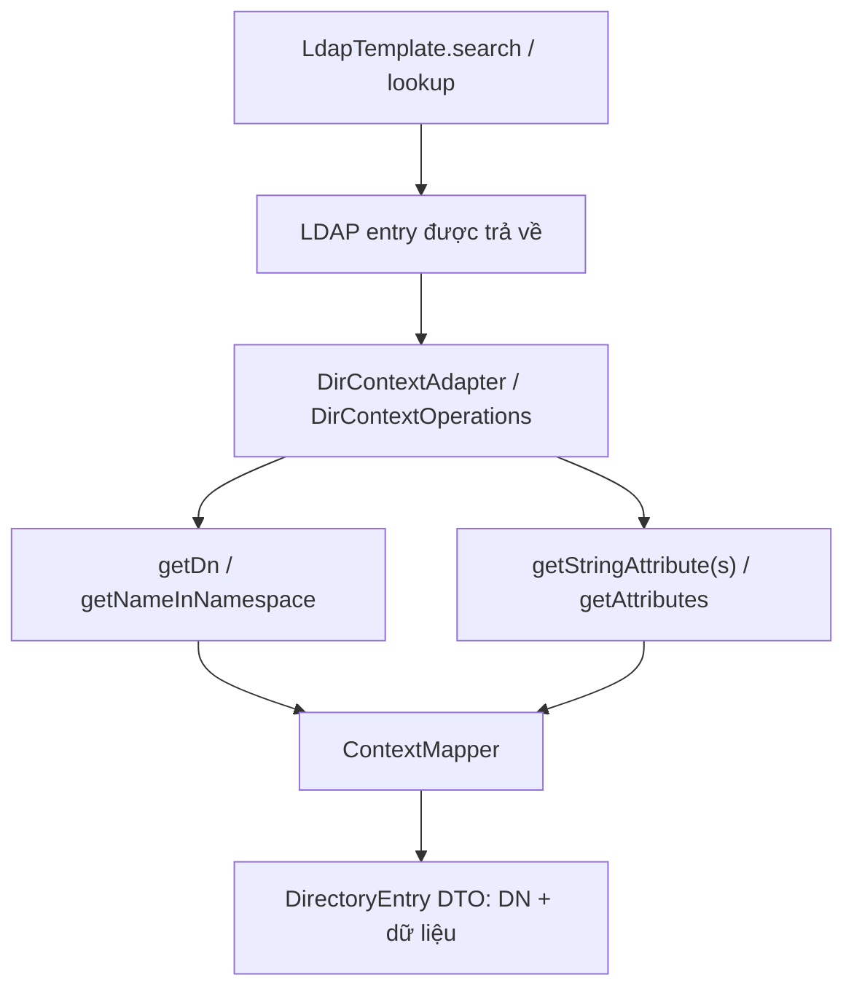

# Đọc DN cùng attribute khi mapping trong Spring LDAP

Khi tìm kiếm LDAP, nhiều ứng dụng không chỉ cần `uid`, `cn` hoặc `mail`, mà còn cần biết **entry đó nằm ở đâu trong Directory Information Tree (DIT)**. Ví dụ, màn hình quản trị phải hiển thị tên nhân viên, đồng thời lưu một DN để có thể tra cứu lại, hoặc tác vụ đồng bộ cần phân biệt hai entry có cùng `uid` nhưng nằm ở hai organizational unit (OU) khác nhau.

Trong Spring LDAP, `AttributesMapper<T>` rất phù hợp để chuyển các attribute thành DTO. Tuy nhiên, callback đó nhận `javax.naming.directory.Attributes`, **không nhận thông tin DN theo một hợp đồng chung**. Nếu muốn đọc **DN cùng với attribute của chính entry**, giải pháp thông dụng là dùng **`ContextMapper<T>`** và đối tượng **`DirContextOperations`** mà `LdapTemplate` cung cấp trong thao tác search hoặc lookup.

Bài thuộc chương **Mapping kết quả** của module Spring LDAP, tập trung vào truy xuất đúng DN, phân biệt tên tương đối và tên đầy đủ, ánh xạ dữ liệu an toàn và kiểm thử tích hợp. Sau bài học, bạn có thể:

- Hiểu sự khác biệt giữa **DN**, **RDN**, **ContextSource base** và **search base**.
- Dùng `ContextMapper` để đọc `DirContextOperations.getDn()` và các attribute trong cùng một callback.
- Phân biệt `getDn()` với `getNameInNamespace()` và chọn giá trị phù hợp khi dùng trong nội bộ hoặc liên hệ hệ thống ngoài.
- Kết hợp `LdapTemplate.search(...)`, `lookup(...)`, projection và query builder với mapper tái sử dụng.
- Xử lý attribute tùy chọn/nhiều giá trị, DN cần escape, entry trùng `uid` và sự thay đổi DN khi rename/move.
- Kiểm thử mapper bằng Mockito, kiểm thử hành vi thực tế trên directory server và bảo vệ DN/thuộc tính nhạy cảm.

## 1. Bài toán: attribute không đủ để xác định vị trí entry

Giả sử directory có cây:

```text
dc=example,dc=org
└── ou=people
    ├── ou=employees
    │   ├── uid=lan
    │   └── uid=minh
    └── ou=contractors
        ├── uid=lan
        └── uid=an
```

Ví dụ hai entry có cùng `uid=lan`, nhưng DN khác nhau:

```ldif
dn: uid=lan,ou=employees,ou=people,dc=example,dc=org
objectClass: top
objectClass: person
objectClass: organizationalPerson
objectClass: inetOrgPerson
uid: lan
cn: Lan Nguyen
sn: Nguyen
mail: lan@example.org
mail: lan.work@example.org

dn: uid=lan,ou=contractors,ou=people,dc=example,dc=org
objectClass: top
objectClass: person
objectClass: organizationalPerson
objectClass: inetOrgPerson
uid: lan
cn: Lan Contractor
sn: Contractor
mail: lan.contract@example.org
```

Đặt `ContextSource.base = "dc=example,dc=org"`. Nếu search cả subtree `ou=people` với filter `(uid=lan)`, **cả hai entry đều có thể khớp**, trong khi `uid` giống nhau. Nếu DTO chỉ chứa `uid` và `cn`, application không biết rõ entry thuộc nhánh employees hay contractors nếu không lưu thêm thông tin tên.

Một DTO chứa DN và dữ liệu sẽ có ý nghĩa hơn:

```java
import java.util.List;

public record DirectoryEntry(
    String relativeDn,
    String fullDn,
    String uid,
    List<String> commonNames,
    List<String> emails
) {}
```

**Lưu ý:** DN là **tên của entry trong cấu trúc directory**, không tự động là một attribute LDAP thường được trả trong `Attributes`. Một số server cung cấp operational attribute như `entryDN`, nhưng không nên giả định nó hiện diện, được quyền đọc hoặc có cùng hành vi ở mọi server. Với Spring LDAP, mapper qua context là con đường phổ biến hơn khi cần tên entry.

## 2. DN, RDN, base context và search base

Một **Distinguished Name (DN)** là chuỗi các **Relative Distinguished Name (RDN)**, từ tên của entry về các cấp cha. Xét Lan ở nhánh employees:

```text
DN đầy đủ:
uid=lan,ou=employees,ou=people,dc=example,dc=org

RDN của entry:
uid=lan

ContextSource base:
dc=example,dc=org

Search base (tương đối với ContextSource base):
ou=people

DN của entry tương đối với ContextSource base:
uid=lan,ou=employees,ou=people
```

Bảng giúp tránh nhầm lẫn:

| Khái niệm | Ví dụ | Phục vụ việc gì? |
| --- | --- | --- |
| **RDN** | `uid=lan` | Tên của entry trong nhánh cha gần nhất |
| **DN đầy đủ** | `uid=lan,ou=employees,ou=people,dc=example,dc=org` | Tên entry trong namespace LDAP server |
| **ContextSource base** | `dc=example,dc=org` | Điểm gốc tương đối của thao tác Spring LDAP |
| **Search base** | `ou=people` | Nhánh bắt đầu một lần tìm kiếm |
| **DN tương đối với ContextSource** | `uid=lan,ou=employees,ou=people` | Tên thường dùng khi gọi `LdapTemplate.lookup` hoặc thao tác theo DN |
| **Bind DN** | `cn=readonly,ou=service,dc=example,dc=org` | Danh tính mà client dùng để xác thực với server |

Đặc biệt, **search base không phải đơn vị làm tương đối của `getDn()`**. Khi `ContextSource.base = "dc=example,dc=org"` và search base là `ou=people`, kết quả từ `getDn()` thường tương ứng `uid=lan,ou=employees,ou=people`, chứ không chỉ `uid=lan,ou=employees`.

Nếu `ContextSource.base` thay thành `ou=people,dc=example,dc=org` thì DN tương đối tương ứng của entry employees là `uid=lan,ou=employees`, nhưng **DN đầy đủ trên server không đổi**.

Với mã tự xây DN từ dữ liệu, nên dùng `LdapName`/`LdapNameBuilder` thay vì nối hoặc tách dấu phẩy. Một RDN có thể chứa dấu phẩy escape hoặc nhiều cặp attribute–value mà việc `split(",")` không xử lý đúng.

## 3. Chọn đúng mapper: AttributesMapper hay ContextMapper?

Trong Spring LDAP có hai kiểu callback phổ biến:

| Tiêu chí | `AttributesMapper<T>` | `ContextMapper<T>` |
| --- | --- | --- |
| Đối tượng callback nhận | `Attributes` | `Object ctx`, thường là `DirContextAdapter` |
| Đọc attribute | `attrs.get("uid")` | `DirContextOperations.getStringAttribute("uid")` hoặc `getAttributes()` |
| Đọc DN của entry | **Không có API DN chung** trên `Attributes` | `getDn()` hoặc `getNameInNamespace()` |
| Dùng với `LdapTemplate.search` | Có | Có |
| Dùng với `LdapTemplate.lookup` | Có | Có |
| Phù hợp | DTO chỉ gồm attribute | DTO cần cả DN và attribute |

Interface `ContextMapper<T>` có phương thức về mặt ý tưởng:

```java
T mapFromContext(Object ctx) throws NamingException;
```

Đây là chữ ký minh họa của API, không phải định nghĩa interface mới. Với `DefaultDirObjectFactory` mà Spring LDAP dùng phổ biến, đối tượng được đưa vào mapper thường là `DirContextAdapter`, triển khai interface `DirContextOperations`.



Nếu dự án tự thay đổi `DirObjectFactory`, callback có thể nhận một loại object khác. Khi đó ép kiểu `(DirContextOperations) ctx` có thể lỗi; cần bảo đảm cấu hình thực tế tương thích hoặc thiết kế mapper cho kiểu được trả về.

## 4. Hai API đọc DN quan trọng

Trên `DirContextOperations`, hai phương thức dễ bị nhầm là:

| API | Kiểu trả về | Ý nghĩa trong cấu hình thông dụng |
| --- | --- | --- |
| `getDn()` | `javax.naming.Name` | **DN tương đối với base path** của `ContextSource` |
| `getNameInNamespace()` | `String` | Tên trong **namespace**, thường là DN đầy đủ của entry |

Với `ContextSource.base = "dc=example,dc=org"` và entry Lan ở employees:

```java
Name relativeDn = entry.getDn();
// uid=lan,ou=employees,ou=people

String fullDn = entry.getNameInNamespace();
// uid=lan,ou=employees,ou=people,dc=example,dc=org
```

Các comment trên là **kết quả kỳ vọng đối với cấu hình và directory mẫu**, không phải giá trị hardcode cần đưa vào ứng dụng.

### Khi nào dùng tên nào?

- **DN tương đối** từ `getDn()` phù hợp để thực hiện các thao tác tiếp theo qua **cùng `ContextSource` và cùng base context**: `lookup`, `modifyAttributes`, `rename` (khi có yêu cầu/phân quyền phù hợp).
- **DN đầy đủ** từ `getNameInNamespace()` phù hợp khi một hệ thống ngoài cần tên đầy đủ, hoặc khi so sánh với DN trả bởi `ldapsearch`. Cần xác minh định dạng/provider nếu có referral hoặc `DirObjectFactory` tùy biến.
- Để **hiển thị tên người**, nên dùng `displayName`, `cn` hoặc quy tắc trình bày; DN/RDN là định danh thư mục, không phải nhãn giao diện thân thiện.

**Không đưa thẳng DN đầy đủ vào `LdapTemplate.lookup(...)` nếu `ContextSource` đã đặt base DN**: phần base có thể bị áp dụng thêm lần nữa, làm tên sai. Ngược lại, gửi DN tương đối cho API yêu cầu một bind DN đầy đủ ở phía ngoài Spring LDAP cũng có thể sai. Phải đọc hợp đồng của API đích.

### Đừng suy DN từ `uid` hoặc `cn`

Không phải mọi người dùng đều có RDN dạng `uid=...`: có directory sử dụng `cn=...`, entry đa giá trị RDN hoặc cấu trúc OU thay đổi theo thời gian. Ngay cả khi hai entry có cùng `uid`, chúng có thể nằm ở hai DN khác nhau. Đọc `getDn()` từ kết quả giúp lấy **đúng vị trí entry tìm thấy** thay vì tự dựng tên từ giả định.

## 5. Viết ContextMapper tái sử dụng để lấy DN và attribute

Ví dụ Java 17+ tạo một mapper đọc `uid`, toàn bộ `cn`/`mail`, cùng DN tương đối và DN đầy đủ. Nó xử lý attribute vắng mặt và không gán ý nghĩa cho thứ tự của multi-valued attribute.

```java
import java.util.Arrays;
import java.util.List;

import org.springframework.ldap.core.ContextMapper;
import org.springframework.ldap.core.DirContextOperations;

public final class DirectoryEntryMapper
        implements ContextMapper<DirectoryEntry> {

    @Override
    public DirectoryEntry mapFromContext(Object context) {
        if (!(context instanceof DirContextOperations entry)) {
            throw new IllegalStateException(
                "LDAP context does not implement DirContextOperations");
        }

        String uid = entry.getStringAttribute("uid");
        if (uid == null || uid.isBlank()) {
            throw new IllegalStateException(
                "Required LDAP attribute uid is missing");
        }

        return new DirectoryEntry(
            entry.getDn().toString(),
            entry.getNameInNamespace(),
            uid,
            allStrings(entry.getStringAttributes("cn")),
            allStrings(entry.getStringAttributes("mail"))
        );
    }

    private static List<String> allStrings(String[] values) {
        return values == null
            ? List.of()
            : List.copyOf(Arrays.asList(values));
    }
}
```

Code này hoạt động với giả định `DirContextOperations` được dùng bởi provider và kết quả search có trả `uid`:

1. **`entry.getDn()`** lấy DN tương đối với base context. Ví dụ lưu dưới dạng chuỗi để DTO độc lập với object JNDI có trạng thái.
2. **`entry.getNameInNamespace()`** lấy tên trong namespace. Đây là tên định vị của entry chứ không phải attribute `cn` hay `uid`.
3. **`getStringAttribute("uid")`** đọc một chuỗi và kiểm tra bắt buộc theo hợp đồng ứng dụng. Nếu schema hoặc dữ liệu của bạn cho phép nhiều `uid`, cần chính sách riêng.
4. **`getStringAttributes("cn")` và `getStringAttributes("mail")`** lấy toàn bộ giá trị chuỗi. Chúng có thể trả `null` khi attribute không được định nghĩa/trả về, nên helper chuyển thành list rỗng.
5. **`List.copyOf(...)`** tạo list bất biến. Nó không sắp xếp hay khẳng định giá trị đầu tiên là chính.

Nếu DN cần được xử lý như một tên có cấu trúc thay vì đưa vào DTO JSON, có thể giữ `Name` hoặc parse sang `LdapName` trong tầng tích hợp. Tránh giữ tham chiếu mutable `Name` được provider trả về quá lâu; tạo bản sao khi cần để tránh sửa ngoài ý muốn. Việc dùng `String` trong DTO giúp snapshot tên ở thời điểm truy vấn và đơn giản hóa serialization, nhưng không làm DN trở thành khóa bất biến mãi mãi.

### Các attribute không được trả về

Trong LDAP, **vắng `mail` trong kết quả** có thể nghĩa là entry không có `mail`, projection không yêu cầu hoặc bind account không đủ quyền. Mapper ở trên cho list rỗng, phù hợp với giao diện chỉ cần “những email nhìn thấy được”. Nếu nghiệp vụ phải xác định thật sự không có email, cần phân biệt các nguyên nhân này qua cấu hình truy vấn/ACL.

Với thuộc tính nhị phân như `jpegPhoto`, dùng API trả object/byte array tương ứng thay vì `getStringAttribute`. DN và attribute có thể được đọc cùng một context, nhưng các quy tắc kiểu dữ liệu và schema vẫn cần được kiểm soát.

## 6. Tìm kiếm bằng LdapTemplate và mapping cùng DN

Giả sử Spring Boot được cấu hình `ContextSource.base = "dc=example,dc=org"`:

```yaml
spring:
  ldap:
    urls: ${LDAP_URL:ldaps://ldap.example.org:636}
    base: ${LDAP_BASE:dc=example,dc=org}
    username: ${LDAP_BIND_DN}
    password: ${LDAP_BIND_PASSWORD}
```

LDAP endpoint, bind DN và credential phải đến từ cấu hình của môi trường; trong production cần kiểm chứng chứng chỉ TLS và quản lý mật khẩu bằng secret store. Những giá trị `example.org` chỉ là minh họa.

Ví dụ repository tìm người theo `uid` ở mọi OU con dưới `ou=people`:

```java
import java.util.List;

import org.springframework.ldap.core.LdapTemplate;
import org.springframework.ldap.query.LdapQuery;
import org.springframework.ldap.query.SearchScope;

import static org.springframework.ldap.query.LdapQueryBuilder.query;

public final class PeopleDirectory {
    private final LdapTemplate ldapTemplate;
    private final DirectoryEntryMapper mapper = new DirectoryEntryMapper();

    public PeopleDirectory(LdapTemplate ldapTemplate) {
        this.ldapTemplate = ldapTemplate;
    }

    public List<DirectoryEntry> findByUid(String requestedUid) {
        if (requestedUid == null || requestedUid.isBlank()) {
            throw new IllegalArgumentException("uid must not be blank");
        }

        LdapQuery ldapQuery = query()
            .base("ou=people")
            .searchScope(SearchScope.SUBTREE)
            .attributes("uid", "cn", "mail")
            .where("objectClass").is("inetOrgPerson")
            .and("uid").is(requestedUid);

        return ldapTemplate.search(ldapQuery, mapper);
    }
}
```

Các điểm cần phân biệt:

- **`base("ou=people")`** quyết định nhánh bắt đầu, **`SearchScope.SUBTREE`** quyết định tìm mọi cấp dưới nhánh đó. Chỉ dùng `SearchScope.ONELEVEL` nếu entry cần tìm là con trực tiếp của `ou=people`.
- **`where(...).is(...)`** xây filter có escaping cho giá trị `requestedUid`, giảm nguy cơ LDAP filter injection. Nếu tên attribute hoặc base đến từ input, vẫn cần allowlist và kiểm soát nhánh.
- **`attributes("uid","cn","mail")`** chọn những attribute mapper yêu cầu. **DN không cần xuất hiện trong danh sách projection**, bởi thông tin DN được lấy qua context, không đọc từ `Attributes.get("dn")`.
- **`ldapTemplate.search(query, mapper)`** gọi mapper cho **mỗi entry** khớp. Kết quả có thể rỗng, một hoặc nhiều phần tử.

Với dữ liệu mẫu, `findByUid("lan")` trả về hai DTO: một ở employees và một ở contractors, phân biệt được nhờ `relativeDn`/`fullDn`. Nếu nghiệp vụ đòi hỏi UID là duy nhất, adapter/service phải phát hiện khi có nhiều entry thay vì chọn phần tử đầu tiên một cách tùy tiện.

### Tên entry không phải một attribute trong projection

Một sai lầm thường gặp:

```java
// Sai giả định: "dn" là attribute LDAP chuẩn mà server luôn trả.
String dn = (String) attrs.get("dn").get();
```

Trong `AttributesMapper` thông thường, `attrs.get("dn")` có thể là `null`. Không thêm tên giả `"dn"` vào `attributes(...)` rồi mong nhận được DN. Một số server hỗ trợ các operational attribute đặc thù như `entryDN`, nhưng chúng có yêu cầu truy vấn/quyền riêng và không thay thế API context chung của Spring LDAP.

## 7. Lookup theo DN và mapping DN + attribute

Nếu đã biết DN tương đối của một entry, `LdapTemplate.lookup(...)` có thể ánh xạ theo cùng mapper:

```java
public DirectoryEntry readEmployeeLan() {
    return ldapTemplate.lookup(
        "uid=lan,ou=employees,ou=people",
        new DirectoryEntryMapper()
    );
}
```

Ví dụ là một method trong class có field `ldapTemplate`. Với base context `dc=example,dc=org`, lookup trỏ đến:

```text
uid=lan,ou=employees,ou=people,dc=example,dc=org
```

Khi cần giới hạn attribute trả về trong lookup, Spring LDAP có overload nhận mảng tên thuộc tính trước mapper:

```java
public DirectoryEntry readEmployeeLanProjected() {
    return ldapTemplate.lookup(
        "uid=lan,ou=employees,ou=people",
        new String[] {"uid", "cn", "mail"},
        new DirectoryEntryMapper()
    );
}
```

Các overload trên nhận `ContextMapper<T>` nên vẫn có thể đọc DN và attribute đã yêu cầu. Khác với search, lookup theo **DN đã biết** không cần filter và không duyệt entry ở OU khác. Nếu entry được rename hoặc move sang DN mới, lookup theo DN cũ có thể thất bại.

**Đừng chỉ dùng giá trị `uid` để tự dựng DN** nếu ứng dụng không chắc vị trí entry. Một người có thể nằm ở `ou=employees`, `ou=contractors` hoặc cấu trúc khác, thậm chí có RDN không phải `uid`. Khi chưa biết DN, search theo khóa nghiệp vụ trong phạm vi thích hợp trước; sau đó mapper trả DN thực tế.

## 8. AbstractContextMapper: tiện ích cho callback typed

Spring LDAP cung cấp `AbstractContextMapper<T>` để giảm đoạn ép kiểu. Thay vì tự cài `mapFromContext(Object)`, ta override `doMapFromContext(DirContextOperations)`:

```java
import java.util.Arrays;
import java.util.List;

import org.springframework.ldap.core.DirContextOperations;
import org.springframework.ldap.core.support.AbstractContextMapper;

public final class SimpleEntryMapper
        extends AbstractContextMapper<DirectoryEntry> {

    @Override
    protected DirectoryEntry doMapFromContext(
            DirContextOperations entry) {

        String[] emails = entry.getStringAttributes("mail");
        String[] names = entry.getStringAttributes("cn");

        return new DirectoryEntry(
            entry.getDn().toString(),
            entry.getNameInNamespace(),
            entry.getStringAttribute("uid"),
            names == null ? List.of() : List.copyOf(Arrays.asList(names)),
            emails == null ? List.of() : List.copyOf(Arrays.asList(emails))
        );
    }
}
```

Đây là bản mapping đơn giản để giới thiệu base class; trong production cần bổ sung validation `uid` bắt buộc như ví dụ mục 5. `AbstractContextMapper` thuận tiện nếu `DefaultDirObjectFactory` trả đối tượng hỗ trợ `DirContextOperations`. Khi cấu hình `DirObjectFactory` tùy biến trả kiểu khác, lớp trừu tượng vẫn có thể gây `ClassCastException` và không tự giải quyết khác biệt provider.

Không nên trả nguyên `DirContextOperations` từ mapper cho tầng nghiệp vụ rồi tiếp tục thao tác lên nó sau khi template hoàn tất. Hãy trích xuất **DN và dữ liệu cần thiết** thành DTO; template chịu trách nhiệm quản lý vòng đời context và tài nguyên JNDI.

## 9. DN có thể thay đổi và không luôn là khóa nghiệp vụ vĩnh viễn

DN định danh vị trí entry **tại thời điểm tra cứu**, nhưng không phải mã nhận dạng bất biến sau mọi thao tác.

Ví dụ chuyển Lan từ employees sang contractors:

```text
Trước:
uid=lan,ou=employees,ou=people,dc=example,dc=org

Sau:
uid=lan,ou=contractors,ou=people,dc=example,dc=org
```

Nếu ứng dụng giữ DN cũ lâu dài, lookup/modify theo DN cũ có thể không tìm thấy. Có một số hướng thiết kế:

1. **DN để thực hiện thao tác ngay:** sử dụng DN đọc được từ kết quả search để lookup hoặc thực hiện hành động cùng phiên nghiệp vụ có kiểm soát; vẫn phải xử lý race condition nếu entry di chuyển giữa các bước.
2. **Khóa nghiệp vụ ổn định:** nếu cần tham chiếu lâu dài, xem xét một thuộc tính định danh được hệ thống quản trị cam kết duy nhất/bền vững trong phạm vi phù hợp (hoặc server-specific entry identifier), thay vì mặc định dùng `uid` hay DN.
3. **Đồng bộ thay đổi:** hệ thống lưu DN cần chiến lược cập nhật khi rename/move và khi môi trường LDAP được tái cấu trúc.

**Không coi `getNameInNamespace()` là một URL có thể mở trên web hoặc đường dẫn filesystem.** Nó biểu diễn tên trong naming namespace của provider. Không tự thêm `ldaps://` vào trước DN rồi dùng làm endpoint mạng.

### DN equality và escaping

Hai chuỗi DN có thể khác về cách viết hoa, escape hoặc chuẩn hóa nhưng cùng chỉ một tên theo quy tắc áp dụng. Khi cần so sánh/ghép tên LDAP, dùng `LdapName`/`LdapNameBuilder` và quy tắc schema phù hợp; tránh so sánh chuỗi tùy tiện hoặc `split(",")`.

Ví dụ xây một DN tương đối mới với `uid` do người dùng cung cấp:

```java
import javax.naming.Name;
import org.springframework.ldap.support.LdapNameBuilder;

public static Name personDn(String uid) {
    return LdapNameBuilder.newInstance()
        .add("ou", "people")
        .add("uid", uid)
        .build();
}
```

Đây là ví dụ khi ứng dụng **đã biết chắc** entry nằm trực tiếp dưới `ou=people` và dùng RDN `uid`. Trong bài toán cần DN của **entry vừa tìm**, nên lấy `entry.getDn()`, không tự tạo DN bằng `uid` có thể nằm ở OU khác.

### DN trong group membership

Một số LDAP server dùng attribute `member` chứa **DN của thành viên**. Khi ánh xạ cả DN người dùng và nhóm, hãy nhận biết DN trong `member` là **giá trị attribute kiểu DN**, khác với **DN của chính entry nhóm**. Không tự lấy `group.getDn()` làm giá trị `member`. Khi so sánh thành viên, cần parse và xử lý theo matching rule phù hợp, không áp quy tắc string equality tùy ý.

## 10. Lỗi thường gặp khi đọc DN cùng attribute

| Hiện tượng | Nguyên nhân khả dĩ | Hướng xử lý |
| --- | --- | --- |
| `attrs.get("dn") == null` trong `AttributesMapper` | DN không phải attribute thường được trả qua JNDI `Attributes` | Dùng `ContextMapper` và `DirContextOperations` |
| `getDn()` không chứa `dc=example,dc=org` | Nó là DN **tương đối với ContextSource base** | Dùng `getNameInNamespace()` nếu cần tên đầy đủ |
| `getDn()` chứa `ou=people` dù search base đã là people | `getDn()` tương đối với **ContextSource base**, không phải search base | Không tự cắt nhánh `ou=people` |
| `lookup(fullDn, ...)` thất bại khi source có base | Có thể nhân đôi hậu tố base | Truyền DN tương đối phù hợp |
| DTO thiếu `mail` dù entry có email | Không yêu cầu projection, ACL che hoặc dữ liệu khác | Kiểm tra attributes/filter/quyền |
| `getStringAttribute("cn")` không trả đủ mọi tên | Attribute `cn` có thể đa giá trị | Dùng `getStringAttributes` để đọc tất cả |
| `ClassCastException` trong mapper | Context object factory trả kiểu khác `DirContextOperations` | Kiểm tra `DirObjectFactory`/mapping contract |
| Hai entry cùng `uid` bị gộp thành một | Khóa suy từ attribute không duy nhất trên các OU | Giữ DN và quy tắc định danh nghiệp vụ phù hợp |
| DN mới không lookup được theo DN cũ | Entry bị move/rename | Cập nhật tham chiếu và xử lý race |
| DN hiển thị sai với giá trị có dấu phẩy | Nối/tách DN bằng chuỗi thô | Dùng `LdapName`/`LdapNameBuilder` |
| Search mapper không được gọi | Không có entry khớp hoặc không thấy được do ACL | Phân biệt kết quả rỗng, filter/scope, quyền và lỗi hệ thống |
| Lỗi kết nối hoặc TLS bị coi là không có user | Code nuốt exception, trả `Optional.empty()` | Phân biệt lỗi hạ tầng với không tìm thấy |

Nếu cần tìm entry ở các cấp con, cấu hình search scope phù hợp. `ONELEVEL` chỉ tìm con trực tiếp, còn `SUBTREE` bao phủ mọi cấp dưới base. Mapper không thể phục hồi các entry **không được search trả về** do base/scope/filter/ACL.

## 11. Kiểm thử mapper không cần LDAP server

Một `ContextMapper` là callback Java, có thể unit test bằng Mockito. Test sau minh họa **mock đúng interface** cần thiết, cố tình đưa DN tương đối và DN đầy đủ khác nhau để phát hiện code nhầm hai giá trị:

```java
import static org.junit.jupiter.api.Assertions.*;
import static org.mockito.Mockito.*;

import java.util.List;
import org.junit.jupiter.api.Test;

import org.springframework.ldap.core.DirContextOperations;
import org.springframework.ldap.support.LdapUtils;

class DirectoryEntryMapperTest {

    @Test
    void mapsDnAndAttributesTogether() {
        DirContextOperations context = mock(DirContextOperations.class);

        when(context.getDn()).thenReturn(
            LdapUtils.newLdapName("uid=lan,ou=employees,ou=people")
        );
        when(context.getNameInNamespace()).thenReturn(
            "uid=lan,ou=employees,ou=people,dc=example,dc=org"
        );
        when(context.getStringAttribute("uid")).thenReturn("lan");
        when(context.getStringAttributes("cn")).thenReturn(
            new String[] {"Lan Nguyen", "Nguyen Lan"}
        );
        when(context.getStringAttributes("mail")).thenReturn(
            new String[] {"lan@example.org", "lan.work@example.org"}
        );

        DirectoryEntry result =
            new DirectoryEntryMapper().mapFromContext(context);

        assertEquals(
            "uid=lan,ou=employees,ou=people", result.relativeDn());
        assertEquals(
            "uid=lan,ou=employees,ou=people,dc=example,dc=org",
            result.fullDn());
        assertEquals("lan", result.uid());
        assertEquals(
            List.of("lan@example.org", "lan.work@example.org"),
            result.emails());
        assertEquals(2, result.commonNames().size());
    }

    @Test
    void missingOptionalAttributesBecomeEmptyLists() {
        DirContextOperations context = mock(DirContextOperations.class);
        when(context.getDn()).thenReturn(
            LdapUtils.newLdapName("uid=minh,ou=people")
        );
        when(context.getNameInNamespace()).thenReturn(
            "uid=minh,ou=people,dc=example,dc=org"
        );
        when(context.getStringAttribute("uid")).thenReturn("minh");

        DirectoryEntry result =
            new DirectoryEntryMapper().mapFromContext(context);

        assertEquals(List.of(), result.emails());
        assertEquals(List.of(), result.commonNames());
    }

    @Test
    void requiredUidMissingIsRejected() {
        DirContextOperations context = mock(DirContextOperations.class);
        when(context.getDn()).thenReturn(
            LdapUtils.newLdapName("cn=unknown,ou=people")
        );
        when(context.getNameInNamespace()).thenReturn(
            "cn=unknown,ou=people,dc=example,dc=org"
        );

        assertThrows(IllegalStateException.class,
            () -> new DirectoryEntryMapper().mapFromContext(context));
    }
}
```

Các test xác minh phép ánh xạ và chính sách null/đa giá trị. Chúng **không chứng minh** `LdapTemplate` với server thật sẽ trả chính xác DN theo cách giả lập, bởi việc tạo `DirContextAdapter` còn phụ thuộc `ContextSource` và `DirObjectFactory`. Để kiểm chứng hành vi đó, cần integration test.

## 12. Integration test: xác minh DN trên directory thử nghiệm

Chuẩn bị directory test với base `dc=example,dc=org`, hai OU con và hai entry Lan có `uid` giống nhau như phần 1. Bind bằng tài khoản có quyền đọc. Kiểm thử:

1. **Search:** tìm `uid=lan` dưới `ou=people` với `SUBTREE` và map bằng `ContextMapper`; kỳ vọng **hai entry** được phân biệt bởi DN.
2. **DN tương đối:** khi `ContextSource.base = "dc=example,dc=org"`, `getDn()` của entry ở employees cho tên tương ứng `uid=lan,ou=employees,ou=people`.
3. **DN đầy đủ:** `getNameInNamespace()` cho tên đầy đủ tương ứng với entry trên server, bao gồm `dc=example,dc=org`.
4. **Đổi base context:** đặt base `ou=people,dc=example,dc=org` rồi tìm trên nhánh tương ứng; `getDn()` có dạng tương đối ngắn hơn, nhưng tên đầy đủ của entry phải trỏ cùng DN server.
5. **Projection:** chỉ yêu cầu `uid`, `cn` và `mail`; mapper vẫn nhận thông tin DN từ context. Nếu thiếu `mail` trong projection, kết quả optional có thể rỗng.
6. **Đa giá trị:** hai giá trị `mail`/`cn` được đọc đầy đủ; không giả định thứ tự.
7. **Đường lỗi:** không có entry hoặc DN cũ sau rename/move, thiếu quyền đọc, sai bind và lỗi TLS phải được phát hiện rõ ràng.
8. **Object factory tùy biến:** nếu dự án thay `DirObjectFactory`, xác minh mapper vẫn nhận đúng kiểu; không chỉ dựa vào hành vi mặc định.

Có thể đối chiếu DN kết quả với lệnh dòng lệnh (dữ liệu hostname và bind DN là minh họa):

```bash
ldapsearch -x -LLL -H ldaps://ldap.example.org:636 \
  -D "cn=readonly,ou=service,dc=example,dc=org" -W \
  -b "ou=people,dc=example,dc=org" -s sub \
  "(uid=lan)" dn uid cn mail
```

Trong lệnh `ldapsearch`, `-b` là DN **đầy đủ** của search base. Trong `LdapTemplate` với `ContextSource.base` đã đặt, `query().base("ou=people")` là base **tương đối**. Giữ cùng tài khoản/quyền khi đối chiếu kết quả; tài khoản quản trị và tài khoản chỉ đọc có thể thấy dữ liệu khác nhau do ACL.

## 13. An toàn, hiệu năng và thiết kế API

DN có thể chứa thông tin tổ chức, tên tài khoản, phòng ban hoặc mã nội bộ. Không xuất toàn bộ DN ra API công khai hoặc log nếu người dùng không có nhu cầu và quyền tương ứng.

**Các nguyên tắc áp dụng:**

- Sử dụng **LDAPS hoặc StartTLS** có xác minh chứng chỉ server; quản lý bind credential ngoài mã nguồn.
- Dùng tài khoản bind có **quyền tối thiểu** và để ACL phía directory thực thi kiểm soát dữ liệu.
- Chỉ cho phép search base, scope và tên attribute trong danh sách được kiểm soát; giá trị filter động cần tạo bằng `LdapQueryBuilder`/`EqualsFilter` để escape đúng.
- Đọc ít attribute nhất cần thiết (projection), giới hạn số lượng/time limit và phân trang khi truy vấn DIT lớn. Mapper có lấy được DN không làm truy vấn tự nhẹ hơn.
- Phân biệt **không có kết quả** với **LDAP outage, bind failure, TLS handshake, thiếu quyền hoặc size/time limit**. Không nuốt exception rồi trả danh sách rỗng.
- Nếu lưu DN lâu dài, cần quy trình xử lý rename/move, tránh dùng DN như khóa bất biến khi directory thay đổi.
- Khi chuyển DN ra JSON, định nghĩa rõ `relativeDn` hay `fullDn` trong contract. Không để frontend phải tự đoán hoặc ghép hậu tố.

Trong luồng cập nhật entry, tránh *time-of-check/time-of-use*: entry có thể bị đổi tên hoặc quyền bị thu hồi giữa lúc search trả DN và lúc modify. Cần kiểm tra quyền, bắt lỗi thích hợp và thiết kế chính sách đồng bộ/retry có kiểm soát.

## 14. Bài tập tự kiểm tra

Cho cây:

```text
dc=example,dc=org
└── ou=people
    ├── ou=employees
    │   └── uid=mai
    └── ou=contractors
        └── uid=mai
```

Hai entry đều có `uid=mai`, nhưng một entry có `cn: Mai Pham`, entry còn lại có `cn: Mai Contractor`. Ứng dụng đặt `ContextSource.base = "dc=example,dc=org"` và search base `ou=people` với scope subtree.

**Câu hỏi:**

1. `AttributesMapper` nhận `Attributes` có mặc định chứa tên DN của entry không?
2. Dùng mapper nào để đọc DN và `cn` trong cùng callback?
3. Với Mai thuộc employees, `getDn()` trả tên tương đối nào theo cấu hình mẫu?
4. `getNameInNamespace()` thường trả tên đầy đủ nào cho entry đó?
5. Nếu search base đã là `ou=people`, có nên cắt thêm `ou=people` khỏi `getDn()` không?
6. Nếu dùng `lookup` qua `ContextSource` đã có base, nên truyền DN tương đối hay DN đầy đủ?
7. Vì sao chỉ dùng `uid` để làm khóa chính cho hai kết quả Mai là không đủ?
8. `getStringAttributes("mail")` có thể trả gì khi attribute không được cung cấp?
9. Rename `ou=employees` thành `ou=staff` có làm thay đổi DN của Mai thuộc nhánh đó không?
10. Một unit test dùng Mockito cho `getDn()` có chứng minh được DN thật server trả không?

**Đáp án và giải thích:**

1. Không. `Attributes` chứa các thuộc tính được trả về, không có hợp đồng chung bắt buộc cung cấp DN.
2. `ContextMapper<T>` cùng `DirContextOperations`; đọc `getDn()` và `getStringAttribute("cn")` hoặc `getStringAttributes("cn")`.
3. `uid=mai,ou=employees,ou=people`, vì `dc=example,dc=org` là base context.
4. `uid=mai,ou=employees,ou=people,dc=example,dc=org`, trong cấu hình/provider thông thường.
5. Không. `getDn()` đã tương đối với **ContextSource base**, không phải search base; bỏ thêm `ou=people` sẽ tạo tên sai.
6. DN tương đối với cùng base context, chẳng hạn `uid=mai,ou=employees,ou=people`.
7. Hai entry trùng `uid` nhưng nằm ở DN khác nhau; ứng dụng cần quy tắc định danh rõ ràng và xử lý nhiều kết quả.
8. Có thể là `null` khi attribute không được định nghĩa/trả về; mapper cần kiểm tra trước khi tạo list.
9. Có. DN của entry con thay đổi theo nhánh cha khi được move/rename; tham chiếu lưu trước đó có thể cũ.
10. Không. Mockito chỉ chứng minh logic mapper với dữ liệu do test giả lập; cần integration test để xác minh behavior provider/server.

## 15. Tổng kết và tài liệu tham khảo

Khi cần **DN cùng các attribute của một entry LDAP**, ưu tiên `ContextMapper<T>` với `DirContextOperations` thay vì chỉ dùng `AttributesMapper<T>`. `getDn()` trả **DN tương đối với base path**; `getNameInNamespace()` cho tên trong namespace, thường là **DN đầy đủ** của entry. Cả hai có thể được ánh xạ cùng `uid`, `cn`, `mail` và các thuộc tính cần thiết trong một DTO rõ nghĩa.

Nhớ rằng **search base và ContextSource base khác nhau**, projection không cần attribute `"dn"`, tên entry có thể thay đổi khi rename/move, và multi-valued attribute phải được đọc đầy đủ khi nghiệp vụ yêu cầu. Kiểm tra mapping trên LDAP server đại diện, bảo vệ thông tin DN/credential và không suy ra một khóa nghiệp vụ vĩnh viễn chỉ từ tên thư mục.

Tài liệu tham khảo:

- [Spring LDAP Reference — Simplifying Attribute Access with DirContextAdapter](https://docs.spring.io/spring-ldap/reference/): giới thiệu `ContextMapper`, `DirContextAdapter` và mapping kết quả.
- [Spring LDAP — ContextMapper API](https://docs.spring.io/spring-ldap/docs/current/api/org/springframework/ldap/core/ContextMapper.html): `mapFromContext(Object)`.
- [Spring LDAP — DirContextOperations API](https://docs.spring.io/spring-ldap/docs/current/api/org/springframework/ldap/core/DirContextOperations.html): `getDn()`, `getNameInNamespace()` và attribute access.
- [Spring LDAP — DirContextAdapter API](https://docs.spring.io/spring-ldap/docs/current/api/org/springframework/ldap/core/DirContextAdapter.html): DN tương đối với base path và các helper attribute.
- [Spring LDAP — AbstractContextMapper API](https://docs.spring.io/spring-ldap/docs/current/api/org/springframework/ldap/core/support/AbstractContextMapper.html): callback `doMapFromContext(DirContextOperations)`.
- [Spring LDAP — LdapTemplate API](https://docs.spring.io/spring-ldap/docs/current/api/org/springframework/ldap/core/LdapTemplate.html): `search`/`lookup` với mapper.
- [RFC 4514 — LDAP String Representation of Distinguished Names](https://www.rfc-editor.org/rfc/rfc4514): biểu diễn và escaping của DN/RDN.
- [RFC 4511 — LDAP: The Protocol](https://www.rfc-editor.org/rfc/rfc4511): search, DN, scope và phản hồi của LDAP server.
