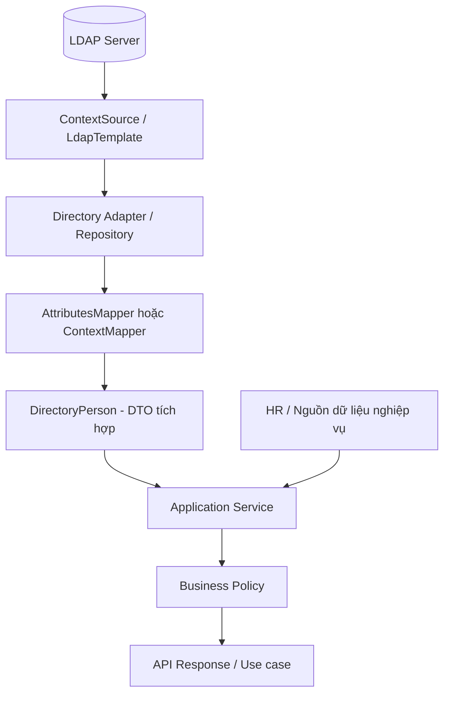

# Tách mapping thư mục khỏi quy tắc nghiệp vụ

Khi xây dựng ứng dụng với **Spring LDAP**, kết quả tìm kiếm thường được trả về dưới dạng `Attributes`, `DirContextAdapter` hoặc đối tượng được ánh xạ bằng ODM. Dữ liệu thư mục có các đặc điểm riêng: tên attribute theo LDAP schema, giá trị đa trị, kiểu dữ liệu, DN, attribute có thể vắng mặt và giới hạn quyền đọc. Trong khi đó, ứng dụng cần trả lời những câu hỏi **nghiệp vụ**, chẳng hạn “người này có được dùng cổng nội bộ không?”, “hồ sơ nào cần hiển thị?” hoặc “ai là người có quyền phê duyệt?”.

Nếu một `AttributesMapper` vừa đọc `mail`, `departmentNumber`, vừa quyết định người dùng được phép truy cập, mã nguồn sẽ trộn **quy tắc tích hợp LDAP** với **quy tắc nghiệp vụ**. Hệ quả là khó kiểm thử, khó thay đổi nguồn dữ liệu và dễ lấy nhầm metadata kỹ thuật làm tiêu chí nghiệp vụ.

Bài thuộc chương **Mapping kết quả** của mô-đun **SPRING_LDAP**. Chúng ta sẽ xây dựng ranh giới giữa `LdapTemplate`/`LdapClient` và miền nghiệp vụ, từ việc ánh xạ entry thành DTO trung gian đến service và policy có thể kiểm thử mà không cần LDAP server.

**Sau bài học, bạn có thể:**

- Phân biệt **directory mapping**, **kiểm tra hợp đồng dữ liệu** và **quy tắc nghiệp vụ**.
- Thiết kế một mapper chỉ chuyển `javax.naming.directory.Attributes` thành đối tượng Java, không đưa ra quyết định nghiệp vụ.
- Xử lý attribute đơn trị, đa trị, vắng mặt, sai kiểu, DN và giới hạn projection/ACL.
- Đặt repository/adapter LDAP sau một interface để service không phụ thuộc vào `LdapTemplate`.
- Viết policy thuần Java và kiểm thử độc lập mapper, repository, service và server LDAP.
- Nhận biết các anti-pattern như quyết định trạng thái nhân sự từ `modifyTimestamp`, tự động cấp quyền từ tên OU, hoặc biến lỗi LDAP thành “không có quyền”.
- Bảo đảm các đường đọc qua TLS, quyền tối thiểu và logging phù hợp với dữ liệu thư mục.

## 1. Hai câu hỏi khác nhau: dữ liệu là gì và phải làm gì với nó?

Giả sử LDAP chứa:

```ldif
dn: uid=an,ou=People,dc=example,dc=org
objectClass: top
objectClass: person
objectClass: organizationalPerson
objectClass: inetOrgPerson
uid: an
cn: An Nguyen
sn: Nguyen
mail: an@example.org
mail: an.work@example.net
employeeNumber: NV-1024
departmentNumber: ENG
```

**Câu hỏi của tầng mapping:**

- Entry có các attribute nào?
- `uid` có giá trị chuỗi nào?
- Có bao nhiêu `mail` và chúng được đưa vào `List<String>` ra sao?
- Nếu `departmentNumber` không được trả về thì đối tượng Java biểu diễn thế nào?
- Dữ liệu nào phải được coi là **không hợp lệ so với contract** của tầng tích hợp?

**Câu hỏi của tầng nghiệp vụ:**

- Người có mã `NV-1024` đã được kích hoạt theo hệ thống nhân sự chưa?
- Người đó đã hoàn thành đào tạo bắt buộc chưa?
- Có được dùng cổng nội bộ hay phê duyệt yêu cầu không?
- Hệ thống có nên hiển thị email nào là email liên hệ chính?
- Tại thời điểm quyết định, nguồn dữ liệu nào có thẩm quyền?

Hai nhóm câu hỏi **không cùng một trách nhiệm**. Mapping có thể biết `departmentNumber` là attribute dùng để diễn tả mã phòng ban; mapper **không nên chứa** quy tắc “phòng ENG mặc nhiên có quyền truy cập toàn hệ thống”.

### 1.1. Ranh giới khuyến nghị



Tầng tích hợp LDAP hiểu **cú pháp và dữ liệu thư mục**; tầng ứng dụng dùng dữ liệu đó cùng nguồn nghiệp vụ khác để quyết định hành động. Khi thay LDAP bằng API danh bạ khác, phần policy ideally không cần viết lại; chỉ adapter phải thay.

## 2. Ba loại trách nhiệm thường bị trộn lẫn

| Trách nhiệm | Ví dụ | Nên đặt ở đâu? |
| --- | --- | --- |
| Đọc tên và giá trị attribute | Đọc `uid`, `cn`, `mail` từ `Attributes` | Mapper LDAP |
| Chuyển kiểu biểu diễn | `mail` đa trị → danh sách chuỗi | Mapper LDAP |
| Kiểm tra hợp đồng nguồn | `uid` bắt buộc trong DTO nhưng không xuất hiện | Mapper/adapter, lỗi dữ liệu |
| Dựng query, base, scope, attributes | Tìm user theo `uid` dưới `ou=People` | LDAP repository/adapter |
| Chuyển lỗi hạ tầng | Lỗi kết nối, thiếu quyền, size/time limit | Adapter và tầng xử lý lỗi |
| Quyết định trạng thái nghiệp vụ | Nhân viên đang hoạt động hay đã nghỉ | Domain/application service, theo nguồn thẩm quyền |
| Quyết định quyền dùng tính năng | Có đủ điều kiện truy cập cổng không? | Business policy/authorization layer |
| Chọn nội dung hiển thị | Tên và email ưu tiên cho UI | Application/presentation policy |
| Kiểm soát quyền đọc LDAP | ACL bind account, TLS, quyền đọc thuộc tính | Server + security configuration |
| Kiểm thử quy tắc doanh nghiệp | Nhân viên nghỉ việc bị từ chối dù LDAP còn entry | Unit test policy/service |

**Không phải mọi validation đều là business rule.** Kiểm tra `uid` phải là chuỗi không rỗng để định danh DTO là **hợp đồng dữ liệu kỹ thuật**; kiểm tra người dùng đã ký cam kết bảo mật mới được mở cổng là **quy tắc nghiệp vụ**.

### 2.1. Ví dụ code có trách nhiệm lẫn lộn

Đoạn code sau cố tình minh họa một anti-pattern:

```java
// Không nên: mapper vừa chuyển dữ liệu, vừa quyết định nghiệp vụ.
AttributesMapper<PortalUser> mapper = attrs -> {
    String uid = (String) attrs.get("uid").get();
    String department = (String) attrs.get("departmentNumber").get();

    // Quy tắc "ENG được truy cập" bị nhúng vào tầng LDAP.
    boolean allowed = "ENG".equals(department);

    return new PortalUser(uid, allowed);
};
```

Các vấn đề:

1. Mapper bị phụ thuộc vào một quy tắc có thể thay đổi bởi bộ phận nghiệp vụ.
2. `departmentNumber` có thể bị ACL che hoặc không xuất hiện, gây `NullPointerException`.
3. Khi có điều kiện thứ hai (nhân sự đã hoạt động, đào tạo đã hoàn thành), mapper phải gọi hệ thống ngoài hoặc chứa thêm logic.
4. Nếu chuyển sang nguồn dữ liệu khác, cùng quy tắc phải được sao chép.
5. Test tích hợp LDAP có nguy cơ trở thành nơi duy nhất kiểm chứng policy.

## 3. Thiết kế mô hình trung gian: `DirectoryPerson`

Thay vì ánh xạ thẳng từ LDAP sang `PortalUser`, định nghĩa đối tượng mô tả **những dữ liệu thư mục đã đọc được**, không hàm ý quyền nghiệp vụ.

Ví dụ Java 17+:

```java
import java.util.List;

public record DirectoryPerson(
    String uid,
    String commonName,
    String employeeNumber,
    String departmentCode,
    List<String> emails
) {
    public DirectoryPerson {
        emails = List.copyOf(emails);
    }
}
```

Ý nghĩa:

| Trường | Thuộc tính LDAP tương ứng | Cam kết của DTO |
| --- | --- | --- |
| `uid` | `uid` | Có giá trị hợp lệ theo contract adapter |
| `commonName` | `cn` | Có thể không đọc được nếu quyền/entry không cho phép |
| `employeeNumber` | `employeeNumber` | Mã nhân viên từ LDAP, không tự chứng minh trạng thái HR |
| `departmentCode` | `departmentNumber` | Mã phòng ban, không phải cờ quyền |
| `emails` | `mail` | Danh sách có thể rỗng; thứ tự không hàm ý ưu tiên |

`List.copyOf` tạo bản sao không thể sửa thông qua record. Điều này giúp tránh việc service vô tình thay đổi dữ liệu đã được mapper cung cấp.

**Đừng ép mọi trường phải `non-null` chỉ để code đơn giản** nếu schema, ACL hoặc chính sách môi trường cho phép không đọc được. Thay vào đó, công bố rõ contract: trường nào bắt buộc, trường nào có thể thiếu và thiếu trường phải được xử lý ở đâu.

### 3.1. Khi nào dùng `Optional`?

Có thể dùng `Optional<String>` ở API tầng service khi biểu diễn có/không có **một entry**. Trong bản ghi dữ liệu nhiều trường, có thể lựa chọn giá trị nullable theo contract hoặc các value object rõ nghĩa.

Đừng dùng `null` để biểu diễn lẫn lộn cả ba trạng thái: **không có giá trị**, **không được quyền đọc** và **server thất bại**. Trong trường hợp cần phân biệt chúng, thiết kế kiểu dữ liệu phong phú hơn (`KnownValue`, `Unavailable`, `NotRequested`) hoặc trả thêm metadata về chất lượng dữ liệu. Một `AttributesMapper` chỉ nhìn thấy tập attribute được trả về thường **không thể tự phân biệt** thiếu giá trị với ACL che giá trị.

## 4. Viết `AttributesMapper` chỉ làm nhiệm vụ ánh xạ

`AttributesMapper<T>` thuộc `org.springframework.ldap.core`. Phương thức quan trọng:

```java
T mapFromAttributes(javax.naming.directory.Attributes attrs)
    throws javax.naming.NamingException;
```

Mapper có thể chuyển dữ liệu thư mục sang `DirectoryPerson`. Nó không cần biết “nhân viên có được đăng nhập không?”.

### 4.1. Mapper cho đơn trị và đa trị

Ví dụ tự chứa:

```java
import java.util.ArrayList;
import java.util.List;
import javax.naming.NamingException;
import javax.naming.directory.Attribute;
import javax.naming.directory.Attributes;
import org.springframework.ldap.core.AttributesMapper;

record DirectoryPerson(
    String uid,
    String commonName,
    String employeeNumber,
    String departmentCode,
    List<String> emails
) {
    DirectoryPerson {
        emails = List.copyOf(emails);
    }
}

final class DirectoryMappingException extends RuntimeException {
    DirectoryMappingException(String message) {
        super(message);
    }
}

final class DirectoryPersonMapper
        implements AttributesMapper<DirectoryPerson> {

    @Override
    public DirectoryPerson mapFromAttributes(Attributes attrs)
            throws NamingException {

        String uid = textValue(attrs, "uid");
        if (uid == null || uid.isBlank()) {
            throw new DirectoryMappingException(
                "Directory entry lacks a usable uid");
        }

        return new DirectoryPerson(
            uid,
            textValue(attrs, "cn"),
            textValue(attrs, "employeeNumber"),
            textValue(attrs, "departmentNumber"),
            textValues(attrs, "mail")
        );
    }

    private static String textValue(Attributes attrs, String id)
            throws NamingException {

        Attribute attribute = attrs.get(id);
        if (attribute == null || attribute.size() == 0) {
            return null;
        }
        if (attribute.size() != 1) {
            throw new DirectoryMappingException(
                "Unexpected multiple values for " + id);
        }

        Object raw = attribute.get();
        if (!(raw instanceof String value)) {
            throw new DirectoryMappingException(
                "Unexpected LDAP syntax for " + id);
        }
        return value;
    }

    private static List<String> textValues(Attributes attrs, String id)
            throws NamingException {

        Attribute attribute = attrs.get(id);
        if (attribute == null) {
            return List.of();
        }

        List<String> values = new ArrayList<>();
        for (int i = 0; i < attribute.size(); i++) {
            Object raw = attribute.get(i);
            if (!(raw instanceof String value)) {
                throw new DirectoryMappingException(
                    "Unexpected LDAP syntax for " + id);
            }
            values.add(value);
        }
        return values;
    }
}
```

**Điểm quan trọng:** các phương thức chỉ xử lý **kiểu dữ liệu và hợp đồng nguồn**. Chúng không đánh giá phòng ban nào được cấp quyền, email nào được ưu tiên hiển thị hoặc nhân viên có đủ điều kiện nghiệp vụ không.

### 4.2. Tại sao không gọi `String.valueOf` cho mọi giá trị?

JNDI `Attribute` có thể trả các kiểu không phải `String`, nhất là với syntax nhị phân như ảnh/chứng chỉ. Ép mọi giá trị bằng `String.valueOf(raw)` có thể biến `byte[]` thành chuỗi không mang nội dung thật.

Ví dụ mapper trên chỉ hỗ trợ những attribute được **chủ động chọn là dữ liệu chuỗi**. Nếu cần `jpegPhoto` hoặc `userCertificate`, hãy tạo adapter khác xử lý `byte[]` đúng contract và không log nội dung nhạy cảm.

**Schema mới quyết định một attribute là đơn trị hay đa trị**. Không giả định mọi `cn`, `mail` hay field tùy biến có cùng tính chất trên mọi hệ thống. Trong ví dụ, `uid`, `employeeNumber`, `departmentNumber` và `cn` được adapter xem là một giá trị cho hợp đồng ứng dụng; nếu server cho nhiều giá trị ở một trường như vậy, mapper báo lỗi để nhóm tích hợp kiểm tra thay vì âm thầm lấy giá trị đầu tiên.

### 4.3. Dữ liệu đa trị không có thứ tự nghiệp vụ

`mail` có thể chứa nhiều địa chỉ nhưng không có bảo đảm “email đầu tiên là email chính”. Đoạn mapper trả danh sách theo thứ tự hiện diện trong kết quả, **không cam kết ý nghĩa thứ tự**.

Nếu nghiệp vụ muốn chọn email chính, hãy xác định nguồn/thuộc tính biểu diễn ưu tiên hoặc một rule trong service. Không dùng `get(0)` rồi coi đó là quy tắc nghiệp vụ.

Tương tự với `member` và `memberOf`: đọc nhiều giá trị là việc của mapper; quyết định ý nghĩa thành viên nhóm trực tiếp/gián tiếp và quyền truy cập là việc của tầng policy, dựa trên schema và nguồn tin cậy.

## 5. Adapter LDAP quyết định cách truy vấn, không quyết định quyền nghiệp vụ

Sau mapper, tạo một interface mà application service có thể sử dụng mà **không phải biết `LdapTemplate` hay `Attributes`**:

```java
import java.util.Optional;

public interface DirectoryPersonReader {
    Optional<DirectoryPerson> findByUid(String uid);
}
```

Triển khai dùng Spring LDAP:

```java
import java.util.List;
import java.util.Optional;
import org.springframework.ldap.core.LdapTemplate;
import org.springframework.ldap.query.LdapQuery;
import org.springframework.ldap.query.SearchScope;

import static org.springframework.ldap.query.LdapQueryBuilder.query;

public final class LdapDirectoryPersonReader
        implements DirectoryPersonReader {

    private final LdapTemplate ldapTemplate;
    private final DirectoryPersonMapper mapper =
        new DirectoryPersonMapper();

    public LdapDirectoryPersonReader(LdapTemplate ldapTemplate) {
        this.ldapTemplate = ldapTemplate;
    }

    @Override
    public Optional<DirectoryPerson> findByUid(String uid) {
        LdapQuery q = query()
            .base("ou=People")
            .searchScope(SearchScope.SUBTREE)
            .attributes(
                "uid", "cn", "employeeNumber",
                "departmentNumber", "mail"
            )
            .where("uid").is(uid);

        List<DirectoryPerson> rows =
            ldapTemplate.search(q, mapper);

        if (rows.isEmpty()) {
            return Optional.empty();
        }
        if (rows.size() != 1) {
            throw new DirectoryMappingException(
                "Non-unique uid in search results");
        }
        return Optional.of(rows.get(0));
    }
}
```

Giả sử `ContextSource.base = dc=example,dc=org`, base `ou=People` là **DN tương đối**. `where("uid").is(uid)` dùng query builder để escape dữ liệu đầu vào trong **filter LDAP**, thay vì nối chuỗi từ request.

Vì `uid` có thể không duy nhất trong một vùng tìm kiếm nếu thiết kế DIT/schema không ràng buộc, repository chủ động xử lý trường hợp nhiều entry khớp. Không lấy `rows.get(0)` rồi ngầm cho rằng đó là người đúng.

Adapter biết cách **tìm và ánh xạ entry**. Nó vẫn không quyết định nhân viên đang hoạt động hoặc được phép truy cập.

### 5.1. Query projection là một phần của contract mapping

Trong ví dụ:

```java
.attributes("uid", "cn", "employeeNumber", "departmentNumber", "mail")
```

Mapper chỉ nên đọc những trường đã yêu cầu. Nếu thêm một field `mobile` vào `DirectoryPersonMapper` nhưng quên thêm `mobile` vào projection, mapper có thể nhận `null` dù LDAP thật có trường đó.

Hãy giữ query projection và mapper đồng bộ bằng test. Mặt khác, chọn ít thuộc tính giảm dữ liệu truyền qua mạng và hạn chế tiếp xúc với thông tin nhạy cảm.

### 5.2. Search trả rỗng khác lỗi LDAP

Phân biệt:

- Search thành công, **không có entry khớp** → `List` rỗng → `Optional.empty()`.
- Search bị từ chối, mất kết nối, lỗi filter hoặc vượt giới hạn → exception từ Spring LDAP → **không** chuyển thành `Optional.empty()`.
- Entry tồn tại nhưng thiếu attribute theo contract adapter → `DirectoryMappingException`.
- Server/ACL không cho đọc một trường tùy chọn → mapper có thể thấy thiếu trường; không thể khẳng định chính xác nguyên nhân chỉ dựa trên `Attributes`.

Nếu mọi lỗi được biến thành “không có người dùng”, tầng nghiệp vụ có thể vô tình vô hiệu hóa tài khoản hoặc coi một snapshot chưa đầy đủ là dữ liệu thực.

## 6. Quy tắc nghiệp vụ nằm ở service/policy thuần Java

Giả sử **nguồn nhân sự** mới là nơi quyết định nhân viên còn hiệu lực và đã hoàn thành đào tạo. LDAP chỉ cung cấp dữ liệu thư mục phục vụ liên hệ/tìm kiếm.

Mô hình nguồn nghiệp vụ:

```java
public record EmploymentState(
    String employeeNumber,
    boolean active,
    boolean trainingComplete
) {}

public interface EmploymentStatusPort {
    EmploymentState loadByEmployeeNumber(String employeeNumber);
}
```

Policy độc lập:

```java
public final class PortalAccessPolicy {

    public boolean mayUsePortal(EmploymentState employment) {
        return employment.active()
            && employment.trainingComplete();
    }
}
```

Và service kết hợp kết quả từ hai nguồn:

```java
import java.util.Optional;

public record PortalProfile(
    String uid,
    String displayName,
    boolean eligibleForPortal
) {}

public final class PortalProfileService {

    private final DirectoryPersonReader directory;
    private final EmploymentStatusPort employment;
    private final PortalAccessPolicy policy;

    public PortalProfileService(
            DirectoryPersonReader directory,
            EmploymentStatusPort employment,
            PortalAccessPolicy policy) {
        this.directory = directory;
        this.employment = employment;
        this.policy = policy;
    }

    public Optional<PortalProfile> findProfile(String uid) {
        return directory.findByUid(uid).map(person -> {
            // Mã nhân viên bắt buộc cho use case này:
            String employeeNumber = person.employeeNumber();
            if (employeeNumber == null) {
                throw new IllegalStateException(
                    "Employee identifier unavailable");
            }

            EmploymentState state =
                employment.loadByEmployeeNumber(employeeNumber);

            return new PortalProfile(
                person.uid(),
                person.commonName(),
                policy.mayUsePortal(state)
            );
        });
    }
}
```

Trong ví dụ:

- **Directory adapter**: đọc `uid`, `cn`, `employeeNumber`.
- **HR adapter** sau `EmploymentStatusPort`: cung cấp trạng thái nhân sự.
- **Policy**: quyết định có đủ điều kiện dùng cổng không.
- **Application service**: điều phối các bước và trả DTO của use case.

Quy tắc `active && trainingComplete` chỉ là **minh họa một chính sách giả định**; mỗi tổ chức phải áp dụng điều kiện được phê duyệt. Việc đăng nhập thực tế có thể cần thêm cơ chế xác thực và ủy quyền khác; `eligibleForPortal` không nên tự động bị coi là bằng chứng user đã được xác thực.

### 6.1. Vì sao ranh giới này có lợi?

Khi tổ chức thay đổi quy tắc thành “nhân viên còn hiệu lực, đã đào tạo và thuộc một nhóm được phê duyệt”, bạn chỉnh **policy** và kiểm thử policy. `DirectoryPersonMapper` vẫn chỉ đọc dữ liệu LDAP.

Khi chuyển từ OpenLDAP sang Active Directory hoặc thư mục khác, bạn điều chỉnh **adapter** hoặc schema mapping. Service/policy không cần phụ thuộc vào tên attribute như `sAMAccountName`, `employeeNumber` hoặc `memberOf`, trừ khi chính use case có quy tắc dựa trên khái niệm đã được mô hình hóa rõ ràng.

## 7. Không để quy tắc nghiệp vụ rò rỉ vào mapper

Các ví dụ thường gây nhầm:

| Mapper làm điều này | Vấn đề | Nên chuyển sang |
| --- | --- | --- |
| `allowed = departmentNumber.equals("ENG")` | Quyền nghiệp vụ bị gắn với mã phòng ban | Authorization/business policy |
| `active = modifyTimestamp gần đây` | Thời điểm cập nhật entry không chứng minh trạng thái nhân sự | Nguồn HR và policy |
| `isManager = cn.startsWith("Manager")` | Suy diễn vai trò từ tên hiển thị | Nguồn vai trò/thẩm quyền |
| `primaryEmail = mail.get(0)` | Giá trị đa trị không có thứ tự nghiệp vụ | Quy tắc chọn email riêng |
| `tenure = now - createTimestamp` | Ngày tạo LDAP entry không phải ngày vào công ty | Dữ liệu tuyển dụng/HR |
| `isDeleted = ldapSearch trả rỗng vì timeout` | Lỗi hạ tầng bị ngụy trang thành dữ liệu không tồn tại | Error handling/reconciliation |
| `vip = user thuộc ou=Executives` | Vị trí DN không nhất thiết là trạng thái quyền | Chính sách quyền rõ ràng |
| `fullName = cn.toUpperCase()` chỉ để hiển thị | Quy tắc trình bày bị nhúng trong mapping | Presentation layer/formatter |

Mapper có thể **chuẩn hóa cú pháp đã được contract định nghĩa** — ví dụ chuyển một Generalized Time hợp lệ thành đối tượng thời gian sau khi parse đúng syntax. Nhưng không nên biến việc parse thành kết luận “tài khoản quá 90 ngày thì bị khóa” ngay trong mapper.

### 7.1. Thuộc tính server-managed không thay dữ liệu nghiệp vụ

`createTimestamp`, `modifyTimestamp`, `creatorsName`, `modifiersName` có thể giúp kiểm tra vận hành LDAP. Chúng không chứng minh ai đã phê duyệt một thao tác ở ứng dụng hoặc một nhân viên bắt đầu làm việc khi nào.

Nếu ứng dụng cần audit nghiệp vụ, hãy thu thập audit event từ hệ thống chịu trách nhiệm hoặc từ log kiểm toán đáng tin cậy, không suy ra từ tên service account trong `modifiersName`.

### 7.2. DN không phải lúc nào cũng là khóa nghiệp vụ

DN có thể đổi khi rename/move entry. Nếu application service lưu DN như mã nhân viên bất biến, nó dễ mất liên kết khi entry di chuyển OU.

LDAP server có thể cung cấp `entryUUID` hoặc định danh khác, nhưng tính ổn định giữa export/import, migration và replication cần được kiểm tra. Khóa nghiệp vụ nên được chọn theo **hợp đồng giữa các hệ thống**, không theo sự tiện lợi của chuỗi DN.

## 8. Khi nào dùng `ContextMapper` thay `AttributesMapper`?

`AttributesMapper` nhận `Attributes` của entry. Nó đơn giản khi chỉ cần các giá trị attribute đã chọn. Nhưng nếu use case cần **DN của entry**, hãy cân nhắc `ContextMapper` và `DirContextAdapter` của Spring LDAP.

Sơ lược:

```java
import org.springframework.ldap.core.ContextMapper;
import org.springframework.ldap.core.DirContextAdapter;

ContextMapper<String> dnMapper = context -> {
    DirContextAdapter entry = (DirContextAdapter) context;
    return entry.getDn().toString();
};
```

Có thể dùng mapper này khi thực hiện `ldapTemplate.search(query, dnMapper)` với overload phù hợp.

**Cần biết rõ loại DN nhận được và ngữ cảnh base.** Tùy API/context, DN từ adapter có thể được biểu diễn tương đối với `ContextSource.base`; không tự xem chuỗi `getDn().toString()` là DN đầy đủ phù hợp để gửi sang mọi hệ thống.

Nếu dùng ODM với `@Entry`, `@Id`, `@Attribute` hoặc `@DnAttribute`, các annotation giúp ánh xạ entry thành object. **ODM vẫn là tầng mapping**; không nên đặt policy như “có quyền phê duyệt nếu tồn tại `memberOf` chứa X” trong getter/setter của entity ODM nếu quy tắc này cần phối hợp nguồn khác hay có biến thể theo use case.

### 8.1. Phân biệt DN, RDN và thuộc tính tên

Một entry:

```text
uid=an,ou=People,dc=example,dc=org
```

có DN là toàn chuỗi trên, RDN là `uid=an` và attribute `uid` thường có giá trị `an`. Mapper không nên suy rằng `uid` luôn là phần đầu tiên của một chuỗi DN do tự `split(",")`: DN có thể chứa dấu phẩy escaped trong RDN.

Dùng `LdapNameBuilder`/JNDI `LdapName` hoặc API naming phù hợp để phân tích DN. Tuyệt đối không dùng phép cắt chuỗi ngây thơ cho một DN chứa các ký tự đặc biệt.

## 9. Dữ liệu thiếu, lỗi hạ tầng và độ tin cậy của nguồn

Một mapper chỉ thấy dữ liệu được JNDI trả về. Nó **không biết toàn bộ nguyên nhân** vì sao một attribute không xuất hiện.

| Hiện tượng | Có thể do | Cách xử lý |
| --- | --- | --- |
| Không có `mail` | Entry không khai báo, projection không yêu cầu hoặc ACL che | Trả danh sách rỗng/đánh dấu không biết theo contract; không tự suy diễn |
| `uid` không có | Schema/mapping sai, quyền đọc bị chặn hoặc dữ liệu không đạt contract | Lỗi mapping đối với use case cần uid |
| `mail` có nhiều giá trị | Attribute đa trị theo schema | Duyệt toàn bộ, không chọn phần tử đầu làm email chính |
| Giá trị `jpegPhoto` là `byte[]` | Attribute có syntax nhị phân | Mapper nhị phân chuyên biệt, không `String.valueOf` |
| Search trả rỗng | Không có entry khớp khi query thành công | `Optional.empty()` theo contract |
| `CommunicationException` | Lỗi mạng/server | Ném lỗi hạ tầng, retry có kiểm soát nếu phù hợp |
| `SizeLimitExceededException` | Search có thể chưa đầy đủ | Không coi dữ liệu đã nhận là toàn bộ |
| `TimeLimitExceededException` | Chạm giới hạn thời gian | Không trả dữ liệu rỗng như search thành công |
| `PartialResultException` | Thường liên quan referral/JNDI | Đánh giá chính sách referral, không gộp với lỗi limit |

**Lỗi bảo mật thường gặp:** khi LDAP tạm thời không hoạt động, ứng dụng coi “không có user trong LDAP” hoặc “không có nhóm” là sự thật nghiệp vụ. Quyết định **fail closed** có thể phù hợp cho kiểm soát truy cập, nhưng hệ thống phải giữ được thông tin rằng đây là **sự cố nguồn dữ liệu**, không viết lại trạng thái nhân viên thành “đã nghỉ” hay xóa dữ liệu dựa trên một search chưa hoàn tất.

### 9.1. Thiết kế trạng thái rõ ràng khi cần

Nếu một hệ thống quan trọng bắt buộc phân biệt “không có giá trị”, “không được phép đọc”, “chưa yêu cầu” và “không xác định”, hãy mở rộng contract của adapter để mang trạng thái đọc thay vì suy từ `null`. Nhưng một `AttributesMapper` đơn giản thường **không đủ thông tin** để xác định đầy đủ các trạng thái này; có thể cần metadata từ truy vấn, policy server hoặc kiểm tra ở tầng điều phối.

Không thêm những trạng thái giả để nói rằng mapper “biết” ACL đã che attribute khi LDAP protocol không cung cấp bằng chứng như vậy.

## 10. Kiểm thử mapper không cần LDAP server

Do mapper là hàm chuyển `Attributes` sang DTO, bạn có thể kiểm thử bằng các triển khai JNDI `BasicAttributes` và `BasicAttribute`.

### 10.1. Test mapping dữ liệu hợp lệ

Ví dụ JUnit 5:

```java
import static org.junit.jupiter.api.Assertions.*;

import java.util.Set;
import javax.naming.directory.Attributes;
import javax.naming.directory.BasicAttribute;
import javax.naming.directory.BasicAttributes;
import org.junit.jupiter.api.Test;

class DirectoryPersonMapperTest {

    private final DirectoryPersonMapper mapper =
        new DirectoryPersonMapper();

    @Test
    void mapsSingleAndMultiValuedAttributes() throws Exception {
        Attributes attrs = new BasicAttributes(true);
        attrs.put("uid", "an");
        attrs.put("cn", "An Nguyen");
        attrs.put("employeeNumber", "NV-1024");
        attrs.put("departmentNumber", "ENG");

        BasicAttribute mails = new BasicAttribute("mail");
        mails.add("an@example.org");
        mails.add("an.work@example.net");
        attrs.put(mails);

        DirectoryPerson person = mapper.mapFromAttributes(attrs);

        assertEquals("an", person.uid());
        assertEquals("An Nguyen", person.commonName());
        assertEquals("NV-1024", person.employeeNumber());
        assertEquals("ENG", person.departmentCode());
        assertEquals(
            Set.of("an@example.org", "an.work@example.net"),
            Set.copyOf(person.emails())
        );
    }

    @Test
    void missingMailBecomesEmptyList() throws Exception {
        Attributes attrs = new BasicAttributes(true);
        attrs.put("uid", "binh");

        DirectoryPerson person = mapper.mapFromAttributes(attrs);

        assertTrue(person.emails().isEmpty());
        assertNull(person.commonName());
    }

    @Test
    void missingUidViolatesDirectoryContract() {
        Attributes attrs = new BasicAttributes(true);
        attrs.put("cn", "No UID");

        assertThrows(
            DirectoryMappingException.class,
            () -> mapper.mapFromAttributes(attrs)
        );
    }
}
```

Các test này **không kiểm thử LDAP server**. Chúng kiểm thử đúng quy tắc ánh xạ: `uid` bắt buộc theo hợp đồng adapter, `mail` đa trị, field tùy chọn có thể không hiện diện. Dùng `Set.copyOf` để so sánh email mà không phụ thuộc thứ tự giá trị đa trị.

### 10.2. Test dữ liệu sai kiểu hoặc sai số lượng

Có thể bổ sung:

- `uid` có hai giá trị → mapper phải báo lỗi thay vì âm thầm lấy đầu tiên.
- `uid` là `byte[]` → mapper báo sai syntax, không tạo chuỗi từ địa chỉ bộ nhớ mảng.
- `mail` chứa một phần tử không phải `String` → mapper báo lỗi.
- `employeeNumber` không xuất hiện → mapper để `null` theo contract; service quyết định use case có cần bắt buộc không.
- Kiểm tra danh sách email không thể bị code ngoài sửa.

Test mapper không cần dữ liệu HR hay policy. Nếu mỗi test mapper lại phải mock HR service hoặc thời gian hệ thống, đó là dấu hiệu mapper đang chịu trách nhiệm quá nhiều.

## 11. Kiểm thử business policy độc lập LDAP

Policy ở mục 6 chỉ phụ thuộc `EmploymentState`:

```java
import static org.junit.jupiter.api.Assertions.*;
import org.junit.jupiter.api.Test;

class PortalAccessPolicyTest {

    private final PortalAccessPolicy policy =
        new PortalAccessPolicy();

    @Test
    void activeAndTrainedPersonIsEligible() {
        var state = new EmploymentState(
            "NV-1024", true, true);

        assertTrue(policy.mayUsePortal(state));
    }

    @Test
    void inactivePersonIsNotEligible() {
        var state = new EmploymentState(
            "NV-1024", false, true);

        assertFalse(policy.mayUsePortal(state));
    }

    @Test
    void missingTrainingPreventsAccess() {
        var state = new EmploymentState(
            "NV-1024", true, false);

        assertFalse(policy.mayUsePortal(state));
    }
}
```

Không cần `LdapTemplate`, `ContextSource`, TLS hoặc LDAP embedded server để chạy những test này. Đó là lợi ích lớn nhất của tách tầng: **quy tắc nghiệp vụ có thể được xác minh bằng dữ liệu đầu vào và đầu ra rõ ràng**.

### 11.1. Test service bằng fake ports

Có thể dựng `DirectoryPersonReader` giả để trả một `DirectoryPerson` cố định, `EmploymentStatusPort` giả để trả `EmploymentState`, rồi gọi `PortalProfileService.findProfile`.

Các trường hợp nên thử:

1. Directory trả `Optional.empty()` → service không gọi HR và không bịa hồ sơ.
2. Directory trả person có `employeeNumber`, HR trả `active=true`, `trainingComplete=true` → `eligibleForPortal=true`.
3. HR trả `active=false` → `eligibleForPortal=false`, dù LDAP vẫn chứa entry.
4. Person không có `employeeNumber` → use case báo lỗi contract/thiếu định danh, không tự cho phép.
5. Directory ném lỗi kết nối → service không chuyển thành “không đủ điều kiện nhân sự” như một kết luận dữ liệu.

Bằng cách này, repository có thể được thay bằng nguồn khác mà không phải sửa bộ test policy.

## 12. Integration test xác minh mapping với LDAP thật

Unit test dùng `BasicAttributes` chưa kiểm chứng **schema, search base, scope, ACL, projection** hoặc kiểu JNDI provider trả về. Cần thêm integration test trên LDAP test server có cấu hình gần production.

| Kịch bản | Điều cần xác minh |
| --- | --- |
| Query theo `uid` | Chỉ tìm entry đúng dưới `ou=People`, không lấy nhầm OU khác |
| Projection thiếu `mail` | Mapper không phát sinh NPE và contract hiển thị đúng |
| `mail` đa trị | Lấy được mọi giá trị theo quyền được cấp; không giả định thứ tự |
| `uid` bị thiếu hoặc sai syntax | Mapper báo lỗi contract |
| ACL ẩn một số attribute | Ứng dụng không suy diễn sai từ dữ liệu vắng mặt |
| Search base không tồn tại | Phân biệt `NameNotFoundException` với không có entry khớp |
| Size/time limit | Không coi kết quả chưa hoàn tất là danh sách đầy đủ |
| Đổi DN | Khóa ứng dụng không bị ngầm phụ thuộc chuỗi DN cũ |
| Server khác schema | Mapping phát hiện khác biệt/phiên bản schema phù hợp |
| TLS/cert sai | Kết nối fail closed, không bỏ xác minh chứng chỉ |

Nếu môi trường dùng nhiều LDAP server, kiểm thử cả replication/độ mới dữ liệu khi failover. Những khác biệt giữa OpenLDAP, Active Directory và server nhúng có thể ảnh hưởng attribute như `memberOf`, `entryUUID` hoặc operational metadata.

**Không sửa production data** chỉ để thử mapping. Dùng fixture/directory riêng có quyền, người dùng và nhóm thử nghiệm rõ ràng.

## 13. ODM và `LdapClient` có thay đổi nguyên tắc này không?

Không. Sự khác biệt API không thay đổi ranh giới trách nhiệm.

**Với `LdapClient`:** bạn có thể dùng query fluent, ánh xạ result thành một đối tượng Java; đối tượng đó vẫn nên là **mô hình tích hợp** hoặc DTO của nguồn LDAP, không phải nơi nhúng chính sách xét duyệt.

**Với ODM:** một class gắn `@Entry`, `@Id`, `@Attribute` có thể giúp ánh xạ entry vào object. Class đó nên phản ánh dữ liệu directory; service/domain policy có thể sử dụng object sau khi chuyển đổi sang mô hình domain cần thiết. Tránh để ORM/ODM entity điều khiển trực tiếp toàn bộ nghiệp vụ, nhất là khi nguồn LDAP có schema/ACL khác môi trường test.

**Với `ContextMapper` và `DirContextAdapter`:** có thêm ngữ cảnh DN và API đọc attribute tiện dụng; vẫn phải phân biệt “đọc được DN” với “DN là khóa nghiệp vụ bất biến”.

Tầng tích hợp nên được thay thế mà policy không biết đã dùng `AttributesMapper`, `ContextMapper` hay ODM.

## 14. Hiệu năng, bảo mật và khả năng vận hành

Tách tầng không chỉ để code sạch; nó giúp giới hạn dữ liệu nhạy cảm và truy vết nguồn sự cố.

### 14.1. Data minimization

- Chỉ yêu cầu `.attributes(...)` mà use case thực sự cần.
- Không đọc `userPassword`, khóa bí mật, chứng chỉ hoặc attribute nhạy cảm khi không có lý do và quyền phù hợp.
- Không lấy mọi `member` của nhóm lớn chỉ để kiểm tra một DN cụ thể nếu có filter phù hợp.
- Đặt base/scope đủ hẹp, filter có escaping an toàn và count/time limit phù hợp.
- Nếu phải dùng operational attributes như `modifyTimestamp`, nêu đích danh khi cần và kiểm tra ACL; không giả định luôn có.

### 14.2. Bảo vệ kết nối

Dùng LDAPS hoặc StartTLS có kiểm tra chứng chỉ, bảo vệ credentials trong secret manager và cấp quyền tối thiểu cho service account. Mapper **không thay thế** kiểm soát quyền LDAP. Nếu ứng dụng không được đọc một thuộc tính, không khắc phục bằng việc bind quyền quản trị quá rộng.

### 14.3. Log ở đúng mức

Có thể log: tên use case, mã truy vấn hoặc correlation ID, thời gian, nhóm exception và số entry đã đọc. Không log hàng loạt object mapped chứa email, mã nhân viên, DN nhạy cảm hay filter chứa giá trị cá nhân không kiểm soát.

Khi lỗi mapping, thông báo như `"Directory entry lacks a usable uid"` hữu ích cho vận hành hơn việc in toàn bộ attribute map. Trường hợp cần chẩn đoán sâu, dùng môi trường giới hạn quyền và chính sách dữ liệu phù hợp.

### 14.4. Không trộn retry vào mapper

Retry lỗi `CommunicationException` có thể thuộc trách nhiệm adapter/service với deadline và backoff; mapper là **hàm chuyển dữ liệu một entry**, không mở kết nối, không thử server dự phòng và không gọi API bên ngoài.

Đối với thao tác ghi, đứt kết nối có thể xảy ra sau khi server đã thực hiện lệnh; không retry mù quáng. Ranh giới mapping giúp giữ các chính sách hạ tầng này khỏi business policy.

## 15. Quy trình refactor một mapper đang làm quá nhiều việc

Giả sử dự án có một mapper trả `PortalUser` và kiểm tra mọi điều kiện trong lambda. Có thể refactor tuần tự:

1. **Liệt kê đầu vào LDAP:** `uid`, `cn`, `employeeNumber`, `departmentNumber`, `mail`; phân biệt user attributes, operational attributes và thuộc tính đa trị.
2. **Tạo `DirectoryPerson`:** mô tả dữ liệu thư mục mà không kết luận trạng thái nghiệp vụ.
3. **Tách mapper:** chuyển đổi đúng syntax, kiểm tra contract tối thiểu và xử lý giá trị thiếu có chủ đích.
4. **Tách repository:** query với base, scope, filter và projection rõ ràng; trả `Optional<DirectoryPerson>` hoặc danh sách theo contract.
5. **Tạo service/policy:** đưa những điều kiện như nhân sự active, hoàn thành đào tạo, vai trò phê duyệt vào lớp thuần Java hoặc authorization service.
6. **Tạo unit test mapper:** dữ liệu đa trị, thiếu attribute, sai kiểu, contract không hợp lệ.
7. **Tạo unit test policy:** đủ/thiếu điều kiện, tránh phụ thuộc LDAP server.
8. **Tạo integration test:** xác minh schema, ACL, mapper, query và lỗi thật.
9. **Kiểm tra ranh giới lỗi:** không biến timeout thành trạng thái nghiệp vụ; không coi một bản snapshot thiếu dữ liệu là toàn bộ directory.
10. **Theo dõi tác động:** thay đổi DTO/port ở những nơi sử dụng; bảo đảm hành vi API đã được đặc tả và kiểm tra.

**Nguyên tắc kiểm tra nhanh:** nếu thay một quy định nhân sự mà phải sửa code `AttributesMapper`, có lẽ ranh giới giữa tích hợp LDAP và nghiệp vụ chưa đủ rõ.

## 16. Bài tập tình huống

Giả sử LDAP có người dùng An:

```text
uid=an
cn=An Nguyen
employeeNumber=NV-1024
departmentNumber=ENG
mail=an@example.org
mail=an.work@example.net
```

Hệ thống nhân sự cho biết nhân viên `NV-1024` còn hiệu lực nhưng chưa hoàn thành đào tạo bắt buộc.

**Bài 1.** Mapper có nên trả `eligibleForPortal=true` chỉ vì `departmentNumber=ENG` không? Vì sao?

**Bài 2.** Attribute `mail` có hai giá trị. Cách mapping nào chính xác hơn: gọi `get()` một lần hay duyệt toàn bộ? Có thể coi phần tử đầu tiên là email chính không?

**Bài 3.** `AttributesMapper` không thấy `employeeNumber` trong kết quả. Có thể khẳng định LDAP entry không có attribute này không?

**Bài 4.** Repository tìm user theo `uid=an` trả danh sách rỗng và hoàn tất thành công. Nó nên trả gì? Nếu phát sinh `CommunicationException` thì có nên trả cùng kết quả không?

**Bài 5.** Policy ở ví dụ yêu cầu nhân viên active **và** đã hoàn thành đào tạo. An có đủ điều kiện chưa? Lớp nào đưa ra quyết định?

**Bài 6.** Một mapper trả `userPassword` và toàn bộ `memberOf` trong DTO để hiển thị danh sách user. Nêu hai rủi ro và cách khắc phục.

**Bài 7.** Tổ chức đổi LDAP server và tên attribute mã phòng ban thay đổi. Tầng nào nên sửa? Policy có nhất thiết phải sửa không?

**Bài 8.** Có nên dùng `createTimestamp` để tính số năm thâm niên hay `modifiersName` để xác định người duyệt yêu cầu nghỉ phép không?

**Bài 9.** Một entry LDAP bị chuyển OU nên DN thay đổi. Nếu domain object dùng DN làm định danh bất biến, vấn đề gì có thể xảy ra?

**Bài 10.** Nêu ít nhất hai unit test cho mapper và hai unit test cho business policy mà không cần LDAP server.

### Đáp án gợi ý

1. **Không.** Mapper chỉ chuyển mã phòng ban. Quyền sử dụng cổng phải theo quy tắc và nguồn dữ liệu được cấp thẩm quyền, không suy ra trực tiếp từ mã OU/phòng ban.
2. Duyệt mọi giá trị `mail`. LDAP attribute đa trị không bảo đảm thứ tự nghiệp vụ; email chính cần quy ước riêng.
3. **Không.** Có thể do projection, ACL hoặc dữ liệu thực. Mapper thường không biết nguyên nhân chỉ từ `Attributes`.
4. Search thành công không khớp entry nào có thể trả `Optional.empty()`. `CommunicationException` là lỗi hạ tầng; không chuyển thành “không có user”.
5. **Chưa.** Thiếu đào tạo, nên `PortalAccessPolicy` trả `false`. Quyết định ở policy chứ không ở mapper.
6. Lộ dữ liệu nhạy cảm và tải quá nhiều giá trị không cần thiết. Thu hẹp projection, áp dụng ACL và chỉ lấy các trường thật sự cần.
7. **LDAP adapter/mapper** chuyển schema mới sang cùng `DirectoryPerson`. Policy không phải đổi nếu contract/domain concept vẫn giữ nguyên.
8. **Không nên**. Ngày tạo entry không phải ngày tuyển dụng; tài khoản sửa LDAP có thể là service account, không phải người duyệt nghiệp vụ.
9. DN cũ có thể không lookup được; cache, DB và các tham chiếu trở nên stale. Cần khóa định danh đã được đặc tả và quy trình đồng bộ rename.
10. Mapper: test `mail` đa trị; test thiếu `uid`. Policy: test active+training complete; test inactive hoặc thiếu training. Cả hai nhóm test đều thuần Java.

## 17. Ghi nhớ

- **Directory mapping** trả lời “LDAP đã trả những giá trị nào và chúng được chuyển thành kiểu Java ra sao?”.
- **Business policy** trả lời “Từ dữ liệu đáng tin cậy, nghiệp vụ phải quyết định điều gì?”.
- Dùng **`AttributesMapper`/`ContextMapper`/ODM** để đọc dữ liệu LDAP và **DTO trung gian** để tách thư mục khỏi mô hình nghiệp vụ; đặt query trong repository/adapter.
- **Đừng nhúng chính sách truy cập vào mapper**, cũng đừng coi `createTimestamp`, `modifyTimestamp`, DN hay thứ tự giá trị đa trị là bằng chứng nghiệp vụ.
- **Phân biệt thiếu dữ liệu với lỗi hệ thống**; giới hạn projection và ACL có thể làm attribute không xuất hiện. Không chuyển mọi exception thành kết quả rỗng.
- **Kiểm thử riêng mapper, policy và tích hợp LDAP**. Unit test mapper dùng `BasicAttributes`; policy test không cần LDAP server; integration test xác minh schema/ACL/query thực tế.
- Giữ kết nối an toàn qua TLS, dùng quyền tối thiểu và không ghi dữ liệu thư mục nhạy cảm vào log.

### Tài liệu tham khảo

- [Spring LDAP Reference Documentation](https://docs.spring.io/spring-ldap/reference/): `LdapTemplate`, `LdapClient`, `AttributesMapper`, `ContextMapper` và ODM.
- [Spring LDAP — AttributesMapper API](https://docs.spring.io/spring-ldap/docs/current/api/org/springframework/ldap/core/AttributesMapper.html): hợp đồng ánh xạ `Attributes`.
- [Spring LDAP — ContextMapper API](https://docs.spring.io/spring-ldap/docs/current/api/org/springframework/ldap/core/ContextMapper.html): ánh xạ từ context.
- [Spring LDAP — DirContextAdapter API](https://docs.spring.io/spring-ldap/docs/current/api/org/springframework/ldap/core/DirContextAdapter.html): truy cập DN và attribute trong context.
- [Spring LDAP — LdapTemplate API](https://docs.spring.io/spring-ldap/docs/current/api/org/springframework/ldap/core/LdapTemplate.html): tìm kiếm và xử lý kết quả.
- [Java SE — Attributes](https://docs.oracle.com/en/java/javase/21/docs/api/java.naming/javax/naming/directory/Attributes.html) và [Attribute](https://docs.oracle.com/en/java/javase/21/docs/api/java.naming/javax/naming/directory/Attribute.html): dữ liệu JNDI đơn trị/đa trị.
- [RFC 4512 — LDAP: Directory Information Models](https://www.rfc-editor.org/rfc/rfc4512.html): mô hình entry, attribute, schema.
- [RFC 4511 — LDAP: The Protocol](https://www.rfc-editor.org/rfc/rfc4511.html): search, lựa chọn thuộc tính và result code.
- [RFC 4514 — String Representation of Distinguished Names](https://www.rfc-editor.org/rfc/rfc4514.html): DN và escaping.
- [RFC 4515 — String Representation of Search Filters](https://www.rfc-editor.org/rfc/rfc4515.html): filter và escaping.
