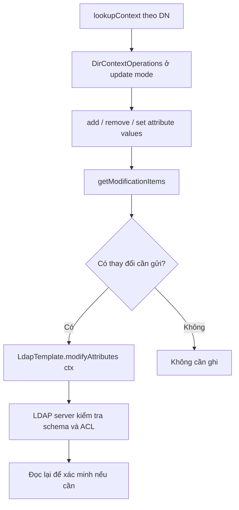

# addAttributeValue, removeAttributeValue và replaceAttributeValue

Khi cập nhật một entry qua **Spring LDAP**, ta thường cần thay đổi những thuộc tính có **nhiều giá trị**: thêm thành viên vào nhóm `member`, bỏ một địa chỉ `mail`, cập nhật danh sách `telephoneNumber` hoặc thay toàn bộ giá trị của một thuộc tính. Nếu chỉ biết phương thức `modifyAttributes` của JNDI, lập trình viên phải tự tạo các `ModificationItem` tương ứng. **`DirContextAdapter`** giúp đơn giản hóa: nó ghi nhận trạng thái entry lúc đọc và tính ra những sửa đổi cần gửi tới LDAP server.

Bài thuộc chương **DirContextAdapter** của mô-đun **SPRING_LDAP**. Người học sẽ sử dụng `LdapTemplate`, `ContextSource` và `DirContextOperations` để thực hành cập nhật dữ liệu thư mục, đồng thời xét schema, filter, DN, quyền truy cập, TLS, lỗi và kiểm thử.

> **Đính chính tên API:** Theo JavaDoc Spring LDAP hiện hành, `DirContextAdapter` có `addAttributeValue(...)`, `removeAttributeValue(...)`, `setAttributeValue(...)` và `setAttributeValues(...)`, **không có phương thức `replaceAttributeValue(...)`**. Cụm từ `replaceAttributeValue` trong tên bài được hiểu là *nghiệp vụ thay thế một giá trị thuộc tính*; bài sẽ chỉ rõ các API thực tế dùng để đạt mục tiêu ấy. Không viết `ctx.replaceAttributeValue(...)` vì mã đó không biên dịch với API chính thức.

**Sau bài học, bạn có thể:**

- Phân biệt thêm **một giá trị**, bỏ **một giá trị**, thay **một giá trị** và thay **toàn bộ attribute**.
- Dùng chính xác `addAttributeValue`, `removeAttributeValue`, `setAttributeValue` và `setAttributeValues`.
- Hiểu bản chất `DirContextAdapter` ở **update mode** và ý nghĩa `getModificationItems()`.
- Cập nhật entry bằng `ldapTemplate.lookupContext(dn)` rồi `ldapTemplate.modifyAttributes(ctx)`.
- So sánh giá trị DN bằng `javax.naming.Name` thay vì so sánh chuỗi thô.
- Xử lý duplicate, schema, operational attributes bị ẩn, kết quả không đầy đủ và mất kết nối trong thao tác ghi.
- Viết unit test cho các thay đổi đang chờ và integration test để xác minh server áp dụng sửa đổi.

## 1. Vì sao quản lý attribute đa trị cần cẩn thận?

Ví dụ một entry nhóm:

```ldif
dn: cn=Engineering,ou=Groups,dc=example,dc=org
objectClass: top
objectClass: groupOfNames
cn: Engineering
member: uid=an,ou=People,dc=example,dc=org
member: uid=binh,ou=People,dc=example,dc=org
member: uid=chi,ou=People,dc=example,dc=org
```

`member` có **ba giá trị**, mỗi giá trị là DN của một entry thành viên. Giả sử chúng ta cần:

1. Thêm `uid=dung,...` nhưng giữ nguyên An, Bình và Chi.
2. Bỏ riêng `uid=binh,...`, không xóa cả nhóm.
3. Thay `uid=chi,...` bằng `uid=lan,...`, giữ các giá trị khác.

Đây là ba thao tác có ý nghĩa **khác nhau**. Nếu dùng `setAttributeValues` mà chỉ đưa một giá trị mới, ta có thể **làm mất toàn bộ các thành viên còn lại**.

### 1.1. Phân biệt entry, attribute và attribute value

```text
Entry (DN: cn=Engineering,ou=Groups,dc=example,dc=org)
│
├── cn
│   └── "Engineering"
│
├── objectClass
│   ├── "top"
│   └── "groupOfNames"
│
└── member
    ├── "uid=an,ou=People,dc=example,dc=org"
    ├── "uid=binh,ou=People,dc=example,dc=org"
    └── "uid=chi,ou=People,dc=example,dc=org"
```

- **Entry** là một bản ghi có DN trong Directory Information Tree.
- **Attribute** là một loại thuộc tính, ví dụ `member`.
- **Attribute value** là một giá trị cụ thể trong thuộc tính ấy, ví dụ DN của An.
- **Schema** quyết định thuộc tính nào hợp lệ, cú pháp và quy tắc so khớp, có thể có nhiều giá trị hay phải đơn trị.

Trong LDAP, các giá trị của một attribute đa trị thường không có **thứ tự mang ý nghĩa nghiệp vụ**. Không coi `member[0]` là chủ nhóm hoặc địa chỉ `mail` đầu tiên là địa chỉ ưu tiên nếu schema/ứng dụng chưa định nghĩa như vậy.

## 2. Bốn thao tác thực sự có trong `DirContextAdapter`

Để xử lý yêu cầu thêm/bỏ/thay, bắt đầu với bảng phân biệt:

| API chính thức | Ý định | Ảnh hưởng đến giá trị khác |
| --- | --- | --- |
| `addAttributeValue("member", newDn)` | Thêm **một giá trị** | Giữ các giá trị đang có |
| `removeAttributeValue("member", oldDn)` | Bỏ **một giá trị cụ thể** | Giữ các giá trị không bị chọn |
| `setAttributeValue("description", text)` | Đặt **một giá trị** cho attribute | Các giá trị khác của cùng attribute không còn được giữ theo kiểu đặt một giá trị |
| `setAttributeValues("mail", values)` | Đặt lại **toàn bộ tập giá trị** | Tập mới thay thế tập giá trị được mô tả |
| `removeAttributeValue(...)` + `addAttributeValue(...)` | Thay **một phần tử** trong attribute đa trị | Cố gắng giữ phần tử không liên quan |
| `ModificationItem(REPLACE_ATTRIBUTE, ...)` | Gửi LDAP **REPLACE** tường minh | Thay **toàn bộ giá trị** attribute trong yêu cầu đó |

**Không có** `DirContextAdapter.replaceAttributeValue(String, Object, Object)`. Khi thấy tên này trong tài liệu nội bộ hoặc đề bài, đừng đoán chữ ký; hãy xác định mong muốn là **thay một phần tử** hay **thay toàn bộ attribute**, rồi chọn API tương ứng.

### 2.1. Ví dụ trên tập email

Ban đầu:

```text
mail = { an@example.org, an.work@example.net }
```

| Mục tiêu | Cách gọi | Tập giá trị mong muốn |
| --- | --- | --- |
| Thêm email phụ | `addAttributeValue("mail", "an.hr@example.org")` | Ba địa chỉ |
| Xóa email công việc | `removeAttributeValue("mail", "an.work@example.net")` | Chỉ còn email khác |
| Thay đúng email công việc | Remove email cũ rồi add email mới | Các email khác vẫn giữ |
| Chỉ giữ email mới | `setAttributeValues("mail", new String[]{"an.new@example.org"})` | Chỉ một địa chỉ |
| Chuyển sang một giá trị | `setAttributeValue("mail", "an.new@example.org")` | Một địa chỉ |

Nguyên tắc là **xác định phạm vi thay đổi trước khi gọi API**. Thay *một phần tử* là khác với thay *cả thuộc tính*.

## 3. Cơ chế làm việc: snapshot và update mode

`DirContextAdapter` triển khai `DirContextOperations` và `AttributeModificationsAware`. Khi được tạo bởi object factory mặc định của Spring LDAP từ kết quả `lookup/search`, nó có thể giữ trạng thái entry gốc để **theo dõi thay đổi**.



Quy trình tiêu biểu:

```java
DirContextOperations ctx = ldapTemplate.lookupContext(relativeDn);

// Chỉ điều chỉnh trạng thái trong adapter tại thời điểm này.
ctx.addAttributeValue("mail", "an.work@example.net");

// Tạo các ModificationItem biểu diễn chênh lệch.
ModificationItem[] changes = ctx.getModificationItems();

// Chỉ lời gọi này mới yêu cầu ghi lên LDAP server.
ldapTemplate.modifyAttributes(ctx);
```

Điểm quan trọng:

- `addAttributeValue`, `removeAttributeValue` và `setAttributeValues` **không tự gửi** LDAP request.
- `getModificationItems()` trả những thay đổi đang được adapter theo dõi, dự kiến dùng trong `modifyAttributes`.
- `modifyAttributes(ctx)` mới gửi **LDAP Modify** theo DN của context, nếu được khởi tạo đúng.
- Server vẫn có thể từ chối vì schema, quyền ghi, naming attribute hoặc chính sách khác.

### 3.1. `update mode` là gì?

Có hai trường hợp sử dụng adapter:

| Trường hợp | Cách tạo | Mục đích |
| --- | --- | --- |
| **Entry mới** | `new DirContextAdapter(dn)` | Điền các attribute, rồi `bind` để tạo entry |
| **Entry đã tồn tại** | `ldapTemplate.lookupContext(dn)` | Đọc bản ghi, sửa giá trị, rồi `modifyAttributes` |

Với entry đang **được cập nhật**, adapter phải ở **update mode** để tính chênh lệch. `lookupContext` là cách chuẩn để nhận context được khởi tạo cho thao tác này.

Nếu tự tạo `DirContextAdapter` với attributes/DN và muốn dùng như entry đã tồn tại, hãy kiểm tra `isUpdateMode()` và thiết lập `setUpdateMode(true)` khi thích hợp. `LdapTemplate.modifyAttributes(ctx)` yêu cầu một `DirContextOperations` được khởi tạo đầy đủ; không nên lấy context mới tạo trống rồi gọi sửa như thể nó đã đọc dữ liệu từ LDAP.

### 3.2. `update()` không phải ghi lên server

`DirContextAdapter.update()` **không đồng nghĩa** `ldapTemplate.modifyAttributes(ctx)`. Theo JavaDoc, `update()` cập nhật trạng thái nội bộ để các getter trả giá trị mới và **xóa danh sách modification đang chờ**.

Do đó không viết:

```java
// SAI: gọi update() trước khi gửi các sửa đổi có thể làm mất diff.
DirContextOperations ctx = ldapTemplate.lookupContext(dn);
ctx.addAttributeValue("mail", "new@example.org");
ctx.update();
ldapTemplate.modifyAttributes(ctx);
```

Ở ví dụ trên, sau `update()`, `getModificationItems()` có thể rỗng. Hãy lấy/sử dụng modification **trước** khi reset baseline. Trong luồng repository thông thường, chỉ cần chỉnh context rồi gọi `modifyAttributes(ctx)`; khi cần xem trạng thái cuối, đọc lại entry từ server.

## 4. `addAttributeValue(...)`: thêm một giá trị

JavaDoc công bố hai overload:

```java
void addAttributeValue(String name, Object value);
void addAttributeValue(
    String name, Object value, boolean addIfDuplicateExists);
```

- Khi attribute chưa tồn tại trong adapter, phương thức có thể tạo attribute để chứa giá trị được thêm.
- Overload hai tham số **tránh thêm giá trị trùng** theo cách adapter so sánh.
- Overload ba tham số cho phép điều khiển việc thử thêm giá trị trùng trong **mô hình local**.

### 4.1. Thêm một thành viên nhóm

```java
DirContextOperations ctx = ldapTemplate.lookupContext(
    "cn=Engineering,ou=Groups"
);

ctx.addAttributeValue(
    "member",
    LdapUtils.newLdapName(
        "uid=dung,ou=People,dc=example,dc=org"
    )
);

ldapTemplate.modifyAttributes(ctx);
```

Ví dụ này giả định `ContextSource.base = dc=example,dc=org`. DN của **entry nhóm** truyền vào `lookupContext` là tương đối, nhưng giá trị `member` là **DN đầy đủ của entry người dùng** theo schema nhóm.

Dùng `LdapUtils.newLdapName(...)` để biểu diễn DN thành `Name`, giúp adapter so sánh DN theo ngữ nghĩa LDAP thay vì so sánh chuỗi thô.

### 4.2. Nếu giá trị đã tồn tại

Giả sử nhóm đã chứa:

```text
member: uid=an,ou=People,dc=example,dc=org
```

Khi gọi:

```java
ctx.addAttributeValue(
    "member",
    LdapUtils.newLdapName(
        "uid=an,ou=People,dc=example,dc=org"
    )
);
```

adapter thường **không tạo sửa đổi** vì giá trị đã có trong snapshot được đọc, theo ngữ nghĩa so sánh mà adapter áp dụng.

Đối với overload:

```java
ctx.addAttributeValue("mail", "an@example.org", true);
```

`true` cho phép thêm giá trị dù adapter cho là trùng trong biểu diễn local. **Không suy ra LDAP server sẽ chấp nhận giá trị trùng**: LDAP attribute được mô hình hóa như tập giá trị, và server/schema có thể từ chối `attributeOrValueExists` hoặc yêu cầu khác. Chỉ dùng overload này khi hiểu chính sách của server và có lý do đặc biệt; mặc định nên tránh duplicate.

### 4.3. Khi nào nên dùng?

- Thêm **một DN** vào `member` của một nhóm.
- Thêm **một địa chỉ** vào `mail` nếu schema cho phép đa trị.
- Thêm một vai trò hoặc mã phân loại **khi attribute được định nghĩa đa trị**.

Nếu attribute là `SINGLE-VALUE`, thêm một giá trị thứ hai có thể bị server từ chối. Đừng dùng `addAttributeValue` để “cập nhật” một trường đơn trị đã có giá trị; hãy dùng `setAttributeValue` hoặc cơ chế replace phù hợp.

## 5. `removeAttributeValue(...)`: bỏ một giá trị cụ thể

Chữ ký API:

```java
void removeAttributeValue(String name, Object value);
```

Phương thức yêu cầu bỏ một giá trị khỏi attribute được đại diện trong adapter. Khi attribute **không có trong adapter**, JavaDoc xác nhận không thực hiện hành động.

Ví dụ bỏ Bình khỏi nhóm:

```java
DirContextOperations ctx = ldapTemplate.lookupContext(
    "cn=Engineering,ou=Groups"
);

ctx.removeAttributeValue(
    "member",
    LdapUtils.newLdapName(
        "uid=binh,ou=People,dc=example,dc=org"
    )
);

ldapTemplate.modifyAttributes(ctx);
```

Sau thao tác thành công, các giá trị `member` của An và Chi **không bị yêu cầu xóa** chỉ vì xóa Bình.

### 5.1. Khi giá trị không tồn tại

Giả sử nhóm không có Bình. `removeAttributeValue("member", DN_Binh)` trên một adapter đã được đọc đầy đủ có thể không tạo khác biệt. **Đây là hành vi của snapshot local**, không phải bằng chứng tuyệt đối rằng server chưa bao giờ có giá trị đó.

Cảnh báo:

- Nếu snapshot không được yêu cầu đầy đủ các giá trị `member`, adapter không thể tính đúng chênh lệch.
- Nếu ACL che một số giá trị, việc dựa vào snapshot có thể sai.
- Nếu có người khác cập nhật entry sau khi bạn đọc, trạng thái server đã khác snapshot.

Không tự coi “`getModificationItems()` rỗng” là bằng chứng mọi hệ thống đều ở trạng thái nghiệp vụ mong muốn.

### 5.2. Bỏ phần tử cuối có thể vi phạm schema

Với `groupOfNames` theo schema chuẩn, `member` thường thuộc nhóm **MUST**. Nếu xóa thành viên cuối cùng làm attribute biến mất, server có thể từ chối vì vi phạm schema.

Đối với nghiệp vụ “nhóm có thể rỗng”, cần chọn objectClass/cơ chế nhóm phù hợp thay vì cố phá quy tắc schema. Nếu cần xóa cả nhóm, đó là thao tác **delete entry**, không phải xóa tất cả giá trị `member` bằng mọi giá.

### 5.3. Operational attributes bị ẩn

Spring LDAP FAQ giải thích một trường hợp đặc biệt: nhiều operational attributes **không được server trả về trong lookup mặc định**. Nếu adapter không nhìn thấy chúng, `removeAttributeValue` có thể **không có tác dụng** vì adapter cho rằng attribute vắng mặt.

Các cách xử lý:

1. Yêu cầu **tường minh tên operational attribute** khi lookup, nếu quyền và server cho phép.
2. Khi được phép ghi, dùng `ModificationItem[]` rõ ràng thay cho suy luận dựa trên snapshot.

Tuy nhiên, nhiều operational attributes như `modifyTimestamp` được server duy trì và có `NO-USER-MODIFICATION`. **Không tự ý sửa/xóa metadata hệ thống** chỉ vì có cách tạo modification trực tiếp.

## 6. “replaceAttributeValue”: hiểu đúng khái niệm thay thế

**Không có phương thức `replaceAttributeValue(...)` trong `DirContextAdapter` hiện hành.** Cần phân biệt hai nhu cầu thực tế.

### 6.1. Thay toàn bộ giá trị attribute

Muốn đặt `description` bằng một chuỗi:

```java
ctx.setAttributeValue(
    "description",
    "Ky su phan mem - nhom nen tang"
);
```

Muốn thay **toàn bộ tập email**:

```java
ctx.setAttributeValues(
    "mail",
    new String[] {
        "an@example.org",
        "an.hr@example.net"
    }
);
```

`setAttributeValue` hướng đến một giá trị; `setAttributeValues` hướng đến một tập giá trị. Khi update mode bật, adapter tính chênh lệch cần thiết. **Không có bảo đảm mọi lần gọi `setAttributeValues` sẽ tạo đúng một `REPLACE_ATTRIBUTE`**: adapter có thể tính thay đổi chi tiết hoặc dạng thay thế tùy giá trị và khả năng schema.

Nếu truyền mảng rỗng hoặc `null` vào `setAttributeValues`, JavaDoc nêu rằng attribute sẽ bị loại bỏ trong mô hình adapter. Hãy tránh dùng thao tác này trên attribute bắt buộc hoặc naming attribute theo schema.

### 6.2. Thay đúng một phần tử của attribute đa trị

Giả sử:

```text
mail = { an@example.org, an.old@example.net }
```

Muốn đổi `an.old@example.net` thành `an.new@example.net` nhưng **giữ `an@example.org`**:

```java
ctx.removeAttributeValue(
    "mail", "an.old@example.net"
);
ctx.addAttributeValue(
    "mail", "an.new@example.net"
);
```

Đây là cách mô tả ý định thay **một giá trị** ở tầng adapter. Khi `getModificationItems()` được tạo, nó có thể chứa thao tác remove/add hoặc phương án tương đương do adapter tính toán; **đừng phụ thuộc số lượng hoặc thứ tự item** nếu chưa kiểm tra contract phiên bản và schema.

Một hàm hỗ trợ do **ứng dụng tự viết** có thể tên là `replaceOneValue`:

```java
import org.springframework.ldap.core.DirContextOperations;

public static void replaceOneValue(
        DirContextOperations ctx,
        String attribute,
        Object oldValue,
        Object newValue) {

    ctx.removeAttributeValue(attribute, oldValue);
    ctx.addAttributeValue(attribute, newValue);
}
```

**Đây là hàm tiện ích tự định nghĩa, không phải API `DirContextAdapter.replaceAttributeValue`.** Khi cần bảo đảm old value tồn tại, hãy kiểm tra snapshot trước khi gọi; khi cần an toàn trước cập nhật đồng thời, phải bổ sung cơ chế kiểm soát server phù hợp, không chỉ làm phép kiểm tra ở Java.

### 6.3. Khi yêu cầu LDAP REPLACE tường minh

JNDI có hằng:

```java
DirContext.REPLACE_ATTRIBUTE
```

và class `javax.naming.directory.ModificationItem`. Nếu cần biểu diễn **thay toàn bộ attribute** trên server mà không dựa vào diff, tạo item tường minh:

```java
import javax.naming.directory.BasicAttribute;
import javax.naming.directory.DirContext;
import javax.naming.directory.ModificationItem;

ModificationItem replaceDescription = new ModificationItem(
    DirContext.REPLACE_ATTRIBUTE,
    new BasicAttribute(
        "description",
        "Ky su phan mem - nhom nen tang"
    )
);

ldapTemplate.modifyAttributes(
    "uid=an,ou=People",
    new ModificationItem[] {replaceDescription}
);
```

Ở đây `uid=an,ou=People` là DN **tương đối** khi `ContextSource.base = dc=example,dc=org`. `REPLACE_ATTRIBUTE` trên một attribute chứa nhiều giá trị **thay toàn bộ tập** theo payload `BasicAttribute`, không phải “thay riêng một phần tử rồi giữ các phần tử không được nêu”.

### 6.4. Bảng chọn API theo ý định

| Yêu cầu | API |
| --- | --- |
| Thêm một thành viên, giữ các thành viên khác | `addAttributeValue("member", memberDn)` |
| Bỏ một thành viên, giữ các thành viên khác | `removeAttributeValue("member", memberDn)` |
| Đổi một địa chỉ trong nhiều email | `removeAttributeValue` + `addAttributeValue` |
| Đặt mới số điện thoại một giá trị | `setAttributeValue("telephoneNumber", phone)` |
| Thay cả danh sách email | `setAttributeValues("mail", emailArray)` |
| Bắt buộc dùng LDAP Replace cho toàn attribute | `ModificationItem(DirContext.REPLACE_ATTRIBUTE, ...)` |
| Đổi DN của entry | `ldapTemplate.rename(oldDn, newDn)`, **không phải attribute setter** |

## 7. So sánh DN trong `member`: dùng `Name`

Đối với group membership, giá trị `member` thường là **DN**. Hai chuỗi DN có thể biểu diễn cùng một tên dù viết khác nhau về chữ hoa và khoảng trắng:

```text
uid=an,ou=People,dc=example,dc=org
UID=an, OU=People, DC=example, DC=org
```

Nếu đưa giá trị `member` vào `addAttributeValue` dưới dạng `String`, việc so sánh có thể xem hai chuỗi khác nhau dù chúng chỉ cùng một DN. JavaDoc `DirContextAdapter` nêu rằng khi dùng `javax.naming.Name`, adapter tính toán modification dựa trên **DN equality**, thay vì raw String equality.

Ví dụ:

```java
import javax.naming.Name;
import org.springframework.ldap.support.LdapUtils;

Name member = LdapUtils.newLdapName(
    "UID=an, OU=People, DC=example, DC=org"
);

ctx.addAttributeValue("member", member);
```

Trong tình huống đơn giản này, nếu entry đã có cùng DN theo định nghĩa tên của JNDI/Spring LDAP, adapter có thể không tính một giá trị mới cần thêm.

**Lưu ý:** equality khi so `Name` không tự chứng minh mọi quy tắc matching của một LDAP server cụ thể đều giống nhau, đặc biệt với syntax, normalization hoặc schema riêng. Kiểm thử với server triển khai thực tế là cần thiết.

### 7.1. DN của entry và DN làm attribute value

Giả sử:

```java
Name groupRelativeDn = LdapNameBuilder.newInstance()
    .add("ou", "Groups")
    .add("cn", "Engineering")
    .build();

Name memberFullDn = LdapNameBuilder.newInstance()
    .add("dc", "org")
    .add("dc", "example")
    .add("ou", "People")
    .add("uid", "an")
    .build();
```

- `groupRelativeDn` dùng trong `ldapTemplate.lookupContext(...)`, **tương đối với `ContextSource.base`**.
- `memberFullDn` là **giá trị DN đầy đủ** của thành viên được lưu trong attribute `member`.

Không nhầm hai ngữ cảnh chỉ vì chúng đều là đối tượng `Name`. Truyền giá trị RDN/DN phải phù hợp schema và naming context của hệ thống.

### 7.2. Tránh tự sửa ký tự đặc biệt

Nếu RDN chứa dấu phẩy:

```text
cn=Doe\, Jane,ou=People,dc=example,dc=org
```

Hãy dùng `LdapNameBuilder` hoặc `LdapUtils.newLdapName` để tạo `Name`. Không nối `"cn=" + input + ",ou=People..."` vì input có thể làm DN sai cú pháp.

DN escaping (RFC 4514) **khác** filter escaping (RFC 4515). Với các thao tác cập nhật bằng DN, hãy xây đúng `Name`; nếu search để tìm nhóm theo `member`, dùng `LdapQueryBuilder` để escape dữ liệu lọc.

## 8. Một ví dụ repository hoàn chỉnh bằng `LdapTemplate`

Giả sử service directory có `ContextSource.base = dc=example,dc=org` và tài khoản bind được cấp quyền sửa `member` của nhóm `groupOfNames`.

Ví dụ Java:

```java
import javax.naming.Name;
import javax.naming.directory.ModificationItem;

import org.springframework.ldap.core.DirContextOperations;
import org.springframework.ldap.core.LdapTemplate;
import org.springframework.ldap.support.LdapNameBuilder;

public final class GroupMembershipRepository {

    private final LdapTemplate ldapTemplate;

    public GroupMembershipRepository(LdapTemplate ldapTemplate) {
        this.ldapTemplate = ldapTemplate;
    }

    private static Name groupDn(String groupName) {
        return LdapNameBuilder.newInstance()
            .add("ou", "Groups")
            .add("cn", groupName)
            .build();
    }

    private static Name memberDn(String uid) {
        return LdapNameBuilder.newInstance()
            .add("dc", "org")
            .add("dc", "example")
            .add("ou", "People")
            .add("uid", uid)
            .build();
    }

    public void addMember(String group, String uid) {
        DirContextOperations ctx =
            ldapTemplate.lookupContext(groupDn(group));

        ctx.addAttributeValue("member", memberDn(uid));
        applyIfChanged(ctx);
    }

    public void removeMember(String group, String uid) {
        DirContextOperations ctx =
            ldapTemplate.lookupContext(groupDn(group));

        ctx.removeAttributeValue("member", memberDn(uid));
        applyIfChanged(ctx);
    }

    public void replaceMember(
            String group, String oldUid, String newUid) {
        DirContextOperations ctx =
            ldapTemplate.lookupContext(groupDn(group));

        ctx.removeAttributeValue("member", memberDn(oldUid));
        ctx.addAttributeValue("member", memberDn(newUid));
        applyIfChanged(ctx);
    }

    private void applyIfChanged(DirContextOperations ctx) {
        ModificationItem[] changes = ctx.getModificationItems();
        if (changes.length == 0) {
            return; // Adapter không phát hiện chênh lệch cần ghi.
        }
        ldapTemplate.modifyAttributes(ctx);
    }
}
```

**Các giả định minh họa:**

- `People` và `Groups` nằm dưới cùng `dc=example,dc=org`.
- Thành viên được biểu diễn bằng `uid`; trên hệ thống thật phải dùng DN thực tế của entry người dùng, không tự suy rằng mọi user đều có cùng DIT.
- Nhóm là `groupOfNames` và schema cho phép các thao tác được chọn.
- `member` được đọc đầy đủ theo quyền của tài khoản bind.
- `replaceMember` trong ví dụ là thao tác **bỏ old rồi thêm new**, không kiểm tra riêng old tồn tại; khi nghiệp vụ yêu cầu thay **đúng** thành viên cũ, cần xác nhận old value có trong snapshot và xử lý đồng thời.

### 8.1. Vai trò của `applyIfChanged`

`getModificationItems()` giúp xem adapter có tạo yêu cầu sửa đổi hay không. Nếu rỗng, ví dụ tránh gửi một request không cần thiết.

**Nhưng “không có diff” không chứng minh server đã đạt trạng thái mong muốn trong mọi hoàn cảnh**: context có thể không đọc đủ thuộc tính, snapshot có thể cũ hoặc server có cập nhật đồng thời. Với thao tác phân quyền quan trọng, cần thiết kế kiểm tra và audit phù hợp.

### 8.2. Khi `ContextSource.base` khác cách tổ chức user

Nếu user được lưu dưới OU lồng nhau hoặc trên suffix khác, hàm `memberDn(uid)` dựng cứng `ou=People` sẽ sai. Nên tra DN thực tế theo một nguồn định danh đáng tin cậy rồi đưa vào `Name`. Đừng để input của request tùy ý quyết định DN của thành viên hoặc group được chỉnh sửa.

### 8.3. Thao tác ghi không phải filter LDAP

`addAttributeValue("member", memberDn)` không phải search filter. Nó mô tả thay đổi trên entry đã xác định bằng DN. Nếu cần tìm group trước, tạo filter an toàn với `LdapQueryBuilder`; không tự nối chuỗi `(member=... )` từ input.

## 9. `LdapClient` có thể dùng cùng modification array

`DirContextAdapter` không gắn cứng với `LdapTemplate`. Spring LDAP tài liệu mới còn minh họa luồng:

```java
// ldapClient và dn đã được cấu hình.
DirContextOperations ctx = ldapClient.search()
    .name(dn)
    .single();

ctx.addAttributeValue("mail", "an.work@example.net");

ldapClient.modify(dn)
    .attributes(ctx.getModificationItems())
    .execute();
```

Ý nghĩa tương đương: tải entry vào một adapter có update mode, chỉnh attribute, lấy `ModificationItem[]` rồi gửi tới server.

Tùy phiên bản Spring LDAP, API fluent của `LdapClient` có thể khác đôi chút. Chọn `LdapTemplate.modifyAttributes(ctx)` khi muốn diễn đạt luồng ngắn gọn với adapter đã có.

**Không gọi `ldapClient.modify(dn).attributes(...)` với mảng rỗng nếu use case không cần**; có thể kiểm tra `getModificationItems().length > 0` như ví dụ `LdapTemplate`.

## 10. Sự khác nhau giữa diff local và LDAP Modify

Spring LDAP adapter tính chênh lệch **trong bộ nhớ**, còn LDAP server đánh giá request theo schema và trạng thái thực tế lúc nhận.

| Tầng | Việc thực hiện | Hạn chế |
| --- | --- | --- |
| `DirContextAdapter` | Lưu dữ liệu đã đọc và thay đổi đã yêu cầu | Có thể chỉ thấy attribute được projection/ACL trả về |
| `getModificationItems()` | Sinh `ModificationItem[]` từ trạng thái local | Chưa có bảo đảm server chấp nhận |
| `LdapTemplate.modifyAttributes` | Gửi lệnh LDAP Modify cho DN mục tiêu | Có thể lỗi mạng, quyền, schema |
| LDAP server | Áp dụng sửa đổi theo schema/matching/ACL | Có thể có thay đổi đồng thời hoặc replication lag |

### 10.1. Ba loại `ModificationItem`

Trong JNDI, `DirContext` có:

```java
DirContext.ADD_ATTRIBUTE
DirContext.REMOVE_ATTRIBUTE
DirContext.REPLACE_ATTRIBUTE
```

Ví dụ các item thao tác trực tiếp:

```java
import javax.naming.directory.BasicAttribute;
import javax.naming.directory.DirContext;
import javax.naming.directory.ModificationItem;

ModificationItem add = new ModificationItem(
    DirContext.ADD_ATTRIBUTE,
    new BasicAttribute("mail", "an.work@example.net")
);

ModificationItem remove = new ModificationItem(
    DirContext.REMOVE_ATTRIBUTE,
    new BasicAttribute("mail", "an.old@example.net")
);

ModificationItem replaceAll = new ModificationItem(
    DirContext.REPLACE_ATTRIBUTE,
    new BasicAttribute("mail", "an.new@example.net")
);
```

`ADD_ATTRIBUTE` trên attribute đa trị có thể thêm giá trị; `REMOVE_ATTRIBUTE` nêu giá trị cụ thể có thể xóa chính giá trị đó; `REPLACE_ATTRIBUTE` thay **tập giá trị được gửi**, không “tìm chuỗi cũ rồi thay tại chỗ”.

Cách kết hợp các item phải tuân thủ schema. Khi cần thao tác chính xác trên server, có thể dùng `ldapTemplate.modifyAttributes(dn, new ModificationItem[]{...})`.

### 10.2. Có phải adapter luôn sinh ADD và REMOVE?

**Không nên giả định**. `DirContextAdapter` có thể tối ưu các thay đổi, gộp theo attribute hoặc tính dạng REPLACE trong những điều kiện cụ thể; các phiên bản Spring LDAP có thể khác về lựa chọn đó.

Ví dụ khi cập nhật `mail` từ `{a,b}` sang `{a,c}`, bạn chủ động yêu cầu **trạng thái cuối**. Đừng viết test chỉ khớp chính xác số `ModificationItem` hay thứ tự của chúng nếu contract không yêu cầu. Tốt hơn, kiểm thử:

1. Dữ liệu cuối đúng.
2. Những giá trị không liên quan được giữ nguyên.
3. Server áp dụng thành công, đúng schema và ACL.
4. Request không ghi dư hoặc lỗi khi không có thay đổi.

### 10.3. Attribute không có equality matching rule

Một số attribute type có thể không khai báo equality matching rule. Việc yêu cầu **xóa một giá trị riêng** có thể không được server hỗ trợ. Tài liệu Spring LDAP 4.2 mô tả cơ chế `DirContextAdapter#setMayRemoveByValue` để buộc tính REPLACE toàn attribute đối với một số attribute đặc biệt khi cần, nếu phiên bản đang dùng có API này.

Không mặc định `setMayRemoveByValue` có trong mọi phiên bản Spring LDAP; kiểm tra JavaDoc và dependency của dự án. Trong các phiên bản cũ, có thể cần tạo `ModificationItem(REPLACE_ATTRIBUTE, ...)` tường minh theo schema.

## 11. Entry mới và entry đang cập nhật

Một entry chưa tồn tại cần **bind** với các thuộc tính đủ theo schema. Không gọi `modifyAttributes` như thể nó đã ở server.

Ví dụ tạo nhóm mới:

```java
import javax.naming.Name;
import org.springframework.ldap.core.DirContextAdapter;
import org.springframework.ldap.support.LdapNameBuilder;

Name dn = LdapNameBuilder.newInstance()
    .add("ou", "Groups")
    .add("cn", "Platform")
    .build();

DirContextAdapter ctx = new DirContextAdapter(dn);

ctx.setAttributeValues(
    "objectClass",
    new String[] {"top", "groupOfNames"}
);
ctx.setAttributeValue("cn", "Platform");
ctx.addAttributeValue(
    "member",
    LdapUtils.newLdapName(
        "uid=an,ou=People,dc=example,dc=org"
    )
);

// Tạo entry với DN đã chọn.
ldapTemplate.bind(ctx);
```

Đây là thao tác **tạo mới**, không phải update: entry `groupOfNames` cần `cn` và `member` theo schema thông thường.

Ngược lại, khi nhóm đã tồn tại:

```java
DirContextOperations ctx =
    ldapTemplate.lookupContext("cn=Platform,ou=Groups");

ctx.addAttributeValue("member", memberDn);
ldapTemplate.modifyAttributes(ctx);
```

Phân biệt `bind` và `modifyAttributes` là nền tảng để không ghi sai entry hoặc mất dữ liệu khi cập nhật.

## 12. Kiểm soát cập nhật đồng thời

Một nguy cơ điển hình với luồng **read → modify local → write** là thay đổi của người khác xảy ra sau khi ta đọc snapshot.

```text
T1: App A đọc member = {An, Bình}
T2: App B thêm Chi → member = {An, Bình, Chi}
T3: App A setAttributeValues(member, {An, Dũng})
T4: App A ghi REPLACE hoặc diff không phù hợp
```

Nếu App A **thay cả attribute**, Chi có thể bị mất khỏi danh sách dù App A không có chủ đích xóa Chi.

Gợi ý thiết kế:

- Khi chỉ thêm/bỏ một giá trị, ưu tiên thao tác **theo giá trị** nếu schema và server hỗ trợ.
- Khi cần thay toàn bộ tập giá trị, ghi nhận nguy cơ **lost update**.
- Với nghiệp vụ đòi hỏi đồng thời chặt chẽ, dùng cơ chế **assertion control / version token** nếu LDAP server hỗ trợ và application kiểm soát được.
- Không xem việc đọc `modifyTimestamp` rồi tự so sánh ở client là transaction nguyên tử trên server.
- Với lệnh ghi mất phản hồi mạng, kết quả có thể **không xác định** (server có thể đã áp dụng); không retry mù quáng.

Đặc biệt, các thay đổi `member` là thay đổi **quyền truy cập tiềm năng**. Nên có audit, phân quyền và kiểm thử điều kiện đồng thời phù hợp.

## 13. Lỗi hay gặp và cách xử lý

| Hiện tượng | Nguyên nhân có thể | Cách kiểm tra |
| --- | --- | --- |
| `replaceAttributeValue(...)` báo “Cannot resolve method” | API này không có trong `DirContextAdapter` | Dùng `setAttributeValue`, `setAttributeValues` hoặc remove + add |
| `removeAttributeValue` không tạo sửa đổi | Attribute không có trong snapshot, giá trị không khớp hoặc chưa được trả về | Kiểm tra projection, ACL và DN equality |
| Thêm giá trị nhưng server báo duplicate | Trùng giá trị theo matching rule của server | Dùng `Name` cho DN, tránh overload cho duplicate |
| Thêm vào attribute đơn trị bị từ chối | Schema `SINGLE-VALUE` | Dùng set/REPLACE phù hợp |
| Bỏ thành viên cuối thất bại | `member` có thể là MUST trong `groupOfNames` | Xem objectClass/schema của nhóm |
| `modifyAttributes(ctx)` lỗi trạng thái | Context chưa đúng DN hoặc chưa ở update mode | Dùng `lookupContext` cho entry có sẵn |
| `getModificationItems()` rỗng sau `update()` | `update()` đã reset chênh lệch nội bộ | Đừng gọi trước khi gửi modification |
| `setAttributeValues` làm mất giá trị khác | Đã thay **toàn tập**, không thay một phần tử | Dùng add/remove riêng hoặc kiểm tra đầy đủ tập mới |
| Entry/attribute không có quyền sửa | ACL/role bind account không phù hợp | Xác minh quyền trên DN và attribute |
| Nhận `SchemaViolationException` | Ràng buộc objectClass/MUST/syntax hoặc DN | Xem schema và payload |
| Sau mất kết nối không rõ thao tác đã chạy | Mạng đứt sau khi server có thể đã áp dụng | Đọc/đối chiếu trạng thái, không retry mù |
| Sau rename group vẫn có member DN cũ | Referential integrity không bảo đảm trên mọi server | Kiểm tra cơ chế cập nhật DN tham chiếu |

**Không biến mọi exception thành danh sách rỗng hoặc “không tìm thấy”.** Trong Spring LDAP, lỗi JNDI được chuyển thành các exception runtime thuộc `org.springframework.ldap`. Lỗi kết nối, thiếu quyền, vi phạm schema và trùng giá trị có ý nghĩa khác nhau.

## 14. Unit test cho `DirContextAdapter`

Mapper và thao tác diff local có thể kiểm tra mà **không cần LDAP server** bằng `BasicAttributes` và `DirContextAdapter`.

### 14.1. Dựng entry gốc

Ví dụ JUnit 5 cho Java 17+:

```java
import static org.junit.jupiter.api.Assertions.*;

import javax.naming.directory.Attributes;
import javax.naming.directory.BasicAttribute;
import javax.naming.directory.BasicAttributes;
import javax.naming.directory.ModificationItem;
import org.junit.jupiter.api.Test;
import org.springframework.ldap.core.DirContextAdapter;
import org.springframework.ldap.support.LdapUtils;

class DirContextAdapterDiffTest {

    private DirContextAdapter existingGroup() {
        Attributes attrs = new BasicAttributes(true);

        attrs.put("cn", "Engineering");
        BasicAttribute members = new BasicAttribute("member");
        members.add("uid=an,ou=People,dc=example,dc=org");
        members.add("uid=binh,ou=People,dc=example,dc=org");
        attrs.put(members);

        DirContextAdapter ctx = new DirContextAdapter(
            attrs,
            LdapUtils.newLdapName("cn=Engineering,ou=Groups")
        );
        ctx.setUpdateMode(true);
        return ctx;
    }

    @Test
    void addingNewMemberCreatesPendingModification() {
        DirContextAdapter ctx = existingGroup();

        ctx.addAttributeValue(
            "member",
            LdapUtils.newLdapName(
                "uid=chi,ou=People,dc=example,dc=org"
            )
        );

        ModificationItem[] changes = ctx.getModificationItems();
        assertTrue(changes.length > 0);
    }

    @Test
    void addingSameDnWithDifferentLetterCaseCanBeNoOp() {
        DirContextAdapter ctx = existingGroup();

        ctx.addAttributeValue(
            "member",
            LdapUtils.newLdapName(
                "UID=an, OU=People, DC=example, DC=org"
            )
        );

        assertEquals(0, ctx.getModificationItems().length);
    }

    @Test
    void removingMissingMemberIsNoOpInSnapshot() {
        DirContextAdapter ctx = existingGroup();

        ctx.removeAttributeValue(
            "member",
            LdapUtils.newLdapName(
                "uid=not-here,ou=People,dc=example,dc=org"
            )
        );

        assertEquals(0, ctx.getModificationItems().length);
    }
}
```

Ví dụ kiểm tra **diff được adapter tính trong bộ nhớ**. Nó không xác nhận một server thực tế chấp nhận thay đổi: muốn kiểm thử ACL, schema, matching rule và replication phải chạy integration test.

### 14.2. Những test bổ sung nên viết

| Trường hợp | Điều cần kiểm chứng |
| --- | --- |
| Add một thành viên mới | Có modification và sau khi ghi server có thêm giá trị |
| Add thành viên đã có bằng `Name` | Không tạo duplicate không mong muốn |
| Remove một thành viên | Giá trị khác vẫn còn |
| Remove attribute không đọc được | Không tự suy ra thao tác thành công |
| Replace một email trong hai email | Email còn lại được giữ |
| `setAttributeValues` toàn bộ tập | Tập mới đúng và test thể hiện ý nghĩa replace-all |
| `update()` trước khi ghi | Hiểu việc reset diff; không dùng sai trong repository |
| Thêm vào `SINGLE-VALUE` | Server từ chối đúng theo schema |
| Xóa `member` cuối của `groupOfNames` | Server xử lý theo ràng buộc MUST |
| DN chứa dấu phẩy escaped | `Name` dựng và so sánh đúng |
| Thao tác ghi khi mất network | Không tự retry không giới hạn |
| User không có quyền sửa group | Thất bại an toàn, không mở rộng quyền |

**Không phụ thuộc thứ tự giá trị** `member` hoặc `mail` khi so sánh trong test. Có thể so tập giá trị nếu schema bảo đảm không trùng, đồng thời kiểm tra trạng thái thật của server sau thao tác.

## 15. Quy tắc an toàn khi cập nhật LDAP

Các thao tác trong bài có thể làm thay đổi **quan hệ thành viên nhóm và quyền truy cập**. Vì thế cần:

1. **TLS:** dùng LDAPS hoặc StartTLS có xác minh certificate/hostname, không gửi credentials trên kết nối không được bảo vệ.
2. **Quyền tối thiểu:** service account chỉ được sửa những attribute/nhóm mà nghiệp vụ cho phép.
3. **Validate đầu vào:** không cho request tùy ý chọn DN nhóm hoặc DN thành viên ngoài phạm vi nghiệp vụ được duyệt.
4. **Dùng `Name` đúng ngữ cảnh:** DN của entry được thao tác có thể tương đối với `ContextSource.base`; DN làm giá trị `member` thường là DN đầy đủ.
5. **Không tự sửa operational metadata:** `modifyTimestamp`, `entryUUID` thường không cho user modification và có cơ chế riêng.
6. **Không ghi dữ liệu nhạy cảm vào log:** DN nhân sự, email, nhóm quyền, filter và credentials cần chính sách log thích hợp.
7. **Cẩn trọng với concurrency:** thay toàn bộ attribute có thể xóa các giá trị người khác vừa thêm.
8. **Có audit:** ghi nhận ai yêu cầu sửa quyền, nhóm nào, giá trị trước/sau theo chính sách bảo mật.
9. **Giữ báo lỗi đúng loại:** tránh giả định lỗi mạng nghĩa là lệnh ghi chưa thực hiện.
10. **Kiểm thử gần production:** LDAP embedded server có thể khác schema, ACL và khả năng hỗ trợ của server thật.

## 16. Bài tập thực hành

Giả sử `ContextSource.base = dc=example,dc=org`. Một nhóm:

```text
cn=Engineering,ou=Groups,dc=example,dc=org
member = {
  uid=an,ou=People,dc=example,dc=org,
  uid=binh,ou=People,dc=example,dc=org,
  uid=chi,ou=People,dc=example,dc=org
}
```

**Bài 1.** Muốn thêm Dũng vào nhóm mà vẫn giữ ba thành viên hiện tại, nên gọi phương thức nào?

**Bài 2.** Muốn xóa riêng Bình khỏi nhóm, nên dùng `removeAttributeValue` hay `setAttributeValues` với mảng chỉ gồm An?

**Bài 3.** Có thể viết `ctx.replaceAttributeValue("member", oldDn, newDn)` với `DirContextAdapter` chính thức hiện hành không? Nêu cách thay một phần tử.

**Bài 4.** Khi muốn thay **toàn bộ tập `mail`** bằng hai địa chỉ mới, nên dùng phương thức nào?

**Bài 5.** Vì sao `ctx.addAttributeValue("member", newDnAsString)` có thể xử lý duplicate khác với việc dùng `Name`?

**Bài 6.** `ctx.removeAttributeValue("modifyTimestamp", oldTimestamp)` không tạo diff. Có thể kết luận server không có `modifyTimestamp` không?

**Bài 7.** `getModificationItems()` rỗng sau khi người học gọi `ctx.update()`. Nguyên nhân là gì? Thứ tự gọi đúng với `modifyAttributes`?

**Bài 8.** Muốn thay `description` bằng một giá trị duy nhất trên server bằng LDAP `REPLACE_ATTRIBUTE` tường minh, cần các class/hằng nào?

**Bài 9.** Một nhóm `groupOfNames` chỉ còn một `member`. Xóa giá trị cuối có thể gây lỗi gì? Vì sao?

**Bài 10.** Client nhận `CommunicationException` sau khi gửi lệnh thêm thành viên. Có thể retry ngay mà chắc chắn không gây tác động lặp không?

**Bài 11.** Nếu schema của một attribute không có equality matching rule, tại sao việc xóa từng giá trị có thể không phù hợp? Hãy nêu lựa chọn khác.

**Bài 12.** Sự khác nhau giữa `ldapTemplate.bind(new DirContextAdapter(dn))` và `ldapTemplate.modifyAttributes(ldapTemplate.lookupContext(dn))` là gì?

### Đáp án gợi ý

1. `ctx.addAttributeValue("member", memberDn)` rồi `ldapTemplate.modifyAttributes(ctx)`.
2. `removeAttributeValue("member", dnBinh)` vì cần bỏ **một giá trị**, không thay toàn bộ tập thành viên.
3. **Không**. Dùng `removeAttributeValue(oldDn)` rồi `addAttributeValue(newDn)`, hoặc tái tạo toàn tập bằng `setAttributeValues` nếu nghiệp vụ muốn replace-all.
4. `setAttributeValues("mail", new String[]{...})`.
5. `String` equality khác **DN equality**; `Name` giúp adapter nhận diện các DN tương đương theo cú pháp tên LDAP.
6. **Không**. Thuộc tính có thể không được yêu cầu khi lookup, bị ACL che hoặc là metadata do server quản lý. Không sửa trực tiếp operational attribute nếu schema không cho phép.
7. `update()` reset các modification đang chờ trong adapter. Cần chỉnh context, lấy diff và gọi `ldapTemplate.modifyAttributes(ctx)` **trước khi reset baseline**.
8. `ModificationItem`, `BasicAttribute` và `DirContext.REPLACE_ATTRIBUTE`; truyền mảng item cho `ldapTemplate.modifyAttributes(dn, items)`.
9. `member` thường là thuộc tính **MUST** của `groupOfNames`; làm nó biến mất có thể vi phạm schema.
10. **Không chắc**. Server có thể đã thêm giá trị rồi response bị mất. Cần đối chiếu trạng thái và kiểm soát retry/idempotency.
11. Server có thể không hỗ trợ xóa một giá trị cụ thể. Có thể dùng `REPLACE_ATTRIBUTE` toàn bộ tập nếu schema cho phép, hoặc API điều khiển diff phù hợp với phiên bản Spring LDAP.
12. `bind` tạo entry mới theo DN đã chọn; `lookupContext` rồi `modifyAttributes` cập nhật entry đã tồn tại từ snapshot/adapter ở update mode.

## 17. Ghi nhớ

- **`DirContextAdapter` có `addAttributeValue`, `removeAttributeValue`, `setAttributeValue` và `setAttributeValues`; không có `replaceAttributeValue` trong JavaDoc hiện hành.**
- **Add** thêm một giá trị; **remove** bỏ một giá trị; **set một/đa trị** xác định trạng thái mong muốn của attribute; **REPLACE_ATTRIBUTE** tường minh thay toàn bộ tập theo payload gửi.
- `lookupContext` đọc entry ở update mode; `getModificationItems()` sinh các sửa đổi đang chờ; `modifyAttributes` mới yêu cầu server ghi. `update()` không phải lệnh ghi lên LDAP.
- Với `member` chứa DN, dùng `javax.naming.Name` và DN equality; đừng dùng string equality hoặc tự nối DN chưa escape.
- Schema, ACL, thuộc tính operational, số lượng giá trị, concurrency và trạng thái kết nối có thể ảnh hưởng kết quả.
- Trong nghiệp vụ cấp quyền, phải kiểm tra tác động và audit. Không xem thao tác đã gửi nhưng mất response là thất bại chắc chắn, cũng không tự retry vô hạn.

### Tài liệu tham khảo

- [Spring LDAP — DirContextAdapter JavaDoc](https://docs.spring.io/spring-ldap/docs/current/api/org/springframework/ldap/core/DirContextAdapter.html): API add/remove/set, update mode, `Name` equality, `getModificationItems` và `update()`.
- [Spring LDAP — LdapDataEntry API](https://docs.spring.io/spring-ldap/reference/api/java/org/springframework/LdapDataEntry.html): hợp đồng thao tác attribute.
- [Spring LDAP — LdapOperations API](https://docs.spring.io/spring-ldap/reference/api/java/org/springframework/ldap/core/LdapOperations.html): `lookupContext`, `modifyAttributes(DirContextOperations)` và `bind`.
- [Spring LDAP — Simplifying Attribute Access and Manipulation with DirContextAdapter](https://docs.spring.io/spring-ldap/reference/dirobjectfactory.html): luồng lookup/update, đa trị và so sánh DN.
- [Spring LDAP — FAQ: Operational Attributes](https://docs.spring.io/spring-ldap/reference/faq.html): vì sao `removeAttributeValue` có thể không phát hiện attribute không được trả về.
- [Spring LDAP 4.2 — Customizing DirContextAdapter Modifications](https://docs.spring.io/spring-ldap/reference/dirobjectfactory.html): `setMayRemoveByValue` và attribute không có equality rule trong phiên bản hỗ trợ.
- [RFC 4511 — LDAP: The Protocol](https://www.rfc-editor.org/rfc/rfc4511.html): LDAP Modify, ADD/DELETE/REPLACE và result code.
- [RFC 4512 — LDAP: Directory Information Models](https://www.rfc-editor.org/rfc/rfc4512.html): schema, attribute type, đơn trị/đa trị và matching rule.
- [RFC 4514 — LDAP DN String Representation](https://www.rfc-editor.org/rfc/rfc4514.html): biểu diễn DN và ký tự cần escape.
- [RFC 4515 — LDAP Search Filter String Representation](https://www.rfc-editor.org/rfc/rfc4515.html): escaping filter khi tìm entry trước update.
