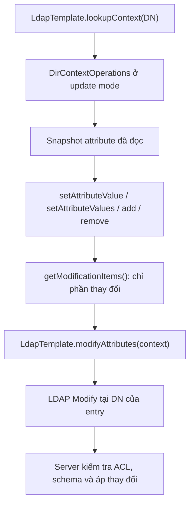
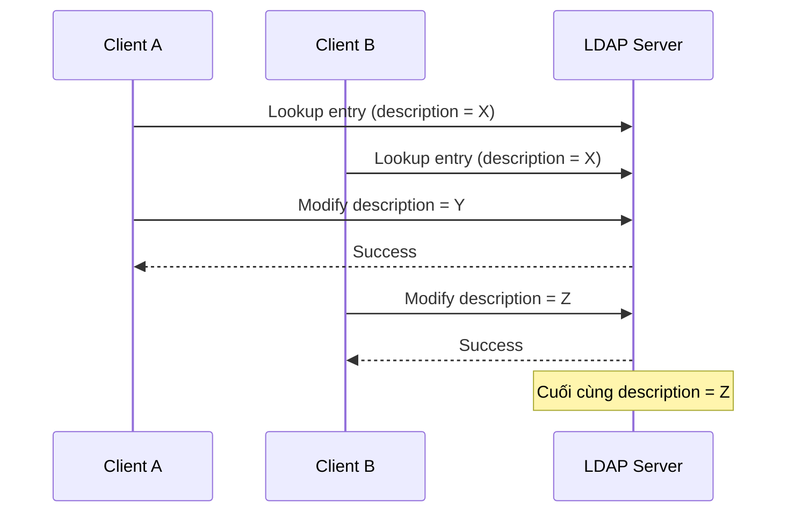

# Giữ attribute chưa thay đổi trong update

## Mục tiêu bài học

Trong **SPRING_LDAP**, cập nhật một entry LDAP cần bảo đảm một điều quan trọng: **chỉ thay những attribute mà nghiệp vụ yêu cầu, giữ nguyên các attribute không liên quan**. Ví dụ người dùng đổi số điện thoại công việc thì tên, email, nhóm, dữ liệu ứng dụng khác không được tự nhiên biến mất.

**`DirContextAdapter`** của Spring LDAP hỗ trợ cách làm này bằng cơ chế **theo dõi thay đổi** (*attribute modification tracking*). Khi adapter đang ở **update mode**, những lời gọi như `setAttributeValue`, `setAttributeValues`, `addAttributeValue` hoặc `removeAttributeValue` được dùng để tính các `ModificationItem`. `LdapTemplate.modifyAttributes(DirContextOperations)` có thể gửi đúng tập thay đổi đó đến LDAP server thay vì gửi lại toàn bộ hồ sơ.

Bài thuộc chương **DirContextAdapter** và nằm trong lộ trình **SPRING_LDAP**: từ DN, schema, LDAP filter và thao tác entry bằng `LdapTemplate`, `LdapClient` hoặc ODM, đến cấu hình `ContextSource`, xác thực, TLS, pooling, xử lý lỗi và kiểm thử truy cập thư mục an toàn.

Sau bài học, bạn có thể:

1. Phân biệt **entry mới**, **entry đã đọc để update** và các trạng thái của `DirContextAdapter`.
2. Thực hiện quy trình `lookupContext → setAttributeValue(s) → modifyAttributes` đúng mục đích.
3. Chứng minh attribute không sửa sẽ **không nằm trong danh sách modification**; phân biệt với việc nó có/không được đọc về ứng dụng.
4. Xử lý đúng các lựa chọn **không thay đổi**, **đổi giá trị**, **xóa thuộc tính** và **thay tập giá trị đa trị**.
5. Biết khi nào cần tạo `ModificationItem[]` tường minh thay vì dựa vào snapshot của adapter.
6. Nhận diện vấn đề **lost update**, schema, ACL, DN tương đối, TLS và các lỗi khi retry thao tác ghi.
7. Viết unit test cho phần tính diff và integration test đối chiếu trạng thái entry sau khi cập nhật.

## 1. Tình huống: chỉnh điện thoại, không làm mất thông tin khác

Giả sử LDAP server thử nghiệm có một entry:

```ldif
dn: uid=lan,ou=People,dc=example,dc=org
objectClass: top
objectClass: person
objectClass: organizationalPerson
objectClass: inetOrgPerson
uid: lan
cn: Lan Nguyen
sn: Nguyen
mail: lan@example.org
description: Nhân viên phòng kỹ thuật
telephoneNumber: +84 28 5555 0101
```

Nghiệp vụ là **đổi `telephoneNumber` thành `+84 28 5555 0199`**. Kết quả sau cập nhật phải là:

```ldif
dn: uid=lan,ou=People,dc=example,dc=org
objectClass: inetOrgPerson
uid: lan
cn: Lan Nguyen
sn: Nguyen
mail: lan@example.org
description: Nhân viên phòng kỹ thuật
telephoneNumber: +84 28 5555 0199
```

Các dòng khác chỉ được giữ nguyên; không có yêu cầu đổi `cn`, `sn`, `mail`, `description` hoặc `objectClass`. Đây là **hợp đồng nghiệp vụ dạng patch**: chạm đúng trường được chỉ định, không coi việc thiếu một trường trong request HTTP là mệnh lệnh xóa trường đó.

| Attribute | Trước | Ý định | Sau |
| --- | --- | --- | --- |
| `telephoneNumber` | `+84 28 5555 0101` | **Thay đổi** | `+84 28 5555 0199` |
| `mail` | `lan@example.org` | **Giữ nguyên** | `lan@example.org` |
| `description` | Nhân viên phòng kỹ thuật | **Giữ nguyên** | Không đổi |
| `cn`, `sn` | Tên/họ | **Giữ nguyên** | Không đổi |
| `objectClass` | `inetOrgPerson` | **Giữ nguyên** | Không đổi |

LDAP có thao tác `Modify` dành cho việc sửa một hoặc nhiều thuộc tính của **một entry**. Không cần xóa entry rồi tạo lại để thay số điện thoại, và cũng không cần gửi lại toàn bộ `Attributes` dưới dạng thay thế.

## 2. Ba trạng thái của một field trong yêu cầu cập nhật

Trước khi chọn API Spring LDAP, phải quy định một yêu cầu cập nhật có ý nghĩa gì khi field vắng mặt hoặc rỗng:

| Request của ứng dụng | Hợp đồng nghiệp vụ gợi ý | LDAP operation |
| --- | --- | --- |
| **Không có field `mail`** | Giữ nguyên email hiện có | Không tạo modification cho `mail` |
| **Có `mail = "new@example.org"`** | Thay email | REPLACE/modify giá trị email |
| **Có yêu cầu “xóa email” tường minh** | Xóa thuộc tính tùy chọn | REMOVE attribute nếu schema và quyền cho phép |
| **Có `mail = ""`** | Phải do API định nghĩa: từ chối hay xóa | Không tự động đoán là “không đổi” |
| **Có `telephoneNumber` mới** | Thay tập số điện thoại theo hợp đồng | Sửa đúng tập giá trị được yêu cầu |

Với API HTTP PATCH, rất nên dùng một kiểu request có thể **phân biệt “field vắng mặt” với “field hiện diện có giá trị null”**. Một POJO Java chỉ có `String mail` mặc định `null` có thể không đủ diễn đạt ba trạng thái này; hệ thống phải lựa chọn cú pháp và deserializer phù hợp.

**Nguyên tắc:** Giữ nguyên attribute không được nhắc đến không phải nhờ gán lại giá trị cũ cho tất cả thuộc tính, mà vì **không tạo thao tác sửa đối với những attribute đó**.

## 3. DirContextAdapter thực hiện dirty tracking như thế nào?

Trong Spring LDAP, `DirContextAdapter` triển khai `DirContextOperations` và `AttributeModificationsAware`. Mặc định, `DefaultDirObjectFactory` có thể tạo adapter từ kết quả `lookup` hoặc `search`.

Khi adapter được khởi tạo từ một entry đã đọc và đang ở **update mode**, nó có thể so sánh trạng thái ban đầu với những thay đổi do code áp dụng:



Các method quan trọng:

| API | Vai trò |
| --- | --- |
| `lookupContext(dn)` | Đọc entry và trả `DirContextOperations` thích hợp để cập nhật |
| `getStringAttribute(name)` | Đọc một giá trị chuỗi |
| `getStringAttributes(name)` | Đọc tập giá trị chuỗi (đa trị) |
| `setAttributeValue(name, value)` | Đặt một giá trị mới cho attribute |
| `setAttributeValues(name, values)` | Đặt tập giá trị đa trị; có logic phát hiện khác biệt |
| `addAttributeValue(name, value)` | Thêm một giá trị, thường tránh thêm trùng |
| `removeAttributeValue(name, value)` | Loại một giá trị đã biết khỏi attribute đa trị |
| `getModificationItems()` | Lấy mảng `ModificationItem` đã tính |
| `getNamesOfModifiedAttributes()` | Xem tên những attribute được ghi nhận là có thay đổi |
| `isUpdateMode()` | Kiểm tra trạng thái theo dõi cập nhật |
| `modifyAttributes(ctx)` | Thực sự gửi thao tác LDAP Modify lên server |

Điểm mấu chốt: **`setAttributeValue` chưa phải lời gọi mạng cập nhật server**. Nó thay đổi trạng thái dự định của adapter. Chỉ khi code gọi phương thức ghi như `ldapTemplate.modifyAttributes(ctx)`, một thao tác LDAP Modify mới được phát đi.

### 3.1. Update mode khác create mode

| Tình huống | Cách tạo context | Ý nghĩa |
| --- | --- | --- |
| Thêm entry mới | `new DirContextAdapter(dn)` | Xây attribute cho entry chưa tồn tại rồi `bind` |
| Cập nhật entry hiện có | `ldapTemplate.lookupContext(dn)` | Nhận snapshot có DN và trạng thái phù hợp cho modify |
| Tự tạo adapter để mô phỏng entry hiện có | Khởi tạo từ `Attributes` + DN, xác nhận/bật update mode | Dùng chủ yếu cho test và công cụ đặc biệt |

Không áp dụng lẫn lộn `bind(ctx)`, `rebind(ctx)` và `modifyAttributes(ctx)`:

- `bind` là **tạo entry**, không phải cập nhật một entry đã tồn tại.
- `modifyAttributes` gửi những modification tới entry đã có, phù hợp với patch.
- `rebind` có ngữ nghĩa xóa/thay thế binding/entry theo API và có thể làm mất dữ liệu không được khai báo lại. **Không chọn rebind khi mục tiêu là giữ attribute chưa thay đổi.**

### 3.2. getModificationItems và ba kiểu sửa

JNDI biểu diễn modification bằng `javax.naming.directory.ModificationItem` với các thao tác:

| Loại thao tác | Hằng số JNDI | Ý nghĩa |
| --- | --- | --- |
| ADD | `DirContext.ADD_ATTRIBUTE` | Thêm attribute hoặc giá trị nếu server cho phép |
| REMOVE | `DirContext.REMOVE_ATTRIBUTE` | Xóa attribute hoặc giá trị theo yêu cầu |
| REPLACE | `DirContext.REPLACE_ATTRIBUTE` | Thay tập giá trị của một attribute |

`DirContextAdapter` có thể tính các ADD/REMOVE/REPLACE phù hợp dựa trên giá trị ban đầu và giá trị mới, nhưng **không mặc định mọi attribute đều luôn được REPLACE**. Với một số thuộc tính đa trị, Spring LDAP có thể tính các modification theo từng giá trị để không thay toàn bộ tập.

Điều quan trọng nhất trong bài: **attribute không đổi không cần xuất hiện trong mảng `ModificationItem[]`**, kể cả khi adapter đã đọc nó cùng với những thuộc tính khác.

## 4. Quy trình cập nhật đúng một thuộc tính

Giả sử ứng dụng đã có `LdapTemplate` và `ContextSource` hợp lệ. Với Spring Boot, cấu hình kết nối **minh họa**:

```properties
spring.ldap.urls=ldaps://ldap.example.org:636
spring.ldap.base=dc=example,dc=org
spring.ldap.username=cn=svc-editor,ou=Services,dc=example,dc=org
spring.ldap.password=${LDAP_BIND_PASSWORD}
```

Đây là dữ liệu giả định; để chạy phải có LDAP server, truststore tin cậy, schema và account chỉ có quyền sửa đúng nhánh/attribute cần thiết. Không ghi mật khẩu thật vào repository.

### 4.1. Ví dụ Java: chỉ đổi số điện thoại

```java
import javax.naming.Name;
import org.springframework.ldap.core.DirContextOperations;
import org.springframework.ldap.core.LdapTemplate;
import org.springframework.ldap.support.LdapNameBuilder;

final class PersonDirectoryUpdater {
    private final LdapTemplate ldapTemplate;

    PersonDirectoryUpdater(LdapTemplate ldapTemplate) {
        this.ldapTemplate = ldapTemplate;
    }

    void changePhone(String uid, String newPhone) {
        if (uid == null || uid.isBlank()
                || newPhone == null || newPhone.isBlank()) {
            throw new IllegalArgumentException("uid/phone required");
        }

        // DN tương đối với ContextSource.base = dc=example,dc=org.
        Name dn = LdapNameBuilder.newInstance()
                .add("ou", "People")
                .add("uid", uid)
                .build();

        // Đọc trạng thái hiện hành; adapter ở update mode.
        DirContextOperations ctx = ldapTemplate.lookupContext(dn);

        // Chỉ động đến trường nghiệp vụ yêu cầu.
        ctx.setAttributeValue("telephoneNumber", newPhone);

        // Có thể quan sát diff trước khi ghi.
        if (ctx.getModificationItems().length == 0) {
            return; // Không có thay đổi hữu hiệu theo adapter.
        }

        // Gửi những modification được adapter tính đến LDAP server.
        ldapTemplate.modifyAttributes(ctx);
    }
}
```

Đọc trình tự này theo **hợp đồng**:

1. Dựng DN bằng `LdapNameBuilder`, không ghép input người dùng vào chuỗi DN một cách thủ công.
2. `lookupContext(dn)` đọc entry và cung cấp adapter có snapshot phù hợp để tính thay đổi.
3. `setAttributeValue("telephoneNumber", newPhone)` chỉ thay giá trị dự định của thuộc tính này.
4. `getModificationItems()` là phần chênh lệch mà Spring LDAP tính, **không phải toàn bộ attribute của entry**.
5. `modifyAttributes(ctx)` thực hiện ghi. Server vẫn phải xác minh quyền, schema và các ràng buộc hiện hành.

Nếu giá trị mới đã bằng giá trị cũ theo cách adapter so sánh, số modification có thể là 0. Khi đó ví dụ chủ động bỏ qua yêu cầu ghi. Trường hợp cần audit mỗi lần nhận request **dù không có thay đổi**, hãy ghi audit nghiệp vụ riêng, không cố sửa thuộc tính LDAP chỉ để tạo side effect.

**Cảnh báo về DN:** Ví dụ này giả định entry nằm trực tiếp dưới `ou=People`. Nếu entry có thể ở nhiều OU, cần tìm DN thật bằng search với filter phù hợp, rồi dùng chính DN đó để lookup/update; đừng suy vị trí chỉ từ `uid`.

### 4.2. Trạng thái trước và sau không có nghĩa “đã lưu”

```text
Server LDAP: phone = 0101, mail = lan@example.org
  |
  | lookupContext()
  v
Adapter: phone = 0101, mail = lan@example.org
  |
  | setAttributeValue("telephoneNumber", "0199")
  v
Adapter: phone = 0199 (dự định); mail vẫn như cũ
  |
  | getModificationItems()
  v
Diff: chỉ thay telephoneNumber
  |
  | ldapTemplate.modifyAttributes(ctx)
  v
Server LDAP: áp Modify nếu qua ACL/schema
```

Lời gọi `ctx.getStringAttribute("telephoneNumber")` trên adapter sau khi set có thể phản ánh giá trị dự định theo trạng thái nội bộ; **nó không chứng minh server đã lưu thành công**. Muốn đối soát trạng thái server, đọc lại entry sau khi `modifyAttributes(ctx)` trả thành công, bằng context/quy trình phù hợp.

### 4.3. Vì sao không gửi lại toàn bộ attribute?

Một cách làm không phù hợp với patch là đọc DTO, rồi thay tất cả trường từ request:

```java
// Dễ sai: request chỉ có telephoneNumber, nhưng các field khác là null.
ctx.setAttributeValue("cn", request.fullName());
ctx.setAttributeValue("mail", request.email());
ctx.setAttributeValue("telephoneNumber", request.phone());
ldapTemplate.modifyAttributes(ctx);
```

Ở đây, giá trị `null` của `fullName` hoặc `email` có thể bị diễn giải là **ý định xóa thuộc tính** theo API. Khi đó dữ liệu không liên quan có thể bị sửa hoặc LDAP server từ chối vì một thuộc tính bắt buộc bị xóa.

Thay vào đó, cần có biểu diễn **field được yêu cầu cập nhật**:

```java
// Pseudocode mô tả hợp đồng PATCH, không giả định record tự phân biệt
// "field thiếu" và "field có giá trị null".
if (patch.hasField("telephoneNumber")) {
    String nextPhone = patch.requiredString("telephoneNumber");
    ctx.setAttributeValue("telephoneNumber", nextPhone);
}
if (patch.hasField("description")) {
    ctx.setAttributeValue(
            "description",
            patch.optionalStringOrNull("description")
    );
}
ldapTemplate.modifyAttributes(ctx);
```

Với ví dụ trên, `patch` là một abstraction minh họa cần được xây dựng theo thư viện xử lý request thực tế. Không copy đoạn pseudo-code vào production mà chưa định nghĩa `hasField`, validation và quy tắc null của ứng dụng.

## 5. Khi dùng cùng giá trị: no-op khác với ghi lại

Giả sử `description` ban đầu là `"Nhân viên phòng kỹ thuật"`. Nếu gọi:

```java
DirContextOperations ctx = ldapTemplate.lookupContext(dn);

ctx.setAttributeValue(
        "description",
        "Nhân viên phòng kỹ thuật");

int count = ctx.getModificationItems().length;
```

Trong update mode, adapter so sánh với trạng thái ban đầu và thường không tạo modification cho giá trị không thay đổi. Nếu bạn gọi `setAttributeValue` với một giá trị mới khác, adapter đưa thuộc tính đó vào danh sách sửa.

Không nên tự dùng `equalsIgnoreCase` hoặc `trim()` để quyết định “không khác” cho mọi attribute: LDAP schema có **matching rule** khác nhau; hơn nữa so sánh của adapter ở phía client không thay thế phép kiểm tra trên server. Đối với DN-valued attributes, Spring LDAP có hỗ trợ xử lý **`javax.naming.Name`** để so sánh theo ngữ nghĩa DN; xem phần đa trị ở mục 7.

**Không thay đổi cùng giá trị** là một tối ưu vận hành, không phải cơ chế kiểm soát cạnh tranh. Giữa thời điểm lookup và modify, một client khác vẫn có thể sửa entry.

## 6. Phân biệt “giữ nguyên”, “xóa thuộc tính” và “thiếu do ACL”

Một attribute không xuất hiện trong adapter có thể do:

- Entry thực sự **không có attribute**.
- Client **không yêu cầu trả về** attribute trong lookup/search.
- Tài khoản bind **không được ACL cho đọc** attribute đó.
- Attribute thuộc loại operational và server chỉ trả khi yêu cầu tường minh.

Khi nhiệm vụ là **giữ nguyên** attribute đó, cách an toàn thường là **không gọi setter/remover cho nó**. Không tự “phục hồi” giá trị thiếu bằng chuỗi rỗng, `null` hay giá trị mặc định.

### 6.1. Xóa có chủ đích

Nếu nghiệp vụ cần xóa `description` (thuộc tính tùy chọn, được schema và ACL cho phép), thao tác xóa phải được thể hiện **tường minh**:

```java
DirContextOperations ctx = ldapTemplate.lookupContext(dn);
ctx.setAttributeValues("description", new Object[0]);
ldapTemplate.modifyAttributes(ctx);
```

Theo Javadoc `DirContextAdapter.setAttributeValues`, mảng giá trị rỗng (hoặc `null` với overload này) có nghĩa loại thuộc tính. Tuy nhiên, **chỉ khi adapter có snapshot phù hợp** thì nó mới tính được chênh lệch đúng. Nếu attribute không được tải do projection hoặc ACL, việc yêu cầu remove bằng API dựa trên diff có thể không tạo modification theo cách caller dự đoán.

Không xóa `sn` hoặc `cn` chỉ vì form không gửi chúng: `inetOrgPerson` và chuỗi object class kế thừa có các thuộc tính bắt buộc; LDAP server có thể từ chối hành động không hợp lệ.

### 6.2. Thuộc tính operational là ngoại lệ quan trọng

Các attribute như `createTimestamp`, `modifyTimestamp` thường là **operational attributes** do server quản lý, không được trả về cùng user attributes mặc định. Tài liệu FAQ của Spring LDAP giải thích: nếu `DirContextAdapter` chưa đọc thấy attribute, gọi `removeAttributeValue(...)` có thể **không tạo modification nào**, vì từ góc nhìn adapter giá trị đó không tồn tại.

Nếu có nhiệm vụ hợp lệ cần sửa một attribute không nằm trong snapshot:

1. Chọn overload `lookup`/`search` yêu cầu tường minh attribute cần thao tác và lấy adapter qua context mapper phù hợp.
2. Hoặc xây `ModificationItem[]` tường minh rồi gọi `LdapTemplate.modifyAttributes(dn, changes)`, nếu biết chính xác ý định và có quyền.
3. Đối chiếu schema/ACL và quy tắc server; nhiều operational attributes **không được phép sửa** dù client yêu cầu tường minh.

Không dùng khả năng tạo `ModificationItem[]` để tìm cách vượt ACL. Quyền thực tế luôn do server quyết định.

## 7. Attribute đa trị: giữ các giá trị không bị động tới

Một nhóm `groupOfNames` có thể chứa nhiều `member`:

```ldif
dn: cn=Developers,ou=Groups,dc=example,dc=org
objectClass: groupOfNames
cn: Developers
member: uid=lan,ou=People,dc=example,dc=org
member: uid=mai,ou=People,dc=example,dc=org
```

Nếu hợp đồng nghiệp vụ là **thêm một người vào nhóm**, không nên làm:

```java
// SAI cho nghiệp vụ "thêm": thay toàn bộ tập bằng một thành viên.
ctx.setAttributeValues("member",
        new String[] {"uid=nam,ou=People,dc=example,dc=org"});
```

Thao tác `setAttributeValues` đại diện cho **tập giá trị mới của attribute**. Nếu chỉ truyền một thành viên, những thành viên còn lại có thể bị xóa khỏi tập sau update.

### 7.1. Thêm/xóa đúng một giá trị

Để thêm một thành viên mà vẫn giữ các thành viên khác:

```java
import javax.naming.Name;
import org.springframework.ldap.core.DirContextOperations;
import org.springframework.ldap.support.LdapNameBuilder;

Name groupDn = LdapNameBuilder.newInstance()
        .add("ou", "Groups")
        .add("cn", "Developers")
        .build();

// Attribute member lưu DN đầy đủ tính từ gốc directory,
// khác với DN tương đối truyền cho LdapTemplate.
Name memberDn = LdapNameBuilder.newInstance(
        "dc=example,dc=org")
        .add("ou", "People")
        .add("uid", "nam")
        .build();

DirContextOperations ctx = ldapTemplate.lookupContext(groupDn);
ctx.addAttributeValue("member", memberDn);
ldapTemplate.modifyAttributes(ctx);
```

Để bỏ thành viên đó, dùng `ctx.removeAttributeValue("member", memberDn)` với cùng cách biểu diễn DN và quyền. `addAttributeValue` thông thường tránh thêm giá trị trùng; không cần đọc các thành viên ra `String[]`, chèn vào rồi REPLACE toàn bộ tập chỉ để thêm một người.

**Cần lưu ý DN và escaping:** Giá trị `member` chứa **DN đầy đủ**; `groupDn` truyền cho `LdapTemplate` thường là tên **tương đối** với base của `ContextSource`. Dùng `LdapNameBuilder` cho DN, không dùng escape filter để tạo DN.

### 7.2. So sánh DN theo Name

DN `uid=LAN,ou=People,dc=example,dc=org` có thể biểu diễn cùng tên với `UID=lan,OU=People,DC=example,DC=org` theo ngữ nghĩa tên LDAP. Nếu code coi chúng là hai `String` khác nhau, có thể phát sinh thay đổi thừa.

Spring LDAP hỗ trợ đưa `javax.naming.Name` vào các method thao tác attribute để tính khác biệt **theo DN equality**, thay vì chỉ theo equality chuỗi Java.

```java
// Tập member hiện có có thể lưu DN dưới dạng chuỗi.
Name sameMember = LdapNameBuilder.newInstance(
        "dc=example,dc=org")
        .add("ou", "People")
        .add("uid", "LAN")
        .build();

ctx.addAttributeValue("member", sameMember);
// Khi DN tương đương đã có, builder có thể tránh thay đổi trùng.
```

Không mặc định mọi attribute đa trị là DN-valued. Chỉ truyền `Name` khi schema của attribute diễn đạt giá trị DN, như `member` hoặc `uniqueMember` trong những schema phù hợp.

### 7.3. Toàn bộ tập mới và thứ tự giá trị

`setAttributeValues("member", values)` có thể dùng khi nghiệp vụ thật sự là **đặt lại toàn bộ danh sách thành viên**. Mặc định, với method hai tham số, **thứ tự không được coi là có ý nghĩa** khi tính thay đổi. Overload `setAttributeValues(name, values, orderMatters)` cho phép xác định rằng việc đổi thứ tự cũng đáng được xem là thay đổi.

Tuy nhiên, LDAP multi-valued attribute thường được mô hình hóa như **một tập không có thứ tự**. Chỉ dùng `orderMatters=true` khi schema/server và nghiệp vụ thực sự yêu cầu, và kiểm thử trên directory server cụ thể.

Một số attribute không có **equality matching rule** phù hợp; server có thể từ chối thao tác thêm/xóa riêng từng giá trị. Ở những phiên bản Spring LDAP mới, có cấu hình nâng cao để buộc tính diff theo kiểu REPLACE toàn bộ attribute trong các trường hợp đó. Nếu gặp lỗi schema/matching rule, hãy kiểm tra tài liệu Spring LDAP **đúng phiên bản**, thay vì tự động chuyển mọi update đa trị sang REPLACE.

## 8. Ba API dễ bị dùng sai

### 8.1. `getModificationItems()` chỉ xem diff

```java
DirContextOperations ctx = ldapTemplate.lookupContext(dn);
ctx.setAttributeValue("description", "Đã xác minh");

var changes = ctx.getModificationItems();
// changes là những thay đổi dự định, chưa phải kết quả ghi server.
```

`getModificationItems()` cung cấp `ModificationItem[]` để gửi trong LDAP Modify. Nó không có nghĩa đã lưu các thay đổi. Có thể dùng để kiểm tra số lượng hoặc tên attribute thay đổi trong unit test và để xây chính sách audit an toàn.

Nếu cần debug, chỉ log **tên attribute và loại thao tác**, không log toàn bộ giá trị nhạy cảm hoặc secret. Một field như `userPassword` tuyệt đối không nên bị đưa vào log chỉ vì đang phát sinh modification.

### 8.2. `ctx.update()` không phải thao tác ghi trên server

Tên method `update()` trên `DirContextAdapter` đặc biệt dễ gây nhầm. Theo Javadoc, method này cập nhật trạng thái attribute **bên trong adapter**, khiến các getter phản ánh giá trị mới và **xóa danh sách modification đang theo dõi**.

```java
DirContextOperations ctx = ldapTemplate.lookupContext(dn);
ctx.setAttributeValue("description", "Đã xác minh");

// KHÔNG NÊN gọi update() để "lưu" LDAP:
ctx.update();

// Diff giờ có thể rỗng; server chưa được yêu cầu Modify.
ldapTemplate.modifyAttributes(ctx);
```

Đoạn trên có thể khiến người viết tưởng đã lưu, trong khi `ctx.update()` đã làm mất các modification pending. **Muốn gửi thao tác LDAP Modify, gọi `ldapTemplate.modifyAttributes(ctx)` (hoặc API tương ứng của `LdapClient`)**, không dùng `ctx.update()` như một lệnh commit.

Sau khi gửi một thao tác ghi, nếu cần xác nhận giá trị thực tế, nên **lookup lại** thay vì dựa vào trạng thái một adapter đã được sửa trong bộ nhớ. Không tái sử dụng một snapshot cũ cho nhiều request độc lập.

### 8.3. `rebind` không phải partial update

```java
// Không dùng rebind để đổi một thuộc tính khi yêu cầu
// là "giữ nguyên mọi thuộc tính khác".
ldapTemplate.rebind(ctx);
```

`rebind` có ngữ nghĩa thay entry/binding, với khả năng thay thế tập attribute bằng dữ liệu cung cấp. Không mặc nhiên giữ những attribute không xuất hiện trong đối tượng mới. Khi nghiệp vụ yêu cầu patch, ưu tiên **Modify**.

## 9. Snapshot không đầy đủ: chuyện gì xảy ra nếu chưa đọc một field?

Đây là trường hợp rất quan trọng khi tái sử dụng `DirContextAdapter`:

```text
LDAP entry thực tế:
  uid=lan
  cn=Lan Nguyen
  mail=lan@example.org
  description=Đang làm việc

Lookup chỉ yêu cầu:
  uid, cn

Adapter thấy:
  uid=lan
  cn=Lan Nguyen
  (không có dữ liệu mail/description trong snapshot)
```

Từ phía adapter, **không được trả về** và **không tồn tại** có thể trông giống nhau. Nếu code muốn bỏ một giá trị cũ của `description`, nhưng adapter chưa từng được đọc thuộc tính ấy, phương pháp dựa trên so sánh snapshot có thể không tạo yêu cầu REMOVE như mong đợi.

Ngược lại, nếu code gán một giá trị mới cho attribute chưa tải, nó đang thay một **trạng thái cũ không biết rõ**. Có thể đúng nếu hợp đồng yêu cầu **đặt giá trị tuyệt đối bất kể trước đó là gì**, nhưng không đúng nếu hợp đồng yêu cầu **“chỉ thay khi giá trị cũ bằng X”**.

### 9.1. Khi có thể dùng snapshot đầy đủ

Với thao tác sửa thông thường, `lookupContext(dn)` từ `ContextSource` và factory mặc định giúp ứng dụng làm việc với những **user attributes** được server trả về theo quyền account. Đây là trường hợp thích hợp cho dirty tracking.

Tuy nhiên, không phải mọi attribute đều mặc định được trả về. Operational attributes, attribute bị ACL ẩn, một số attribute có phạm vi riêng hoặc dữ liệu được tải theo range có thể cần xử lý đặc biệt.

### 9.2. Khi cần đọc tường minh thuộc tính trước khi sửa

Với một trường hợp cần sửa attribute không có trong kết quả lookup mặc định, dùng API lookup yêu cầu thuộc tính cụ thể:

```java
import javax.naming.Name;
import org.springframework.ldap.core.ContextMapper;
import org.springframework.ldap.core.DirContextOperations;

String[] attrsToRead = {"cn", "description"};

DirContextOperations ctx = ldapTemplate.lookup(
        dn,
        attrsToRead,
        (ContextMapper<DirContextOperations>) raw ->
                (DirContextOperations) raw
);

ctx.setAttributeValue("description", "Đã xác minh");
ldapTemplate.modifyAttributes(ctx);
```

Mã này **giả định `DefaultDirObjectFactory`** đang trả object tương thích với `DirContextOperations`. Nếu dùng factory tùy chỉnh, kiểm tra object type trước khi cast hoặc chọn API mapping phù hợp. Đừng dùng ví dụ này để cố sửa operational attributes do server quản lý.

### 9.3. Khi thay đổi phải tường minh, không phụ thuộc snapshot

Nếu nghiệp vụ đã xác định rõ **thao tác trên một attribute** và không cần adapter tính diff từ giá trị đã đọc, có thể dùng `ModificationItem[]`:

```java
import javax.naming.Name;
import javax.naming.directory.BasicAttribute;
import javax.naming.directory.DirContext;
import javax.naming.directory.ModificationItem;

ModificationItem[] changes = {
    new ModificationItem(
        DirContext.REPLACE_ATTRIBUTE,
        new BasicAttribute("description", "Đã xác minh")
    )
};

ldapTemplate.modifyAttributes(dn, changes);
```

Đây là một **REPLACE có chủ đích** đối với `description`. Những attribute khác không có mặt trong mảng sẽ không bị chỉ định sửa bởi yêu cầu này. Tuy nhiên, ứng dụng vẫn phải biết đúng DN, đúng schema, đúng quyền, và phải xử lý cạnh tranh với những client khác.

Nếu yêu cầu là **xóa một attribute tùy chọn**, dùng `DirContext.REMOVE_ATTRIBUTE` với cấu trúc `BasicAttribute` phù hợp với thao tác remove toàn thuộc tính theo JNDI/LDAP; xác minh behavior trên server đích. Không tạo một mảng `ModificationItem[]` tùy tiện từ JSON không đáng tin cậy.

## 10. Dirty tracking không phải optimistic locking

Việc chỉ gửi những attribute thay đổi giúp giảm nguy cơ ghi đè **các field không liên quan**. Nhưng nó **không giải quyết hoàn toàn cập nhật đồng thời**.

Ví dụ hai client cùng chỉnh `description`:



Client B có thể ghi đè thay đổi của A vì snapshot không tự chứa cơ chế kiểm tra phiên bản. Đây là **lost update** ngay trên cùng attribute.

Nếu hai client cập nhật hai attribute khác nhau, dùng LDAP Modify chỉ chạm từng attribute thường giảm va chạm so với thay toàn bộ entry. Tuy nhiên, vẫn phải xét các ràng buộc liên thuộc tính, schema và consistency yêu cầu của sản phẩm.

Để có **kiểm soát cạnh tranh mạnh hơn**, cân nhắc:

- **Assertion control** hoặc một cơ chế conditional modify mà LDAP server và thư viện thực sự hỗ trợ.
- Kiểm tra một thuộc tính phiên bản/dấu thời gian trước sửa, hiểu rõ rằng **đọc–so sánh–ghi tách rời vẫn có race condition** nếu không có điều kiện nguyên tử phía server.
- Đồng bộ/serialization cập nhật ở tầng ứng dụng khi tất cả writer thực sự đi qua cùng một điểm kiểm soát.
- Thiết kế nghiệp vụ hợp nhất thay đổi, thông báo xung đột và cho phép thử lại có kiểm soát.

Không mặc định rằng `DirContextAdapter` hoặc `LdapTemplate.modifyAttributes` hỗ trợ sẵn optimistic locking giống `@Version` của JPA. Các server khác nhau có thể có control, transaction và chính sách replication khác nhau.

### 10.1. Timeout sau khi gửi Modify không có nghĩa thao tác thất bại

Giả sử LDAP server đã áp thay đổi nhưng kết nối rơi trước khi client nhận phản hồi:

```text
App gửi Modify(description = Y)
Server có thể đã áp dụng
Mạng đứt trước phản hồi
App không biết chắc trạng thái cuối
```

Trong trường hợp này:

1. Không lập tức retry một ADD/REMOVE đa trị có side effect.
2. Nếu có thể, lookup lại trạng thái hiện tại bằng account có quyền và so sánh với mục tiêu.
3. Cân nhắc concurrency: giá trị đọc lại có thể đã thay đổi bởi writer khác.
4. Trả kết quả nghiệp vụ “chưa xác định/đang cần đối soát” theo hợp đồng nếu không thể xác minh.

Không bắt mọi exception rồi trả `false` hoặc `List.of()` như thể server chắc chắn chưa thực hiện.

## 11. Unit test: chứng minh attribute không đổi không bị ghi

Không cần LDAP server để kiểm tra cách `DirContextAdapter` tính modification. Có thể dùng `BasicAttributes` và một DN thử nghiệm để tạo adapter trong bộ nhớ.

### 11.1. Fixture dùng cho test

```java
import javax.naming.directory.BasicAttributes;
import javax.naming.ldap.LdapName;
import org.springframework.ldap.core.DirContextAdapter;

static DirContextAdapter sampleEntry() throws Exception {
    BasicAttributes attrs = new BasicAttributes(true);
    attrs.put("objectClass", "inetOrgPerson");
    attrs.put("uid", "lan");
    attrs.put("cn", "Lan Nguyen");
    attrs.put("sn", "Nguyen");
    attrs.put("mail", "lan@example.org");
    attrs.put("description", "Ban đầu");

    DirContextAdapter adapter = new DirContextAdapter(
            attrs, new LdapName("uid=lan,ou=People"));
    adapter.setUpdateMode(true);
    return adapter;
}
```

Đây là **fixture unit test**, không phải cách khuyến nghị xây adapter để ghi production. Trong ứng dụng thật nên dùng `lookupContext(dn)` để có DN/snapshot do server trả về. Việc đặt `setUpdateMode(true)` ở fixture là một bước tường minh để test dirty tracking.

### 11.2. Test một field thay đổi, các field khác giữ nguyên

Ví dụ JUnit 5 dùng chung helper `sampleEntry()`:

```java
import static org.junit.jupiter.api.Assertions.*;

import java.util.Arrays;
import java.util.Set;
import java.util.stream.Collectors;
import javax.naming.directory.ModificationItem;
import org.junit.jupiter.api.Test;
import org.springframework.ldap.core.DirContextAdapter;

class DirContextAdapterChangeTest {

    @Test
    void onlyDescriptionIsModified() throws Exception {
        DirContextAdapter ctx = sampleEntry();
        assertTrue(ctx.isUpdateMode());
        assertEquals(0, ctx.getModificationItems().length);

        ctx.setAttributeValue("description", "Sau cập nhật");

        ModificationItem[] mods = ctx.getModificationItems();
        Set<String> modifiedNames = Arrays.stream(mods)
                .map(item -> item.getAttribute().getID()
                        .toLowerCase(java.util.Locale.ROOT))
                .collect(Collectors.toSet());

        assertEquals(Set.of("description"), modifiedNames);
        assertEquals("lan@example.org",
                ctx.getStringAttribute("mail"));
        assertEquals("Lan Nguyen",
                ctx.getStringAttribute("cn"));
    }
}
```

Test chỉ khẳng định **adapter tính diff cho `description`** và các trường khác không bị chỉ định sửa. Nó không tự kết nối LDAP, không thực hiện ghi lên server và không chứng minh ACL/schema cho phép update.

Chú ý cách đặt ví dụ trong dự án:

- Đặt `sampleEntry()` trong cùng lớp test hoặc một helper test có phạm vi truy cập phù hợp.
- Các import được trình bày riêng theo mục để dễ đọc; khi đưa vào một file Java hoàn chỉnh, hợp nhất các import ở đầu file.
- Đối với một số filter/schema/phiên bản thư viện, chi tiết `ADD/REMOVE/REPLACE` có thể khác; kiểm chứng tên attribute và hiệu quả cuối thay vì viết test phụ thuộc một thứ tự mảng không được bảo đảm.

### 11.3. Test không đổi giá trị thì không gửi modification

```java
@Test
void sameDescriptionMeansNoEffectiveModification() throws Exception {
    DirContextAdapter ctx = sampleEntry();
    ctx.setAttributeValue("description", "Ban đầu");
    assertEquals(0, ctx.getModificationItems().length);
}
```

Với adapter trong update mode, đặt lại một giá trị bằng đúng giá trị đã đọc không cần tạo thao tác sửa ở LDAP. Điều này hữu ích khi request gửi lại dữ liệu nguyên trạng.

### 11.4. Test update() chỉ xóa trạng thái thay đổi nội bộ

```java
@Test
void localUpdateClearsPendingModifications() throws Exception {
    DirContextAdapter ctx = sampleEntry();
    ctx.setAttributeValue("description", "Sau cập nhật");
    assertTrue(ctx.getModificationItems().length > 0);

    ctx.update(); // Chỉ tác động adapter, không gọi LDAP server.
    assertEquals(0, ctx.getModificationItems().length);
}
```

Đây là test rất quan trọng để tránh nhầm `ctx.update()` với `ldapTemplate.modifyAttributes(ctx)`. Test không dùng LDAP server, nên không có bước nào ghi dữ liệu directory.

### 11.5. Test tập thuộc tính đa trị

Với attribute chứa hai số điện thoại, khi chỉ thay một số, hai trường không liên quan `mail` và `cn` vẫn không được sửa:

```java
@Test
void multivalueUpdateMustNotModifyUnrelatedAttributes()
        throws Exception {
    DirContextAdapter ctx = sampleEntry();
    ctx.setAttributeValues("telephoneNumber", new String[] {
            "+84 28 5555 0101",
            "+84 28 5555 0199"
    });

    Set<String> names = Arrays.stream(ctx.getModificationItems())
            .map(m -> m.getAttribute().getID())
            .collect(Collectors.toSet());

    assertTrue(names.contains("telephoneNumber"));
    assertFalse(names.contains("mail"));
    assertFalse(names.contains("cn"));
}
```

Test này kiểm tra **attribute nào được đặt trong diff**, không kiểm tra server chấp nhận giá trị mới hay thuộc tính đó thực tế được schema cho phép chứa hai giá trị. Đó là trách nhiệm của integration test.

## 12. Integration test: phải chứng minh trên LDAP server

Unit test giúp đánh giá dirty tracking, nhưng **chỉ directory server mới biết** ACL, schema, matching rule, ràng buộc RDN và trạng thái dữ liệu thực. Nên có một LDAP server test riêng với entry và account tách khỏi production.

### 12.1. Bộ kiểm thử theo tình huống

| Mã ca | Kịch bản | Kết quả cần xác minh |
| --- | --- | --- |
| **KEEP-01** | Đổi `telephoneNumber`, không chạm các field khác | Sau lookup lại, `mail`, `cn`, `sn`, `description` giữ nguyên |
| **KEEP-02** | Set `description` bằng giá trị hiện tại | Diff không phát sinh thay đổi không cần thiết |
| **KEEP-03** | Đổi `description` từ A sang B | LDAP chỉ áp ý định sửa `description` |
| **KEEP-04** | HTTP PATCH không có field `mail` | Không xóa hoặc thay email |
| **KEEP-05** | HTTP PATCH yêu cầu xóa `description` tường minh | Xóa theo hợp đồng, không xóa field khác |
| **KEEP-06** | Cố xóa thuộc tính bắt buộc `sn` | LDAP từ chối theo schema; entry vẫn nhất quán |
| **KEEP-07** | Thêm một giá trị `member` vào nhóm có nhiều thành viên | Thành viên cũ vẫn có mặt |
| **KEEP-08** | Xóa một `member` đã tồn tại | Thành viên khác không bị xóa |
| **KEEP-09** | Thêm DN tương đương đã tồn tại bằng `Name` | Tránh sửa trùng không cần thiết theo DN equality |
| **KEEP-10** | Attribute operational không trả về mặc định | Không giả định REMOVE dựa trên snapshot sẽ hoạt động |
| **KEEP-11** | Account chỉ đọc thử modify | Server từ chối theo ACL |
| **KEEP-12** | DN sai hoặc entry không tồn tại | Báo lỗi đúng loại, không tạo entry ngoài ý định |
| **KEEP-13** | Mất kết nối trước khi nhận Modify response | Không retry mù; có bước đối soát |
| **KEEP-14** | TLS certificate không đáng tin cậy | Kết nối bị từ chối, không hạ cấp sang plain LDAP |
| **KEEP-15** | Hai client đổi cùng `description` | Quan sát nguy cơ lost update và cách ứng dụng xử lý |
| **KEEP-16** | Dùng `rebind` trên fixture thử nghiệm | Nhận diện khác biệt so với modify; không áp trên dữ liệu thật |

### 12.2. Trình tự kiểm chứng độc lập bằng ldapsearch

Trong môi trường thử nghiệm, account có quyền đọc có thể kiểm tra trạng thái trước/sau:

```bash
ldapsearch -LLL -x \
  -H ldaps://ldap.example.org:636 \
  -D "cn=svc-reader,ou=Services,dc=example,dc=org" -W \
  -b "uid=lan,ou=People,dc=example,dc=org" \
  -s base "(objectClass=*)" \
  uid cn sn mail description telephoneNumber
```

Chạy lệnh một lần **trước**, một lần **sau** khi ứng dụng thực hiện `modifyAttributes(ctx)`. Kỳ vọng: chỉ thuộc tính được nghiệp vụ yêu cầu thay đổi; những thuộc tính khác bằng giá trị đã ghi nhận trước đó, trong giới hạn quyền và độ nhất quán của server.

Không dùng credential thật trên dòng lệnh; `-W` cho phép nhập mật khẩu qua prompt. Máy khách cần tin cậy chứng chỉ server. Nếu directory có replica, cần lưu ý replication delay: đọc từ node khác ngay sau ghi có thể chưa thấy trạng thái mới.

### 12.3. Phân biệt “không thay đổi” với “không có quyền đọc”

Giả sử `mail` không xuất hiện trong response của account chỉ đọc nhưng lại có trong server. Một test chỉ nhìn vào kết quả dưới account ấy **không thể kết luận mail đã được giữ nguyên**. Để kiểm chứng, dùng một account có quyền phù hợp để đối soát trên **môi trường thử nghiệm**, hoặc kiểm tra trước/sau theo quy trình audit được tổ chức cho phép.

Không mở rộng quyền của account dịch vụ sản xuất chỉ để làm cho test dễ viết.

## 13. Xử lý lỗi và phân quyền

Spring LDAP không tự bảo đảm update thành công chỉ vì adapter tính được diff. Server có thể trả lỗi:

| Tình huống | Nguyên nhân | Hướng xử lý |
| --- | --- | --- |
| `lookupContext` không tìm thấy DN | Tên sai, entry đã bị xóa hoặc base không đúng | Báo not-found phù hợp, kiểm tra DN tương đối |
| `modifyAttributes` bị từ chối | ACL không cho sửa hoặc account sai | Tách lỗi quyền với dữ liệu rỗng |
| Schema violation | Thuộc tính bắt buộc, kiểu hoặc object class không hợp lệ | Kiểm tra schema và quy tắc field, không bỏ validation |
| Attribute đa trị không hỗ trợ remove theo giá trị | Không có equality matching rule hoặc server có ràng buộc | Dùng cách cập nhật phù hợp với schema/server |
| `ClassCastException` từ lookupContext | `DirObjectFactory` không trả `DirContextOperations` | Kiểm tra cấu hình object factory |
| Timeout hoặc mất kết nối | Không rõ server đã áp Modify hay chưa | Đối soát rồi mới quyết định retry |
| RDN bị thay qua setter | Thay giá trị attribute nhưng không đổi DN | Dùng `rename` khi hợp đồng thực sự là đổi DN |

**Đừng bắt mọi exception rồi coi update thành công hoặc thất bại đơn giản.** Với thao tác ghi, đặc biệt khi mất phản hồi, trạng thái có thể chưa được xác định. Nên trả một trạng thái nghiệp vụ có ý nghĩa để caller biết có cần đối soát hay không.

### 13.1. Quyền tối thiểu, TLS và pooling

Trong một kiến trúc điển hình:

```text
DirectoryQueryService
  -> LdapTemplate/ContextSource: svc-reader, quyền chỉ đọc

DirectoryUpdateService
  -> LdapTemplate/ContextSource: svc-editor,
     chỉ sửa các attribute/nhánh đã cho phép
```

Trước khi cập nhật:

1. **Authorization tại ứng dụng:** caller được sửa entry này và attribute này hay không?
2. **LDAP ACL:** danh tính service có quyền đúng nhánh/attribute, không có quyền quản trị rộng không cần thiết.
3. **TLS:** dùng LDAPS hoặc StartTLS với certificate/hostname verification; không tắt xác minh chứng chỉ để kết nối thành công.
4. **DN:** dùng `LdapNameBuilder` khi dữ liệu RDN động, không ghép chuỗi tùy tiện.
5. **Input validation:** kiểm tra kiểu/độ dài/ý nghĩa của giá trị trước khi tạo modification.
6. **Connection management:** pooling phải được kiểm tra với TLS, danh tính bind và timeout; không tái sử dụng context dưới quyền người dùng khác.
7. **Logging:** ghi loại operation, thuộc tính được sửa, thời gian và correlation ID; tránh log nội dung hồ sơ không cần thiết.

**Cần phân biệt authentication và update:** Search thấy một entry hoặc Modify thành công bằng service account **không chứng minh** người dùng cuối đã đăng nhập hợp lệ. Nếu ứng dụng cần xác thực người dùng, hãy dùng một luồng authentication riêng. Không coi password rỗng là credential hợp lệ trong simple bind.

## 14. Những sai lầm làm mất attribute không chủ đích

| Cách làm sai | Vì sao gây vấn đề | Giải pháp |
| --- | --- | --- |
| Biến mọi field thiếu trong PATCH thành `null` rồi gọi setter | Có thể thành ý định xóa attribute | Phân biệt absent/set/clear trước khi sửa |
| Gán toàn bộ DTO vào adapter để “đồng bộ” | Field không được yêu cầu cũng bị động đến | Chỉ gọi setter cho field đã thay đổi theo hợp đồng |
| Dùng `rebind` để sửa `telephoneNumber` | Thay entry thay vì Modify; có nguy cơ mất thuộc tính khác | `lookupContext + modifyAttributes` |
| Gọi `ctx.update()` rồi tưởng đã lưu | Xóa diff nội bộ nhưng không phát LDAP Modify | Gọi `ldapTemplate.modifyAttributes(ctx)` |
| Tạo `new DirContextAdapter(dn)` rồi dùng ngay như snapshot hiện có | Đây là tình huống tạo entry; chưa có trạng thái gốc | Dùng `lookupContext(dn)` cho update |
| Đọc thiếu attribute rồi kết luận nó không tồn tại | Có thể do projection/ACL/operational attribute | Đọc đúng attribute khi cần, kiểm tra quyền |
| `setAttributeValues("member", new[]{oneDn})` khi chỉ muốn thêm một thành viên | Có thể thay toàn bộ tập thành viên | `addAttributeValue` hoặc modify theo từng giá trị |
| Giả định `member` là chuỗi tùy ý | DN equality có khác biệt với String equality | Dùng `Name` nếu attribute là DN-valued |
| Dùng `setAttributeValue` để đổi RDN | Sửa attribute không đồng nghĩa đổi DN | Dùng `rename` khi cần đổi DN |
| Chỉ kiểm tra diff trong unit test | Không thấy lỗi schema, ACL, mạng, replication | Integration test và đọc lại entry |
| Cho rằng dirty tracking là locking | Client khác có thể sửa cùng field giữa lookup/modify | Kiểm soát cạnh tranh theo khả năng server |
| Retry write ngay khi timeout | Server có thể đã áp lệnh | Đối soát trạng thái và quyết định retry có điều kiện |

## 15. Bài tập tổng hợp: cập nhật hồ sơ không làm mất dữ liệu

**Bối cảnh:** Một ứng dụng quản lý nhân viên dùng Spring LDAP. Người dùng được sửa **điện thoại** và **mô tả** trên một hồ sơ mà họ có quyền cập nhật. Các thuộc tính `uid`, `cn`, `sn`, `mail` và `objectClass` phải được giữ nguyên khi chỉ sửa điện thoại.

### Yêu cầu thực hành

1. Chuẩn bị một directory server thử nghiệm với hai OU: `ou=People` và `ou=Groups`; tạo ít nhất một entry người và một nhóm có hai thành viên.
2. Cấu hình `ContextSource` dùng LDAPS, base DN `dc=example,dc=org` và account ghi được giới hạn **chỉ nhánh/attribute cần sửa**.
3. Xây một API PATCH có thể phân biệt ba trạng thái: **field không xuất hiện**, **field có giá trị mới**, **yêu cầu xóa có chủ đích**.
4. Dùng `LdapNameBuilder` để xác định DN hoặc search để tìm DN thật khi entry nằm ở nhiều OU.
5. Dùng `LdapTemplate.lookupContext(dn)` và chỉ gọi setter cho field có trong yêu cầu.
6. Kiểm tra tên các thuộc tính trong `getModificationItems()` trước khi gọi `modifyAttributes(ctx)`. Không log giá trị dữ liệu cá nhân.
7. Thử cập nhật `telephoneNumber` rồi đối chiếu toàn bộ entry đã được phép đọc trước/sau; chứng minh các field ngoài yêu cầu không đổi.
8. Thử request chỉ sửa `description` nhưng không có `mail`; xác nhận email không bị xóa.
9. Thử thêm một `member` vào nhóm bằng `addAttributeValue`, rồi kiểm tra hai thành viên cũ vẫn còn.
10. Viết unit test trên `DirContextAdapter` ở update mode cho các ca no-op, đổi một attribute, loại một attribute, và đa trị.
11. Viết integration test cho các ca ACL từ chối, schema sai, DN không tồn tại, TLS lỗi và trạng thái chưa chắc chắn sau timeout.
12. Giải thích vì sao một `rebind` hoặc một `ctx.update()` không đáp ứng hợp đồng “giữ nguyên thuộc tính chưa đổi”.

### Tiêu chí nghiệm thu

| Tiêu chí | Điều phải chứng minh |
| --- | --- |
| **Đúng operation** | Update entry bằng LDAP Modify thay vì xóa–tạo lại |
| **Đúng field** | Chỉ trường được PATCH yêu cầu nằm trong danh sách modification |
| **Giữ dữ liệu** | Field không yêu cầu sửa vẫn đúng sau khi đọc lại server |
| **Đa trị** | Thêm/xóa một giá trị không làm mất các giá trị khác |
| **An toàn** | TLS được xác minh, ACL tối thiểu, không log secret |
| **Ổn định** | Lỗi LDAP/timeout không bị che thành kết quả rỗng hoặc thành công |
| **Kiểm thử** | Có unit test diff và integration test đối chiếu entry thực tế |

### Câu hỏi tự kiểm tra

**1.** Gọi `ctx.setAttributeValue("telephoneNumber", "...")` đã cập nhật LDAP server chưa?

**Trả lời:** Chưa. Đây là thay đổi dự định trên adapter. Cần gọi `ldapTemplate.modifyAttributes(ctx)` hoặc API ghi tương ứng.

**2.** Vì sao không cần gọi lại `setAttributeValue("mail", oldMail)` khi chỉ đổi điện thoại?

**Trả lời:** Vì hợp đồng không yêu cầu sửa `mail`. Không tạo modification cho nó là cách giữ nguyên dữ liệu.

**3.** Có được coi request không chứa `mail` là “hãy xóa mail” không?

**Trả lời:** Không, trừ khi API đã định nghĩa rõ như vậy. Thông thường PATCH cần phân biệt **vắng mặt** với **xóa có chủ đích**.

**4.** `getModificationItems()` trả mảng rỗng thì có nghĩa server đã cập nhật xong?

**Trả lời:** Không. Có thể chưa có gì thay đổi; hoặc code đã gọi `ctx.update()` và xóa diff nội bộ. Mảng rỗng không phải bằng chứng đã ghi server.

**5.** Vì sao `rebind` có thể nguy hiểm trong bài toán partial update?

**Trả lời:** Vì có ngữ nghĩa thay entry/binding; thuộc tính không được khai báo lại có thể không được bảo toàn. `modifyAttributes` mới phù hợp với việc sửa một phần.

**6.** `setAttributeValues("member", new String[]{newDn})` có thích hợp để thêm một người vào nhóm không?

**Trả lời:** Không nếu hợp đồng chỉ là **thêm**. Nó biểu diễn tập mới và có nguy cơ loại các thành viên cũ. Nên dùng `addAttributeValue("member", memberDn)` với kiểu DN phù hợp.

**7.** Cùng attribute được sửa bởi hai client, adapter có tự từ chối lost update không?

**Trả lời:** Không. Dirty tracking là tính diff với snapshot, không phải một transaction kiểm tra phiên bản nguyên tử.

**8.** Vì sao `removeAttributeValue("someOperationalAttribute", value)` có thể không tạo modification?

**Trả lời:** Vì operational attribute có thể không được trả về mặc định; adapter không thấy giá trị ấy trong snapshot. Cần xác định phương thức đọc/cập nhật phù hợp và quyền server.

**9.** `ctx.update()` và `ldapTemplate.modifyAttributes(ctx)` khác nhau ở đâu?

**Trả lời:** `ctx.update()` tác động trạng thái nội bộ của adapter và quên diff; `ldapTemplate.modifyAttributes(ctx)` gửi lệnh Modify đến directory server.

**10.** Vì sao unit test diff thành công chưa đủ chứng minh yêu cầu cập nhật an toàn?

**Trả lời:** Unit test không chứng minh schema, ACL, TLS, kết quả trên server, thao tác đồng thời hay replication. Cần kiểm thử tích hợp và đối soát entry.

## Tổng kết

Để **giữ attribute chưa thay đổi trong update**, cần bắt đầu từ hợp đồng nghiệp vụ: chỉ sửa field được yêu cầu và phân biệt **giữ nguyên**, **thay mới** và **xóa**. Trong Spring LDAP, cách điển hình là:

```java
DirContextOperations ctx = ldapTemplate.lookupContext(dn);
ctx.setAttributeValue("telephoneNumber", newPhone);
ldapTemplate.modifyAttributes(ctx);
```

`DirContextAdapter` ở update mode giúp tính `ModificationItem[]` từ snapshot cũ, nhờ đó attribute không liên quan không cần bị ghi lại. Tuy nhiên, chức năng này **không tự bảo đảm** snapshot đầy đủ, không giải quyết lost update, không thay thế ACL/TLS/schema và không thể sửa trực tiếp trạng thái server chỉ bằng `ctx.update()`. Khi có attribute đa trị, operational attribute hoặc yêu cầu sửa không dựa trên snapshot, cần lựa chọn API phù hợp và kiểm thử thật.

### Tài liệu tham khảo

- **Spring LDAP Reference — Simplifying Attribute Access and Manipulation with DirContextAdapter**: https://docs.spring.io/spring-ldap/reference/dirobjectfactory.html.
- **Spring LDAP Javadoc — DirContextAdapter**: https://docs.spring.io/spring-ldap/docs/current/api/org/springframework/ldap/core/DirContextAdapter.html.
- **Spring LDAP Javadoc — DirContextOperations**: https://docs.spring.io/spring-ldap/docs/current/api/org/springframework/ldap/core/DirContextOperations.html.
- **Spring LDAP Javadoc — LdapOperations / LdapTemplate**: https://docs.spring.io/spring-ldap/reference/api/java/org/springframework/ldap/core/LdapOperations.html.
- **Spring LDAP FAQ — Operational Attributes**: https://docs.spring.io/spring-ldap/reference/faq.html.
- **Java SE JNDI API**: `javax.naming.directory.ModificationItem`, `DirContext`, `BasicAttribute`, `Attributes`.
- **RFC 4511 — LDAP: The Protocol**: Modify operation, kết quả và mã lỗi.
- **RFC 4512 — LDAP: Directory Information Models**: attribute types, object classes, schema.
- **RFC 4514 — String Representation of Distinguished Names**: DN/RDN và escaping.
- **RFC 4515 — String Representation of Search Filters**: escape giá trị filter khi cần tìm DN từ thuộc tính.
