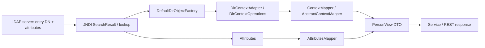
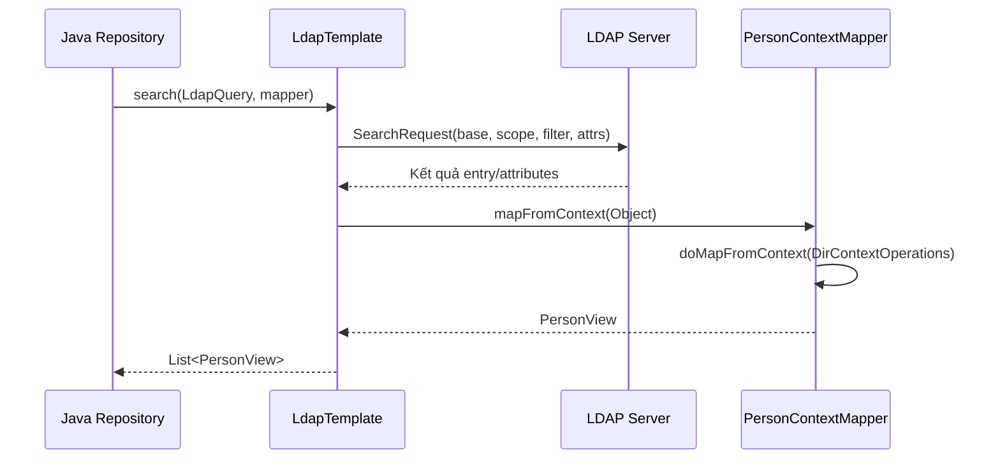

# Phân biệt adapter mapping với DTO mapping

## Mục tiêu bài học

Trong **SPRING_LDAP**, khi gọi `LdapTemplate.search()` hoặc `lookup()`, một entry lấy từ LDAP thường được Spring biểu diễn bằng `DirContextAdapter`. Sau đó ứng dụng có thể chuyển entry ấy thành `PersonDto`, `GroupDto` hoặc một đối tượng nghiệp vụ khác. Hai việc này thường bị gọi chung là “mapping”, nhưng **không cùng tầng trách nhiệm**.

**Adapter mapping** trong bài là cách dữ liệu LDAP (**DN + attributes**) được trình bày qua `DirContextAdapter`/`DirContextOperations` để Java đọc, sửa và tính thay đổi; đây là **cách gọi mô tả vai trò**, không phải tên một interface `AdapterMapper` chính thức của Spring LDAP. **DTO mapping** là quá trình **chuyển dữ liệu đã đọc từ LDAP thành kiểu Java do ứng dụng định nghĩa**, thường thông qua `AttributesMapper<T>`, `ContextMapper<T>` hoặc `AbstractContextMapper<T>`.

Bài thuộc chương **DirContextAdapter** của module SPRING_LDAP. Người học sẽ liên hệ việc mapping với DN, schema, LDAP filter, `LdapTemplate`, `LdapClient`/ODM, `ContextSource`, kết nối TLS, pooling, xử lý lỗi và kiểm thử truy cập thư mục an toàn.

Sau bài này, bạn có thể:

1. Giải thích chính xác hai tầng **LDAP entry → adapter** và **adapter/attributes → DTO**.
2. Phân biệt `DirContextAdapter`, `DirContextOperations`, `AttributesMapper<T>`, `ContextMapper<T>` và `AbstractContextMapper<T>`.
3. Viết hai cách mapping cho cùng một yêu cầu đọc, rồi chọn cách phù hợp khi DTO **có hoặc không cần DN**.
4. Xử lý thuộc tính thiếu, đa trị, binary, DN tương đối và attribute projection.
5. Hiểu vì sao **DTO không tự cập nhật LDAP** và vì sao giữ adapter như DTO ở tầng HTTP/API thường là thiết kế không phù hợp.
6. Kiểm thử mapper độc lập với server và kiểm thử kết quả bằng LDAP server có schema, ACL và TLS thực tế.

## 1. Cùng một entry, hai tầng biểu diễn

Giả sử directory dùng base `dc=example,dc=org` và có entry:

```ldif
dn: uid=lan,ou=People,dc=example,dc=org
objectClass: top
objectClass: person
objectClass: organizationalPerson
objectClass: inetOrgPerson
uid: lan
cn: Lan Nguyen
sn: Nguyen
mail: lan@example.org
telephoneNumber: +84 28 5555 0101
telephoneNumber: +84 28 5555 0199
```

LDAP coi đây là **một entry trong Directory Information Tree (DIT)**. Nó có tên `dn`, tập attribute tuân theo schema và có thể được tìm bằng filter, ví dụ `(uid=lan)`. Trên Java, ta có thể muốn hiển thị:

```java
import java.util.List;

record PersonView(
        String uid,
        String displayName,
        String email,
        List<String> phoneNumbers
) {}
```

`PersonView` chỉ chứa dữ liệu cần cho giao diện; nó **không phải một LDAP entry**. Nó không biết schema, object class, cách bind LDAP, thay DN hay cách gửi Modify.

### Luồng dữ liệu



Theo cấu hình Spring LDAP mặc định, `DefaultDirObjectFactory` giúp tạo `DirContextAdapter` từ entry tìm được ở những phép `search`/`lookup` phù hợp. Sau đó, **mapper do ứng dụng chọn** quyết định dữ liệu nào được chuyển thành `PersonView`. `AttributesMapper` có thể nhận trực tiếp `Attributes` mà không cần ứng dụng truy cập một adapter.

### Hai lớp trách nhiệm

| Tiêu chí | Adapter của LDAP | DTO của ứng dụng |
| --- | --- | --- |
| Đại diện cho | Entry LDAP với DN/attributes | Dữ liệu theo hợp đồng nghiệp vụ/API |
| Kiểu thường gặp | `DirContextAdapter`, `DirContextOperations` | `record PersonView`, POJO, immutable value object |
| Biết DN? | Có `getDn()` | Chỉ khi ứng dụng **chọn** đưa DN vào DTO |
| Biết cách lấy attribute? | `getStringAttribute()`, `getStringAttributes()`, `getObjectAttribute()` | Getter/field Java thông thường |
| Có cơ chế sửa LDAP? | Có thể tính `ModificationItem[]` khi update mode | Không tự tạo LDAP Modify; cần service/repository ghi riêng |
| Gắn với schema/ACL? | Phản ánh **những gì LDAP trả** theo schema, ACL và projection | Theo mô hình nghiệp vụ; có thể chỉ là một tập con |
| Phù hợp trả trực tiếp ra REST? | Thường **không** | Có, sau khi áp authorization và chính sách bảo vệ dữ liệu |
| Tái sử dụng | Tầng truy cập directory | Tầng service, API, hiển thị hoặc trao đổi dữ liệu |

**Ghi nhớ:** Một adapter có thể giúp bạn đọc thuộc tính và theo dõi thay đổi, nhưng không tự biết field nào cần được công bố cho client. Một DTO có thể an toàn hơn để vận chuyển dữ liệu, nhưng chỉ an toàn khi API thực sự áp dụng **quyền truy cập và giới hạn trường dữ liệu** phù hợp.

## 2. DirContextAdapter có phải một “DTO đặc biệt” không?

Không. `DirContextAdapter` là một triển khai của `DirContextOperations` và `AttributeModificationsAware`, cung cấp tiện ích thao tác với attributes của LDAP.

Các phương thức tiêu biểu:

| API | Nhiệm vụ |
| --- | --- |
| `getDn()` | Trả DN tương đối với base path của context |
| `getStringAttribute("cn")` | Lấy một giá trị chuỗi |
| `getStringAttributes("telephoneNumber")` | Lấy nhiều giá trị chuỗi |
| `getObjectAttribute("jpegPhoto")` | Lấy một giá trị object/binary nếu được trả |
| `setAttributeValue("mail", value)` | Đặt giá trị dự định trên adapter |
| `setAttributeValues(...)` | Đặt tập giá trị đa trị |
| `getModificationItems()` | Lấy các thay đổi để có thể dùng trong LDAP Modify |
| `isUpdateMode()` | Cho biết adapter có ở chế độ theo dõi cập nhật không |

Khi đang ở **update mode** với snapshot thích hợp, adapter có thể tính chênh lệch giữa giá trị đã đọc và giá trị ứng dụng thay đổi. Tính năng đó hữu ích cho `LdapTemplate.modifyAttributes(ctx)`, **không phải cơ chế serialization JSON**.

`DirContextAdapter` cũng không phải một đối tượng `DirContext` đầy đủ để tùy tiện dùng như kết nối LDAP sống: tài liệu Spring LDAP lưu ý rằng nhiều method ngoài phạm vi tiện ích của adapter không được triển khai cho mục đích sử dụng thông thường.

### 2.1. Tạo adapter trực tiếp và adapter trả về từ search có khác nhau?

Có khác về **ngữ cảnh nghiệp vụ**:

- `new DirContextAdapter(dn)` thường dùng khi **xây entry mới** để gọi `bind` (thêm entry).
- Một adapter từ kết quả `lookupContext(dn)` thường dùng khi **đọc entry hiện có** và sau đó sửa/ghi qua `modifyAttributes`.
- Trong luồng `search(query, mapper)`, adapter là **đối tượng dữ liệu trung gian của một kết quả**; mapper nên chuyển nó thành DTO nếu caller chỉ cần dữ liệu đọc.

Nếu yêu cầu là “hiển thị tên và email”, **không cần tạo một adapter mới** từ DTO sau khi đã search rồi mới trả response. Chỉ cần mapping sang DTO ngay ở callback.

## 3. Adapter mapping: lớp thích nghi giữa JNDI và cách truy cập LDAP

JNDI có các kiểu tổng quát `Attributes`, `Attribute`, `NamingEnumeration`, `SearchResult`. Chúng diễn đạt chính xác dữ liệu directory nhưng có thể dài dòng khi làm việc với nhiều giá trị:

```java
import java.util.ArrayList;
import java.util.List;
import javax.naming.NamingEnumeration;
import javax.naming.NamingException;
import javax.naming.directory.Attribute;
import javax.naming.directory.Attributes;

static List<String> phonesFromAttributes(Attributes attrs)
        throws NamingException {
    Attribute attr = attrs.get("telephoneNumber");
    if (attr == null) {
        return List.of();
    }
    List<String> phones = new ArrayList<>();
    NamingEnumeration<?> values = attr.getAll();
    try {
        while (values.hasMore()) {
            Object value = values.next();
            if (value instanceof String text) {
                phones.add(text);
            }
        }
    } finally {
        values.close();
    }
    return phones;
}
```

Với `DirContextOperations`, cùng yêu cầu đọc đa trị được viết gọn hơn:

```java
import java.util.Arrays;
import java.util.List;
import org.springframework.ldap.core.DirContextOperations;

static List<String> phonesFromContext(DirContextOperations ctx) {
    String[] values = ctx.getStringAttributes("telephoneNumber");
    return values == null ? List.of() :
            List.copyOf(Arrays.asList(values));
}
```

Đó là lợi ích của **adapter**: che bớt sự phức tạp của tầng `Attributes`/`NamingEnumeration`, đồng thời cho phép xử lý DN và trạng thái update. Nhưng kết quả của `phonesFromContext` mới là **dữ liệu Java**; bản thân adapter vẫn là abstraction liên quan LDAP.

### 3.1. Adapter chỉ nhìn thấy dữ liệu server thực sự trả

Nếu LDAP search chỉ yêu cầu `uid`, `cn`, `mail`, adapter không được tự phát sinh `telephoneNumber` từ hư không. Nếu không có dữ liệu trong kết quả:

- Entry có thể không có thuộc tính đó.
- Attribute có thể không được yêu cầu trong projection.
- Account bind có thể bị ACL che giá trị.
- Một số operational attributes cần được yêu cầu riêng.

Vì vậy **`null` khi đọc adapter chưa chứng minh attribute không tồn tại trên server**. Để kết luận cần kiểm tra query, schema, ACL và identity của kết nối, không chỉ sửa mapper.

## 4. DTO mapping: chuyển LDAP entry thành hợp đồng dữ liệu Java

Tầng DTO mapping trả lời câu hỏi **“với dữ liệu entry đang được phép đọc, ứng dụng muốn trao đổi những trường nào và quy tắc của chúng là gì?”**. Lớp DTO có thể:

- Đổi tên `cn` thành `displayName` theo ngôn ngữ nghiệp vụ.
- Chọn `uid` làm định danh hiển thị thay vì lộ cấu trúc DN.
- Chuyển `telephoneNumber` đa trị thành `List<String>` không cho sửa.
- Kiểm tra trường bắt buộc và cho phép thiếu trường tùy chọn.
- Không đưa `objectClass`, `userPassword`, ảnh nhị phân hoặc thuộc tính quản trị vào payload.

**Mapping không phải xác thực hoặc phân quyền.** DTO chỉ chọn dữ liệu trong memory, còn quyền cho phép đọc entry/attribute phải được enforce ở application service và LDAP ACL. Một DTO gọn không chứng minh server đã truyền ít dữ liệu: cần thiết lập **attribute projection** ở `LdapQuery` hoặc `SearchControls`.

### 4.1. Dùng AttributesMapper khi không cần DN

`AttributesMapper<T>` của Spring LDAP nhận `Attributes` của **một entry**. Nó phù hợp với `PersonView` vì DTO ví dụ không cần DN và không cần dirty tracking.

```java
import java.util.ArrayList;
import java.util.List;
import javax.naming.NamingEnumeration;
import javax.naming.NamingException;
import javax.naming.directory.Attribute;
import javax.naming.directory.Attributes;
import org.springframework.ldap.core.AttributesMapper;

final class PersonAttributesMapper
        implements AttributesMapper<PersonView> {

    @Override
    public PersonView mapFromAttributes(Attributes attrs)
            throws NamingException {
        return new PersonView(
                required(attrs, "uid"),
                required(attrs, "cn"),
                optional(attrs, "mail"),
                allStrings(attrs, "telephoneNumber")
        );
    }

    private static String required(Attributes attrs, String name)
            throws NamingException {
        String value = optional(attrs, name);
        if (value == null || value.isBlank()) {
            throw new IllegalStateException(
                    "Missing required LDAP field: " + name);
        }
        return value;
    }

    private static String optional(Attributes attrs, String name)
            throws NamingException {
        Attribute attr = attrs.get(name);
        if (attr == null || attr.size() == 0) {
            return null;
        }
        Object value = attr.get();
        return value instanceof String ? (String) value : null;
    }

    private static List<String> allStrings(
            Attributes attrs, String name) throws NamingException {
        Attribute attr = attrs.get(name);
        if (attr == null) {
            return List.of();
        }
        List<String> result = new ArrayList<>();
        NamingEnumeration<?> values = attr.getAll();
        try {
            while (values.hasMore()) {
                Object item = values.next();
                if (item instanceof String text) {
                    result.add(text);
                }
            }
        } finally {
            values.close();
        }
        return List.copyOf(result);
    }
}
```

Trong ví dụ:

1. `mapFromAttributes` nhận một entry dưới dạng tập thuộc tính.
2. `required()` bảo vệ hợp đồng: DTO bắt buộc có UID và tên. Nếu server không trả, mapper báo lỗi thay vì tạo đối tượng có ID rỗng.
3. `optional()` cho phép `mail` thiếu; chính sách này là lựa chọn **nghiệp vụ**, không phải kết luận của schema.
4. `allStrings()` lấy toàn bộ các giá trị chuỗi đã được trả, đóng `NamingEnumeration` và tạo danh sách độc lập, không mutable.
5. Không có phương thức `getDn()` vì đầu vào chỉ là `Attributes`. Đó là giới hạn có chủ đích, không phải lỗi của mapper.

**Lưu ý:** Ví dụ dùng Java 17 cho `record` và cú pháp pattern matching `instanceof String text`. Dự án Java cũ hơn có thể dùng POJO và ép kiểu thông thường. Nếu schema trả binary attribute, không tự ép giá trị thành `String`; hãy chọn mapper phù hợp.

### 4.2. Dùng ContextMapper khi DTO cần dữ liệu từ adapter

`ContextMapper<T>` nhận đối tượng context do `DirObjectFactory` tạo từ kết quả LDAP. Với factory mặc định, có thể chuyển sang `DirContextOperations` và đọc DN:

```java
import org.springframework.ldap.core.ContextMapper;
import org.springframework.ldap.core.DirContextOperations;

record PersonInternal(
        String relativeDn,
        String uid,
        String displayName
) {}

ContextMapper<PersonInternal> mapper = raw -> {
    DirContextOperations entry = (DirContextOperations) raw;
    return new PersonInternal(
            entry.getDn().toString(),
            entry.getStringAttribute("uid"),
            entry.getStringAttribute("cn")
    );
};
```

`PersonInternal` là model dùng bên trong hệ thống, nơi lưu DN thực sự có lý do nghiệp vụ (ví dụ thao tác với entry đã tìm được). Không nhất thiết trả `relativeDn` cho browser/mobile client. Trong thực tế, các trường bắt buộc cũng cần được kiểm tra như ví dụ `PersonAttributesMapper`.

Theo Spring LDAP Javadoc, `DirContextAdapter.getDn()` trả **DN tương đối so với base path**, không mặc định là DN tuyệt đối. Nếu `ContextSource` được cấu hình base `dc=example,dc=org`, giá trị của Lan thường là:

```text
DN tuyệt đối trên directory: uid=lan,ou=People,dc=example,dc=org
ContextSource.base:         dc=example,dc=org
entry.getDn():             uid=lan,ou=People
```

Khi dùng DN này trong thao tác `LdapTemplate.lookup()` hoặc `modifyAttributes()`, phải thống nhất cách xử lý tên **tương đối** với base của `ContextSource`. Không nối hậu tố DN một cách thủ công khi chưa xác định tên đang ở hệ tọa độ nào.

### 4.3. AbstractContextMapper: bớt phép cast lặp lại

Nếu nhiều repository đều cần dữ liệu từ `DirContextOperations`, Spring LDAP có `AbstractContextMapper<T>`. Lớp cơ sở triển khai `final mapFromContext(Object)`, chuyển `Object` sang `DirContextOperations`, rồi gọi hook lớp con:

```java
import java.util.Arrays;
import java.util.List;
import org.springframework.ldap.core.DirContextOperations;
import org.springframework.ldap.core.support.AbstractContextMapper;

final class PersonContextMapper
        extends AbstractContextMapper<PersonView> {

    @Override
    protected PersonView doMapFromContext(
            DirContextOperations entry) {
        String uid = require(entry, "uid");
        String name = require(entry, "cn");
        String email = entry.getStringAttribute("mail");
        String[] phones = entry.getStringAttributes("telephoneNumber");

        return new PersonView(
                uid,
                name,
                email,
                phones == null ? List.of()
                        : List.copyOf(Arrays.asList(phones))
        );
    }

    private static String require(
            DirContextOperations entry, String field) {
        String value = entry.getStringAttribute(field);
        if (value == null || value.isBlank()) {
            throw new IllegalStateException(
                    "Missing required LDAP field: " + field);
        }
        return value;
    }
}
```

Đây là mẫu **Template Method** ở tầng mapper: Spring cố định cách dispatch và cast, còn bạn chỉ viết `doMapFromContext()`. Không override `mapFromContext(Object)` vì method này là `final`.

Lớp mapper không mở kết nối, không đăng nhập, không tự lưu cập nhật và không phân trang. Nó chỉ biến **một** entry context thành **một** `PersonView`.

### 4.4. Cẩn thận với DirObjectFactory tùy chỉnh

`AbstractContextMapper` giả định object đầu vào là `DirContextOperations`, thường do `DefaultDirObjectFactory` tạo. Nếu dự án thay `DirObjectFactory` để trả một kiểu object khác, `mapFromContext(Object)` có thể ném `ClassCastException`.

Khi dùng factory tùy chỉnh, cần kiểm tra loại object thực nhận và cân nhắc `ContextMapper<T>` trực tiếp với kiểu mà factory trả. Đừng giải quyết lỗi cast bằng cách bắt ngoại lệ rồi bỏ qua entry một cách âm thầm; điều đó che một lỗi cấu hình hoặc hợp đồng mapping.

## 5. Cùng nghiệp vụ đọc, chọn mapper nào?

| Tình huống | Lựa chọn thường phù hợp |
| --- | --- |
| Chỉ cần `uid`, `cn`, `mail` | `AttributesMapper<PersonView>` |
| Cần DN thật đã tìm được qua filter | `ContextMapper<PersonInternal>` hoặc `AbstractContextMapper` |
| Muốn tái sử dụng quy tắc map nhiều entry trong nhiều repository | Một class mapper stateless, có unit test riêng |
| Entry được truy cập để **sửa** một attribute | `lookupContext()`/`DirContextOperations` và phương thức ghi riêng |
| Mô hình domain LDAP ổn định với nhiều field và annotation | Xem xét LDAP ODM |
| Sử dụng API truy vấn fluent | `LdapClient` với mapping tương thích phiên bản |

**Đừng chọn ContextMapper chỉ vì nó “mạnh hơn”.** Nếu DTO không cần DN hoặc các tiện ích của adapter, `AttributesMapper` có thể đơn giản, rõ hơn và ít giả định hơn về object factory.

## 6. Tích hợp mapper với LdapTemplate.search và lookup

Giả sử ứng dụng đã cấu hình `ContextSource` tới directory server thử nghiệm qua TLS. Cấu hình Spring Boot minh họa:

```properties
spring.ldap.urls=ldaps://ldap.example.org:636
spring.ldap.base=dc=example,dc=org
spring.ldap.username=cn=svc-reader,ou=Services,dc=example,dc=org
spring.ldap.password=${LDAP_BIND_PASSWORD}
```

Trong môi trường thật, cấp credential qua secret manager hoặc biến môi trường được bảo vệ; cấu hình JVM truststore đúng để xác minh chứng chỉ và hostname. Đừng sao chép mật khẩu thật vào mã nguồn, log hoặc tài liệu.

### 6.1. Search trả DTO, không trả adapter cho caller

```java
import static org.springframework.ldap.query.LdapQueryBuilder.query;

import java.util.List;
import org.springframework.ldap.core.LdapTemplate;
import org.springframework.ldap.query.LdapQuery;
import org.springframework.ldap.query.SearchScope;

final class PersonDirectoryRepository {
    private final LdapTemplate ldapTemplate;
    private final PersonContextMapper mapper = new PersonContextMapper();

    PersonDirectoryRepository(LdapTemplate ldapTemplate) {
        this.ldapTemplate = ldapTemplate;
    }

    List<PersonView> findByUid(String uid) {
        if (uid == null || uid.isBlank()) {
            throw new IllegalArgumentException("uid is required");
        }

        LdapQuery request = query()
                .base("ou=People")
                .searchScope(SearchScope.SUBTREE)
                .attributes("uid", "cn", "mail", "telephoneNumber")
                .where("objectClass").is("inetOrgPerson")
                .and("uid").is(uid);

        return ldapTemplate.search(request, mapper);
    }
}
```

Đường dữ liệu ở đây:



Hàm `findByUid` trả `List<PersonView>`, không trả `List<DirContextAdapter>`. Điều đó tách tầng service khỏi cấu trúc LDAP và các method sửa thuộc tính. Không có việc caller nhận được context rồi âm thầm gọi setter lên entry.

**Tập entry có thể gồm 0, 1 hoặc nhiều phần tử**. Nếu UID phải duy nhất theo nghiệp vụ, service phải xử lý riêng ba trường hợp; không mặc định lấy phần tử đầu. Cũng không lấy “search không ra entry” làm bằng chứng rằng người dùng đăng nhập sai mật khẩu.

### 6.2. Cùng query, đổi sang AttributesMapper

Nếu không cần DN, thay đổi chỉ ở mapper:

```java
LdapQuery request = query()
        .base("ou=People")
        .attributes("uid", "cn", "mail", "telephoneNumber")
        .where("uid").is("lan");

List<PersonView> persons = ldapTemplate.search(
        request, new PersonAttributesMapper());
```

Hai cách có thể cho cùng tập DTO nếu cùng base, filter, scope, projection, dữ liệu và quyền. `AttributesMapper` thường ít giả định hơn khi không cần DN; `ContextMapper` giúp làm việc với DN và các tiện ích khác của adapter.

### 6.3. Lookup khi đã biết DN chính xác

Khi đã biết tên một entry, dùng `lookup` thay vì search rộng:

```java
PersonView view = ldapTemplate.lookup(
        "uid=lan,ou=People",
        new String[] {"uid", "cn", "mail", "telephoneNumber"},
        new PersonContextMapper()
);
```

`"uid=lan,ou=People"` là DN **tương đối với base** của `ContextSource`. Nếu DN được dựng từ dữ liệu động, dùng `LdapNameBuilder` để tránh sai escaping theo RFC 4514.

Đây vẫn là **DTO mapping**: `lookup` tìm đúng entry, còn `PersonContextMapper` chọn dữ liệu và chuyển sang Java. Khi cần entry ở dạng adapter để cập nhật, API `lookupContext(dn)` có mục đích khác.

### 6.4. Attribute projection phải khớp nhu cầu DTO

Một lỗi dễ bỏ qua:

```java
LdapQuery q = query()
        .base("ou=People")
        .attributes("uid", "cn") // Bỏ quên mail và telephoneNumber.
        .where("uid").is("lan");

List<PersonView> views = ldapTemplate.search(
        q, new PersonContextMapper());
```

Mapper vẫn chạy, nhưng `email` có thể là `null` và `phoneNumbers` rỗng. Không thể từ đó kết luận entry trên server không có email/điện thoại. Chỉ có thể nói **kết quả truy vấn đang dùng không có những attribute ấy**.

Ngược lại, nếu một màn hình chỉ cần UID và tên, không nên dùng mapper chung cố lấy thêm email/điện thoại. Hãy tạo một DTO hẹp hơn như `PersonListItem(uid, displayName)` cùng projection `uid, cn` để giảm dữ liệu truyền.

**Không lấy mọi thuộc tính rồi lọc sau mapper như biện pháp tối ưu mạng.** Việc map sang DTO nhỏ chỉ giảm những gì tầng sau nhìn thấy; để giảm payload từ server phải giới hạn attributes ở SearchRequest.

## 7. DTO không có dirty tracking và không tự ghi ngược lên LDAP

Khác biệt quan trọng nhất trong thiết kế đường ghi: `PersonView` **không chứa snapshot có khả năng phát sinh LDAP Modify**. Việc tạo một `PersonView` mới với email khác chỉ thay đổi đối tượng Java.

```java
PersonView original = ldapTemplate.lookup(
        "uid=lan,ou=People",
        new String[] {"uid", "cn", "mail", "telephoneNumber"},
        new PersonContextMapper()
);

PersonView edited = new PersonView(
        original.uid(),
        original.displayName(),
        "new@example.org",
        original.phoneNumbers()
);

// edited là dữ liệu Java. LDAP server CHƯA nhận lệnh Modify.
```

Để sửa entry thật, tầng ghi phải có **authorization**, DN chính xác, ý định thay đổi cụ thể và lời gọi LDAP:

```java
import javax.naming.Name;
import org.springframework.ldap.core.DirContextOperations;
import org.springframework.ldap.core.LdapTemplate;

final class PersonDirectoryUpdater {
    private final LdapTemplate writerLdapTemplate;

    PersonDirectoryUpdater(LdapTemplate writerLdapTemplate) {
        this.writerLdapTemplate = writerLdapTemplate;
    }

    void changeMail(Name relativeDn, String newMail) {
        if (newMail == null || newMail.isBlank()) {
            throw new IllegalArgumentException("mail is required");
        }

        DirContextOperations ctx =
                writerLdapTemplate.lookupContext(relativeDn);
        ctx.setAttributeValue("mail", newMail);
        writerLdapTemplate.modifyAttributes(ctx);
    }
}
```

Trong ví dụ ghi này, `lookupContext` cung cấp adapter cho **entry hiện có**; setter tính thay đổi trên snapshot, còn `modifyAttributes` gửi thao tác tới server. `PersonView` chỉ là dữ liệu đọc, không tham gia cơ chế dirty tracking.

### 7.1. Không dùng “map mọi field DTO vào context” khi chỉ sửa một field

Một yêu cầu PATCH chỉ thay email không nên:

```java
// KHÔNG NÊN: các trường DTO thiếu có thể thành null và bị sửa/xóa.
ctx.setAttributeValue("cn", dto.displayName());
ctx.setAttributeValue("mail", dto.email());
ctx.setAttributeValues(
        "telephoneNumber",
        dto.phoneNumbers().toArray(String[]::new));
```

Nếu DTO không chứa đủ mọi attribute hoặc client chỉ gửi một phần dữ liệu, “ghi lại tất cả” có thể làm mất giá trị không liên quan. Đối với patch, phân biệt **field vắng mặt**, **field có giá trị mới** và **yêu cầu xóa tường minh**; chỉ sửa attribute được phép và được yêu cầu.

### 7.2. Adapter không phải optimistic locking

`DirContextAdapter` có thể theo dõi khác biệt để tránh gửi sửa những attribute không đổi, nhưng không tự từ chối cập nhật đồng thời khi hai client sửa **cùng** field từ hai snapshot cũ. Nếu nghiệp vụ đòi tránh *lost update*, cần kiểm soát cạnh tranh theo khả năng directory server (ví dụ assertion control hoặc cơ chế conditional update phù hợp).

Khi mất kết nối sau khi gửi Modify, không mặc định thao tác chưa thực hiện. Có thể phải đọc lại trạng thái và đối soát trước khi thử lại.

## 8. Thuộc tính đa trị, binary và ranh giới dữ liệu cần lưu ý

Việc chọn adapter hay DTO mapper ảnh hưởng cách viết code, nhưng không làm thay đổi bản chất LDAP:

| Dữ liệu LDAP | Rủi ro mapping | Cách xử lý |
| --- | --- | --- |
| `mail` thiếu | Ném lỗi không cần thiết hoặc vô tình tạo email rỗng | Quy định field tùy chọn hay bắt buộc |
| `telephoneNumber` đa trị | Chỉ lấy phần tử đầu, mất số còn lại | `getStringAttributes()` hoặc duyệt toàn bộ `Attribute.getAll()` |
| `member` của nhóm | Xem một DN là toàn bộ thành viên | Model hóa tập DN và kiểm tra giới hạn server |
| `jpegPhoto` | Cast binary thành `String`, hoặc trả dữ liệu quá lớn | Dùng `getObjectAttribute()` và chỉ đọc khi nghiệp vụ cần |
| Operational attributes | Mặc định không nằm trong response | Yêu cầu rõ nếu server hỗ trợ và ACL cho phép |
| DN tương đối | Nối base sai, tạo DN trùng hậu tố | Xác định base path, dùng `Name`/`LdapNameBuilder` |
| ACL che attribute | Giải thích sai rằng server không lưu trường | Tách visibility khỏi sự tồn tại của dữ liệu |

### 8.1. Khi DTO muốn chứa DN của thành viên nhóm

Nhóm `groupOfNames` thường có `member` là **thuộc tính đa trị chứa DN**:

```ldif
dn: cn=Developers,ou=Groups,dc=example,dc=org
objectClass: top
objectClass: groupOfNames
cn: Developers
member: uid=lan,ou=People,dc=example,dc=org
member: uid=mai,ou=People,dc=example,dc=org
```

DTO nội bộ có thể sử dụng `List<String> memberDns` hoặc `List<Name>` tùy yêu cầu. Nếu trả danh sách ra API công khai, cân nhắc chuyển DN thành định danh không lộ DIT. Đối với các thao tác **thêm/bớt thành viên**, `DirContextAdapter` có API `addAttributeValue`/`removeAttributeValue` và có thể dùng `Name` để so sánh DN theo ngữ nghĩa tên; nhưng đây là đường ghi riêng, không phải thao tác xảy ra tự động khi sửa collection trong DTO.

### 8.2. Đừng gán các thuộc tính nhạy cảm vào DTO công khai

Ngay cả khi LDAP ACL cho phép service account xem nhiều thông tin, API có thể chỉ được công bố `cn` và `mail`. Thiết kế một DTO công khai với field `userPassword`, `employeeNumber`, dữ liệu ảnh hoặc tên nhóm đặc quyền là không phù hợp nếu không có yêu cầu và authorization tương ứng.

**Nguyên tắc giảm dữ liệu:** Đưa điều kiện lọc vào LDAP server, chỉ yêu cầu attribute cần thiết trong SearchRequest, rồi map vào DTO hẹp. Tránh “đọc mọi thứ vào adapter rồi bỏ bớt khi serialize”; việc loại bỏ sau khi nhận không giảm dữ liệu trên mạng.

## 9. Vòng đời, thread safety và quản lý tài nguyên

### 9.1. Không lưu adapter lâu dài như một DTO

Không nên viết repository trả trực tiếp:

```java
// KHÔNG NÊN cho API nghiệp vụ đọc đơn giản:
DirContextOperations findPersonContext(String uid) {
    // Lấy adapter từ LDAP rồi để controller/serializer dùng tùy ý.
    return ...; // Pseudocode: không nên expose abstraction LDAP.
}
```

Việc trả một `DirContextOperations` ra tầng controller khiến caller biết cấu trúc LDAP, có thể sử dụng setter một cách sai lệch, và khó kiểm soát serialization các attribute không được phép công bố. Đây còn là một **đối tượng có trạng thái**; không nên giữ nó như một cache hồ sơ dùng chung cho mọi request.

Tốt hơn, repository trả `PersonView` hoặc một model nội bộ đã xác định hợp đồng. Mapper tạo **đối tượng Java độc lập** trong callback. `LdapTemplate` xử lý phần hạ tầng truy cập, còn service quyết định cách trả dữ liệu.

### 9.2. Mapper nên không giữ mutable state

Một `PersonContextMapper` tốt chỉ nhận một entry, xây một DTO và trả về. Tránh đặt `List<PersonView> result` trong field mutable của mapper rồi cộng dồn qua các lời gọi: nó có thể trộn dữ liệu giữa request và gây lỗi khi nhiều luồng dùng chung bean.

DTO trả về cũng nên giữ các collection độc lập như `List.copyOf(...)`, thay vì đưa nguyên array/collection mutable từ callback cho caller sửa. Với dữ liệu binary, cân nhắc tạo bản sao mảng nếu dữ liệu cần bất biến thực sự.

### 9.3. Đừng gọi LDAP search mới cho từng entry trong mapper

Đoạn code sau minh họa nguy cơ **N+1 queries**:

```java
// KHÔNG NÊN trong doMapFromContext() cho mỗi user:
String uid = entry.getStringAttribute("uid");
List<String> groups = groupRepository.searchGroupsByUid(uid);
```

Nếu kết quả danh bạ có 500 người, mapper có thể làm thêm 500 lần tìm nhóm ngoài truy vấn chính. Lời gọi mạng lồng nhau còn gây khó khăn cho timeout/pooling. Nếu DTO cần nhóm, hãy thiết kế truy vấn hoặc bước lấy dữ liệu bổ sung ở tầng service, với giới hạn và chiến lược tải phù hợp.

### 9.4. Mapper không thay thế timeout và pooling

`ContextSource` quản lý danh tính và cấu hình kết nối; `LdapTemplate`/`LdapClient` thực hiện thao tác; mapper chỉ làm việc với kết quả. Muốn tối ưu, cần xét **base/scope/filter/index**, projection, paging, time/size limits, connect/read timeout và pooling tương thích TLS. Không mặc định một kiểu mapper nhanh hơn trong mọi trường hợp nếu các yếu tố truy vấn và kết nối khác nhau.

## 10. Những lỗi dễ gặp và cách chẩn đoán

| Triệu chứng | Phân biệt đúng nguyên nhân | Cách xử lý |
| --- | --- | --- |
| `ClassCastException` trong `ContextMapper` | Factory trả object không tương thích `DirContextOperations` | Xem `DefaultDirObjectFactory`/factory tùy chỉnh; chọn mapper phù hợp |
| DTO có `email=null` dù LDAP có email | Projection thiếu hoặc ACL không cho đọc | So sánh query, schema, ACL và danh tính bind |
| DTO chỉ có một số điện thoại | Đã dùng getter một giá trị với field đa trị | Chuyển sang getter/mapper đọc toàn bộ giá trị |
| `getDn()` thiếu hậu tố domain | Trả DN tương đối so với base path | Dùng cùng quy ước DN và `ContextSource` |
| DTO sửa email nhưng LDAP không đổi | DTO không tự gửi Modify | Dùng service ghi riêng và `modifyAttributes` |
| Sau khi tạo DTO, dữ liệu nhạy cảm vẫn được tải về | Query vẫn yêu cầu mọi attribute | Đặt projection tại LDAP search |
| Mapper bị lỗi field bắt buộc | Entry thiếu, dữ liệu bị ẩn hoặc projection sai | Phân loại lỗi mapping, không giả “entry không tồn tại” |
| Kết quả rỗng được xem là lỗi mapper | Search có thể thành công mà không có entry khớp | Xử lý 0/1/nhiều entry ở service |
| Đọc nhóm làm truy vấn rất chậm | N+1 hoặc attribute lớn, filter thiếu giới hạn | Tách điều phối và kiểm soát query |
| Lỗi TLS bị trả thành danh sách rỗng | Exception bị che | Giữ lỗi kết nối khác với không tìm thấy |

**Không nên**:

```java
try {
    return repository.findByUid(uid);
} catch (Exception ignored) {
    return List.of();  // Sai: làm lỗi schema, ACL hoặc TLS giống "không có".
}
```

Một search **thành công** có 0 entry thì trả danh sách rỗng hợp lệ; nếu quá trình search/mapping thất bại, cần để tầng service xử lý một trạng thái lỗi khác. Khi log, ghi loại operation và loại lỗi theo chính sách; không log password hay toàn bộ tập `Attributes`.

## 11. Unit test: cùng một entry, hai mapper

Có thể kiểm thử DTO mapping mà **không cần LDAP server**. Với `BasicAttributes`, unit test mô phỏng các thuộc tính đã được trả về; với `DirContextAdapter(attrs, dn)`, có thể kiểm tra adapter và `ContextMapper`.

Ví dụ đặt `PersonView`, `PersonAttributesMapper` và `PersonContextMapper` trong cùng package với lớp test:

```java
import static org.junit.jupiter.api.Assertions.*;

import java.util.Set;
import javax.naming.directory.BasicAttribute;
import javax.naming.directory.BasicAttributes;
import javax.naming.ldap.LdapName;
import org.junit.jupiter.api.Test;
import org.springframework.ldap.core.ContextMapper;
import org.springframework.ldap.core.DirContextAdapter;
import org.springframework.ldap.core.DirContextOperations;

class MappingLayersTest {
    private static BasicAttributes fixture() {
        BasicAttributes attrs = new BasicAttributes(true);
        attrs.put("uid", "lan");
        attrs.put("cn", "Lan Nguyen");
        attrs.put("mail", "lan@example.org");

        BasicAttribute phones = new BasicAttribute("telephoneNumber");
        phones.add("+84 28 5555 0101");
        phones.add("+84 28 5555 0199");
        attrs.put(phones);
        return attrs;
    }

    @Test
    void bothMapperTypesProduceEquivalentBusinessData()
            throws Exception {
        BasicAttributes attrs = fixture();
        DirContextAdapter adapter = new DirContextAdapter(
                attrs, new LdapName("uid=lan,ou=People"));

        PersonView fromAttributes =
                new PersonAttributesMapper().mapFromAttributes(attrs);
        PersonView fromContext =
                new PersonContextMapper().mapFromContext(adapter);

        assertEquals(fromAttributes.uid(), fromContext.uid());
        assertEquals(fromAttributes.displayName(),
                fromContext.displayName());
        assertEquals(fromAttributes.email(), fromContext.email());
        assertEquals(Set.copyOf(fromAttributes.phoneNumbers()),
                Set.copyOf(fromContext.phoneNumbers()));
    }

    @Test
    void contextProvidesDnEvenIfPublicDtoDoesNot() throws Exception {
        DirContextAdapter adapter = new DirContextAdapter(
                fixture(), new LdapName("uid=lan,ou=People"));
        ContextMapper<String> dnMapper =
                raw -> ((DirContextOperations) raw).getDn().toString();

        assertEquals("uid=lan,ou=People",
                dnMapper.mapFromContext(adapter));
        PersonView dto =
                new PersonContextMapper().mapFromContext(adapter);
        assertEquals("lan", dto.uid());
        // PersonView chủ động không có field DN.
    }

    @Test
    void missingOptionalAttributesHaveExplicitDefaults()
            throws Exception {
        BasicAttributes attrs = new BasicAttributes(true);
        attrs.put("uid", "lan");
        attrs.put("cn", "Lan Nguyen");
        DirContextAdapter adapter = new DirContextAdapter(
                attrs, new LdapName("uid=lan,ou=People"));

        PersonView dto =
                new PersonContextMapper().mapFromContext(adapter);

        assertNull(dto.email());
        assertTrue(dto.phoneNumbers().isEmpty());
    }

    @Test
    void missingRequiredUidIsNotSilentlyAccepted()
            throws Exception {
        BasicAttributes attrs = new BasicAttributes(true);
        attrs.put("cn", "Lan Nguyen");
        DirContextAdapter adapter = new DirContextAdapter(
                attrs, new LdapName("uid=lan,ou=People"));

        assertThrows(IllegalStateException.class,
                () -> new PersonContextMapper()
                        .mapFromContext(adapter));
    }

    @Test
    void customFactoryResultMustBeCompatibleWithAbstractMapper() {
        assertThrows(ClassCastException.class,
                () -> new PersonContextMapper()
                        .mapFromContext(new Object()));
    }
}
```

**Điểm đáng kiểm tra:** Test so các số điện thoại dưới dạng `Set`, bởi tập giá trị LDAP đa trị thường không có thứ tự được bảo đảm. Kết quả so bằng list theo thứ tự có thể thất bại không cần thiết dù tập dữ liệu đúng.

Test cũng cho thấy **DN có trong adapter không có nghĩa phải lộ DN ở DTO**. Việc chọn field là một quyết định của hợp đồng dữ liệu. Nếu DTO nội bộ cần DN, tạo một kiểu khác như `PersonInternal` để không trộn mô hình API công khai với định danh LDAP.

### 11.1. Unit test không thể chứng minh điều gì?

Các test trên **không xác minh**:

- LDAP server đã chạy, chứng chỉ TLS có hợp lệ hay không.
- Account có quyền đọc `mail` hoặc `telephoneNumber` không.
- Filter, scope, base DN và attribute projection của `LdapTemplate` đã đúng hay chưa.
- Schema/matching rules và ràng buộc riêng của sản phẩm LDAP.
- Danh sách điện thoại có bị cắt bởi cơ chế giới hạn server không.
- Các exception vận hành do referral, size limit, timeout, kết nối chết.

Những yếu tố này phải được kiểm tra bằng **integration test** trên một directory server phù hợp, không chỉ mock hoặc xây adapter thủ công.

## 12. Ma trận kiểm thử tích hợp

Chuẩn bị một LDAP server thử nghiệm, fixture LDIF và service account chỉ đọc. Mỗi phép thử cần ghi nhận base DN, scope, filter, danh sách thuộc tính được yêu cầu và danh tính LDAP đã sử dụng.

| Mã ca | Tình huống | Kết quả cần xác minh |
| --- | --- | --- |
| **MAP-01** | Query tìm `uid=lan` | DTO có tên, email đúng |
| **MAP-02** | Cùng query với `AttributesMapper` và `ContextMapper` | Dữ liệu nghiệp vụ tương đương |
| **MAP-03** | ContextMapper cần `getDn()` | DN được diễn giải đúng theo base path |
| **MAP-04** | Entry thiếu `mail` | Field tùy chọn được biểu diễn đúng |
| **MAP-05** | Entry có hai `telephoneNumber` | DTO có đầy đủ hai giá trị được phép đọc |
| **MAP-06** | Query chỉ yêu cầu `uid, cn` | Không suy `mail` không tồn tại chỉ vì mapper nhận null |
| **MAP-07** | Account không có quyền đọc một attribute | Không để lộ giá trị; xử lý hợp đồng mapping rõ ràng |
| **MAP-08** | Custom `DirObjectFactory` trả kiểu khác | Phát hiện khả năng không tương thích `AbstractContextMapper` |
| **MAP-09** | Search không có entry | Service xử lý kết quả rỗng hợp lệ |
| **MAP-10** | Nhiều entry có cùng UID ở các nhánh khác | Service không mặc định lấy phần tử đầu |
| **MAP-11** | Search gặp size/time limit | Không xem kết quả chưa đầy đủ là dữ liệu đầy đủ |
| **MAP-12** | TLS handshake thất bại | Báo lỗi kết nối, không hạ cấp TLS |
| **MAP-13** | LDAP server không sẵn sàng | Không chuyển lỗi hạ tầng thành “không tìm thấy” |
| **MAP-14** | Chức năng đọc bằng account không có quyền ghi | LDAP ACL thực sự chặn sửa entry |
| **MAP-15** | DTO công khai chỉ dùng hai trường | Query không yêu cầu các attribute nhạy cảm/không liên quan |
| **MAP-16** | Với dữ liệu nhóm đa trị lớn | Kiểm tra giới hạn/range retrieval đặc thù của server nếu có |

### Đối chiếu bằng ldapsearch

Trên directory thử nghiệm có certificate hợp lệ và account chỉ đọc:

```bash
ldapsearch -LLL -x \
  -H ldaps://ldap.example.org:636 \
  -D "cn=svc-reader,ou=Services,dc=example,dc=org" -W \
  -b "ou=People,dc=example,dc=org" -s sub \
  "(&(objectClass=inetOrgPerson)(uid=lan))" \
  uid cn mail telephoneNumber
```

So sánh các attribute và số lượng giá trị trả về với `PersonView` mà ứng dụng tạo. `-W` cho phép nhập mật khẩu qua prompt thay vì đưa secret lên command line. Không sử dụng credentials thật trong báo cáo hoặc in dữ liệu cá nhân nhạy cảm không cần thiết.

**Giới hạn kết luận:** Nếu ldapsearch thấy email nhưng repository DTO không thấy, hãy kiểm tra có dùng **cùng identity, cùng server, base, filter và projection** hay không. Không vội kết luận mapper sai khi hai phép thử thực tế chạy trong hai ngữ cảnh quyền khác nhau.

## 13. DTO mapping chiều đọc khác với assembler chiều ghi và ODM

Một mapper như `PersonContextMapper` chỉ triển khai **chiều đọc**:

```text
LDAP entry -> DirContextAdapter -> PersonView
```

Nếu ứng dụng cần **chiều ghi** từ một domain object xuống context, có thể tổ chức một assembler hoặc service cập nhật riêng:

```text
Validated command
  -> application authorization
  -> lookupContext(existing DN)
  -> set only intended LDAP attributes
  -> LdapTemplate.modifyAttributes(context)
```

Spring LDAP có abstraction `ContextAssembler` với phương thức `mapToContext(Object obj, Object ctx)` ngoài chiều `mapFromContext`. Tuy nhiên, **có phương thức mapToContext không có nghĩa dữ liệu đã được ghi**. Việc gửi `bind` để tạo entry hoặc `modifyAttributes` để sửa entry vẫn thuộc đường truy cập directory.

**LDAP ODM** có thể dùng metadata/annotation để biểu diễn entry dưới dạng domain object ở tầng cao hơn. Nó phù hợp khi ứng dụng có mô hình LDAP ổn định, nhưng không nên nhầm với DTO công khai của API: object ODM có thể chứa nhiều trường nội bộ hoặc metadata không được phép đưa ra bên ngoài.

Khi sử dụng `LdapClient` (API fluent), có thể thay cú pháp truy vấn/ghi và sử dụng mapper hoặc projection phù hợp với phiên bản. **Sự phân chia trách nhiệm vẫn giữ nguyên**: kết nối và thao tác LDAP, biểu diễn entry, chuyển thành mô hình nghiệp vụ, cuối cùng là quyền được trả dữ liệu hay thực hiện cập nhật.

## 14. Bài tập tổng hợp: thiết kế repository không rò rỉ adapter

**Bối cảnh:** Ứng dụng Spring LDAP dùng base `dc=example,dc=org` và nhánh `ou=People`. Người dùng tra cứu danh bạ nhưng không được biết cấu trúc DN nội bộ hoặc đọc những attribute không liên quan. Một chức năng quản trị riêng có thể cập nhật email khi đã được phân quyền.

### Yêu cầu

1. Tạo fixture `inetOrgPerson` có `uid`, `cn`, `mail` và hai `telephoneNumber`.
2. Thiết kế `PersonView` chỉ gồm UID, tên hiển thị, email và danh sách điện thoại, **không có DN**.
3. Viết `PersonAttributesMapper` từ `Attributes` sang DTO; xử lý `mail` thiếu và nhiều số điện thoại.
4. Viết `PersonContextMapper extends AbstractContextMapper<PersonView>` có cùng hợp đồng DTO và không giữ state mutable.
5. Dùng `LdapTemplate.search(LdapQuery, mapper)` với filter có giá trị được builder escape, base/scope đúng và attribute projection rõ ràng.
6. Thử `LdapTemplate.lookup(dn, attributes, mapper)` khi biết DN của một entry, rồi so sánh kết quả với search.
7. Viết unit test cho cả hai mapper bằng `BasicAttributes` và `DirContextAdapter`; kiểm tra trường thiếu, đa trị và `getDn()`.
8. Chứng minh `PersonView` không có cơ chế dirty tracking và việc dựng một DTO mới **không cập nhật LDAP**.
9. Viết một `PersonDirectoryUpdater` riêng dùng `lookupContext` và `modifyAttributes` để cập nhật **chỉ email**, có kiểm tra quyền.
10. Integration test trên server thử nghiệm với LDAPS có certificate verification và service account read-only/write hạn chế phù hợp.
11. Xác minh rằng API công khai không trả DN, mật khẩu hoặc attribute không được duyệt; query cũng không yêu cầu chúng.
12. Ghi nhận sự khác biệt giữa lỗi mapper, lỗi quyền, kết quả rỗng, timeout mạng và lỗi chứng chỉ.

### Tiêu chí nghiệm thu

| Tiêu chí | Bằng chứng |
| --- | --- |
| **Phân tầng đúng** | Repository đọc trả `PersonView`, không lộ `DirContextOperations` cho controller |
| **Mapping đúng** | Cùng dữ liệu nghiệp vụ qua `AttributesMapper` và `ContextMapper` |
| **DN rõ ràng** | Phân biệt DN tương đối của adapter với DN tuyệt đối trên server |
| **Đa trị** | Đọc đủ các số điện thoại và không phụ thuộc thứ tự |
| **Projection** | Chỉ yêu cầu attribute DTO thực sự sử dụng |
| **Ghi tách biệt** | Sửa DTO không tạo LDAP Modify, update có service và quyền riêng |
| **Bảo mật** | ACL, TLS, authorization và không log secret |
| **Kiểm thử** | Có unit test mapper và integration test LDAP thực tế |

### Câu hỏi tự kiểm tra

**1. `DirContextAdapter` có phải một DTO của REST API không?**

Không. Nó là abstraction đại diện LDAP context/entry, có DN, attributes và khả năng theo dõi sửa đổi. DTO nên được thiết kế riêng theo hợp đồng công bố dữ liệu.

**2. `AttributesMapper` và `ContextMapper` khác nhau ở đầu vào nào?**

`AttributesMapper` nhận `Attributes`, còn `ContextMapper` nhận object từ `DirObjectFactory`; với mặc định Spring LDAP, thường là `DirContextAdapter` tương thích `DirContextOperations`.

**3. Vì sao `ContextMapper` hữu ích khi cần DN?**

Vì `DirContextOperations.getDn()` cung cấp DN của entry theo base context. DN không phải một attribute phổ quát trong `Attributes`.

**4. `AbstractContextMapper` có map DTO ngược về LDAP không?**

Không. Nó giúp triển khai chiều đọc `mapFromContext()`. Cơ chế ghi cần assembler/service và operation `bind` hoặc `modifyAttributes` thích hợp.

**5. Vì sao một DTO chỉ có hai field không chứng minh truy vấn tiết kiệm dữ liệu?**

Vì LDAP có thể đã trả nhiều attribute trước khi mapper bỏ bớt. Chỉ SearchRequest có projection phù hợp mới hạn chế dữ liệu trả về từ server.

**6. `getStringAttribute("telephoneNumber")` có đủ để dựng danh sách mọi số điện thoại không?**

Không. Attribute LDAP có thể đa trị. Dùng `getStringAttributes()` hoặc duyệt đầy đủ các giá trị từ `Attributes`.

**7. Nếu mapper nhận `mail=null`, entry chắc chắn không có email?**

Không. Có thể field không được yêu cầu, bị ACL ẩn hoặc entry thực sự thiếu nó. Phải xem query, identity và schema.

**8. Vì sao một `AbstractContextMapper` có thể gặp `ClassCastException` sau khi thay `DirObjectFactory`?**

Vì lớp cha cast object nhận được sang `DirContextOperations`. Một custom factory có thể trả kiểu không tương thích.

**9. Cập nhật field `email` trong một `record PersonView` có làm LDAP server đổi dữ liệu không?**

Không. Record là giá trị Java; phải thực hiện operation ghi qua repository được phân quyền nếu muốn cập nhật LDAP.

**10. Mapper nên thực hiện search nhóm mới cho từng người trong `doMapFromContext()` không?**

Không nên vì có thể gây N+1 queries, tải server lớn và khó kiểm soát lỗi. Service nên điều phối việc lấy thêm dữ liệu với kế hoạch truy vấn phù hợp.

## Tổng kết

**Phân biệt adapter mapping với DTO mapping** là phân biệt hai tầng của SPRING_LDAP:

```text
LDAP server / JNDI
    -> DirContextAdapter / DirContextOperations
       (DN, attributes, tiện ích thao tác và dirty tracking)
    -> ContextMapper / AttributesMapper / AbstractContextMapper
    -> DTO Java theo hợp đồng nghiệp vụ
       (ít trường cần thiết, dữ liệu độc lập, không tự ghi LDAP)
```

Chọn `AttributesMapper` khi chỉ cần attribute; chọn `ContextMapper` hoặc `AbstractContextMapper` khi cần DN hoặc tiện ích của adapter. Khi sửa entry, dùng đường ghi riêng và API `modifyAttributes`, không coi DTO mapping là một cơ chế persistence.

Để hệ thống an toàn và đúng dữ liệu, luôn xem xét **base DN, schema, filter escaping, attribute projection, ACL, TLS, timeout, pooling, dữ liệu đa trị và xử lý lỗi**. Kiểm thử mapper bằng fixture trong Java, rồi xác minh các giả định đó trên directory server được cấp quyền kiểm thử.

### Tài liệu tham khảo

- **Spring LDAP Reference — Simplifying Attribute Access and Manipulation with DirContextAdapter**: https://docs.spring.io/spring-ldap/reference/dirobjectfactory.html.
- **Spring LDAP Javadoc — DirContextAdapter**: https://docs.spring.io/spring-ldap/docs/current/api/org/springframework/ldap/core/DirContextAdapter.html.
- **Spring LDAP Javadoc — DirContextOperations**: https://docs.spring.io/spring-ldap/docs/current/api/org/springframework/ldap/core/DirContextOperations.html.
- **Spring LDAP Javadoc — AttributesMapper**: https://docs.spring.io/spring-ldap/docs/current/api/org/springframework/ldap/core/AttributesMapper.html.
- **Spring LDAP Javadoc — ContextMapper**: https://docs.spring.io/spring-ldap/docs/current/api/org/springframework/ldap/core/ContextMapper.html.
- **Spring LDAP Javadoc — AbstractContextMapper**: https://docs.spring.io/spring-ldap/docs/current/api/org/springframework/ldap/core/support/AbstractContextMapper.html.
- **Spring LDAP Javadoc — ContextAssembler**: https://docs.spring.io/spring-ldap/docs/current/api/org/springframework/ldap/core/ContextAssembler.html.
- **Spring LDAP Javadoc — LdapTemplate**: https://docs.spring.io/spring-ldap/docs/current/api/org/springframework/ldap/core/LdapTemplate.html.
- **Java SE JNDI**: `javax.naming.directory.Attributes`, `Attribute`, `BasicAttributes`, `NamingEnumeration`.
- **RFC 4511 / 4512**: LDAP protocol, Directory Information Models, schema và attributes.
- **RFC 4514 / 4515**: biểu diễn DN/RDN và LDAP search filter.
