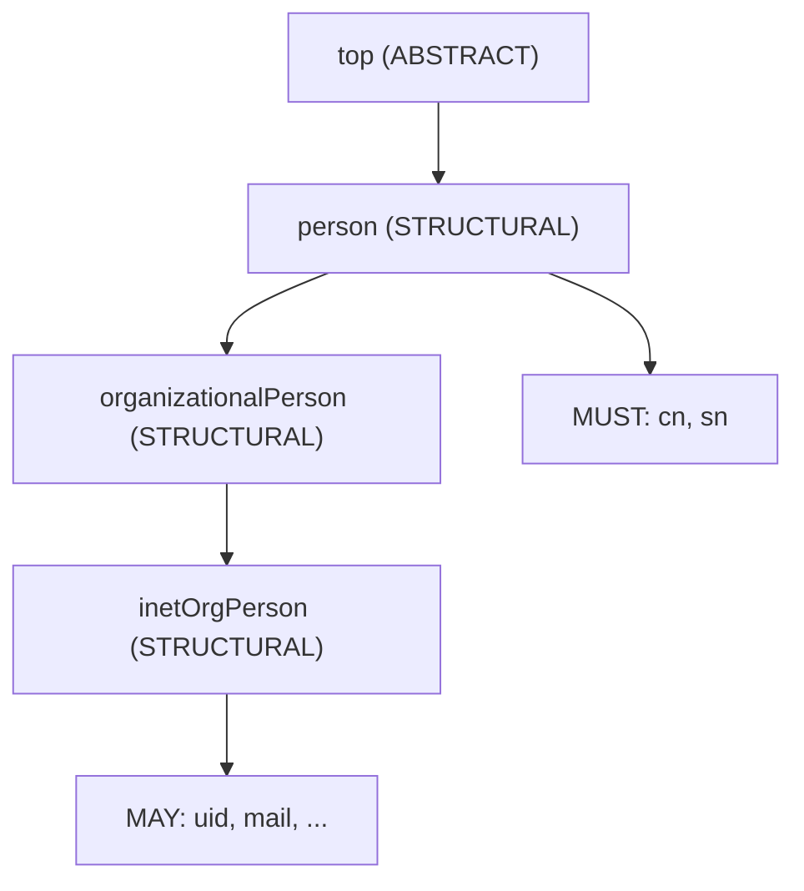
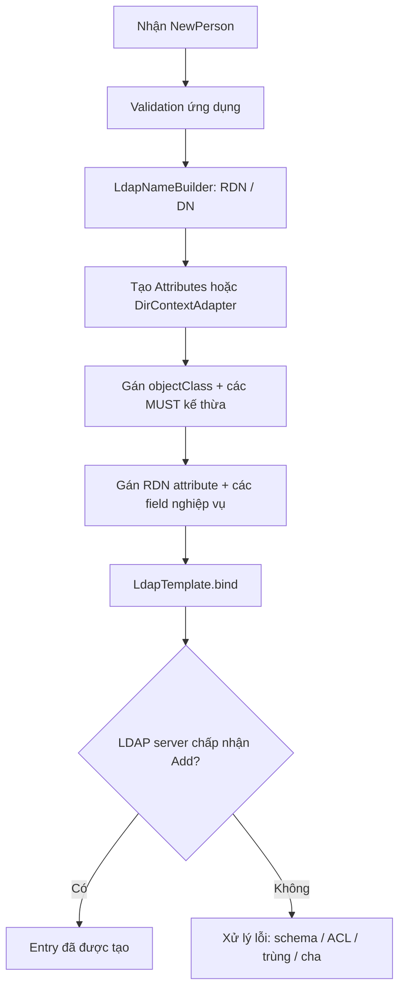
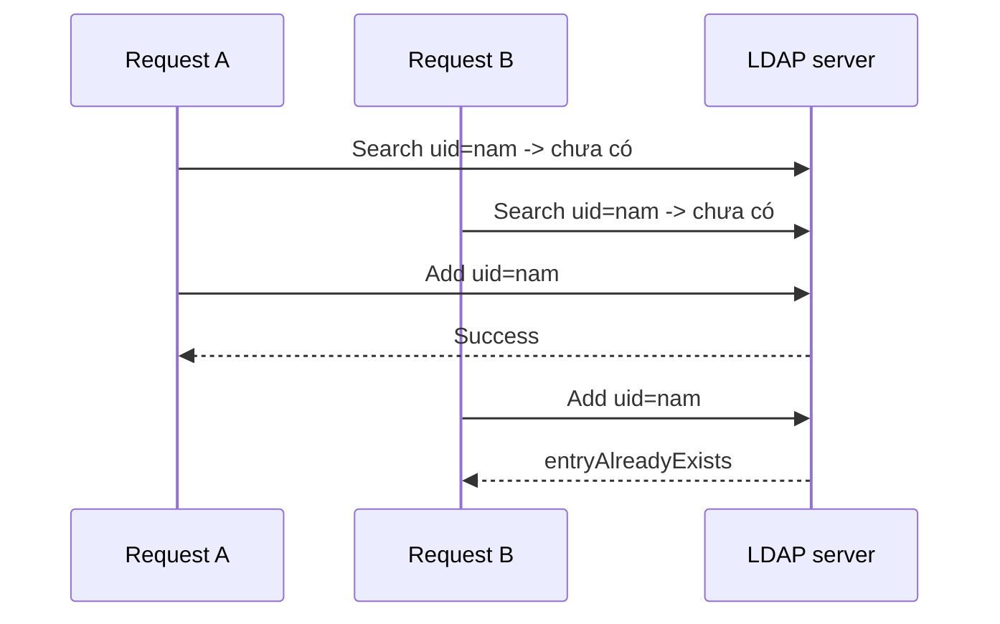

# Thêm attribute bắt buộc trước khi bind

## Mục tiêu bài học

Trong **SPRING_LDAP**, một thao tác tạo entry không chỉ là chọn DN rồi gọi `LdapTemplate.bind()`. Directory server còn kiểm tra **schema**: entry phải có `objectClass` thích hợp, đủ các thuộc tính **bắt buộc** (`MUST`), các thuộc tính bổ sung phải được cho phép (`MAY` hoặc qua auxiliary object class) và tên entry phải hợp lệ trong DIT. Thiếu `sn` khi tạo `inetOrgPerson`, dùng `cn` làm RDN nhưng không cung cấp `cn`, hoặc tạo entry dưới một OU chưa tồn tại đều có thể khiến Add thất bại.

Bài thuộc chương **Bind và tạo entry**, tập trung vào việc **chuẩn bị đầy đủ dữ liệu trước khi gửi lệnh tạo**. Trong lộ trình SPRING_LDAP, bạn sẽ kết hợp DN, schema, `LdapTemplate`/`DirContextAdapter`, `ContextSource`, xác thực kết nối, TLS, quyền truy cập, xử lý lỗi và kiểm thử. Những nguyên tắc về schema cũng áp dụng khi dùng `LdapClient` hoặc LDAP ODM, dù cú pháp API có thể khác theo phiên bản.

Sau bài học, bạn có thể:

1. Phân biệt **LDAP Bind để xác thực** với **`bind` trong API Spring LDAP để thêm entry**.
2. Đọc ý nghĩa `objectClass`, `MUST`, `MAY` và các thuộc tính kế thừa trong schema.
3. Chuẩn bị `cn`, `sn`, `uid` và `objectClass` cho một entry `inetOrgPerson` có RDN là `uid`.
4. Tạo entry bằng `BasicAttributes` hoặc `DirContextAdapter` trước khi gọi `LdapTemplate.bind`.
5. Phát hiện sớm dữ liệu thiếu, nhưng không nhầm validation phía Java với kiểm tra schema/ACL của server.
6. Xử lý những lỗi thường gặp khi thêm entry: thiếu thuộc tính, sai object class, trùng DN, thiếu entry cha, thiếu quyền và kết nối không an toàn.
7. Thiết kế unit test và integration test bảo đảm entry tạo được, có đúng dữ liệu và không ảnh hưởng entry khác.

## 1. “Bind” trong bài này là thêm entry, không phải đăng nhập

Từ **bind** có hai nghĩa dễ nhầm:

| Ngữ cảnh | Ý nghĩa | Ví dụ |
| --- | --- | --- |
| **LDAP Bind operation** của giao thức | Thiết lập trạng thái xác thực cho kết nối LDAP | Xác thực bằng DN và mật khẩu, hoặc SASL |
| **`LdapTemplate.bind(...)`** của Spring LDAP | Tạo/bind một **entry mới tại DN** với các thuộc tính | `ldapTemplate.bind(dn, null, attrs)` |

Khi gọi `LdapTemplate.bind(dn, null, attrs)`, đây là thao tác tạo entry, tương ứng với LDAP Add trong trường hợp dùng `LdapTemplate` cho thư mục. Nó **không kiểm tra mật khẩu của người dùng cuối**. Việc xác thực kết nối đã được cấu hình qua `ContextSource`, dùng cho những thao tác mà tài khoản đó được phép thực hiện.

Ngược lại, tìm thấy entry bằng `search()` hoặc tạo thành công entry bằng `bind()` không chứng minh một người đã đăng nhập. Nếu ứng dụng cần xác thực, phải có luồng authentication chuyên trách và không chấp nhận mật khẩu rỗng như một kết quả xác thực hợp lệ.

## 2. Bài toán: tạo tài khoản thư mục với DN hợp lệ

Giả sử LDAP server thử nghiệm có cây:

```text
dc=example,dc=org
├── ou=People
│   ├── uid=lan
│   └── uid=mai
└── ou=Groups
    └── cn=Developers
```

Ứng dụng muốn thêm người dùng `uid=nam` dưới `ou=People`. Entry mục tiêu:

```ldif
dn: uid=nam,ou=People,dc=example,dc=org
objectClass: top
objectClass: person
objectClass: organizationalPerson
objectClass: inetOrgPerson
uid: nam
cn: Nam Tran
sn: Tran
mail: nam@example.org
```

Trong fixture này, `ou=People,dc=example,dc=org` **đã tồn tại** và service account được phép thêm entry vào đúng nhánh đó.

Giữa DN và danh sách thuộc tính có hai mối liên hệ khác nhau:

1. **DN/RDN:** DN `uid=nam,...` dùng attribute `uid` với giá trị `nam` để định danh entry. Giá trị dùng để đặt tên phải nhất quán với entry được tạo.
2. **Schema:** chọn `inetOrgPerson` (kế thừa `organizationalPerson` và `person`) làm loại entry yêu cầu các thuộc tính bắt buộc của lớp đó và các lớp cha.

**`mail` không phải thuộc tính bắt buộc chung của `inetOrgPerson` theo schema chuẩn**, nhưng API nghiệp vụ có thể quy định mail bắt buộc ở tầng ứng dụng. Cần phân biệt **schema MUST** với **business required**; chúng có thể giao nhau mà không hoàn toàn trùng nhau.

## 3. Đọc schema trước khi tạo

Một object class xác định **loại entry**, các thuộc tính bắt buộc và được phép. Trong định nghĩa LDAP schema, những từ thường gặp:

| Khái niệm | Ý nghĩa | Hệ quả lúc tạo entry |
| --- | --- | --- |
| `objectClass` | Các lớp mà entry thuộc về | Phải khai báo đúng lớp structural và các lớp liên quan |
| `MUST` | Thuộc tính bắt buộc của object class | Nếu thiếu, Add có thể bị từ chối với `objectClassViolation` |
| `MAY` | Thuộc tính được phép nhưng không bắt buộc | Có thể gửi nếu chức năng cần và schema cho phép |
| `SUP` | Lớp cha của object class | Các ràng buộc kế thừa vẫn có hiệu lực |
| `STRUCTURAL` | Loại entry chính trong cây structural object class | Phải chọn chuỗi structural hợp lệ |
| `AUXILIARY` | Lớp phụ bổ sung khả năng/thuộc tính | Chỉ thêm nếu schema và chính sách server cho phép |
| Attribute type / syntax | Loại dữ liệu và matching rules | Không phải giá trị tùy ý nào cũng hợp lệ |

### 3.1. Kế thừa của inetOrgPerson

Chuỗi structural object classes thường dùng để biểu diễn một người:



Với schema thường gặp:

- `person` có các trường bắt buộc **`cn`** (*common name*) và **`sn`** (*surname*).
- `organizationalPerson` mở rộng `person`, bổ sung các thuộc tính phù hợp với hồ sơ trong tổ chức.
- `inetOrgPerson` tiếp tục mở rộng lớp đó; **`uid`**, **`mail`** là các thuộc tính phổ biến được phép sử dụng trong các cấu hình schema tương ứng.
- `objectClass` bản thân là một thuộc tính bắt buộc của mô hình LDAP và thường khai báo chuỗi lớp theo kế thừa để dễ hiểu/tương thích.

Trong ví dụ tạo bằng RDN `uid=nam`, dù schema cho phép `uid` là tùy chọn, **thiết kế tên entry buộc bạn cung cấp giá trị `uid` phù hợp với RDN**. Đừng đồng nhất “MAY trong schema” với “có thể bỏ nếu đang dùng làm RDN”.

**Không giả định mọi directory server có schema giống nhau.** OpenLDAP, Active Directory, ApacheDS hoặc cấu hình doanh nghiệp có thể có lớp, thuộc tính bắt buộc thêm, quy tắc đặt tên và ACL khác nhau. Khi chạy thật, phải tra schema của **server đích**.

### 3.2. Attribute schema không phải validation của form

Ví dụ:

| Trường | Theo schema `inetOrgPerson` phổ biến | Theo hợp đồng API tạo nhân viên (ví dụ) |
| --- | --- | --- |
| `objectClass` | Bắt buộc | Server và repository phải thiết lập đúng |
| `cn` | Bắt buộc qua `person` | Bắt buộc |
| `sn` | Bắt buộc qua `person` | Bắt buộc |
| `uid` | Được phép (MAY), nhưng cần cho RDN `uid=...` | Bắt buộc và cần duy nhất trong phạm vi nghiệp vụ |
| `mail` | Thường được phép, không nhất thiết MUST | Có thể bắt buộc theo chính sách |
| `telephoneNumber` | Có thể được phép, thường tùy chọn | Tùy chọn |
| `userPassword` | Có thể liên quan cơ chế xác thực, phụ thuộc chính sách | **Không tự đưa vào** khi chỉ tạo hồ sơ |

Một ứng dụng có thể yêu cầu `mail` để gửi thông báo, dù LDAP schema không yêu cầu. Ngược lại, kể cả UI không yêu cầu `sn`, repository vẫn phải có chiến lược cung cấp giá trị hợp lệ trước khi Add; **không điền chuỗi giả** để qua schema nếu giá trị đó không đúng nghiệp vụ.

## 4. Kiểm tra đầu vào trước khi dựng entry

Đối với nghiệp vụ tạo `inetOrgPerson`, có thể định nghĩa DTO đầu vào rõ ràng:

```java
record NewPerson(
        String uid,
        String fullName,
        String surname,
        String email
) {}
```

Một lớp validate ở mức ứng dụng:

```java
final class PersonInputRules {
    private PersonInputRules() {}

    static void validate(NewPerson person) {
        if (person == null) {
            throw new IllegalArgumentException("person is required");
        }
        requireText(person.uid(), "uid");
        requireText(person.fullName(), "cn");
        requireText(person.surname(), "sn");

        // Email là required theo hợp đồng ví dụ, không phải MUST của
        // mọi schema inetOrgPerson.
        requireText(person.email(), "mail");

        if (person.uid().length() > 64
                || person.fullName().length() > 256
                || person.surname().length() > 128) {
            throw new IllegalArgumentException("field too long");
        }
    }

    private static void requireText(String input, String field) {
        if (input == null || input.isBlank()) {
            throw new IllegalArgumentException(field + " is required");
        }
    }
}
```

Đây là **validation minh họa**, không phải toàn bộ schema validator. Hạn mức 64/256/128 ký tự do ứng dụng chọn, **không phải các giá trị bắt buộc trong RFC**. Khi cần kiểm tra email, Unicode, tên/UID có ký tự đặc biệt, hoặc chiều dài theo byte, phải dùng quy tắc nghiệp vụ và schema thực tế.

Quan trọng:

- **Không tự escape giá trị `uid` trước khi truyền vào `LdapNameBuilder`.** Builder nhận giá trị thô và xử lý theo cú pháp DN/RDN.
- **Không tự tạo tên LDAP từ giá trị email** nếu nghiệp vụ đã chọn UID làm RDN.
- **Không tin validation của client là đủ.** LDAP server mới là nơi thực thi schema, ACL và tính hợp lệ cuối cùng.
- **Không đưa password vào form tạo hồ sơ chỉ vì object class có thể hỗ trợ nó.** Tài khoản và cơ chế xác thực phải được thiết kế riêng.

## 5. Dựng DN trước, nhưng không ghép chuỗi thủ công

Trong ví dụ, `ContextSource` đặt base DN `dc=example,dc=org`. Khi gọi `LdapTemplate.bind` bằng một `Name`, DN được hiểu **tương đối** so với base đó.

Sử dụng `LdapNameBuilder`:

```java
import javax.naming.Name;
import org.springframework.ldap.support.LdapNameBuilder;

final class PersonNames {
    private PersonNames() {}

    static Name relativePersonDn(String rawUid) {
        if (rawUid == null || rawUid.isBlank()) {
            throw new IllegalArgumentException("uid is required");
        }
        return LdapNameBuilder.newInstance()
                .add("ou", "People")
                .add("uid", rawUid)
                .build();
    }
}
```

Đầu vào `nam` tạo DN tương đối `uid=nam,ou=People`. Directory server xử lý DN hiệu dụng `uid=nam,ou=People,dc=example,dc=org`.

Nếu người dùng có UID literal `nam,dev`, nối chuỗi:

```java
// KHÔNG NÊN: dấu phẩy của UID có thể bị diễn giải là dấu phân cách RDN.
String dn = "uid=" + rawUid + ",ou=People";
```

Trong khi `LdapNameBuilder.add("uid", rawUid)` xử lý encoding RDN theo ngữ cảnh DN. Đây là khác biệt với **LDAP filter escaping** (RFC 4515) dùng khi search; không dùng `EqualsFilter` để tạo DN, cũng không đưa giá trị đã escape sẵn vào DN builder.

### 5.1. Đồng bộ RDN với thuộc tính được gửi

Nếu DN là `uid=nam,ou=People`, danh sách attribute phải thể hiện `uid` tương ứng với giá trị `nam`. Nếu đổi RDN sang `cn=Nam Tran`, bạn cần hiểu quy tắc đặt tên và giá trị `cn` của entry.

**Không chọn RDN ngẫu nhiên vì có sẵn một field.** DN là định danh trong DIT, còn thuộc tính như `mail` có thể thay đổi theo thời gian. Thiết kế RDN phải cân nhắc tính ổn định, tính duy nhất trong cùng nhánh và hậu quả khi đổi tên (`rename`) đối với các nhóm hoặc tham chiếu có lưu DN.

### 5.2. Parent DN phải tồn tại trước Add

LDAP Add tạo **một entry**, không tự tạo cả một chuỗi OU cha. Nếu chưa tồn tại `ou=People,dc=example,dc=org`, việc tạo `uid=nam,ou=People,...` có thể trả `noSuchObject` dù tất cả attribute đều hợp lệ.

Phải chuẩn bị hoặc provision entry cha theo một luồng quản trị riêng, có quyền thích hợp và schema riêng của entry cha. Không tự động tạo OU mới từ mọi request mà không có phê duyệt nghiệp vụ.

## 6. Cách 1: tạo entry bằng BasicAttributes và LdapTemplate.bind

Đây là cách tường minh, gần với cấu trúc của thao tác LDAP Add. `BasicAttributes` chứa các attribute; `BasicAttribute` cho phép một attribute có nhiều giá trị như `objectClass`.

### 6.1. Hàm xây Attributes

```java
import javax.naming.directory.Attributes;
import javax.naming.directory.BasicAttribute;
import javax.naming.directory.BasicAttributes;

final class PersonEntryAttributes {
    private PersonEntryAttributes() {}

    static Attributes forCreate(NewPerson person) {
        PersonInputRules.validate(person);

        // true: tên attribute không phân biệt chữ hoa/thường.
        BasicAttributes attrs = new BasicAttributes(true);

        BasicAttribute objectClasses = new BasicAttribute("objectClass");
        objectClasses.add("top");
        objectClasses.add("person");
        objectClasses.add("organizationalPerson");
        objectClasses.add("inetOrgPerson");
        attrs.put(objectClasses);

        // cn và sn: MUST qua lớp person.
        attrs.put("cn", person.fullName());
        attrs.put("sn", person.surname());

        // uid: dùng làm RDN của entry mới.
        attrs.put("uid", person.uid());

        // mail: optional theo schema phổ biến, required theo API ví dụ.
        attrs.put("mail", person.email());

        return attrs;
    }
}
```

**Vì sao dùng `BasicAttributes(true)`?** Tên loại thuộc tính LDAP không phân biệt chữ hoa/thường, ví dụ `cn` và `CN` quy chiếu cùng tên trong schema. Tùy chọn này giúp container phía Java so khớp tên attribute không phân biệt hoa/thường. Nó **không** làm validation schema thay server.

**Vì sao `objectClass` nhiều giá trị?** Entry có thể khai báo nhiều object class trong chuỗi kế thừa. Đây là attribute đa trị, nên không đặt nhiều lần bằng `attrs.put("objectClass", "...")`: những lần put tiếp theo có thể **thay thế** object class trước đó trong đối tượng `Attributes`.

**Không cần tự nhét những thuộc tính mà server tự quản lý** như `createTimestamp`, `modifyTimestamp`, `creatorsName` vào yêu cầu Add. Các operational attribute này có quy tắc riêng và thường do directory server sinh ra.

### 6.2. Gửi Add bằng LdapTemplate

```java
import javax.naming.Name;
import javax.naming.directory.Attributes;
import org.springframework.ldap.core.LdapTemplate;

final class PersonCreateRepository {
    private final LdapTemplate writerLdapTemplate;

    PersonCreateRepository(LdapTemplate writerLdapTemplate) {
        this.writerLdapTemplate = writerLdapTemplate;
    }

    Name create(NewPerson person) {
        PersonInputRules.validate(person);

        Name relativeDn = PersonNames.relativePersonDn(person.uid());
        Attributes attributes = PersonEntryAttributes.forCreate(person);

        // Đây là Add entry, KHÔNG phải LDAP authentication Bind.
        writerLdapTemplate.bind(relativeDn, null, attributes);
        return relativeDn;
    }
}
```

Gọi `bind(relativeDn, null, attributes)` chuyển yêu cầu tạo entry cho server. Với `DirContext`/JNDI ở tầng dưới, thao tác tương ứng có thể được triển khai qua thao tác tạo subcontext; Spring LDAP cung cấp API nhất quán và điều phối context.

Khi method trả về bình thường, thao tác Add đã nhận phản hồi thành công theo LDAP provider. Nhưng application vẫn nên xác minh trạng thái mong muốn trong integration test (đặc biệt khi đọc từ replica khác có độ trễ đồng bộ).

**Không thay `bind` bằng `rebind` để xử lý lỗi trùng.** `rebind` có ngữ nghĩa thay thế binding và có thể làm mất dữ liệu/vi phạm hợp đồng “chỉ tạo khi chưa tồn tại”.

## 7. Cách 2: tạo entry bằng DirContextAdapter

`DirContextAdapter` là lớp tiện ích của Spring LDAP giúp thao tác với attributes. Khi **tạo entry mới**, có thể tạo một adapter với DN, đặt đầy đủ các thuộc tính rồi gọi `LdapTemplate.bind(ctx)`.

```java
import javax.naming.Name;
import org.springframework.ldap.core.DirContextAdapter;
import org.springframework.ldap.core.DirContextOperations;
import org.springframework.ldap.core.LdapTemplate;

final class PersonCreateWithAdapter {
    private final LdapTemplate writerLdapTemplate;

    PersonCreateWithAdapter(LdapTemplate writerLdapTemplate) {
        this.writerLdapTemplate = writerLdapTemplate;
    }

    void create(NewPerson person) {
        PersonInputRules.validate(person);
        Name relativeDn = PersonNames.relativePersonDn(person.uid());

        DirContextOperations ctx = new DirContextAdapter(relativeDn);
        ctx.setAttributeValues("objectClass", new String[] {
                "top",
                "person",
                "organizationalPerson",
                "inetOrgPerson"
        });
        ctx.setAttributeValue("uid", person.uid());
        ctx.setAttributeValue("cn", person.fullName());
        ctx.setAttributeValue("sn", person.surname());
        ctx.setAttributeValue("mail", person.email());

        writerLdapTemplate.bind(ctx);
    }
}
```

Ở đây, `new DirContextAdapter(relativeDn)` đại diện cho **entry đang được xây mới**; nó không cần có snapshot từ server. Các setter tạo nội dung attribute; `writerLdapTemplate.bind(ctx)` mới là bước gửi Add.

Đối với **entry đã tồn tại** cần cập nhật, đường đi lại khác:

```java
// Dành cho update, không phải create:
DirContextOperations existing = writerLdapTemplate.lookupContext(relativeDn);
existing.setAttributeValue("mail", "new@example.org");
writerLdapTemplate.modifyAttributes(existing);
```

Không gọi `bind(ctx)` cho adapter vừa `lookupContext` khi nghiệp vụ chỉ yêu cầu sửa. **Create** và **update** có hợp đồng khác nhau, đặc biệt về trường hợp entry đã có, schema và xử lý cạnh tranh.

### 7.1. Chọn BasicAttributes hay DirContextAdapter?

| Tiêu chí | `BasicAttributes` | `DirContextAdapter` |
| --- | --- | --- |
| Cách viết | Xây rõ `Attributes`/`Attribute` JNDI | Dùng getter/setter tiện lợi của Spring LDAP |
| Tạo objectClass đa trị | `BasicAttribute("objectClass")` rồi `add(...)` | `setAttributeValues(..., String[])` |
| Cách thêm entry | `bind(dn, null, attrs)` | `bind(ctx)` |
| Đọc DN | Được truyền riêng | Adapter giữ DN |
| Tái sử dụng trong update | Phải tự xác định modification | Có hỗ trợ dirty tracking khi adapter ở update mode |
| Khi phù hợp | Muốn biểu diễn Add request tường minh | Muốn dùng API `DirContextOperations` nhất quán |

**Cả hai đều phải cung cấp đầy đủ attribute bắt buộc.** Lựa chọn API không tạo ra `sn` từ `cn` và cũng không tự sửa một object class sai. Với dữ liệu nhạy cảm, việc tiện gọi setter không thay thế validation và ACL.

## 8. Phân biệt objectClass, attribute và thứ tự xử lý

LDAP entry có một hoặc nhiều `objectClass` theo schema. Để tạo `inetOrgPerson`, đoạn mã mẫu khai báo cả chuỗi kế thừa:

```text
objectClass = {top, person, organizationalPerson, inetOrgPerson}
```

Sau đó thêm `cn`, `sn`, `uid`, `mail` vào **cùng một tập Attributes trước khi gửi `bind`**. Bạn không cần thực hiện bốn request riêng lên server, cũng không cần tạo entry thiếu `sn` rồi hy vọng bổ sung bằng Modify sau.



Lập trình viên có thể viết các lời gọi `attrs.put(...)` theo thứ tự khác nhau; kết quả quan trọng là **tập attribute cuối cùng hợp lệ trước khi gửi Add**. Thuộc tính LDAP đa trị thường không có thứ tự mang ý nghĩa nghiệp vụ; vì vậy đừng phụ thuộc thứ tự các dòng `objectClass` trong response.

### 8.1. Vì sao không “Add thiếu, rồi Modify bổ sung”?

Máy chủ đánh giá schema **ngay khi nhận Add**. Nếu thiếu `sn`, server có thể từ chối entry, nên không có entry nào để thực hiện Modify tiếp. Ngay cả server cho phép một số bước tạo tạm trong chính sách đặc biệt, cách tạo hồ sơ thiếu trường bắt buộc thường làm ứng dụng khó phục hồi và audit.

**Quy trình đúng** là chuẩn bị một Add request đầy đủ và nhất quán. Nếu dữ liệu nghiệp vụ chưa đủ, từ chối ở tầng ứng dụng với lỗi đầu vào có ý nghĩa, không cố gửi một entry không hợp lệ.

## 9. Không phải objectClass nào cũng có cùng các attribute bắt buộc

Các ví dụ trên dành riêng cho `inetOrgPerson`. Nếu bạn muốn tạo OU, group hoặc một kiểu entry khác, phải thay **cả object class lẫn tập attribute bắt buộc**, không copy nguyên mã rồi chỉ đổi tên DN.

| Kiểu entry | Object class thường gặp | Thuộc tính bắt buộc điển hình | Ví dụ DN |
| --- | --- | --- | --- |
| Người dùng | `inetOrgPerson` | `cn`, `sn` (qua `person`) | `uid=nam,ou=People,...` |
| Đơn vị tổ chức | `organizationalUnit` | `ou` | `ou=People,dc=example,dc=org` |
| Nhóm tên | `groupOfNames` | `cn`, **`member`** | `cn=Developers,ou=Groups,...` |
| Nhóm tên duy nhất | `groupOfUniqueNames` | `cn`, **`uniqueMember`** | `cn=TeamA,ou=Groups,...` |

Đây là các class theo schema chuẩn thường gặp; directory server có thể cung cấp thêm kiểu entry riêng, chẳng hạn nhóm không bắt buộc thành viên hoặc những lớp đặc thù của sản phẩm. **Tra schema thực tế trước khi chọn object class.**

### 9.1. Ví dụ groupOfNames: thiếu member cũng không hợp lệ

Giả sử ứng dụng muốn tạo nhóm `cn=Developers`. Để thỏa `groupOfNames`, cần `cn` và **ít nhất một `member`** theo schema tiêu chuẩn:

```ldif
dn: cn=Developers,ou=Groups,dc=example,dc=org
objectClass: top
objectClass: groupOfNames
cn: Developers
member: uid=lan,ou=People,dc=example,dc=org
```

Nếu chỉ gửi:

```ldif
dn: cn=Developers,ou=Groups,dc=example,dc=org
objectClass: top
objectClass: groupOfNames
cn: Developers
```

server tuân theo schema `groupOfNames` thông thường sẽ từ chối vì **thiếu `member`**. Không nên “lách” bằng cách thêm một thành viên giả để tạo nhóm rỗng nếu dữ liệu đó không đúng. Nếu hợp đồng cần nhóm rỗng, hãy chọn schema/loại nhóm có hỗ trợ và được quản trị phê duyệt.

### 9.2. Tạo nhóm bằng BasicAttributes

```java
import javax.naming.Name;
import javax.naming.directory.BasicAttribute;
import javax.naming.directory.BasicAttributes;
import org.springframework.ldap.support.LdapNameBuilder;

Name groupDn = LdapNameBuilder.newInstance()
        .add("ou", "Groups")
        .add("cn", "Developers")
        .build();

Name memberDn = LdapNameBuilder.newInstance(
        "dc=example,dc=org")
        .add("ou", "People")
        .add("uid", "lan")
        .build();

BasicAttributes attributes = new BasicAttributes(true);
BasicAttribute classes = new BasicAttribute("objectClass");
classes.add("top");
classes.add("groupOfNames");
attributes.put(classes);
attributes.put("cn", "Developers");

// member mang giá trị DN đầy đủ của entry thành viên.
attributes.put("member", memberDn.toString());

writerLdapTemplate.bind(groupDn, null, attributes);
```

Ví dụ này giả định code có `writerLdapTemplate` và hai nhánh `Groups`, `People` đã tồn tại trong directory thử nghiệm. DN dùng làm **tên entry nhóm** là tương đối với base của `ContextSource`, trong khi giá trị `member` là DN **đầy đủ**. Đừng nhầm hai loại DN này.

Khi nhóm đã được tạo, việc **thêm thành viên** là `modifyAttributes`/`addAttributeValue`, không phải gọi `bind` lại với DN nhóm đã tồn tại.

## 10. Server có thể kiểm tra nhiều điều hơn MUST/MAY

Một entry có đủ `cn`, `sn` và `uid` vẫn có thể bị từ chối. Những kiểm tra quan trọng:

1. **Nhánh cha:** DN cha phải tồn tại và cho phép thêm entry con theo chính sách.
2. **Tính duy nhất của DN:** cùng DN không thể có hai entry độc lập đồng thời; LDAP Add vào DN đã tồn tại phải được xử lý như xung đột.
3. **Schema và loại attribute:** thuộc tính phải có trong schema, đúng syntax và số giá trị được phép (single-valued/multi-valued).
4. **Structural object class:** không khai báo tùy tiện hai nhánh structural class không tương thích cho cùng entry.
5. **RDN:** kiểu và giá trị thuộc tính định danh phải phù hợp với quy tắc đặt tên.
6. **ACL:** danh tính kết nối phải được phép thêm đúng loại entry ở vị trí đó.
7. **Server controls/policy:** quy tắc vận hành, giới hạn kích thước, constraint, overlay hoặc plugin có thể thêm kiểm tra.

### 10.1. Tên attribute hợp lệ nhưng giá trị sai syntax

Một trường được phép bởi object class không có nghĩa **mọi giá trị String** đều hợp lệ. Ví dụ một attribute loại DN có thể yêu cầu chuỗi biểu diễn DN hợp lệ; một attribute số có thể không chấp nhận chuỗi chữ cái.

Vì `Attributes` trong JNDI là container khá tổng quát, code Java có thể xây một tập dữ liệu mà compiler chấp nhận nhưng LDAP server từ chối vì schema. Với dữ liệu từ API, nên validate trước để phản hồi dễ hiểu, **nhưng không bỏ qua lỗi server**.

### 10.2. Có cần tự gửi toàn bộ lớp cha trong objectClass?

Một số directory có thể suy ra hoặc chấp nhận danh sách object class rút gọn. Tuy nhiên, ví dụ trong bài **chủ động khai báo đủ chuỗi `top → person → organizationalPerson → inetOrgPerson`** nhằm minh bạch sự kế thừa và tăng tính dễ hiểu khi kiểm thử với những server thông dụng.

Việc khai báo chuỗi lớp cha **không làm xuất hiện tự động các thuộc tính MUST** như `cn` hoặc `sn`. Dù server có chấp nhận `objectClass: inetOrgPerson` một mình, yêu cầu vẫn phải thỏa schema kế thừa.

## 11. Lỗi thường gặp khi gọi bind

| Tình huống | LDAP result thường gặp | Cần xử lý |
| --- | --- | --- |
| Thiếu `sn` hoặc `cn` | `objectClassViolation` (65) | Bổ sung MUST trước khi Add; không tạo entry giả |
| Gửi thuộc tính không được phép bởi schema | `objectClassViolation` hoặc lỗi schema tương ứng | Kiểm tra object class, auxiliary class và attribute |
| Sai cú pháp giá trị thuộc tính | `invalidAttributeSyntax` (21), `constraintViolation` (19) hoặc lỗi khác | Kiểm tra attribute type và syntax |
| DN đã tồn tại | `entryAlreadyExists` (68) | Báo conflict; không ghi đè |
| DN cha không tồn tại | `noSuchObject` (32) | Provision cha theo luồng riêng hoặc từ chối |
| Thiếu quyền Add | `insufficientAccessRights` (50) | Sửa ACL/identity theo chính sách; không tự nâng quyền |
| RDN/đặt tên không hợp lệ | `namingViolation` (64) hoặc lỗi liên quan | Dựng DN đúng và đối chiếu quy tắc server |
| Không có đường truyền bảo vệ/certificate lỗi | Lỗi kết nối/TLS tại client | Sửa TLS, không hạ cấp sang kết nối không an toàn |
| Timeout sau khi gửi Add | Trạng thái **chưa chắc chắn** | Đọc/đối soát lại trước khi retry |

Các mã kết quả mô tả behavior LDAP phổ biến; tên exception trong Spring LDAP hoặc JNDI có thể khác theo phiên bản và provider. **Không bắt mọi exception rồi trả `false` hoặc `List.of()`**, vì những lựa chọn này làm mất sự khác nhau giữa xung đột dữ liệu, lỗi schema, lỗi quyền và hạ tầng.

### 11.1. Phản hồi cho người dùng cuối

Trong một ứng dụng có REST API, hợp đồng có thể quy định:

| Nhóm lỗi | Phản hồi nghiệp vụ minh họa |
| --- | --- |
| Thiếu `sn`/`cn` do request không hợp lệ | Lỗi validation, nêu đúng field cần sửa |
| DN mục tiêu đã có | Xung đột tạo entry |
| Parent không tồn tại theo dữ liệu được phép tạo | Lỗi cấu hình tổ chức hoặc nhánh không hợp lệ |
| Không được phép tạo | Lỗi authorization |
| LDAP server không sẵn sàng | Lỗi dependency/hạ tầng, không ngụy trang thành thiếu thuộc tính |

Không hiển thị nguyên văn stack trace, DN quản trị hoặc credential trong response. Mặt khác, log nội bộ phải giữ **loại lỗi an toàn**, operation, request/correlation ID và thời điểm để điều tra.

## 12. Bind an toàn: ContextSource, TLS và quyền tối thiểu

Thông thường, ứng dụng cần một service account riêng cho các thao tác tạo entry. `ContextSource` thiết lập URL, base DN và thông tin xác thực của **kết nối dùng để gửi Add**.

Ví dụ cấu hình Spring Boot (minh họa, tùy phiên bản):

```properties
spring.ldap.urls=ldaps://ldap.example.org:636
spring.ldap.base=dc=example,dc=org
spring.ldap.username=cn=svc-entry-writer,ou=Services,dc=example,dc=org
spring.ldap.password=${LDAP_BIND_PASSWORD}
```

Trong production:

- `LDAP_BIND_PASSWORD` được lấy từ secret manager/biến môi trường được bảo vệ; **không hardcode** vào Java, CI log hoặc tài liệu thật.
- Dùng LDAPS hoặc StartTLS **với xác minh certificate/hostname** và truststore đúng. Không gửi simple-bind credential qua kênh chưa được bảo vệ.
- Tài khoản `svc-entry-writer` chỉ được thêm **đúng nhánh** và **loại entry** cần thiết. Không dùng account quản trị toàn directory vì vài thao tác tạo người.
- Authorization của ứng dụng phải quyết định caller được tạo tài khoản nào. Có quyền LDAP Add **không tự bảo đảm** caller HTTP được phép tạo.
- Không cho người dùng tự truyền base DN, object class hoặc tên thuộc tính tùy ý nếu API chỉ hỗ trợ tạo `inetOrgPerson`. Giữ chúng trong **allowlist/cấu hình đáng tin cậy**.
- Đặt connect/read timeout và giám sát số lần Add thất bại; với pooling, bảo đảm không tái sử dụng nhầm context có danh tính bind khác.

### 12.1. Không dùng anonymous bind để tạo entry

Anonymous LDAP Bind là trạng thái truy cập không có danh tính đã xác thực. Nó không phù hợp cho luồng tạo tài khoản người dùng trong hệ thống thông thường. Các lệnh thêm entry cần một identity riêng được cấp quyền thích hợp, và LDAP server nên từ chối thao tác thêm entry của anonymous client.

Đặc biệt, nếu `ContextSource` có service DN nhưng mật khẩu cấu hình bị rỗng, **không âm thầm fallback sang anonymous**. Một số directory có thể chấp nhận *unauthenticated simple bind* với DN không rỗng và password rỗng, khiến ứng dụng nhầm trạng thái xác thực. Kiểm tra credential trước khi khởi tạo kết nối.

### 12.2. Không chèn input vào DN hay filter

Khi tạo entry, DN phải được build đúng ngữ cảnh bằng `LdapNameBuilder`. Khi cần **kiểm tra/truy vấn entry trước hoặc sau Add**, sử dụng `LdapQueryBuilder` hoặc filter builder; đừng nối `uid` vào chuỗi LDAP filter.

```java
// Ví dụ tìm bằng filter an toàn; KHÔNG phải bước tạo entry.
var request = org.springframework.ldap.query.LdapQueryBuilder.query()
        .base("ou=People")
        .where("uid").is(person.uid());
```

Kể cả khi kiểm tra trước thấy chưa có entry, một client khác vẫn có thể thêm cùng DN ngay sau đó. **Kiểm tra tồn tại trước Add chỉ giúp UX**, không thay thế xử lý lỗi trùng DN do server trả về.

## 13. Concurrency, retry và idempotency của Add

Một hợp đồng **“tạo entry nếu chưa có”** nghe đơn giản nhưng có thể gặp hai vấn đề khác nhau:

### 13.1. Hai yêu cầu đồng thời tạo cùng DN



Không có cách kiểm tra độc lập `exists()` trước rồi mới `bind()` có thể loại hoàn toàn cuộc đua này. LDAP server kiểm tra **DN duy nhất** tại thời điểm Add. Ứng dụng phải xử lý trường hợp trùng như một xung đột, dù bước kiểm tra trước vừa cho thấy chưa tồn tại.

Quan trọng: DN duy nhất **không đồng nghĩa giá trị `uid` duy nhất trên mọi OU**. Hai entry có thể mang cùng `uid` ở hai nhánh khác nhau nếu server và schema cho phép. Nếu yêu cầu duy nhất trên toàn tổ chức, cần cơ chế chính sách/index/ràng buộc phù hợp ở directory hoặc tầng ứng dụng, không dựa vào tên DN đơn lẻ.

### 13.2. Timeout sau khi gửi Add

```text
Ứng dụng gửi LDAP Add(uid=nam)
    |
    v
Server có thể đã tạo entry
    |
    x  Kết nối đứt trước khi client nhận phản hồi
    |
    v
Client chưa biết server đã Add thành công hay chưa
```

Trong trường hợp này, **không tự động retry mù** hoặc coi mọi lỗi `entryAlreadyExists` là thành công. Entry tồn tại sau retry có thể đã được tạo bởi request đầu, nhưng cũng có thể là entry của request khác, với các thuộc tính khác.

Quy trình xử lý có thể là:

1. Khi kết nối phục hồi, đọc entry tại DN mục tiêu bằng identity có quyền phù hợp.
2. So sánh dữ liệu thực tế với **định danh và nội dung** mà yêu cầu Add mong đợi; lưu ý read replica có thể trễ đồng bộ.
3. Nếu khác với hợp đồng, báo xung đột hoặc chuyển quy trình đối soát; không ghi đè entry đang tồn tại.
4. Chỉ retry nếu có cơ sở xác định an toàn, chính sách giới hạn số lần/thời gian và quan sát lỗi.

Với các hệ thống có nhiều writer, tính **idempotent** của API tạo entry có thể được quản lý bằng khóa yêu cầu (idempotency key) ở tầng dịch vụ riêng, nhưng phải thiết kế nơi lưu/kiểm tra khóa và độ bền dữ liệu. `LdapTemplate.bind()` **không tự cung cấp** idempotency theo yêu cầu HTTP.

### 13.3. Không mặc định Add nhiều entry là một transaction

Ví dụ nghiệp vụ “tạo người dùng rồi thêm vào nhóm” thường gồm **Add một entry người** và **Modify một entry nhóm**. LDAP không mặc nhiên đảm bảo cả hai thao tác thành công hoặc thất bại cùng nhau trên mọi server. Nếu Modify nhóm lỗi sau khi Add người đã thành công, phải có chiến lược xử lý phần thành công: bù trừ có kiểm soát, hàng đợi đối soát hoặc quy trình báo lỗi.

Không viết rollback bằng cách `unbind()` vô điều kiện: entry vừa tạo có thể đã được tham chiếu hoặc thay đổi bởi một tác nhân khác trước khi rollback.

## 14. Unit test: kiểm tra tập attribute trước khi bind

Unit test không cần LDAP server để chứng minh builder luôn chuẩn bị đầy đủ các thuộc tính kỳ vọng. Ví dụ sau sử dụng JUnit 5; đặt các class `NewPerson`, `PersonInputRules`, `PersonEntryAttributes` cùng package của test.

```java
import static org.junit.jupiter.api.Assertions.*;

import javax.naming.directory.Attributes;
import org.junit.jupiter.api.Test;

class PersonEntryAttributesTest {

    @Test
    void createContainsObjectClassAndRequiredAttributes()
            throws Exception {
        NewPerson person = new NewPerson(
                "nam", "Nam Tran", "Tran", "nam@example.org");

        Attributes attrs = PersonEntryAttributes.forCreate(person);

        assertTrue(attrs.get("objectClass").contains("top"));
        assertTrue(attrs.get("objectClass").contains("person"));
        assertTrue(attrs.get("objectClass")
                .contains("organizationalPerson"));
        assertTrue(attrs.get("objectClass")
                .contains("inetOrgPerson"));

        assertEquals("nam", attrs.get("uid").get());
        assertEquals("Nam Tran", attrs.get("cn").get());
        assertEquals("Tran", attrs.get("sn").get());
        assertEquals("nam@example.org", attrs.get("mail").get());
    }

    @Test
    void missingSurnameIsRejectedBeforeDirectoryAccess() {
        NewPerson missing = new NewPerson(
                "nam", "Nam Tran", "", "nam@example.org");

        assertThrows(IllegalArgumentException.class,
                () -> PersonEntryAttributes.forCreate(missing));
    }

    @Test
    void missingCommonNameIsRejectedBeforeDirectoryAccess() {
        NewPerson missing = new NewPerson(
                "nam", " ", "Tran", "nam@example.org");

        assertThrows(IllegalArgumentException.class,
                () -> PersonEntryAttributes.forCreate(missing));
    }
}
```

Unit test này chứng minh:

- Builder tạo `objectClass` nhiều giá trị, không lỡ chỉ giữ giá trị sau cùng.
- Có `cn`, `sn` và `uid` trước khi gọi Add.
- Dữ liệu thiếu trường theo **hợp đồng ví dụ** bị từ chối sớm.

Nó **không chứng minh** directory đích có `inetOrgPerson` trong schema, DN cha tồn tại, ACL cho phép Add, hoặc mã Java gửi lệnh thành công. Đó là phạm vi của integration test.

### 14.1. Unit test dựng DN có ký tự đặc biệt

```java
import static org.junit.jupiter.api.Assertions.*;
import javax.naming.Name;
import javax.naming.ldap.LdapName;
import org.junit.jupiter.api.Test;

class PersonNamesTest {
    @Test
    void commaIsPartOfRdnValueNotAnExtraRdn() throws Exception {
        Name built = PersonNames.relativePersonDn("nam,dev");
        LdapName parsed = new LdapName(built.toString());

        assertEquals(2, parsed.size()); // uid=..., ou=People
        assertEquals("nam,dev", parsed.getRdn(1).getValue());
    }
}
```

`javax.naming.ldap.LdapName` biểu diễn DN từ trái sang phải theo chuỗi nhưng **chỉ số RDN trong `getRdn(index)` được tính từ phần gốc sang lá**. Với hai RDN `uid=nam\,dev,ou=People`, `getRdn(1)` chính là RDN `uid` và trả lại giá trị `nam,dev`.

Khi test DN có dấu phẩy, không so sánh raw string bằng quy tắc tự nối, vì thư viện có thể chọn cách biểu diễn escape tương đương. So sánh cấu trúc DN và giá trị RDN là ổn định hơn.

### 14.2. Đừng dùng unit test để khẳng định server chắc chắn nhận

Ngay cả khi các test trên PASS, server vẫn có quyền từ chối Add. Đặc biệt với LDAP dùng nhiều sản phẩm, custom schema và ACL, integration test là bắt buộc.

## 15. Integration test: kiểm chứng lỗi schema và trạng thái server

Chuẩn bị directory **thử nghiệm**, account có quyền đọc và account chỉ được Add trong nhánh test. Các ví dụ này không yêu cầu thay đổi bất kỳ dữ liệu production nào.

### 15.1. Ma trận kiểm thử

| Mã ca | Kịch bản | Kỳ vọng |
| --- | --- | --- |
| **ADD-01** | `inetOrgPerson` có `cn`, `sn`, `uid`, `objectClass` | Add thành công theo schema/ACL fixture |
| **ADD-02** | Bỏ `sn` khỏi Add request gửi trực tiếp | Server từ chối schema |
| **ADD-03** | Bỏ `cn` khỏi Add request gửi trực tiếp | Server từ chối schema |
| **ADD-04** | Bỏ `objectClass` | Server từ chối hoặc trả lỗi schema/dữ liệu hợp lệ theo implementation |
| **ADD-05** | Dùng `uid` trong RDN nhưng không cung cấp giá trị phù hợp | Server không nhận entry đặt tên sai |
| **ADD-06** | Gửi `mail` không có trong schema/không được phép với lớp đã chọn | Server trả lỗi schema |
| **ADD-07** | Add cùng DN hai lần | Lần đầu thành công, lần hai conflict |
| **ADD-08** | Add dưới OU cha chưa tồn tại | Server từ chối theo quy tắc DIT |
| **ADD-09** | Add bằng account chỉ đọc | Server từ chối do ACL |
| **ADD-10** | Add bằng account được cấp quyền nhánh khác | Không cho phép tạo ngoài nhánh đã phân quyền |
| **ADD-11** | RDN chứa dấu phẩy trong giá trị UID | DN builder tạo tên có cấu trúc đúng; Add tùy schema/policy |
| **ADD-12** | Add nhóm `groupOfNames` thiếu `member` | Server từ chối schema chuẩn |
| **ADD-13** | Add nhóm có `cn` và `member` | Thành công nếu schema/ACL/nhánh hợp lệ |
| **ADD-14** | Add user có attribute không được phép | Server từ chối, không âm thầm thêm |
| **ADD-15** | Kết nối với certificate TLS không tin cậy | Không gửi Add; không hạ cấp kết nối |
| **ADD-16** | Ngắt kết nối sau khi gửi Add | Không retry mù; thực hiện đối soát trạng thái |
| **ADD-17** | Hai client tạo cùng DN đồng thời | Chỉ một Add có thể tạo entry tại DN đó |
| **ADD-18** | Đọc lại entry sau Add | Kiểm tra DN và các attribute được server thực sự lưu |

Các ca cố tình gửi Add **thiếu `sn`/`cn`** chỉ chạy trong một test integration dùng công cụ tạo request thô trên **directory thử nghiệm**; không bỏ validation trong luồng ứng dụng production chỉ để đo phản hồi schema.

### 15.2. Kiểm tra bằng ldapsearch

Sau khi ứng dụng tạo entry thành công, dùng một account có quyền đọc để đối chiếu:

```bash
ldapsearch -LLL -x \
  -H ldaps://ldap.example.org:636 \
  -D "cn=svc-reader,ou=Services,dc=example,dc=org" -W \
  -b "uid=nam,ou=People,dc=example,dc=org" \
  -s base "(objectClass=*)" \
  objectClass uid cn sn mail
```

`-W` nhập password qua prompt, không ghi trực tiếp trong shell history. Kết quả cần có ít nhất `cn`, `sn`, `uid` và các `objectClass` hiệu dụng phù hợp, trong giới hạn ACL của account.

**Không kiểm tra bằng cách chỉ tìm UID trong toàn bộ directory.** Search rộng có thể thấy một entry khác cùng `uid` tại OU khác và tạo cảm giác Add đã đúng. Đọc theo **DN chính xác** của entry vừa thêm giúp đối chiếu tốt hơn.

### 15.3. Kiểm chứng bước Add không làm hỏng entry khác

Một integration test tốt nên lưu trạng thái các entry fixture trước thao tác, thực hiện Add một DN mới, rồi xác minh:

1. Entry mới được tạo với DN chính xác.
2. Các thuộc tính bắt buộc và thuộc tính nghiệp vụ có giá trị mong đợi.
3. Entry cha vẫn tồn tại; không có OU mới được tạo ngoài yêu cầu.
4. Những entry đang có không bị thay thế hoặc xóa.
5. Có thể cleanup entry thử nghiệm bằng luồng riêng có kiểm soát sau test.

Nếu test cần cleanup, dùng account chỉ có quyền trên nhánh test; đừng phát lệnh `unbind` vào một DN được ghép tùy tiện từ input hay chỉ dựa trên tên hiển thị.

## 16. Các lỗi thiết kế phổ biến

| Cách làm | Vì sao sai | Cách làm đúng |
| --- | --- | --- |
| Chỉ gửi `uid` và `objectClass=inetOrgPerson` | Thiếu `cn`, `sn` kế thừa từ `person` | Chuẩn bị đủ MUST trước Add |
| Tạo `objectClass` bằng nhiều lệnh `attrs.put("objectClass", value)` | Có thể ghi đè giá trị trước đó, mất danh sách lớp | Dùng một `BasicAttribute` đa trị hoặc `setAttributeValues` |
| Xem `mail` bắt buộc với mọi `inetOrgPerson` | Nhầm yêu cầu form với MUST của schema | Tách business-required và schema-required |
| Cho rằng `uid` không cần gửi vì là MAY | Quên RDN được xây bằng `uid` | Gửi RDN attribute nhất quán với tên |
| Gọi Add trước rồi Modify bổ sung `sn` | Add có thể thất bại từ đầu do schema | Tạo request Add đầy đủ |
| Copy code tạo person để tạo `groupOfNames` | Nhóm cần `member`, không phải `sn` | Chọn schema riêng cho loại entry |
| Nối `"uid=" + userInput` thành DN | Giá trị có dấu phân cách gây lỗi tên | Dùng `LdapNameBuilder` |
| Gửi DN tuyệt đối vào API đang dùng DN tương đối | Có thể lặp suffix của base context | Chuẩn hóa quy ước base/DN |
| Tự động tạo mọi parent OU còn thiếu | Có thể tạo cấu trúc DIT ngoài phân quyền | Provision OU qua quy trình quản trị riêng |
| Thấy `entryAlreadyExists` thì gọi `rebind` | Có thể thay dữ liệu người khác | Báo conflict, không ghi đè |
| Đọc kết quả search để coi đã xác thực | Search không chứng minh người dùng biết mật khẩu | Tách authentication khỏi tạo/tra cứu entry |
| Chỉ thử với account quản trị | Không kiểm chứng quyền tối thiểu | Test bằng identity đúng vai trò |
| Không phân biệt lỗi schema với lỗi mạng | Khó sửa input và vận hành | Ánh xạ ngoại lệ theo loại nguyên nhân |
| Retry Add vô điều kiện sau timeout | Không chắc server đã tạo hay chưa | Đối soát trạng thái DN trước khi retry |

## 17. Bài tập tổng hợp: đăng ký entry nhân viên hợp lệ

**Bối cảnh:** Một ứng dụng nhân sự có LDAP base `dc=example,dc=org`, nhánh `ou=People` và API quản trị tạo nhân viên mới. Người được tạo dùng object class `inetOrgPerson`. Yêu cầu: bảo đảm attribute bắt buộc được chuẩn bị **trước khi gọi bind**, không ghi đè entry có sẵn và không cấp quyền rộng hơn cần thiết.

### Nhiệm vụ

1. Dùng `NewPerson(uid, fullName, surname, email)` làm dữ liệu nhập. Phân loại trường nào là MUST của schema, trường nào required theo nghiệp vụ.
2. Viết `PersonInputRules.validate()` từ chối `uid`, `cn` hoặc `sn` trống, áp giới hạn độ dài có giải thích.
3. Dùng `LdapNameBuilder` xây DN tương đối `uid=...,ou=People`, không nối chuỗi input.
4. Xây `Attributes` chứa chuỗi `objectClass` đúng và các attribute `uid`, `cn`, `sn`, `mail`.
5. Thực hiện Add bằng `LdapTemplate.bind(dn, null, attributes)` trên directory test.
6. Thực hiện lại bằng `DirContextAdapter` và `bind(ctx)`. So sánh nội dung entry sau khi tạo bằng hai cách, dùng hai DN thử nghiệm khác nhau.
7. Viết unit test kiểm tra đủ `objectClass`, `uid`, `cn`, `sn` và lỗi validation; thử UID chứa dấu phẩy.
8. Cố tình tạo Add request thiếu `sn` **chỉ trong môi trường test**, ghi nhận server từ chối và bảo đảm không có entry thiếu dữ liệu được tạo.
9. Thử Add trùng DN, Add dưới parent OU không tồn tại, Add bằng tài khoản chỉ đọc và Add với TLS certificate không được tin cậy.
10. Mở rộng bài tập: tạo nhóm `groupOfNames` có `cn` và `member`; giải thích vì sao nhóm không có member không thỏa schema thông thường.
11. Đọc lại entry theo DN chính xác bằng `ldapsearch` hoặc `LdapTemplate.lookup`, đối chiếu tất cả thuộc tính cần thiết.
12. Thiết kế cách xử lý khi Add có thể đã thành công nhưng client không nhận được phản hồi; không tự ghi đè khi gặp xung đột.

### Tiêu chí nghiệm thu

| Tiêu chí | Bằng chứng cần nộp |
| --- | --- |
| **Schema** | Đúng chuỗi object class, đủ attribute MUST kế thừa |
| **DN** | RDN hợp lệ, đúng base context và thống nhất với `uid` |
| **Create API** | Dùng `bind` để thêm entry, không nhầm authentication/rebind |
| **Dữ liệu** | Đọc lại entry có `cn`, `sn`, `uid` và field nghiệp vụ |
| **Xử lý lỗi** | Phân biệt schema, conflict, parent missing, permission và network |
| **Bảo mật** | LDAPS/StartTLS xác minh certificate, identity ghi hạn chế, không log secret |
| **Kiểm thử** | Có unit test trước bind và integration test trên server đích/fixture |
| **Concurrency** | Xử lý Add trùng/response lost mà không retry mù |

### Câu hỏi tự kiểm tra

**Câu 1.** Có thể tạo `inetOrgPerson` chỉ với `uid` và `objectClass` không?

**Trả lời:** Không theo schema chuẩn thông dụng. `person` trong chuỗi kế thừa có MUST `cn` và `sn`; cần cung cấp chúng trước khi Add.

**Câu 2.** Nếu `mail` thiếu, directory server có chắc chắn từ chối một `inetOrgPerson` không?

**Trả lời:** Không. `mail` không phải MUST phổ quát của `inetOrgPerson`. Tuy vậy, hợp đồng nghiệp vụ hoặc policy server có thể bắt buộc email. Phải phân biệt hai tầng.

**Câu 3.** `BasicAttribute("objectClass")` cần lưu bao nhiêu giá trị?

**Trả lời:** Theo ví dụ, các giá trị `top`, `person`, `organizationalPerson`, `inetOrgPerson`. Đây là attribute đa trị, không nên dùng put một giá trị nhiều lần để thay lẫn nhau.

**Câu 4.** Tại sao cần có `uid` khi DN mới là `uid=nam,ou=People` dù schema cho phép `uid` dưới dạng MAY?

**Trả lời:** Vì nó chính là thuộc tính dùng trong RDN của entry. Một tên hợp lệ phải nhất quán với giá trị định danh được biểu diễn trong entry.

**Câu 5.** Nhánh `ou=People` chưa tồn tại. Có thể `bind` ngay một entry `uid=nam,ou=People` để server tự sinh OU không?

**Trả lời:** Không. LDAP Add thường chỉ thêm **một entry** và yêu cầu cha đã có. Phải provision cha theo quy trình được phép.

**Câu 6.** `LdapTemplate.bind(ctx)` và `LdapTemplate.authenticate(...)` có cùng mục tiêu không?

**Trả lời:** Không. `bind(ctx)` trong phần tạo entry gửi Add; `authenticate` thuộc luồng xác minh credential.

**Câu 7.** `groupOfNames` với `cn=Developers` nhưng không có `member` có hợp lệ không?

**Trả lời:** Không theo schema chuẩn của `groupOfNames`, vì `member` là MUST. Nếu nghiệp vụ cần nhóm rỗng, chọn loại/schema cho phép và được phê duyệt.

**Câu 8.** Một client kiểm tra DN chưa tồn tại rồi gọi Add. Có chắc không gặp xung đột không?

**Trả lời:** Không. Một writer khác có thể tạo DN trong khoảng giữa hai thao tác. Phải xử lý kết quả `entryAlreadyExists` từ server.

**Câu 9.** Sau timeout của Add, có thể coi entry chưa được tạo rồi retry ngay không?

**Trả lời:** Không. Server có thể đã Add trước khi mất phản hồi. Cần đối soát trạng thái thực tế và quyền sở hữu dữ liệu trước khi quyết định retry.

**Câu 10.** Một unit test tạo đúng `Attributes` có chứng minh LDAP server sẽ nhận entry không?

**Trả lời:** Không. Unit test chỉ chứng minh code xây request theo mong đợi; schema, parent, ACL, TLS, server policy và trạng thái đã tồn tại phải được kiểm chứng bằng integration test.

## Tổng kết

Để **thêm attribute bắt buộc trước khi bind**, cần suy nghĩ theo hợp đồng **Add entry hoàn chỉnh**:

```text
Hiểu schema và kiểu entry
        ↓
Xác định MUST (kể cả lớp cha) + RDN attribute
        ↓
Validate request và chuẩn hóa DN
        ↓
Xây một tập Attributes đầy đủ
        ↓
LdapTemplate.bind(DN, null, Attributes) hoặc bind(DirContextOperations)
        ↓
LDAP server kiểm tra schema, ACL, DIT và trạng thái
        ↓
Đối chiếu kết quả, xử lý xung đột/timeout
```

Với `inetOrgPerson`, `cn` và `sn` là các MUST phổ biến qua lớp `person`, còn `uid` cần có khi dùng làm RDN `uid=...`. Dù sử dụng `BasicAttributes`, `DirContextAdapter`, `LdapTemplate`, `LdapClient` hay ODM, người viết ứng dụng vẫn cần tuân thủ schema, DN, quyền tối thiểu, TLS, concurrency và kiểm thử thực tế.

**Ghi nhớ:** Gọi `bind()` ở đây là **thêm entry**, không phải đăng nhập. Gửi một entry thiếu MUST để rồi bổ sung sau bằng Modify không phải giải pháp hợp lệ cho LDAP Add thông thường.

### Tài liệu tham khảo

- **Spring LDAP Reference Documentation** — Basic CRUD, `LdapTemplate`, `DirContextAdapter`, `ContextSource`: https://docs.spring.io/spring-ldap/reference/.
- **Spring LDAP Javadoc — LdapTemplate**: https://docs.spring.io/spring-ldap/docs/current/api/org/springframework/ldap/core/LdapTemplate.html.
- **Spring LDAP Javadoc — DirContextAdapter**: https://docs.spring.io/spring-ldap/docs/current/api/org/springframework/ldap/core/DirContextAdapter.html.
- **Java SE JNDI** — `Attributes`, `BasicAttributes`, `BasicAttribute`, `DirContext`, `LdapName`.
- **RFC 4511 — Lightweight Directory Access Protocol (LDAP): The Protocol** — LDAP Add, Bind, kết quả và mã lỗi: https://www.rfc-editor.org/rfc/rfc4511.
- **RFC 4512 — LDAP: Directory Information Models** — Object class, attribute type, DIT và schema: https://www.rfc-editor.org/rfc/rfc4512.
- **RFC 4519 — LDAP: Schema for User Applications** — Object classes thường dùng, `person`, `organizationalUnit`, `groupOfNames`: https://www.rfc-editor.org/rfc/rfc4519.
- **RFC 2798 — Definition of the inetOrgPerson LDAP Object Class**: https://www.rfc-editor.org/rfc/rfc2798.
- **RFC 4514 — String Representation of Distinguished Names**: https://www.rfc-editor.org/rfc/rfc4514.
- **RFC 4513 — LDAP: Authentication Methods and Security Mechanisms**: https://www.rfc-editor.org/rfc/rfc4513.
