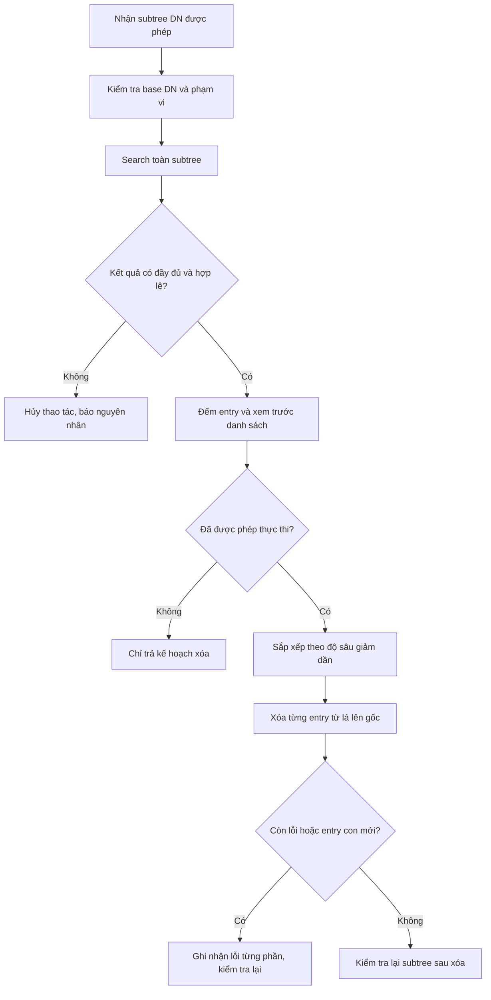

# Delete subtree và giới hạn của LDAP server

Trong một thư mục LDAP, dữ liệu được tổ chức thành cây entry. Xóa một người dùng nằm ở cuối nhánh thường đơn giản; xóa cả một nhánh chứa hàng trăm người dùng, nhóm và đơn vị tổ chức khó hơn nhiều. Lý do là thao tác **LDAP Delete** thông thường chỉ xóa được **entry không có con**. Nếu gửi yêu cầu xóa một entry còn chứa entry con, máy chủ thường từ chối với mã kết quả **`notAllowedOnNonLeaf` (66)**.

Khi làm việc với **Spring LDAP**, `LdapTemplate.unbind(...)` giúp xóa một entry, nhưng không biến thao tác này thành lệnh xóa cả cây. Muốn xóa subtree, ứng dụng cần hiểu cấu trúc DN, phạm vi tìm kiếm, quyền LDAP, giới hạn kết quả và hành vi riêng của máy chủ. Bài học trình bày cách xóa theo thứ tự từ lá lên gốc, những giới hạn cần tính đến, và cách triển khai có kiểm soát.

Sau bài này, bạn có thể:

- Giải thích vì sao LDAP Delete thông thường không xóa một entry đang có con.
- Phân biệt thao tác xóa một entry, xóa subtree phía client và chức năng xóa cây riêng của một số LDAP server.
- Xây dựng quy trình **liệt kê → kiểm tra → xóa từ entry sâu nhất → xóa gốc** bằng Spring LDAP.
- Nhận biết giới hạn về quyền truy cập, kích thước kết quả, thời gian tìm kiếm, referral, thay đổi đồng thời và khả năng khôi phục.
- Thiết kế bước xem trước, giới hạn phạm vi và xử lý lỗi từng phần khi cần xóa dữ liệu LDAP.

## 1. Subtree trong LDAP là gì?

Xem một cây LDAP dùng cho môi trường thực hành:

```text
dc=example,dc=org
└── ou=demo-delete
    ├── uid=an
    ├── uid=binh
    └── ou=team
        └── uid=chi
```

Trong LDAP, những entry trên có DN đầy đủ:

```text
ou=demo-delete,dc=example,dc=org
uid=an,ou=demo-delete,dc=example,dc=org
uid=binh,ou=demo-delete,dc=example,dc=org
ou=team,ou=demo-delete,dc=example,dc=org
uid=chi,ou=team,ou=demo-delete,dc=example,dc=org
```

**Subtree** bắt đầu tại một DN gốc (*subtree base*) và bao gồm entry gốc cùng mọi entry con, cháu ở phía dưới. Ví dụ, subtree có gốc `ou=demo-delete,dc=example,dc=org` bao gồm cả năm entry đã liệt kê, nhưng **không** bao gồm `dc=example,dc=org`.

Trong các API Spring LDAP, DN thường được biểu diễn bởi `javax.naming.Name`/`LdapName` và được truyền **tương đối với base DN của `ContextSource`**. Nếu `ContextSource` đã có base `dc=example,dc=org`, gốc thao tác trong ví dụ sẽ là `ou=demo-delete`.

### Một entry, một nhánh và phạm vi tìm kiếm

| Khái niệm | Ý nghĩa | Ví dụ |
| --- | --- | --- |
| Entry lá (*leaf entry*) | Entry không có con | `uid=chi,ou=team,...` |
| Entry không phải lá (*non-leaf entry*) | Entry đang chứa ít nhất một entry con | `ou=demo-delete,...` |
| `OBJECT_SCOPE` | Tìm đúng entry base | Chỉ `ou=demo-delete` |
| `ONELEVEL_SCOPE` | Tìm entry con trực tiếp, không gồm base | `uid=an`, `uid=binh`, `ou=team` |
| `SUBTREE_SCOPE` | Tìm base và tất cả entry hậu duệ | Cả năm entry trong ví dụ |

**Phạm vi tìm kiếm và phạm vi xóa là hai khái niệm khác nhau.** `SUBTREE_SCOPE` chỉ yêu cầu một **phép tìm kiếm** trên cả cây. Nó không làm cho lời gọi xóa entry gốc trở thành xóa đệ quy.

## 2. Vì sao một LDAP Delete thông thường chỉ xóa được entry lá?

Giao thức LDAP chuẩn có thao tác `DeleteRequest` dành cho **một DN**. Khi DN này vẫn có entry con, server thông thường trả lỗi `notAllowedOnNonLeaf` (LDAP result code 66).

Ví dụ:

```java
import javax.naming.Name;

import org.springframework.ldap.core.LdapTemplate;
import org.springframework.ldap.support.LdapNameBuilder;

public class DeleteOneEntry {
    private final LdapTemplate ldapTemplate;

    public DeleteOneEntry(LdapTemplate ldapTemplate) {
        this.ldapTemplate = ldapTemplate;
    }

    public void deleteLeaf() {
        // ContextSource giả định có base dc=example,dc=org.
        Name leafDn = LdapNameBuilder.newInstance("ou=demo-delete")
                .add("uid", "an")
                .build();

        ldapTemplate.unbind(leafDn);
    }
}
```

Lời gọi `ldapTemplate.unbind(leafDn)` dùng để xóa entry `uid=an,ou=demo-delete,dc=example,dc=org`. Nếu entry không có con, được phép xóa và mọi điều kiện server đều thỏa, thao tác thành công. Nếu gọi trực tiếp:

```java
Name rootDn = LdapNameBuilder.newInstance()
        .add("ou", "demo-delete")
        .build();

ldapTemplate.unbind(rootDn);
```

khi nhánh vẫn chứa `uid=an`, `uid=binh` và `ou=team`, thao tác có thể thất bại với mã LDAP **66**. Việc mã Java chỉ truyền một DN là dấu hiệu rõ rằng đây **không phải API xóa đệ quy**.

### Quy tắc xóa từ lá lên gốc

Với cây ở mục 1, thứ tự hợp lệ là:

```text
Bước 1: uid=chi,ou=team,ou=demo-delete,...
Bước 2: uid=an,ou=demo-delete,...
Bước 3: uid=binh,ou=demo-delete,...
Bước 4: ou=team,ou=demo-delete,...
Bước 5: ou=demo-delete,...
```

Thứ tự xóa giữa các entry lá cùng cấp có thể thay đổi. Điều kiện bắt buộc là **mọi con của một entry phải được xóa trước khi xóa entry cha**.

Nếu chỉ muốn xóa một đơn vị tổ chức rỗng, không cần thuật toán subtree: gọi `unbind` trực tiếp sau khi xác định entry đó không còn con và có quyền xóa.

## 3. Các hướng tiếp cận để xóa subtree

Có ba hướng thực hành phổ biến:

| Cách làm | Cơ chế | Khi nào phù hợp | Hạn chế |
| --- | --- | --- | --- |
| Xóa một entry với `LdapTemplate.unbind` | LDAP Delete cho một DN | Xóa entry lá hoặc nhánh đã rỗng | Không xóa được entry còn con |
| Xóa từ lá lên gốc phía client | Search toàn subtree, sắp xếp rồi gửi nhiều DeleteRequest | Phù hợp khi server không hỗ trợ lệnh xóa cây riêng | Nhiều round trip; không nguyên tử; phải xử lý giới hạn và thay đổi đồng thời |
| Xóa subtree phía server | Điều khiển hoặc cơ chế mở rộng dành riêng cho server | Khi server có hỗ trợ, quyền phù hợp và đã kiểm chứng hành vi | Không có một API xóa subtree chung cho mọi LDAP server |

Một ví dụ cơ chế riêng là **Tree Delete Control** với OID `1.2.840.113556.1.4.805` trong Microsoft Active Directory. Đây là tính năng gắn với hệ sinh thái và chính sách của server hỗ trợ, **không phải điều khiển chuẩn mà mọi LDAP server đều chấp nhận**. Quyền xóa subtree, cách xử lý lỗi và giới hạn triển khai cần theo tài liệu của máy chủ đang dùng.

Một số công cụ dòng lệnh, chẳng hạn các phiên bản `ldapdelete` của OpenLDAP, cung cấp tùy chọn xóa đệ quy như `-r`. Về mặt vận hành, cần kiểm tra tài liệu của **chính bản công cụ** để biết nó duyệt và xóa ra sao; đừng suy luận rằng LDAP DeleteRequest thông thường có một cờ xóa toàn cây.

Trong hệ thống cần di chuyển giữa OpenLDAP, Active Directory hoặc các directory server khác, phương án **tìm kiếm rồi xóa từng entry** thường dễ hiểu và dễ kiểm soát hơn, nhưng phải xem xét kỹ tính đầy đủ của kết quả tìm kiếm.

## 4. Quy trình an toàn: xem trước rồi mới xóa

Trước khi ghi mã, hãy thiết kế quy trình theo thứ tự:



Với một tác vụ xóa subtree thực tế, các bước cần có:

1. **Giới hạn DN gốc**: chỉ cho phép thao tác dưới nhánh chuyên dụng; không nhận trực tiếp DN tùy ý từ biểu mẫu rồi xóa.
2. **Liệt kê toàn bộ entry**: dùng `SUBTREE_SCOPE`, gồm cả entry gốc; không dựa vào giả định cây chỉ có một tầng.
3. **Kiểm tra số lượng và tính đầy đủ**: áp dụng ngưỡng entry, nhận diện lỗi size/time limit, referral, quyền đọc và phân trang.
4. **Xem trước**: hiển thị DN sẽ xóa, số lượng, độ sâu và tác động dự kiến; người phụ trách xác nhận thao tác được phép.
5. **Sắp xếp và xóa**: xóa DN sâu nhất trước, gốc cuối cùng; không xóa song song cha và con trong cùng thời điểm.
6. **Đối chiếu kết quả**: kiểm tra lại các DN còn tồn tại và lưu thông tin lỗi phù hợp cho việc phục hồi hoặc chạy tiếp.

Ví dụ chỉ dùng nhánh `ou=demo-delete` vì có thể tạo lại trong môi trường kiểm thử. Không sử dụng ví dụ này để xóa `ou=people`, `ou=groups` hay một base DN sản xuất.

## 5. Mã Spring LDAP: liệt kê, xem trước và xóa từ lá lên gốc

Ví dụ dưới đây dành cho **một subtree nhỏ trên môi trường thực hành**. `LdapTemplate` được cấu hình qua `ContextSource` với base DN `dc=example,dc=org`, kết nối TLS và quyền phù hợp. Người dùng gọi phương thức với `apply = false` trước để lấy danh sách xem trước.

```java
import java.util.ArrayList;
import java.util.Comparator;
import java.util.List;

import javax.naming.Name;
import javax.naming.directory.SearchControls;

import org.springframework.ldap.core.ContextMapper;
import org.springframework.ldap.core.DirContextOperations;
import org.springframework.ldap.core.LdapTemplate;
import org.springframework.ldap.support.LdapNameBuilder;

public final class DemoSubtreeDeletionService {
    private static final int MAX_ENTRIES = 200;
    private final LdapTemplate ldapTemplate;

    public DemoSubtreeDeletionService(LdapTemplate ldapTemplate) {
        this.ldapTemplate = ldapTemplate;
    }

    /**
     * apply = false: chỉ lấy kế hoạch xóa (dry run).
     * apply = true : thực hiện xóa các entry đã liệt kê.
     *
     * Chỉ dùng cho nhánh demo nhỏ, hiển thị đầy đủ bởi server.
     */
    public List<Name> processDemoSubtree(boolean apply) {
        // Tên tương đối với ContextSource base dc=example,dc=org.
        Name root = LdapNameBuilder.newInstance()
                .add("ou", "demo-delete")
                .build();

        // ContextMapper.getDn() cung cấp DN của entry tương đối
        // với base đã cấu hình ở ContextSource.
        List<Name> discovered = ldapTemplate.search(
                root,
                "(objectClass=*)",
                SearchControls.SUBTREE_SCOPE,
                (ContextMapper<Name>) context ->
                        ((DirContextOperations) context).getDn());

        // Chặn xóa khi không thấy gốc hoặc kết quả vượt ngưỡng.
        if (!discovered.contains(root)) {
            throw new IllegalStateException(
                    "Không tìm thấy entry gốc trong kết quả search.");
        }
        if (discovered.size() > MAX_ENTRIES) {
            throw new IllegalStateException(
                    "Subtree vượt ngưỡng xóa của ví dụ.");
        }

        List<Name> plan = new ArrayList<>(discovered);
        plan.sort(Comparator.comparingInt(Name::size).reversed());

        if (!apply) {
            // Gọi với false để xem trước. Không có DeleteRequest nào.
            return plan;
        }

        // Delete từng entry từ lá lên gốc.
        // Nếu gặp lỗi, phương thức dừng, các entry trước đó có thể
        // đã bị xóa thành công.
        for (Name dn : plan) {
            ldapTemplate.unbind(dn);
        }
        return plan;
    }
}
```

Ví dụ gọi ở tầng nghiệp vụ:

```java
DemoSubtreeDeletionService service =
        new DemoSubtreeDeletionService(ldapTemplate);

// Bước xem trước, không xóa:
List<Name> preview = service.processDemoSubtree(false);
preview.forEach(System.out::println);

// Chỉ trong môi trường thực hành được phép,
// sau khi kiểm tra toàn bộ danh sách:
// service.processDemoSubtree(true);
```

### Vì sao phải sắp xếp theo `Name.size()`?

Trong `javax.naming.Name`, `size()` trả số thành phần RDN. Entry nằm sâu hơn thường có **nhiều RDN hơn** nếu tất cả DN được biểu diễn cùng gốc:

```text
uid=chi,ou=team,ou=demo-delete       -> 3 RDN (sâu nhất)
uid=an,ou=demo-delete                -> 2 RDN
ou=team,ou=demo-delete               -> 2 RDN
ou=demo-delete                       -> 1 RDN (gốc)
```

Trong ví dụ, danh sách đều là DN tương đối với **cùng `ContextSource` base**; vì vậy sắp theo `Name.size()` giảm dần bảo đảm entry con đứng trước entry cha. Những DN cùng độ sâu có thể xóa theo thứ tự bất kỳ.

Không nên dùng độ dài chuỗi, chẳng hạn `dn.toString().length()`: số ký tự trong tên không tương ứng độ sâu của cây. Cũng không tự tách chuỗi DN theo dấu phẩy vì các giá trị có thể chứa dấu phẩy đã escape.

### Những giới hạn cố ý của ví dụ

Đoạn mã trên dùng để học nguyên tắc; chưa phải một hệ thống xóa subtree production:

- **Không phân trang**: chỉ dùng khi toàn bộ subtree được phép tìm kiếm và số entry nhỏ, kết quả không bị cắt. Nếu server áp giới hạn kích thước, cần xử lý lỗi hoặc cơ chế phân trang trước khi xóa.
- **Không khóa cây**: entry mới có thể xuất hiện trong lúc xóa, khiến xóa entry cha bị trả về lỗi 66.
- **Không có giao dịch toàn subtree**: nếu xóa được 30/50 entry rồi lỗi, 30 entry đầu vẫn có thể đã bị xóa.
- **Không tự kiểm chứng ACL hay toàn bộ referral**: kết quả search thiếu entry khiến kế hoạch chưa đầy đủ.
- **Không có phê duyệt qua mã**: tham số `apply` là một bước kỹ thuật để minh họa; quy trình thực tế cần giới hạn quyền và xác nhận thao tác ở tầng nghiệp vụ.

Để làm việc trên cây lớn, hãy thiết kế một job có trạng thái, phân trang theo server hỗ trợ, cơ chế tiến độ và kiểm tra lại trước/sau xóa. Cần bảo đảm rằng kế hoạch xóa được tạo từ **danh sách đầy đủ và đủ quyền đọc**, không chỉ từ số entry hiện ra ở một trang kết quả.

## 6. Giới hạn của LDAP server khi xóa subtree

### 6.1. Giới hạn xóa entry không phải lá

LDAP DeleteRequest thông thường không cho phép xóa một entry còn con. Đây là nguyên nhân của `notAllowedOnNonLeaf` (66). Cách xử lý là xóa con trước; nếu server hỗ trợ một *tree delete control* riêng, cần dùng đúng API, quyền và chính sách của server đó.

Không nên xem mã 66 là lý do để tự động bật tính năng xóa toàn cây. Máy chủ có thể không hỗ trợ, hoặc ứng dụng có thể vô tình mở rộng phạm vi xóa lớn hơn dự kiến.

### 6.2. Giới hạn kết quả tìm kiếm (*size limit*)

Máy chủ LDAP có thể giới hạn số entry trả về mỗi phép search; ứng dụng còn có thể đặt giới hạn bằng `SearchControls.setCountLimit(...)` hoặc API Spring LDAP tương đương.

Nếu subtree có 5.000 entry nhưng kết quả chỉ có 1.000 entry, danh sách xóa **không đầy đủ**. Đặc biệt, một kết quả không đầy đủ có thể vẫn có một số entry hợp lệ, nhưng xóa theo danh sách đó sẽ gây tình trạng xóa dở dang và cuối cùng gặp entry cha còn con.

**Khuyến nghị:** kiểm tra lỗi `sizeLimitExceeded` (LDAP result code 4), không cố xóa theo kết quả dở dang. Với cây lớn, dùng phân trang (*Paged Results Control*) nếu server hỗ trợ, nhưng phân trang **không bảo đảm một snapshot nhất quán** khi cây đang thay đổi; nó cũng không vượt qua mọi giới hạn chính sách của server.

### 6.3. Giới hạn thời gian (*time limit*) và chi phí truy vấn

Tìm kiếm dưới một subtree lớn, đặc biệt nếu filter rộng `(objectClass=*)`, có thể bị giới hạn bởi:

- LDAP `timeLimitExceeded` (result code 3).
- Thời gian chờ kết nối hoặc đọc dữ liệu do client/provider đặt.
- Thời gian xử lý, tải máy chủ và chính sách giới hạn theo tài khoản.
- Giới hạn của reverse proxy, firewall hoặc hạ tầng mạng.

Đặt timeout hợp lý và chủ động dừng kế hoạch khi tìm kiếm chưa hoàn tất. Không nên cố tăng timeout vô hạn để chạy trên cây rất lớn; nên thu hẹp scope, tổ chức các đợt xóa và phối hợp với quản trị viên thư mục.

### 6.4. Quyền đọc và quyền xóa không giống nhau

Một tài khoản có thể **được phép tìm thấy entry nhưng không được xóa entry đó**; ngược lại, các chính sách có thể khiến tài khoản không nhìn thấy đầy đủ hậu duệ. Ngoài quyền xóa entry, một số server còn yêu cầu quyền trên entry cha hoặc quyền đặc biệt đối với đối tượng được bảo vệ.

Ví dụ:

```text
ou=demo-delete
├── uid=an       <- ứng dụng thấy và được xóa
└── ou=admin     <- bị chặn quyền duyệt hoặc quyền xóa
    └── uid=root
```

Nếu kế hoạch tìm kiếm bỏ sót `ou=admin`, ứng dụng có thể xóa `uid=an` rồi thất bại khi xóa `ou=demo-delete`. Đây là **lỗi từng phần**, không phải một lệnh xóa subtree thành công.

Không xem việc không thấy entry con qua search là bằng chứng chắc chắn cây rỗng. Muốn xóa cây, tài khoản và quy trình phải được cấp các quyền phù hợp, kèm kiểm tra kết quả cụ thể.

### 6.5. Alias, referral và phạm vi dữ liệu

**Alias** và **referral** có thể ảnh hưởng đến những entry mà phép search đi qua hoặc trả về:

- Một alias có thể trỏ sang entry khác; cách dereference alias phụ thuộc search controls và cấu hình server.
- Referral có thể chỉ sang máy chủ hoặc nhánh khác; provider có thể theo referral, ném ngoại lệ hoặc bỏ qua tùy cấu hình.
- Xóa chỉ theo tập DN thu được có nguy cơ tác động sang phạm vi ngoài dự kiến nếu ứng dụng tự động xử lý referral mà không kiểm tra.

Khi thực hiện thao tác xóa, hãy quy định rõ chính sách alias/referral và luôn kiểm tra DN của từng entry có nằm dưới gốc được phép. Với các hệ thống nhiều server, cần hiểu cấu trúc naming context và quyền truy cập tại từng server.

### 6.6. Thay đổi đồng thời (*concurrent changes*)

Xét tình huống:

1. Client liệt kê `ou=team` cùng một entry con.
2. Client xóa entry con đã biết.
3. Một ứng dụng khác tạo entry mới dưới `ou=team`.
4. Client xóa `ou=team` và nhận mã 66.

Thao tác xóa theo danh sách đã chuẩn bị **không khóa subtree** và không bảo đảm kết quả lặp lại chính xác khi có tiến trình khác đang tạo/sửa entry. Cách ứng phó có thể là ngừng các luồng ghi vào subtree trong một khoảng bảo trì, kiểm tra lại trước khi xóa cha, hoặc dùng cơ chế riêng của server nếu có hỗ trợ.

Không cố giải quyết mọi lỗi bằng cách lặp xóa không giới hạn: trong cây đang tiếp tục nhận dữ liệu, vòng lặp có thể kéo dài và vô tình xóa entry mới.

### 6.7. Không mặc định có transaction hay rollback toàn cây

Xóa tuần tự thường gồm **nhiều LDAP DeleteRequest độc lập**. Nếu yêu cầu thứ 20 thất bại, các yêu cầu 1–19 có thể đã được server áp dụng. LDAP không bảo đảm giao dịch nguyên tử cho một chuỗi nhiều thao tác chỉ vì chúng đến từ cùng client.

Một số server có cơ chế transaction mở rộng hoặc chức năng tree delete riêng, nhưng khả năng hỗ trợ và mức bảo đảm phải kiểm chứng theo server. Đừng suy luận rằng Spring `@Transactional` trên database tự khiến các LDAP DeleteRequest trở thành một giao dịch có thể rollback.

Với dữ liệu quan trọng, hãy chuẩn bị cơ chế sao lưu/khôi phục được tổ chức cho LDAP, có quyền truy cập và thử nghiệm trước. Việc tạo lại entry không nhất thiết khôi phục đầy đủ operational attributes, quan hệ tham chiếu, ACL hoặc trạng thái sao chép ban đầu.

### 6.8. Sao chép và hệ thống phụ thuộc

Trong hệ thống LDAP có replication, xóa một lượng lớn entry có thể tạo tải lên replication, log và chỉ mục tìm kiếm. Những hệ thống phụ thuộc như cache, ứng dụng xác thực, nhóm hoặc hệ thống tham chiếu DN có thể tiếp tục giữ dữ liệu cũ trong một khoảng thời gian.

Trước khi xóa một nhánh có ý nghĩa nghiệp vụ, xác định những hệ thống đang dùng DN đó, thời gian đồng bộ và cách xác minh dữ liệu trên các replica. **Một thao tác xóa trả thành công không đồng nghĩa mọi client hoặc replica đã quan sát cùng trạng thái ngay lập tức.**

## 7. Lỗi LDAP và cách xử lý khi xóa

| Mã hoặc hiện tượng | Ý nghĩa | Việc cần kiểm tra |
| --- | --- | --- |
| `notAllowedOnNonLeaf` (66) | Entry cần xóa còn con | Tìm entry con còn lại, sắp xếp xóa từ lá và kiểm tra thay đổi đồng thời |
| `noSuchObject` (32) | DN được tham chiếu không tồn tại | DN tương đối/base, entry đã bị job khác xóa, hoặc nhánh cha không còn |
| `insufficientAccessRights` (50) | Thiếu quyền truy cập cần thiết | ACL, quyền xóa entry và quyền liên quan đến entry cha |
| `sizeLimitExceeded` (4) | Search vượt giới hạn số kết quả | Dừng kế hoạch, thu hẹp phạm vi hoặc dùng paging nếu server hỗ trợ |
| `timeLimitExceeded` (3) | Search vượt thời gian cho phép | Kiểm tra filter, scope, tải và timeout |
| `unwillingToPerform` (53) | Server từ chối thực hiện theo chính sách | Ràng buộc hệ thống, entry bảo vệ, cấu hình hoặc cơ chế xóa |
| `busy` (51) | Máy chủ đang bận | Giảm tốc độ, chờ thời điểm thích hợp, dùng retry có giới hạn |
| Kết quả search thiếu entry | Có thể do ACL, referral hoặc lọc theo policy | Kiểm tra khả năng liệt kê đầy đủ trước khi xóa |
| Xóa được một phần rồi lỗi | Nhiều DeleteRequest độc lập | Ghi lại DN đã xóa, dừng khi gặp lỗi và đối chiếu trạng thái còn lại |

Spring LDAP thường chuyển các ngoại lệ JNDI sang hệ ngoại lệ của Spring LDAP. Khi thiết kế xử lý lỗi, đọc nguyên nhân từ server và ghi log an toàn gồm DN thao tác, loại operation, mã LDAP và kết quả; tránh ghi giá trị bí mật hoặc thông tin cá nhân không cần thiết.

### Xử lý một lần xóa lỗi giữa chừng

Giả sử danh sách có 100 entry:

```text
Thành công:  65 DeleteRequest
Thất bại:   DeleteRequest thứ 66
Chưa thử:   34 entry còn lại
```

Không thể xem cả job là đã rollback. Cần phân biệt rõ ba trạng thái **đã xóa / đã thử nhưng lỗi / chưa thử**, sau đó **tìm lại subtree** để lập kế hoạch mới. Tình huống `noSuchObject` khi chạy lại có thể nghĩa là entry đã được xóa; cần xác minh thay vì coi mọi lỗi 32 đều là thất bại nghiêm trọng.

Với dữ liệu nhạy cảm hoặc sản xuất, nên dừng sau lỗi ngoài dự kiến và yêu cầu phân tích nguyên nhân trước khi chạy lại, thay vì tiếp tục xóa các phần khác vô điều kiện.

## 8. Thiết kế xóa subtree cho hệ thống thực tế

Với ứng dụng Spring LDAP, một tác vụ xóa cây nên có ranh giới trách nhiệm rõ ràng:

| Thành phần | Nhiệm vụ |
| --- | --- |
| Tầng nghiệp vụ | Quyết định **subtree nào được phép xóa**, ai được yêu cầu, điều kiện và phê duyệt |
| Dịch vụ liệt kê | Search theo base và scope, xử lý phân trang/giới hạn, ghi nhận danh sách DN |
| Dịch vụ lập kế hoạch | Kiểm tra phạm vi, đếm entry, sắp xếp từ lá lên gốc và tạo dry run |
| Dịch vụ thực thi | Gọi `LdapTemplate.unbind` từng entry, điều tiết tốc độ và ghi nhận thành công/thất bại |
| Dịch vụ đối chiếu | Kiểm tra entry còn lại, phát hiện thay đổi đồng thời, báo cáo trạng thái hoàn thành |
| Vận hành | Chuẩn bị sao lưu/khôi phục, theo dõi tải, replication và quy trình xử lý sự cố |

Đối với cây lớn, các điểm triển khai cần chú ý:

**Đặt giới hạn cứng cho DN gốc.** Một tài khoản hoặc API chỉ được thao tác trên những nhánh được quản trị viên cho phép. Dùng `LdapName`/`Rdn` để kiểm tra cấu trúc tên; không dùng phép kiểm tra chuỗi như `startsWith("ou=demo")` vì dễ nhầm `ou=demo` với `ou=demo-other`.

**Tách bước tìm kiếm khỏi bước xóa.** Một kế hoạch với danh sách DN và số lượng rõ ràng cho phép xem trước. Trước khi thực thi, cần kiểm tra tính mới của kế hoạch hoặc liệt kê lại nếu dữ liệu có thể thay đổi.

**Xử lý phân trang và lỗi kết quả chưa đầy đủ.** Paged Results Control chỉ là cơ chế lấy nhiều trang; nó không tự đảm bảo snapshot, không vượt mọi giới hạn server và không làm cho xóa trở thành nguyên tử.

**Theo dõi tiến độ và dừng có kiểm soát.** Lưu tối thiểu trạng thái operation, DN tương đối, kết quả, thời điểm và mã lỗi. Không ghi password hoặc thuộc tính nhạy cảm vào log.

**Giảm tác động lên server.** Có thể điều tiết tốc độ xóa theo lô nhỏ, tránh xóa song song entry cha/con, chú ý tải và replication. Số luồng càng nhiều không có nghĩa xóa càng an toàn hoặc nhanh hơn.

**Kiểm tra lại sau thực thi.** Nếu search trên subtree không trả entry, vẫn phải xem xét khả năng ACL hoặc referral khiến kết quả không đầy đủ; với những nhánh quan trọng, có thể cần xác nhận bằng tài khoản vận hành có quyền phù hợp hoặc công cụ quản trị của server.

## 9. Bài thực hành có kiểm soát

Giả sử môi trường LDAP thử nghiệm cho phép tạo nhánh:

```text
ou=demo-delete,dc=example,dc=org
├── uid=an,ou=demo-delete,dc=example,dc=org
└── ou=team,ou=demo-delete,dc=example,dc=org
    └── uid=binh,ou=team,ou=demo-delete,dc=example,dc=org
```

Hãy thực hiện theo trình tự:

1. **Chuẩn bị subtree thử nghiệm.** Tạo ba entry con và một entry gốc với `objectClass`/thuộc tính phù hợp schema của server; không dùng nhánh người dùng thật.
2. **Thử xóa entry gốc khi còn con.** Gọi `ldapTemplate.unbind(rootDn)` và ghi nhận kết quả. Với LDAP Delete chuẩn, thường nhận lỗi non-leaf (66).
3. **Tìm toàn bộ subtree.** Dùng scope `SUBTREE_SCOPE`, kiểm tra có đầy đủ bốn entry và tên tương đối có cùng base.
4. **Xem trước kế hoạch.** Dùng `processDemoSubtree(false)`; quan sát `uid=binh` được xếp trước `ou=team`, và `ou=demo-delete` đứng cuối.
5. **Thực thi trên dữ liệu thử nghiệm được phép xóa.** Sau khi kiểm tra kế hoạch và quyền, chạy `processDemoSubtree(true)`.
6. **Xác minh.** Tìm lại dưới `ou=demo-delete` và xác nhận trạng thái theo phản hồi server; nếu entry gốc không tồn tại, xử lý `noSuchObject` trong bước xác minh phù hợp.
7. **Thử lỗi có chủ đích trong môi trường thử nghiệm.** Nếu có thể thiết lập ACL hoặc đưa entry mới vào khi job đang chạy, quan sát việc lỗi giữa chừng và ghi nhận phần đã xóa.

### Câu hỏi tự kiểm tra

**Câu 1.** Vì sao `ldapTemplate.unbind("ou=demo-delete")` không xóa toàn bộ người dùng dưới nhánh này?

**Đáp án:** `unbind` thực hiện xóa một entry; LDAP DeleteRequest thông thường không được xóa entry còn con. Cần xóa con trước hoặc dùng cơ chế xóa cây riêng do server hỗ trợ.

**Câu 2.** Liệt kê subtree bằng `SUBTREE_SCOPE` có làm cho thao tác xóa sau đó trở nên nguyên tử không?

**Đáp án:** Không. Search chỉ cung cấp danh sách; các DeleteRequest tiếp theo độc lập và có thể thất bại giữa chừng.

**Câu 3.** Vì sao phải sắp xếp theo độ sâu của DN thay vì xóa theo thứ tự server trả về?

**Đáp án:** Server không bảo đảm kết quả search trả theo thứ tự lá trước cha. Sắp xếp theo số RDN giảm dần giúp xóa entry con trước entry cha.

**Câu 4.** Kết quả tìm kiếm chỉ có 900 entry trong khi bạn biết cây có hơn 1.000 entry. Có nên xóa 900 entry trước không?

**Đáp án:** Không nên. Kết quả có thể bị giới hạn bởi size limit, time limit, ACL hoặc paging. Hãy xác minh và lấy danh sách đầy đủ trước khi thực thi.

**Câu 5.** Nếu xóa được 20 entry rồi entry thứ 21 bị lỗi quyền, `@Transactional` của một phương thức Spring có tự khôi phục 20 entry trước không?

**Đáp án:** Không được mặc định như vậy. Nhiều LDAP DeleteRequest thường không nằm trong cùng giao dịch rollback; transaction của cơ sở dữ liệu không tự bao phủ LDAP.

**Câu 6.** Có thể dùng Tree Delete Control OID `1.2.840.113556.1.4.805` với mọi LDAP server không?

**Đáp án:** Không. Đây là cơ chế riêng được hỗ trợ trong những môi trường nhất định như Active Directory. Cần kiểm tra khả năng hỗ trợ, quyền và chính sách của server.

## Ghi nhớ

**LDAP Delete thường chỉ xóa được entry lá; xóa subtree phải tuân theo cấu trúc cây.** Với Spring LDAP, quy trình dễ hiểu là dùng search để liệt kê **đầy đủ** các entry, kiểm tra giới hạn và quyền, sắp xếp DN theo **độ sâu giảm dần**, rồi gọi `LdapTemplate.unbind(...)` từ lá lên gốc. Hãy luôn phân biệt xóa tuần tự phía client với tính năng xóa cây riêng của server, đồng thời chuẩn bị cho trường hợp kết quả bị giới hạn, entry thay đổi đồng thời hoặc một phần thao tác đã thành công trước khi gặp lỗi.
