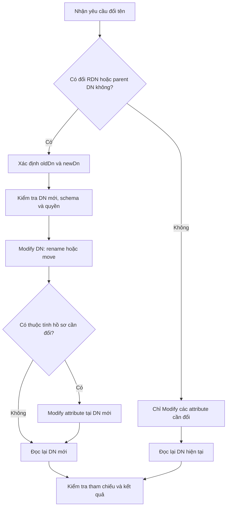

# Phân biệt rename với update attribute trong Spring LDAP

Một entry LDAP có **DN** (*Distinguished Name*) để xác định vị trí trong cây và có các **thuộc tính** (*attributes*) để lưu dữ liệu. Khi yêu cầu “đổi tên người dùng”, ứng dụng có thể đang nói đến ba việc khác nhau: thay giá trị thuộc tính hiển thị như `displayName`, đổi **RDN** của entry từ `uid=lan` thành `uid=lan.tran`, hoặc chuyển entry sang một nhánh khác. Chọn sai thao tác có thể khiến ứng dụng vẫn tìm người dùng ở DN cũ, gặp lỗi ràng buộc schema hoặc làm sai các tham chiếu đến entry.

Trong **Spring LDAP**, `LdapTemplate.modifyAttributes(...)` xử lý thay đổi thuộc tính, còn `LdapTemplate.rename(...)` đổi tên định danh của entry. Hai nhóm thao tác này tương ứng với hai operation khác nhau của giao thức LDAP: **Modify** và **Modify DN**. Bài học giúp bạn xác định chính xác khi nào dùng mỗi nhóm, cách phối hợp và cách kiểm chứng kết quả.

Sau bài này, bạn có thể:

- Phân biệt DN/RDN, thuộc tính dữ liệu và thuộc tính được dùng để đặt tên.
- Nhận diện khi nào một yêu cầu cần LDAP **Modify** hoặc **Modify DN**.
- Giải thích ảnh hưởng của `newRDN`, `deleteOldRDN` và `newSuperior` đối với rename/move.
- Thực hiện ví dụ bằng `LdapTemplate.lookupContext(...)`, `modifyAttributes(...)` và `rename(...)` với DN tương đối.
- Chẩn đoán lỗi schema, trùng DN, quyền, thay đổi đồng thời và các tham chiếu DN sau khi di chuyển.

## 1. DN định danh entry; attribute mô tả entry

Giả sử LDAP chứa entry:

```ldif
dn: uid=lan,ou=people,dc=example,dc=org
objectClass: top
objectClass: person
objectClass: organizationalPerson
objectClass: inetOrgPerson
uid: lan
cn: Lan Nguyen
sn: Nguyen
displayName: Lan Nguyen
mail: lan@example.org
```

Ở đây:

- **DN** là `uid=lan,ou=people,dc=example,dc=org`, định vị entry trong cây LDAP.
- **RDN** của entry là `uid=lan`, tức thành phần đặt tên tương đối với entry cha `ou=people,dc=example,dc=org`.
- `uid` là **thuộc tính dùng trong RDN**, giá trị `lan` phải phù hợp với định danh của entry.
- `cn`, `sn`, `displayName`, `mail` mô tả thông tin entry; chúng có thể được phép thay đổi mà DN không đổi, tùy schema và quyền.
- Nhánh `ou=people` cũng là một entry riêng. Đổi vị trí entry sang `ou=alumni` là thay **DN**, ngay cả khi `uid` không đổi.

Đặc biệt, **không có quy tắc chung rằng `uid` luôn là thuộc tính đặt tên**. Một entry có thể có DN bắt đầu bằng `cn=...` hoặc một RDN khác theo thiết kế schema. Cùng một thuộc tính `cn` có thể chỉ là dữ liệu trên entry này nhưng lại nằm trong RDN của entry khác.

## 2. Nhìn kết quả: update, rename và move khác nhau thế nào?

Hãy giữ nguyên entry ban đầu và xét ba thao tác **độc lập** sau:

**A. Update thuộc tính hiển thị**

```text
TRƯỚC:
DN:          uid=lan,ou=people,dc=example,dc=org
displayName: Lan Nguyen

SAU:
DN:          uid=lan,ou=people,dc=example,dc=org  (không đổi)
displayName: Lan Tran                           (đổi)
```

Đây là **LDAP Modify** trên attribute `displayName`. Ứng dụng vẫn tra cứu entry ở DN cũ.

**B. Rename RDN (đổi tên entry)**

```text
TRƯỚC:
DN: uid=lan,ou=people,dc=example,dc=org

SAU:
DN: uid=lan.tran,ou=people,dc=example,dc=org
```

Đây là **LDAP Modify DN**. RDN thay đổi từ `uid=lan` sang `uid=lan.tran`, nên DN đầy đủ đổi. Thuộc tính `uid` có thể được cập nhật như một phần của operation; việc giữ hay xóa giá trị RDN cũ liên quan đến cờ `deleteOldRDN` (xem mục 4).

**C. Move entry (chuyển nhánh cha)**

```text
TRƯỚC:
DN: uid=lan,ou=people,dc=example,dc=org

SAU:
DN: uid=lan,ou=alumni,dc=example,dc=org
```

Đây cũng là **LDAP Modify DN** theo nghĩa chuyển entry sang parent mới, nếu server hỗ trợ. RDN `uid=lan` vẫn giữ nguyên nhưng **DN đầy đủ thay đổi**.

| Yêu cầu | DN thay đổi? | Operation LDAP | API Spring LDAP điển hình |
| --- | --- | --- | --- |
| Đổi `displayName` từ “Lan Nguyen” thành “Lan Tran” | Không | Modify | `lookupContext` + `modifyAttributes` |
| Đổi `mail` | Không | Modify | `modifyAttributes` |
| Đổi `cn` nhưng DN dùng `uid` làm RDN | Không, nếu `cn` không phải phần đặt tên | Modify | `modifyAttributes` |
| Đổi `uid=lan` trong RDN thành `uid=lan.tran` | Có | Modify DN (rename) | `rename(oldDn, newDn)` |
| Chuyển `uid=lan` từ `ou=people` sang `ou=alumni` | Có | Modify DN (move) | `rename(oldDn, newDn)`, tùy hỗ trợ server |
| Đổi cả RDN và parent | Có | Modify DN với RDN và superior mới | `rename(oldDn, newDn)` nếu server/provider hỗ trợ |
| Đổi thuộc tính dữ liệu **và** DN | Có | Có thể cần cả Modify và Modify DN | Hai thao tác được thiết kế/kiểm chứng rõ ràng |

**Quy tắc chọn thao tác:** Nếu mục tiêu là đổi **cách định vị entry trong cây**, hãy nghĩ đến `rename`. Nếu mục tiêu là đổi **dữ liệu của entry** mà giữ nguyên định danh, hãy nghĩ đến `modifyAttributes`.

## 3. LDAP Modify thay đổi giá trị thuộc tính

LDAP **ModifyRequest** nhắm đến một DN hiện có và gửi danh sách thay đổi của các attribute. Các operation cơ bản là:

| Thao tác sửa | Ý nghĩa | Ví dụ |
| --- | --- | --- |
| ADD | Thêm giá trị/thuộc tính | Thêm một `telephoneNumber` khác nếu schema cho phép |
| REPLACE | Thay các giá trị hiện có | Đặt `displayName` thành “Lan Tran” |
| DELETE | Xóa giá trị hoặc thuộc tính | Bỏ `description` nếu không bắt buộc |

Với Spring LDAP, một cách thuận tiện là lấy context của entry, sửa thuộc tính rồi gọi `modifyAttributes`:

```java
import javax.naming.Name;

import org.springframework.ldap.core.DirContextOperations;
import org.springframework.ldap.core.LdapTemplate;
import org.springframework.ldap.support.LdapNameBuilder;

public final class ProfileService {
    private final LdapTemplate ldapTemplate;

    public ProfileService(LdapTemplate ldapTemplate) {
        this.ldapTemplate = ldapTemplate;
    }

    public void updateDisplayName(String uid, String displayName) {
        // ContextSource giả định có base dc=example,dc=org.
        Name dn = LdapNameBuilder.newInstance("ou=people")
                .add("uid", uid)
                .build();

        DirContextOperations entry = ldapTemplate.lookupContext(dn);

        // Chỉ thay dữ liệu, không đổi DN.
        entry.setAttributeValue("displayName", displayName);

        ldapTemplate.modifyAttributes(entry);
    }
}
```

Nếu gọi:

```java
service.updateDisplayName("lan", "Lan Tran");
```

thì DN vẫn là `uid=lan,ou=people,dc=example,dc=org`. Server có thể từ chối phép sửa vì quyền ACL, ràng buộc syntax hoặc schema; Java method chạy hợp lệ không đồng nghĩa operation LDAP chắc chắn thành công.

### Sửa nhiều attribute trong một lần Modify

`DirContextOperations`/`DirContextAdapter` trong Spring LDAP theo dõi các thuộc tính đã sửa, hỗ trợ gửi thay đổi vào một lời gọi `modifyAttributes`:

```java
Name dn = LdapNameBuilder.newInstance("ou=people")
        .add("uid", "lan")
        .build();

DirContextOperations entry = ldapTemplate.lookupContext(dn);
entry.setAttributeValue("displayName", "Lan Tran");
entry.setAttributeValue("mail", "lan.tran@example.org");

ldapTemplate.modifyAttributes(entry);
```

Trong LDAP, một **ModifyRequest** chứa nhiều thay đổi thuộc tính của **cùng một entry** được máy chủ xử lý như một operation thống nhất theo giao thức, hoặc thành công, hoặc trả lỗi. Điều đó **không** biến nhiều lời gọi Modify và Modify DN riêng biệt thành một giao dịch bao trùm tất cả.

### Giới hạn khi thuộc tính tham gia RDN

Nếu một entry có DN `cn=Lan Nguyen,ou=people,dc=example,dc=org`, giá trị `cn=Lan Nguyen` là một phần của **RDN**. Thử thay toàn bộ `cn` bằng `Lan Tran` bằng Modify có thể bị server từ chối vì xóa giá trị đang dùng để đặt tên, trong khi DN vẫn chứa `cn=Lan Nguyen`.

Đối với yêu cầu “đổi `cn` trong DN”, phải cân nhắc **Modify DN**. Sau rename, có thể cần điều chỉnh các thuộc tính liên quan khác như `displayName` và các tham chiếu ứng dụng.

Không nên áp dụng `REPLACE_ATTRIBUTE` cho một attribute thuộc RDN mà không kiểm tra chính xác quy tắc đặt tên và cách server xử lý.

## 4. LDAP Modify DN: rename có thể thay cả thuộc tính RDN

Trong giao thức LDAP, **Modify DN** (*modDN*) bao gồm các thông tin chính:

- **entry**: DN cũ của entry cần đổi tên.
- **newRDN**: RDN mới, ví dụ `uid=lan.tran`.
- **deleteOldRDN**: có xóa giá trị thuộc tính cấu thành RDN cũ không.
- **newSuperior**: DN cha mới khi thao tác chuyển entry sang nhánh khác, nếu được hỗ trợ và được phép.

Minh họa logic:

```text
Modify DN
  entry:        uid=lan,ou=people,dc=example,dc=org
  newRDN:       uid=lan.tran
  deleteOldRDN: true
  newSuperior:  (không đổi, vẫn ou=people,dc=example,dc=org)
```

Kết quả mong đợi khi server chấp nhận:

```ldif
dn: uid=lan.tran,ou=people,dc=example,dc=org
objectClass: top
objectClass: person
objectClass: organizationalPerson
objectClass: inetOrgPerson
uid: lan.tran
cn: Lan Nguyen
sn: Nguyen
displayName: Lan Nguyen
mail: lan@example.org
```

Điểm cần nhớ: Rename **không nhất thiết đổi các thuộc tính hồ sơ** `cn`, `displayName`, `mail`. Nó đổi tên entry; server xử lý các giá trị thuộc tính tham gia RDN theo quy tắc của Modify DN.

### `deleteOldRDN` tác động ra sao?

Giả sử RDN cũ `uid=lan` và RDN mới `uid=lan.tran`. Với schema cho phép `uid` nhiều giá trị:

| Giá trị `deleteOldRDN` | Giá trị `uid` sau rename trong tình huống điển hình |
| --- | --- |
| `true` | Giá trị RDN cũ `lan` được loại bỏ nếu không còn cần cho tên mới; `uid=lan.tran` tồn tại |
| `false` | Giá trị cũ `lan` được giữ lại cùng giá trị mới `lan.tran`, nếu schema/quy tắc server cho phép |

Không được hiểu rằng `deleteOldRDN=false` luôn thành công. Với thuộc tính chỉ cho một giá trị (*SINGLE-VALUE*), việc giữ đồng thời giá trị cũ và mới có thể vi phạm schema; ACL, ràng buộc tên hoặc chính sách server cũng có thể ngăn rename.

**Không mặc định `LdapTemplate.rename(...)` cho phép chọn tham số `deleteOldRDN` như một đối số.** API template thể hiện thao tác rename giữa hai DN; để kiểm soát chi tiết hành vi provider, cần tìm hiểu cơ chế JNDI/LDAP và cấu hình mà phiên bản Spring LDAP hoặc directory server đang dùng hỗ trợ. Khi phụ thuộc vào việc giữ giá trị cũ, hãy **đọc lại entry** sau rename và kiểm tra thuộc tính thực tế.

### Một RDN có thể gồm nhiều cặp thuộc tính–giá trị

Ví dụ:

```text
cn=Lan Nguyen+uid=lan,ou=people,dc=example,dc=org
```

Toàn bộ `cn=Lan Nguyen+uid=lan` là **một RDN nhiều thuộc tính**. Đổi nó sang `cn=Lan Tran+uid=lan` có thể ảnh hưởng đến giá trị `cn` tham gia RDN. Không thể suy luận một entry chỉ cần cập nhật một attribute trong Java mà DN tự đổi theo.

Khi tạo DN trong Java, dùng `LdapName`/`Rdn` hoặc `LdapNameBuilder` để không xử lý sai ký tự dấu phẩy, dấu cộng, dấu gạch chéo ngược và khoảng trắng trong giá trị.

## 5. Rename bằng `LdapTemplate.rename(...)`

Spring LDAP cung cấp `LdapTemplate.rename(Name oldDn, Name newDn)`. Ví dụ:

```java
import javax.naming.Name;

import org.springframework.ldap.core.LdapTemplate;
import org.springframework.ldap.support.LdapNameBuilder;

public final class AccountNamingService {
    private final LdapTemplate ldapTemplate;

    public AccountNamingService(LdapTemplate ldapTemplate) {
        this.ldapTemplate = ldapTemplate;
    }

    public void renameUid(String oldUid, String newUid) {
        // DN đều tương đối với dc=example,dc=org.
        Name oldDn = LdapNameBuilder.newInstance("ou=people")
                .add("uid", oldUid)
                .build();

        Name newDn = LdapNameBuilder.newInstance("ou=people")
                .add("uid", newUid)
                .build();

        ldapTemplate.rename(oldDn, newDn);
    }
}
```

Ví dụ gọi:

```java
AccountNamingService service = new AccountNamingService(ldapTemplate);
service.renameUid("lan", "lan.tran");
```

Giả sử entry tồn tại, DN mới chưa bị chiếm, quyền và schema cho phép, kết quả là chuyển định danh:

```text
uid=lan,ou=people,dc=example,dc=org
    ↓ LdapTemplate.rename(...)
uid=lan.tran,ou=people,dc=example,dc=org
```

Sau khi rename thành công:

- Tra cứu bằng **DN cũ** thường không còn tìm thấy chính entry ấy, trừ khi server có alias/cơ chế chuyển tiếp riêng.
- **DN mới** là địa chỉ để truy cập entry; cần cập nhật mọi chỗ ứng dụng lưu DN nếu đang sử dụng DN làm khóa.
- Các thuộc tính không thuộc RDN nhìn chung được giữ nguyên; riêng các thuộc tính RDN có thể được điều chỉnh theo quy tắc `deleteOldRDN` và server.
- Rename không tự tạo entry mới hoặc nhân bản dữ liệu; đó là thay đổi định danh của entry hiện có.
- Không nên giả định mọi server đều cho phép rename/move các entry đang có con hoặc qua mọi naming context.

### Base DN của `ContextSource`

Nếu `LdapContextSource` cấu hình:

```text
url:     ldaps://ldap.example.org:636
base DN: dc=example,dc=org
```

thì hai tên truyền vào `rename(...)` nên là **DN tương đối**:

```text
oldDn = uid=lan,ou=people
newDn = uid=lan.tran,ou=people
```

Không lặp lại `dc=example,dc=org` trong cả hai tên khi Spring LDAP đã áp base. Trước khi chạy trên hệ thống thật, xác minh cách các API đang dùng xử lý base và naming context.

## 6. Move bằng `rename`: đổi parent, không nhất thiết đổi RDN

Trong Spring LDAP, một lệnh `rename(oldDn, newDn)` cũng có thể biểu diễn di chuyển entry nếu `newDn` thuộc nhánh cha khác và server/provider hỗ trợ operation tương ứng:

```java
import javax.naming.Name;
import org.springframework.ldap.support.LdapNameBuilder;

// ContextSource base: dc=example,dc=org.
Name oldDn = LdapNameBuilder.newInstance("ou=people")
        .add("uid", "lan")
        .build();

Name newDn = LdapNameBuilder.newInstance("ou=alumni")
        .add("uid", "lan")
        .build();

// Chỉ chạy khi entry đích chưa tồn tại, nhánh cha tồn tại,
// ACL và server cho phép move giữa hai OU.
// ldapTemplate.rename(oldDn, newDn);
```

Khi move thành công:

```text
Trước: uid=lan,ou=people,dc=example,dc=org
Sau:   uid=lan,ou=alumni,dc=example,dc=org
```

`uid` không đổi, nhưng **DN đầy đủ thay đổi**. Nếu entry có con, DN của các entry con cũng có thể bị ảnh hưởng khi di chuyển cả subtree, tùy cơ chế và hỗ trợ của server. Đây là một trong những lý do cần phân tích tác động trước khi move một container.

### Ranh giới hỗ trợ của LDAP server

Một server có thể áp các giới hạn như:

- Không cho phép chuyển qua một naming context khác hoặc giữa hai directory server.
- Yêu cầu quyền xóa/di chuyển ở cha cũ và quyền tạo/đặt tên ở cha mới.
- Không cho phép chuyển một số structural object class vào vị trí không hợp lệ.
- Từ chối move khi entry có con, thuộc đối tượng được bảo vệ hoặc vi phạm chính sách riêng.
- Dùng controls, extended operation hoặc hành vi riêng với một số kiểu entry.

Vì vậy, **khả năng rename một RDN trong cùng OU không chứng minh server hỗ trợ move giữa hai OU**. Cần thử trên directory server tương ứng và đọc mã LDAP result nếu thất bại.

## 7. Kết hợp rename với update thuộc tính khi nghiệp vụ yêu cầu

Một yêu cầu có thể cần cả hai thao tác. Ví dụ “Người dùng đổi tên hiển thị thành Lan Tran và đổi tài khoản từ `uid=lan` sang `uid=lan.tran`” gồm:

1. **Modify DN** để đổi định danh entry.
2. **Modify** để cập nhật `displayName` và/hoặc `mail` theo quy tắc nghiệp vụ.

Mô tả quy trình:



### Ví dụ tách bạch hai ý định

```java
import javax.naming.Name;
import org.springframework.ldap.core.DirContextOperations;
import org.springframework.ldap.support.LdapNameBuilder;

// ContextSource có base dc=example,dc=org.
Name oldDn = LdapNameBuilder.newInstance("ou=people")
        .add("uid", "lan")
        .build();

Name newDn = LdapNameBuilder.newInstance("ou=people")
        .add("uid", "lan.tran")
        .build();

// 1. Đổi định danh entry.
ldapTemplate.rename(oldDn, newDn);

// 2. Cập nhật thuộc tính tại DN MỚI.
DirContextOperations entry = ldapTemplate.lookupContext(newDn);
entry.setAttributeValue("displayName", "Lan Tran");
entry.setAttributeValue("mail", "lan.tran@example.org");
ldapTemplate.modifyAttributes(entry);
```

**Cảnh báo về tính nhất quán:** Đây là **hai operation LDAP riêng**. Nếu rename thành công nhưng modify attribute thất bại, entry có thể đã ở DN mới với dữ liệu hiển thị cũ. Không mặc định có rollback đồng bộ cho cả chuỗi.

Một chiến lược triển khai tốt là xác thực dữ liệu và quyền trước, ghi nhận DN cũ/mới, thực hiện thay đổi trong một luồng nghiệp vụ có xử lý lỗi, rồi **đọc lại DN mới để kiểm tra kết quả**. Khi cần độ nhất quán cao, cần xem xét tính năng transaction/kiểm soát của server cụ thể hoặc thiết kế cơ chế bù trừ có điều kiện; không dựa vào `@Transactional` của database để tự rollback LDAP.

### Khi nào sửa trước, rename sau?

Nếu chỉ đổi `displayName` mà không đổi DN, sửa attribute là đủ. Nếu một attribute đang tham gia RDN, việc sửa trực tiếp có thể vi phạm ràng buộc đặt tên; thường phải rename trước rồi điều chỉnh attribute hồ sơ tại DN mới. Thứ tự chính xác phụ thuộc schema, ACL và nghiệp vụ. Không có một chuỗi thao tác cố định đảm bảo đúng cho mọi server.

## 8. Kiểm tra kết quả trước và sau thao tác

Một hệ thống nên phân biệt **thành công của request** với **trạng thái thực tế sau request**. Với ví dụ rename `uid=lan` → `uid=lan.tran`:

| Cần xác minh | Lý do |
| --- | --- |
| DN mới có thể đọc được qua `lookup`/`lookupContext` | Xác nhận entry đã xuất hiện tại vị trí mới |
| DN cũ có còn tồn tại không | Phát hiện alias, chuyển tiếp hoặc lỗi khi chuyển tên |
| Giá trị attribute tham gia RDN | Hiểu hành vi giữ/xóa giá trị cũ theo server |
| `cn`, `displayName`, `mail` sau rename | Đảm bảo các giá trị nghiệp vụ cần thiết đúng |
| Những nhóm, thuộc tính tham chiếu hoặc hệ thống dùng DN cũ | Phát hiện tham chiếu cần cập nhật |
| Hoạt động xác thực/tìm kiếm sử dụng DN mới | Tránh khóa nhầm tài khoản trong các luồng phụ thuộc |

Một ví dụ đọc lại thuộc tính:

```java
import javax.naming.Name;
import org.springframework.ldap.core.DirContextOperations;
import org.springframework.ldap.support.LdapNameBuilder;

Name newDn = LdapNameBuilder.newInstance("ou=people")
        .add("uid", "lan.tran")
        .build();

DirContextOperations verified = ldapTemplate.lookupContext(newDn);

System.out.println(verified.getStringAttribute("displayName"));
System.out.println(verified.getStringAttributes("uid"));
```

`getStringAttributes("uid")` trả nhiều giá trị nếu có; đừng giả định rename luôn xóa giá trị uid cũ. Khi thao tác có thể thất bại giữa chừng, ghi lại trạng thái tiến trình và có phương án đọc kiểm tra an toàn trước khi thực hiện lại.

### Tham chiếu đến DN có tự được cập nhật không?

Không có bảo đảm chung rằng **mọi** thuộc tính chứa DN hoặc mọi ứng dụng bên ngoài sẽ tự cập nhật khi rename/move. Một số directory server có chức năng duy trì tham chiếu (*referential integrity*) cho một số attribute như thành viên nhóm; server khác không hỗ trợ hoặc chỉ cập nhật có điều kiện.

Nếu ứng dụng lưu `uid=lan,ou=people,dc=example,dc=org` làm định danh lâu dài, rename sẽ phá vỡ giả định rằng DN bất biến. Với hệ thống cần định danh ổn định, có thể cân nhắc ID nội bộ riêng hoặc thuộc tính định danh ổn định mà **directory server cụ thể** cung cấp (ví dụ `entryUUID` ở một số LDAP server, `objectGUID` trong Active Directory). Những thuộc tính này khác nhau giữa các server, có thể là operational attributes và phải được truy cập theo ACL phù hợp.

## 9. Lỗi thường gặp

| Tình huống | Nguyên nhân có thể | Cách xử lý |
| --- | --- | --- |
| Thay `displayName` nhưng ứng dụng vẫn tìm ở DN cũ | Modify không đổi DN, đây là hành vi đúng | Chỉ dùng rename nếu yêu cầu thực sự đổi RDN hoặc parent |
| Đặt `uid=lan.tran` bằng Modify nhưng DN còn `uid=lan` | Modify attribute không thực hiện Modify DN; server có thể từ chối thay giá trị RDN | Dùng `rename` khi cần đổi RDN |
| Rename báo `entryAlreadyExists` (68) | DN đích đã được sử dụng | Kiểm tra DN đích và xử lý xung đột; không ghi đè |
| Rename báo `noSuchObject` (32) | DN cũ hoặc parent cần thiết không tồn tại | Kiểm tra DN tương đối/base, nhánh cha và thay đổi đồng thời |
| Rename báo `insufficientAccessRights` (50) | Thiếu quyền đổi tên/chuyển entry | Kiểm tra ACL cho entry và các vị trí cha liên quan |
| Rename báo `namingViolation` (64), `objectClassViolation` (65) hoặc `constraintViolation` (19) | Tên mới, schema hoặc giá trị thuộc tính không hợp lệ | Kiểm tra RDN, object class, attribute type và naming rules |
| Move thất bại dù rename cùng OU thành công | Server cấm chuyển nhánh hoặc naming context/ACL không phù hợp | Kiểm tra quyền, hỗ trợ Modify DN với newSuperior, ranh giới server |
| Rename thành công nhưng nhóm hoặc cache dùng DN cũ | Tham chiếu DN không được tự cập nhật ở mọi nơi | Xem cơ chế referential integrity, cập nhật nguồn tham chiếu cần thiết |
| Hai request từ các client ghi đồng thời | DN hoặc giá trị đã bị client khác thay đổi | Kiểm tra lại trạng thái, xử lý xung đột và tránh retry không giới hạn |
| Sau rename, `uid` có cả giá trị cũ lẫn mới | Hành vi giữ giá trị RDN cũ hoặc schema cho phép đa giá trị | Kiểm tra `deleteOldRDN` và chính sách provider/server |

Trong Spring LDAP, ngoại lệ JNDI từ directory server thường được chuyển thành ngoại lệ thuộc Spring LDAP. Để chẩn đoán, giữ thông tin thao tác, DN, LDAP result code và nguyên nhân gốc ở log có quyền truy cập phù hợp; không ghi mật khẩu hay dữ liệu nhạy cảm không cần thiết.

## 10. Thực hành: cùng một entry, ba yêu cầu nghiệp vụ

Giả sử có các entry và OU cần thiết trong **môi trường LDAP thử nghiệm**:

```text
dc=example,dc=org
├── ou=people
│   └── uid=lan
└── ou=alumni
```

Tài khoản kết nối có quyền phù hợp; `ContextSource` dùng LDAPS/StartTLS với kiểm tra chứng chỉ và base `dc=example,dc=org`.

**Bài tập A – Đổi tên hiển thị:**

Từ `displayName: Lan Nguyen` thành `displayName: Lan Tran`, giữ nguyên `uid=lan`. Hãy gọi `lookupContext`, sửa `displayName`, dùng `modifyAttributes` và kiểm tra rằng DN vẫn ở `ou=people`.

**Bài tập B – Đổi UID trong RDN:**

Từ `uid=lan,ou=people` thành `uid=lan.tran,ou=people`. Dùng `LdapNameBuilder` tạo hai DN tương đối rồi gọi `rename`. Sau đó đọc entry ở DN mới, kiểm tra thuộc tính `uid` và xác nhận ứng dụng không còn dựa vào DN cũ.

**Bài tập C – Chuyển OU:**

Từ `uid=lan.tran,ou=people` sang `uid=lan.tran,ou=alumni`. Dùng `rename` với parent mới **nếu directory server cho phép**. Đọc lại ở DN mới; kiểm tra trạng thái các hệ thống hoặc thuộc tính tham chiếu DN.

### Câu hỏi tự kiểm tra

**Câu 1.** Đổi `mail` từ `lan@example.org` thành `lan.tran@example.org` có cần gọi `rename` không?

**Đáp án:** Không, nếu `mail` không tham gia RDN và yêu cầu không đổi vị trí/tên entry. Dùng Modify để sửa thuộc tính.

**Câu 2.** Entry có DN `cn=Lan Nguyen,ou=people,dc=example,dc=org`. Muốn DN thành `cn=Lan Tran,ou=people,dc=example,dc=org` thì chỉ sửa `displayName` có đủ không?

**Đáp án:** Không. DN chứa `cn=Lan Nguyen` nên cần Modify DN để đổi RDN; `displayName` là thuộc tính hồ sơ độc lập.

**Câu 3.** Chuyển entry `uid=lan,ou=people` sang `uid=lan,ou=alumni` mà giữ nguyên `uid` có phải update attribute thông thường không?

**Đáp án:** Không. Đây là move, làm đổi DN đầy đủ và cần Modify DN/newSuperior khi server hỗ trợ.

**Câu 4.** Nếu gọi `rename` xong rồi `modifyAttributes` bị lỗi, hai thao tác có tự rollback không?

**Đáp án:** Không được giả định như vậy. Đây là hai operation LDAP riêng; có thể rename đã thành công trong khi cập nhật thuộc tính thất bại.

**Câu 5.** `deleteOldRDN=false` có đảm bảo giữ được UID cũ trên mọi server không?

**Đáp án:** Không. Thuộc tính có thể bị giới hạn số giá trị hoặc server có quy tắc riêng. Phải kiểm tra schema, provider và dữ liệu thực tế sau thao tác.

**Câu 6.** Vì sao cần xem các nhóm và hệ thống tham chiếu DN sau khi đổi RDN hoặc chuyển OU?

**Đáp án:** Rename/move làm DN đầy đủ thay đổi. Không có bảo đảm chung rằng mọi nơi lưu chuỗi DN sẽ tự cập nhật tương ứng.

## Ghi nhớ

**Modify đổi dữ liệu của entry; Modify DN đổi tên hoặc vị trí của entry trong cây LDAP.** Với Spring LDAP, hãy dùng `LdapTemplate.modifyAttributes(...)` khi chỉ cần sửa `cn`, `mail`, `displayName` hoặc thuộc tính khác không ảnh hưởng RDN. Dùng `LdapTemplate.rename(...)` khi đổi RDN hoặc parent DN, đồng thời lưu ý giá trị RDN cũ, schema, ACL và tham chiếu DN. Khi nghiệp vụ cần cả hai nhóm thay đổi, hãy tổ chức chúng thành các operation rõ ràng, kiểm chứng trạng thái sau mỗi bước quan trọng và chuẩn bị cách xử lý lỗi từng phần.
