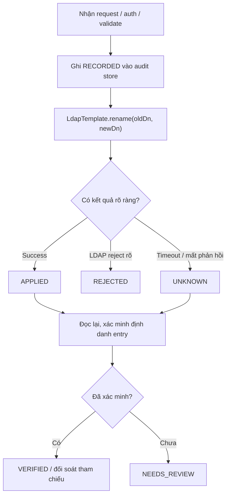
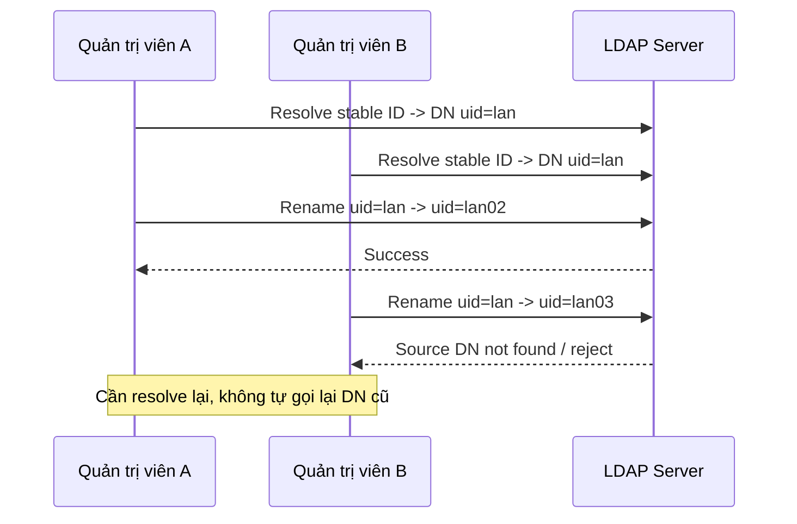

# Thiết kế API đổi tên an toàn và có thể truy vết

## Mục tiêu bài học

Trong **SPRING_LDAP**, đổi tên một entry không chỉ là thay giá trị `cn` hoặc `uid`. Nếu thuộc tính đó nằm trong **RDN** (*Relative Distinguished Name*), nghiệp vụ có thể phải thực hiện **LDAP Modify DN**: đổi RDN, hoặc đồng thời chuyển entry sang nhánh cha khác (*move*). Điều này ảnh hưởng đến định danh, quyền truy cập, các tham chiếu chứa DN và khả năng truy vết sau sự cố.

Bài thuộc chương **Rename và move**, hướng dẫn thiết kế **API đổi tên an toàn và có thể truy vết**: từ hợp đồng request/response, xây DN, kiểm soát nhánh đích và quyền, thao tác bằng `LdapTemplate.rename()`, đến audit, idempotency, đối soát khi mất phản hồi và kiểm thử LDAP server thật. Kiến thức áp dụng trong hệ sinh thái `ContextSource`, `LdapTemplate`, `LdapClient` hoặc ODM, với TLS, pooling và xử lý lỗi phù hợp.

Sau bài học, bạn sẽ:

1. Phân biệt **sửa attribute thường**, **đổi RDN**, **chuyển nhánh** và **đổi định danh nghiệp vụ**.
2. Thiết kế endpoint rename có đầu vào hạn chế, actor xác thực, điều kiện trước khi ghi và kết quả rõ ràng.
3. Dùng `LdapNameBuilder` để tạo DN, không nối giá trị không tin cậy thành tên LDAP.
4. Hiểu `LdapTemplate.rename(oldDn, newDn)` và giới hạn của LDAP Modify DN, đặc biệt với việc thay đổi RDN attribute và tham chiếu nhóm.
5. Ghi nhật ký ý định/thành công/thất bại/chưa xác định theo **request ID**, tránh làm lộ dữ liệu nhạy cảm.
6. Phân biệt retry an toàn với **thử lại mù sau timeout**, dùng đối soát và định danh ổn định.
7. Xây bộ unit test và integration test cho rename/move, ACL, xung đột, sự cố mạng và audit.

## 1. Trước hết, “đổi tên” nghĩa là gì?

Xét entry mẫu trong directory thử nghiệm:

```ldif
dn: uid=lan,ou=People,dc=example,dc=org
objectClass: top
objectClass: person
objectClass: organizationalPerson
objectClass: inetOrgPerson
uid: lan
cn: Lan Nguyen
sn: Nguyen
mail: lan@example.org
```

Ba yêu cầu sau **không tương đương**:

| Yêu cầu nghiệp vụ | Thao tác LDAP thường phù hợp | Hậu quả |
| --- | --- | --- |
| Đổi tên hiển thị `cn` từ `Lan Nguyen` thành `Lan Anh` | `modifyAttributes` nếu RDN không dùng `cn` | DN `uid=lan,...` không đổi |
| Đổi mã trong RDN từ `uid=lan` thành `uid=lan02` | `rename` / LDAP Modify DN | DN thay đổi; cần kiểm tra giá trị `uid` sau đổi |
| Chuyển entry từ `ou=People` sang `ou=Contractors` | `rename` với **parent DN mới**, nếu server hỗ trợ | Đường dẫn DN và phạm vi ACL có thể thay đổi |

Với entry có RDN `uid`, sửa `cn` chỉ là **đổi tên hiển thị**, không phải đổi DN. Ngược lại, nếu entry có RDN `cn=...`, thay `cn` có thể đòi hỏi một chiến lược rename riêng. Không chọn operation chỉ vì nút UI ghi “Đổi tên”.

**DN** xác định vị trí/tên entry trong Directory Information Tree (DIT). **RDN** là thành phần gần nhất của entry, ví dụ `uid=lan`. **Base DN** của `ContextSource` là hậu tố gốc đã được cấu hình và thường không được lặp lại trong tham số DN tương đối đưa cho `LdapTemplate`.

### 1.1. Rename khác với tạo entry mới

Không xóa rồi tạo entry mới chỉ để đổi tên:

- Entry có thể sở hữu **operational attributes** và định danh ổn định do server cấp.
- ACL hoặc nhóm khác có thể tham chiếu DN cũ.
- Xóa–tạo lại là nhiều thao tác, có nguy cơ mất dữ liệu hoặc để trạng thái nửa chừng.
- Việc tạo một object mới không bảo đảm là **cùng đối tượng** với entry trước.

Với rename/move hợp lệ, ưu tiên LDAP **Modify DN**. Chỉ dùng một quy trình migration khác nếu directory đích không hỗ trợ move mong muốn, có kế hoạch đối soát dữ liệu và được nghiệp vụ phê duyệt.

## 2. LDAP Modify DN và lời gọi Spring LDAP

Trong RFC 4511, thao tác **Modify DN** mang những thông tin chính:

| Trường trong giao thức | Ý nghĩa |
| --- | --- |
| `entry` | DN hiện tại của entry |
| `newrdn` | RDN mới |
| `deleteoldrdn` | Có xóa giá trị RDN cũ khỏi entry khi áp thao tác hay không |
| `newSuperior` | DN cha mới, nếu cần chuyển entry |

Ở tầng `LdapTemplate`, cách dùng thông dụng là:

```java
import javax.naming.Name;
import org.springframework.ldap.core.LdapTemplate;

// oldDn và newDn đã được dựng, kiểm tra và cho phép từ trước.
ldapTemplate.rename(oldDn, newDn);
```

Spring LDAP điều phối context/JNDI để thực hiện rename. Hợp đồng `rename(oldDn, newDn)` không nên được diễn giải thành khả năng kiểm soát độc lập **mọi tùy chọn** của Modify DN ở tất cả LDAP server.

**Đặc biệt quan trọng:** `deleteoldrdn` ảnh hưởng liệu giá trị RDN cũ có còn được giữ trong tập attribute hay không. Một số provider có thiết lập riêng cho hành vi này; kết quả cụ thể phải kiểm chứng với **server và cấu hình JNDI/Spring LDAP đang dùng**. Nếu ứng dụng yêu cầu `uid` chỉ có một giá trị và đúng bằng RDN mới, hãy **đọc lại entry sau rename và kiểm tra thuộc tính**, đừng giả định một cách tuyệt đối rằng mọi server đều xử lý giống nhau.

### 2.1. Move không phải thao tác xuyên mọi server

Chuyển entry sang một `newSuperior` có thể chỉ được hỗ trợ trong cùng naming context, cùng directory server hoặc theo giới hạn sản phẩm. Server có thể từ chối move giữa các nhánh, subtree quá lớn, naming context khác nhau, hoặc khi ACL không đủ.

LDAP Modify DN **không phải** một giao thức migration tổng quát giữa hai directory server độc lập. Nếu chuyển dữ liệu qua hai server, cần một quy trình migration/replication riêng, không cố dùng `rename(oldDn, newDn)` rồi cho rằng mọi dữ liệu và tham chiếu đã chuyển.

### 2.2. Đổi DN không bảo đảm cập nhật các tham chiếu khác

Ví dụ một nhóm có:

```ldif
dn: cn=Developers,ou=Groups,dc=example,dc=org
objectClass: top
objectClass: groupOfNames
cn: Developers
member: uid=lan,ou=People,dc=example,dc=org
```

Sau rename người dùng sang `uid=lan02,ou=People,...`, thuộc tính `member` của nhóm **không được bảo đảm tự cập nhật** trên mọi server. Một số sản phẩm có cơ chế referential integrity hoặc plugin riêng; một số không có. Cần xem thiết lập server và kiểm thử.

Điều này cũng áp dụng với `manager`, `owner`, `uniqueMember`, ACL, URL, cache hoặc bảng dữ liệu ứng dụng đang lưu DN. Đổi DN thành công không có nghĩa mọi hệ thống liên quan đã đổi tham chiếu xong.

## 3. Hợp đồng API đổi tên: tránh cho client gửi DN tùy ý

Một endpoint có thể được định nghĩa như sau:

```http
POST /api/directory/people/{personId}/rename
Authorization: Bearer <access-token>
Content-Type: application/json
Idempotency-Key: 9f468e60-612f-4ebd-a08e-4c70d48a1ad2

{
  "newUid": "lan02",
  "reason": "Chuẩn hóa mã nhân viên"
}
```

Trong hợp đồng minh họa:

- `personId` là **ID ứng dụng ổn định**; tránh dùng một đường dẫn chứa chính UID/DN đang được đổi làm định danh duy nhất nếu ứng dụng cần tiếp tục tra cứu sau rename.
- `newUid` là **giá trị RDN mới**, không phải filter, đoạn LDIF hay DN đầy đủ.
- `reason` là lý do nghiệp vụ cần truy vết; giới hạn độ dài và dữ liệu nhạy cảm.
- `Idempotency-Key` là mã định danh yêu cầu do client gửi, được service lưu cùng fingerprint của yêu cầu để tránh xử lý lặp.
- Actor phải lấy từ **security context đã xác thực**, không tin trường `actor` tự khai trong body.
- **DN cũ** được xác định bên trong hệ thống sau khi tìm entry theo một định danh ổn định; **DN mới** do server ứng dụng dựng theo chính sách.

Nếu sản phẩm chưa có ID bất biến ở tầng ứng dụng, cần xác định thuộc tính định danh ổn định do directory hỗ trợ (ví dụ entry UUID hoặc object GUID tùy server), ACL cho đọc nó và phương án sử dụng khi entry đổi DN. Không giả định một attribute bất biến tồn tại hoặc được phép đọc trên mọi LDAP server.

### 3.1. Cấu trúc kết quả

Một kết quả rename thành công:

```http
HTTP/1.1 200 OK
Content-Type: application/json

{
  "operationId": "9f468e60-612f-4ebd-a08e-4c70d48a1ad2",
  "personId": "person-742",
  "status": "APPLIED",
  "newUid": "lan02",
  "referencesStatus": "PENDING_REVIEW"
}
```

Không nhất thiết đưa DN đầy đủ hoặc nội dung nhạy cảm vào response công khai. Nếu cần trả DN nội bộ cho công cụ quản trị, phải kiểm soát quyền và phân loại dữ liệu. Trường `referencesStatus` chỉ có ý nghĩa nếu hệ thống thực sự có quy trình đánh giá tham chiếu; không tuyên bố `UPDATED` khi chưa kiểm chứng các nhóm/hệ thống liên quan.

### 3.2. Hợp đồng lỗi HTTP và nghiệp vụ

| Tình huống | Phản hồi gợi ý | Lưu ý |
| --- | --- | --- |
| Input sai cú pháp, UID rỗng/quá dài | `400 Bad Request` | Không gửi Modify DN |
| Chưa xác thực | `401 Unauthorized` | Theo cơ chế auth của API |
| Actor không có quyền rename/move | `403 Forbidden` | Không tiết lộ chi tiết LDAP ngoài mức cho phép |
| Không tìm thấy entry theo ID hợp lệ | `404 Not Found` | Không đánh đồng với lỗi directory unavailable |
| DN đích đã thuộc entry khác | `409 Conflict` | Không ghi đè entry hiện có |
| Tiền điều kiện phiên bản thất bại | `412 Precondition Failed` nếu có cơ chế điều kiện thật | Không dùng ETag giả làm khóa nguyên tử |
| LDAP server không thể kết nối | `503 Service Unavailable` hoặc lỗi dependency tương ứng | Thao tác có thể đã được áp nếu mất phản hồi sau khi gửi |
| Trạng thái ghi chưa xác định | Mô hình `UNKNOWN / REQUIRES_RECONCILIATION` | Không tự trả “thất bại chắc chắn” |

Đây là đề xuất **hợp đồng ứng dụng**, không phải mapping HTTP mặc định của Spring LDAP. Nếu dùng `202 Accepted`, hệ thống phải có cơ chế xử lý tiếp và tra cứu trạng thái yêu cầu thực sự; đừng trả 202 khi không có worker/queue để hoàn tất.

## 4. Xây DN mới an toàn và giới hạn nhánh được phép

Khi `ContextSource` đã có base `dc=example,dc=org`, `LdapTemplate.rename()` thông thường nhận **DN tương đối với base đó**.

Cấu hình Spring Boot minh họa:

```properties
spring.ldap.urls=ldaps://ldap.example.org:636
spring.ldap.base=dc=example,dc=org
spring.ldap.username=cn=svc-rename,ou=Services,dc=example,dc=org
spring.ldap.password=${LDAP_BIND_PASSWORD}
```

Đây là ví dụ, không phải credential thật. Mật khẩu phải lấy từ nguồn secret an toàn; LDAPS cần kiểm tra chứng chỉ/hostname và truststore tin cậy. Identity chỉ nên có quyền rename/move **những nhánh và loại entry được phép**, không cần đặc quyền quản trị toàn directory.

### 4.1. Dùng LdapNameBuilder cho RDN thô

Với phạm vi đổi UID chỉ trong `ou=People`, tạo tên bằng builder:

```java
import javax.naming.Name;
import org.springframework.ldap.support.LdapNameBuilder;

final class PersonDnPolicy {
    private PersonDnPolicy() {}

    static Name inPeople(String rawUid) {
        if (rawUid == null || rawUid.isBlank()
                || rawUid.length() > 64) {
            throw new IllegalArgumentException("Invalid UID");
        }
        return LdapNameBuilder.newInstance()
                .add("ou", "People")
                .add("uid", rawUid)
                .build();
    }
}
```

Giả sử `oldUid="lan"` và `newUid="lan02"`:

```text
ContextSource.base : dc=example,dc=org
oldDn (tương đối) : uid=lan,ou=People
newDn (tương đối) : uid=lan02,ou=People
oldDn (đầy đủ)    : uid=lan,ou=People,dc=example,dc=org
newDn (đầy đủ)    : uid=lan02,ou=People,dc=example,dc=org
```

Không nhận `newDn` nguyên văn từ HTTP request, ví dụ `"uid=lan02,ou=Admins,dc=example,dc=org"`, rồi chuyển thẳng cho `rename()`. Client có thể yêu cầu chuyển entry tới một nhánh ngoài chính sách hoặc làm rối quy tắc DN tương đối/tuyệt đối.

**Validation** có thể giới hạn độ dài/kiểu UID theo hợp đồng, nhưng **builder** mới chịu trách nhiệm biểu diễn giá trị RDN chứa dấu phẩy, dấu cộng, dấu gạch chéo ngược… đúng RFC 4514. Không escape một giá trị trước khi đưa vào builder; việc escape hai lần có thể đổi tên thật.

### 4.2. Xác định DN cũ từ entry thực, không đoán bừa

Nếu người dùng ở nhiều OU, ví dụ:

```text
uid=lan,ou=People,dc=example,dc=org
uid=lan,ou=Contractors,dc=example,dc=org
```

thì một `uid` **không đủ** để chọn đúng entry. Repository nên tra cứu theo **định danh ổn định** và đưa về **một entry duy nhất** cùng DN thực. Với `LdapTemplate.search`, có thể dùng `ContextMapper` để lấy `DirContextOperations.getDn()`.

```java
import static org.springframework.ldap.query.LdapQueryBuilder.query;

import java.util.List;
import javax.naming.Name;
import org.springframework.ldap.core.ContextMapper;
import org.springframework.ldap.core.DirContextOperations;

// Demo: "personId" phải map đến một attribute định danh ổn định
// đã được xác minh hỗ trợ bởi directory server cụ thể.
List<Name> candidates = ldapTemplate.search(
        query().base("ou=People")
               .where("employeeNumber").is(personId),
        (ContextMapper<Name>) raw ->
                ((DirContextOperations) raw).getDn()
);
```

Đây là **minh họa truy vấn**, không khẳng định `employeeNumber` luôn là immutable ID hoặc duy nhất: một tổ chức có thể cập nhật/tái sử dụng nó. Trong production, hãy có hợp đồng riêng về định danh bất biến, uniqueness, lookup theo nhiều OU, sự tồn tại của thuộc tính và quyền đọc. Một kết quả có **0** hoặc **nhiều hơn 1** entry cần được xử lý riêng, không ngầm chọn phần tử đầu.

### 4.3. Chuyển OU cần chính sách đích riêng

Nếu nghiệp vụ thật sự cần move từ `ou=People` sang `ou=Contractors`:

```java
import javax.naming.Name;
import org.springframework.ldap.support.LdapNameBuilder;

// Nguồn lấy từ entry đã resolve, không dựng từ tên do client đoán.
Name oldDn = resolvedPerson.relativeDn();

Name targetDn = LdapNameBuilder.newInstance()
        .add("ou", "Contractors")
        .add("uid", validatedNewUid)
        .build();

// Chỉ thực hiện sau khi đã kiểm tra actor, nhánh đích và ACL.
ldapTemplate.rename(oldDn, targetDn);
```

Nếu `targetOu` do client chọn, chỉ chấp nhận giá trị trong **allowlist** được ánh xạ tới các DN cha cố định; không lấy nguyên chuỗi OU của caller làm đường dẫn. **Quyền move** có thể khác quyền rename tại chỗ: nhiều server cần quyền tương ứng ở cả entry nguồn và nhánh cha đích.

### 4.4. Kiểm tra DN có cấu trúc, không dùng startsWith chuỗi

Ví dụ cách kiểm tra dễ sai:

```java
// Không nên: phép prefix chuỗi có thể nhầm các DN có ký tự giống nhau.
if (candidateDn.toString().startsWith("ou=People")) {
    // ...
}
```

DN có escaping, thứ tự RDN và quy tắc so sánh riêng; hãy parse thành `javax.naming.ldap.LdapName` và kiểm tra các RDN/base theo cấu trúc hoặc dựng DN từ **những thành phần đã được cho phép**. Việc kiểm tra bằng Java vẫn **không thay thế LDAP ACL**: server phải giới hạn thao tác cuối cùng.

## 5. Service rename: kiểm tra trước, gửi lệnh đúng một lần

Một dịch vụ quản trị nên tách:

- **Resolver**: xác định entry nguồn và DN hiện tại từ ID ổn định.
- **Policy**: kiểm tra quyền actor, nhánh và quy tắc đổi tên.
- **Rename executor**: thực hiện đúng một LDAP Modify DN trên connection phù hợp.
- **Audit/operation store**: lưu request ID, ý định, kết quả và thông tin phục hồi/đối soát.
- **Reference reconciliation**: xem xét nhóm, cache và hệ thống đang tham chiếu DN cũ.

Ví dụ cấu trúc Java tập trung vào **một rename trong OU cố định** (không phải toàn bộ pipeline idempotency):

```java
import javax.naming.Name;
import org.springframework.ldap.core.LdapTemplate;

record ResolvedPerson(String personId, Name relativeDn, String uid) {}

interface PersonResolver {
    ResolvedPerson byStableId(String personId);
}

interface RenameAuthorizer {
    void requireRenamePermission(
            String actorId, ResolvedPerson person, Name targetDn);
}

final class PersonRenameService {
    private final LdapTemplate ldapTemplate;
    private final PersonResolver resolver;
    private final RenameAuthorizer authorization;

    PersonRenameService(
            LdapTemplate ldapTemplate,
            PersonResolver resolver,
            RenameAuthorizer authorization) {
        this.ldapTemplate = ldapTemplate;
        this.resolver = resolver;
        this.authorization = authorization;
    }

    Name renameUid(String authenticatedActorId,
                   String personId, String newUid) {
        ResolvedPerson person = resolver.byStableId(personId);
        Name targetDn = PersonDnPolicy.inPeople(newUid);

        // Production phải kiểm tra nguồn đúng nằm trong OU cho phép,
        // mục tiêu khác nguồn và account có quyền theo chính sách.
        authorization.requireRenamePermission(
                authenticatedActorId, person, targetDn);

        ldapTemplate.rename(person.relativeDn(), targetDn);
        return targetDn;
    }
}
```

Ví dụ này **cố ý không thể hiện lớp audit/idempotency** trong method: cần thêm một coordinator bền vững như mục sau trước khi coi đây là API có thể truy vết trên production. Nó minh họa việc **không nhận raw DN từ request**, cách phân chia resolver/authorizer và chỗ gọi LDAP. Phải kiểm tra `personId` thực sự là định danh ổn định, không cho renaming một entry ngoài OU, và dùng cùng base DN trên các context liên quan.

Không viết:

```java
// Không an toàn: actor/newDn tùy ý từ client, không kiểm tra policy.
ldapTemplate.rename(request.oldDn(), request.newDn());
```

### 5.1. Cần kiểm tra gì trước khi rename?

| Tiền điều kiện | Giải thích |
| --- | --- |
| Actor đã xác thực | Không nhận actor tự khai từ JSON |
| Quyền ứng dụng | Người gọi được rename **đúng personId**, loại entry và OU |
| Entry nguồn | Resolve đúng **một** entry, xác minh nó còn là entry mong muốn |
| DN đích | Được dựng từ RDN đã validate và parent trong danh sách cho phép |
| Hợp đồng UID | Có quy tắc uniqueness, không sửa ID bất biến ngoài chính sách |
| Parent đích | Tồn tại, có quyền move và không vi phạm cấu trúc DIT |
| Tác động liên quan | Xác định nhóm/ACL/cache cần đối soát sau đổi DN |
| Audit store | Ghi được **ý định bền vững** trước khi gửi LDAP request |

Kiểm tra “DN đích chưa tồn tại” bằng lookup có thể cải thiện thông báo lỗi, nhưng **không loại bỏ race condition**: một writer khác vẫn có thể chiếm DN trong khoảng giữa lookup và rename. LDAP server phải xử lý va chạm cuối cùng, ứng dụng phải tôn trọng kết quả đó.

### 5.2. Sự khác biệt giữa validation và escaping

`LdapNameBuilder` bảo vệ cú pháp **DN** theo RFC 4514; `LdapQueryBuilder` bảo vệ **filter value** theo RFC 4515. Nếu resolver dùng search từ một ID do caller cung cấp, phải đưa ID vào `where(...).is(value)`, không nối string filter.

Escaping chỉ làm dữ liệu được diễn giải đúng cú pháp. Nó không cho phép một actor đổi entry ngoài quyền, không thay thế kiểm tra độ dài/định dạng UID và không xử lý hộ xung đột DN.

## 6. Thiết kế truy vết: audit là một phần của hợp đồng

Một dòng log `"rename success"` không đủ để điều tra khi hai yêu cầu chạy gần nhau, client bị timeout hoặc dữ liệu nhóm còn tham chiếu DN cũ. API đổi tên nên có **operation ID** và một chuỗi sự kiện bền vững, đủ để trả lời:

- Ai yêu cầu, qua cơ chế xác thực nào, với quyền gì?
- Entry **nào** được nhắm tới (ID ổn định, không chỉ DN có thể thay đổi)?
- DN nguồn và DN đích thuộc phạm vi nào?
- Lý do nghiệp vụ là gì, có cần approval không?
- Yêu cầu đã được gửi tới LDAP chưa, server trả gì và lúc nào?
- Trạng thái cuối đã được **kiểm chứng** chưa?
- Các nhóm, tham chiếu hoặc cache liên quan đã được đối soát hay còn chờ?

### 6.1. Bản ghi ý định trước khi gửi Modify DN

Ví dụ một sự kiện audit nội bộ đã lọc dữ liệu:

```json
{
  "eventType": "LDAP_RENAME_INTENT_RECORDED",
  "operationId": "9f468e60-612f-4ebd-a08e-4c70d48a1ad2",
  "actorId": "admin-17",
  "personId": "person-742",
  "oldRelativeDn": "uid=lan,ou=People",
  "newRelativeDn": "uid=lan02,ou=People",
  "reasonCode": "IDENTIFIER_CORRECTION",
  "requestFingerprint": "hash-of-canonical-request",
  "state": "RECORDED"
}
```

Đây chỉ là **schema minh họa** của audit store, không phải payload phải công khai cho client. DN và UID có thể là dữ liệu nhận dạng, nên phải có **phân quyền truy cập audit, mã hóa hoặc mã hóa trường nhạy cảm khi phù hợp, retention và chính sách xóa**. Không log credential, password, token hay toàn bộ attributes. `requestFingerprint` cần được tạo từ dữ liệu canonical đáng tin cậy, không dùng một hash tùy tiện khó kiểm chứng.

Một audit event có thể còn ghi thời điểm UTC, server/tenant ID, correlation ID, loại operation `MODIFY_DN`, nhánh nguồn/đích, phiên bản policy và mã lỗi LDAP đã phân loại. Tránh lưu nguyên stack trace kèm dữ liệu người dùng vào một kho audit đọc rộng.

### 6.2. Trạng thái của một yêu cầu rename

Một mô hình trạng thái thực dụng:

| Trạng thái | Ý nghĩa | Hành động kế tiếp |
| --- | --- | --- |
| `RECORDED` | Ý định và request ID đã được lưu bền vững; chưa có kết quả LDAP xác nhận | Điều phối gửi yêu cầu theo chính sách |
| `APPLIED` | Client nhận phản hồi Modify DN thành công | Kiểm chứng/đối soát tùy mức yêu cầu |
| `REJECTED` | Server từ chối rõ ràng, ví dụ xung đột hoặc thiếu quyền | Trả loại lỗi phù hợp; không retry như lỗi mạng |
| `UNKNOWN` | Không xác định thao tác đã áp hay chưa, ví dụ timeout sau gửi | Đối soát, không gửi lại mù |
| `VERIFIED` | Trạng thái entry mục tiêu đã được kiểm chứng sau đổi | Tiếp tục kiểm tra tham chiếu |
| `NEEDS_REVIEW` | Có mâu thuẫn hoặc chưa chứng minh được identity/trạng thái | Chuyển cho quy trình xử lý riêng |

Trạng thái **tham chiếu** nên được quản lý độc lập, ví dụ `NOT_CHECKED`, `PENDING`, `UPDATED`, `MANUAL_REVIEW`. Một rename đã `APPLIED` vẫn có thể còn `referencesStatus=PENDING`; không được đánh dấu toàn bộ nghiệp vụ hoàn tất nếu hợp đồng yêu cầu liên kết cũng được cập nhật.



### 6.3. Lỗ hổng transaction giữa audit store và LDAP

Nếu audit ghi trong cơ sở dữ liệu SQL, còn rename ghi vào LDAP, **không có transaction nguyên tử phổ quát bao trùm cả hai hệ thống**. Các điểm lỗi:

1. Không lưu được ý định: **không gửi rename** nếu yêu cầu truy vết là bắt buộc.
2. Đã lưu ý định, chưa gửi LDAP thì process dừng: trạng thái cần được điều phối/kiểm tra lại.
3. LDAP rename thành công, nhưng ghi event `APPLIED` thất bại: entry đã đổi tên dù audit vẫn `RECORDED`.
4. LDAP áp dụng xong, mất phản hồi: trạng thái thực tế có thể không quan sát được ngay.

Thiết kế tốt cần **durable journal/outbox-like coordination**, phát hiện bản ghi pending và cơ chế reconciliation. Một lệnh SQL rollback **không tự hoàn tác** LDAP Modify DN. Không hứa “exactly once” chỉ vì method Java được gọi một lần; phải có cơ chế idempotency/khóa và bằng chứng từ hệ thống ngoài.

### 6.4. Tách audit khỏi application log

| Application log/metrics | Audit trail bền vững |
| --- | --- |
| Độ trễ LDAP, loại exception, trace ID | Actor, operation ID, intent, bằng chứng kết quả |
| Dùng cho vận hành, thường retention ngắn | Dùng cho kiểm toán/quản trị, retention theo chính sách |
| Có thể sampling hoặc tổng hợp | Cần tính đầy đủ, kiểm soát sửa/xóa |
| Không nên chứa DN/PII ngoài nhu cầu | DN/ID có thể được lưu có kiểm soát, không lưu secret |

Nếu requirement yêu cầu chống sửa lịch sử, kho audit nên áp dụng quyền ghi nối tiếp, phân quyền đọc, thời gian đáng tin cậy và cơ chế phát hiện sửa đổi theo chính sách tổ chức. Việc in audit vào stdout đơn thuần không đáp ứng yêu cầu này.

## 7. Idempotency Key: lặp request không phải luôn lặp LDAP rename

Trong API HTTP, client có thể gửi lại cùng yêu cầu sau timeout hoặc do proxy retry. Đổi tên thường **không idempotent theo nghĩa thao tác máy chủ**:

```text
Lần 1: uid=lan -> uid=lan02   (có thể thành công)
Lần 2: uid=lan -> uid=lan02   (nguồn có thể không còn)
```

Không coi lỗi `noSuchObject` ở DN cũ là bằng chứng lần đầu thành công. Entry có thể đã bị xóa, chuyển sang một nơi khác hoặc một actor khác đã can thiệp.

### 7.1. Cách xử lý Idempotency-Key

Một kho lưu trữ request (có unique constraint/atomic claim) cần ràng buộc:

```text
(tenant, authenticated actor or chosen operation scope, idempotency key)
   -> canonical request fingerprint
   -> personId ổn định, oldDn/newDn, trạng thái, kết quả đã biết
```

Quy tắc:

1. **Key chưa có:** ghi ý định và claim key một cách nguyên tử, sau đó mới tiến hành rename.
2. **Key đã có, cùng fingerprint:** trả lại trạng thái/kết quả đã ghi; nếu `UNKNOWN`, trả trạng thái cần đối soát, **không gửi một Modify DN mới ngay**.
3. **Key đã có, fingerprint khác:** trả conflict vì client dùng lại key cho yêu cầu khác.
4. **Hai HTTP request cùng key đồng thời:** chỉ một request được phép làm chủ việc điều phối; request còn lại quan sát cùng operation.
5. **Key hết hạn:** có chính sách retention phù hợp; không mặc định request rất cũ an toàn để thực hiện lại khi tên có thể đã tái sử dụng.

Idempotency store không thể tự chứng minh LDAP đã làm gì sau timeout. Nó giúp **không tạo thêm thao tác trùng**; việc xác minh trạng thái phải dùng đối soát.

### 7.2. Đối soát sau trạng thái UNKNOWN

Một bước đối soát đáng tin cậy cần kết hợp:

- **ID ổn định của entry**, không chỉ kiểm tra DN có tồn tại.
- Tra cứu **DN cũ và DN mới** trong đúng context/ACL, tránh nhầm do replication delay.
- Kiểm tra RDN attribute theo chính sách server, ví dụ `uid` sau rename.
- Kiểm tra có actor khác vừa move hoặc đổi tên lại cùng entry hay không.
- Nếu bằng chứng chưa đủ, trả `NEEDS_REVIEW` thay vì tự công nhận thành công.

| Quan sát | Điều có thể kết luận | Rủi ro |
| --- | --- | --- |
| DN cũ vắng, DN mới tồn tại **cùng stable ID** | Có cơ sở xác nhận entry mong đợi đã ở tên mới | Vẫn phải xét replica/cập nhật mới hơn |
| DN cũ còn, DN mới không có | Rename có thể chưa áp dụng | Có thể còn độ trễ/đồng thời; không retry ngay theo cảm tính |
| DN mới tồn tại với **stable ID khác** | Mục tiêu bị chiếm hoặc có xung đột | Không coi là thành công |
| Cả hai DN không tồn tại | Trạng thái bất thường | Có thể bị move/xóa tiếp; cần điều tra |
| Cả hai DN tồn tại | Có thể là hai entry khác nhau | Không kết luận rename bằng sự tồn tại của tên |
| Không đọc được do ACL/TLS/network | Không có đủ bằng chứng | Không chuyển thành not-found hoặc thành công |

**Nếu không có ID ổn định đáng tin cậy**, phép thử “old DN không còn và new DN đã có” **không đủ** để chứng minh đúng entry đã được rename. Trong trường hợp không thể quan sát một cách tin cậy, hệ thống nên giữ trạng thái chưa xác định và có quy trình hỗ trợ thủ công.

## 8. Precondition, concurrency và kiểm soát lost update

Ngay cả khi idempotency đã xử lý việc gửi lại **cùng request**, hai actor khác nhau vẫn có thể cùng đổi tên một entry:



Có thể dùng một giá trị version/ETag ở API để thông báo trạng thái mà caller đã xem, **nhưng** kiểm tra version trong ứng dụng rồi gọi LDAP rename ở bước riêng vẫn có khoảng đua. Chỉ tuyên bố kiểm soát cạnh tranh nguyên tử khi directory server thực sự hỗ trợ một cơ chế **conditional operation/assertion control** tương thích với đường gọi đang dùng, và đã kiểm thử.

Trong trường hợp server không hỗ trợ điều kiện nguyên tử, có thể:

- Serialize các yêu cầu rename của cùng `personId` trong một coordinator đáng tin cậy, với hiểu biết giới hạn khi có writer khác ngoài hệ thống.
- Resolve lại entry trước khi gửi, kiểm tra DN hiện tại và chính sách hiện hành.
- Phát hiện conflict, yêu cầu người dùng làm mới dữ liệu hoặc duyệt lại thay đổi.
- Không tự đảo ngược rename vừa thành công nếu có khả năng một tác nhân khác đã thao tác tiếp.

Một LDAP Modify DN trên **một entry** có ngữ nghĩa riêng của giao thức. Nhưng “rename entry + sửa nhóm + đổi URL + cập nhật cache” là **nhiều hành động ngoài nhau**, không được `LdapTemplate.rename()` bảo đảm là một transaction chung.

## 9. Tác động đến tham chiếu DN và các hệ thống liên quan

Một entry LDAP có thể được định danh bằng **DN có thể thay đổi** trong nhiều nơi:

| Nơi lưu tham chiếu | Ví dụ | Hành động khi đổi DN |
| --- | --- | --- |
| Nhóm LDAP | `member`, `uniqueMember` | Kiểm tra server có tự cập nhật hay cần sửa tường minh |
| Quan hệ quản lý | `manager`, `owner` | Xác minh cấu trúc và quyền cập nhật |
| Ứng dụng | Bảng liên kết user/group theo DN | Ưu tiên ID ổn định hoặc migration có kiểm soát |
| Cache/authorization | Cache nhóm, profile, session | Invalidate hoặc cập nhật theo ID, kiểm tra thời gian hiệu lực |
| URL/hệ thống tích hợp | DN làm khóa trong một hệ thống khác | Phát sự kiện và theo dõi kết quả consumer |
| Audit | Các sự kiện gắn với DN cũ | Giữ liên kết bằng operation ID và stable person ID |

### 9.1. Không giả định referential integrity tự động

Sau `rename()`, hãy kiểm tra thật:

1. Người dùng đã nằm ở DN mới với **cùng định danh ổn định**.
2. Các nhóm quan trọng còn chứa tham chiếu hợp lệ.
3. ACL theo nhánh đích đã thay đổi quyền hiển thị/sửa như kỳ vọng.
4. Cache hoặc hệ thống bên ngoài có dùng DN làm khóa hay không.

Nếu LDAP server có plugin theo dõi rename và sửa tham chiếu tự động, cần xác định chính xác **attribute nào** được plugin quản lý, phạm vi và tính nhất quán. Không kết luận một server hỗ trợ mọi thuộc tính DN-valued chỉ vì nhóm `member` được cập nhật trong một thử nghiệm.

### 9.2. Cập nhật nhóm là thao tác khác với rename

Nếu phải thay giá trị `member` trong một nhóm, có thể dùng `DirContextOperations` kết hợp `LdapTemplate.modifyAttributes()` hoặc `ModificationItem[]`, theo schema và ACL của server.

```java
import javax.naming.Name;
import org.springframework.ldap.core.DirContextOperations;
import org.springframework.ldap.core.LdapTemplate;

// Đây là một tác vụ tách biệt với rename, chỉ chạy khi chính sách
// referential integrity xác định rõ có cần cập nhật bằng ứng dụng.
DirContextOperations group =
        ldapTemplate.lookupContext(knownGroupRelativeDn);

group.removeAttributeValue("member", oldMemberFullDn);
group.addAttributeValue("member", newMemberFullDn);
ldapTemplate.modifyAttributes(group);
```

Đoạn trên giả định `oldMemberFullDn` và `newMemberFullDn` là giá trị DN đúng, có kiểu `Name` nếu schema và mapping của Spring LDAP hỗ trợ phù hợp; `knownGroupRelativeDn` là tên nhóm **tương đối với ContextSource base**. Phải tránh tự sửa nếu server đã tự thay tham chiếu, và phải kiểm tra hành vi add/remove theo schema, matching rule và trạng thái nhóm sau thao tác.

**Không có transaction chung** giữa `rename(user)` và `modifyAttributes(group)` theo mặc định. Nếu sửa nhóm thất bại, hãy ghi trạng thái `referencesStatus=NEEDS_REVIEW` hoặc một job đối soát có thể tiếp tục, chứ không mặc định xóa hay rename ngược entry người dùng.

### 9.3. Subtree rename và DN của entry con

Nếu entry được rename là **OU có nhiều con**, tên của các entry con có thể thay đổi theo đường dẫn; hành vi và hạn chế thực tế tùy directory server. Cần đánh giá:

- Server có hỗ trợ đổi tên/move subtree không, hay từ chối vì còn con?
- Có giới hạn số entry, quyền hoặc naming context?
- Các app đang lưu **DN tuyệt đối của từng hậu duệ** có cần cập nhật không?
- Hệ thống quản lý danh tính có cho phép move cả nhánh và ảnh hưởng tới ACL thế nào?

Đây là thay đổi rủi ro cao hơn việc sửa RDN của một entry lá. Một API chỉ cho rename **nhân viên** nên ngăn caller gửi ID của OU/quản trị viên và vô tình đổi tên một nhánh lớn.

## 10. Bảo mật cho API đổi tên

### 10.1. Có hai ranh giới quyền

**Quyền của caller trong ứng dụng** và **quyền LDAP của service identity** đều phải được kiểm tra:

```text
HTTP Caller
  -> AuthN: xác thực identity
  -> Application AuthZ: có quyền rename personId / chuyển nhánh?
  -> Policy: kiểm tra newUid, OU đích và trạng thái entry
  -> ContextSource với LDAP writer identity giới hạn
  -> LDAP server ACL: kiểm tra Modify DN
```

Một người có thể đọc hồ sơ nhưng **không** có quyền đổi RDN. Một người có quyền đổi RDN trong People cũng có thể **không** có quyền chuyển entry sang nhánh nhạy cảm như `ou=Admins`. Hai quyền nên được biểu diễn rõ trong policy.

### 10.2. Không lấy authorization từ dữ liệu do client gửi

Những đầu vào nên **được quyết định bởi server hoặc allowlist**:

- Actor ID, role và tenant của request.
- Entry nguồn theo ID ổn định; account không tự chọn một DN bất kỳ.
- Object class được phép rename, tránh vô tình chọn group/OU/admin.
- Phạm vi DN nguồn và danh sách parent DN đích.
- Loại operation: `RENAME_RDN` hay `MOVE_ENTRY`, và lý do chuyển nhánh.

Chuỗi `uid` nên được giới hạn độ dài và nội dung theo hợp đồng. Ngay cả khi `LdapNameBuilder` escape được dấu phẩy, ứng dụng vẫn có quyền từ chối UID có dấu phẩy vì policy. Ngược lại, không dựa vào một regex duy nhất để coi yêu cầu đã được phân quyền.

### 10.3. TLS, credentials, connection pooling

- Dùng **LDAPS** hoặc **StartTLS** với xác minh certificate và hostname. Không bỏ xác minh chứng chỉ để “sửa lỗi kết nối”.
- Credential của `ContextSource` lấy từ secret manager hoặc nguồn cấu hình bảo vệ; không ghi secret vào audit hay log.
- LDAP service identity có quyền **đúng nhánh nguồn và cha đích**, không dùng tài khoản quản trị chung chỉ để rename vài entry.
- Thiết lập connect/read timeout và theo dõi lỗi mạng; không nhầm search time limit với thời gian chờ kết nối.
- Nếu dùng pooling, kiểm tra tương thích với TLS, danh tính bind, lifecycle của context và server; không tái sử dụng context người dùng này cho người dùng khác.
- Áp dụng rate limit và kiểm soát số lượng thao tác rename, đặc biệt với API quản trị có thể ảnh hưởng cache/authorization.

**Search có kết quả không chứng minh caller đã xác thực.** Đăng nhập người dùng là nghiệp vụ khác (LDAP Bind với credential hợp lệ, SSO hoặc hệ thống danh tính khác); không chấp nhận mật khẩu rỗng thành công chỉ vì server hỗ trợ unauthenticated simple bind.

### 10.4. Trace an toàn nhưng không rò rỉ DN

Trong log vận hành, thường chỉ cần:

```json
{
  "operation": "LDAP_MODIFY_DN",
  "operationId": "9f468e60-612f-4ebd-a08e-4c70d48a1ad2",
  "state": "UNKNOWN",
  "directoryErrorClass": "TIMEOUT",
  "durationMs": 1700
}
```

Thông tin actor, reason, old/new DN có thể lưu tại **audit store phân quyền chặt**. Tránh dùng raw DN trong mọi dòng INFO log hoặc metrics label vì DN chứa dữ liệu cá nhân và có cardinality cao. **Không tạo metrics label bằng UID/DN/request ID**, vì làm tăng cardinality và nguy cơ lộ định danh.

### 10.5. Không phát tán trạng thái thành công quá sớm

Một callback HTTP có thể nhận phản hồi LDAP thành công, nhưng hệ thống cache hoặc nhóm vẫn chưa cập nhật. Tránh phát sự kiện `PERSON_RENAMED_COMPLETELY` nếu chỉ biết Rename đã `APPLIED`. Có thể dùng sự kiện thể hiện đúng sự thật như `LDAP_DN_CHANGED` và một trạng thái/reference event riêng sau đối soát.

Đối với tích hợp đa hệ thống, nếu phát sự kiện qua message broker, cần thiết kế outbox/delivery bảo đảm theo khả năng thực tế của hạ tầng; không mặc định phát một message và ghi LDAP là transaction nguyên tử.

## 11. Xử lý lỗi rename theo ngữ nghĩa

Lỗi rename có thể phát sinh ở bước resolve, authorize, kết nối, LDAP Modify DN, audit hoặc đối soát tham chiếu. Không dùng một `catch (Exception)` để trả `false` hay “không tìm thấy người dùng”.

| Lỗi/tình huống | Nguyên nhân có thể | Cách ứng dụng xử lý |
| --- | --- | --- |
| Entry nguồn không tồn tại | DN cũ sai, entry đã move/rename/xóa | Kiểm tra ID ổn định; báo not-found/conflict đúng ngữ nghĩa |
| Target DN đã tồn tại | Có entry khác chiếm tên | Conflict; **không rebind/ghi đè** |
| Parent đích không tồn tại | Chưa provision OU hoặc sai nhánh | Từ chối move, không tự tạo OU ngoài policy |
| Không có quyền | LDAP ACL hoặc authorization ứng dụng | Báo forbidden/authorization; không tự nâng quyền |
| Naming violation | RDN, parent hoặc quy tắc naming không hợp lệ | Kiểm tra DN builder và policy server |
| Schema violation | Cấu trúc hoặc attribute sau rename không hợp lệ | Đối chiếu object class, RDN và `deleteoldrdn` |
| Server không hỗ trợ move | Cross naming context, subtree hoặc server policy | Dùng chiến lược migration riêng nếu được phép |
| Referral/alias | Directory trả tham chiếu hoặc xử lý tên không mong muốn | Cấu hình/referral policy rõ, không follow tới server ngoài tin cậy |
| TLS hoặc bind thất bại | Certificate, credential, server lỗi | Không gửi plain LDAP thay thế; thông báo dependency error |
| Timeout **trước khi biết phản hồi** | Server có thể đã áp Modify DN | Đánh dấu `UNKNOWN`, đối soát trước khi retry |
| Audit store không ghi kết quả | LDAP có thể đã đổi nhưng nhật ký chưa cập nhật | Phát hiện pending, reconciliation; không xóa kết quả thật |
| Rename thành công nhưng nhóm còn DN cũ | Không có referential integrity tự động | Trạng thái references cần xử lý, không báo hoàn tất toàn bộ |

### 11.1. Trường hợp LDAP trả lỗi rõ và trường hợp UNKNOWN

Khi server gửi phản hồi LDAP rõ ràng rằng operation bị **từ chối**, có thể lưu `REJECTED` cùng mã lỗi đã phân loại. Nếu **không nhận được phản hồi**, ứng dụng không thể kết luận operation đã thất bại. Việc phân loại phải dựa trên **thông tin thực sự quan sát được**, không suy đoán từ tên exception Java đơn thuần.

Với Spring LDAP, nhiều `NamingException` của JNDI được chuyển thành các runtime exception trong Spring LDAP. Tên lớp cụ thể có thể tùy phiên bản và provider. Cần phân loại dựa trên kết quả LDAP, vị trí thất bại và trạng thái truyền nhận có thể quan sát được; nếu không thể chứng minh một reject, giữ trạng thái `UNKNOWN`.

### 11.2. Không thực hiện rollback bằng rename ngược vô điều kiện

Một lỗi thường gặp: rename user thành công, sửa nhóm lỗi, nên tự gọi `rename(newDn, oldDn)` để “hoàn tác”. Cách này nguy hiểm vì:

- Một actor khác có thể đã sửa entry, group hoặc tên mới sau lần rename đầu.
- DN cũ có thể đã bị một entry khác chiếm.
- Một số hệ thống đã tiêu thụ sự kiện đổi tên mới.
- Rename ngược cũng là một operation mới, có thể timeout hoặc thất bại.

Nếu có yêu cầu rollback, cần một **compensation workflow** được thiết kế riêng, kiểm tra danh tính ổn định, tiền điều kiện, tham chiếu, quyền và audit cho lần đảo ngược. Trong nhiều trường hợp, đối soát và sửa tham chiếu tiếp là lựa chọn ít rủi ro hơn.

## 12. Unit test: DN, quyền và điều phối gọi rename

Unit test nên chứng minh logic **trước khi có mạng LDAP**: dựng DN đúng, chặn actor không đủ quyền, không để input thêm RDN ngoài ý định, không gọi rename hai lần cho một operation đã được claim.

### 12.1. Test cấu trúc DN và escaping RDN

```java
import static org.junit.jupiter.api.Assertions.*;

import javax.naming.Name;
import javax.naming.ldap.LdapName;
import org.junit.jupiter.api.Test;

class PersonDnPolicyTest {
    @Test
    void ordinaryUidProducesTwoRelativeRdns() throws Exception {
        Name name = PersonDnPolicy.inPeople("lan02");
        LdapName parsed = new LdapName(name.toString());

        assertEquals(2, parsed.size());
        // Chỉ số của LdapName tính từ RDN gốc về RDN lá.
        assertEquals("People", parsed.getRdn(0).getValue());
        assertEquals("lan02", parsed.getRdn(1).getValue());
    }

    @Test
    void commaInRawUidIsNotAThirdRdn() throws Exception {
        Name name = PersonDnPolicy.inPeople("lan,dev");
        LdapName parsed = new LdapName(name.toString());

        assertEquals(2, parsed.size());
        assertEquals("lan,dev", parsed.getRdn(1).getValue());
    }

    @Test
    void blankUidIsRejectedBeforeLdapCall() {
        assertThrows(IllegalArgumentException.class,
                () -> PersonDnPolicy.inPeople("   "));
    }
}
```

Test kiểm tra **cấu trúc DN** thay vì so string đã escape: cùng một DN có thể có cách biểu diễn ký tự đặc biệt tương đương. Việc builder bảo vệ cấu trúc không tự quyết định UID chứa dấu phẩy có hợp lệ theo quy tắc nghiệp vụ hay không; nếu policy cấm, bổ sung validation và test từ chối.

### 12.2. Test service không gửi rename nếu bị từ chối quyền

Giả sử dự án dùng JUnit 5 và Mockito:

```java
import static org.junit.jupiter.api.Assertions.*;
import static org.mockito.Mockito.*;

import org.junit.jupiter.api.Test;
import org.springframework.ldap.core.LdapTemplate;

class PersonRenameServiceTest {
    @Test
    void doesNotRenameWhenAuthorizerRejects() {
        LdapTemplate template = mock(LdapTemplate.class);
        PersonResolver resolver = id -> new ResolvedPerson(
                id, PersonDnPolicy.inPeople("lan"), "lan");
        RenameAuthorizer denied = (actor, person, target) -> {
            throw new SecurityException("Rename not permitted");
        };

        PersonRenameService service =
                new PersonRenameService(template, resolver, denied);

        assertThrows(SecurityException.class,
                () -> service.renameUid("actor-1", "person-742", "lan02"));
        verifyNoInteractions(template);
    }

    @Test
    void sendsOneRenameForApprovedRequest() {
        LdapTemplate template = mock(LdapTemplate.class);
        PersonResolver resolver = id -> new ResolvedPerson(
                id, PersonDnPolicy.inPeople("lan"), "lan");
        RenameAuthorizer allowed = (actor, person, target) -> {};
        PersonRenameService service =
                new PersonRenameService(template, resolver, allowed);

        service.renameUid("actor-1", "person-742", "lan02");

        verify(template).rename(
                PersonDnPolicy.inPeople("lan"),
                PersonDnPolicy.inPeople("lan02"));
        verifyNoMoreInteractions(template);
    }
}
```

Hai test này chỉ kiểm tra **mẫu điều phối đơn giản ở mục 5**. Chúng chưa kiểm tra audit store, idempotency atomically, quyền ACL thật, schema, kết quả rename hoặc tính nhất quán các tham chiếu. Với một API production, phải có test cho coordinator và persistence của operation state.

### 12.3. Test idempotency ở tầng điều phối

Viết test với **fake audit store** hoặc cơ sở dữ liệu test có unique constraint:

| Tình huống | Kỳ vọng |
| --- | --- |
| Hai request cùng key, cùng fingerprint | Chỉ **một** lần điều phối LDAP Modify DN |
| Cùng key nhưng newUid khác | Conflict, không thực hiện đổi tên thứ hai |
| Request lặp sau khi `APPLIED` | Trả kết quả cũ, không rename lần nữa |
| Request lặp khi `UNKNOWN` | Trả trạng thái và tiến hành đối soát, không retry ngay |
| Audit store không ghi được intent | Không gửi rename |
| Ghi `APPLIED` thất bại sau LDAP success | Có cách phát hiện operation pending và truy vết để đối soát |
| Hai request đồng thời claim cùng key | Một request sở hữu quyền thực thi, request kia không gọi LDAP |

Chỉ mock một `Map<String,Record>` không đủ chứng minh **atomicity của claim key** trong môi trường nhiều instance. Cần test persistence/concurrency phù hợp với hạ tầng thật.

## 13. Integration test: xác minh LDAP thật và truy vết

Unit test không kiểm tra được LDAP server có hỗ trợ move/subtree rename, `deleteoldrdn` được áp thế nào, ACL ra sao và liệu các nhóm có tự cập nhật DN hay không. Vì vậy, phải kiểm thử trên **directory server riêng**, với OU, account và fixture được phép thay đổi.

### 13.1. Fixture thử nghiệm

Ví dụ:

```text
dc=example,dc=org
├── ou=People
│   ├── uid=lan
│   └── uid=mai
├── ou=Contractors
└── ou=Groups
    └── cn=Developers
```

Nhóm `Developers` tham chiếu `uid=lan,ou=People,...`. Account `svc-reader` chỉ có quyền đọc; `svc-rename` có quyền rename phù hợp trong nhánh test, nhưng không được đổi `ou=Admins` hoặc các nhánh khác không thuộc fixture.

Trước mỗi test ghi nhận **DN nguồn, stable ID (nếu hỗ trợ), tập thuộc tính được phép đọc và trạng thái tham chiếu**. Chỉ chạy test destructive/rename trên các entry do bộ test sở hữu, có cleanup xác minh danh tính.

### 13.2. Ma trận kiểm thử tích hợp

| Mã | Tình huống | Kết quả cần xác minh |
| --- | --- | --- |
| **REN-01** | Đổi `uid=lan` thành `uid=lan02` trong People | DN mới tồn tại, DN cũ không còn theo trạng thái đã đồng bộ |
| **REN-02** | Đọc entry sau rename | Stable ID của entry giữ đúng, dữ liệu bắt buộc không mất |
| **REN-03** | Kiểm tra `uid` và giá trị RDN sau rename | Hành vi `deleteoldrdn` đúng yêu cầu/schema |
| **REN-04** | Chỉ thay `cn` khi RDN là uid | DN không đổi; dùng Modify, không gửi Modify DN |
| **REN-05** | Rename sang DN đang có entry khác | Server từ chối conflict, entry đích không bị ghi đè |
| **REN-06** | Đổi tên không thay đổi giá trị thực | Theo policy là no-op rõ ràng hoặc một kết quả được định nghĩa |
| **REN-07** | New UID chứa dấu phẩy literal | Builder giữ đúng số RDN hoặc validation từ chối theo policy |
| **REN-08** | Client cố truyền parent ngoài allowlist | Request bị từ chối trước LDAP |
| **REN-09** | Move People → Contractors được cho phép | Entry ở đúng OU mới và có quyền/visibility dự kiến |
| **REN-10** | Move sang OU cha không tồn tại | Không tạo OU tự động, trả lỗi rõ |
| **REN-11** | Move khi account thiếu quyền ở đích | LDAP ACL từ chối, không tự nâng quyền |
| **REN-12** | Rename bằng account chỉ đọc | Server từ chối |
| **REN-13** | Rename cả subtree trong môi trường test | Kiểm tra hỗ trợ/giới hạn thực tế của server |
| **REN-14** | Move qua naming context khác | Ghi nhận khả năng hỗ trợ hoặc lỗi của directory đích |
| **REN-15** | Nhóm chứa `member=oldDN` | Kiểm tra có/không có referential integrity tự động |
| **REN-16** | Nhóm/ứng dụng còn tham chiếu DN cũ | Ghi `referencesStatus` chưa hoàn tất, không tuyên bố đồng bộ xong |
| **REN-17** | Hai actor đổi tên cùng một entry đồng thời | Phát hiện race/conflict; không tự retry tên cũ |
| **REN-18** | Hai request cùng idempotency key | Chỉ một tác vụ thực sự phát Modify DN |
| **REN-19** | Same key, different payload | Conflict và không gọi LDAP lần hai |
| **REN-20** | Ngắt kết nối sau khi gửi Modify DN | Trạng thái `UNKNOWN`, có bước đối soát theo ID |
| **REN-21** | DN mới tồn tại nhưng stable ID khác | Không đánh dấu rename thành công |
| **REN-22** | Audit intent không ghi được | Không phát LDAP rename nếu audit là bắt buộc |
| **REN-23** | LDAP success nhưng ghi audit outcome lỗi | Có cơ chế phát hiện pending và điều tra trạng thái |
| **REN-24** | TLS certificate không được tin cậy | Kết nối bị từ chối; không downgrade |
| **REN-25** | LDAP server timeout hoặc referral | Phân loại lỗi và không công nhận success khi chưa xác minh |
| **REN-26** | API trả kết quả cho caller không đủ quyền | Không lộ DN, actor/audit details hoặc thuộc tính nhạy cảm |
| **REN-27** | Rename UID nhưng lookup bằng ID ứng dụng | Resolver vẫn tìm đúng entry sau đổi DN |
| **REN-28** | Audit query theo operation ID | Xem được chuỗi intent/outcome/reconciliation hợp lệ, không chứa secret |

Một số test cần **mô phỏng lỗi kết nối hoặc lỗi audit store** có kiểm soát; không gây gián đoạn một server production. Không tự coi mọi “timeout” là trường hợp server đã áp lệnh; test phải chứng minh ứng dụng **giữ đúng sự không chắc chắn** cho tới khi đối soát.

### 13.3. Xác minh bằng ldapsearch trước và sau rename

Đọc entry ở DN nguồn trước thao tác:

```bash
ldapsearch -LLL -x \
  -H ldaps://ldap.example.org:636 \
  -D "cn=svc-reader,ou=Services,dc=example,dc=org" -W \
  -b "uid=lan,ou=People,dc=example,dc=org" \
  -s base "(objectClass=*)" \
  uid cn sn mail
```

Sau khi API báo Modify DN thành công, đọc bằng DN mới:

```bash
ldapsearch -LLL -x \
  -H ldaps://ldap.example.org:636 \
  -D "cn=svc-reader,ou=Services,dc=example,dc=org" -W \
  -b "uid=lan02,ou=People,dc=example,dc=org" \
  -s base "(objectClass=*)" \
  uid cn sn mail
```

`-W` nhập mật khẩu qua prompt thay vì đưa secret lên câu lệnh. Hai kết quả trên **chưa tự chứng minh identity ổn định** nếu không đọc thêm thuộc tính định danh ổn định mà server thực tế hỗ trợ và ACL cho phép. Cần đối chiếu theo **cùng directory/replica hoặc hiểu rõ replication delay**.

Kiểm tra nhóm sau rename:

```bash
ldapsearch -LLL -x \
  -H ldaps://ldap.example.org:636 \
  -D "cn=svc-reader,ou=Services,dc=example,dc=org" -W \
  -b "cn=Developers,ou=Groups,dc=example,dc=org" \
  -s base "(objectClass=*)" member
```

Nếu `member` vẫn trỏ tới old DN, cập nhật theo chính sách/server thay vì cho rằng rename tự hoàn tất mọi tham chiếu. Nếu LDAP server tự cập nhật tham chiếu, vẫn cần xác nhận kết quả trên server đó và không suy ra hành vi tương tự ở sản phẩm khác.

### 13.4. Những điều unit test không thể khẳng định

Mockito xác minh `rename(oldDn, newDn)` được gọi **không chứng minh**:

- Server đã chấp nhận LDAP Modify DN.
- Cách `deleteoldrdn` tác động đến thuộc tính RDN.
- ACL cho phép move từ OU nguồn đến OU đích.
- Các nhóm, manager/owner DN và cache đã có tham chiếu mới.
- Định danh entry đã được giữ khi move.
- Audit và LDAP ghi thành công cùng nhau trong điều kiện lỗi thực.

Đây chính là lý do phải có integration test với fixture được cô lập và quy trình đối soát.

## 14. Bài tập tổng hợp: API rename có operation journal

**Bối cảnh:** Một công ty dùng Spring LDAP cho directory nhân viên. Tài khoản có UID nhưng ứng dụng dùng `personId` ổn định. Nhân viên nằm trong `ou=People`, một số thuộc `ou=Contractors`, và các nhóm có `member` trỏ theo DN.

**Yêu cầu triển khai:**

1. Định nghĩa `POST /api/directory/people/{personId}/rename` với `newUid`, `reason` và `Idempotency-Key`. Actor lấy từ security context, không do client tự khai.
2. Phân biệt nghiệp vụ đổi tên hiển thị `cn` với đổi `uid` trong RDN. Chọn `modifyAttributes` hay `rename` đúng trường hợp.
3. Resolve nguồn theo một định danh ổn định có trên directory đích; trả lỗi nếu không tìm thấy hoặc không duy nhất.
4. Xây `newDn` bằng `LdapNameBuilder`, giới hạn OU theo policy; không chấp nhận full DN từ body.
5. Kiểm tra quyền rename và move riêng. Dùng LDAP writer identity chỉ có quyền ở nhánh thử nghiệm và LDAPS/StartTLS đã xác minh certificate.
6. Lưu một bản ghi `RECORDED` bền vững gồm operation ID, actor, stable person ID, before/after, reason và fingerprint đã bảo vệ dữ liệu.
7. Có cơ chế claim `Idempotency-Key` theo unique constraint; kiểm tra request lặp, request khác payload và hai request đồng thời.
8. Gửi **một** `LdapTemplate.rename(oldDn, newDn)` đúng tên; không coi `rename()` là thao tác thay toàn bộ nhóm.
9. Lưu `APPLIED` hoặc `REJECTED` khi có phản hồi rõ; giữ `UNKNOWN` nếu không có kết quả đáng tin.
10. Viết bước đối soát đọc lại DN nguồn/đích cùng stable ID. Không xác nhận success chỉ dựa trên sự tồn tại DN đích.
11. Kiểm tra tham chiếu nhóm `member` và cache; phân biệt trạng thái entry đã rename với trạng thái hệ thống liên quan đã cập nhật.
12. Cung cấp endpoint quản trị `GET /api/directory/rename-operations/{operationId}` có phân quyền để xem trạng thái và các thông tin audit được phép công bố.
13. Viết test cho permission, xung đột DN, invalid input, mất kết nối, client retry, idempotency, audit failure và referential integrity.
14. Chạy thử tất cả thao tác đổi tên trên LDAP server test, không dùng dữ liệu người dùng thật.

### Tiêu chí nghiệm thu

| Yêu cầu | Bằng chứng |
| --- | --- |
| Định danh đúng | Dùng stable person ID, không phụ thuộc hoàn toàn vào UID/DN có thể đổi |
| DN an toàn | DN tạo từ builder, OU allowlist, không cho client điều khiển tùy ý |
| Quyền rõ | AuthN/AuthZ của ứng dụng và LDAP ACL kiểm tra ở đúng tầng |
| Rename đúng | `LdapTemplate.rename` với DN nguồn/đích đã kiểm tra |
| Truy vết đầy đủ | Intent được lưu trước write; có outcome hoặc UNKNOWN và lịch sử đối soát |
| Retry có kiểm soát | Cùng key không gây thêm Modify DN, khác payload bị từ chối |
| Không tuyên bố quá mức | Entry rename và tham chiếu nhóm có trạng thái riêng |
| Xử lý hạ tầng | Không biến timeout, ACL, TLS thành “không tìm thấy” |
| Kiểm thử | Unit test quy tắc/DTO + integration test server/audit/permission |

## 15. Câu hỏi tự kiểm tra

**1. Người dùng đổi `cn` nhưng DN là `uid=lan,ou=People,...`. Có nhất thiết gọi `rename()` không?**

Không. Nếu `cn` không nằm trong RDN, đổi tên hiển thị thông thường là một LDAP Modify trên thuộc tính `cn`, không phải Modify DN.

**2. Vì sao không nên nhận `oldDn` và `newDn` tùy ý từ JSON rồi gọi `LdapTemplate.rename()`?**

Vì caller có thể nhắm đến entry/OU ngoài phạm vi, gây nhầm DN tương đối/tuyệt đối hoặc đưa dữ liệu không tin cậy vào cấu trúc tên. Nên dùng ID ổn định để resolve DN nguồn và dựng DN đích từ RDN, parent đã được policy cho phép.

**3. `LdapNameBuilder` và `LdapQueryBuilder` có cùng nhiệm vụ escaping không?**

Không. `LdapNameBuilder` tạo DN/RDN theo RFC 4514; `LdapQueryBuilder` tạo filter theo RFC 4515. Hai cú pháp có quy tắc escaping khác nhau.

**4. `deleteoldrdn` trong LDAP Modify DN ảnh hưởng điều gì?**

Nó quyết định cách xử lý giá trị RDN cũ trong tập attribute của entry khi đổi RDN. Ứng dụng phải xác minh hành vi provider/server và đối chiếu schema sau rename, nhất là khi UID/RDN cần một giá trị duy nhất.

**5. Rename thành công có bảo đảm `member` của mọi nhóm tự đổi thành DN mới không?**

Không. Tùy directory server có referential integrity plugin/cơ chế riêng hay không. Ứng dụng phải kiểm tra và đối soát các tham chiếu theo chính sách.

**6. Mất kết nối sau khi gửi rename có nghĩa server chưa thực hiện không?**

Không. Server có thể đã áp Modify DN trước khi phản hồi bị mất. Lưu trạng thái `UNKNOWN`, đối soát bằng định danh ổn định và bằng chứng từ directory.

**7. Vì sao DN đích tồn tại chưa đủ chứng minh lần rename trước thành công?**

Vì DN ấy có thể thuộc entry khác hoặc bị tái sử dụng. Cần so sánh **stable entry ID** và trạng thái trước/sau; nếu chưa đủ bằng chứng, giữ `NEEDS_REVIEW`.

**8. `Idempotency-Key` có thay thế kiểm soát cạnh tranh giữa hai admin khác nhau không?**

Không. Nó giúp nhận diện request lặp với cùng key; hai actor khác nhau có thể đưa ra hai thao tác khác nhau. Cần thêm policy, kiểm tra trạng thái, cơ chế điều kiện hoặc serialization khi thích hợp.

**9. Ghi audit `APPLIED` thất bại sau khi LDAP rename thành công thì nên làm gì?**

Không coi SQL rollback đã hoàn tác LDAP. Phải có audit intent bền vững, phát hiện bản ghi pending và đối soát để cập nhật trạng thái bằng chứng sau này.

**10. Vì sao không nên rollback rename bằng cách rename ngược tự động nếu cập nhật nhóm thất bại?**

Vì entry/nhóm có thể đã được sửa tiếp, DN cũ có thể đã bị chiếm và những hệ thống khác có thể đã xử lý sự kiện mới. Compensation là một operation riêng cần quyền, điều kiện, kiểm tra và audit.

**11. Một API rename hỗ trợ move sang OU khác có cần kiểm tra quyền nguồn và đích không?**

Có. Ngoài quyền của caller, LDAP server có thể yêu cầu ACL trên entry nguồn và nhánh đích. Dùng allowlist parent DN, không mặc định quyền rename tại chỗ đủ để chuyển nhánh.

**12. Unit test Mockito xác minh `ldapTemplate.rename(oldDn, newDn)` đã được gọi. Có chứng minh hệ thống an toàn để triển khai không?**

Không. Test đó chưa chứng minh server chấp nhận Modify DN, schema/RDN, TLS, ACL, audit, idempotency, tham chiếu nhóm và xử lý lỗi thực tế. Phải có integration test với directory thử nghiệm cùng kho audit phù hợp.

## Tổng kết

Để **thiết kế API đổi tên an toàn và có thể truy vết** trong SPRING_LDAP, không bắt đầu từ một lệnh `rename()` đơn lẻ. Hãy bắt đầu từ hợp đồng:

```text
Actor đã xác thực + personId ổn định + newUid/nhánh được phép
    -> Resolve entry nguồn và xác minh quyền
    -> Dựng DN đích bằng LdapNameBuilder
    -> Claim idempotency key và ghi audit intent bền vững
    -> LdapTemplate.rename(oldDn, newDn)
    -> Ghi APPLIED / REJECTED / UNKNOWN theo bằng chứng
    -> Đọc lại, kiểm tra stable ID và RDN attributes
    -> Đối soát nhóm, cache, ACL và hệ thống liên quan
    -> Công bố trạng thái chính xác cho caller được phân quyền
```

**`LdapTemplate.rename()` là công cụ thực hiện LDAP Modify DN**, không phải giải pháp tự động cho toàn bộ hợp đồng đổi định danh. API an toàn cần giới hạn DN nguồn/đích, authorization hai tầng, TLS, chuẩn hóa/escaping tên, kiểm soát cạnh tranh và chống retry mù. API có thể truy vết cần operation ID, audit bền vững, trạng thái `UNKNOWN` khi không nhận được kết quả và quy trình đối soát bằng **định danh entry ổn định**.

Với move và rename, đừng tuyên bố mọi tham chiếu đã được cập nhật nếu chưa kiểm chứng. Schema, ACL, hành vi `deleteoldrdn`, subtree rename và khả năng referential integrity **phụ thuộc directory server**. Hãy đối chiếu với LDAP server thực, kiểm thử trên fixture cô lập và chọn cách tiếp tục/khôi phục phù hợp với dữ liệu.

### Tài liệu tham khảo

- **Spring LDAP Reference Documentation** — `LdapTemplate`, `ContextSource`, DN và thao tác CRUD: https://docs.spring.io/spring-ldap/reference/.
- **Spring LDAP Javadoc — LdapTemplate** — các overload `rename`, `lookup`, `search`: https://docs.spring.io/spring-ldap/docs/current/api/org/springframework/ldap/core/LdapTemplate.html.
- **Spring LDAP Javadoc — LdapNameBuilder**: https://docs.spring.io/spring-ldap/docs/current/api/org/springframework/ldap/support/LdapNameBuilder.html.
- **Java SE JNDI API** — `javax.naming.Name`, `javax.naming.ldap.LdapName`, `DirContext.rename`.
- **RFC 4511 — Lightweight Directory Access Protocol (LDAP): The Protocol**, mục Modify DN: https://www.rfc-editor.org/rfc/rfc4511.
- **RFC 4512 — LDAP: Directory Information Models**, DIT, RDN, schema và attribute: https://www.rfc-editor.org/rfc/rfc4512.
- **RFC 4513 — LDAP: Authentication Methods and Security Mechanisms**: https://www.rfc-editor.org/rfc/rfc4513.
- **RFC 4514 — LDAP: String Representation of Distinguished Names**: https://www.rfc-editor.org/rfc/rfc4514.
- **RFC 4515 — LDAP: String Representation of Search Filters**: https://www.rfc-editor.org/rfc/rfc4515.
- **RFC 4528 — Lightweight Directory Access Protocol (LDAP) Assertion Control**, nếu directory server và client hỗ trợ áp điều kiện nguyên tử: https://www.rfc-editor.org/rfc/rfc4528.
