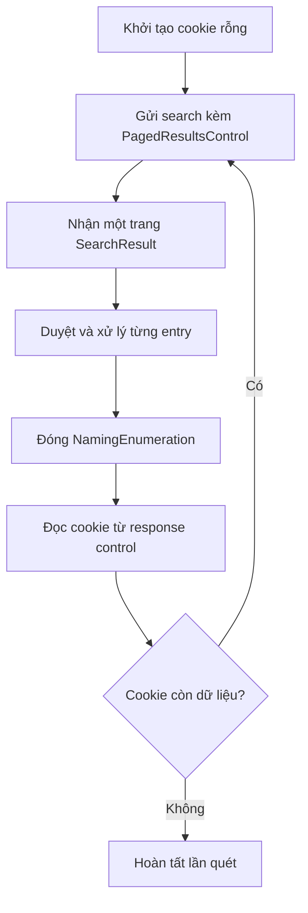

# Streaming kết quả lớn thay vì gom toàn bộ vào list

Khi truy vấn LDAP chỉ trả vài người dùng, cách gọi `LdapTemplate.search(...)` và nhận về `List<User>` thường đơn giản, dễ sử dụng. Nhưng nếu ứng dụng cần quét hàng trăm nghìn entry để kiểm kê, xuất báo cáo, đối chiếu dữ liệu hoặc đồng bộ sang hệ thống khác, việc **giữ toàn bộ kết quả trong bộ nhớ** có thể làm tăng heap, kéo dài thời gian xử lý và gây `OutOfMemoryError`. Trong Spring LDAP, ta có thể xử lý từng kết quả ngay khi callback được gọi, sau đó kết hợp **phân trang phía LDAP server** khi số lượng entry vượt giới hạn của một phép tìm kiếm.

Bài thuộc phần **Search nâng cao** của module Spring LDAP, tập trung vào quyết định dùng `List` hay callback, vòng đời truy vấn, cách kiểm soát bộ nhớ và xử lý kết quả lớn an toàn. Các ví dụ giả định `ContextSource` sử dụng base DN `dc=example,dc=org` và kết nối được bảo vệ bằng TLS; tên máy chủ và dữ liệu chỉ mang tính minh họa.

Sau bài này, bạn có thể:

- Giải thích vì sao việc nhận toàn bộ kết quả thành `List` có thể chiếm nhiều bộ nhớ.
- Dùng callback của `LdapTemplate` hoặc `NamingEnumeration` của JNDI để xử lý từng entry.
- Phân biệt **streaming phía ứng dụng** với **LDAP paged results** phía server.
- Giới hạn số thuộc tính trả về, phạm vi tìm kiếm, thời gian và công việc trong callback.
- Xử lý lỗi giữa chừng, kết quả chưa đầy đủ, thay đổi đồng thời và tiến độ khi quét cây LDAP lớn.

## 1. Khi nào `List` trở thành vấn đề?

Ví dụ một ứng dụng liệt kê tất cả người dùng thuộc `ou=people`:

```java
import java.util.List;

import org.springframework.ldap.core.AttributesMapper;
import org.springframework.ldap.core.LdapTemplate;
import org.springframework.ldap.query.LdapQueryBuilder;

// Giả sử ldapTemplate đã được cấu hình.
List<String> uids = ldapTemplate.search(
        LdapQueryBuilder.query()
                .base("ou=people")
                .where("objectClass").is("inetOrgPerson"),
        (AttributesMapper<String>) attrs ->
                (String) attrs.get("uid").get());

System.out.println("Số UID: " + uids.size());
```

Đây là cách hợp lý khi tập kết quả nhỏ và nghiệp vụ cần dùng cả danh sách sau khi tìm kiếm hoàn tất. Tuy nhiên, mỗi `String`, đối tượng ánh xạ và phần tử trong `List` đều chiếm bộ nhớ. Nếu thay `String` bằng một đối tượng người dùng với hàng chục trường, chi phí còn tăng hơn.

| Tiêu chí | Gom `List<T>` | Xử lý từng entry bằng callback |
| --- | --- | --- |
| Dữ liệu được giữ ở phía ứng dụng | Toàn bộ kết quả ánh xạ trước khi trả về | Chỉ giữ entry đang xử lý và trạng thái nhỏ, nếu callback không tích lũy |
| Bộ nhớ của kết quả | Thường tăng theo số entry `O(n)` | Có thể gần `O(1)` theo số entry, cộng bộ đệm của provider và sink |
| Thời điểm xử lý | Thường bắt đầu sau khi có `List` | Có thể xử lý ngay khi provider đưa ra từng kết quả |
| Phù hợp | Màn hình tìm kiếm có giới hạn, danh sách nhỏ, tính toán cần toàn tập | Xuất dữ liệu, kiểm kê, đồng bộ, tính tổng, xử lý tuần tự |
| Xử lý lỗi giữa chừng | Lời gọi search có thể thất bại trước khi trả danh sách | Một số entry có thể đã được chuyển sang nơi nhận trước khi gặp lỗi |
| Server size/time limit | Vẫn bị áp dụng | Vẫn bị áp dụng; callback không xóa giới hạn server |

**Streaming ở đây là cách *tiêu thụ kết quả từng entry***. Không nên hiểu rằng nó bảo đảm JVM hoàn toàn không có buffer. LDAP provider, tầng kết nối, máy chủ và nơi ghi dữ liệu vẫn có thể lưu một số entry trong bộ nhớ. Đặc biệt, callback **không tự động phân trang** và **không bảo đảm lấy hết toàn bộ subtree**.

### Hình dung đường đi của dữ liệu

```text
Cách gom List:
LDAP server → LDAP provider → mapper → List chứa N phần tử → xử lý

Cách dùng callback:
LDAP server → LDAP provider → callback → xử lý/ghi từng entry
                                       └─ chỉ giữ trạng thái cần thiết
```

Nếu callback tự gọi `list.add(result)` với mọi entry, lợi ích tiết kiệm bộ nhớ gần như mất đi. Muốn thật sự xử lý theo luồng, **sink** (đầu nhận) phải tiêu thụ, tổng hợp hoặc ghi kết quả theo cách không tích lũy vô hạn.

## 2. Streaming bằng callback của `LdapTemplate`

Spring LDAP có overload `search` nhận **`NameClassPairCallbackHandler`**. Khác với `AttributesMapper<T>` thường tạo danh sách, handler được gọi cho từng kết quả và cho phép ứng dụng thực hiện công việc tại chỗ.

Ví dụ dưới đây truyền một `Consumer<String>` để xử lý UID ngay khi tìm thấy. Nó **không giữ một `List` UID**:

```java
import java.util.concurrent.atomic.AtomicLong;
import java.util.function.Consumer;

import javax.naming.Name;
import javax.naming.NamingException;
import javax.naming.directory.Attribute;
import javax.naming.directory.SearchControls;
import javax.naming.directory.SearchResult;

import org.springframework.ldap.core.LdapTemplate;
import org.springframework.ldap.core.NameClassPairCallbackHandler;
import org.springframework.ldap.support.LdapNameBuilder;

public final class UserEntryStreamer {
    private final LdapTemplate ldapTemplate;

    public UserEntryStreamer(LdapTemplate ldapTemplate) {
        this.ldapTemplate = ldapTemplate;
    }

    public long forEachUid(Consumer<String> sink) {
        Name base = LdapNameBuilder.newInstance("ou=people").build();

        SearchControls controls = new SearchControls();
        controls.setSearchScope(SearchControls.SUBTREE_SCOPE);
        controls.setReturningAttributes(new String[] { "uid" });
        controls.setReturningObjFlag(false);
        controls.setCountLimit(0);   // Không đặt giới hạn count phía client.
        controls.setTimeLimit(15_000); // Giới hạn thời gian tìm kiếm phía client.

        AtomicLong visited = new AtomicLong();

        ldapTemplate.search(
                base,
                "(&(objectClass=inetOrgPerson)(uid=*))",
                controls,
                (NameClassPairCallbackHandler) pair -> {
                    // Với kết quả LDAP search thông thường, pair là SearchResult.
                    SearchResult result = (SearchResult) pair;
                    visited.incrementAndGet();

                    Attribute uidAttr = result.getAttributes().get("uid");
                    if (uidAttr == null) {
                        return;
                    }

                    try {
                        Object value = uidAttr.get();
                        if (value instanceof String) {
                            sink.accept((String) value);
                        }
                    } catch (NamingException ex) {
                        throw new IllegalStateException(
                                "Không đọc được UID từ kết quả LDAP", ex);
                    }
                });

        return visited.get();
    }
}
```

Có thể sử dụng như sau:

```java
UserEntryStreamer streamer = new UserEntryStreamer(ldapTemplate);

// In kết quả trong ví dụ học tập; production nên ghi ra sink
// có kiểm soát và tránh log dữ liệu định danh không cần thiết.
long visited = streamer.forEachUid(uid ->
        System.out.println("UID: " + uid));

System.out.println("Số entry đã đi qua callback: " + visited);
```

Trong môi trường thực tế, sink có thể ghi từng dòng vào file CSV, đẩy theo từng lô nhỏ tới hệ thống đích hoặc cập nhật bộ đếm. Tránh truyền một sink lại giữ mọi UID trong `ArrayList` nếu mục đích là giới hạn bộ nhớ.

### Những điều cần hiểu về ví dụ

1. `ContextSource` đã có base `dc=example,dc=org`, nên `"ou=people"` là DN **tương đối**.
2. `SearchControls.SUBTREE_SCOPE` tìm trong toàn nhánh, bao gồm entry base. Filter chỉ nhận các entry khớp `inetOrgPerson` có `uid`.
3. `setReturningAttributes(new String[]{"uid"})` giảm dữ liệu được tải và chuyển thành đối tượng Java. Nó không làm thay đổi quyền đọc hoặc schema.
4. `setReturningObjFlag(false)` tránh yêu cầu trả đối tượng được bind theo ngữ nghĩa JNDI khi không cần.
5. `setCountLimit(0)` nghĩa là không áp **giới hạn số lượng do client chỉ định**; **server vẫn có thể áp giới hạn riêng**.
6. `setTimeLimit(15_000)` yêu cầu giới hạn thời gian của tìm kiếm theo API JNDI. Với tập dữ liệu lớn cần chọn mức phù hợp và phân trang; không dùng timeout quá thấp rồi hiểu kết quả chưa đầy đủ là thành công.
7. `visited` là bộ đếm nhỏ, không chứa toàn bộ kết quả. Nó chỉ là **số entry đã đi qua callback**, không mặc nhiên là tổng số entry thực có trong LDAP.
8. `LdapTemplate` thông thường quản lý tài nguyên context/enumeration bên trong lời gọi. Handler nên kết thúc công việc của mình sớm và không giữ tham chiếu `SearchResult` sau khi thao tác hoàn tất.

**Lưu ý:** Đây là một phép search **chưa phân trang**. Với directory server giới hạn trả về 1.000 entry hoặc thời gian tìm kiếm, callback chỉ có thể xử lý các entry mà server thực sự trả về; khi gặp `sizeLimitExceeded` hoặc `timeLimitExceeded`, phải coi lần quét là **không hoàn chỉnh**.

### Chọn mapper hay callback theo nhu cầu

- Dùng `AttributesMapper<T>` hoặc `ContextMapper<T>` trả về `List<T>` khi thực sự cần tập kết quả nhỏ để thao tác tiếp.
- Dùng `NameClassPairCallbackHandler` khi muốn xử lý lần lượt và không giữ tất cả đối tượng.
- Để xử lý số lượng lớn ổn định, phối hợp callback với **giới hạn phạm vi, số thuộc tính, paging, xử lý lỗi và sink có dung lượng hữu hạn**.

## 3. JNDI `NamingEnumeration` cũng hỗ trợ xử lý tuần tự

Bên dưới Spring LDAP là JNDI. Khi làm việc trực tiếp với `DirContext.search(...)`, kết quả là một `NamingEnumeration<SearchResult>`. Ứng dụng có thể duyệt từng entry thay vì chuyển tất cả thành danh sách:

```java
import javax.naming.NamingEnumeration;
import javax.naming.NamingException;
import javax.naming.directory.DirContext;
import javax.naming.directory.SearchControls;
import javax.naming.directory.SearchResult;

public final class JndiStreamingExample {
    public static void walk(DirContext ctx) throws NamingException {
        SearchControls controls = new SearchControls();
        controls.setSearchScope(SearchControls.SUBTREE_SCOPE);
        controls.setReturningAttributes(new String[] { "uid", "cn" });

        // Giả sử ctx có base dc=example,dc=org.
        NamingEnumeration<SearchResult> results = ctx.search(
                "ou=people",
                "(objectClass=inetOrgPerson)",
                controls);

        try {
            while (results.hasMore()) {
                SearchResult result = results.next();
                // Xử lý ngay entry này; không thêm vào List vô hạn.
                System.out.println(result.getName());
            }
        } finally {
            results.close();
        }
    }
}
```

**Hai trách nhiệm tài nguyên khác nhau:**

- `results.close()` giải phóng tài nguyên của enumeration sau khi duyệt, kể cả khi xảy ra exception.
- Nếu chính ứng dụng tạo `DirContext`, nó còn phải gọi `ctx.close()` ở vòng đời bên ngoài. `DirContext` không phải `AutoCloseable`.

Việc `NamingEnumeration` cung cấp `hasMore()` và `next()` không đồng nghĩa server gửi từng entry ngay lập tức hoặc sẽ không buffer dữ liệu: lịch truyền kết quả phụ thuộc provider, cấu hình mạng và server.

### Filter động phải được xử lý an toàn

Khi lấy `uid`, `departmentNumber` hoặc dữ liệu khác từ đầu vào, không nối thẳng vào LDAP filter:

```java
// Không nên: dữ liệu có ký tự *, (, ), \ hoặc NUL
// có thể bị hiểu thành cú pháp LDAP filter.
String unsafeFilter = "(uid=" + userInput + ")";
```

Với JNDI, dùng overload có tham số:

```java
NamingEnumeration<SearchResult> results = ctx.search(
        "ou=people",
        "(&(objectClass=inetOrgPerson)(uid={0}))",
        new Object[] { userInput },
        controls);
```

Trong Spring LDAP, có thể dùng `LdapQueryBuilder` hoặc filter builder của Spring LDAP để escape đúng **ngữ cảnh filter**. `Rdn.escapeValue(...)` xử lý **DN/RDN**, không thay thế escaping cho filter.

## 4. Streaming và phân trang là hai vấn đề khác nhau

Một directory server thường đặt **size limit** hoặc **time limit** cho tìm kiếm. Kể cả khi ứng dụng chỉ giữ một entry trong RAM, server vẫn có thể từ chối hoặc cắt ngắn việc trả dữ liệu sau một ngưỡng.

Phân biệt rõ:

| Khả năng | Giải quyết vấn đề gì? | Không tự giải quyết điều gì? |
| --- | --- | --- |
| Callback/`NamingEnumeration` | Hạn chế đối tượng kết quả được tích lũy trong bộ nhớ ứng dụng | Giới hạn số entry server cho phép trả về |
| `setReturningAttributes` | Giảm kích thước mỗi kết quả | Giới hạn số kết quả, số round trip |
| `SUBTREE_SCOPE` / `ONELEVEL_SCOPE` | Chọn phạm vi các entry được xét | Chi phí tìm kiếm khi phạm vi quá rộng |
| **Paged Results Control** | Yêu cầu server trả một tập tìm kiếm qua các trang | Không bảo đảm snapshot nhất quán nếu cây thay đổi |
| Sink ghi theo lô nhỏ | Giảm chi phí I/O trên từng entry, giữ bộ đệm có giới hạn | Lỗi từng phần giữa các lô, khả năng rollback |
| Server-side sorting | Nếu được hỗ trợ, cho phép sắp xếp theo quy tắc server | Không tự thay cho paging hoặc giới hạn bộ nhớ của sink |

### Ví dụ: callback chưa đủ khi server có size limit

Giả sử có 80.000 người dùng dưới `ou=people` và máy chủ áp giới hạn 1.000 kết quả cho search thông thường.

```text
80.000 entry có thể khớp filter
       │
       ▼
LDAP search không paging
       │
       ├── server trả tối đa một phần kết quả
       └── có thể báo sizeLimitExceeded (4)

Callback xử lý được các entry đã nhận,
nhưng không tự lấy được 79.000 entry còn lại.
```

Muốn lấy dữ liệu theo từng phần, client cần cơ chế **phân trang mà server hỗ trợ**, ví dụ Simple Paged Results Control theo **RFC 2696**. Giới hạn size/time server vẫn có thể áp dụng, và máy chủ có thể yêu cầu quyền hoặc chính sách riêng cho paging.

## 5. LDAP Paged Results Control: xử lý từng trang, từng entry

Với Simple Paged Results, client gửi:

- **Page size**: số entry mong muốn trong trang, ví dụ 200.
- **Cookie**: giá trị do server trả về để tiếp tục trang sau.
- **Request control**: yêu cầu server xử lý việc phân trang.

Sau mỗi trang, client đọc **response control** để lấy cookie tiếp theo. Cookie rỗng báo hiệu đã đến cuối tập kết quả theo cơ chế paging.



### Ví dụ JNDI với `LdapContext`

Đoạn sau minh họa lõi phân trang của JNDI khi đã có `LdapContext` **được kết nối, xác thực và bảo vệ bằng TLS**. Nó không lưu một `List` kết quả toàn bộ subtree:

```java
import java.io.IOException;
import java.util.function.Consumer;

import javax.naming.NamingEnumeration;
import javax.naming.NamingException;
import javax.naming.directory.Attribute;
import javax.naming.directory.SearchControls;
import javax.naming.directory.SearchResult;
import javax.naming.ldap.Control;
import javax.naming.ldap.LdapContext;
import javax.naming.ldap.PagedResultsControl;
import javax.naming.ldap.PagedResultsResponseControl;

public final class PagedLdapWalker {
    private static final int PAGE_SIZE = 200;

    public static void walk(
            LdapContext ctx,
            Consumer<String> consumeUid) throws NamingException, IOException {

        SearchControls controls = new SearchControls();
        controls.setSearchScope(SearchControls.SUBTREE_SCOPE);
        controls.setReturningAttributes(new String[] { "uid" });

        byte[] cookie = null;

        do {
            // Dùng cùng LdapContext trong toàn bộ chuỗi paging.
            ctx.setRequestControls(new Control[] {
                    new PagedResultsControl(
                            PAGE_SIZE, cookie, Control.CRITICAL)
            });

            NamingEnumeration<SearchResult> results = ctx.search(
                    "ou=people",
                    "(&(objectClass=inetOrgPerson)(uid=*))",
                    controls);

            try {
                while (results.hasMore()) {
                    SearchResult result = results.next();
                    Attribute uid = result.getAttributes().get("uid");

                    if (uid != null) {
                        Object value = uid.get();
                        if (value instanceof String) {
                            consumeUid.accept((String) value);
                        }
                    }
                }
            } finally {
                results.close();
            }

            Control[] responseControls = ctx.getResponseControls();
            boolean receivedPageControl = false;
            cookie = null;

            if (responseControls != null) {
                for (Control response : responseControls) {
                    if (response instanceof PagedResultsResponseControl) {
                        PagedResultsResponseControl page =
                                (PagedResultsResponseControl) response;
                        cookie = page.getCookie();
                        receivedPageControl = true;
                    }
                }
            }

            if (!receivedPageControl) {
                throw new NamingException(
                        "Server không trả Paged Results response control");
            }
        } while (cookie != null && cookie.length > 0);
    }
}
```

Giải thích:

1. `PAGE_SIZE = 200` là kích thước trang **đề nghị**, không phải cam kết server luôn trả đúng 200 entry.
2. `PagedResultsControl` cần đúng kiểu `LdapContext` để gọi `setRequestControls(...)`.
3. `cookie` do **server cấp**; client không tự tạo hoặc sửa giá trị.
4. `NamingEnumeration` được đóng **sau từng trang** trước khi client đọc response control và chuyển sang trang kế tiếp.
5. Dùng **cùng `LdapContext`** trong chuỗi vì cookie và trạng thái search có thể gắn với kết nối/session theo triển khai của server.
6. Nếu server không hỗ trợ control, trả lỗi, ngắt kết nối hoặc không cung cấp cookie đúng cơ chế, phải báo lần quét **chưa hoàn tất**, không coi thành công.
7. Ứng dụng tạo context ở tầng gọi phải **đóng `LdapContext`** sau khi hoàn tất hoặc gặp lỗi; ví dụ chỉ quản lý enumeration trong mỗi trang.

Khi sử dụng thực tế, bổ sung timeout, giới hạn số trang, ghi checkpoint, kết nối TLS đáng tin cậy, xử lý retry và cơ chế dừng theo yêu cầu vận hành. **Không** mặc định có thể tạo một context mới rồi dùng lại cookie của context cũ: hành vi đó phụ thuộc server.

### Cách tiếp cận trong Spring LDAP

Spring LDAP có **`PagedResultsDirContextProcessor`** (thuộc `org.springframework.ldap.control`) để hỗ trợ Paged Results Control qua cơ chế `DirContextProcessor`. Khi dùng Spring LDAP, nên dùng API xử lý controls/phân trang phù hợp với **phiên bản Spring LDAP hiện có**, thay vì tự giữ JNDI context nếu không cần.

Quy trình triển khai ở mức khái niệm:

```text
Tạo PagedResultsDirContextProcessor(pageSize)
        │
        ▼
Gọi search với DirContextProcessor
        │
        ▼
Xử lý kết quả của trang hiện tại
        │
        ▼
Kiểm tra processor.hasMore()
        │
        ├── true  → search trang kế tiếp, tiếp tục dùng trạng thái paging
        └── false → kết thúc
```

Tùy overload `search(...)` và phiên bản Spring LDAP, lời gọi xử lý paging có thể kết hợp một mapper trả **`List` cho từng trang** hoặc cơ chế callback. **Một `List` nhỏ theo trang có giới hạn** vẫn phù hợp với mục tiêu tiết kiệm bộ nhớ; điểm cần tránh là nối mọi trang vào một `List` khổng lồ. Nếu áp dụng callback, kiểm tra rõ overload được dùng có hỗ trợ `DirContextProcessor` và cách quản lý trạng thái của server.

**Phân trang không phải transaction hay snapshot:** nếu entry được thêm, xóa hoặc đổi tên giữa các trang, tùy server bạn có thể gặp thiếu hoặc lặp kết quả. Do đó, job đồng bộ cần xử lý idempotency và kiểm chứng dữ liệu thay vì giả định một lần paging tạo ảnh chụp bất biến.

## 6. Thiết kế sink có bộ nhớ hữu hạn

Streaming chỉ có tác dụng khi **bước sau không giữ vô hạn kết quả**. Một số kiểu sink:

| Mục tiêu | Sink phù hợp | Điều cần lưu ý |
| --- | --- | --- |
| Đếm entry | `long`/`AtomicLong` | Không giữ danh sách, nhưng kết quả phụ thuộc tính đầy đủ của search |
| Xuất CSV | `BufferedWriter`, ghi mỗi dòng | Mở/đóng writer ở tầng gọi; xử lý lỗi I/O, mã hóa và dữ liệu nhạy cảm |
| Đồng bộ sang API | Lô nhỏ tối đa N bản ghi | Giới hạn số bản ghi/lô, retry có điều kiện, idempotency |
| Tổng hợp thống kê | Bản đồ đếm theo nhóm có số nhóm hữu hạn | Không gom toàn bộ entry; số nhóm tăng lớn vẫn cần kiểm soát |
| Đẩy lên hàng đợi | Queue có **dung lượng giới hạn** | Có cơ chế backpressure; không tạo queue không giới hạn |
| Quét lỗi dữ liệu | Xử lý từng entry và lưu riêng các lỗi cần điều tra | Ghi checkpoint; không tích lũy mọi lỗi trong RAM |

### Ví dụ xử lý theo lô nhỏ

Giả sử sink là một hàm nhận `List<String>` UID để ghi vào hệ thống đích. Ta có thể giữ tối đa 100 UID trong bộ đệm:

```java
import java.util.ArrayList;
import java.util.List;
import java.util.function.Consumer;

public final class UidBatchSink {
    private static final int BATCH_SIZE = 100;

    private final List<String> batch = new ArrayList<>(BATCH_SIZE);
    private final Consumer<List<String>> writeBatch;

    public UidBatchSink(Consumer<List<String>> writeBatch) {
        this.writeBatch = writeBatch;
    }

    public void accept(String uid) {
        batch.add(uid);

        if (batch.size() >= BATCH_SIZE) {
            flush();
        }
    }

    public void flush() {
        if (batch.isEmpty()) {
            return;
        }

        // Giao cho bên nhận một bản sao ổn định của lô hiện tại.
        List<String> toWrite = new ArrayList<>(batch);
        writeBatch.accept(toWrite);
        batch.clear();
    }
}
```

Ví dụ ghép với streamer:

```java
UidBatchSink sink = new UidBatchSink(batch -> {
    // Tại đây thực hiện ghi bền vững, có báo lỗi khi thất bại.
    saveBatchToDestination(batch);
});

UserEntryStreamer streamer = new UserEntryStreamer(ldapTemplate);
long count = streamer.forEachUid(sink::accept);
sink.flush();  // Gửi lô cuối có thể chưa đủ 100 UID.
```

`saveBatchToDestination(...)` trong đoạn minh họa là hàm nghiệp vụ do ứng dụng cung cấp. Nếu việc ghi lô thất bại, callback cần dừng/trả lỗi phù hợp; không bỏ qua exception rồi coi tiến trình đã hoàn tất.

**Giới hạn cần hiểu:** `UidBatchSink` sử dụng một buffer kích thước cố định, nhưng việc `writeBatch` thực hiện ghi thực tế phải được kiểm soát. Nếu nó chỉ đẩy dữ liệu vào một queue không giới hạn, hệ thống vẫn có thể tăng bộ nhớ theo số entry. Nếu ghi bất đồng bộ, dùng queue có giới hạn và cơ chế **backpressure** để tốc độ LDAP search không vượt khả năng nơi nhận.

### Không giữ `SearchResult` hoặc `DirContextOperations` quá lâu

Trong callback, nên trích xuất **những giá trị tối thiểu cần thiết** và chuyển sang dạng dữ liệu độc lập. Đừng lưu toàn bộ đối tượng `SearchResult` vào danh sách hoặc chuyển một context LDAP còn sống qua luồng khác: vòng đời kết nối, thuộc tính và tài nguyên provider có thể không thích hợp để sử dụng sau khi search kết thúc.

## 7. Kết quả lớn, tính đầy đủ và lỗi giữa chừng

### Callback chỉ báo được những entry đã thấy

Giả sử chương trình báo:

```text
Đã xử lý: 1000
Kết quả mong đợi: 45000
```

Con số 1.000 **không chứng minh** thư mục chỉ có 1.000 entry. Truy vấn có thể bị giới hạn bởi server, một referral chưa được xử lý, ACL làm ẩn entry, filter sai hoặc operation bị ngắt. Một chương trình có thể đã ghi 1.000 entry trước khi nhận `SizeLimitExceededException`, rồi thất bại.

Vì callback có thể tạo tác dụng phụ (ghi file, đẩy dữ liệu, cập nhật database), lần quét đó thường **không thể tự rollback** toàn bộ các entry đã xử lý. Cần phân biệt:

- **Đã xử lý và nơi nhận xác nhận thành công**.
- **Đã nhận từ LDAP nhưng chưa chắc ghi thành công**.
- **Chưa nhận vì lỗi, ngắt hoặc chưa có trang tiếp theo**.

Muốn tiếp tục sau lỗi, phải biết hành vi pagination/cookie, trạng thái đích và chính sách retry. Tránh đơn giản chạy lại toàn bộ rồi tạo bản ghi trùng ở hệ thống đích.

### Các giới hạn ảnh hưởng đến thao tác streaming

| Điều kiện | Triệu chứng | Hướng xử lý |
| --- | --- | --- |
| Server size limit | Search báo `sizeLimitExceeded` (4) hoặc kết quả chỉ có một phần | Dùng paging nếu hỗ trợ, chia nhỏ phạm vi, không kết luận quét đã đủ |
| Time limit | `timeLimitExceeded` (3) hoặc timeout phía client | Điều chỉnh scope/filter/index, thời gian/lô và phương án tiếp tục |
| Quá nhiều thuộc tính | Mỗi entry lớn, tăng RAM và băng thông | Chỉ trả những attribute ID cần dùng |
| Filter không được index | Server tốn CPU và thời gian | Tối ưu điều kiện tìm kiếm, trao đổi với quản trị viên LDAP về index |
| Referral | Search chuyển sang server khác hoặc báo referral | Xác định chính sách theo referral và giới hạn phạm vi |
| ACL | Không thấy đầy đủ entry/attribute | Dùng tài khoản được phép và kiểm tra quyền đọc |
| Server kết nối yếu/TLS lỗi | Search ngắt giữa chừng | Kiểm tra timeout, TLS, hạ tầng mạng; retry có giới hạn |
| Dữ liệu đổi giữa các trang | Có thể thiếu hoặc lặp entry | Thiết kế idempotency, checkpoint và đối chiếu sau quét |
| Sink chậm hoặc lỗi | Callback giữ kết nối lâu, lô xuất thất bại | Batch hữu hạn, backpressure và xử lý lỗi rõ ràng |

**Một lỗi không nên che giấu:** bắt `Exception` trong callback rồi chỉ log và tiếp tục có thể khiến hệ thống báo hoàn thành dù nhiều entry không được ghi. Nếu chấp nhận bỏ qua một bản ghi lỗi, phải ghi lại lỗi theo chính sách rõ ràng và báo số lượng bản ghi thất bại.

### Chọn khóa để đồng bộ và tránh trùng

Khi đồng bộ LDAP sang hệ thống khác, không nên mặc định **DN là định danh bất biến**: entry có thể bị rename hoặc move, làm DN thay đổi. Tùy directory server, có thể có thuộc tính định danh ổn định như `entryUUID` hoặc `objectGUID`, nhưng quyền đọc và tính sẵn có khác nhau. Nếu cần đồng bộ có khả năng chạy lại, hãy chọn khóa idempotency theo đặc tính của hệ thống nguồn và đích, đồng thời xác định cách xử lý rename/delete.

Một phương án đối chiếu đầy đủ có thể cần cơ chế changelog, timestamp hoặc các controls chuyên biệt nếu server hỗ trợ. Quét từng trang đơn thuần không bảo đảm bắt được mọi thay đổi diễn ra trong lúc quét.

## 8. Hiệu năng và bảo mật khi streaming

Một callback quá nặng có thể giữ một search/connection trong thời gian dài. Nên chia trách nhiệm:

1. **Tìm kiếm với scope/filter hẹp nhất đáp ứng nhu cầu**. Ví dụ chỉ đọc `ou=people` thay vì toàn bộ `dc=example,dc=org` nếu không cần.
2. **Yêu cầu ít thuộc tính nhất**. Tránh nhận `*` hoặc operational attributes khi chỉ cần `uid`/`cn`.
3. **Chọn page size phù hợp**. Trang cực lớn có thể tăng peak memory và timeout; trang quá nhỏ tăng round trip. Thử nghiệm dựa trên server và mạng thực tế.
4. **Giới hạn công việc trong callback**. Không nên gọi một API chậm cho từng entry nếu có thể gom thành lô nhỏ; tránh giữ tài nguyên LDAP qua các tác vụ không cần thiết.
5. **Đặt timeout và giới hạn công việc**. Việc quét có thể kéo dài, cần cơ chế dừng và biết phần nào đã xử lý.
6. **Sử dụng kết nối an toàn**. LDAPS hoặc StartTLS phải kiểm tra chứng chỉ/hostname; credential được quản lý ngoài mã nguồn.
7. **Kiểm soát dữ liệu nhạy cảm**. Search thường trả `mail`, `memberOf` và nhiều thuộc tính nhận diện cá nhân. Chỉ lấy dữ liệu phục vụ mục đích đã được cấp quyền, tránh ghi nguyên entry vào log.
8. **Tôn trọng chính sách server**. Paging không phải cách vượt qua ACL hoặc quota; việc tăng size/time limit cần dựa trên nhu cầu được phép và cấu hình máy chủ.

Nếu có nhiều thread xử lý đích, giữ **queue dung lượng hữu hạn** và không dùng một `LdapContext` có trạng thái paging chung cho các luồng cùng lúc. Trong Spring LDAP, nên dùng cơ chế quản lý `ContextSource`/pooling phù hợp, không tự giữ một context lâu dài qua nhiều yêu cầu độc lập.

## 9. Bài thực hành

Giả sử máy chủ LDAP thử nghiệm có 3.000 entry người dùng dưới `ou=people,dc=example,dc=org` và tài khoản đọc được cấp quyền truy cập.

**Bài A – So sánh List và callback**

1. Viết truy vấn `LdapTemplate.search(...)` trả `List<String>` UID cho tập nhỏ có giới hạn.
2. Viết lại bằng `NameClassPairCallbackHandler`, chỉ tăng bộ đếm và gửi UID vào sink.
3. Quan sát bộ nhớ và thời gian bằng công cụ profiling trong môi trường thử nghiệm, không kết luận từ một lần chạy.
4. So sánh số entry đã nhận, điều kiện lọc và thuộc tính yêu cầu.

**Bài B – Phân biệt streaming và paging**

1. Đặt giả định server giới hạn search thông thường ở 1.000 entry.
2. Chạy callback không paging; ghi nhận exception và số entry đã đi qua callback.
3. Cấu hình `Paged Results Control` có hỗ trợ, page size 200; thực hiện lấy các trang đến khi cookie rỗng.
4. Nếu có thay đổi trong LDAP giữa các trang, kiểm tra số lượng và các định danh để phát hiện kết quả lặp/thiếu.

**Bài C – Sink có giới hạn**

1. Dùng `UidBatchSink` với `BATCH_SIZE=100`.
2. Ghi số UID mà mỗi lô nhận được, bảo đảm lô cuối được `flush()`.
3. Giả lập lỗi ở lô thứ 5; xác minh chương trình báo lỗi, phân biệt các lô đã ghi và chưa ghi.
4. Chạy lại trên đích có cơ chế idempotency, không chỉ nối dữ liệu để rồi tạo trùng.

### Câu hỏi tự kiểm tra

**Câu 1.** Đổi `List<User>` sang callback có bảo đảm lấy hết dữ liệu khi LDAP server đặt size limit 1.000 entry không?

**Đáp án:** Không. Callback giúp không giữ tất cả kết quả trong bộ nhớ ứng dụng, nhưng giới hạn của server vẫn áp dụng. Có thể cần paging hoặc chia nhỏ phạm vi tìm kiếm.

**Câu 2.** Có dùng callback nhưng bên trong lại `allUsers.add(user)` cho mọi entry. Bộ nhớ có giảm theo số lượng không?

**Đáp án:** Không đáng kể đối với phần danh sách kết quả; `allUsers` vẫn tăng theo số entry. Cần xử lý ngay hoặc ghi ra sink có dung lượng hữu hạn.

**Câu 3.** Vì sao `SearchControls.setCountLimit(0)` không có nghĩa server sẽ trả vô hạn entry?

**Đáp án:** `0` chỉ không đặt giới hạn count do client chỉ định; size/time limit, ACL và chính sách của server vẫn có hiệu lực.

**Câu 4.** Cookie phân trang lấy từ đâu và khi nào biết hết trang?

**Đáp án:** Server trả cookie trong `PagedResultsResponseControl`. Cookie rỗng/null sau khi nhận response hợp lệ báo hết tập kết quả của lần phân trang theo cơ chế hỗ trợ.

**Câu 5.** Vì sao phải đóng `NamingEnumeration` sau khi duyệt?

**Đáp án:** Enumeration có thể giữ tài nguyên của provider/connection. Đóng nó trong `finally` giúp giải phóng tài nguyên ngay cả khi callback hoặc việc đọc kết quả gặp lỗi.

**Câu 6.** Nếu quét thành công 5 trang rồi lỗi ở trang 6, có thể báo job thành công vì đã xử lý được nhiều entry không?

**Đáp án:** Không. Đây là lần quét chưa hoàn tất. Cần ghi nhận phần đã xử lý, nguyên nhân lỗi, trạng thái hệ thống đích và phương án chạy tiếp có idempotency.

## Ghi nhớ

**Streaming giúp kiểm soát bộ nhớ ứng dụng; paging giúp lấy dữ liệu theo nhiều trang trong giới hạn mà server hỗ trợ.** Với Spring LDAP, dùng callback thay cho `List` khi cần xử lý từng entry và không giữ cả tập kết quả. Khi tập dữ liệu lớn, kết hợp filter/scope hợp lý, giới hạn thuộc tính, Paged Results Control, sink có dung lượng hữu hạn, quản lý tài nguyên, xử lý lỗi và kiểm chứng tính đầy đủ. Đừng nhầm “đã xử lý tất cả kết quả nhận được” với “đã quét hết dữ liệu tồn tại trên LDAP server”.
