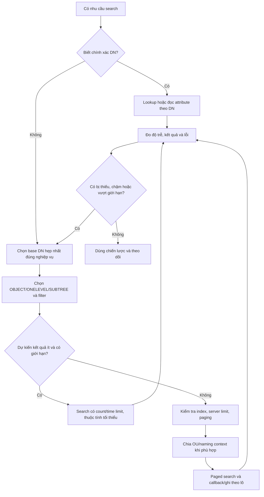

# Chọn chiến lược search theo kích thước DIT trong Spring LDAP

Một ứng dụng LDAP có thể chạy tốt khi thư mục chỉ có vài trăm entry, nhưng truy vấn tương tự trên cây chứa hàng triệu entry có thể chậm, tốn tài nguyên hoặc bị máy chủ từ chối. Nếu luôn dùng một công thức chung như tìm từ base DN cao nhất với filter rộng `(objectClass=*)`, hiệu năng và độ tin cậy sẽ phụ thuộc quá nhiều vào kích thước và cấu trúc thư mục.

Trong Spring LDAP, lựa chọn chiến lược tìm kiếm cần dựa trên **kích thước DIT, nhánh cần truy vấn, độ chọn lọc của filter, chỉ mục thực tế trên server, lượng dữ liệu trả về và mục đích tiêu thụ kết quả**. Bài này giải thích cách ra quyết định giữa tra cứu DN trực tiếp, tìm theo một cấp, tìm toàn subtree, tìm kiếm có giới hạn và phân trang khi làm việc với các directory server khác nhau.

Sau bài học, bạn có thể:

- Đánh giá kích thước và cấu trúc DIT (*Directory Information Tree*) trước khi thiết kế search.
- Chọn `OBJECT_SCOPE`, `ONELEVEL_SCOPE` hoặc `SUBTREE_SCOPE` phù hợp với bài toán.
- Kết hợp base DN, filter có tính chọn lọc, thuộc tính trả về và chỉ mục để giảm chi phí.
- Phân biệt truy vấn tương tác, tra cứu một entry và tác vụ quét dữ liệu số lượng lớn.
- Thiết kế chiến lược dùng Spring LDAP `LdapTemplate`, `LdapQueryBuilder`, callback và Paged Results Control mà vẫn tôn trọng giới hạn của LDAP server.

## 1. Kích thước DIT là gì và vì sao ảnh hưởng đến search?

DIT là cây các entry LDAP, mỗi entry có một DN duy nhất trong phạm vi naming context tương ứng. Ví dụ:

```text
dc=example,dc=org
├── ou=people
│   ├── ou=hanoi
│   │   ├── uid=an
│   │   └── uid=binh
│   └── ou=danang
│       └── uid=chi
├── ou=groups
│   └── cn=developers
└── ou=service
    └── uid=sync-reader
```

Khi thiết kế truy vấn, có ít nhất **ba loại kích thước** cần quan sát:

| Yếu tố | Câu hỏi cần trả lời | Ảnh hưởng |
| --- | --- | --- |
| Tổng số entry của DIT | Toàn bộ directory chứa bao nhiêu entry? | Gợi ý mức độ phức tạp của hệ thống, nhưng chưa đủ để đánh giá một search |
| Số entry trong search base và scope | `ou=people` có bao nhiêu entry thuộc phạm vi search? | Xác định quy mô dữ liệu server có thể phải xét |
| Số entry khớp filter và kích thước thuộc tính | Có bao nhiêu entry thực sự được trả về? Mỗi entry nặng bao nhiêu? | Quyết định băng thông, bộ nhớ client và thời gian xử lý kết quả |

Hai hệ thống có cùng 1 triệu entry vẫn có đặc điểm search khác nhau. Hệ thống A có một nhánh `ou=people` gồm 900.000 người dùng; hệ thống B phân bổ entry vào nhiều nhánh theo khu vực. Tra cứu người dùng trong `ou=hanoi` trên B có thể nhẹ hơn nhiều so với quét toàn bộ `ou=people` trên A, nếu cấu trúc, filter và index hỗ trợ.

**Kích thước DIT không đồng nghĩa độ tốn kém của mọi truy vấn.** Tra cứu chính xác một DN có thể nhanh trong cây rất lớn, còn filter không chọn lọc trên toàn subtree có thể đắt ngay cả trong cây nhỏ hơn.

### Ba đại lượng cần phân biệt

- **Kích thước vùng tìm kiếm**: số entry nằm trong base và scope. Ví dụ `ONELEVEL_SCOPE` thường xét tập entry khác với `SUBTREE_SCOPE`.
- **Độ chọn lọc của filter**: filter loại bỏ được bao nhiêu ứng viên. `(uid=an.nguyen)` có thể rất chọn lọc, trong khi `(objectClass=person)` có thể khớp phần lớn entry người dùng.
- **Chi phí materialize kết quả**: số entry trả về nhân với lượng thuộc tính, phép ánh xạ Java và chi phí của nơi nhận.

Một ước lượng dùng để lập kế hoạch, **không phải công thức tính thời gian truy vấn**, là:

```text
Số entry kết quả dự kiến ≈ số entry trong scope × tỷ lệ khớp filter
Dung lượng dữ liệu dự kiến ≈ số entry kết quả × kích thước mỗi kết quả
```

Thời gian thực tế còn phụ thuộc index, cache, ACL, độ sâu cây, cấu hình server, mạng, tải và độ phức tạp filter.

## 2. Chọn chiến lược theo mục đích và quy mô

Không có một ngưỡng tuyệt đối như “trên 10.000 entry phải dùng paging” áp dụng cho tất cả directory server. Giới hạn tùy server và cấu hình. Bảng sau là **khung ra quyết định**, còn các cột kích thước chỉ là ví dụ minh họa, không phải chính sách cố định:

| Tình huống | Chiến lược ưu tiên | Lý do |
| --- | --- | --- |
| Đã biết DN của đúng một entry, dù DIT rất lớn | `lookup`/`getAttributes` theo DN | Truy cập đúng entry, không cần quét subtree |
| Muốn liệt kê con trực tiếp của một OU nhỏ | `ONELEVEL_SCOPE` và tập thuộc tính tối thiểu | Không quét các cấp con sâu hơn |
| Tìm một người dùng theo `uid` trong vùng xác định | Base hẹp nhất phù hợp + filter equality, kiểm tra index | Giảm phạm vi và số kết quả |
| Giao diện tìm kiếm tương tác có thể khớp hàng nghìn entry | Filter chọn lọc, hạn chế kết quả, paging nếu cần | Tránh tải mọi entry vào một trang UI |
| Quét nhánh trung bình hoặc lớn để xuất dữ liệu | Search có phân trang + xử lý từng trang/entry | Kiểm soát heap và giới hạn mỗi search |
| Báo cáo toàn DIT có nhiều naming context hoặc referrals | Chia theo naming context/OU, paging, đối chiếu | Phạm vi “toàn bộ DIT” không nhất thiết là một search duy nhất |
| Đồng bộ thường xuyên trên thư mục rất lớn | Ưu tiên cơ chế thay đổi gia tăng nếu server hỗ trợ; dùng full scan có kế hoạch | Giảm việc quét lặp toàn bộ cây và chi phí server |

### Ví dụ định lượng để hình dung

- Nhánh có **vài trăm entry**: tìm kiếm có filter cụ thể và trả danh sách nhỏ thường đủ nếu server cho phép.
- Nhánh có **vài chục nghìn entry**: cần chú ý search base, index, count/time limit và cách tiêu thụ kết quả; UI không nên tự tải hết.
- Nhánh có **hàng trăm nghìn đến hàng triệu entry**: quét hàng loạt cần thiết kế paging, bộ nhớ hữu hạn, thời gian thực thi, cơ chế dừng và khôi phục.

Các ví dụ trên không thay thế việc đo thời gian phản hồi trên chính server. Một truy vấn exact-match có index vẫn có thể tốt trên cây rất lớn; một substring filter không index có thể rất chậm trên cây nhỏ.

## 3. Chọn base DN và search scope trước khi tối ưu filter

Search request LDAP có ba thành phần cốt lõi: **base DN**, **scope** và **filter**. Nên bắt đầu bằng cách giới hạn cây cần xét, rồi mới tinh chỉnh điều kiện.

Ví dụ tìm người dùng thuộc Hà Nội, trong DIT được chia theo `ou=hanoi,ou=people,dc=example,dc=org`. Nếu ứng dụng biết người dùng chỉ nằm ở nhánh Hà Nội, hãy chọn base đó thay vì `dc=example,dc=org`.

| Scope | Hành vi | Bài toán phù hợp |
| --- | --- | --- |
| `OBJECT_SCOPE` | Chỉ xét entry base | Đọc hoặc kiểm tra một entry đã biết DN |
| `ONELEVEL_SCOPE` | Chỉ các entry con trực tiếp của base | Danh sách tài khoản ngay dưới một OU |
| `SUBTREE_SCOPE` | Base và mọi hậu duệ | Tìm trong nhiều OU con, báo cáo theo một nhánh |
 
Hãy hình dung:

```text
base = ou=people,dc=example,dc=org

OBJECT_SCOPE:        ou=people
ONELEVEL_SCOPE:      ou=hanoi, ou=danang
SUBTREE_SCOPE:       ou=people, các OU và mọi uid nằm bên dưới
```

Nếu entry người dùng được đặt bên dưới `ou=hanoi` và `ou=danang`, tìm người dùng bằng `ONELEVEL_SCOPE` từ `ou=people` sẽ **không** tìm thấy các entry `uid` nằm sâu hơn một cấp. Scope hẹp là lợi thế **chỉ khi nó đáp ứng đúng cấu trúc dữ liệu**.

### Đừng suy ra scope chỉ từ kích thước

Một thư mục lớn có thể cần `SUBTREE_SCOPE` để tìm đủ người dùng nhiều OU. Giải pháp lúc này là **chia vùng tìm kiếm** hoặc sử dụng filter/index và paging thích hợp, chứ không tự đổi sang `ONELEVEL_SCOPE` rồi chấp nhận bỏ sót.

Nếu tên entry đã biết chính xác, tra cứu DN trực tiếp thường rõ nghĩa hơn so với search trên subtree. Khi chỉ biết thuộc tính `uid` và không biết vị trí entry trong nhiều OU, search vẫn cần thiết.

## 4. Tra cứu entry theo DN: lựa chọn cho bài toán định danh chính xác

Giả sử `ContextSource` cấu hình base DN `dc=example,dc=org`. Muốn lấy entry có DN đầy đủ:

```text
uid=an,ou=hanoi,ou=people,dc=example,dc=org
```

Spring LDAP có thể dùng DN **tương đối** và `lookupContext`:

```java
import javax.naming.Name;
import org.springframework.ldap.core.DirContextOperations;
import org.springframework.ldap.core.LdapTemplate;
import org.springframework.ldap.support.LdapNameBuilder;

public final class PersonLookupService {
    private final LdapTemplate ldapTemplate;

    public PersonLookupService(LdapTemplate ldapTemplate) {
        this.ldapTemplate = ldapTemplate;
    }

    public String findCommonName(String uid) {
        Name relativeDn = LdapNameBuilder.newInstance("ou=hanoi,ou=people")
                .add("uid", uid)
                .build();

        DirContextOperations entry = ldapTemplate.lookupContext(relativeDn);
        return entry.getStringAttribute("cn");
    }
}
```

Trong ví dụ, `LdapNameBuilder` xử lý giá trị RDN đúng cú pháp, kể cả khi `uid` chứa các ký tự cần escape. Không nối thẳng giá trị người dùng nhập vào chuỗi DN.

**Đánh đổi:** `lookupContext` thuận tiện khi cần adapter và các thuộc tính entry. Nếu chỉ cần một vài thuộc tính, cân nhắc overload `lookup` cho phép giới hạn thuộc tính trả về trong phiên bản Spring LDAP bạn sử dụng. Tra cứu theo DN vẫn cần ACL và trả lỗi khi entry không tồn tại; nó không phải xác thực người dùng.

## 5. Chọn filter có tính chọn lọc và phù hợp index

Với truy vấn tìm kiếm, filter quyết định bao nhiêu entry có khả năng khớp. Các filter được tối ưu khác nhau tùy LDAP server, schema và cấu hình index.

| Filter | Dự đoán chung về độ chọn lọc | Lưu ý |
| --- | --- | --- |
| `(uid=an.nguyen)` | Thường cao nếu UID được quản lý gần như duy nhất trong nhánh | Equality index có thể tăng tốc nếu server cấu hình |
| `(&(objectClass=inetOrgPerson)(uid=an.nguyen))` | Cao nhờ `uid`, đồng thời giới hạn loại entry | Kiểm tra mục tiêu và các index thực có |
| `(objectClass=inetOrgPerson)` | Có thể khớp rất nhiều entry | Phù hợp khi thật sự cần duyệt nhiều tài khoản |
| `(mail=*@example.org)` | Có thể kém chọn lọc, cần substring matching | Hiệu năng phụ thuộc substring index và schema |
| `(cn=*nguyen*)` | Có thể đắt, đặc biệt khi không có index thích hợp | Tránh dùng như truy vấn mặc định trên toàn DIT |
| `(uid=*)` | Chỉ kiểm tra thuộc tính tồn tại | Không bảo đảm kết quả ít |
| Filter OR cho hai UID | Kết hợp nhiều điều kiện OR | Số nhánh OR lớn có thể tốn tài nguyên; cần đo |

**Không thể kết luận một filter nhanh chỉ bằng cú pháp.** Một equality filter trên thuộc tính không có index có thể đắt; substring filter trên thuộc tính có index phù hợp đôi khi đáp ứng tốt. Việc tạo/chỉnh index là nhiệm vụ cấu hình LDAP server, không phải hệ quả tự động từ `LdapTemplate`.

Ví dụ cú pháp OR trong LDAP filter là `(|(uid=an)(uid=binh))`: dấu `|` kết hợp các điều kiện con.

### Filter an toàn với Spring LDAP

Sử dụng `LdapQueryBuilder` để tách dữ liệu đầu vào khỏi cấu trúc filter:

```java
import java.util.List;
import javax.naming.directory.Attribute;
import org.springframework.ldap.core.AttributesMapper;
import org.springframework.ldap.core.LdapTemplate;
import org.springframework.ldap.query.LdapQuery;
import org.springframework.ldap.query.LdapQueryBuilder;

public final class UidSearchService {
    private final LdapTemplate ldapTemplate;

    public UidSearchService(LdapTemplate ldapTemplate) {
        this.ldapTemplate = ldapTemplate;
    }

    public List<String> findCommonNames(String uid) {
        LdapQuery query = LdapQueryBuilder.query()
                .base("ou=people")
                .attributes("cn")
                .where("uid").is(uid);

        return ldapTemplate.search(
                query,
                (AttributesMapper<String>) attrs -> {
                    Attribute cn = attrs.get("cn");
                    return cn == null ? null : (String) cn.get();
                });
    }
}
```

Trong ví dụ, `uid` là **giá trị filter**, được builder xử lý theo cú pháp LDAP filter; không dùng `Rdn.escapeValue(...)` vì hàm đó dành cho **DN/RDN**. Lời gọi tìm kiếm trả danh sách, phù hợp khi ứng dụng đã biết kết quả có giới hạn nhỏ. Nếu `uid` không có ràng buộc duy nhất trên toàn nhánh, có thể có nhiều entry khớp.

**Tối ưu tiếp theo:** Nếu biết chính xác OU, đổi base sang nhánh đó. Khi filter được dùng thường xuyên, phối hợp với quản trị viên LDAP để kiểm tra index và phép tìm kiếm thực tế thay vì phỏng đoán từ mã Java.

## 6. Giới hạn thuộc tính trả về để giảm kích thước từng kết quả

Có hai loại chi phí cần tách:

- **Tìm ra entry** dựa trên scope, filter và index.
- **Trả thuộc tính của entry** qua mạng và tạo đối tượng ở client.

Ngay cả khi filter có index tốt, truy vấn trả về 100.000 entry với hàng chục thuộc tính mỗi entry vẫn có thể dùng nhiều băng thông và heap. Nếu chỉ cần `uid` và `cn`, hãy yêu cầu hai thuộc tính này.

Ví dụ trực tiếp với JNDI `SearchControls`:

```java
import javax.naming.directory.SearchControls;

SearchControls controls = new SearchControls();
controls.setSearchScope(SearchControls.SUBTREE_SCOPE);
controls.setReturningAttributes(new String[] { "uid", "cn" });
controls.setReturningObjFlag(false);
controls.setCountLimit(100);    // Giới hạn số entry client muốn nhận.
controls.setTimeLimit(5000);   // Giới hạn thời gian phía client (ms).
```

Lưu ý:

1. `setReturningAttributes` chỉ ảnh hưởng **thuộc tính được yêu cầu**, không giúp filter chọn lọc hơn.
2. `setCountLimit(100)` thích hợp cho một truy vấn có giới hạn nghiệp vụ. Với job quét toàn bộ nhánh, không đặt count limit tùy ý rồi coi 100 entry đầu là toàn bộ.
3. `setTimeLimit(...)` giúp tránh tìm kiếm kéo dài nhưng không thay thế timeout kết nối/đọc và chính sách server.
4. Các thuộc tính không thấy có thể do không tồn tại, không được yêu cầu hoặc bị ACL che; đừng kết luận sai chỉ từ kết quả trả về.
5. Các thuộc tính vận hành của LDAP không nhất thiết được trả về mặc định; hãy yêu cầu rõ nếu có quyền và thật sự cần.

### Băng thông và kích thước entry

Một thư mục có các thuộc tính như ảnh đại diện, chứng chỉ hoặc binary attribute có thể tạo kết quả lớn nếu ứng dụng yêu cầu quá nhiều thuộc tính. Khi thiết kế phần hiển thị danh sách, nên chỉ tải các thuộc tính cần cho danh sách; lấy thông tin chi tiết của một entry khi người dùng thực sự mở mục đó.

## 7. Search tương tác: giới hạn kết quả là một yêu cầu nghiệp vụ

Với màn hình gợi ý tên người dùng, hệ thống thường chỉ cần một tập kết quả nhỏ. Ví dụ người dùng tìm `an`, ứng dụng trả 20 kết quả để chọn. Việc server có thể khớp 20.000 entry **không đồng nghĩa UI nên tải toàn bộ 20.000 entry**.

Quy trình phù hợp:

1. Chọn base DN gắn với nhóm đối tượng mà UI được phép tìm.
2. Dùng filter trên trường được index phù hợp, có giới hạn độ dài đầu vào và escaping an toàn.
3. Chỉ yêu cầu những thuộc tính để hiển thị và định danh kết quả.
4. Đặt giới hạn kết quả và thời gian; nếu chưa đủ, cho người dùng tinh chỉnh điều kiện hoặc triển khai paging.
5. Trả trạng thái “còn nhiều kết quả” thay vì thông báo sai “chỉ có 20 người dùng”.

Giới hạn 20, 50 hay 100 entry là **quyết định thiết kế UI**, không phải kích thước trang paging mặc định cho mọi trường hợp.

### Truy vấn chứa `cn=*an*` có nên dùng?

Substring search có thể hữu ích, nhưng trên nhánh lớn có thể tạo tập ứng viên rất rộng. Cân nhắc tìm tiền tố, chuẩn hóa đầu vào hoặc một cơ chế tìm kiếm chuyên biệt nếu yêu cầu sản phẩm cần full-text/fuzzy search. LDAP **không phải** công cụ tìm kiếm toàn văn phổ quát; các matching rules khác nhau theo schema và server.

Không nên tự động chuyển mọi truy vấn của UI thành `(cn=*{input}*)`, nhất là khi người dùng nhập một ký tự và search base là toàn DIT. Hãy đo độ chọn lọc và quản lý ngưỡng kết quả.

## 8. Search hàng loạt: streaming và phân trang là hai lớp giải pháp

Khi cần xuất dữ liệu của toàn bộ `ou=people`, một `List<User>` duy nhất có thể lớn hơn heap. Nhưng chuyển sang callback để xử lý từng entry vẫn **không tự khắc phục size limit** của LDAP server.

| Vấn đề | Giải pháp | Điều vẫn phải kiểm tra |
| --- | --- | --- |
| Ứng dụng giữ tất cả kết quả trong RAM | Callback xử lý từng entry hoặc `List` nhỏ theo trang | Sink/queue có giới hạn, không tự gom lại vô hạn |
| Server giới hạn số entry mỗi search | Paged Results Control nếu server hỗ trợ, hoặc chia truy vấn hợp lệ | Chính sách server, cookie, time limit |
| Search quá rộng/không có index | Chia theo OU/naming context và cải thiện filter | Tính đầy đủ và không trùng kết quả giữa các nhánh |
| Thao tác kéo dài hàng phút/giờ | Job theo lô, checkpoint, retry có giới hạn | Dữ liệu thay đổi khi đang quét |
| Đồng bộ lặp lại thường xuyên | Tìm hiểu cơ chế change tracking/changelog của server | Không phải server nào cũng có cùng API |

### Callback thay cho gom toàn bộ vào `List`

Một ví dụ Spring LDAP xử lý từng kết quả ngay khi tìm thấy, chỉ giữ bộ đếm:

```java
import java.util.concurrent.atomic.AtomicLong;
import javax.naming.directory.SearchControls;
import javax.naming.directory.SearchResult;

import org.springframework.ldap.core.LdapTemplate;
import org.springframework.ldap.core.NameClassPairCallbackHandler;

public long countMatchingEntries(LdapTemplate ldapTemplate) {
    SearchControls controls = new SearchControls();
    controls.setSearchScope(SearchControls.SUBTREE_SCOPE);
    controls.setReturningAttributes(new String[] { "uid" });

    AtomicLong count = new AtomicLong();

    ldapTemplate.search(
            "ou=people",
            "(&(objectClass=inetOrgPerson)(uid=*))",
            controls,
            (NameClassPairCallbackHandler) pair -> {
                SearchResult result = (SearchResult) pair;
                if (result.getAttributes().get("uid") != null) {
                    count.incrementAndGet();
                }
            });

    return count.get();
}
```

Đoạn minh họa giả định `ldapTemplate` đã cấu hình; phương thức `countMatchingEntries` đặt trong một lớp Java có thể chứa method tương ứng. Kết quả là **số entry callback đã nhìn thấy**, **không phải** một phép đếm tuyệt đối toàn bộ thư mục. Nếu server giới hạn search hoặc ứng dụng bị ngắt, phép đếm chưa đầy đủ; nếu filter hoặc ACL ẩn entry, cũng không thể suy ra quy mô DIT chỉ từ con số ấy.

Ngay cả khi dùng callback, provider vẫn có thể buffer một lượng dữ liệu và giữ tài nguyên network. Không nên thực hiện công việc rất chậm trong callback hoặc tạo một queue không giới hạn.

### Paged Results Control

Khi server hỗ trợ **Simple Paged Results (RFC 2696)**, client yêu cầu từng trang và sử dụng cookie do server trả về để đi tiếp. Ví dụ dòng xử lý:

```text
Search với page size 250, cookie ban đầu rỗng
   ↓
Server trả trang 1 và cookie kế tiếp
   ↓
Client xử lý từng entry hoặc ghi lô nhỏ
   ↓
Gửi search trang 2 kèm cookie
   ↓
... cho đến khi response cookie rỗng
```

Spring LDAP có cơ chế `PagedResultsDirContextProcessor` trong package `org.springframework.ldap.control` để hỗ trợ điều khiển này trên các phiên bản phù hợp. Khi lựa chọn API, cần kiểm tra overload `LdapTemplate.search(...)`, hỗ trợ `DirContextProcessor` và vòng đời context/cookie trong phiên bản đang dùng.

Về mặt chiến lược, một `List` **theo trang với giới hạn** vẫn là cách làm hợp lệ: ví dụ xử lý từng trang 250 entry rồi giải phóng dữ liệu trước khi sang trang tiếp. Không cần ép mọi code thành reactive stream nếu page size đã kiểm soát được bộ nhớ.

**Quan trọng:** Paging không tạo ra snapshot nhất quán mặc định. Nếu entry bị thêm, xóa hoặc chuyển OU giữa các trang, kết quả có thể thiếu hoặc trùng tùy server. Việc server trả cookie rỗng chỉ kết thúc chuỗi paging hiện tại, không chứng minh không có thay đổi đồng thời.

## 9. Chia tìm kiếm theo nhánh DIT

Với DIT lớn được phân vùng rõ, có thể chia công việc theo OU:

```text
dc=example,dc=org
└── ou=people
    ├── ou=hanoi      → job A
    ├── ou=danang     → job B
    └── ou=saigon     → job C
```

Mỗi job dùng base DN của nhánh mình phụ trách, ví dụ:

```text
Job A: base=ou=hanoi,ou=people,dc=example,dc=org
Job B: base=ou=danang,ou=people,dc=example,dc=org
Job C: base=ou=saigon,ou=people,dc=example,dc=org
```

Phân nhánh có một số lợi ích: giới hạn phạm vi, dễ theo dõi số lượng, phân quyền theo nhánh và có thể chạy từng job vào thời điểm phù hợp. Tuy nhiên, nó chỉ trả đủ dữ liệu khi cấu trúc cây và phạm vi được xác nhận.

### Tránh bỏ sót và trùng dữ liệu

- Nếu `ou=people` có người dùng nằm **ngay dưới gốc**, chia search chỉ theo các OU con sẽ **bỏ sót** các entry này.
- Nếu hai job dùng những `SUBTREE_SCOPE` **chồng lấn**, có thể nhận cùng một entry nhiều lần.
- Nếu entry được **move** từ OU này sang OU khác giữa hai job, entry có thể xuất hiện hai lần hoặc không xuất hiện.
- Nếu directory có **referral** hoặc nhiều naming context, một search gốc không nhất thiết trải qua tất cả máy chủ.
- Nếu ACL che một phần DIT, việc không thấy entry không đồng nghĩa entry không tồn tại.

Hãy định nghĩa sơ đồ phân vùng **không chồng lấn**, xử lý entry ở gốc phù hợp, ghi checkpoint và xác minh bằng ID thích hợp. DN có thể đổi sau rename/move; nếu cần định danh ổn định hãy xem các thuộc tính server cung cấp như `entryUUID` hoặc `objectGUID`, khi được hỗ trợ và có quyền đọc.

### Có nên chạy nhiều job song song?

Song song giúp tăng throughput trong một số trường hợp, nhưng có thể làm LDAP server quá tải hoặc vượt giới hạn kết nối/quota. Thử tải với số worker nhỏ, đo thời gian mỗi job và độ trễ của dịch vụ đăng nhập trước khi tăng concurrency. Không nên giả định hiệu năng tăng tuyến tính theo số luồng.

## 10. Đo trước khi chọn ngưỡng và tối ưu

Kích thước DIT là thông tin cần thiết nhưng chưa đủ; nên dựa trên quan sát thực tế. Đo các chỉ số sau trong môi trường tương đương sản xuất:

| Nhóm chỉ số | Ví dụ cần đo | Ý nghĩa |
| --- | --- | --- |
| Độ trễ | Median, p95, p99 của truy vấn đại diện | Trải nghiệm người dùng và tail latency |
| Kết quả | Số entry trả về, bytes/entry, thuộc tính được yêu cầu | Băng thông và chi phí ánh xạ |
| Giới hạn | Size/time limit, paging, quota, referral | Biết khi nào không thể coi kết quả là đầy đủ |
| Tài nguyên client | Heap peak, GC pause, số context/connection | Ứng dụng có chịu được quét lớn không |
| Tài nguyên server | CPU, search candidates/entries examined nếu có, index hit, cache | Filter và index có hiệu quả không |
| Chất lượng dữ liệu | Số entry khớp dự kiến, trùng, thiếu, thay đổi giữa các trang | Độ tin cậy khi dùng cho đồng bộ/báo cáo |

**Đừng dùng một lần tìm kiếm `(objectClass=*)` trên toàn DIT để đếm số entry của hệ thống sản xuất** nếu chưa có quyền và kế hoạch phù hợp. Kết quả có thể bị giới hạn, tốn tài nguyên hoặc bỏ qua các nhánh/replica. Ưu tiên số liệu quản trị/monitoring từ directory server, thống kê được cấp quyền hoặc các truy vấn mẫu có phạm vi rõ ràng.

### Quy trình ra quyết định



Ở bước `F`, “ít” có nghĩa phù hợp nhu cầu thực tế của client và chính sách server, **không phải** một số entry cố định cho mọi hệ thống.

## 11. Các lỗi thiết kế thường gặp

| Triệu chứng | Nguyên nhân có thể | Cách điều chỉnh |
| --- | --- | --- |
| Search rất chậm dù chỉ cần một tài khoản | Dùng subtree rộng và filter kém chọn lọc | Lookup theo DN nếu biết, hoặc thu hẹp base và xem index |
| Không tìm thấy người dùng dưới OU con | Dùng `ONELEVEL_SCOPE` từ OU cha | Dùng `SUBTREE_SCOPE` hoặc truy vấn đúng OU con |
| Trả về quá nhiều người dùng trên UI | Không giới hạn kết quả/thuộc tính | Giới hạn theo nhu cầu UI; yêu cầu tinh chỉnh hoặc paging |
| Job đồng bộ tràn heap | Gom mọi kết quả vào một `List` | Dùng callback hoặc danh sách giới hạn theo trang |
| Callback chỉ xử lý 1.000 trong 30.000 entry | Server áp size limit | Phân trang theo hỗ trợ server, kiểm tra lỗi và tính đầy đủ |
| Search trả entry thiếu `mail` | Thuộc tính không được yêu cầu, thiếu quyền hoặc không có giá trị | Kiểm tra attributes list và ACL; không mặc định server sai |
| Count thấp hơn số lượng trên dashboard | Scope khác, ACL, referral, dữ liệu thay đổi hoặc server limit | Đối chiếu cùng naming context, thời điểm, filter và quyền |
| Kết quả trùng giữa các job OU | Scope chồng lấn hoặc entry move trong lúc quét | Thiết kế phân vùng, ID ổn định và xử lý idempotent |
| Filter theo tên hoạt động ở staging nhưng chậm ở production | Khác số entry/index/cache/giới hạn | Benchmark trên môi trường có cấu trúc và tải tương đương |
| Paging báo hết nhưng dữ liệu đích thiếu | Thay đổi đồng thời, lỗi sink, ACL hoặc phạm vi chưa đủ | Đối chiếu, checkpoint và chiến lược tái đồng bộ phù hợp |

## 12. Thực hành: chọn chiến lược cho ba DIT

Giả sử bạn được cấp quyền trên ba directory thử nghiệm:

**Kịch bản A: 500 entry, một OU duy nhất.** Người dùng nhập UID và ứng dụng hiển thị `cn`. Nếu bạn biết chính xác DN, ưu tiên lookup. Nếu chưa biết DN, search trong OU với equality filter `(uid=...)` và trả thuộc tính cần thiết. Không cần quét mọi attribute của cả 500 entry để tìm một người.

**Kịch bản B: 70.000 entry, chia theo `ou=hanoi`, `ou=danang` và `ou=saigon`.** Một quản trị viên muốn liệt kê nhân viên Hà Nội. Chọn base `ou=hanoi,ou=people,...`, scope theo cấu trúc thực và filter loại người dùng phù hợp. Đặt giới hạn để phục vụ UI; nếu phải xuất toàn bộ nhánh, kiểm tra paging, dùng callback/ghi theo lô và xác nhận tính đầy đủ.

**Kịch bản C: 1.200.000 entry, nhiều naming context và replica.** Job đêm cần đồng bộ thay đổi nhân sự. Kiểm tra có cơ chế đồng bộ gia tăng nào từ directory server trước; nếu phải full scan, lập kế hoạch chia vùng, paging theo server, checkpoint, idempotency, kiểm soát tải, ACL và referral. Đánh giá tác động của rename/move lên khóa đồng bộ.

### Câu hỏi tự kiểm tra

**Câu 1.** DIT có một triệu entry. Có bắt buộc dùng paging khi biết DN chính xác của một tài khoản?

**Đáp án:** Không. Lookup theo DN chỉ nhắm đến một entry. Paging dành cho truy vấn có nhiều kết quả.

**Câu 2.** Search từ `ou=people` bằng `ONELEVEL_SCOPE` có tìm thấy người dùng dưới `ou=hanoi,ou=people` không?

**Đáp án:** Không, nếu họ là con trực tiếp của `ou=hanoi`. `ONELEVEL_SCOPE` từ `ou=people` chỉ tìm các entry con trực tiếp của `ou=people`.

**Câu 3.** `setReturningAttributes(new String[]{"uid"})` có làm filter `(uid=an)` dùng index nhanh hơn không?

**Đáp án:** Không trực tiếp. Nó giảm lượng dữ liệu trả về; khả năng dùng index phụ thuộc filter và cấu hình server.

**Câu 4.** Vì sao callback không tự giải quyết giới hạn size limit của LDAP server?

**Đáp án:** Callback thay cách client xử lý kết quả nhận được. Server vẫn áp giới hạn tìm kiếm; muốn nhiều trang phải có paging hoặc chiến lược chia vùng phù hợp.

**Câu 5.** Nếu một job chia theo OU quét xong các nhánh con, có thể kết luận đã bao phủ toàn bộ `ou=people` không?

**Đáp án:** Chỉ khi mô hình phân vùng bảo đảm không bỏ sót entry ngay dưới gốc, không có các nhánh khác/referral bị bỏ qua và có quyền đọc đầy đủ; còn phải xét dữ liệu di chuyển khi quét.

**Câu 6.** Một filter equality trên `uid` có luôn nhanh hơn substring trên `cn` không?

**Đáp án:** Không thể bảo đảm tuyệt đối. Equality thường dễ tối ưu hơn, nhưng hiệu năng thực tế phụ thuộc index, schema, dữ liệu và cấu hình directory server.

## Ghi nhớ

**Chiến lược search cần chọn theo nhu cầu thực và hình dạng DIT, không chỉ theo tổng số entry.** Khi biết DN, ưu tiên tra cứu trực tiếp. Khi phải search, chọn base và scope hẹp nhất vẫn bao phủ đúng dữ liệu, sử dụng filter chọn lọc và yêu cầu ít thuộc tính. Với truy vấn tương tác, đặt giới hạn có ý nghĩa cho UI; với tác vụ quét lớn, kết hợp paging, streaming/batch, chia nhánh hợp lệ, checkpoint và đối chiếu. Luôn kiểm tra size/time limit, ACL, referral, chỉ mục và thay đổi đồng thời trước khi khẳng định kết quả đã đầy đủ.
