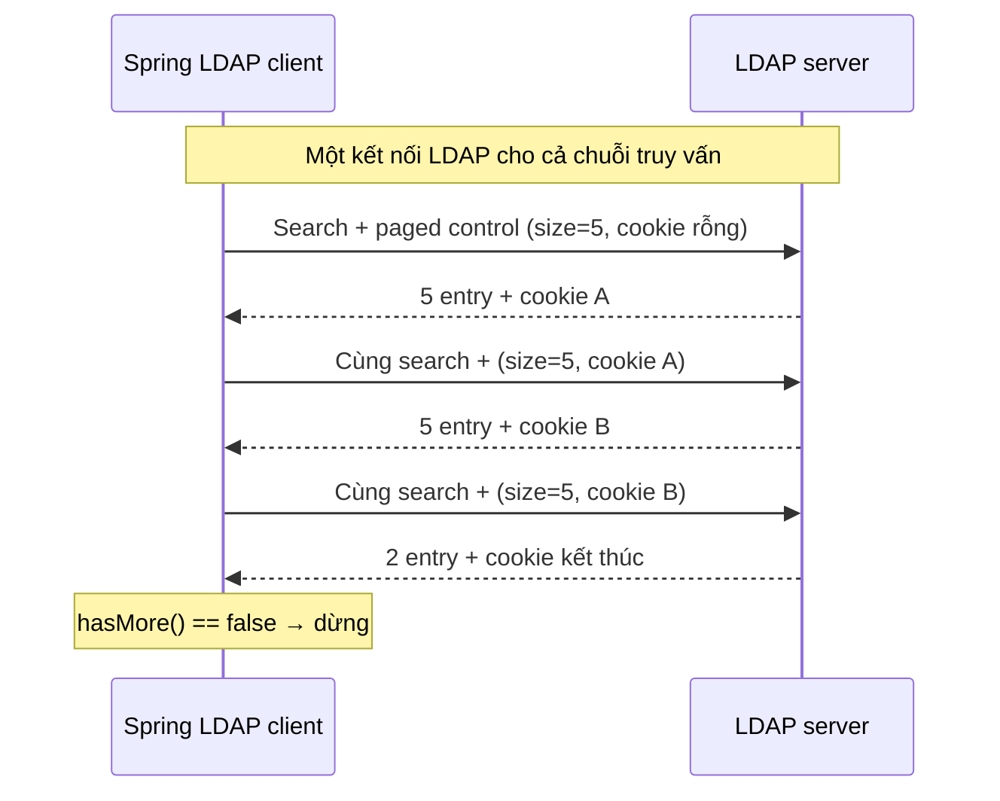

# PagedResultsDirContextProcessor và cookie phân trang trong Spring LDAP

## 1. Bài toán: lấy nhiều entry mà không tải toàn bộ một lần

Giả sử ứng dụng Spring LDAP cần đọc hàng chục nghìn tài khoản trong `ou=people,dc=example,dc=org`. Một lệnh `LdapTemplate.search(...)` thông thường có thể tạo ra tập kết quả lớn, tốn bộ nhớ và gặp giới hạn số entry hoặc thời gian tìm kiếm do máy chủ LDAP áp đặt. **Simple Paged Results** (RFC 2696) cho phép client yêu cầu máy chủ gửi kết quả theo từng đợt (page) và chủ động quyết định khi nào lấy đợt tiếp theo.

Trong Spring LDAP, `PagedResultsDirContextProcessor` là một `DirContextProcessor` phục vụ cơ chế này: trước truy vấn, nó gắn *request control* phân trang; sau truy vấn, nó đọc *response control* để cập nhật **cookie** và thông tin cho lần gọi kế tiếp.

> **Phạm vi:** Bài này tập trung vào `PagedResultsDirContextProcessor`, vòng lặp đọc các trang và cookie. Phân trang không tự tạo ra thứ tự sắp xếp; sorting bằng LDAP server-side control là một chức năng riêng.

### Kết quả mong đợi

Sau bài học, bạn có thể:

- Giải thích ý nghĩa của page size, cookie và `hasMore()` trong RFC 2696.
- Viết vòng lặp phân trang với `LdapOperations.search(...)` và giữ cùng kết nối nhờ `SingleContextSource`.
- Phân biệt cookie LDAP với page number/offset và xử lý trang cuối, truy vấn thay đổi, lỗi server.
- Chọn giới hạn page size và thiết kế cách đọc dữ liệu phù hợp với tài nguyên ứng dụng.

## 2. Cookie phân trang hoạt động như thế nào?

Một truy vấn phân trang không gửi số trang `page=2` hay offset `skip=100`. Client gửi **kích thước trang** cùng cookie nhận từ lần trước:

1. Lần đầu: gửi cùng tham số tìm kiếm, page size bằng một số dương (ví dụ `5`), **không có cookie tiếp tục**.
2. Server trả một đợt entry và một cookie mà nó tạo ra. Nếu còn dữ liệu, cookie cho biết vị trí tiếp tục theo cách riêng của server.
3. Client gửi lại **cùng truy vấn** với cookie **mới nhất**. Server trả đợt kế tiếp.
4. Khi hết dữ liệu, server trả cookie kết thúc (rỗng/không còn cookie); `processor.hasMore()` trả `false`.

Ví dụ minh họa (giả sử 12 entry và server trả tối đa 5 entry mỗi đợt):

| Lượt gọi | Request | Response | Có gọi tiếp? |
| --- | --- | --- | --- |
| 1 | `pageSize=5`, cookie đầu tiên rỗng | 5 entry + cookie `A` | Có |
| 2 | `pageSize=5`, cookie `A` | 5 entry + cookie `B` | Có |
| 3 | `pageSize=5`, cookie `B` | 2 entry + cookie kết thúc | Không |

`A` và `B` ở đây chỉ là tên ký hiệu; **không giải mã hoặc tự tạo cookie**. Cookie là một chuỗi byte *opaque* do server quản lý, có thể phụ thuộc phiên LDAP, trạng thái tìm kiếm và chính sách hết hạn. Số entry thực trả về trong một đợt cũng phụ thuộc server, không mặc định luôn đúng bằng page size.



Điểm quan trọng của RFC 2696 là các thông số như **base DN, scope, filter và các search control** phải được giữ nhất quán trong cùng chuỗi phân trang; ngoại lệ chủ yếu là cookie và page size. Dùng cookie cũ, cookie của người dùng khác hoặc cookie của truy vấn khác có thể khiến server từ chối hoặc trả kết quả không xác định.

## 3. Các API cần biết

| API | Vai trò |
| --- | --- |
| `new PagedResultsDirContextProcessor(pageSize)` | Tạo processor cho **lượt đầu tiên** của một chuỗi phân trang. |
| `new PagedResultsDirContextProcessor(pageSize, cookie)` | Tạo processor tiếp tục bằng đối tượng `PagedResultsCookie` nhận từ lượt trước. Chỉ dùng khi vẫn giữ đúng ngữ cảnh kết nối và truy vấn. |
| `processor.hasMore()` | Cho biết có thể lấy trang tiếp theo hay không sau khi `search(...)` kết thúc. |
| `processor.getCookie()` | Trả về wrapper `PagedResultsCookie`; hữu ích khi cần truyền trạng thái cho processor tiếp theo. |
| `processor.getResultSize()` | Đọc **ước lượng** tổng số entry nếu server trả về; giá trị `0` hoặc giá trị không chính xác có thể xảy ra. |
| `processor.getPageSize()` | Trả về kích thước trang đã yêu cầu. |
| `SingleContextSource.doWithSingleContext(...)` | Giữ **cùng `DirContext`/kết nối** khi thực hiện nhiều lệnh tìm kiếm trong callback. |

`PagedResultsDirContextProcessor` thực thi giao diện `DirContextProcessor`: Spring LDAP gọi `preProcess(...)` trước truy vấn và `postProcess(...)` sau khi xử lý kết quả. Vì vậy, khi gọi `LdapOperations.search(...)`, cần dùng **overload có tham số `DirContextProcessor`**; gọi overload không có tham số này sẽ không gửi yêu cầu phân trang.

Đừng lấy `getResultSize()` làm số lượng trang chắc chắn để hiển thị trên UI. Theo RFC 2696, server có thể không biết tổng số kết quả và trả giá trị `0`; khả năng còn trang tiếp theo nên dựa vào `hasMore()`.

## 4. Ví dụ Java: đọc từng trang với cùng kết nối

Giả sử Spring Boot đã tạo `ContextSource`/`LdapTemplate` từ cấu hình LDAP. Base DN của `ContextSource` là `dc=example,dc=org`, nên base tìm kiếm tương đối là `ou=people`. Đoạn sau dùng Spring LDAP 3.x (ví dụ 3.3), JDK 17 và `AttributesMapper` để chuyển entry thành đối tượng Java.

```java
import java.util.ArrayList;
import java.util.List;

import javax.naming.NamingException;
import javax.naming.directory.Attribute;
import javax.naming.directory.Attributes;
import javax.naming.directory.SearchControls;

import org.springframework.ldap.control.PagedResultsDirContextProcessor;
import org.springframework.ldap.core.AttributesMapper;
import org.springframework.ldap.core.ContextSource;
import org.springframework.ldap.core.support.SingleContextSource;
import org.springframework.stereotype.Service;

@Service
public class EmployeeDirectoryService {
    private static final int PAGE_SIZE = 200;
    private final ContextSource contextSource;

    public EmployeeDirectoryService(ContextSource contextSource) {
        this.contextSource = contextSource;
    }

    public List<Employee> findAllEmployees() {
        return SingleContextSource.doWithSingleContext(
            contextSource,
            operations -> {
                SearchControls controls = new SearchControls();
                controls.setSearchScope(SearchControls.SUBTREE_SCOPE);
                controls.setReturningAttributes(new String[]{"uid", "cn", "mail"});

                AttributesMapper<Employee> mapper = attrs -> new Employee(
                    read(attrs, "uid"),
                    read(attrs, "cn"),
                    read(attrs, "mail")
                );

                PagedResultsDirContextProcessor processor =
                    new PagedResultsDirContextProcessor(PAGE_SIZE);

                List<Employee> employees = new ArrayList<>();
                do {
                    List<Employee> page = operations.search(
                        "ou=people",
                        "(&(objectClass=inetOrgPerson)(uid=*))",
                        controls,
                        mapper,
                        processor
                    );
                    employees.addAll(page);
                } while (processor.hasMore());

                return employees;
            },
            true,  // sử dụng read-only context
            false, // không mặc định bỏ qua PartialResultException
            false  // không mặc định bỏ qua NameNotFoundException
        );
    }

    private static String read(Attributes attrs, String name)
            throws NamingException {
        Attribute attribute = attrs.get(name);
        return attribute == null ? null : String.valueOf(attribute.get());
    }

    public record Employee(String uid, String cn, String mail) {}
}
```

**Các điểm cần quan sát:**

1. `SearchControls.SUBTREE_SCOPE` duyệt các entry bên dưới `ou=people`; `setReturningAttributes(...)` chỉ yêu cầu ba thuộc tính cần dùng. Filter giữ nguyên trên tất cả lượt gọi.
2. `PagedResultsDirContextProcessor` được khởi tạo **một lần** trước vòng `do...while`, rồi truyền vào **tất cả** lệnh `search(...)`. Sau mỗi lời gọi, processor nhận response control và tự cập nhật cookie cho lần sau.
3. `do...while` thực hiện ít nhất một lần để tìm được trang đầu tiên, kể cả khi không có entry. Điều kiện dừng nằm ở `processor.hasMore()` sau lượt tìm kiếm đã hoàn tất.
4. `SingleContextSource` giữ một kết nối trong suốt callback rồi giải phóng ở cuối. Đây là yêu cầu then chốt: `LdapTemplate` thông thường lấy và đóng/trả context cho từng lời gọi, nên cookie dễ mất hiệu lực nếu vòng lặp dùng các kết nối khác nhau.
5. Trong ví dụ, các trang được cộng dồn vào `List`. Với tập dữ liệu rất lớn, nên **xử lý và ghi từng `page`** trong callback (theo lô) để tránh giữ toàn bộ trong RAM.

> **Cấu hình:** Nếu `ContextSource` không đặt base DN, hãy dùng base đầy đủ (`ou=people,dc=example,dc=org`). Cần LDAP server hỗ trợ control phân trang RFC 2696, và tài khoản kết nối phải có quyền tìm kiếm các entry cần đọc.

### Khi cần dùng `getCookie()` và constructor hai tham số

Cách tái sử dụng cùng `processor` ở trên là ngắn gọn nhất. Nếu mỗi lượt tìm kiếm cần một processor riêng **trong cùng callback/kết nối**, có thể truyền trực tiếp wrapper cookie của lượt trước:

```java
PagedResultsDirContextProcessor first =
    new PagedResultsDirContextProcessor(100);

List<Employee> firstPage = operations.search(
    base, filter, controls, mapper, first);

if (first.hasMore()) {
    // Phải dùng cùng kết nối và cùng các tham số tìm kiếm.
    PagedResultsDirContextProcessor second =
        new PagedResultsDirContextProcessor(100, first.getCookie());

    List<Employee> secondPage = operations.search(
        base, filter, controls, mapper, second);
    // Đọc second.hasMore() trước khi quyết định lấy trang tiếp.
}
```

Đoạn này minh họa **cơ chế truyền trạng thái**, trong đó `base`, `filter`, `controls`, `mapper` và `operations` đã được thiết lập trong callback. Không dùng lại một cookie từ trang bất kỳ: nếu tiếp tục, phải lấy cookie **mới nhất** do lần tìm kiếm vừa hoàn tất trả về. `PagedResultsCookie.getCookie()` trả dữ liệu byte thô; mã ứng dụng không cần giải mã hoặc sửa byte đó.

## 5. Một số giới hạn dễ hiểu nhầm

### Cookie không phải số trang

Cookie chỉ hỗ trợ việc **đi tiếp tuần tự** trong chuỗi kết quả. Không thể tính cookie của trang 10 từ số `10`, cũng không có khả năng nhảy ngẫu nhiên bằng offset giống `LIMIT/OFFSET` trong SQL. Nếu một API HTTP yêu cầu `GET /employees?page=10`, không thể mặc nhiên chuyển `page=10` thành một cookie hợp lệ.

### Giữ kết nối qua nhiều request HTTP là bài toán khác

Một cookie LDAP không tự làm cho phiên tìm kiếm trở thành stateless. Callback của `SingleContextSource` chỉ giữ kết nối trong **một lần thực thi**. Trả cookie cho trình duyệt rồi nhận lại ở HTTP request khác không đảm bảo truy vấn tiếp tục dùng được kết nối cũ. Nếu ứng dụng cần phân trang giao diện qua nhiều HTTP request, phải thiết kế rõ vòng đời phiên LDAP và việc giữ cùng kết nối (kèm timeout, giới hạn tài nguyên và xử lý hủy phiên), hoặc chọn cách truy vấn phù hợp hơn với yêu cầu API. Không đặt cookie dài hạn vào cache rồi giả định nó luôn dùng lại được.

### Phân trang khác sorting và khác snapshot

Simple Paged Results **không bảo đảm thứ tự theo `cn`, `uid` hay thời điểm tạo**. Nếu yêu cầu thứ tự cụ thể, cần xác định server có hỗ trợ *server-side sort control* (RFC 2891) và cấu hình riêng. Dữ liệu LDAP có thể thay đổi trong lúc đọc nhiều trang; không nên mặc định các trang tạo thành một ảnh chụp bất biến hoặc luôn không trùng/không thiếu entry.

## 6. Xử lý lỗi và tối ưu trong thực tế

| Triệu chứng | Nguyên nhân có thể | Hướng xử lý |
| --- | --- | --- |
| Server báo không hỗ trợ request control (ví dụ `unavailableCriticalExtension`) | LDAP server không hỗ trợ control OID `1.2.840.113556.1.4.319`, hoặc hạn chế theo cấu hình | Kiểm tra `supportedControl` ở Root DSE và tài liệu server; thử lại trên môi trường tích hợp. |
| Trang đầu có dữ liệu, trang sau lỗi/không đúng | Cookie hết hạn, đổi kết nối hoặc thay base/filter/scope/control | Đảm bảo cùng kết nối bằng `SingleContextSource`, giữ nguyên truy vấn, dùng cookie mới nhất. |
| Vẫn gặp size/time limit | Paged results không vô hiệu hóa mọi chính sách giới hạn của server | Thu hẹp base/filter, tối ưu chỉ mục và thuộc tính trả về, kiểm tra giới hạn riêng của server. |
| `getResultSize()` bằng `0` dù có dữ liệu | Server không cung cấp tổng số entry hoặc chỉ cung cấp ước lượng | Dừng bằng `hasMore()`; không suy ra “không có kết quả” từ `0`. |
| Ứng dụng dùng nhiều RAM | Mỗi trang được cộng dồn vào một danh sách lớn | Xử lý theo lô, lưu/ghi từng trang và giải phóng tham chiếu sau xử lý. |
| Trùng/thiếu entry giữa các trang | Tập dữ liệu bị thay đổi hoặc thiếu ràng buộc thứ tự phù hợp | Chọn chính sách nhất quán dữ liệu theo nghiệp vụ; kiểm thử khi có thao tác thêm/xóa/sửa đồng thời. |

Đặt `pageSize` thành một giá trị dương hợp lý: cỡ vài chục đến vài trăm entry thường là điểm bắt đầu để đo tải, tùy dung lượng mỗi entry và giới hạn server. Page size lớn giảm số lần round-trip nhưng tăng dữ liệu mỗi lượt; page size quá nhỏ lại tạo nhiều lượt truy vấn/round-trip trên cùng kết nối. Chọn theo phép đo hiệu năng trên LDAP server thực tế, không coi một giá trị là tối ưu chung.

Ngoài ra, nên giới hạn phạm vi bằng `base`, `scope`, `filter`; chỉ đọc attribute thực sự cần; dùng kết nối bảo mật (LDAPS/StartTLS theo cấu hình môi trường), quyền tối thiểu và thời gian chờ phù hợp. Không ghi cookie thô hoặc dữ liệu tài khoản nhạy cảm vào log. Với tìm kiếm có đầu vào từ người dùng, hãy xây dựng filter bằng API escape/builder của Spring LDAP thay vì nối chuỗi trực tiếp.

## 7. Bài thực hành tự kiểm tra

**Bối cảnh:** Một LDAP thử nghiệm có 12 entry `inetOrgPerson` trong `ou=people`. Hãy thử page size bằng `5` và ghi lại số entry ở mỗi đợt cùng giá trị `hasMore()` (không cần in cookie ra log). Nếu server tuân theo kích thước yêu cầu, có thể quan sát chuỗi `5 → 5 → 2` và dừng ở lượt thứ ba.

Sau đó thực hiện ba kiểm chứng:

1. Đổi thành page size `3`, xác nhận số lượt gọi thay đổi nhưng tổng số entry được lấy vẫn đúng nếu dữ liệu ổn định và server không áp thêm giới hạn.
2. Thử tách các lượt gọi sang những `LdapTemplate`/kết nối độc lập để quan sát vì sao tiếp tục bằng cookie có thể thất bại; khôi phục `SingleContextSource` để đảm bảo phiên hợp lệ.
3. Quan sát `getResultSize()` và đối chiếu với số entry thực thu được. Kết luận liệu server của bạn có trả ước lượng hữu ích hay không.

**Tiêu chí hoàn thành:** Vòng lặp dừng bằng `hasMore()`, dùng cùng kết nối và cùng search parameters, không giải mã cookie, không dựa vào `getResultSize()` để quyết định còn trang.

## Tài liệu tham khảo

- [RFC 2696 — LDAP Control Extension for Simple Paged Results Manipulation](https://datatracker.ietf.org/doc/html/rfc2696).
- [Spring LDAP 3.3 API — PagedResultsDirContextProcessor](https://docs.spring.io/spring-ldap/docs/3.3.x/api/org/springframework/ldap/control/PagedResultsDirContextProcessor.html).
- [Spring LDAP — Processing the DirContext / Paged Search Results](https://docs.spring.io/spring-ldap/reference/processing-the-dircontext.html).
- [Spring LDAP API — SingleContextSource](https://docs.spring.io/spring-ldap/docs/current/api/org/springframework/ldap/core/support/SingleContextSource.html).

**Lưu ý phiên bản:** Trên một số bản Spring LDAP API mới, `PagedResultsDirContextProcessor` được đánh dấu deprecated để chuyển sang `PagedResultsControlExchangeDirContextProcessor`; cú pháp trong ví dụ hướng tới bản 3.x. Khi nâng cấp, đối chiếu tài liệu đúng phiên bản dependency trước khi đổi lớp processor.
