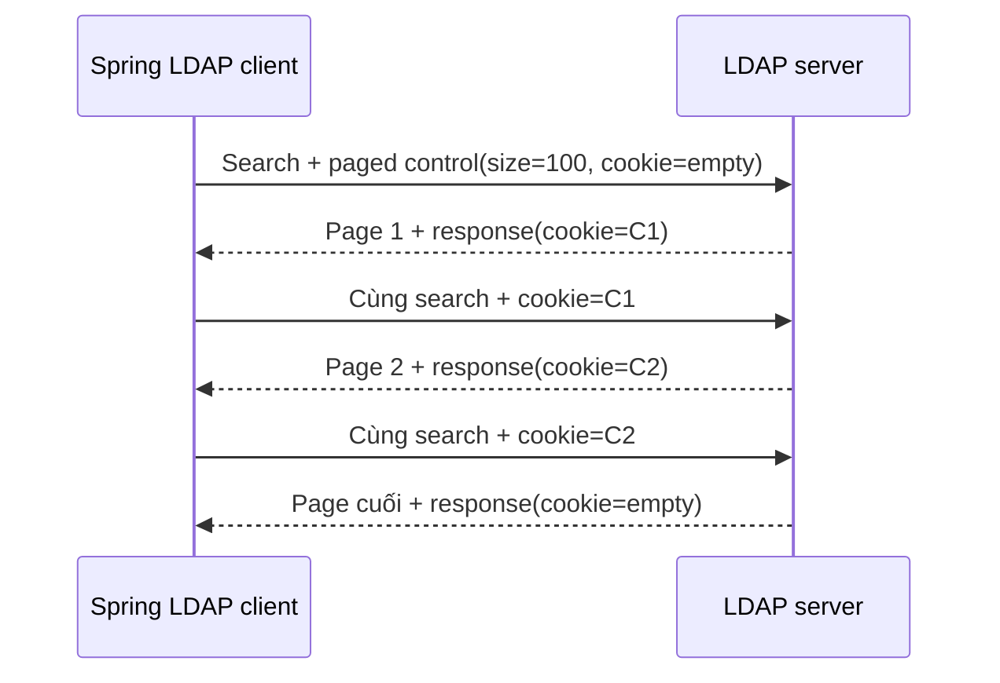

# Page size và giới hạn thực tế của server

## Mục tiêu bài học

Trong **SPRING_LDAP**, một truy vấn tìm nhân viên có thể khớp hàng chục nghìn entry. Việc gọi `LdapTemplate.search()` rồi cắt `List` ở Java không bảo đảm hiệu quả: LDAP server vẫn có thể phải trả nhiều dữ liệu qua mạng, ứng dụng tốn bộ nhớ và những **size/time limit** của server vẫn có thể làm truy vấn thất bại. **Simple Paged Results** (RFC 2696) cho phép client yêu cầu kết quả theo từng trang, nhưng **`pageSize` là số lượng đề nghị cho mỗi lần trả**, không phải lời cam kết server sẽ trả chính xác số đó hay cho phép duyệt vô hạn.

Bài thuộc chương **Phân trang và sorting**, tập trung vào mối quan hệ giữa **page size**, **LDAP search controls**, **giới hạn quản trị của server**, **cookie phân trang**, **kết nối**, **tải hệ thống** và **thứ tự kết quả**. Người học vận dụng `ContextSource`, `LdapTemplate`/`LdapClient`, mapper, LDAP filter, TLS, pooling và kiểm thử an toàn để thiết kế các API đọc directory đúng và có khả năng vận hành.

Học xong, bạn sẽ:

1. Phân biệt `pageSize`, `sizeLimit`, `timeLimit`, giới hạn tài nguyên/quản trị của server và giới hạn của API.
2. Diễn giải RFC 2696: request control, response cookie, ước lượng tổng số entry và dấu hiệu hết trang.
3. Thực hiện paged search bằng Spring LDAP với `PagedResultsDirContextProcessor` (các bản 3.x/4.0) hoặc `PagedResultsControlExchangeDirContextProcessor` (4.1+).
4. Giải thích vì sao phải giữ **cùng LDAP connection** cho chuỗi trang theo hướng dẫn Spring LDAP.
5. Chọn và đo `pageSize` phù hợp thay vì mặc định “càng lớn càng nhanh”.
6. Phát hiện giới hạn server, trang thiếu dữ liệu, cookie hết hạn, truy vấn không được hỗ trợ và lỗi bị che.
7. Phân biệt **paged results** với **sorting**, tránh ngộ nhận về thứ tự và tính nhất quán khi dữ liệu đổi trong lúc duyệt.

## 1. Tình huống: danh bạ nhiều entry

Giả sử directory có base `dc=example,dc=org` với khoảng **12.000** entry nhân viên dưới `ou=People`. Một màn hình chỉ cần `uid`, `cn` và `mail`; hệ thống còn có job đồng bộ toàn bộ danh bạ mỗi ngày.

Ba cách làm không tương đương:

| Cách làm | Server gửi bao nhiêu dữ liệu? | Đánh giá |
| --- | --- | --- |
| `search()` trả toàn bộ rồi `subList(0, 100)` | Có thể phải truyền nhiều hơn 100 entry trước khi cắt | Không phải phân trang tại server |
| Filter chỉ lấy 100 nhân viên theo điều kiện nghiệp vụ hẹp | Chỉ những entry khớp filter và giới hạn thực thi | Tốt khi yêu cầu thật sự chỉ cần nhóm đó |
| **RFC 2696**: mỗi lần yêu cầu trang 100 entry và dùng cookie | Server chia quá trình trả kết quả thành các lần search được kiểm soát | Hợp lý khi cần duyệt nhiều entry |

**Ví dụ số học:** nếu server thực sự trả đủ 100 entry mỗi trang và tập kết quả giữ nguyên, 12.000 entry cần khoảng **120 lần lấy trang**. Đây chỉ là phép minh họa; LDAP không cam kết mọi trang đều đủ 100 entry, không cam kết thứ tự bất biến, và có thể áp giới hạn/từ chối trước khi job hoàn tất.

### 1.1. SearchRequest có gì ngoài filter?

Một LDAP search không chỉ có `(objectClass=inetOrgPerson)`. Nó còn gồm:

| Thành phần | Ví dụ | Tác động |
| --- | --- | --- |
| Base DN | `ou=People` tương đối với `ContextSource.base` | Khoanh vùng DIT |
| Scope | `SUBTREE` hoặc `ONELEVEL` | Cấp tìm kiếm |
| Filter | `(&(objectClass=inetOrgPerson)(departmentNumber=42))` | Entry nào được xét |
| Returned attributes | `uid`, `cn`, `mail` | Dữ liệu trả về mỗi entry |
| `sizeLimit` | Mốc giới hạn tổng số entry trong yêu cầu search | Có thể kết thúc bằng size-limit error |
| `timeLimit` | Giới hạn thời gian xử lý tìm kiếm | Có thể kết thúc bằng time-limit error |
| Paged results control | Yêu cầu trang 100 và cookie | Trao đổi các trang của một search |

Đặt `pageSize=100` **không** tự giới hạn tổng số entry cả job, không buộc server cho phép tìm toàn bộ cây và không thay thế filter/ACL. Muốn giới hạn **tổng công việc của ứng dụng**, cần thêm `maxRows`, `maxPages`, deadline và giới hạn truy cập ở tầng service.

## 2. Năm loại giới hạn phải phân biệt

| Giới hạn | Ai kiểm soát? | Áp dụng ở đâu? | Ví dụ |
| --- | --- | --- | --- |
| **Requested page size** | Client trong RFC 2696 control | Số entry mong muốn trong **một trang** | `pageSize=100` |
| **Search size limit** | Client gửi trong SearchRequest, server có thể áp thêm giới hạn | Số entry tối đa của thao tác search theo quy tắc LDAP | `SearchControls.setCountLimit(200)` |
| **Server/admin size limit** | Directory administrator và server | Hạn chế số entry/khối lượng tìm kiếm | AD có LDAP policy `MaxPageSize` |
| **Search time limit** | SearchRequest và server policy | Thời gian thực thi search theo giới hạn | `SearchControls.setTimeLimit(3000)` |
| **Application budget** | Service/API | Tổng số trang, tổng entry, thời gian và tài nguyên job | `maxPages=40`, `maxRows=4000` |

Đây là **các cơ chế khác nhau**, không thể tùy tiện thay thế nhau. Ngoài ra còn có **connection timeout**, **read timeout**, giới hạn đồng thời, số kết nối, kích thước response, bộ nhớ và chính sách ACL. Chẳng hạn search time limit 3 giây không có nghĩa TCP connect timeout cũng là 3 giây.

### 2.1. Page size không phải mức trần dữ liệu của cả chuỗi

```text
pageSize=100
Page 1 -> có thể 100 entry + cookie tiếp tục
Page 2 -> có thể 100 entry + cookie tiếp tục
...
Page N -> có thể ít hơn 100 entry + cookie rỗng
```

**Không suy luận “trang trả ít hơn 100 entry nghĩa là hết”**. Dấu hiệu kết thúc theo RFC 2696 là **cookie rỗng/không còn continuation** trong response control phù hợp. Với Spring LDAP, sử dụng `processor.hasMore()` thay vì kiểm tra `page.size() < requestedPageSize`.

Ngược lại, **trang trả đủ 100 entry cũng không chứng minh còn trang tiếp**. Cookie mới là tín hiệu cần xét.

### 2.2. Client sizeLimit có thể làm paged search mất ý nghĩa

RFC 2696 quy định trường hợp `requested page size >= sizeLimit` của SearchRequest: server **nên bỏ qua paging control** vì truy vấn có thể thỏa trong một trang. Vì vậy, nếu dùng:

```java
SearchControls controls = new SearchControls();
controls.setCountLimit(100);

// Đồng thời gửi paging request size=100 có thể khiến control
// bị bỏ qua theo RFC; không phải cách phân trang toàn bộ dữ liệu.
```

thì không nên kỳ vọng thu được 100 entry đầu và cookie để tiếp tục. Với job duyệt nhiều trang, thường giữ `SearchControls.setCountLimit(0)` (nghĩa là **không yêu cầu giới hạn count từ client** trong JNDI), rồi dùng **application budget riêng** và để server thực thi các giới hạn quản trị của nó. **`0` không có nghĩa vô hạn trên LDAP server**.

Không tự ý tăng `sizeLimit` để “vượt giới hạn” do admin áp đặt. Nếu cần xuất toàn bộ tập dữ liệu, phải thiết kế luồng được phép và cấu hình phù hợp với quản trị directory.

### 2.3. Page size của server không có một con số chung

Microsoft Active Directory có LDAP policy **`MaxPageSize`** (giá trị mặc định thường được tài liệu Microsoft nêu là **1.000 entry**). Đó là **chính sách của AD**, không phải quy định “LDAP chỉ cho tối đa 1.000” trong RFC 2696. Giá trị thực tế có thể được quản trị viên thay đổi và các server như OpenLDAP, ApacheDS hoặc dịch vụ directory khác có policy riêng.

Thử gửi `pageSize=5000` vào server có policy 1.000 không bảo đảm nhận 5.000 entry: có thể server giới hạn, từ chối hoặc thực hiện theo ngữ nghĩa do sản phẩm cung cấp. **Không đoán behavior chỉ từ một tên cài đặt**; cần kiểm tra response, tài liệu server và kết quả thực tế.

### 2.4. Thời gian trên mỗi trang khác deadline của job

Nếu một job tải 120 trang, mỗi trang mất trung bình 400 ms thì chỉ thời gian search đã khoảng 48 giây, chưa kể network, mapping, xử lý/retry; tổng thời gian có thể cao hơn nhiều. `setTimeLimit(3000)` trên từng SearchRequest không bảo đảm job kết thúc trong 3 giây.

Muốn chặn job kéo dài, cần quản lý **deadline tổng** ở tầng service (và cancellation/timeout tương thích), bên cạnh thời hạn trên từng request và timeout kết nối. Không che lỗi page thứ 119 bằng cách trả 118 trang trước như một kết quả hoàn chỉnh.

## 3. RFC 2696: cookie và thông tin về số kết quả

Simple Paged Results sử dụng LDAP control có OID:

```text
1.2.840.113556.1.4.319
```

Request control chứa `size` (số entry mong muốn trong trang) và `cookie`. Lần đầu cookie rỗng; mỗi response được server xử lý paging sẽ kèm response control có một **cookie mới** để tiếp tục hoặc **cookie rỗng** khi hết kết quả.



### 3.1. Cookie không phải offset số học

Cookie là **giá trị opaque** do server phát hành. Không tự tăng một biến `pageNumber` rồi chuyển thành cookie, không giải mã nội dung để suy vị trí và không gửi cookie của một truy vấn sang filter/base/scope khác. Cookie có thể gắn với trạng thái và vòng đời kết nối/server, không phải mã lưu vĩnh viễn để tìm “trang 42” bất kỳ.

Nếu muốn API HTTP có `nextToken`, nên dùng **token do application quản lý** gắn với query fingerprint, user/tenant, expiry và chính sách session. Tuyệt đối không công khai raw LDAP cookie vô thời hạn hoặc hứa continuation chạy được qua mọi server/connection. Với Spring LDAP, yêu cầu **cùng underlying connection** còn làm việc chia một chuỗi paging qua nhiều HTTP request khó hơn đáng kể.

### 3.2. Total result size chỉ là ước lượng tùy chọn

Response control có thể trả một trường **size estimate**. RFC 2696 cho phép server trả `0` khi không có ước lượng. Trong các API Spring LDAP cũ, `PagedResultsDirContextProcessor.getResultSize()` chỉ lấy **ước lượng**, không phải con số đếm chính xác.

Không tạo giao diện kiểu “Trang 1/120 chính xác” khi không có total count đáng tin cậy. Đối với danh bạ, thường đủ hiển thị **có trang tiếp hay không**. Nếu cần total chính xác cho báo cáo, phải có cơ chế đếm/phân tích riêng, chấp nhận chi phí và ràng buộc nhất quán.

### 3.3. Server không hỗ trợ hoặc không xử lý control

Nếu server không hỗ trợ paged results, hành vi còn phụ thuộc cờ **criticality**. Theo RFC 2696: nếu critical control không được hỗ trợ, server trả lỗi `unsupportedCriticalExtension`; nếu không critical, server có thể bỏ qua control. Nếu mã ứng dụng lầm một response không phân trang thành “trang đầu”, nó có thể tải quá nhiều entry hoặc đánh dấu hoàn tất sai.

Trong production phải **kiểm tra hỗ trợ và response** bằng thư viện/driver thực tế. Khi paging không được hỗ trợ, không âm thầm fallback sang “tải mọi entry rồi cắt trong Java”. Hãy trả lỗi có ý nghĩa, áp filter hẹp hơn hoặc chọn chiến lược được administrator phê duyệt.

## 4. Spring LDAP và sự thay đổi API theo phiên bản

Trong Spring LDAP, request/response control được xử lý qua `DirContextProcessor`. **Tên lớp processor đã thay đổi ở các phiên bản mới**:

| Dòng Spring LDAP | API thường dùng | Ghi chú |
| --- | --- | --- |
| 3.x và 4.0 | `org.springframework.ldap.control.PagedResultsDirContextProcessor` | Có `hasMore()`, `getCookie()`, `getResultSize()` |
| 4.1+ | `PagedResultsControlExchangeDirContextProcessor` | API mới có `hasMore()`, sử dụng `ControlExchange` |
| 4.1+ dùng API cũ | `PagedResultsDirContextProcessor` | Được đánh dấu **deprecated** theo Javadoc mới |

Không copy một import từ ví dụ trên Internet mà bỏ qua phiên bản dependency. **Ví dụ chính dưới đây dành cho Spring LDAP 4.1+**; phần 4.3 ghi cách đổi sang API 3.x/4.0.

### 4.1. Vì sao cần SingleContextSource?

Spring LDAP `LdapTemplate` thường lấy và đóng/trả context cho từng lời gọi. Nhưng một chuỗi trang theo hướng dẫn Spring LDAP đòi hỏi các request liên tiếp dùng **cùng LDAP connection** để cookie tiếp tục hợp lệ.

`SingleContextSource.doWithSingleContext(...)` cung cấp một phạm vi công việc, trong đó các `LdapOperations` dùng chung context/connection:

```text
SingleContextSource / một phạm vi dùng chung connection
  ├── search trang 1 -> cookie A
  ├── search trang 2 -> cookie B
  ├── search trang 3 -> cookie C
  └── search trang cuối -> hết cookie
Kết thúc phạm vi -> đóng/trả context theo quản lý của Spring
```

Đây là yêu cầu **đặc biệt quan trọng khi có pooling hoặc load balancing**. Cookie từ connection/server A không được mặc nhiên dùng trên connection B. Một pool chung không bảo đảm các lời gọi khác nhau luôn lấy đúng cùng connection vật lý. Không giữ một `LdapContext` sống trong singleton chỉ để phục vụ trang kế tiếp cho mọi HTTP request.

### 4.2. Ví dụ hoàn chỉnh: đọc theo trang có giới hạn, Spring LDAP 4.1+

Đoạn mã minh họa sau trả về tối đa một **lượng kết quả được kiểm soát** trong một operation. Nó dùng cùng connection, chỉ lấy các attribute cần thiết, có giới hạn số trang/số entry và **không trả dữ liệu một phần như thể đã hoàn tất**.

```java
import java.util.ArrayList;
import java.util.List;
import javax.naming.NamingException;
import javax.naming.directory.Attribute;
import javax.naming.directory.Attributes;
import javax.naming.directory.SearchControls;
import org.springframework.ldap.control.PagedResultsControlExchangeDirContextProcessor;
import org.springframework.ldap.core.AttributesMapper;
import org.springframework.ldap.core.support.SingleContextSource;
import org.springframework.ldap.core.ContextSource;

record PersonRow(String uid, String name, String email) {}

final class PagedPersonReader {
    private static final int PAGE_SIZE = 100;
    private static final int MAX_PAGES = 40;
    private static final int MAX_ROWS = 4_000;

    private final ContextSource contextSource;

    PagedPersonReader(ContextSource contextSource) {
        this.contextSource = contextSource;
    }

    List<PersonRow> readDepartment42() {
        SearchControls controls = new SearchControls();
        controls.setSearchScope(SearchControls.SUBTREE_SCOPE);
        controls.setReturningAttributes(
                new String[] {"uid", "cn", "mail"});
        controls.setCountLimit(0);   // Không đặt client size limit.
        controls.setTimeLimit(3_000); // Limit cho mỗi search, không
                                      // thay deadline của cả job.

        var processor =
                new PagedResultsControlExchangeDirContextProcessor(
                        PAGE_SIZE);

        AttributesMapper<PersonRow> mapper = attrs ->
                new PersonRow(
                        required(attrs, "uid"),
                        required(attrs, "cn"),
                        optional(attrs, "mail"));

        return SingleContextSource.doWithSingleContext(
                contextSource,
                operations -> {
                    List<PersonRow> collected = new ArrayList<>();
                    int pages = 0;

                    do {
                        if (pages >= MAX_PAGES) {
                            throw new IllegalStateException(
                                    "Page budget exceeded");
                        }

                        List<PersonRow> page = operations.search(
                                "ou=People",
                                "(&(objectClass=inetOrgPerson)"
                                + "(departmentNumber=42))",
                                controls,
                                mapper,
                                processor);
                        pages++;

                        if (collected.size() + page.size() > MAX_ROWS) {
                            throw new IllegalStateException(
                                    "Row budget exceeded");
                        }
                        collected.addAll(page);
                    } while (processor.hasMore());

                    return List.copyOf(collected);
                });
    }

    private static String required(Attributes attrs, String name)
            throws NamingException {
        String value = optional(attrs, name);
        if (value == null || value.isBlank()) {
            throw new IllegalStateException(
                    "Missing required field: " + name);
        }
        return value;
    }

    private static String optional(Attributes attrs, String name)
            throws NamingException {
        Attribute attr = attrs.get(name);
        if (attr == null || attr.size() == 0) {
            return null;
        }
        Object value = attr.get();
        return value instanceof String ? (String) value : null;
    }
}
```

Giải thích:

1. `PAGE_SIZE=100` là **đề nghị mỗi lần lấy**, không phải 100 entry được bảo đảm.
2. `setCountLimit(0)` tránh client áp một size limit cắt chuỗi paging; **server vẫn có quyền giới hạn**.
3. `setTimeLimit(3000)` là time limit cho từng search; ứng dụng phải bổ sung deadline toàn job nếu cần SLA tổng.
4. `operations.search(..., processor)` gắn paging control với mỗi request và nhận response control trước khi gọi `hasMore()`.
5. `do ... while (processor.hasMore())` dừng **theo cookie**, không theo số phần tử trong page.
6. `MAX_PAGES` và `MAX_ROWS` là **giới hạn chính sách ứng dụng**, không phải LDAP server setting; vượt hạn mức thì ví dụ ném lỗi rõ ràng thay vì im lặng trả dữ liệu thiếu.
7. Filter, scope, base và returned attributes giữ **giống nhau** ở mọi trang. Với dữ liệu động, tạo filter bằng `LdapQueryBuilder` hoặc `EqualsFilter`; ví dụ cố định department `42` để tập trung vào paging.
8. `List.copyOf()` giúp kết quả độc lập và không sửa được qua collection; không làm giảm dữ liệu đã truyền qua network.

**Về bộ nhớ:** Ví dụ chỉ thích hợp với **khoảng dữ liệu bị giới hạn**. Với job xuất hàng triệu entry, không gom tất cả vào `List`. Nên xử lý/lưu từng page theo batch, có checkpoint/idempotency nghiệp vụ và không coi một page thất bại là toàn bộ export đã xong. Những job dài còn cần deadline tổng, kiểm soát backpressure và kế hoạch phục hồi state.

### 4.3. Nếu đang dùng Spring LDAP 3.x hoặc 4.0

Thay processor của ví dụ bằng:

```java
import org.springframework.ldap.control.PagedResultsDirContextProcessor;

// Dùng bên trong cùng cấu trúc SingleContextSource:
PagedResultsDirContextProcessor processor =
        new PagedResultsDirContextProcessor(100);

// operations.search(base, filter, controls, mapper, processor)
// ... sau mỗi lần search:
boolean hasNext = processor.hasMore();
```

Trong API này, `getCookie()` trả `PagedResultsCookie` và `getResultSize()` là ước lượng tùy chọn. Nếu tạo processor mới cho mỗi trang, phải truyền **đúng cookie nhận được từ trang trước**; dễ nhất là tái sử dụng processor trong cùng chuỗi `SingleContextSource` như ví dụ chính.

Ở Spring LDAP 4.1+, API cũ đã được đánh dấu deprecated và nên chuyển sang `PagedResultsControlExchangeDirContextProcessor` khi nâng cấp. Tên lớp, cấu trúc control và overload cụ thể cần được kiểm tra với **Javadoc của phiên bản thư viện đang chạy**.

### 4.4. Nếu chỉ muốn 100 entry cho một màn hình?

Không tự động dùng code “đọc đủ 4.000 rồi cắt còn 100”. Cần thiết kế endpoint/truy vấn cho màn hình. Với mỗi API:

- Nếu chỉ cần **100 kết quả khớp điều kiện** và không có “trang sau”, một truy vấn đủ hẹp với giới hạn thích hợp có thể đủ.
- Nếu cần **Next page**, phải duy trì continuation theo khả năng của server, biết các ràng buộc cookie/connection và thể hiện thứ tự kết quả phù hợp.
- Nếu muốn **trang ngẫu nhiên theo số thứ tự** (chọn page 34 trực tiếp), Simple Paged Results **không cung cấp offset page 34**; phải duyệt các cookie trước đó hoặc dùng cơ chế khác được server hỗ trợ.
- Nếu cần **nhiều người dùng đồng thời chuyển trang cách nhau hàng phút**, không mặc định có thể giữ một LDAP connection riêng cho mỗi browser session mãi mãi. Cân nhắc mô hình search/index tại tầng ứng dụng, job snapshot hoặc thiết kế cursor có vòng đời chặt chẽ.

### 4.5. Giới hạn thời gian của toàn chuỗi

Một cách thể hiện chính sách là đặt deadline tại application service:

```java
long deadlineNanos =
        System.nanoTime() + java.util.concurrent.TimeUnit.SECONDS
                .toNanos(20);

// Kiểm tra trong vòng lặp trước khi gọi search trang kế tiếp:
if (System.nanoTime() >= deadlineNanos) {
    throw new IllegalStateException("LDAP paging deadline exceeded");
}
```

Đây là **kiểm tra trước request**, không tự hủy một lời gọi LDAP đang treo. Muốn giới hạn thời gian thực tế của thao tác đang chạy, cần cấu hình **LDAP read/network timeout**, điều kiện cancellation và policy của server. Sau một timeout, không được trả những trang đã nhận như thể đã lấy **toàn bộ** dữ liệu.

## 5. Chọn page size bằng phép đo, không bằng cảm giác

Không có giá trị `pageSize` tối ưu cho mọi LDAP server. Cùng 100 entry nhưng có entry chỉ chứa `uid, cn, mail` và entry có ảnh `jpegPhoto`, nhóm `member` hàng nghìn giá trị sẽ khác nhau rất lớn về bytes và thời gian mapping.

Hãy bắt đầu bằng một **giá trị thử nghiệm có kiểm soát**, ví dụ 50 hoặc 100, rồi đo cùng filter/base/scope/attributes dưới tải đại diện. Các con số này là **điểm thử**, không phải mặc định bắt buộc của LDAP.

### 5.1. Trade-off giữa trang nhỏ và trang lớn

| Kích thước trang | Ưu điểm có thể thấy | Chi phí/rủi ro |
| --- | --- | --- |
| **Rất nhỏ** (ví dụ 10) | Độ trễ/bytes mỗi trang nhỏ, dễ kiểm soát batch | Nhiều round trip, overhead control và connection |
| **Vừa** (ví dụ 50–200) | Thường là điểm thử cân bằng cho danh bạ nhẹ | Phải đo theo network/server thật |
| **Lớn** (ví dụ 500–1000) | Ít round trip nếu entry nhỏ và server cho phép | Peak memory/bytes/time per page cao; dễ gần giới hạn server |
| **Rất lớn** (ví dụ 5000) | Có thể giảm round trip trong một số môi trường | Có thể vi phạm policy/overload, làm lỗi hoặc timeout |

Không nên suy rằng **server có `MaxPageSize=1000` thì ứng dụng phải đặt `pageSize=1000`**. Giới hạn trên là **trần/policy**, không phải khuyến nghị hiệu năng.

### 5.2. Một phép ước tính dung lượng

Giả định minh họa **mỗi entry trung bình 2 KiB dữ liệu ứng dụng sau mapping**, chưa bao gồm BER/LDAP overhead, object allocation hay TLS:

| Requested page size | Dữ liệu ứng dụng ước tính cho một trang |
| --- | --- |
| 25 | ~50 KiB |
| 100 | ~200 KiB |
| 250 | ~500 KiB |
| 500 | ~1.000 KiB |

**Đây không phải số đo thực tế.** Trong directory có attribute đa trị, DN dài, trường binary hoặc dữ liệu phân bố lệch, trang 100 entry có thể lớn hơn rất nhiều so với ước tính. Máy khách và server còn cần bộ nhớ xử lý `SearchResult`, `Attributes`, byte buffer và DTO.

### 5.3. Mục tiêu tối ưu cần rõ

Có ít nhất bốn mục tiêu có thể xung đột:

- **Latency một trang:** người dùng muốn trang đầu nhanh.
- **Throughput job:** đồng bộ nhiều entry/giây.
- **Ổn định server:** không làm tăng CPU, memory, disk IO hoặc số query đồng thời quá mức.
- **Chi phí/mạng:** số round trip và tổng bytes.

Với UI tra cứu tương tác, **p95/p99 latency của trang đầu và tải đồng thời** quan trọng hơn số entry/giây của job xuất dữ liệu. Với batch sync, throughput và khả năng resume có thể quan trọng hơn latency từng trang.

### 5.4. Ma trận benchmark đề xuất

Giữ nguyên **filter, base, scope, projection, identity, server và khoảng tải thử**, chỉ đổi page size. Ví dụ:

| `pageSize` | Pages | Entries | p95 page latency | Peak heap | Lỗi/tỷ lệ timeout |
| --- | ---: | ---: | ---: | ---: | --- |
| 25 | Đo | Đo | Đo | Đo | Đo |
| 50 | Đo | Đo | Đo | Đo | Đo |
| 100 | Đo | Đo | Đo | Đo | Đo |
| 250 | Đo | Đo | Đo | Đo | Đo |
| 500 | Đo | Đo | Đo | Đo | Đo |

Không điền những con số đo giả. Cần ít nhất nhiều lần chạy, cả tải bình thường và mức concurrency mong đợi; tách warm-up, cache, server replication và network path. Dùng test server hoặc cửa sổ đo được quản trị viên duyệt để không gây tác động không kiểm soát lên production.

**Chỉ số nên thu thập** (không biến UID/DN thành metrics label):

- `page_size_requested`, `rows_returned_by_page`, `pages_total`.
- Thời gian nhận một trang, p50/p95/p99, tổng thời gian job, tốc độ entry/giây.
- Bytes response (nếu có đo phù hợp), bộ nhớ đỉnh phía client, GC và pool saturation.
- Lỗi `sizeLimitExceeded`, `timeLimitExceeded`, `adminLimitExceeded`, `unsupportedCriticalExtension`, network timeout.
- Số lần cookie bị từ chối/expired, tỷ lệ job hoàn tất, số lần đối soát hoặc retry.
- Số phép search/connection đang hoạt động và tác động tới directory server.

### 5.5. Chọn page size theo chính sách

Thay vì cho caller HTTP tự gửi `pageSize=100000`, API nên đặt **server-side cap**:

```java
final class PagePolicy {
    private static final int DEFAULT_SIZE = 100;
    private static final int MAX_SIZE = 250; // Policy ứng dụng minh họa.

    static int validate(Integer requestedSize) {
        if (requestedSize == null) {
            return DEFAULT_SIZE;
        }
        if (requestedSize < 1 || requestedSize > MAX_SIZE) {
            throw new IllegalArgumentException("Invalid page size");
        }
        return requestedSize;
    }
}
```

`MAX_SIZE=250` là **một lựa chọn của sản phẩm**, không phải giới hạn chuẩn. Sau khi benchmark, có thể điều chỉnh policy nhưng phải xét tác động lên API clients và server. Không tăng trần chỉ vì một người dùng cần xuất nhiều dữ liệu: việc xuất báo cáo nên có workflow riêng và giới hạn tổng.

## 6. Sorting và tính nhất quán khi phân trang

**Paged Results không đồng nghĩa Sorted Results.** RFC 2696 định nghĩa cách tiếp tục một search bằng cookie; nó **không tự bảo đảm** kết quả có thứ tự theo `cn` hoặc `uid`.

| Tình huống | Vấn đề |
| --- | --- |
| Trang 1 trả Lan, Mai; trang 2 trả Nam, Huy | Không có cam kết mỗi trang đã sắp đúng alphabet |
| Java `Collections.sort(page)` từng trang | Chỉ sắp xếp **trong từng page**, không sắp toàn bộ tập |
| Người dùng đổi tên giữa trang 1 và trang 2 | Có thể thấy duplicate/skip/mất nhất quán tùy server |
| Entry được thêm/xóa trong lúc duyệt | Tập kết quả có thể thay đổi giữa các lần page request |
| Sort theo attribute không index hoặc không được phép | Server có thể tốn tài nguyên hoặc từ chối |

### 6.1. Sort tại server có control riêng

LDAP **Server Side Sorting** có thể dùng control mô tả trong **RFC 2891** nếu directory server hỗ trợ. Với Spring LDAP, có `SortControlDirContextProcessor` trong các dòng phiên bản cũ; ở API mới cần đối chiếu `SortControlExchange` và bộ xử lý control tương ứng.

**Không mặc định** mọi directory hỗ trợ vừa paging vừa sort theo thuộc tính tùy chọn, hoặc hỗ trợ sort mà không cần index/quyền đặc biệt. Cần xác minh control trên server, response sort result và độ trễ thực tế.

### 6.2. Sorting không tạo snapshot bất biến

Sort theo `cn` có thể giúp giao diện dễ đọc, nhưng **không bảo đảm snapshot isolation** của toàn bộ quá trình phân trang. Khi entry được sửa/thêm/xóa giữa các trang, kết quả có thể thay đổi. Một số server áp behavior riêng cho cookie và sort, nhưng không được suy ra consistency kiểu transaction từ một response có cookie.

Với ứng dụng yêu cầu **không thiếu/không trùng** (ví dụ đồng bộ hệ thống kế toán):

1. Cân nhắc LDAP sync/change log/DirSync hoặc cơ chế incremental do server hỗ trợ thay vì paged search lâu dài như một ảnh chụp bất biến.
2. Dùng **ID ổn định** để de-duplicate và checkpoint theo nghiệp vụ, không chỉ DN có thể đổi.
3. Nếu cần ảnh chụp tại một thời điểm, xây snapshot/index riêng có version và timestamp đáng tin cậy theo kiến trúc.
4. Kiểm tra lại các biến động trong giai đoạn export nếu nghiệp vụ yêu cầu.

Không khắc phục lỗi mất/trùng chỉ bằng cách `distinct()` danh sách DTO theo UID, vì hai entry khác nhau có thể có UID trùng ở các OU khác nhau.

### 6.3. Trộn paging và sort phải xét chi phí

Nếu server phải sort 50.000 entry trước khi trả trang đầu, `pageSize=25` **không đảm bảo trang đầu rất nhanh**. Chi phí sắp xếp/filter/index vẫn có thể lớn. Khi benchmark, đo riêng truy vấn:

```text
search + filter
search + filter + paged results
search + filter + server-side sort
search + filter + paged results + server-side sort
```

So sánh kết quả và error controls, không chỉ thời gian. Một server có thể hỗ trợ từng control riêng nhưng có hạn chế khi kết hợp chúng.

## 7. Những giới hạn thực tế thường gặp trên LDAP server

### 7.1. Active Directory: MaxPageSize không phải “tổng 1.000 người”

Trong Active Directory, `MaxPageSize` là một LDAP policy quản lý kích thước kết quả tìm kiếm cho một request; giá trị mặc định được tài liệu Microsoft công bố là **1.000**. Một LDAP client biết sử dụng simple paged results có thể đi qua nhiều trang của một tập lớn **khi server và chính sách cho phép**.

Ví dụ:

```text
AD policy MaxPageSize (minh họa): 1000
Ứng dụng request pageSize:          200
Tập người dùng khớp filter:        4600

Không thể kết luận kết quả chỉ có 1000 người.
Nếu paging được hỗ trợ, theo điều kiện thích hợp:
  200 + 200 + ... + trang cuối
với cookie tiếp tục giữa các lần search.
```

Tuy nhiên, AD có thể còn các chính sách khác về **thời gian, số kết quả, đồng thời, tài nguyên và connection**. Paging không được dùng để vượt một giới hạn bảo mật/quyền của tài khoản. Cấu hình đã được thay đổi ở môi trường doanh nghiệp phải được kiểm tra thực tế, không lấy giá trị mặc định của tài liệu làm sự thật chắc chắn.

### 7.2. OpenLDAP và các directory khác

OpenLDAP có thể có **size/time limit** và policy theo identity, scope, backend hoặc cấu hình admin. Ứng dụng không nên suy `pageSize=100` là bảo đảm vượt qua mọi giới hạn tổng số entry. Các server LDAP khác có hành vi hỗ trợ control, giới hạn tài nguyên, kết nối và cookie riêng.

Những câu hỏi cần hỏi administrator/server documentation:

1. Server có hỗ trợ OID `1.2.840.113556.1.4.319` không?
2. Page size được chấp nhận trong khoảng nào? Có giảm kích thước hay từ chối không?
3. Những size/time/admin limit nào **vẫn có hiệu lực khi paging**?
4. Cookie có yêu cầu cùng connection/server, có timeout hoặc session idle limit không?
5. Có hỗ trợ server-side sorting, attribute nào có index, sort có ảnh hưởng performance/limit không?
6. Kết quả giữa các trang có tính ổn định gì khi entry thay đổi?
7. Có per-user quota, giới hạn đồng thời hoặc policy rate limit không?
8. Search trên replica/GC/naming context có hành vi khác không?

### 7.3. SearchControls và giới hạn ở JNDI

`javax.naming.directory.SearchControls` cho phép cấu hình:

```java
SearchControls controls = new SearchControls();
controls.setSearchScope(SearchControls.SUBTREE_SCOPE);
controls.setReturningAttributes(new String[] {"uid", "cn", "mail"});
controls.setCountLimit(0); // Client không yêu cầu giới hạn số entry.
controls.setTimeLimit(3_000); // Giới hạn search, đơn vị ms.
```

Các giá trị này khác với `pageSize` của paged-results control. Khi gặp `SizeLimitExceededException`, `TimeLimitExceededException` hoặc Spring LDAP wrapper, đừng thay cả `countLimit`, `timeLimit`, `pageSize` tùy tiện mà không xác định nguồn lỗi.

**Lưu ý:** `setCountLimit(0)` không vô hiệu hóa giới hạn server. `setTimeLimit(3000)` cũng không thay thế network read timeout và giới hạn tài nguyên trên server.

### 7.4. Giới hạn còn đến từ schema/attribute lớn

Không chỉ số lượng entry quyết định mức độ nặng. Một nhóm với hàng chục nghìn `member` có thể có response lớn dù `pageSize=1`. Paged Results chia **số entry**, **không** tự phân trang từng giá trị bên trong một attribute.

Một số sản phẩm có cơ chế range retrieval/limit riêng cho attribute đa trị lớn, chẳng hạn một số kịch bản `member` trên AD. Nếu cần mọi member của nhóm, phải kiểm tra cơ chế của server: **paging theo entry không đồng nghĩa paging theo attribute values**.

Với danh bạ, chỉ yêu cầu `uid`, `cn`, `mail` nếu thực sự cần chúng; tránh `jpegPhoto`, certificate, `memberOf` hoặc mọi attribute theo mặc định mà không có lý do. Giới hạn dữ liệu từ truy vấn giúp mỗi page rẻ hơn và giảm rủi ro lộ dữ liệu.

## 8. Xử lý lỗi và trạng thái dữ liệu chưa hoàn tất

Đối với các job đồng bộ, **lấy được một số trang không có nghĩa job thành công**. Cần phân biệt:

| Hiện tượng | Điều cần hiểu | Hành động |
| --- | --- | --- |
| Trang đầu rỗng, cookie kết thúc | Search hợp lệ nhưng không có entry | Trả kết quả rỗng theo hợp đồng |
| Trang có ít entry hơn page size nhưng cookie vẫn còn | Chưa hết dữ liệu | Tiếp tục bằng cookie |
| Trang đủ page size nhưng cookie kết thúc | Server kết thúc chuỗi | Dừng; không gọi lại vô hạn |
| Response thiếu paging control | Server có thể không hỗ trợ/bỏ qua | Xác minh khả năng hỗ trợ, không coi đó là continuation bình thường |
| `sizeLimitExceeded` | Size limit của client/server đã bị vượt | Xem SearchControls và policy server |
| `timeLimitExceeded` | Search vượt thời gian được phép | Tối ưu filter/index, điều chỉnh policy với admin |
| `adminLimitExceeded` | Vượt hạn mức quản trị/tài nguyên | Giảm tải, giảm scope hoặc trao đổi admin |
| Cookie không còn hợp lệ | Kết nối thay đổi, server hết phiên hoặc dữ liệu/state đổi | Không đoán offset; khởi động chuỗi mới nếu an toàn |
| LDAP connection chết ở trang giữa | Các trang trước có thể đã được nhận | Không trả như full success; theo workflow resume/đối soát |
| Mapper lỗi giữa chừng | Có dữ liệu sai schema/projection/ACL | Báo lỗi mapping rõ, không bỏ qua entry âm thầm |
| Authorization lỗi/ACL che attribute | Identity không được phép thấy dữ liệu | Không thử bằng tài khoản quyền cao hơn trong luồng khách |

### 8.1. Không che lỗi bằng dữ liệu “ít hơn dự kiến”

Đoạn code sau nguy hiểm:

```java
// KHÔNG NÊN: biến một chuỗi paging thất bại thành "đã xong".
try {
    return loadAllPages();
} catch (Exception ignored) {
    return cachedRowsSoFar;
}
```

Nếu trang 1–7 thành công rồi trang 8 lỗi, người dùng có thể tưởng **toàn bộ** danh bạ chỉ có các entry trước đó. Với batch sync, có thể lưu checkpoint các page đã xử lý, nhưng phải đánh dấu **PARTIAL/FAILED/NEEDS_RECONCILIATION**, không công bố dữ liệu đó là snapshot hoàn chỉnh.

### 8.2. Tránh retry làm lặp/trượt trang

Khi request trang N timeout, có thể server đã phát triển trạng thái cookie, connection đã bị đóng hoặc dataset thay đổi. Việc gửi lại **cùng cookie** trên connection khác hoặc sau thời gian dài không được mặc định an toàn.

Một chính sách phục hồi có thể:

1. Dừng chuỗi và lưu lỗi có ngữ cảnh an toàn (`requestId`, page index, loại lỗi, không log raw cookie).
2. Nếu có thể duy trì cùng connection và server cho phép, thử lại có giới hạn theo policy đã kiểm chứng.
3. Nếu không thể chứng minh cookie hợp lệ, khởi động **search mới** và de-duplicate/checkpoint dựa trên **ID ổn định**.
4. Đối soát các thay đổi phát sinh giữa hai lần export, nếu tính đầy đủ là yêu cầu.
5. Giới hạn số lần retry, tổng thời gian, tổng số trang và tác động tài nguyên server.

Tránh ghi cookie như một “mã duy nhất” vào log/metrics; nó là token server cấp, cần bảo vệ như dữ liệu session/cursor nhạy cảm, có vòng đời hữu hạn.

### 8.3. Không giữ connection vô thời hạn

`SingleContextSource` hữu ích để xử lý **một chuỗi page liên tục**, nhưng việc giữ connection suốt thời gian người dùng đọc trang 1 rồi nghỉ vài phút trước khi bấm Next có thể gây cạn pool hoặc cookie timeout.

Đối với API UI có traffic lớn, cần thiết kế rõ:

- Pagination tại **index/search service của ứng dụng** có thể phù hợp hơn nếu cần truy cập trang bất kỳ.
- Job server-side có thể dùng LDAP paging và lưu kết quả vào snapshot được quản lý.
- Nếu bắt buộc truyền trực tiếp cookie qua API, phải quản lý **connection affinity**, session expiry, số phiên, bảo mật token và hỗ trợ của server; đây là một kiến trúc phức tạp chứ không chỉ thêm `pageSize` vào JSON.

Không coi connection pooling là giải pháp tự động cho affinity. Một pool chỉ tái sử dụng connection theo cơ chế riêng, không bảo đảm lấy lại đúng connection/session của một cookie tùy ý.

## 9. Thiết kế API: requested size và total có nghĩa gì?

Một HTTP endpoint có thể nhận:

```http
GET /api/directory/people?department=42&pageSize=100
Authorization: Bearer <access-token>
```

Hệ thống có thể phản hồi theo hợp đồng:

```json
{
  "items": [
    {"uid": "lan", "displayName": "Lan Nguyen"},
    {"uid": "mai", "displayName": "Mai Tran"}
  ],
  "requestedPageSize": 100,
  "returnedCount": 2,
  "hasMore": false,
  "nextToken": null,
  "totalCount": null
}
```

Ví dụ này minh họa **hợp đồng API**, không ngụ ý một backend dùng Simple Paged Results có thể đóng connection rồi mở lại tùy ý cho request Next. `nextToken` chỉ nên có nếu kiến trúc thật sự hỗ trợ continuation an toàn và được quản lý.

**Không dùng `totalCount=0` để diễn đạt “server không trả ước lượng”**: 0 có thể là số kết quả hợp lệ, còn “không biết” nên được biểu diễn bằng `null` hoặc trường trạng thái riêng theo API.

Nếu API phục vụ UI có phân trang nhiều request, hãy quyết định rõ:

- Có **cursor bền vững ở tầng ứng dụng** hay không?
- Trang có được sắp theo tiêu chí ổn định không?
- Client có được đổi filter/sort/page size khi đang dùng cursor không?
- Có giới hạn thời gian/đồng thời/số lượng cursor không?
- Search có cần phản ánh dữ liệu mới ngay, hay dùng snapshot theo thời điểm?
- Lỗi khi cursor hết hạn sẽ là gì, và làm sao khởi động lại?

**Không thiết kế client tự chọn `pageSize` vô hạn**, không cho filter thô tùy ý và không trả DN/attribute nhạy cảm chỉ vì LDAP service identity có quyền đọc.

## 10. Bảo mật, quyền truy cập và giới hạn tài nguyên

Paging là cơ chế **điều tiết tốc độ đọc**, không phải một cơ chế authorization.

```text
HTTP caller (AuthN + AuthZ)
    -> API cho phép filter/size trong giới hạn
    -> LDAP ContextSource dùng account quyền tối thiểu
    -> TLS + đúng server/certificate
    -> LDAP filter, base/scope, requested attributes
    -> Paged Results Control (có cookie)
    -> Server ACL + admin policies
    -> DTO mapper và response được kiểm soát
```

### 10.1. Hai nơi cần kiểm tra quyền

1. **Ứng dụng**: người gọi được phép tra cứu phòng ban/tập nhân viên nào, tối đa bao nhiêu entry, có quyền export hay chỉ xem trang hiện tại?
2. **LDAP server**: service account được đọc những nhánh/attribute nào?

Nếu service account có quyền đọc mọi nhánh, không được lấy điều đó làm bằng chứng rằng caller HTTP cũng được xem mọi người dùng. Filter có thể hạn chế scope, nhưng authorization cho caller vẫn phải là kiểm tra độc lập, không chỉ lấy `departmentNumber` do client gửi và tin rằng nó hợp lệ.

### 10.2. TLS, kết nối và cookie

- Dùng LDAPS hoặc StartTLS với **certificate/hostname verification**; không bỏ TLS để “ổn định paging”.
- Không lưu bind credential trong source code; lấy từ cấu hình được bảo vệ.
- Không chia sẻ `PagedResultsDirContextProcessor` hoặc trạng thái cookie của một request cho nhiều tenant/user.
- Không chuyển raw cookie cho browser hoặc ghi nó vào log công khai; bảo vệ token continuation theo chính sách session.
- Giữ connection theo phạm vi đã xác định; bảo đảm trả context/pool khi kết thúc, timeout hoặc lỗi.
- Tránh song song hóa cùng một chuỗi cookie trên nhiều connection. Nếu cần phân luồng, phải chia **độc lập theo phạm vi/filter** hoặc dùng cơ chế server khác, và xử lý nguy cơ trùng/thiếu.

### 10.3. Limit không đồng nghĩa filter an toàn

Một search với filter không được escape:

```java
// KHÔNG NÊN: dữ liệu chưa tin cậy bị ghép vào cú pháp filter.
String filter = "(uid=" + rawInput + ")";
```

có thể trở thành `(uid=*)` nếu caller gửi `*`, làm query rộng ngoài ý định. `pageSize=25` không sửa lỗi logic này; nó chỉ yêu cầu server trả kết quả theo từng đợt. Dùng `LdapQueryBuilder.where("uid").is(rawInput)` hoặc filter builder encode giá trị theo RFC 4515; dùng `LdapNameBuilder` cho DN/RDN theo RFC 4514.

### 10.4. Chống quá tải ở tầng API

Một endpoint public không nên cho phép vô hạn số phiên paging hoặc tạo hàng chục truy vấn expensive trên mỗi người dùng. Áp dụng theo nghiệp vụ:

- Rate limit theo principal/tenant, không chỉ theo địa chỉ IP.
- Giới hạn page size, tổng số trang hoặc budget dữ liệu.
- Giới hạn concurrency, thời gian giữ connection và số session đang mở.
- Chỉ allowlist attribute/filter/scope được phép, hạn chế substring wildcard đầu chuỗi.
- Giám sát server response time, pool exhaustion, search errors và tỉ lệ cache/index hit nếu hệ thống hỗ trợ.
- Nếu phát sinh hành vi export lớn, phân quyền riêng thay vì dùng trực tiếp endpoint danh bạ tương tác.

Không nâng giới hạn server để phục vụ một query chưa tối ưu hoặc vượt quyền, khi chưa đo chi phí và chưa được administrator phê duyệt.

## 11. Unit test: kiểm tra giới hạn do ứng dụng đặt

Một phần của paging policy **có thể kiểm thử mà không cần LDAP server**: validation của page size và không chấp nhận giá trị quá lớn.

```java
import static org.junit.jupiter.api.Assertions.*;
import org.junit.jupiter.api.Test;

class PagePolicyTest {
    @Test
    void missingSizeUsesServerDefault() {
        assertEquals(100, PagePolicy.validate(null));
    }

    @Test
    void acceptsAllowedSize() {
        assertEquals(50, PagePolicy.validate(50));
        assertEquals(250, PagePolicy.validate(250));
    }

    @Test
    void rejectsInvalidSizes() {
        assertThrows(IllegalArgumentException.class,
                () -> PagePolicy.validate(0));
        assertThrows(IllegalArgumentException.class,
                () -> PagePolicy.validate(-1));
        assertThrows(IllegalArgumentException.class,
                () -> PagePolicy.validate(10_000));
    }
}
```

Trong test dịch vụ, cũng nên xác minh:

1. Thay đổi `pageSize` không thay đổi quyền truy cập hoặc attribute projection.
2. Budget `maxPages` và `maxRows` chặn kết quả hoàn tất giả khi vượt hạn.
3. Khi server/search giả trả lỗi ở page N, service không trả các page trước như **full success**.
4. Khi không có continuation cookie, vòng lặp dừng; khi còn cookie, vẫn tiếp tục dù page có ít entry.
5. Metrics không chứa UID, DN hay raw cookie.

**Giới hạn unit test:** Mock `LdapTemplate` hoặc processor không chứng minh một LDAP server thật đã tuân thủ RFC 2696, hỗ trợ control, giữ connection đúng hay trả cookie hợp lệ. Phần này phải có integration test.

## 12. Integration test trên directory server

Chuẩn bị server riêng có ít nhất **225** entry fixture và những quyền/giới hạn có thể kiểm soát. Mỗi lần test phải biết **số entry kỳ vọng theo filter**, base DN, scope, attributes, danh tính bind và directory server đang dùng.

### 12.1. Ma trận kiểm thử

| Mã ca | Kịch bản | Kỳ vọng |
| --- | --- | --- |
| **PAGE-01** | 225 entry, `pageSize=100` | Duyệt hết bằng cookie; nhận đủ 225 theo điều kiện kiểm thử ổn định |
| **PAGE-02** | `pageSize=1` | Hoạt động nếu server cho phép, nhiều request hơn |
| **PAGE-03** | `pageSize=25` | Đúng tập dữ liệu kỳ vọng, không dùng `subList` sau full search |
| **PAGE-04** | Request page size lớn hơn chính sách | Server xử lý theo policy; client không giả định được chấp nhận |
| **PAGE-05** | Search có `sizeLimit` nhỏ hơn page size | Quan sát trường hợp control có thể bị bỏ qua/lỗi theo RFC |
| **PAGE-06** | Search filter không có kết quả | Hoàn tất đúng, không loop vô hạn |
| **PAGE-07** | Page cuối có ít entry hơn size | Dừng theo cookie, không theo `page.size()` |
| **PAGE-08** | Server trả một trang ngắn nhưng còn cookie | Tiếp tục cho tới khi hết cookie |
| **PAGE-09** | Server không hỗ trợ control | Fail rõ hoặc fallback được phê duyệt, không tải toàn bộ ngầm |
| **PAGE-10** | Trả cookie rồi dùng trên connection khác | Xác minh giới hạn affinity của server; không dựa vào hành vi ngẫu nhiên |
| **PAGE-11** | Giữ cùng connection bằng `SingleContextSource` | Có thể tiếp tục chuỗi page trong phạm vi callback |
| **PAGE-12** | Cookie expired/server session chết | Báo lỗi/resume theo workflow, không tự đoán offset |
| **PAGE-13** | Vượt search time limit | Không báo kết quả hoàn chỉnh |
| **PAGE-14** | Vượt server admin limit | Phân loại lỗi, đo tác động và không retry ồ ạt |
| **PAGE-15** | Client `setCountLimit(0)` | Vẫn tuân thủ giới hạn server; kiểm tra behavior |
| **PAGE-16** | LDAP credential chỉ đọc | Không thể đọc entry/attribute bị ACL che |
| **PAGE-17** | Search chỉ yêu cầu `uid,cn,mail` | Mapper chỉ nhận attribute projection kỳ vọng |
| **PAGE-18** | Entry có `jpegPhoto` lớn nhưng không yêu cầu | Không tải ảnh chỉ để phân trang danh bạ |
| **PAGE-19** | Sort client từng page | Nhìn thấy khác với global sort, chứng minh không thể kết luận thứ tự toàn tập |
| **PAGE-20** | Server-side sort có hỗ trợ | Kiểm tra kết hợp sort+paging, response và chi phí |
| **PAGE-21** | Thêm/sửa/xóa entry trong lúc đọc các trang | Ghi nhận consistency thực tế, không hứa snapshot |
| **PAGE-22** | Hai job paging đồng thời | Trạng thái cookie/processor độc lập, không trộn trang |
| **PAGE-23** | Timeout ở giữa job | Không công bố kết quả các trang trước như full success |
| **PAGE-24** | Tổng số entry trong response control bằng 0 | Phân biệt unknown estimate với kết quả rỗng thật |
| **PAGE-25** | Request HTTP nhập `pageSize=1000000` | API từ chối theo policy trước khi gửi LDAP |
| **PAGE-26** | Đo 25, 50, 100, 250, 500 | Ghi latency/throughput/memory/error thực tế |
| **PAGE-27** | Server/replica khác nhau | Kiểm tra cookie/session và tránh lẫn identity/server |
| **PAGE-28** | LDAP TLS certificate sai | Không hạ cấp bảo mật, không coi là không có entry |

**Quan trọng khi viết fixture:** Một test cần chứng minh page ngắn nhưng vẫn có cookie nên dùng server/mock control có behavior đã xác định, không ép tất cả LDAP server trả page ngắn ở giữa. Các test đặc thù server phải ghi rõ environment và capability thay vì đánh dấu fail chỉ vì server khác triển khai hợp lệ.

### 12.2. Đối chiếu kết quả với ldapsearch

Một phép search danh bạ minh họa:

```bash
ldapsearch -LLL -x \
  -H ldaps://ldap.example.org:636 \
  -D "cn=svc-reader,ou=Services,dc=example,dc=org" -W \
  -b "ou=People,dc=example,dc=org" -s sub \
  "(&(objectClass=inetOrgPerson)(departmentNumber=42))" \
  uid cn mail
```

Tùy phiên bản `ldapsearch` (ví dụ OpenLDAP clients), có thể hỗ trợ tùy chọn paging như `-E pr=100/noprompt`. **Phải kiểm tra help/documentation của đúng công cụ đang cài** để biết cú pháp và behavior: không phải mọi `ldapsearch` trên mọi hệ điều hành hỗ trợ cùng options.

`-W` nhập password từ prompt, không ghi bí mật trong command line. Một lệnh không có paging control có thể vấp giới hạn server nên không phải gold standard để khẳng định toàn bộ tập kết quả. Khi đối chiếu, dùng cùng identity, filter, base, scope và server, có kế hoạch xử lý dữ liệu bị sửa giữa các lần chạy.

### 12.3. Khi nào test thực sự thành công?

Một test paging **PASS** khi:

- Số lượng và **ID** entry kỳ vọng khớp fixture trong điều kiện dữ liệu ổn định; không chỉ kiểm tra `rows.size() > 0`.
- Không có duplicate/skip ngoài behavior được mô tả khi có concurrent writes; nếu cần tính nhất quán, thiết kế cơ chế bổ sung.
- Tất cả các trang đã được xử lý và continuation cookie cuối đã kết thúc bình thường.
- Không vi phạm quyền, không truyền dữ liệu không cần thiết và không che lỗi.
- Thời gian/connection/memory nằm trong budget có thể vận hành.

Chưa có khả năng quan sát hoặc xác minh toàn bộ các yếu tố trên thì **không nên tuyên bố hoàn tất đồng bộ directory** chỉ vì vòng `while` đã dừng.

## 13. Những sai lầm phổ biến

| Sai lầm | Vì sao sai | Cách khắc phục |
| --- | --- | --- |
| `pageSize=100` nghĩa là tất cả search chỉ có 100 entry | Page size không giới hạn tổng tập | Thêm application budget, kiểm soát quyền/export |
| Trang nhận 72/100 entry thì kết thúc | Một trang ngắn vẫn có thể còn cookie | Dùng `hasMore()`/response cookie |
| Trang 100/100 chắc chắn có trang tiếp | Server có thể kết thúc đúng ở mốc này | Đọc response cookie |
| Dùng `SearchControls.setCountLimit(100)` cùng paging 100 để lấy mọi trang | RFC 2696 cho phép server bỏ qua control nếu page size >= sizeLimit | Đặt count limit/client strategy phù hợp |
| Nâng page size từ 100 lên 10.000 để vượt MaxPageSize | Server admin limit vẫn có hiệu lực | Thiết kế paging đúng và phối hợp admin |
| Đọc tất cả rồi `subList` | Vẫn tốn mạng, memory và vấp server limit | Phân trang tại server |
| Dùng cookie qua mọi connection từ pool | Cookie/session có thể phụ thuộc connection | Giữ một context cho chuỗi page |
| Lưu raw cookie trong DB làm cursor vĩnh viễn | Cookie opaque, có TTL và có thể phụ thuộc server | Quản lý lifecycle, không hứa reuse tùy ý |
| Coi `getResultSize()==0` là không có entry | 0 có thể nghĩa server **không ước lượng** | Tách unknown khỏi zero |
| Sort từng trang ở Java rồi tuyên bố danh sách đã sort | Không tạo thứ tự toàn bộ dataset | Dùng server-side sort có hỗ trợ hoặc snapshot |
| Có server-side sort nghĩa là snapshot bất biến | Data vẫn có thể thay đổi | Thiết kế consistency/incremental sync |
| Gom hàng triệu entry vào `ArrayList` | Tăng heap và GC, rủi ro OOM | Xử lý theo batch có giới hạn |
| Trả page đã đọc trước khi lỗi như full success | Che thiếu dữ liệu | Báo partial/failed và đối soát |
| Dùng `pageSize` để sửa LDAP injection | Không giới hạn ý nghĩa filter | Escape input bằng filter builder, allowlist |
| Chỉ thử dưới account admin | Không thấy ACL thực tế | Test identity và quyền đúng vai trò |
| Chọn `pageSize=1000` vì AD mặc định MaxPageSize=1000 | Trần policy không phải mức tối ưu | Benchmark p95/throughput/memory |

## 14. Bài tập tổng hợp: thiết kế phân trang an toàn cho danh bạ

**Bối cảnh:** Một doanh nghiệp có LDAP server với `dc=example,dc=org` và `ou=People`. Hệ thống cần hai chức năng: **danh bạ tương tác** và **job đồng bộ nhân viên**. Một số nhân viên có nhiều số điện thoại, một số thuộc tính không cho phép account thông thường đọc. LDAP server áp giới hạn kích thước/tài nguyên theo cấu hình của administrator.

### Phần A. Phân tích yêu cầu

1. Liệt kê các giới hạn: request page size, server/admin size limit, SearchControls count/time limit, network timeout, application maxPages/maxRows, pool và memory.
2. Phân biệt hợp đồng của màn hình danh bạ chỉ xem một trang với job đồng bộ **toàn bộ những entry được phép đọc**.
3. Chỉ ra lý do `getResultSize()`/total estimate không được coi là exact count.
4. Xác định filter, base, scope và attribute projection cho mỗi chức năng. Không cho HTTP caller tự truyền filter LDAP thô.
5. Viết quyết định thiết kế khi directory server không hỗ trợ OID của RFC 2696.

### Phần B. Viết mã Spring LDAP

6. Dùng `PagedResultsControlExchangeDirContextProcessor` nếu ở Spring LDAP 4.1+, hoặc `PagedResultsDirContextProcessor` nếu dùng phiên bản 3.x/4.0.
7. Bọc chuỗi trang trong `SingleContextSource.doWithSingleContext()`, dùng cùng search base/filter/scope/attributes và kết thúc theo `processor.hasMore()`.
8. Đặt `pageSize` mặc định 100 nhưng chặn input ngoài policy. Không hardcode “LDAP server tối đa 1.000 entry” thành quy tắc của mọi server.
9. Đặt `maxPages`, `maxRows` và deadline tổng; nếu vượt hạn mức, trả lỗi rõ thay vì khẳng định đã lấy đủ.
10. Trong job batch, xử lý từng trang mà không giữ toàn bộ result trong RAM; thiết kế checkpoint/resume với **ID ổn định** và cơ chế đối soát.

### Phần C. Đo và kiểm thử

11. Chuẩn bị LDAP server test có ít nhất 225 entry phù hợp filter; đo và so sánh page size 25, 50, 100, 250, 500.
12. Thu thập số trang, entry, p95 latency, memory, server load và các lỗi; chọn một giá trị phù hợp cho **mỗi loại chức năng**.
13. Kiểm tra trang cuối ngắn, trang ngắn ở giữa (nếu server hỗ trợ/mô phỏng), cookie kết thúc và cookie không hợp lệ.
14. Mô phỏng timeout ở trang giữa. Chứng minh job không báo full success với dữ liệu thiếu.
15. Kiểm tra server-side sort nếu hỗ trợ và ghi rõ mức nhất quán khi dữ liệu thay đổi giữa các trang.
16. Kiểm tra ACL và returned attributes để bảo đảm service account không truy xuất/tiết lộ dữ liệu không được phép.

### Tiêu chí nghiệm thu

| Tiêu chí | Bằng chứng cần có |
| --- | --- |
| **Hiểu giới hạn** | Phân biệt page size, client size/time limit, server policy và budget ứng dụng |
| **Đúng RFC** | Dùng cookie/`hasMore()`, không dùng số row một trang làm điều kiện kết thúc |
| **Đúng kết nối** | Cùng underlying connection trong chuỗi paging Spring LDAP |
| **Đúng version** | Import/cách dùng processor khớp Spring LDAP đã chọn |
| **Hiệu quả** | Bảng benchmark với số đo thực và quyết định page size có giải thích |
| **Không rò rỉ** | Base/filter/projection/ACL và TLS được kiểm tra |
| **Đúng dữ liệu** | Đối chiếu số ID/entry fixture, không báo toàn bộ dữ liệu khi có lỗi |
| **Sorting rõ ràng** | Không nhầm sort một page với sort toàn tập hoặc snapshot |
| **Khả năng vận hành** | Có deadline, maxPages/maxRows, timeout, metrics và policy phục hồi |

## 15. Câu hỏi tự kiểm tra

**1. `pageSize=100` có đồng nghĩa search chỉ được đọc tối đa 100 entry không?**

Không. Nó đề nghị server trả theo từng trang khoảng 100 entry. Tổng số được duyệt qua các trang có thể lớn hơn và vẫn chịu các giới hạn quản trị, quyền và budget ứng dụng.

**2. Tại sao không dừng khi `page.size() < pageSize`?**

Vì dấu hiệu còn dữ liệu theo RFC 2696 là **response cookie**, không phải so sánh số entry của một trang. Spring LDAP cung cấp `hasMore()`.

**3. `SearchControls.setCountLimit(0)` có vô hiệu hóa giới hạn server không?**

Không. Nó không yêu cầu count limit từ client; server vẫn có size/time/admin limits và ACL.

**4. Vì sao `pageSize=1000` chưa chắc phù hợp dù AD thường có `MaxPageSize=1000`?**

Vì page size tối ưu phụ thuộc latency, kích thước entry, filter/index, concurrency, network và tài nguyên. 1.000 là một policy mặc định được tài liệu Microsoft mô tả, **không phải benchmark khuyến nghị**.

**5. Có thể tự dùng raw cookie của trang 1 để gọi trang 2 trên một connection khác không?**

Không được mặc định như vậy. Hướng dẫn Spring LDAP yêu cầu giữ cùng connection trong chuỗi trang. Phải có cơ chế affinity/session phù hợp nếu xây kiến trúc phân trang nhiều request.

**6. `processor.getResultSize()==0` có chắc không có entry không?**

Không. Trong RFC 2696, ước lượng có thể bằng 0 khi server **không cung cấp estimate**. Không dùng nó làm exact count.

**7. Nếu server không hỗ trợ paged results mà control không critical thì sao?**

Server có thể bỏ qua control. Client phải phát hiện/đánh giá response, không tự tin rằng kết quả đã được phân trang an toàn.

**8. Sort từng page bằng Java có tạo thứ tự của cả danh bạ không?**

Không. Muốn sort toàn tập cần server-side sort có hỗ trợ hoặc một dataset đã được thu thập/định nghĩa snapshot đúng cách.

**9. Server-side sort có làm kết quả bất biến trong cả chuỗi paging không?**

Không tự động. Nếu entry được thêm/sửa/xóa giữa các trang, consistency phụ thuộc server và chiến lược sync; sort không đồng nghĩa snapshot transaction.

**10. Vì sao paging không đủ để chống truy vấn quá rộng do input `*`?**

Vì page size chỉ điều tiết trả dữ liệu, không sửa nghĩa filter. Cần builder escape giá trị, kiểm tra quyền và giới hạn filter/base/scope.

**11. Một job tải 15 trang rồi lỗi ở trang 16 có được trả thành công với 15 trang không?**

Không, trừ khi hợp đồng từ đầu quy định đó là kết quả một phần và có trạng thái tương ứng. Không công bố dữ liệu thiếu như đã đồng bộ đủ.

**12. `pageSize=1` có bảo đảm ít sử dụng tài nguyên nhất không?**

Không. Nó có thể tăng rất nhiều round trip, overhead control và thời gian giữ connection. Phải đo tổng chi phí.

**13. LDAP paging có phân trang các giá trị `member` bên trong một group entry không?**

Không. Simple Paged Results phân trang **entry trong search result**. Việc lấy attribute đa trị lớn phụ thuộc cơ chế khác nếu server hỗ trợ.

**14. Khi nào cần một search index/snapshot ngoài LDAP?**

Khi API cần chọn trang tùy ý, nhiều user giữ cursor lâu, sort/aggregation phức tạp, hoặc consistency mà server paging trực tiếp không đáp ứng được với tải cho phép.

## Tổng kết

**Page size là một tham số điều tiết**, không phải lời hứa về số row mỗi trang, tổng số row, hiệu năng hay khả năng vượt giới hạn server. Trong Spring LDAP, cần dùng đúng **RFC 2696 cookie**, giữ cùng connection giữa các search liên tiếp và kết thúc bằng dấu hiệu `hasMore()==false`. Giới hạn `sizeLimit`, `timeLimit`, server/admin policies và application budget phải được nhìn nhận riêng.

Chọn page size dựa trên **số đo trên server thật** và loại tác vụ: UI thường ưu tiên latency; batch ưu tiên throughput, memory và khả năng phục hồi. Paging cũng không tự có sort toàn tập hoặc snapshot nhất quán. Một thiết kế an toàn cần filter/base/projection hợp lệ, ACL, TLS, cookie management, timeout, giới hạn tổng công việc, error handling và kiểm thử các ca phân trang không đầy đủ.

### Tài liệu tham khảo

- **RFC 2696 — LDAP Control Extension for Simple Paged Results Manipulation**: https://www.rfc-editor.org/rfc/rfc2696.
- **RFC 4511 — LDAP: The Protocol** (SearchRequest, controls, size/time limits và result codes): https://www.rfc-editor.org/rfc/rfc4511.
- **RFC 2891 — LDAP Control Extension for Server Side Sorting of Search Results**: https://www.rfc-editor.org/rfc/rfc2891.
- **Spring LDAP Reference — Processing the DirContext, Paged Search Results**: https://docs.spring.io/spring-ldap/reference/processing-the-dircontext.html.
- **Spring LDAP 4.1+ Javadoc — PagedResultsControlExchangeDirContextProcessor**: https://docs.spring.io/spring-ldap/reference/api/java/org/springframework/ldap/control/PagedResultsControlExchangeDirContextProcessor.html.
- **Spring LDAP Javadoc — PagedResultsDirContextProcessor** (các bản cũ; deprecated ở 4.1+): https://docs.spring.io/spring-ldap/reference/api/java/org/springframework/ldap/control/PagedResultsDirContextProcessor.html.
- **Spring LDAP Javadoc — SingleContextSource, LdapTemplate, DirContextProcessor**: https://docs.spring.io/spring-ldap/reference/api/java/org/springframework/ldap/core/support/SingleContextSource.html.
- **Microsoft Open Specifications — LDAP Policies (MaxPageSize và các giới hạn AD)**: https://learn.microsoft.com/en-us/openspecs/windows_protocols/ms-adts/3f0137a1-63df-400c-bf97-e1040f055a99.
- **Java SE JNDI API — SearchControls, Attributes, DirContext**: https://docs.oracle.com/en/java/javase/17/docs/api/java.naming/javax/naming/directory/SearchControls.html.
