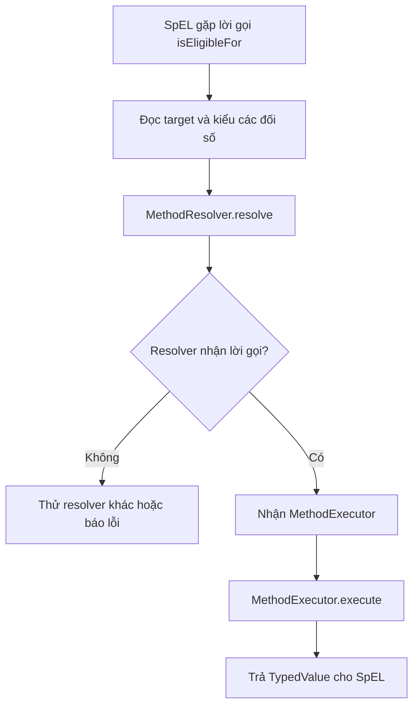

# MethodResolver khi cần gọi logic tùy biến

Trong ứng dụng Spring LDAP, dữ liệu được đọc từ directory server bằng `LdapTemplate` hoặc `LdapClient`, sau đó chuyển thành đối tượng Java để xử lý nghiệp vụ. Có những trường hợp quy tắc sau khi truy vấn không chỉ là kiểm tra một thuộc tính: ứng dụng cần kết hợp nhiều trường, chuẩn hóa dữ liệu hoặc áp một chính sách được kiểm soát. Nếu quy tắc được biểu diễn bằng **Spring Expression Language (SpEL)**, cơ chế **`MethodResolver`** cho phép định nghĩa cách *một lời gọi phương thức trong biểu thức* được tìm và thực thi.

Ví dụ, sau khi đọc các thuộc tính `uid`, `employeeType` và `departmentNumber` từ LDAP, ứng dụng có thể đánh giá:

```text
#person.isEligibleFor('internal-portal')
```

Đối tượng `person` không nhất thiết phải có phương thức Java tên `isEligibleFor`. Một `MethodResolver` tùy biến có thể nhận diện lời gọi này, kiểm tra đối số và chuyển nó cho chính sách nghiệp vụ đã được kiểm duyệt.

**Phân biệt ngay từ đầu:** `org.springframework.expression.MethodResolver` là API của **Spring Expression**, không phải một operation của LDAP và cũng không phải interface ánh xạ riêng của Spring LDAP. Nó hoạt động **trong JVM**, sau khi dữ liệu LDAP đã được lấy về. Dùng `MethodResolver` không làm LDAP server thực thi mã Java và không thay thế tìm kiếm qua LDAP filter, kiểm tra quyền hoặc các ràng buộc schema.

Sau bài học, bạn có thể:

- Hiểu sự khác nhau giữa `MethodResolver`, `MethodExecutor`, `PropertyAccessor` và `AttributesMapper`.
- Biết khi nào nên mở rộng việc phân giải phương thức SpEL thay vì chỉ gọi service Java bình thường.
- Viết một `MethodResolver` có danh sách phương thức cho phép (*allowlist*), kiểm tra kiểu đối số và không gọi phương thức tùy ý.
- Kết hợp `LdapTemplate.search(...)` với việc đánh giá quy tắc nghiệp vụ trên đối tượng ánh xạ từ LDAP.
- Nhận biết các vấn đề hiệu năng, cache, bảo mật SpEL, dữ liệu LDAP thiếu thuộc tính và khả năng kiểm thử.

## 1. Resolver nằm ở tầng nào trong ứng dụng Spring LDAP?

Hãy xem đường đi của dữ liệu:

```text
LDAP server
   │  LDAP search/filter
   ▼
ContextSource → LdapTemplate / LdapClient
   │
   │  AttributesMapper / ContextMapper
   ▼
DirectoryPerson (đối tượng Java)
   │
   ▼
SpEL: #person.isEligibleFor('internal-portal')
   │
   ├─ EvaluationContext
   ├─ MethodResolver        xác định lời gọi nào được hỗ trợ
   └─ MethodExecutor        thực hiện quy tắc nghiệp vụ
   │
   ▼
Kết quả true/false phục vụ ứng dụng
```

Có ba nhiệm vụ khác nhau mà người mới học dễ nhầm:

| Thành phần | Thuộc tầng | Công việc |
| --- | --- | --- |
| LDAP filter | LDAP server | Chọn entry thỏa điều kiện theo cú pháp filter và khả năng so khớp của server |
| `AttributesMapper` / `ContextMapper` | Spring LDAP | Biến dữ liệu entry LDAP thành đối tượng hoặc giá trị Java |
| `PropertyAccessor` | Spring Expression | Quyết định cách biểu thức đọc/ghi property trên đối tượng |
| `MethodResolver` | Spring Expression | Tìm cách xử lý lời gọi phương thức theo tên, target và kiểu tham số |
| `MethodExecutor` | Spring Expression | Thực thi phương thức được resolver chọn, trả `TypedValue` |

Ví dụ:

```text
(user thuộc loại employee, phòng ban D01)
    │
    ├─ LDAP filter: (employeeType=employee)
    │                 → server có thể lọc entry theo attribute
    │
    └─ SpEL: #person.isEligibleFor('internal-portal')
                      → ứng dụng đánh giá thêm chính sách nội bộ
```

**Không coi SpEL là ngôn ngữ filter LDAP.** Một biểu thức SpEL không tự biến thành LDAP search filter. Nếu mục tiêu là giảm số entry từ hàng triệu xuống vài chục, hãy tối ưu base DN, scope và LDAP filter **trước khi** áp logic phía Java.

## 2. `MethodResolver` và `MethodExecutor` hoạt động thế nào?

Spring Expression cung cấp hai interface chủ chốt:

```java
import java.util.List;

import org.springframework.core.convert.TypeDescriptor;
import org.springframework.expression.AccessException;
import org.springframework.expression.EvaluationContext;
import org.springframework.expression.MethodExecutor;
import org.springframework.expression.MethodResolver;
```

Chữ ký rút gọn của `MethodResolver`:

```java
MethodExecutor resolve(
        EvaluationContext context,
        Object targetObject,
        String name,
        List<TypeDescriptor> argumentTypes)
        throws AccessException;
```

Ý nghĩa các tham số:

| Tham số | Cách hiểu |
| --- | --- |
| `context` | Ngữ cảnh đánh giá SpEL (variables, resolvers, conversion service, ...) |
| `targetObject` | Đối tượng nhận lời gọi, ví dụ giá trị biến `#person` |
| `name` | Tên phương thức trong biểu thức, ví dụ `isEligibleFor` |
| `argumentTypes` | Mô tả kiểu của các đối số được cung cấp |
| Giá trị trả về | `MethodExecutor` nếu resolver xử lý lời gọi, hoặc `null` để cho resolver khác thử tiếp |
| `AccessException` | Lỗi phân giải hoặc lỗi thực thi do cơ chế truy cập phương thức báo |

Khi `MethodResolver` đã tìm được cơ chế thực hiện, SpEL gọi `MethodExecutor`:

```java
import org.springframework.expression.TypedValue;

TypedValue execute(
        EvaluationContext context,
        Object target,
        Object... arguments)
        throws AccessException;
```

`TypedValue` đóng gói kết quả đánh giá và thông tin kiểu của nó. Ví dụ, một quy tắc boolean có thể trả `new TypedValue(true)`.

### Chuỗi xử lý một lời gọi



Để tạo một *virtual method* (phương thức chỉ tồn tại trong ngữ nghĩa biểu thức), `MethodResolver` có thể trả executor ngay cả khi lớp Java của target **không có** phương thức tương ứng.

**Quy tắc an toàn:** Chỉ nhận diện **tên phương thức và target cụ thể**. Với lời gọi không thuộc phạm vi, trả `null`; với lời gọi đúng tên nhưng đối số không hợp lệ, báo lỗi rõ ràng. Không tạo một resolver tự động tìm và gọi mọi method phản chiếu của mọi object.

## 3. Khi nào thật sự cần `MethodResolver` tùy biến?

Có nhiều trường hợp chỉ dùng Java hoặc SpEL thông thường là đủ.

| Nhu cầu | Lựa chọn hợp lý | Có cần custom `MethodResolver`? |
| --- | --- | --- |
| Đọc `uid`, `cn`, `mail` từ LDAP | `AttributesMapper` hoặc `ContextMapper` | Không |
| Ánh xạ `cn` sang trường `displayName` trong DTO | Mapper/service Java | Không |
| Gọi method public đã có trên DTO trong biểu thức tin cậy | SpEL reflective method resolution thông thường | Thường không |
| Chạy một quy tắc duy nhất, không có lý do dùng biểu thức | Gọi Java service trực tiếp | Thường không |
| Muốn biểu thức dùng một tên method ảo nhưng DTO không triển khai method đó | Custom `MethodResolver` + `MethodExecutor` | Có thể |
| Muốn áp allowlist, kiểm soát đối số và cách thực thi một lời gọi SpEL | Custom resolver hoặc thiết kế evaluation context chặt chẽ | Có thể |
| Muốn đổi cách đọc property `person.department` | `PropertyAccessor` | Không phải nhiệm vụ của `MethodResolver` |
| Muốn LDAP server tìm các entry khớp filter | `LdapQueryBuilder` / LDAP filter | Không |

Ví dụ phù hợp với custom resolver: một hệ thống có nhiều loại DTO LDAP cần giữ đối tượng dữ liệu thuần túy, nhưng lớp chính sách cho phép biểu thức nghiệp vụ gọi một method ảo với ngữ nghĩa thống nhất. Quy tắc có thể được kiểm thử độc lập với LDAP.

Ngược lại, nếu chính sách chỉ gọi từ một nơi, viết thẳng:

```java
boolean allowed = directoryPolicy.isEligible(person, "internal-portal");
```

sẽ đơn giản, dễ đọc và an toàn hơn. **Không nên dùng SpEL chỉ để thay cho một lời gọi Java thông thường** khi không có nhu cầu cấu hình/diễn giải biểu thức thật sự.

## 4. Ví dụ dữ liệu: đọc thuộc tính từ entry LDAP

Giả sử LDAP có entry:

```ldif
dn: uid=an,ou=people,dc=example,dc=org
objectClass: top
objectClass: person
objectClass: organizationalPerson
objectClass: inetOrgPerson
uid: an
cn: An Nguyen
sn: Nguyen
employeeType: employee
departmentNumber: D01
```

Chúng ta muốn kiểm tra điều kiện minh họa: một người dùng được phép dùng `internal-portal` nếu `employeeType=employee` và `departmentNumber` thuộc hai phòng ban cho phép `D01` hoặc `D02`. Đây là **quy tắc nghiệp vụ của ứng dụng trong ví dụ**, không phải quyền ACL của LDAP server.

### DTO Java tách khỏi truy vấn

```java
public final class DirectoryPerson {
    private final String uid;
    private final String employeeType;
    private final String departmentNumber;

    public DirectoryPerson(
            String uid, String employeeType, String departmentNumber) {
        this.uid = uid;
        this.employeeType = employeeType;
        this.departmentNumber = departmentNumber;
    }

    public String getUid() {
        return uid;
    }

    public String getEmployeeType() {
        return employeeType;
    }

    public String getDepartmentNumber() {
        return departmentNumber;
    }
}
```

**Cố ý không khai báo `isEligibleFor(...)` trong DTO.** Chúng ta sẽ bổ sung ngữ nghĩa của tên phương thức đó bằng `MethodResolver`.

### Truy vấn Spring LDAP và ánh xạ dữ liệu

Giả sử `LdapTemplate` đã được cấu hình với `ContextSource` base DN `dc=example,dc=org`, tài khoản đủ quyền đọc và kết nối TLS được xác thực chứng chỉ.

```java
import java.util.List;

import javax.naming.NamingException;
import javax.naming.directory.Attribute;
import javax.naming.directory.Attributes;

import org.springframework.ldap.core.AttributesMapper;
import org.springframework.ldap.core.LdapTemplate;
import org.springframework.ldap.query.LdapQuery;
import org.springframework.ldap.query.LdapQueryBuilder;

public final class DirectoryPersonRepository {
    private final LdapTemplate ldapTemplate;

    public DirectoryPersonRepository(LdapTemplate ldapTemplate) {
        this.ldapTemplate = ldapTemplate;
    }

    public DirectoryPerson findByUid(String uid) {
        LdapQuery query = LdapQueryBuilder.query()
                .base("ou=people")
                .attributes("uid", "employeeType", "departmentNumber")
                .where("uid").is(uid);

        List<DirectoryPerson> results = ldapTemplate.search(
                query,
                (AttributesMapper<DirectoryPerson>) attrs ->
                        new DirectoryPerson(
                                readString(attrs, "uid"),
                                readString(attrs, "employeeType"),
                                readString(attrs, "departmentNumber")));

        if (results.size() != 1) {
            throw new IllegalStateException(
                    "Cần đúng một entry UID trong nhánh đã chọn; nhận "
                    + results.size());
        }
        return results.get(0);
    }

    private static String readString(Attributes attrs, String name)
            throws NamingException {
        Attribute attribute = attrs.get(name);
        if (attribute == null || attribute.size() == 0) {
            return null;
        }
        Object value = attribute.get();
        return value instanceof String ? (String) value : null;
    }
}
```

Điểm cần chú ý:

- `LdapQueryBuilder` xử lý `uid` trong **filter**, không nối dữ liệu nhập vào chuỗi LDAP filter thủ công.
- `.base("ou=people")` là tên tương đối so với `ContextSource` base đã cấu hình.
- Chỉ yêu cầu ba thuộc tính phục vụ chính sách, tránh tải toàn bộ entry.
- Thuộc tính tùy chọn không tồn tại hoặc không được phép đọc có thể cho giá trị `null`; quy tắc xử lý tiếp theo phải quyết định an toàn.
- Ví dụ yêu cầu **đúng một** kết quả, thay vì chọn ngẫu nhiên entry đầu khi `uid` có thể trùng ở những nhánh khác nhau.

Nếu ứng dụng đã biết DN chính xác, có thể dùng `lookup`/`lookupContext` thay vì search. Không nên dùng `MethodResolver` để thay thế việc xác định entry cần đọc.

## 5. Định nghĩa logic nghiệp vụ độc lập với SpEL

Viết một service thuần Java cho quy tắc quyền dùng cổng nội bộ:

```java
import java.util.Set;

public final class DirectoryEligibilityPolicy {
    private static final Set<String> ALLOWED_DEPARTMENTS =
            Set.of("D01", "D02");

    public boolean isEligible(DirectoryPerson person, String program) {
        if (person == null || program == null) {
            return false;
        }

        // Chỉ nhận biết chương trình đã được phê duyệt.
        if (!"internal-portal".equals(program)) {
            return false;
        }

        return "employee".equalsIgnoreCase(person.getEmployeeType())
                && ALLOWED_DEPARTMENTS.contains(
                        person.getDepartmentNumber());
    }
}
```

`Set.of(...)` cần Java 9 trở lên; nếu dự án chạy Java 8, dùng tập bất biến tương đương. Trong hệ thống thật, danh sách phòng ban và quy tắc cần được quản lý theo nghiệp vụ và bảo mật phù hợp.

**Ưu điểm của việc tách policy ra khỏi resolver:** Logic được kiểm thử bằng unit test không cần Spring, SpEL hay LDAP server. `MethodResolver` chỉ lo phân giải tên method và chuyển các đối số hợp lệ cho service.

Chú ý `isEligible` **không phải** kiểm tra xác thực LDAP, không kiểm chứng mật khẩu, không thay LDAP ACL và không xác nhận tất cả dữ liệu LDAP đang đầy đủ. Nếu thiếu `employeeType` hoặc `departmentNumber`, ví dụ trên chủ động trả `false`.

## 6. Viết một `MethodResolver` có giới hạn rõ ràng

Chúng ta định nghĩa method ảo `isEligibleFor(String program)` chỉ dùng trên đối tượng `DirectoryPerson`. Lời gọi ngoài tập này sẽ không được custom resolver xử lý.

```java
import java.util.List;

import org.springframework.core.convert.TypeDescriptor;
import org.springframework.expression.AccessException;
import org.springframework.expression.EvaluationContext;
import org.springframework.expression.MethodExecutor;
import org.springframework.expression.MethodResolver;
import org.springframework.expression.TypedValue;

public final class DirectoryMethodResolver implements MethodResolver {
    private final DirectoryEligibilityPolicy policy;

    public DirectoryMethodResolver(DirectoryEligibilityPolicy policy) {
        this.policy = policy;
    }

    @Override
    public MethodExecutor resolve(
            EvaluationContext context,
            Object targetObject,
            String name,
            List<TypeDescriptor> argumentTypes) throws AccessException {

        // Chỉ chấp nhận một method ảo trên đúng loại đối tượng.
        if (!(targetObject instanceof DirectoryPerson)
                || !"isEligibleFor".equals(name)) {
            return null; // Resolver khác có thể xử lý lời gọi.
        }

        // Với method đã nhận diện, đối số sai là lỗi rõ ràng.
        if (argumentTypes.size() != 1
                || argumentTypes.get(0) == null
                || !String.class.isAssignableFrom(
                        argumentTypes.get(0).getType())) {
            throw new AccessException(
                    "isEligibleFor cần đúng một đối số String");
        }

        return (executionContext, target, arguments) -> {
            if (!(target instanceof DirectoryPerson)
                    || arguments.length != 1
                    || !(arguments[0] instanceof String)) {
                throw new AccessException(
                        "Target hoặc đối số không hợp lệ");
            }

            boolean allowed = policy.isEligible(
                    (DirectoryPerson) target,
                    (String) arguments[0]);

            return new TypedValue(allowed);
        };
    }
}
```

Trong code:

1. `resolve(...)` chạy khi engine cần tìm cách xử lý một lời gọi phương thức.
2. Resolver kiểm tra **kiểu target**, **tên method**, **số lượng** và **kiểu đối số**. Nó không nhận diện mọi phương thức bằng reflection.
3. Nếu target không phải `DirectoryPerson` hoặc tên khác `isEligibleFor`, trả `null` — tức *resolver này không xử lý*.
4. Với lời gọi đã nhận diện mà đối số không đúng hợp đồng, ném `AccessException` để báo lỗi.
5. `MethodExecutor` gọi `DirectoryEligibilityPolicy` và trả kết quả trong `TypedValue`.

Đây là **method ảo ở tầng SpEL**; không có mã nào được gửi tới LDAP server khi `isEligibleFor(...)` được đánh giá.

### Vì sao cần kiểm tra đối số hai lần?

`argumentTypes` giúp resolver quyết định có hỗ trợ lời gọi ngay trong quá trình **phân giải**. `arguments` của executor là giá trị thực được truyền vào lúc **thực thi**. Việc kiểm tra trong `execute(...)` giúp bảo vệ hợp đồng, đặc biệt khi biểu thức hoặc cơ chế chuyển đổi kiểu phức tạp hơn và executor có thể được engine cache.

Nếu muốn hỗ trợ nhiều kiểu hoặc overload, cần thiết kế quy tắc phân giải/ép kiểu cụ thể. Không nên âm thầm gọi `toString()` trên mọi đối tượng, vì cách đó có thể chấp nhận đầu vào ngoài dự kiến.

## 7. Đăng ký resolver trong `StandardEvaluationContext`

`StandardEvaluationContext` quản lý các biến, resolver và cấu hình cần thiết để đánh giá biểu thức SpEL. Tạo một evaluator riêng:

```java
import java.util.List;

import org.springframework.expression.Expression;
import org.springframework.expression.spel.standard.SpelExpressionParser;
import org.springframework.expression.spel.support.StandardEvaluationContext;

public final class DirectoryRuleEvaluator {
    private final DirectoryMethodResolver resolver;
    private final Expression expression;

    public DirectoryRuleEvaluator(DirectoryEligibilityPolicy policy) {
        this.resolver = new DirectoryMethodResolver(policy);

        // Biểu thức do ứng dụng định nghĩa, không lấy từ request.
        this.expression = new SpelExpressionParser().parseExpression(
                "#person.isEligibleFor('internal-portal')");
    }

    public boolean canAccessPortal(DirectoryPerson person) {
        // Tạo context cho mỗi lần đánh giá: không chia sẻ biến mutable.
        StandardEvaluationContext context =
                new StandardEvaluationContext();

        // Ví dụ chỉ cho phép custom resolver này phân giải method.
        context.setMethodResolvers(List.of(resolver));
        context.setVariable("person", person);

        Boolean result = expression.getValue(context, Boolean.class);
        return Boolean.TRUE.equals(result);
    }
}
```

Có thể gọi:

```java
DirectoryEligibilityPolicy policy = new DirectoryEligibilityPolicy();
DirectoryRuleEvaluator evaluator = new DirectoryRuleEvaluator(policy);

DirectoryPerson an =
        new DirectoryPerson("an", "employee", "D01");

DirectoryPerson binh =
        new DirectoryPerson("binh", "contractor", "D01");

System.out.println(evaluator.canAccessPortal(an));   // true
System.out.println(evaluator.canAccessPortal(binh)); // false
```

**Chi tiết thiết kế:**

- `setMethodResolvers(...)` thay danh sách resolver xử lý lời gọi method. Trong ví dụ chỉ có `DirectoryMethodResolver`; một lời gọi method khác không được resolver này hỗ trợ sẽ không tìm thấy executor trong danh sách đó.
- `addMethodResolver(...)` là cách bổ sung một resolver vào context đang có những resolver khác. Thứ tự resolver có thể ảnh hưởng đến việc lời gọi nào được chọn; cần hiểu cấu hình hiện tại khi muốn tùy biến hoặc ưu tiên một phương thức.
- `expression` được parse khi khởi tạo evaluator, còn `StandardEvaluationContext` có biến `#person` được tạo mới cho mỗi lần đánh giá. Điều này tránh ghi đè biến giữa các request đồng thời.
- `resolver` và `policy` được dùng nhất quán trong vòng đời evaluator. Không nên tái sử dụng một expression đã cache executor với những chính sách mang trạng thái không tương thích giữa các tenant mà không xem xét cơ chế cache của SpEL.

**Giới hạn bảo mật quan trọng:** Chỉ thay danh sách `MethodResolver` **không tự biến `StandardEvaluationContext` thành một sandbox an toàn**. SpEL còn có thể truy cập property, kiểu, constructor và các khả năng khác tùy context. Vì vậy, ở ví dụ này **chuỗi biểu thức là hằng số do ứng dụng kiểm soát**. Không nhận một chuỗi SpEL tùy ý từ HTTP request, LDAP attribute không đáng tin cậy hoặc người dùng rồi đánh giá trực tiếp bằng `StandardEvaluationContext`.

Với nhu cầu cho người dùng cấu hình biểu thức có hạn chế, nên cân nhắc `SimpleEvaluationContext` hoặc một ngôn ngữ quy tắc giới hạn riêng, đồng thời kiểm tra những tính năng được phép và API của phiên bản Spring đang dùng. `MethodResolver` chỉ là *một* phần của mô hình bảo mật, không phải cơ chế phân quyền thay thế ứng dụng.

## 8. Kết hợp LDAP repository và evaluator

Sau khi có `DirectoryPersonRepository` và `DirectoryRuleEvaluator`, tầng nghiệp vụ có thể rõ ràng như sau:

```java
public final class PortalAccessService {
    private final DirectoryPersonRepository repository;
    private final DirectoryRuleEvaluator ruleEvaluator;

    public PortalAccessService(
            DirectoryPersonRepository repository,
            DirectoryRuleEvaluator ruleEvaluator) {
        this.repository = repository;
        this.ruleEvaluator = ruleEvaluator;
    }

    public boolean canEnterInternalPortal(String uid) {
        DirectoryPerson person = repository.findByUid(uid);
        return ruleEvaluator.canAccessPortal(person);
    }
}
```

Quy trình:

```text
uid nhập vào
   │
   ├── LdapTemplate.search(filter có giá trị được escape đúng)
   │           ↓
   │      DirectoryPerson
   │           ↓
   └── SpEL / MethodResolver / Policy
               ↓
          true hoặc false
```

Cần phân biệt kết quả `true` của policy với việc xác thực người dùng: ví dụ chỉ minh họa kiểm tra thuộc tính nghiệp vụ. Trong hệ thống đăng nhập, còn phải xác thực danh tính bằng cơ chế được duyệt, bảo vệ kết nối TLS, kiểm tra quyền và không tin giá trị `uid` do client tự khai mà không có ràng buộc danh tính.

### Khi nào nên đẩy điều kiện xuống LDAP server?

Nếu điều kiện chỉ đơn giản là “`employeeType=employee`”, LDAP filter có thể xử lý ngay:

```java
import org.springframework.ldap.query.LdapQuery;
import org.springframework.ldap.query.LdapQueryBuilder;

LdapQuery query = LdapQueryBuilder.query()
        .base("ou=people")
        .where("employeeType").is("employee");
```

Với điều kiện phức tạp hơn, vẫn có thể áp **filter để giảm tập ứng viên**:

```java
LdapQuery query = LdapQueryBuilder.query()
        .base("ou=people")
        .where("employeeType").is("employee")
        .and("departmentNumber").is("D01");
```

Tuy nhiên, nếu cần hai phòng ban `D01` hoặc `D02`, filter phải diễn đạt đúng quan hệ AND/OR; ví dụ trên chỉ tìm **D01**, không phải đầy đủ chính sách của ví dụ. Logic nghiệp vụ ở Java có thể chứa điều kiện thay đổi theo sản phẩm, quy tắc bổ sung hoặc cần nguồn dữ liệu khác. Dù vậy, **không nên tải toàn bộ DIT để chạy SpEL** khi server có thể lọc bớt phần lớn entry bằng filter có index phù hợp.

**Không nhầm tầng thực thi:** LDAP filter được chạy theo schema/matching rules của directory server; so sánh `equalsIgnoreCase` hoặc `Set.contains` trong Java dùng ngữ nghĩa Java. Hai cách không luôn tương đương khi có Unicode, normalization hoặc các matching rules đặc biệt.

## 9. `MethodResolver` khác `PropertyAccessor` và các mapper ra sao?

Xét một entry LDAP sau khi ánh xạ thành `DirectoryPerson`:

```text
#person.employeeType
#person.isEligibleFor('internal-portal')
```

Hai biểu thức không giống nhau:

- `#person.employeeType` là **truy cập property**. Cách lấy property do các `PropertyAccessor` trong evaluation context và khả năng đọc property của object quyết định. Với POJO có getter, SpEL thường đọc thông qua cơ chế property access chuẩn.
- `#person.isEligibleFor(...)` là **gọi method**. Cách chọn method hoặc executor do `MethodResolver` quyết định.

Trong khi đó, `AttributesMapper` của Spring LDAP giải quyết việc khác hẳn: đưa `Attributes` của LDAP thành `DirectoryPerson` hoặc một giá trị Java. Nó không xử lý cú pháp gọi method trong biểu thức.

| Thứ cần tùy biến | Hook thường phù hợp | Ví dụ |
| --- | --- | --- |
| Attribute LDAP được chuyển sang trường Java ra sao | `AttributesMapper` / `ContextMapper` | `employeeType` → `DirectoryPerson.employeeType` |
| Đọc một property từ đối tượng Java hoặc cấu trúc dữ liệu tùy biến | `PropertyAccessor` | `#person.employeeType` |
| Phân giải lời gọi method của SpEL | `MethodResolver` | `#person.isEligibleFor('internal-portal')` |
| Thực thi method đã được chọn | `MethodExecutor` | Gọi `policy.isEligible(...)` |
| Xác định LDAP entry nào cần trả về | LDAP filter, base DN và search scope | `(employeeType=employee)` |

Nhờ chia trách nhiệm, quy tắc Java có thể thay đổi mà không cần sửa cấu trúc DIT, trong khi mapper vẫn chuyên về dữ liệu LDAP và resolver vẫn chuyên về cú pháp invocation.

## 10. Hiệu năng, cache và vòng đời tài nguyên

### Tránh truy vấn LDAP bên trong mỗi lần gọi method

Một anti-pattern dễ xuất hiện là để `MethodExecutor` gọi `ldapTemplate.search(...)` mỗi khi `#person.isEligibleFor(...)` được đánh giá. Với một danh sách 5.000 entry, điều này có thể tạo **5.000 truy vấn LDAP phụ** (*N+1 queries*), tăng tải server và độ trễ.

Nên ưu tiên:

1. Xác định thuộc tính cần thiết ngay từ đầu.
2. Dùng LDAP filter với base/scope hợp lý và chỉ tải những thuộc tính thực sự cần.
3. Ánh xạ entry thành DTO đơn giản.
4. Dùng `MethodResolver` để gọi logic thuần Java trên dữ liệu đã có.
5. Chỉ gọi LDAP bổ sung khi không thể tránh, có giới hạn, timeout và cơ chế cache phù hợp yêu cầu tính mới.

Trong ví dụ này, `DirectoryEligibilityPolicy` không truy cập LDAP; mọi thuộc tính đã được đọc một lần từ repository.

### Cache biểu thức và executor

Parse SpEL có chi phí. Biểu thức **cố định và đáng tin cậy** có thể được parse một lần và tái sử dụng, như `DirectoryRuleEvaluator` ở trên. Tuy nhiên:

- Không chia sẻ một `StandardEvaluationContext` chứa biến `#person` có thể bị thay đổi giữa nhiều request.
- Resolver có thể nhận trạng thái cấu hình/policy; cần tránh dùng expression/executor cache lẫn giữa tenant hoặc bộ policy khác nhau.
- Nếu policy thay đổi theo thời gian, cần chiến lược phiên bản hóa/đọc lại policy; không để kết quả cache tồn tại vô thời hạn khi nghiệp vụ cần cập nhật.
- Đừng dùng cache thuộc tính LDAP như bằng chứng tài khoản vẫn còn quyền. Dữ liệu LDAP, trạng thái tài khoản và ACL có thể đã thay đổi trên server.

**Bộ nhớ và streaming:** Đối với hàng trăm nghìn entry, hãy dùng callback hoặc phân trang thay cho `List` rất lớn. Một resolver xử lý từng DTO không tự giải quyết giới hạn size/time của LDAP server.

## 11. Bảo mật và giới hạn tin cậy

Spring Expression rất linh hoạt, vì thế việc tùy biến `MethodResolver` cần có ranh giới rõ:

| Rủi ro | Cách kiểm soát |
| --- | --- |
| Biểu thức do người dùng tự cung cấp có thể truy cập API không mong muốn | Chỉ dùng biểu thức được duyệt; không đánh giá SpEL tùy ý bằng context toàn năng |
| Resolver nhận mọi tên phương thức | Allowlist theo tên method, kiểu target và kiểu tham số |
| Executor dùng reflection động dựa trên tên nhập | Gọi trực tiếp method nghiệp vụ đã định nghĩa, không dùng `getMethod(...).invoke(...)` tùy ý |
| Attribute LDAP thiếu hoặc bị ACL che | Xử lý null an toàn, không ngầm cho phép khi thiếu thông tin |
| Query phía repository bị nối filter từ dữ liệu nhập | Dùng `LdapQueryBuilder` hoặc filter parameterized |
| Dữ liệu người dùng lẫn vào log | Không ghi credential, entry đầy đủ hoặc thông tin nhạy cảm không cần thiết |
| Kết quả policy bị coi là xác thực LDAP | Tách authentication, authorization và quy tắc nghiệp vụ |
| Mỗi lần đánh giá lại gọi LDAP | Giảm N+1 queries, tối ưu server filter, timeout và quyền |
| Directory server dùng kết nối không an toàn | Dùng LDAPS/StartTLS với xác minh chứng chỉ/hostname và quyền tối thiểu |

**Không dựa hoàn toàn vào `MethodResolver` để bảo vệ dữ liệu.** Dù resolver chỉ cho phép `isEligibleFor`, cấu hình các thành phần khác của SpEL có thể vẫn rộng. Ranh giới đầu tiên vẫn là nơi biểu thức được tạo ra, context được cấp khả năng gì và ai được phép gọi chức năng.

## 12. Kiểm thử `MethodResolver` mà không cần LDAP server

Ưu điểm của cách thiết kế trên là có thể kiểm thử ba lớp độc lập:

1. **Policy**: giá trị đầu vào khác nhau có được cho phép hay không.
2. **Resolver/evaluator**: tên method ảo, kiểu đối số và kết quả `TypedValue`.
3. **Repository**: ánh xạ dữ liệu `Attributes` từ LDAP và trường hợp không tìm thấy/trùng UID.

### Kiểm thử logic nghiệp vụ

```java
import static org.junit.jupiter.api.Assertions.*;

import org.junit.jupiter.api.Test;

class DirectoryEligibilityPolicyTest {
    private final DirectoryEligibilityPolicy policy =
            new DirectoryEligibilityPolicy();

    @Test
    void employeeInAllowedDepartmentCanEnter() {
        DirectoryPerson person =
                new DirectoryPerson("an", "employee", "D01");

        assertTrue(policy.isEligible(person, "internal-portal"));
    }

    @Test
    void contractorCannotEnter() {
        DirectoryPerson person =
                new DirectoryPerson("binh", "contractor", "D01");

        assertFalse(policy.isEligible(person, "internal-portal"));
    }

    @Test
    void missingDepartmentIsDenied() {
        DirectoryPerson person =
                new DirectoryPerson("chi", "employee", null);

        assertFalse(policy.isEligible(person, "internal-portal"));
    }
}
```

### Kiểm thử evaluator có gọi resolver

```java
import static org.junit.jupiter.api.Assertions.*;

import org.junit.jupiter.api.Test;

class DirectoryRuleEvaluatorTest {
    private final DirectoryRuleEvaluator evaluator =
            new DirectoryRuleEvaluator(new DirectoryEligibilityPolicy());

    @Test
    void expressionCallsSyntheticMethod() {
        assertTrue(evaluator.canAccessPortal(
                new DirectoryPerson("an", "employee", "D01")));

        assertFalse(evaluator.canAccessPortal(
                new DirectoryPerson("binh", "employee", "D99")));
    }
}
```

Ở mức test nâng cao, có thể gọi `DirectoryMethodResolver.resolve(...)` với tên method không được hỗ trợ và xác minh giá trị `null`, hoặc thử lời gọi sai số lượng/kiểu đối số và kiểm tra báo lỗi. Đừng chỉ kiểm tra case trả `true`; cần cả các tình huống **từ chối** và **thiếu dữ liệu**.

Với kiểm thử tích hợp LDAP, dùng server thử nghiệm có schema và ACL đại diện cho môi trường mục tiêu, kết nối an toàn và dữ liệu không nhạy cảm. Không tự tạo hoặc sửa entry sản xuất chỉ để kiểm thử resolver: logic resolver chủ yếu có thể được kiểm tra hoàn toàn bằng unit test.

## 13. Bài thực hành mở rộng

Giả sử ứng dụng cần hỗ trợ thêm chương trình `partner-portal`:

- Người dùng có `employeeType=partner`.
- `departmentNumber` thuộc một tập do nghiệp vụ quy định.
- Dữ liệu thiếu hoặc chương trình không được hỗ trợ thì từ chối.

Hãy thực hiện:

1. Thêm quy tắc vào `DirectoryEligibilityPolicy`, giữ nguyên DTO và `MethodResolver` nếu hợp đồng method ảo không thay đổi.
2. Thêm test cho một partner hợp lệ, một partner sai phòng ban và một chương trình không biết.
3. Thay biểu thức tin cậy trong `DirectoryRuleEvaluator` thành `#person.isEligibleFor('partner-portal')` và kiểm tra kết quả.
4. Nếu phải hỗ trợ nhiều biểu thức, thiết kế danh sách biểu thức được duyệt thay vì nhận trực tiếp chuỗi từ người dùng.
5. Quan sát rằng toàn bộ thay đổi thuộc **logic ứng dụng**, không yêu cầu bổ sung method Java vào `DirectoryPerson` và không làm LDAP filter tự hiểu `isEligibleFor`.

### Câu hỏi tự kiểm tra

**Câu 1.** `MethodResolver` có phải interface của Spring LDAP dùng để truy vấn server không?

**Đáp án:** Không. Nó nằm trong Spring Expression (`org.springframework.expression`), dùng để phân giải lời gọi method của SpEL trong JVM. Spring LDAP cung cấp dữ liệu để logic đó xử lý.

**Câu 2.** Khi một biểu thức `#person.isEligibleFor('internal-portal')` được đánh giá, đối tượng `person` bắt buộc phải có method Java `isEligibleFor` không?

**Đáp án:** Không, nếu một custom `MethodResolver` nhận diện lời gọi và cung cấp `MethodExecutor` tương ứng. Đây là cách bổ sung method ảo cho biểu thức.

**Câu 3.** Trả `null` từ `MethodResolver.resolve(...)` nghĩa là biểu thức có kết quả boolean `false`?

**Đáp án:** Không. `null` nghĩa resolver **không xử lý** lời gọi, để resolver khác thử tiếp. Kết quả boolean đến từ `MethodExecutor.execute(...)` nếu method được phân giải thành công.

**Câu 4.** Một resolver được cấu hình allowlist có làm mọi biểu thức SpEL do người dùng nhập trở nên an toàn không?

**Đáp án:** Không. SpEL có nhiều khả năng ngoài method invocation; phải kiểm soát nguồn biểu thức, toàn bộ evaluation context, các resolver/accessor khác và quyền ứng dụng.

**Câu 5.** Nếu muốn lọc 100.000 entry theo `employeeType=employee`, dùng `MethodResolver` để lọc trong Java có tốt hơn LDAP filter không?

**Đáp án:** Thường không. LDAP filter có thể giảm tập kết quả ngay trên server và tận dụng index; custom resolver phù hợp cho logic nghiệp vụ cần đánh giá **sau khi** đã lấy dữ liệu cần thiết.

**Câu 6.** `PropertyAccessor` và `MethodResolver` giải quyết cùng một việc không?

**Đáp án:** Không. `PropertyAccessor` xử lý truy cập property như `#person.employeeType`; `MethodResolver` xử lý lời gọi method như `#person.isEligibleFor(...)`.

## Ghi nhớ

**`MethodResolver` giúp SpEL hiểu và thực thi lời gọi logic tùy biến trong ứng dụng, không phải trên LDAP server.** Khi dùng cùng Spring LDAP, hãy lấy dữ liệu bằng `LdapTemplate`/`LdapClient`, ánh xạ thuộc tính qua mapper, rồi đánh giá chính sách qua `MethodResolver` và `MethodExecutor` nếu thật sự cần cơ chế biểu thức. Giới hạn rõ tên method, target và đối số; ưu tiên logic Java dễ kiểm thử; tránh đánh giá SpEL từ nguồn không tin cậy. Với tập LDAP lớn, vẫn phải tối ưu search base, filter, index, paging và lượng dữ liệu trả về — custom resolver không thay thế các nguyên tắc truy vấn và bảo mật đó.
