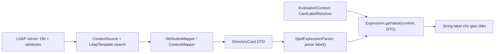
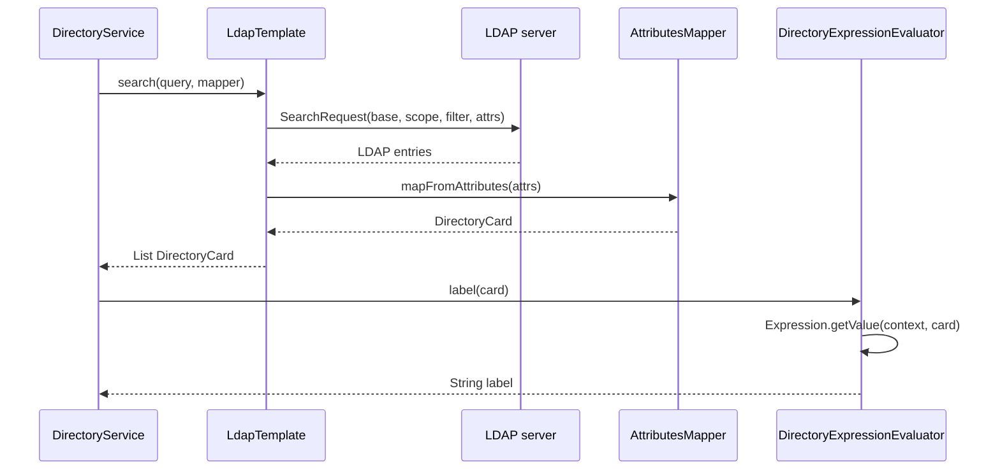
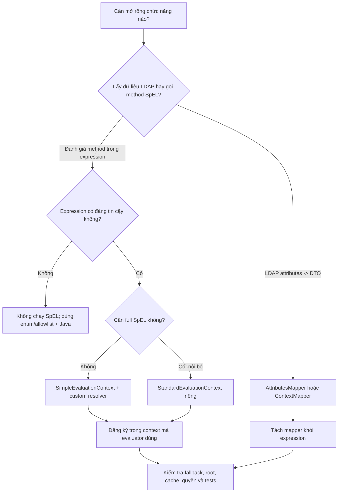

# Đăng ký resolver vào nơi sử dụng phù hợp

## Mục tiêu bài học

Trong **SPRING_LDAP**, một ứng dụng có thể đọc entry LDAP bằng `LdapTemplate` hoặc `LdapClient`, chuyển các thuộc tính thành DTO, rồi dùng biểu thức hoặc quy tắc hiển thị để lấy thông tin cần thiết. Khi có một **resolver** tùy chỉnh, câu hỏi quan trọng không chỉ là *viết resolver như thế nào*, mà còn là **đăng ký resolver vào đúng đối tượng sử dụng nó**. Một `MethodResolver` của Spring Expression chỉ phát huy tác dụng trong `EvaluationContext` được dùng khi đánh giá biểu thức; đặt nó trong Spring container dưới dạng `@Component` không tự khiến mọi truy vấn LDAP hoặc mọi biểu thức SpEL sử dụng resolver đó.

Bài nằm trong chương **Resolver và accessor**, tập trung vào ba ranh giới:

1. **Spring Expression (SpEL):** `MethodResolver`, `MethodExecutor`, `PropertyAccessor`, `BeanResolver`, `EvaluationContext`, `SimpleEvaluationContext` và `StandardEvaluationContext`. Đây là nơi đăng ký resolver để xử lý biểu thức.
2. **Spring LDAP:** `ContextSource`, `LdapTemplate`/`LdapClient`, `AttributesMapper`, `ContextMapper`, `DirContextAdapter` và ODM. Đây là nơi xử lý kết nối, truy vấn, ánh xạ và thay đổi LDAP entry; **không phải nơi mặc định đăng ký một SpEL MethodResolver**.
3. **Bảo mật và vận hành:** authorization của ứng dụng, LDAP ACL, filter/DN escaping, TLS, pooling, error handling và kiểm thử. **Không resolver nào tự thay thế quyền truy cập directory server.**

Tên “resolver” là một thuật ngữ dùng ở nhiều API khác nhau. Trong bài, ví dụ chính là **`org.springframework.expression.MethodResolver`**. Bài cũng nêu `BeanResolver` và phân biệt các loại mapper/resolver khác để tránh đăng ký sai vị trí.

Sau bài này, bạn sẽ:

- Chọn đúng đối tượng `EvaluationContext` để đăng ký `MethodResolver` và `PropertyAccessor`.
- Phân biệt `SimpleEvaluationContext.forPropertyAccessors(...).withMethodResolvers(...)` với `StandardEvaluationContext.addMethodResolver(...)` và `setMethodResolvers(...)`.
- Viết một custom resolver chỉ hỗ trợ method rõ ràng cho DTO LDAP, không mở reflection tùy ý.
- Hiểu việc đặt Spring bean, parser, mapper và LDAP context **không tự đăng ký resolver vào nơi khác**.
- Tránh fallback resolver quyền rộng, biểu thức không đáng tin, state chia sẻ giữa tenant/request và nguy cơ cached expression dùng chéo mức quyền.
- Thiết kế unit test cho cấu hình resolver và integration test cho toàn luồng đọc LDAP theo ACL/TLS.

## 1. Tình huống: từ LDAP entry đến biểu thức nghiệp vụ

Giả sử directory có base `dc=example,dc=org` và entry:

```ldif
dn: uid=lan,ou=People,dc=example,dc=org
objectClass: top
objectClass: person
objectClass: organizationalPerson
objectClass: inetOrgPerson
uid: lan
cn: Lan Nguyen
sn: Nguyen
mail: lan@example.org
description: Nhân viên bộ phận kỹ thuật
```

Một API đọc danh bạ chỉ cần DTO chứa `uid` và tên hiển thị:

```java
public record DirectoryCard(String uid, String displayName) {}
```

Ứng dụng có một quy tắc *do developer kiểm soát*:

```text
label()  -> "lan — Lan Nguyen"
```

Ở đây `label()` là **tên method logic trong biểu thức**, không phải LDAP attribute hay lời gọi sẵn có trên `DirContextAdapter`. Để diễn giải cú pháp này trong SpEL, developer viết một `MethodResolver` trả về `MethodExecutor` cụ thể.

Nếu đăng ký đúng chỗ, biểu thức `label()` được giải quyết trên `DirectoryCard`. Nếu chỉ có `@Component CardLabelResolver` nhưng `EvaluationContext` được dùng khi đánh giá **không có resolver này**, lời gọi biểu thức sẽ thất bại hoặc rơi vào cơ chế resolver khác theo cấu hình.

### 1.1. Sơ đồ đường dữ liệu



Nhìn sơ đồ sẽ thấy `LdapTemplate.search()` không tự biết về `CardLabelResolver`. `EvaluationContext` là một cấu hình độc lập cho **đường biểu thức**, và mapper là một callback riêng cho **đường LDAP**.

### 1.2. Ba khái niệm thường bị gọi nhầm là “resolver”

| Thành phần | Package/API | Đầu vào | Đầu ra/vai trò | Đăng ký ở đâu? |
| --- | --- | --- | --- | --- |
| `MethodResolver` | `org.springframework.expression` | Target Java, method name, arg types | Tìm `MethodExecutor` | `EvaluationContext` của biểu thức |
| `PropertyAccessor` | `org.springframework.expression` | Target và property name | Đọc/ghi property Java | `EvaluationContext` |
| `BeanResolver` | `org.springframework.expression` | Bean reference trong biểu thức | Tìm object bean | `StandardEvaluationContext.setBeanResolver(...)` khi có nhu cầu tin cậy |
| `AttributesMapper<T>` | `org.springframework.ldap.core` | `javax.naming.directory.Attributes` | DTO một entry | Truyền vào `ldapTemplate.search(..., mapper)` |
| `ContextMapper<T>` | `org.springframework.ldap.core` | Object từ `DirObjectFactory` (thường adapter) | DTO một entry, có thể lấy DN | Truyền vào `search(..., mapper)` hoặc `lookup(...)` |
| `ContextSource` | `org.springframework.ldap.core` | Cấu hình kết nối/bind | Tạo LDAP `DirContext` | Inject vào `LdapTemplate`/`LdapClient` |

**Lưu ý tên:** `ContextSource` là factory kết nối; nó **không đồng nghĩa** với `EvaluationContext` của SpEL. `ContextMapper` có chữ *Context* nhưng không thực thi `MethodResolver`. LDAP server có cơ chế DN/referral hoặc filter riêng; chúng cũng không phải SpEL method resolution.

## 2. MethodResolver giải quyết method ở đâu?

Spring Framework định nghĩa:

```java
// Hợp đồng cốt lõi của org.springframework.expression.MethodResolver:
MethodExecutor resolve(
        EvaluationContext context,
        Object targetObject,
        String name,
        java.util.List<org.springframework.core.convert.TypeDescriptor>
                argumentTypes)
        throws AccessException;
```

Đây là đoạn **trích dạng chữ ký API**, không phải một method khai báo trực tiếp ở top level Java. Resolver trả:

- Một `MethodExecutor` nếu nó **nhận trách nhiệm** xử lý method yêu cầu trên target và số/kiểu tham số tương thích.
- `null` nếu nó **không giải quyết** method ấy để SpEL cân nhắc resolver khác (nếu có).
- `AccessException` khi quá trình resolution thất bại theo contract.

`MethodExecutor` sau đó thực thi:

```java
TypedValue execute(
        EvaluationContext context, Object target, Object... arguments)
        throws AccessException;
```

**Điểm an toàn quan trọng:** Một resolver custom trả `null` không phải một chính sách **deny**. Nếu evaluation context còn `ReflectiveMethodResolver`, method có thể được tìm bằng reflection. Muốn hạn chế, cần kiểm soát **cả tập resolver** đăng ký vào context.

### 2.1. PropertyAccessor khác MethodResolver

Trong SpEL:

```text
displayName           -> property access -> PropertyAccessor
label()               -> method call     -> MethodResolver
#selectedName          -> variable        -> EvaluationContext variables
@directoryService      -> bean reference  -> BeanResolver (nếu cấu hình)
```

Một `PropertyAccessor` chỉ hỗ trợ `getStringAttribute("cn")` hoặc field Java **không tự giải quyết** biểu thức `label()`. Cũng không nên gọi một method resolver để thay thế mọi mapper LDAP: mapper nhận attribute của entry, còn resolver làm việc trên target của expression.

### 2.2. Parser không phải nơi giữ danh sách resolver

`SpelExpressionParser` phân tích chuỗi expression thành một `Expression`. Việc truy cập property/method trong lúc `getValue()` được quyết định bởi `EvaluationContext` truyền vào, không phải một resolver được “cài toàn cục” trong parser.

```text
SpelExpressionParser.parseExpression(...)
    -> Expression
       + EvaluationContext (chứa resolvers/accessors)
       + root object / variables
    -> getValue(...)
```

**Đăng ký đúng điểm thực thi:** Nếu một service tự gọi `expression.getValue(context, root)`, hãy cấu hình **chính context đó**. Cấu hình một context khác ở bean không được truyền vào phép đánh giá sẽ không có tác dụng.

## 3. Chọn nơi đăng ký resolver

Một cách ra quyết định:

| Nhu cầu | Nơi nên cấu hình | Điều cần tránh |
| --- | --- | --- |
| Biểu thức chỉ dùng DTO hiển thị danh bạ, tên method được duyệt | `SimpleEvaluationContext.forPropertyAccessors(...).withMethodResolvers(...)` | `StandardEvaluationContext` có reflection mặc định |
| Biểu thức cấu hình nội bộ phức tạp, tin cậy, cần đủ tính năng SpEL | `StandardEvaluationContext` của **chính evaluator đó** | Áp dụng cùng context quyền rộng cho HTTP input |
| Resolver được dùng trong một component/service | Tạo `DirectoryExpressionEvaluator` sở hữu parser/context | Chỉ `@Component` resolver rồi tưởng tự được sử dụng |
| Mapping LDAP attributes sang DTO | `ldapTemplate.search(query, attributesMapper)` | Đăng ký `MethodResolver` vào `ContextSource` |
| Mapping LDAP entry cần DN | `ldapTemplate.search(query, contextMapper)` | Thay `ContextMapper` bằng SpEL `MethodResolver` |
| ODM cho domain entity | Metadata `@Entry`, `@Attribute` và `ObjectDirectoryMapper` | Kỳ vọng custom SpEL resolver làm LDAP ODM hiểu schema |
| LDAP connection/TLS/pooling | `ContextSource` và config hạ tầng | Dùng `EvaluationContext` như LDAP connection |

**Không có một “resolver registry” toàn cục mặc định phù hợp mọi bài toán.** Đường đăng ký phụ thuộc vào **ai tạo evaluation context và ai thực sự đánh giá expression**.

## 4. Ví dụ: custom MethodResolver chỉ hỗ trợ một phép hiển thị

Ta xây `CardLabelResolver` để một expression tin cậy `label()` tạo chuỗi từ DTO:

```text
root = new DirectoryCard("lan", "Lan Nguyen")
expression = label()
result = lan — Lan Nguyen
```

**Phạm vi:** Phép tính chỉ làm việc trên đối tượng Java **đã được mapper đọc và authorization cho phép**. Resolver không gọi LDAP search, không có quyền sửa entry và không chạm trực tiếp vào `DirContextAdapter`.

### 4.1. Cài CardLabelResolver

```java
import java.util.List;
import org.springframework.core.convert.TypeDescriptor;
import org.springframework.expression.AccessException;
import org.springframework.expression.EvaluationContext;
import org.springframework.expression.MethodExecutor;
import org.springframework.expression.MethodResolver;
import org.springframework.expression.TypedValue;

public final class CardLabelResolver implements MethodResolver {

    @Override
    public MethodExecutor resolve(
            EvaluationContext context,
            Object targetObject,
            String name,
            List<TypeDescriptor> argumentTypes)
            throws AccessException {

        // Không phục vụ mọi loại object hoặc mọi method.
        if (!(targetObject instanceof DirectoryCard)
                || !"label".equals(name)
                || !argumentTypes.isEmpty()) {
            return null;
        }

        // Executor có thể được cache, nên PHẢI dùng target thực tế
        // của lần execute; không capture targetObject ở resolve().
        return (executionContext, target, arguments) -> {
            if (!(target instanceof DirectoryCard card)
                    || arguments.length != 0) {
                throw new AccessException(
                        "Unsupported label() invocation");
            }
            return new TypedValue(
                    card.uid() + " — " + card.displayName());
        };
    }
}
```

Phân tích:

1. `resolve()` kiểm tra **loại root**, tên method và số lượng argument. Đây là quy tắc allowlist, không phải “tự động hỗ trợ mọi method của object”.
2. Trả `null` cho method khác để báo resolver **không xử lý**; nếu muốn method ấy chắc chắn bị chặn, context không được có resolver khác có thể xử lý nó.
3. `MethodExecutor` chỉ tạo chuỗi từ hai field DTO. Nó không dùng reflection hay gọi repository.
4. `execute()` kiểm tra lại target và arguments vì Spring có thể **cache executor** để dùng lại cho nhiều root object tương thích.
5. Resolver không giữ user ID, tenant, LDAP connection hoặc DTO trong field mutable. Một instance stateless có thể tái sử dụng trong **cùng nhóm evaluation contexts có mức quyền tương đương**.

**Tính năng mở rộng không đồng nghĩa quyền bảo mật:** Bất kỳ đoạn Java khác nào đã cầm DTO vẫn có thể gọi `card.uid()` hoặc `card.displayName()`. Custom resolver chỉ giới hạn một **đường expression cụ thể**.

### 4.2. Đăng ký PropertyAccessor chỉ đọc trên cùng root

Nếu expression cũng cần đọc các property `uid` và `displayName` trực tiếp, viết `PropertyAccessor` tối giản. Không tạo một reflective accessor rộng rồi hi vọng resolver sẽ chặn các property khác.

```java
import org.springframework.expression.AccessException;
import org.springframework.expression.EvaluationContext;
import org.springframework.expression.PropertyAccessor;
import org.springframework.expression.TypedValue;

public final class CardPropertyAccessor
        implements PropertyAccessor {

    @Override
    public Class<?>[] getSpecificTargetClasses() {
        return new Class<?>[] {DirectoryCard.class};
    }

    @Override
    public boolean canRead(
            EvaluationContext context, Object target, String name) {
        return target instanceof DirectoryCard
                && ("uid".equals(name)
                    || "displayName".equals(name));
    }

    @Override
    public TypedValue read(
            EvaluationContext context, Object target, String name)
            throws AccessException {
        if (!canRead(context, target, name)) {
            throw new AccessException("Property not readable");
        }

        DirectoryCard card = (DirectoryCard) target;
        return new TypedValue(
                "uid".equals(name) ? card.uid()
                                   : card.displayName());
    }

    @Override
    public boolean canWrite(
            EvaluationContext context, Object target, String name) {
        return false;
    }

    @Override
    public void write(
            EvaluationContext context, Object target, String name,
            Object newValue) throws AccessException {
        throw new AccessException("Read-only accessor");
    }
}
```

Lớp này là **accessor của Java DTO**, không phải cơ chế lấy `cn` trực tiếp từ LDAP. Nếu kết quả truy vấn LDAP thiếu `cn`, mapper phải xử lý điều đó **trước** khi biểu thức được đánh giá; accessor không tự tìm lại field bị thiếu.

### 4.3. Đăng ký vào SimpleEvaluationContext của evaluator

Đây là **bước quan trọng nhất** của bài:

```java
import org.springframework.expression.Expression;
import org.springframework.expression.ExpressionParser;
import org.springframework.expression.spel.standard.SpelExpressionParser;
import org.springframework.expression.spel.support.SimpleEvaluationContext;

public final class DirectoryExpressionEvaluator {
    private final SimpleEvaluationContext context;
    private final Expression labelExpression;
    private final Expression nameExpression;

    public DirectoryExpressionEvaluator() {
        // Context của chính đường hiển thị danh bạ.
        this.context = SimpleEvaluationContext
                .forPropertyAccessors(new CardPropertyAccessor())
                .withMethodResolvers(new CardLabelResolver())
                .withAssignmentDisabled()
                .build();

        ExpressionParser parser = new SpelExpressionParser();
        // Hai biểu thức hằng do developer kiểm soát.
        this.labelExpression = parser.parseExpression("label()");
        this.nameExpression =
                parser.parseExpression("displayName");
    }

    public String label(DirectoryCard card) {
        return labelExpression.getValue(
                context, card, String.class);
    }

    public String displayName(DirectoryCard card) {
        return nameExpression.getValue(
                context, card, String.class);
    }
}
```

Sử dụng:

```java
DirectoryExpressionEvaluator evaluator =
        new DirectoryExpressionEvaluator();

DirectoryCard card =
        new DirectoryCard("lan", "Lan Nguyen");

String label = evaluator.label(card);
// "lan — Lan Nguyen"

String name = evaluator.displayName(card);
// "Lan Nguyen"
```

Chính `context` **nằm trong `DirectoryExpressionEvaluator`** là nơi đăng ký resolver. Từng lời gọi `getValue(context, card, ...)` dùng context đó, nên Spring có thể tìm `CardLabelResolver`.

`SimpleEvaluationContext` ở đây được tạo với **custom property accessor** và **custom method resolver**, không tự bật reflective method resolution tùy ý. `withAssignmentDisabled()` còn chặn các toán tử assignment trong phạm vi biểu thức của context này. Các mức chặn đó **không làm SpEL thành sandbox tuyệt đối**, và ví dụ **chỉ** đánh giá biểu thức hằng do developer chọn.

### 4.4. Vì sao không dùng withInstanceMethods() vô điều kiện?

`SimpleEvaluationContext.Builder.withInstanceMethods()` cho phép đăng ký `DataBindingMethodResolver` để gọi những instance methods phù hợp. Nó thuận tiện cho **một số biểu thức data binding do developer kiểm soát**, nhưng trong use case hiện tại chỉ cần một method logic `label()`. Dùng `withMethodResolvers(new CardLabelResolver())` thể hiện rõ tập method có thể được giải quyết.

Đừng coi “chỉ instance methods” có nghĩa **chỉ những method an toàn**: một instance method có thể thực hiện network, xóa file hoặc gửi LDAP Modify. Muốn giữ khả năng gọi method ở phạm vi hẹp, cần một resolver chuyên trách và các object root được thiết kế cẩn thận.

## 5. Đăng ký qua Spring Bean nhưng giữ đúng nơi sử dụng

Một resolver có thể là bean dùng chung nếu không giữ mutable state. Tuy nhiên, việc khai báo bean **không tự thay đổi mọi EvaluationContext**.

```java
import org.springframework.context.annotation.Bean;
import org.springframework.context.annotation.Configuration;

@Configuration
public class DirectoryExpressionConfig {

    @Bean
    CardLabelResolver cardLabelResolver() {
        return new CardLabelResolver();
    }

    @Bean
    CardPropertyAccessor cardPropertyAccessor() {
        return new CardPropertyAccessor();
    }

    @Bean
    DirectoryRuleEngine directoryRuleEngine(
            CardLabelResolver resolver,
            CardPropertyAccessor accessor) {
        return new DirectoryRuleEngine(resolver, accessor);
    }
}
```

Trong `DirectoryRuleEngine`, **constructor** phải nhận các dependency và **gắn chúng vào context** dùng khi evaluate:

```java
import org.springframework.expression.Expression;
import org.springframework.expression.spel.standard.SpelExpressionParser;
import org.springframework.expression.spel.support.SimpleEvaluationContext;

public final class DirectoryRuleEngine {
    private final SimpleEvaluationContext evaluationContext;
    private final Expression labelExpression;

    public DirectoryRuleEngine(
            CardLabelResolver resolver,
            CardPropertyAccessor accessor) {
        this.evaluationContext = SimpleEvaluationContext
                .forPropertyAccessors(accessor)
                .withMethodResolvers(resolver)
                .withAssignmentDisabled()
                .build();
        this.labelExpression =
                new SpelExpressionParser()
                        .parseExpression("label()");
    }

    public String renderLabel(DirectoryCard card) {
        return labelExpression.getValue(
                evaluationContext, card, String.class);
    }
}
```

Ở đây `@Bean` chỉ có vai trò **quản lý instance và injection**. Hành động đăng ký SpEL thực sự nằm trong `SimpleEvaluationContext.forPropertyAccessors(...).withMethodResolvers(...)` của `DirectoryRuleEngine`.

**Không nhầm:**

```java
@Bean
CardLabelResolver cardLabelResolver() {
    return new CardLabelResolver();
}

// Không có lệnh nào ở trên tự đăng ký resolver
// vào LdapTemplate, SpelExpressionParser, mọi
// StandardEvaluationContext hoặc các Spring bean khác.
```

Nếu một subsystem khác tự tạo `EvaluationContext`, bạn cần kiểm tra API extension/configuration **của chính subsystem đó**. Không có lý do kỹ thuật để áp resolver hiển thị danh bạ cho tất cả expression trong toàn hệ thống.

## 6. Khi nào dùng StandardEvaluationContext?

`StandardEvaluationContext` cung cấp tập tính năng đầy đủ hơn: property/method resolution dựa trên reflection, constructor resolution, type lookup, bean references (nếu cài `BeanResolver`), converters, variables và functions. Phù hợp với **biểu thức nội bộ tin cậy, được developer/administrator quản lý theo một quy trình an toàn**, khi các tính năng bổ sung thực sự cần thiết.

### 6.1. addMethodResolver khác setMethodResolvers

```java
import org.springframework.expression.spel.support.StandardEvaluationContext;

StandardEvaluationContext trusted =
        new StandardEvaluationContext();

// Thêm một resolver nhưng giữ nguyên các resolver đang có.
trusted.addMethodResolver(new CardLabelResolver());
```

`addMethodResolver()` **bổ sung** chứ không thay thế. `StandardEvaluationContext` mặc định sử dụng `ReflectiveMethodResolver` nếu không được thay cấu hình; vì vậy custom resolver trả `null` cho method khác **không tự chặn** phép gọi qua reflection còn tồn tại.

Nếu chỉ muốn một danh sách method resolver tùy chỉnh cho một context cụ thể:

```java
import java.util.List;
import org.springframework.expression.spel.support.StandardEvaluationContext;

StandardEvaluationContext context =
        new StandardEvaluationContext();

context.setMethodResolvers(
        List.of(new CardLabelResolver()));

// Đây là tập method resolvers bạn đã chọn cho context này.
// Không còn mặc định coi những resolver khác được giữ lại.
```

**Không kết luận context này đủ an toàn cho expression không đáng tin.** `StandardEvaluationContext` vẫn có các tính năng của SpEL toàn phần, bao gồm đường truy cập property, type/constructor và khả năng mở rộng khác tùy cấu hình. Chặn reflection method resolution **không** đồng nghĩa khóa toàn bộ expression engine.

Nếu cần một tập property accessor tùy chỉnh ở `StandardEvaluationContext`, có:

```java
context.setPropertyAccessors(
        List.of(new CardPropertyAccessor()));
```

`setPropertyAccessors()` **thay thế** danh sách accessor của context; `addPropertyAccessor()` **bổ sung** vào danh sách, nên accessor mặc định khác có thể vẫn còn. Dù bạn cấu hình lại cả hai tập, không dùng `StandardEvaluationContext` làm “sandbox” cho chuỗi SpEL từ HTTP/client.

### 6.2. Quan sát cấu hình thay vì đoán

Khi debug một component tin cậy, có thể kiểm tra:

```java
System.out.println(
        context.getMethodResolvers()
                .stream()
                .map(x -> x.getClass().getSimpleName())
                .toList());
System.out.println(
        context.getPropertyAccessors()
                .stream()
                .map(x -> x.getClass().getSimpleName())
                .toList());
```

Kết quả là **danh sách resolver/accessor được cấu hình trên instance context này**, không phải danh sách resolver trong toàn bộ JVM. Không log nội dung LDAP attributes, session tokens hoặc root object chứa PII để “debug” resolver.

Trong bài thực hành, hãy test:

1. Context được truyền cho `Expression.getValue()` thực sự là context vừa cấu hình.
2. Danh sách resolver không chứa fallback không được phép.
3. Field không thuộc allowlist không thể được truy cập qua context đó.
4. Không dùng một parsed `Expression` đã từng đánh giá với quyền rộng hơn để đánh giá bằng context hẹp hơn.

### 6.3. BeanResolver: đăng ký nếu thực sự cần bean reference

`BeanResolver` không giống `MethodResolver`. Nó xử lý bean reference trong biểu thức như `@someService`, thường qua `StandardEvaluationContext.setBeanResolver(...)`. Ví dụ trong ứng dụng tin cậy có thể sử dụng `BeanFactoryResolver`:

```java
import org.springframework.context.ApplicationContext;
import org.springframework.context.expression.BeanFactoryResolver;
import org.springframework.expression.spel.support.StandardEvaluationContext;

// CHỈ cho một evaluator chạy biểu thức nội bộ đã tin cậy.
StandardEvaluationContext trustedContext =
        new StandardEvaluationContext();
trustedContext.setBeanResolver(
        new BeanFactoryResolver(applicationContext));
```

Trong đoạn ví dụ, `applicationContext` là instance `ApplicationContext` được inject tại tầng cấu hình (không phải biến toàn cục hoặc dữ liệu lấy từ request). Đăng ký `BeanFactoryResolver` có thể cho expression truy cập các bean Spring mà resolver tìm được, kể cả bean có khả năng thao tác LDAP; **không dùng cho biểu thức từ người dùng, form hoặc API**.

`SimpleEvaluationContext` cố ý **không hỗ trợ bean references**. Nếu ứng dụng chỉ cần hiển thị tên từ DTO, không có lý do đăng ký `BeanResolver`. Nếu nghiệp vụ thực sự cần một “danh sách chức năng” được phép, hãy thiết kế các phương thức an toàn/command tường minh thay vì cấp quyền tham chiếu mọi bean.

### 6.4. Phân biệt với các loại resolver khác

| Tên trong Spring Expression | Trách nhiệm | Khi nào cân nhắc |
| --- | --- | --- |
| `MethodResolver` | Chọn `MethodExecutor` cho method invocation | Có custom method syntax rõ ràng, code tin cậy |
| `ConstructorResolver` | Chọn cách khởi tạo object khi SpEL cho phép | Chỉ với expression nội bộ, xem kỹ loại type |
| `BeanResolver` | Tìm bean qua tên | Rất hạn chế; thường không cần trong LDAP DTO formatting |
| `PropertyAccessor` | Truy cập property, không phải method invocation | DTO/special map-like data hoặc property policy riêng |
| `TypeLocator` | Giải quyết type reference `T(...)` | Không dùng để mở rộng expression từ người dùng |
| `TypeConverter` | Chuyển kiểu trong lúc đánh giá expression | Khi cần conversion hẹp, kiểm tra side effects |

Không đăng ký tất cả các resolver chỉ vì một biểu thức không resolve được. **Đầu tiên xác định cú pháp bị lỗi thuộc loại nào**, rồi mở đúng khả năng tối thiểu trong một context gắn với người tiêu thụ cụ thể.

## 7. Tích hợp đúng với Spring LDAP

Giả sử ứng dụng lấy danh bạ LDAP và dùng `DirectoryExpressionEvaluator` ở tầng service/response formatter. Đường LDAP sử dụng **mapper**, còn đường SpEL sử dụng **resolver**:



### 7.1. Một repository chỉ làm việc với LDAP

```java
import static org.springframework.ldap.query.LdapQueryBuilder.query;

import java.util.List;
import javax.naming.NamingException;
import javax.naming.directory.Attribute;
import javax.naming.directory.Attributes;
import org.springframework.ldap.core.AttributesMapper;
import org.springframework.ldap.core.LdapTemplate;
import org.springframework.ldap.query.LdapQuery;

public final class DirectoryCardRepository {
    private final LdapTemplate ldap;

    public DirectoryCardRepository(LdapTemplate ldap) {
        this.ldap = ldap;
    }

    public List<DirectoryCard> findByUid(String uid) {
        if (uid == null || uid.isBlank()) {
            throw new IllegalArgumentException("uid required");
        }

        LdapQuery request = query()
                .base("ou=People")
                .attributes("uid", "cn")
                .where("objectClass").is("inetOrgPerson")
                .and("uid").is(uid);

        AttributesMapper<DirectoryCard> mapper = attrs ->
                new DirectoryCard(
                        required(attrs, "uid"),
                        required(attrs, "cn"));

        return ldap.search(request, mapper);
    }

    private static String required(
            Attributes attrs, String name)
            throws NamingException {
        Attribute field = attrs.get(name);
        if (field == null || field.size() == 0) {
            throw new IllegalStateException(
                    "LDAP attribute not returned: " + name);
        }
        Object value = field.get();
        if (!(value instanceof String text)
                || text.isBlank()) {
            throw new IllegalStateException(
                    "Invalid LDAP attribute: " + name);
        }
        return text;
    }
}
```

Trong code:

- `LdapTemplate.search(query, mapper)` là API **đăng ký mapper theo từng lời gọi LDAP**. Nó không dùng `MethodResolver`.
- `LdapQueryBuilder.where(...).is(uid)` giúp escape giá trị filter theo ngữ cảnh LDAP; không nối input trực tiếp vào filter.
- `.attributes("uid","cn")` giới hạn attribute được yêu cầu. Nếu không có trong kết quả, phải phân biệt projection, schema, ACL và lỗi dữ liệu.
- Nếu dùng DN để lookup/modify, dùng `LdapNameBuilder` và quy ước `ContextSource.base`, không lấy chuỗi DN từ một biểu thức SpEL không tin cậy.
- Search trả `0, 1 hoặc nhiều entry`. Hợp đồng uniqueness của UID cần được service kiểm tra; không mặc định lấy phần tử đầu rồi trả nhầm một người.

### 7.2. Service kết hợp repository và evaluator

```java
import java.util.List;

record DirectoryCardResponse(
        String uid, String label) {}

public final class DirectoryCardService {
    private final DirectoryCardRepository repository;
    private final DirectoryRuleEngine ruleEngine;

    public DirectoryCardService(
            DirectoryCardRepository repository,
            DirectoryRuleEngine ruleEngine) {
        this.repository = repository;
        this.ruleEngine = ruleEngine;
    }

    public List<DirectoryCardResponse> findCards(String uid) {
        // Ứng dụng phải kiểm tra quyền caller trước thao tác này.
        return repository.findByUid(uid).stream()
                .map(card -> new DirectoryCardResponse(
                        card.uid(), ruleEngine.renderLabel(card)))
                .toList();
    }
}
```

**Trách nhiệm được tách rõ:**

1. Repository chịu trách nhiệm LDAP query, mapping và lỗi directory.
2. Rule engine chịu trách nhiệm biểu thức **do developer kiểm soát** và resolver của chính nó.
3. Application service/controller chịu trách nhiệm authorization, chỉ chọn dữ liệu được phép trả ra, giới hạn số entry và hợp đồng HTTP.
4. LDAP server quyết định quyền đọc thực tế qua **bind identity/ACL**.

**Không nên:** gọi LDAP search từ `MethodExecutor.execute()` cho từng row, hoặc để `CardLabelResolver` giữ một `LdapTemplate` rồi truy vấn thêm bất kỳ attribute do expression yêu cầu. Đó là thiết kế dễ sinh **N+1 LDAP queries**, khó giới hạn scope/quyền và thời gian chờ.

### 7.3. Khi dữ liệu cần DN thay vì chỉ attributes

Nếu nghiệp vụ cần DN của entry, dùng `ContextMapper<T>`/`DirContextOperations` ở tầng repository, ví dụ:

```java
import org.springframework.ldap.core.ContextMapper;
import org.springframework.ldap.core.DirContextOperations;

ContextMapper<String> dnMapper = raw ->
        ((DirContextOperations) raw).getDn().toString();
```

`DirContextOperations.getDn()` thường trả DN **tương đối** với base của `ContextSource`, không phải chuỗi định danh tùy ý để công bố cho browser. `ContextMapper` có thể nhận adapter do `DefaultDirObjectFactory` tạo; nếu có factory tùy chỉnh, kiểm tra object được chuyển đúng kiểu.

Việc chọn `ContextMapper` **không thay đổi** nơi phải đăng ký `MethodResolver`: nếu sau đó muốn đánh giá biểu thức trên DTO, resolver vẫn thuộc `EvaluationContext` của expression evaluator.

### 7.4. ODM và LdapClient không tự lấy resolver của SpEL

`LdapTemplate.find(..., Entry.class)` dùng ODM metadata như `@Entry`, `@Id`, `@Attribute`, `@DnAttribute`. `LdapClient` có API fluent cho các thao tác LDAP và mapping tùy phiên bản. **Không có bước nào đương nhiên sử dụng `CardLabelResolver`** trừ khi ứng dụng chủ động tổ chức một bước expression evaluation sau khi đã lấy dữ liệu.

Khi thấy một phương thức “resolver” trong một thư viện khác, phải xem **interface và API tiêu thụ cụ thể** của nó. Không lấy tên giống nhau làm lý do inject Spring Expression resolver vào LDAP mapper hoặc ngược lại.

## 8. Thiết kế EvaluationContext theo phạm vi sử dụng

Một hệ thống có thể có các biểu thức khác nhau: hiển thị danh bạ, quy tắc quản trị, biến đổi dữ liệu ở batch job. Các trường hợp đó **không nhất thiết có cùng tập resolver**.

| Phạm vi | Root Object | Resolver/accessor tối thiểu | Có nên dùng StandardEvaluationContext? |
| --- | --- | --- | --- |
| Danh bạ chỉ đọc | `DirectoryCard` đã được phép hiển thị | `CardPropertyAccessor` + `CardLabelResolver` | Không cần |
| Mapping dữ liệu LDAP sang DTO | `Attributes` hoặc `DirContextOperations` | `AttributesMapper` hoặc `ContextMapper` | Không cần SpEL |
| Form chỉnh sửa hồ sơ | DTO/command đã validate | Setter/validator rõ ràng; có thể không cần SpEL | Tránh nếu input không tin cậy |
| Quy tắc vận hành nội bộ cố định | DTO chỉ chứa dữ liệu cần thiết | Resolver cụ thể theo contract | Chỉ khi cần SpEL toàn phần và biểu thức **đáng tin cậy** |
| Batch đồng bộ LDAP | Entity/DTO qua mapper | Mapping/transform service tường minh | Không cần SpEL nếu dùng Java đủ rõ |
| Directory permission check | Actor + entry ID + field | Authorization service và LDAP ACL | **Không** dùng MethodResolver làm ACL |

### 8.1. Mỗi use case có thể có một context factory riêng

Thay vì một singleton `StandardEvaluationContext` với các resolvers không kiểm soát, hãy đóng gói cấu hình trong một factory hoặc evaluator theo use case:

```text
DirectoryCardService
  -> DirectoryRuleEngine
       -> SimpleEvaluationContext (CardPropertyAccessor, CardLabelResolver)

ProfileUpdateService
  -> Validation + authorization + explicit LDAP Modify
       -> Không cần SpEL MethodResolver

InternalAdminRuleService (nếu có)
  -> Context riêng cho biểu thức developer-managed
       -> Các resolver được review và test
```

Các object cấu hình có thể tái sử dụng trong đúng **một profile quyền**, nhưng **không giữ mutable actorId, tenantId hoặc LDAP password trong resolver singleton**. Thông tin quyền của request phải đến từ policy/context có vòng đời phù hợp; thường an toàn hơn nếu authorization được thực hiện **trước khi DTO đến evaluator**.

### 8.2. Không tái sử dụng parsed Expression giữa các mức quyền

Spring Framework cảnh báo rằng parsed `Expression` có thể cache `PropertyAccessor`, `MethodExecutor`, `ConstructorExecutor` và một số đường truy cập khác từng được giải quyết. Vì vậy:

**Không nên:**

```java
// Ví dụ ý tưởng KHÔNG NÊN dùng cho hai security profiles.
Expression shared = parser.parseExpression("label()");

shared.getValue(adminEvaluationContext, adminRoot);
shared.getValue(viewerEvaluationContext, viewerRoot);
```

Nếu hai context khác **security implications**, Spring Framework không hỗ trợ tái sử dụng một parsed expression instance theo cách này; cache từ lần evaluate quyền rộng có thể bị dùng lại ở context hạn chế. Với cùng string expression, **parse thành các `Expression` riêng biệt cho từng security profile**.

Có thể cache cùng một instance expression cho nhiều root object và các context **có cấu hình tương đương, cùng mức tin cậy**. Đừng hiểu điều này là cấm mọi caching; vấn đề là không vượt qua **ranh giới quyền**.

### 8.3. Không đánh giá biểu thức SpEL lấy từ nguồn không đáng tin

`SimpleEvaluationContext` giới hạn nhiều tính năng SpEL, nhưng Spring Framework nhấn mạnh đó **không phải sandbox đầy đủ**. Một method hay getter có thể mang side effect, và một root object có thể chứa dịch vụ/connection nhạy cảm.

**Cấm mẫu thiết kế:**

```java
// Không an toàn: biểu thức thô do HTTP client gửi.
String expressionText = request.getParameter("expression");
Object result = new SpelExpressionParser()
        .parseExpression(expressionText)
        .getValue(standardEvaluationContext, rootObject);
```

Nếu API cho người dùng chọn một trường hiển thị, chỉ nhận **enum hoặc allowlist token**, ví dụ:

```java
enum CardDisplayField {
    UID, DISPLAY_NAME, LABEL
}

public final class CardFieldSelector {
    private CardFieldSelector() {}

    public static String selectField(
            CardDisplayField requested, DirectoryCard card,
            DirectoryRuleEngine rules) {
        return switch (requested) {
            case UID -> card.uid();
            case DISPLAY_NAME -> card.displayName();
            case LABEL -> rules.renderLabel(card);
        };
    }
}
```

Ở đây Spring Expression chỉ chạy **biểu thức `label()` đã được developer tạo**. Client chọn một enum đã được API xác nhận hợp lệ, không thể gửi cú pháp SpEL tùy ý. Thậm chí, nếu phép tính đơn giản, có thể bỏ hẳn SpEL và tính nhãn bằng Java.

### 8.4. Không đưa DirContextOperations làm root object

`DirContextOperations` và `DirContextAdapter` chứa các method như `getStringAttribute()`, `setAttributeValue()` và thông tin DN. Đưa chúng làm root cho một `StandardEvaluationContext` có reflection sẽ mở rộng đáng kể đường truy cập:

```text
Không nên:
LDAP adapter -> StandardEvaluationContext -> expression từ user

Nên:
LDAP adapter -> mapper -> DirectoryCard DTO
                         -> context hẹp + expression tin cậy
                         -> chuỗi được phép hiển thị
```

Một custom resolver được kiểm soát không biến `StandardEvaluationContext` thành môi trường an toàn tuyệt đối, nhất là khi root object có các reference đến service/connection/credential.

## 9. Giới hạn quyền thực tế ở LDAP và ứng dụng

`CardLabelResolver` có thể trả chuỗi cho mọi `DirectoryCard`. Nó **không biết** caller đang là ai, có được đọc entry này không hoặc `cn` có bị LDAP ACL che không.

### 9.1. Authorization có hai tầng

```text
HTTP caller + tenant
  -> Application authorization: được tìm những entry nào?
  -> LdapTemplate + ContextSource identity:
       LDAP server ACL: được đọc DN/attribute nào?
  -> AttributesMapper -> DirectoryCard (chỉ field cần)
  -> DirectoryRuleEngine (resolver theo use case)
  -> HTTP response được kiểm soát
```

Nếu `svc-reader` được đọc `cn` của tất cả nhân viên, điều đó không có nghĩa mọi HTTP caller được phép xem toàn bộ danh bạ. Service phải kiểm tra actor/tenant/scope và giới hạn truy vấn.

Nếu `cn` bị ACL ẩn, mapper có thể nhận dữ liệu thiếu. **Không dùng resolver để tự đi tìm lại bằng tài khoản quyền cao hơn** hoặc ngụy trang lỗi thành tên rỗng. Phải xử lý nguyên nhân: projection, ACL, entry/schema hay mapping.

### 9.2. Filter, DN và resolver phải đúng ngữ cảnh

Khi xây search từ input:

```java
// Nên:
var filterQuery = query()
        .base("ou=People")
        .where("uid").is(userSuppliedUid);

// Không nên nối filter từ input chưa escape:
String unsafeFilter = "(uid=" + userSuppliedUid + ")";
```

`LdapQueryBuilder` xử lý **LDAP filter value**; `LdapNameBuilder` xử lý **DN/RDN**. Đây là cú pháp khác nhau (RFC 4515 và RFC 4514). `MethodResolver` không thay thế cả hai bộ builder; một method hẹp ở tầng SpEL cũng không sửa được LDAP injection của search ở tầng repository.

Nếu nghiệp vụ cần `update()` hoặc `modifyAttributes()`, hãy thực hiện qua **service riêng được phân quyền**. Không để `CardLabelResolver` hoặc biểu thức hiển thị phát sinh LDAP write.

### 9.3. TLS, pooling và timeout vẫn thuộc ContextSource

Ví dụ Spring Boot cấu hình LDAP (minh họa):

```properties
spring.ldap.urls=ldaps://ldap.example.org:636
spring.ldap.base=dc=example,dc=org
spring.ldap.username=cn=svc-reader,ou=Services,dc=example,dc=org
spring.ldap.password=${LDAP_BIND_PASSWORD}
```

Không dùng credential thật trong tài liệu hoặc source code; lấy từ secret manager/biến môi trường được bảo vệ. Dùng **LDAPS hoặc StartTLS có xác minh certificate/hostname**. Pooling và connect/read timeouts được quản lý ở hạ tầng LDAP client/context, **không ở EvaluationContext của SpEL**.

Nếu một LDAP search timeout, lỗi ấy **không nên bị chuyển thành** “resolver không tìm thấy method”. Nếu SpEL không resolve được method, lỗi thuộc **cấu hình biểu thức/context**; nếu LDAP không trả entry/attribute do schema/ACL/network, lỗi thuộc **repository/connection**. Phân loại lỗi theo tầng giúp xử lý và vận hành chính xác.

### 9.4. Log/metrics: chỉ lưu thông tin cần thiết

Không log raw LDAP password, toàn bộ attributes, LDAP cookie, root object chứa dữ liệu nhạy cảm hoặc các biểu thức untrusted. Có thể ghi:

```text
event=EXPRESSION_EVALUATION
evaluator=directory-card
expressionId=LABEL_V1
resolver=CardLabelResolver
status=SUCCESS

event=LDAP_SEARCH
operation=SEARCH_PEOPLE
status=TIMEOUT
```

Ở tầng audit bảo vệ, có thể cần actor/entry ID theo chính sách, nhưng không đưa UID/DN vào metrics label vì dễ tăng cardinality và rò rỉ thông tin. Giữ trace ID để nối được **LDAP operation** với **expression evaluation** khi phân tích sự cố, mà không làm rối hai nguồn lỗi.

## 10. Chẩn đoán lỗi: đăng ký nhầm chỗ hay chính resolver sai?

| Triệu chứng | Nguyên nhân thường gặp | Cách kiểm tra và sửa |
| --- | --- | --- |
| Biểu thức `label()` không tìm được method | Không truyền `EvaluationContext` chứa resolver vào `getValue()` | Kiểm tra chính instance context ở nơi evaluate |
| Có bean `CardLabelResolver` nhưng SpEL vẫn không gọi | Spring Bean không tự trở thành MethodResolver toàn cục | Inject vào evaluator và gọi `withMethodResolvers(...)` |
| `resolve()` trả `null` nhưng method lạ vẫn gọi được | Còn `ReflectiveMethodResolver`/resolver khác | Kiểm tra `getMethodResolvers()`, dùng context hẹp |
| Đã dùng `setMethodResolvers()` mà property vẫn đọc được | Method resolution khác property access | Kiểm tra và hạn chế `getPropertyAccessors()` riêng |
| SpEL không đọc được `displayName` | Chưa đăng ký `PropertyAccessor` hoặc property name sai | `forPropertyAccessors(...)`, kiểm tra target class |
| `getValue(context, root)` vẫn dùng dữ liệu root cũ | Executor cache/capture target trong `resolve()` | Trong `execute()` dùng tham số `target` thực tế |
| Một method được tìm nhầm overload | Không kiểm tra `argumentTypes` hoặc conversion | Match tên, số lượng và kiểu tham số rõ ràng |
| Khi dùng Standard context, method ngoài allowlist vẫn được gọi | Thêm resolver nhưng giữ reflection mặc định | Xem lại nhu cầu dùng Standard, dùng Simple khi phù hợp |
| `@service` thất bại | Không có `BeanResolver`, hoặc đang dùng Simple context | Đừng mở bean access trừ use case internal đáng tin |
| `LdapTemplate.search()` trả DTO sai | Lỗi mapper, filter, projection, schema/ACL | Sửa `AttributesMapper`/`ContextMapper`, không sửa SpEL resolver |
| LDAP access denied | Account bind/ACL không đủ quyền | Kiểm tra danh tính kết nối và server ACL |
| TLS handshake lỗi | Certificate, truststore, hostname hoặc endpoint | Sửa TLS, không chuyển sang LDAP plaintext |
| Request thấy kết quả người khác | Authorization thiếu, tenant/request state rò rỉ | Tách quyền ứng dụng, không dùng resolver singleton mutable |
| Biểu thức ở viewer dùng lại kết quả/cache của admin | Tái sử dụng `Expression` giữa security profiles | Parse instance riêng cho mỗi profile |
| Biểu thức tạo quá nhiều truy vấn LDAP | Resolver gọi repository/network trên từng row | Mapping theo batch, pure DTO resolver |

### 10.1. Bốn câu hỏi debug theo thứ tự

Khi một biểu thức được viết đúng nhưng resolver không được gọi, kiểm tra:

1. **Ai đánh giá?** Đoạn code nào gọi `getValue()` hoặc `setValue()`? Có dùng `EvaluationContext` không hay overload không truyền context?
2. **Context nào?** Chính instance được truyền có `CardLabelResolver` và `CardPropertyAccessor` chưa? Có tạo một `StandardEvaluationContext` mới sau khi cấu hình context khác không?
3. **Cú pháp nào?** `label()` là method invocation, `displayName` là property. Một `MethodResolver` không thay thế cho `PropertyAccessor`.
4. **Target nào?** Đối tượng root có phải `DirectoryCard`? Method name và argument types có được resolver cho phép không? Có code lưu target cũ trong executor không?

Chỉ sau khi bốn câu hỏi này được giải quyết mới kiểm tra lỗi tầng LDAP. Đừng thấy tên người trống rồi mặc định “MethodResolver không được đăng ký” nếu LDAP query thực tế không trả `cn`.

### 10.2. Trả lỗi đúng tầng

Một service có thể phân loại:

| Tầng | Ví dụ | Hướng phản hồi |
| --- | --- | --- |
| Input HTTP | UID hoặc enum field không hợp lệ | Validation error |
| Authorization ứng dụng | Caller không được phép xem entry | Forbidden hoặc not-found theo disclosure policy |
| LDAP search | No matching entries | Kết quả rỗng hợp lệ nếu search đã thành công |
| LDAP hạ tầng | Connection timeout, TLS fail | Dependency error, không trả “không có người dùng” |
| LDAP schema/ACL | Attribute thiếu, quyền bị hạn chế | Phân loại lỗi và xử lý hợp đồng dữ liệu |
| LDAP mapping | DTO thiếu field bắt buộc | Data/mapping error; không tự gọi bằng quyền admin |
| SpEL configuration | `label()` không resolve | Lỗi lập trình/cấu hình evaluator |
| SpEL runtime | MethodExecutor không hỗ trợ target/arguments | Lỗi contract biểu thức; không biến thành LDAP error |

Trong log, ghi operation ID/correlation ID, loại lỗi và evaluator ID. Không log toàn bộ input biểu thức không đáng tin hoặc những `Attributes` mà application service không được phép công bố.

## 11. Unit test: đăng ký đúng và khóa resolver ngoài ý định

Ví dụ dùng JUnit 5 với Java 17+, các class `DirectoryCard`, `CardLabelResolver`, `CardPropertyAccessor` và `DirectoryRuleEngine` đã trình bày ở trên.

### 11.1. Test evaluator có đúng resolver

```java
import static org.junit.jupiter.api.Assertions.*;
import org.junit.jupiter.api.Test;

class DirectoryRuleEngineTest {
    private final DirectoryRuleEngine engine =
            new DirectoryRuleEngine(
                    new CardLabelResolver(),
                    new CardPropertyAccessor());

    @Test
    void registeredResolverFormatsDifferentRootObjects() {
        DirectoryCard a = new DirectoryCard("lan", "Lan Nguyen");
        DirectoryCard b = new DirectoryCard("mai", "Mai Tran");

        assertEquals("lan — Lan Nguyen", engine.renderLabel(a));
        assertEquals("mai — Mai Tran", engine.renderLabel(b));
    }
}
```

Test với **hai root objects khác nhau** quan trọng vì `MethodExecutor` có thể được SpEL cache. Nếu resolver vô tình capture instance đầu tiên ở `resolve()`, lần evaluate thứ hai có thể trả dữ liệu của người đầu tiên — một lỗi nghiêm trọng khi xử lý danh bạ và người dùng/tenant khác nhau.

### 11.2. Test resolver không phục vụ method lạ

```java
import static org.junit.jupiter.api.Assertions.*;

import java.util.List;
import org.junit.jupiter.api.Test;
import org.springframework.core.convert.TypeDescriptor;
import org.springframework.expression.MethodExecutor;

class CardLabelResolverTest {

    @Test
    void resolvesOnlyLabelWithoutArguments() throws Exception {
        CardLabelResolver resolver = new CardLabelResolver();
        DirectoryCard card = new DirectoryCard("lan", "Lan Nguyen");

        MethodExecutor allowed =
                resolver.resolve(null, card, "label", List.of());

        assertNotNull(allowed);
        assertEquals("lan — Lan Nguyen",
                allowed.execute(null, card).getValue());

        assertNull(resolver.resolve(
                null, card, "uid", List.of()));
        assertNull(resolver.resolve(
                null, "not-a-card", "label", List.of()));
        assertNull(resolver.resolve(
                null, card, "label",
                List.of(TypeDescriptor.valueOf(String.class))));
    }
}
```

Ở đây `null` cho `EvaluationContext` trong test trực tiếp phù hợp vì resolver minh họa **không dùng context** để quyết định kết quả. Với resolver có sử dụng context, hãy truyền instance thật và kiểm tra đầy đủ hợp đồng.

**Không kết luận từ `resolve()==null` rằng method bị cấm trong mọi SpEL context.** Unit test này chỉ kiểm tra một resolver; cần test context tổng hợp để phát hiện fallback.

### 11.3. Test SimpleEvaluationContext chặn fallback

```java
import static org.junit.jupiter.api.Assertions.*;

import org.junit.jupiter.api.Test;
import org.springframework.expression.EvaluationException;
import org.springframework.expression.spel.standard.SpelExpressionParser;
import org.springframework.expression.spel.support.SimpleEvaluationContext;

class LimitedContextTest {
    private final SpelExpressionParser parser =
            new SpelExpressionParser();
    private final SimpleEvaluationContext context =
            SimpleEvaluationContext
                    .forPropertyAccessors(new CardPropertyAccessor())
                    .withMethodResolvers(new CardLabelResolver())
                    .withAssignmentDisabled()
                    .build();

    @Test
    void onlyRegisteredMethodIsResolvable() {
        DirectoryCard card = new DirectoryCard(
                "lan", "Lan Nguyen");

        assertEquals("lan — Lan Nguyen",
                parser.parseExpression("label()")
                        .getValue(context, card, String.class));

        assertThrows(EvaluationException.class,
                () -> parser.parseExpression("uid()")
                        .getValue(context, card));
    }

    @Test
    void onlyAllowedPropertyIsReadable() {
        DirectoryCard card = new DirectoryCard(
                "lan", "Lan Nguyen");

        assertEquals("Lan Nguyen",
                parser.parseExpression("displayName")
                        .getValue(context, card, String.class));

        assertThrows(EvaluationException.class,
                () -> parser.parseExpression("class")
                        .getValue(context, card));
    }

    @Test
    void assignmentsAreDisabled() {
        DirectoryCard card = new DirectoryCard(
                "lan", "Lan Nguyen");

        assertThrows(EvaluationException.class,
                () -> parser.parseExpression("displayName")
                        .setValue(context, card, "Tên khác"));
    }
}
```

`DirectoryCard` record có Java method `uid()`, nhưng trong context đã khai báo **chỉ có custom MethodResolver** cho `label()`, biểu thức `uid()` không được giải quyết như một method invocation. Property `uid` vẫn đọc được qua `CardPropertyAccessor` nếu ứng dụng chọn biểu thức property tương ứng.

### 11.4. Test add khác set trên StandardEvaluationContext

```java
import static org.junit.jupiter.api.Assertions.*;

import java.util.List;
import org.junit.jupiter.api.Test;
import org.springframework.expression.EvaluationException;
import org.springframework.expression.spel.standard.SpelExpressionParser;
import org.springframework.expression.spel.support.StandardEvaluationContext;

class StandardContextRegistrationTest {
    private final SpelExpressionParser parser =
            new SpelExpressionParser();

    @Test
    void addingResolverDoesNotRemoveReflectionFallback() {
        StandardEvaluationContext context =
                new StandardEvaluationContext();
        context.addMethodResolver(new CardLabelResolver());

        DirectoryCard card = new DirectoryCard("lan", "Lan");

        // Method uid() có thật trên record, reflection vẫn có thể gọi.
        assertEquals("lan",
                parser.parseExpression("uid()")
                        .getValue(context, card, String.class));
    }

    @Test
    void replacingResolversDoesNotProvideReflectionFallback() {
        StandardEvaluationContext context =
                new StandardEvaluationContext();
        context.setMethodResolvers(
                List.of(new CardLabelResolver()));

        DirectoryCard card = new DirectoryCard("lan", "Lan");
        assertThrows(EvaluationException.class,
                () -> parser.parseExpression("uid()")
                        .getValue(context, card));
    }
}
```

**Giới hạn kết luận:** Test cho thấy sự khác biệt về **method resolution** trong hai context trên, **không chứng minh** `StandardEvaluationContext` với `setMethodResolvers` là nơi an toàn cho biểu thức từ người dùng. Các đường tính năng khác của SpEL toàn phần vẫn tồn tại.

### 11.5. Test Spring bean configuration sử dụng resolver thật

Nếu service dùng `@Configuration/@Bean` ở phần 5, có thể viết test chạy Spring context:

```java
import static org.junit.jupiter.api.Assertions.*;

import org.junit.jupiter.api.Test;
import org.springframework.context.annotation.AnnotationConfigApplicationContext;

class DirectoryBeanConfigTest {
    @Test
    void beanIsInjectedIntoEvaluator() {
        try (var application = new AnnotationConfigApplicationContext(
                DirectoryExpressionConfig.class)) {
            DirectoryRuleEngine engine =
                    application.getBean(DirectoryRuleEngine.class);
            assertEquals("lan — Lan Nguyen",
                    engine.renderLabel(
                            new DirectoryCard("lan", "Lan Nguyen")));
        }
    }
}
```

Ví dụ Spring bean test cần dependency `spring-context` và JUnit phù hợp; `spring-test` không bắt buộc cho chính cách khởi tạo `AnnotationConfigApplicationContext` thủ công ở trên. Trong cấu trúc vừa nêu, `DirectoryExpressionConfig` đã đăng ký `DirectoryRuleEngine` và các resolver qua constructor injection, không cần LDAP server để chứng minh resolver được kết nối vào đúng evaluator.

## 12. Integration test: từ LDAP đến một evaluator thực sự sử dụng resolver

Unit test xác nhận cấu hình SpEL đúng nhưng chưa chứng minh:

- Query dùng đúng `ContextSource.base`, filter, scope, attribute projection.
- LDAP server có dữ liệu phù hợp và service account được phép đọc `uid/cn`.
- LDAP TLS/truststore, bind identity và connection timeout hoạt động.
- HTTP caller không xem được entry ngoài tenant hoặc phân quyền.
- Runtime thực sự gọi `DirectoryRuleEngine` đã được inject, không tạo `StandardEvaluationContext` khác rồi quên cấu hình.

Vì vậy phải kiểm tra **toàn luồng** trên directory thử nghiệm có schema và ACL thực tế.

### 12.1. Chuẩn bị fixture

```text
dc=example,dc=org
└── ou=People
    ├── uid=lan  (cn=Lan Nguyen, sn=Nguyen)
    └── uid=mai  (cn=Mai Tran, sn=Tran)
```

Khởi động app với `DirectoryCardRepository`, `DirectoryCardService`, `DirectoryExpressionConfig` đúng bean graph, service account chỉ đọc và endpoint dành cho caller có quyền truy vấn `ou=People`.

### 12.2. Ma trận kiểm thử tích hợp

| Mã ca | Tình huống | Kết quả mong đợi |
| --- | --- | --- |
| **REG-01** | App khởi tạo `DirectoryExpressionConfig` | Bean `DirectoryRuleEngine` thực sự có resolver được inject |
| **REG-02** | LDAP tìm `uid=lan` | DTO có `lan` và `Lan Nguyen` |
| **REG-03** | Service chạy `renderLabel(card)` | Response label đúng `lan — Lan Nguyen` |
| **REG-04** | Một resolver bean được đăng ký Spring nhưng evaluator khác không dùng nó | Không kỳ vọng method được giải quyết trên evaluator kia |
| **REG-05** | `label()` được evaluate trong context Simple đã cấu hình | Thành công |
| **REG-06** | `uid()` được gọi như method trên context Simple hẹp | Bị từ chối (không có resolver tương ứng) |
| **REG-07** | `uid` được đọc như property qua custom accessor | Thành công |
| **REG-08** | Expression cố đọc `class` | Bị từ chối qua custom accessor đã cấu hình |
| **REG-09** | Expression cố assignment `displayName` | Bị từ chối theo read-only/assignment policy |
| **REG-10** | `StandardEvaluationContext.addMethodResolver(...)` | Test chứng minh reflection fallback vẫn có thể tồn tại |
| **REG-11** | `StandardEvaluationContext.setMethodResolvers(...)` | Method ngoài resolver đã set không được giải quyết qua method resolver khác |
| **REG-12** | `StandardEvaluationContext.setPropertyAccessors(...)` | Property accessor mặc định được thay theo contract |
| **REG-13** | Client gửi tên field không có trong allowlist | API trả validation error, không parse SpEL |
| **REG-14** | Client gửi một chuỗi SpEL thô | API không chuyển thành `parseExpression()` |
| **REG-15** | Hai root DTO khác nhau được dùng với cùng expression trong cùng profile | Resolver/executor không dùng lại dữ liệu người trước |
| **REG-16** | Context khác mức quyền có parsed expression riêng | Không chia sẻ cached executor giữa admin/viewer |
| **REG-17** | Account LDAP không được đọc `cn` | Mapper báo dữ liệu thiếu/quyền theo contract, không tự nâng quyền |
| **REG-18** | LDAP search thành công nhưng không có entry | Service xử lý tập rỗng, không coi là method resolver error |
| **REG-19** | LDAP server timeout | Báo dependency error, không trả danh bạ rỗng như full success |
| **REG-20** | Certificate LDAPS không tin cậy | Kết nối thất bại; không downgrade |
| **REG-21** | UID do caller cung cấp chứa ký tự filter như `*` | Filter builder escape giá trị, không mở rộng search ngoài ý định |
| **REG-22** | Caller ngoài tenant cố truy vấn DN/UID của tenant khác | Authorization ứng dụng chặn |
| **REG-23** | Service account read-only cố Modify | LDAP server ACL từ chối |
| **REG-24** | Xử lý 500 DTO trong batch | Không có thêm một LDAP search cho mỗi lần `label()` |
| **REG-25** | Hai HTTP requests chạy đồng thời | Không trộn root/actor/tenant và không rò rỉ context |
| **REG-26** | Resolver bean không được inject vào evaluator | Test phát hiện lỗi cấu hình thay vì âm thầm fallback |

**Thực hiện chỉ trên OU/dữ liệu kiểm thử được phép.** Những ca đặc thù, như thử ACL hoặc TLS lỗi, cần account/certificate fixture được quản trị tạo riêng; không làm giảm bảo mật hoặc phá quyền hệ thống production để khiến test PASS.

### 12.3. Kiểm tra dữ liệu LDAP bằng ldapsearch

Khi cần đối chiếu mapper, chạy công cụ LDAP với cùng server, identity, base/scope và quyền:

```bash
ldapsearch -LLL -x \
  -H ldaps://ldap.example.org:636 \
  -D "cn=svc-reader,ou=Services,dc=example,dc=org" -W \
  -b "ou=People,dc=example,dc=org" -s sub \
  "(&(objectClass=inetOrgPerson)(uid=lan))" \
  uid cn
```

`-W` nhập password qua prompt. Cần tin cậy chứng chỉ server và xác minh hostname, không tắt kiểm tra TLS. Nếu `ldapsearch` trả `uid/cn` nhưng repository không có, kiểm tra **cùng LDAP endpoint/replica**, identity bind, filter và danh sách attributes được yêu cầu trước khi kết luận lỗi SpEL resolver.

### 12.4. Cách chứng minh resolver không gây N+1 queries

Test tích hợp có thể dùng spy/instrumentation ở repository:

1. Thực hiện search để lấy 100 DTO trong **một hoặc một số request LDAP được xác định**.
2. Gọi `DirectoryRuleEngine.renderLabel()` trên toàn bộ 100 DTO.
3. Xác minh số lời gọi LDAP **không tăng** trong vòng format, vì resolver chỉ làm việc với Java DTO.
4. Đo latency và bộ nhớ; không cho resolver tạo network connection hoặc giữ LDAP context qua các request.

Nếu nhu cầu hiển thị cần thêm thông tin như group membership, nên thiết kế một bước truy vấn/batch hoặc projection riêng ở tầng service theo quyền và chi phí, không nhét LDAP search vào `MethodExecutor.execute()` cho từng row.

## 13. Checklist đăng ký resolver đúng nơi

Trước khi chấp nhận một pull request có custom resolver, kiểm tra:

| Câu hỏi | Tiêu chí PASS |
| --- | --- |
| **Resolver thuộc API nào?** | Phân biệt rõ `MethodResolver`/`BeanResolver` với LDAP mapper/context |
| **Ai tạo EvaluationContext?** | Code hoặc framework consumer được xác định |
| **Ai gọi getValue()?** | Lời gọi dùng đúng context đã đăng ký |
| **Có auto-registration không?** | Không nhầm Spring `@Component/@Bean` với đăng ký SpEL |
| **Custom resolver có hẹp không?** | Match target type, method name, argument types và kiểm tra lại khi execute |
| **Có fallback resolver không?** | Không còn đường reflection/bean/method ngoài policy |
| **Có property accessor tương ứng không?** | Property và method được cấu hình đúng loại |
| **Expression có đáng tin cậy không?** | Chỉ dùng biểu thức do developer cấu hình; input client là enum/allowlist |
| **Có cache chéo quyền không?** | Expression instance tách theo security profile |
| **Root object có an toàn không?** | DTO hẹp, không chứa repository/connection/password |
| **Có quyền application/LDAP không?** | AuthN/AuthZ và LDAP ACL được kiểm tra riêng |
| **Có giới hạn truy vấn không?** | Base/scope/filter/attributes đúng và kết quả được giới hạn |
| **Có quản lý hạ tầng không?** | TLS, bind identity, pooling và timeout ở ContextSource |
| **Có negative tests không?** | Method/property ngoài allowlist bị từ chối thực sự |
| **Có integration test không?** | Đường LDAP → mapper → evaluator → response được kiểm tra |

### 13.1. Quy trình ra quyết định nhanh



Quyết định trọng tâm không phải **“đặt class resolver ở package nào?”**, mà là **“component nào sở hữu chính evaluation context dùng cho expression này?”**. Với LDAP mapper, câu trả lời lại là **“phương thức `search/lookup/find` nào tiêu thụ callback hoặc ODM metadata?”**.

## 14. Bài tập tổng hợp: resolver cho màn hình danh bạ

**Bối cảnh:** Một ứng dụng Spring LDAP đọc nhân viên trong `ou=People,dc=example,dc=org`. Giao diện hiển thị UID và tên nhân viên. Developer muốn tái sử dụng một phép định dạng `label()` trong biểu thức cấu hình **nội bộ**. Người dùng HTTP chỉ có thể chọn một trong ba giá trị: `UID`, `DISPLAY_NAME`, `LABEL`; họ **không** được gửi raw SpEL.

### Phần A — Xác định đúng ranh giới

1. Viết sơ đồ phân biệt `ContextSource`, `LdapTemplate`, `AttributesMapper`, `DirectoryCard`, `MethodResolver`, `EvaluationContext`.
2. Giải thích vì sao `@Component CardLabelResolver` không tự đăng ký vào một `SpelExpressionParser` hoặc `LdapTemplate` bất kỳ.
3. Cho biết `label()` được xử lý qua `MethodResolver` hay `PropertyAccessor`, còn `displayName` được xử lý qua thành phần nào.
4. Đề xuất một root DTO không chứa LDAP DN, mật khẩu hay connection.
5. Viết policy phân quyền: ai được xem entry nào và field nào, độc lập với SpEL.

### Phần B — Cài resolver và nơi đăng ký

6. Tạo `CardLabelResolver implements MethodResolver` chỉ chấp nhận target `DirectoryCard`, method `label` và **không tham số**.
7. Trả `MethodExecutor` tạo chuỗi `uid + " — " + displayName` mà không gọi LDAP.
8. Trong `MethodExecutor.execute()`, dùng target được truyền vào tại thời điểm thực thi; không giữ DTO đầu tiên trong closure.
9. Tạo `CardPropertyAccessor` chỉ đọc `uid` và `displayName`, không hỗ trợ ghi.
10. Xây `SimpleEvaluationContext.forPropertyAccessors(...).withMethodResolvers(...).withAssignmentDisabled().build()`.
11. Dùng `SpelExpressionParser` parse hằng `label()` và `displayName`, gọi `getValue(context, card)` trong một evaluator rõ ràng.
12. Tạo Spring `@Configuration/@Bean` để inject resolver/accessor vào **chính evaluator**, không khai báo bean xong để đó.

### Phần C — So sánh cách đăng ký

13. Thử `StandardEvaluationContext.addMethodResolver(new CardLabelResolver())`; chứng minh `ReflectiveMethodResolver` có thể còn hoạt động.
14. Thử `setMethodResolvers(List.of(new CardLabelResolver()))`; nhận diện sự khác biệt giữa **bổ sung** và **thay thế**.
15. Thực hiện điều tương tự với `addPropertyAccessor()` và `setPropertyAccessors()`.
16. Giải thích vì sao ngay cả khi đã thay method resolvers, `StandardEvaluationContext` vẫn không phải sandbox cho expression không đáng tin.
17. Không dùng chung parsed `Expression` giữa viewer/admin evaluation contexts có mức quyền khác nhau.

### Phần D — Tích hợp Spring LDAP

18. Viết `DirectoryCardRepository` tìm `inetOrgPerson` theo UID với `LdapQueryBuilder`, chỉ yêu cầu `uid,cn`.
19. Dùng `AttributesMapper<DirectoryCard>` tạo DTO. Nếu cần DN, thiết kế `ContextMapper<T>` riêng ở repository.
20. Tạo `DirectoryCardService` kết hợp repository và evaluator. Đường format không được gửi thêm LDAP request.
21. Dùng `CardDisplayField` enum nhận từ HTTP, không chạy expression tự do đến từ client.
22. Đảm bảo `ContextSource` chỉ đọc dữ liệu cho phép qua LDAPS/StartTLS được xác minh; policy ứng dụng vẫn chặn các entry khác quyền.

### Phần E — Kiểm thử

23. Unit test hai root DTO khác nhau với cùng resolver để phát hiện cache capture target.
24. Unit test method `uid()` và property `class` bị chặn trong context hẹp.
25. Unit test Spring bean có inject `DirectoryRuleEngine` thật và thực sự dùng resolver.
26. Integration test với LDAP fixture, ACL, filter input đặc biệt và TLS certificate sai.
27. Đo số lần search khi format 100/500 DTO; việc định dạng không được gây N+1 LDAP queries.
28. Tài liệu hóa nơi đăng ký resolver và quy tắc bảo mật, để một team khác không vô tình thêm `ReflectiveMethodResolver` hoặc `BeanFactoryResolver` ngoài ý định.

### Tiêu chí nghiệm thu

| Nhóm | Bằng chứng |
| --- | --- |
| **Đăng ký đúng nơi** | `DirectoryRuleEngine` dùng context có `CardLabelResolver` |
| **API đúng loại** | `MethodResolver` cho `label()`, `PropertyAccessor` cho `displayName` |
| **Không auto-register nhầm** | Spring `@Bean` chỉ tạo instance, evaluator phải inject và đăng ký |
| **Không fallback** | Context hẹp không chạy method ngoài allowlist |
| **Đúng cache** | Hai root khác nhau không lấy dữ liệu của nhau |
| **Đúng LDAP boundary** | `AttributesMapper` xử lý entry trước khi resolver chạy |
| **Bảo mật** | Không raw SpEL từ user; DTO hẹp, AuthN/AuthZ và LDAP ACL |
| **Vận hành** | TLS, timeout, pooling, lỗi LDAP và lỗi SpEL được phân biệt |
| **Kiểm thử** | Negative tests, JUnit và integration test phù hợp |

## 15. Câu hỏi tự kiểm tra

**1. Viết `@Component` cho một `MethodResolver` có khiến `SpelExpressionParser` tự dùng nó không?**

Không. `@Component` làm resolver có thể được Spring container quản lý. Phải gắn instance vào `EvaluationContext` mà evaluator thực sự dùng khi gọi `getValue()`.

**2. Với biểu thức `label()`, nơi đăng ký resolver thích hợp là đâu?**

Là `EvaluationContext` phục vụ phép đánh giá `label()`, ví dụ `SimpleEvaluationContext` bên trong `DirectoryRuleEngine`.

**3. `LdapTemplate.search(query, mapper)` dùng `MethodResolver` không?**

Không. API đó dùng `AttributesMapper` hoặc `ContextMapper` để chuyển dữ liệu LDAP thành object Java. MethodResolver chỉ tham gia khi ứng dụng có một bước đánh giá SpEL riêng.

**4. `addMethodResolver()` có tự loại bỏ `ReflectiveMethodResolver` mặc định của StandardEvaluationContext không?**

Không. Nó bổ sung resolver. Nếu muốn thay danh sách, dùng `setMethodResolvers()` và hiểu rằng Standard context còn nhiều tính năng khác không được chặn bởi việc thay method resolvers.

**5. `PropertyAccessor` có xử lý biểu thức `label()` không?**

Không. `label()` là method invocation. `PropertyAccessor` xử lý property access như `displayName`.

**6. Vì sao custom resolver trả `null` cho `uid()` chưa chắc chặn method?**

Vì context có thể đăng ký resolver khác, chẳng hạn resolver dựa trên reflection. Muốn bảo đảm một method không được dùng qua đường expression, phải kiểm soát toàn bộ tập resolvers.

**7. Vì sao MethodExecutor không nên capture DirectoryCard trong `resolve()`?**

Vì executor có thể được cache. Khi evaluate root khác, nó có thể tiếp tục trả dữ liệu root cũ nếu closure lưu target ban đầu. Hãy dùng tham số `target` của `execute()`.

**8. `SimpleEvaluationContext` có cho phép tự đánh giá mọi SpEL từ HTTP user không?**

Không. Spring cảnh báo nó chỉ giảm phạm vi ngôn ngữ trên cơ sở best-effort, không phải sandbox. Nên nhận enum/allowlist rồi thực hiện phép tính cụ thể do developer quản lý.

**9. Có thể tái sử dụng cùng parsed `Expression` giữa context admin và viewer không?**

Không nên nếu hai context có **security implications khác nhau**. Spring Framework cảnh báo cached accessor/executor từ context quyền rộng có thể ảnh hưởng phép đánh giá trong context hạn chế. Parse thành các instances riêng theo profile.

**10. Khi muốn truy cập Spring bean qua `@beanName`, dùng MethodResolver hay BeanResolver?**

`BeanResolver`. Chỉ cấu hình trong một context nội bộ đáng tin cậy nếu thực sự cần, vì nó có thể mở quyền truy cập tới các Spring beans nhạy cảm.

**11. `SimpleEvaluationContext.withInstanceMethods()` có đồng nghĩa chỉ gọi method an toàn không?**

Không. Instance method cũng có thể thực hiện side effects. Với một use case hẹp nên dùng custom MethodResolver cho đúng các method đã được cho phép.

**12. Nếu SpEL hiển thị tên rỗng, nên sửa MethodResolver hay AttributesMapper trước?**

Phải xác định tầng lỗi. Nếu LDAP query không trả `cn` do projection/ACL hoặc mapper có lỗi, cần sửa repository/mapping. Nếu DTO đúng nhưng `label()` không resolve, xem cấu hình EvaluationContext và resolver.

**13. `ContextSource` của LDAP có phải `EvaluationContext` của SpEL không?**

Không. `ContextSource` quản lý việc tạo LDAP DirContext/kết nối, còn `EvaluationContext` quản lý resolution của property/method/type/bean khi chạy expression.

**14. Vì sao không để MethodExecutor tự gọi LDAP search mỗi khi render nhãn?**

Vì dễ gây N+1 queries, làm chậm ứng dụng, khó kiểm soát quyền và che lỗi hạ tầng. Hãy đọc/mapping dữ liệu trước trong repository, sau đó áp phép tính thuần trên DTO.

**15. Resolver chạy đúng có chứng minh caller được đọc một entry không?**

Không. Nó chỉ chứng minh expression được xử lý. Quyền của caller do application authorization quyết định, quyền LDAP operation do bind identity và ACL server quyết định.

**16. Nếu một subsystem khác của Spring tự tạo EvaluationContext, có dùng resolver này tự động không?**

Không được giả định. Phải xác định **extension point/cơ chế cấu hình của chính subsystem đó** và kiểm tra liệu nó có dùng context bạn tạo không. Không tự gắn mọi resolver vào application context rồi cho rằng áp dụng toàn cục.

## Tổng kết

**Đăng ký resolver vào nơi sử dụng phù hợp** có nghĩa:

```text
Resolver của Spring Expression
    -> EvaluationContext thuộc đúng use case
       -> Expression.getValue(context, root)

Mapper của Spring LDAP
    -> LdapTemplate.search(query, mapper)
       -> LDAP entry -> DTO

ContextSource của Spring LDAP
    -> Cấu hình kết nối, bind identity, TLS/pooling
       -> LDAP server ACL và schema
```

Với biểu thức định dạng trên DTO danh bạ, dùng `SimpleEvaluationContext.forPropertyAccessors(...).withMethodResolvers(...)` và chỉ những expression **do developer kiểm soát**. Nếu buộc phải dùng `StandardEvaluationContext` cho tác vụ nội bộ, hiểu sự khác biệt giữa `addMethodResolver()` và `setMethodResolvers()`, đồng thời kiểm soát reflection, property/bean/constructor access và các đường fallback khác.

**Quy tắc cốt lõi:** Spring Bean chỉ giúp sở hữu và inject resolver; **đúng context tại điểm đánh giá** mới khiến resolver tham gia. Resolver không thay thế `AttributesMapper`, `ContextMapper`, LDAP schema, authorization, ACL, TLS hoặc giới hạn dữ liệu được phép truy cập. Hãy kiểm thử đường chạy thật từ directory tới DTO và expression, bao gồm các **trường hợp bị từ chối**.

### Tài liệu tham khảo

- **Spring Framework Reference — EvaluationContext và Security Considerations**: https://docs.spring.io/spring-framework/reference/core/expressions/evaluation.html.
- **Spring Framework Javadoc — MethodResolver**: https://docs.spring.io/spring-framework/docs/current/javadoc-api/org/springframework/expression/MethodResolver.html.
- **Spring Framework Javadoc — MethodExecutor**: https://docs.spring.io/spring-framework/docs/current/javadoc-api/org/springframework/expression/MethodExecutor.html.
- **Spring Framework Javadoc — PropertyAccessor**: https://docs.spring.io/spring-framework/docs/current/javadoc-api/org/springframework/expression/PropertyAccessor.html.
- **Spring Framework Javadoc — SimpleEvaluationContext**: https://docs.spring.io/spring-framework/docs/current/javadoc-api/org/springframework/expression/spel/support/SimpleEvaluationContext.html.
- **Spring Framework Javadoc — SimpleEvaluationContext.Builder**: https://docs.spring.io/spring-framework/docs/current/javadoc-api/org/springframework/expression/spel/support/SimpleEvaluationContext.Builder.html.
- **Spring Framework Javadoc — StandardEvaluationContext**: https://docs.spring.io/spring-framework/docs/current/javadoc-api/org/springframework/expression/spel/support/StandardEvaluationContext.html.
- **Spring Framework Javadoc — ReflectiveMethodResolver**: https://docs.spring.io/spring-framework/docs/current/javadoc-api/org/springframework/expression/spel/support/ReflectiveMethodResolver.html.
- **Spring LDAP Javadoc — ContextMapper và AttributesMapper**: https://docs.spring.io/spring-ldap/reference/api/java/org/springframework/ldap/core/ContextMapper.html và https://docs.spring.io/spring-ldap/reference/api/java/org/springframework/ldap/core/AttributesMapper.html.
- **Spring LDAP Javadoc — LdapTemplate**: https://docs.spring.io/spring-ldap/reference/api/java/org/springframework/ldap/core/LdapTemplate.html.
- **Spring LDAP Reference — ODM**: https://docs.spring.io/spring-ldap/reference/odm.html.
- **Spring LDAP Reference — DirContextAdapter**: https://docs.spring.io/spring-ldap/reference/dirobjectfactory.html.
- **RFC 4511/4512 — LDAP Protocol và Directory Information Models**: https://www.rfc-editor.org/rfc/rfc4511 và https://www.rfc-editor.org/rfc/rfc4512.
- **RFC 4514/4515 — Distinguished Names và Search Filters**: https://www.rfc-editor.org/rfc/rfc4514 và https://www.rfc-editor.org/rfc/rfc4515.
