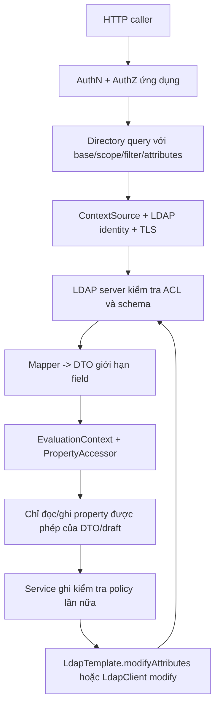
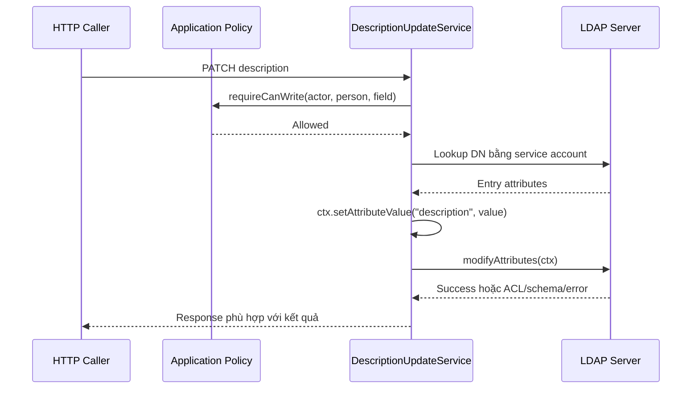

# Giới hạn quyền đọc hoặc ghi của accessor

## Mục tiêu bài học

Trong ứng dụng **SPRING_LDAP**, dữ liệu từ LDAP thường được đọc qua `LdapTemplate`/`LdapClient`, sau đó chuyển thành object Java để biểu thức, mapper, form hoặc API sử dụng. Một **accessor** có thể quyết định thành phần nào của object được phép **đọc**, thành phần nào được phép **ghi**. Nếu mở quyền quá rộng, một biểu thức hay một phép binding có thể nhìn thấy thông tin nội bộ hoặc sửa những trường không thuộc hợp đồng. Ngược lại, nếu ngăn mọi thao tác, ứng dụng không còn thực hiện được các phép cập nhật hợp lệ.

Bài thuộc chương **Resolver và accessor**, tập trung vào việc **giới hạn quyền đọc/ghi của accessor** trong ứng dụng Spring làm việc với thư mục LDAP. Bài liên hệ các thành phần:

- `PropertyAccessor` trong **Spring Expression Language (SpEL)**: các method `canRead()`, `read()`, `canWrite()`, `write()` quyết định thao tác truy cập property **trong một evaluation context**.
- `SimpleEvaluationContext`: lựa chọn context cho biểu thức đã được ứng dụng tin cậy, với mức hỗ trợ property read-only hoặc read/write và custom accessor.
- `DirContextOperations`/`DirContextAdapter`: các method đọc/sửa attribute **trong đối tượng context LDAP**.
- `AttributesMapper`, `ContextMapper` và LDAP ODM: cách ánh xạ dữ liệu LDAP thành object Java; `@Attribute(readonly=true)` của ODM quyết định một trường mapping không được ghi trở lại.
- **LDAP ACL**, quyền ứng dụng và kết nối qua `ContextSource`: ranh giới **bảo mật thực sự** của thao tác lên directory server.

**Phạm vi cần nhớ:** `PropertyAccessor` thuộc **Spring Framework Expression**, không phải giao diện của `org.springframework.ldap`. “Resolver/accessor” trong bài mô tả lớp hỗ trợ truy cập dữ liệu và biểu thức xung quanh Spring LDAP; **không có một ACL LDAP mặc định được sinh ra chỉ vì đăng ký custom accessor**. Khả năng trả dữ liệu của accessor và quyền LDAP trên server phải được bảo vệ **độc lập**.

Sau bài học, người học có thể:

1. Phân biệt **đọc Java property**, **đọc LDAP attribute**, **ghi vào object Java** và **ghi LDAP bằng Modify**.
2. Cài `PropertyAccessor` chỉ đọc những property thuộc allowlist và không hỗ trợ ghi.
3. Thiết kế accessor chỉ cho ghi một số trường vào **bản nháp cập nhật**, không ghi thẳng LDAP.
4. Chọn `SimpleEvaluationContext` và hiểu giới hạn an toàn của SpEL, đặc biệt với biểu thức do người dùng cung cấp.
5. Phân biệt `@Attribute(readonly=true)` trong ODM với `canWrite()==false` và với **ACL** của LDAP server.
6. Kết nối các quy tắc từ HTTP authorization, projection, mapper, accessor đến LDAP schema/ACL, TLS và error handling.
7. Viết unit test và integration test kiểm chứng cả hành vi được phép lẫn hành vi bị từ chối.

## 1. Một hồ sơ LDAP, nhiều loại “quyền”

Giả sử directory thử nghiệm có entry:

```ldif
dn: uid=lan,ou=People,dc=example,dc=org
objectClass: top
objectClass: person
objectClass: organizationalPerson
objectClass: inetOrgPerson
uid: lan
cn: Lan Nguyen
sn: Nguyen
mail: lan@example.org
telephoneNumber: +84 28 5555 0101
description: Nhân viên bộ phận kỹ thuật
```

Ứng dụng có hai vai trò giả định:

- **Nhân viên** chỉ được xem tên và email công việc của những người thuộc phạm vi được cấp quyền.
- **Quản lý hồ sơ** được xem thêm số điện thoại và cập nhật `description` của những entry cụ thể mà họ được phân công.

Các yêu cầu đó có ít nhất **bốn tầng bảo vệ**:

| Tầng | Câu hỏi cần trả lời | Ví dụ |
| --- | --- | --- |
| HTTP/Application authorization | Caller có quyền xem/sửa **entry nào** và **field nào**? | Người quản lý chỉ sửa mô tả của nhân viên thuộc đơn vị |
| LDAP bind identity và server ACL | Account kết nối có được đọc/ghi **DN/attribute** đó? | `svc-reader` chỉ đọc `cn,mail` |
| Query/projection và mapper | Những attribute nào thực sự được yêu cầu và đưa vào object Java? | Search chỉ yêu cầu `uid,cn,mail` |
| Java property accessor | Biểu thức được đọc/ghi những **property Java** nào? | Có thể đọc `displayName`, nhưng không được truy cập object LDAP thô |

**Một tầng cho phép không suy ra các tầng khác cho phép.** Nếu `canRead("email")==true`, điều đó chỉ nói custom accessor hỗ trợ đọc một property của target object; nó **không chứng minh** caller có quyền đọc email trên LDAP. Nếu server ACL cho phép service account sửa email, điều đó cũng **không cho phép** mọi người gọi API sửa email.



## 2. PropertyAccessor của Spring Expression là gì?

Giao diện `org.springframework.expression.PropertyAccessor` cho phép SpEL giải quyết truy cập **property** của object. Contract cốt lõi:

| Method | Trả lời | Ý nghĩa |
| --- | --- | --- |
| `getSpecificTargetClasses()` | Accessor ưu tiên loại target nào? | Có thể giới hạn chỉ object thuộc một lớp nhất định |
| `canRead(context, target, name)` | Có hỗ trợ đọc property này không? | Nên trả `false` cho field ngoài allowlist |
| `read(context, target, name)` | Đọc giá trị hợp lệ | Trả `TypedValue` hoặc báo `AccessException` |
| `canWrite(context, target, name)` | Có hỗ trợ ghi property này không? | `false` khi read-only hoặc field không được sửa |
| `write(context, target, name, newValue)` | Áp việc ghi được phép | Chỉ sửa **đối tượng Java mục tiêu** nếu được thiết kế như vậy |

Một số phiên bản Spring Framework kế thừa `getSpecificTargetClasses()` từ `TargetedAccessor`, nhưng nó vẫn là một phần của hợp đồng accessor. SpEL có thể sử dụng nhiều accessor/resolver theo thứ tự ưu tiên. Nếu một accessor trả `false` nhưng evaluation context còn đăng ký **một accessor khác có khả năng đọc/ghi rộng hơn**, truy cập có thể vẫn thực hiện qua accessor đó.

Vì vậy, **viết một accessor từ chối là chưa đủ**: phải kiểm soát **toàn bộ các accessor/resolver** có mặt trong `EvaluationContext`.

### 2.1. Accessor không tự kiểm tra LDAP ACL

`canRead()` và `canWrite()` là những method mà **ứng dụng bạn cài đặt**. Mặc định chúng không gọi LDAP server, không kiểm tra `ContextSource` và không tạo LDAP Modify. Một accessor có thể đơn giản trả:

```java
@Override
public boolean canWrite(
        EvaluationContext context, Object target, String name) {
    return false;
}
```

Điều đó khiến **đường ghi thông qua accessor này** bị chặn, nhưng Java code khác vẫn có thể gọi setter, repository khác vẫn có thể chạy `ldapTemplate.modifyAttributes()`, và LDAP server vẫn có ACL riêng. Không gọi một accessor “read-only” là “đảm bảo account này chỉ có quyền đọc LDAP”.

### 2.2. Getter không nhất thiết vô hại

Một method không có tham số và trả giá trị có thể được hệ thống biểu thức nhận như getter/property accessor. Tuy nhiên, cú pháp giống getter **không bảo đảm không có side effect**. Ví dụ một method có tên giống thao tác đọc nhưng lại chạy network hoặc thay đổi state.

Vì thế, nên tạo DTO chỉ chứa dữ liệu được phép và **không đưa thẳng** `DirContextOperations`, repository, file, connection, service thực thi lệnh hoặc entity có method nguy hiểm làm root object cho SpEL. Kể cả context **read-only** cũng không chứng minh rằng mọi getter có thể được gọi đều an toàn.

## 3. Thiết kế DTO nhỏ trước khi áp accessor

Thay vì để SpEL khám phá toàn bộ `DirContextAdapter` của một entry, tầng repository có thể chỉ tạo:

```java
// Java 17+: view bất biến cho màn hình danh bạ.
public record DirectoryPersonCard(
        String uid,
        String displayName,
        String email
) {}
```

Repository có thể tạo DTO bằng `AttributesMapper` hoặc `ContextMapper`:

```java
import static org.springframework.ldap.query.LdapQueryBuilder.query;
import org.springframework.ldap.core.LdapTemplate;
import org.springframework.ldap.query.LdapQuery;
import java.util.List;

public List<DirectoryPersonCard> findCards(LdapTemplate ldapTemplate) {
    LdapQuery request = query()
            .base("ou=People")
            .attributes("uid", "cn", "mail")
            .where("objectClass").is("inetOrgPerson");

    return ldapTemplate.search(request, attrs ->
            new DirectoryPersonCard(
                    (String) attrs.get("uid").get(),
                    (String) attrs.get("cn").get(),
                    attrs.get("mail") == null
                            ? null : (String) attrs.get("mail").get()));
}
```

Đây là một phép mapping **minh họa** với giả định `uid` và `cn` thực sự được trả và có kiểu `String`. Trong hệ thống thật, kiểm tra null/schema/ACL, không coi trường bị thiếu là bằng chứng entry không tồn tại. Với dữ liệu người dùng không được phép xem `mail`, tầng policy phải tạo DTO khác hoặc không yêu cầu `mail` ngay từ LDAP.

**Quan trọng:** DTO hẹp giúp giới hạn **bề mặt Java**, nhưng riêng DTO **không giảm dữ liệu đã truyền từ server** nếu query vẫn yêu cầu mọi attribute. Hạn chế trường **ngay tại LDAP search projection**, rồi kiểm soát việc trả DTO ở service.

## 4. Accessor chỉ đọc với allowlist property

Giả sử một biểu thức **do developer cấu hình** chỉ được phép xem `uid` và `displayName` của `DirectoryPersonCard`. Email, dù có trong DTO, không được phép truy cập qua **đường biểu thức này**.

### 4.1. Cài đặt PropertyAccessor

```java
import org.springframework.expression.AccessException;
import org.springframework.expression.EvaluationContext;
import org.springframework.expression.PropertyAccessor;
import org.springframework.expression.TypedValue;

public final class PublicPersonPropertyAccessor
        implements PropertyAccessor {

    @Override
    public Class<?>[] getSpecificTargetClasses() {
        return new Class<?>[] {DirectoryPersonCard.class};
    }

    @Override
    public boolean canRead(
            EvaluationContext context, Object target, String name) {
        if (!(target instanceof DirectoryPersonCard)) {
            return false;
        }
        return "uid".equals(name) || "displayName".equals(name);
    }

    @Override
    public TypedValue read(
            EvaluationContext context, Object target, String name)
            throws AccessException {
        if (!canRead(context, target, name)) {
            throw new AccessException("Property is not readable");
        }
        DirectoryPersonCard person = (DirectoryPersonCard) target;
        Object value = switch (name) {
            case "uid" -> person.uid();
            case "displayName" -> person.displayName();
            default -> throw new AccessException("Property is not readable");
        };
        return new TypedValue(value);
    }

    @Override
    public boolean canWrite(
            EvaluationContext context, Object target, String name) {
        return false;
    }

    @Override
    public void write(
            EvaluationContext context, Object target, String name,
            Object newValue) throws AccessException {
        throw new AccessException("Read-only property accessor");
    }
}
```

Ở đây:

1. `getSpecificTargetClasses()` giới hạn loại target mà accessor xử lý.
2. `canRead()` kiểm tra **đúng target và đúng tên property**. Không trả `true` cho mọi name rồi thử đọc tùy ý.
3. `read()` **kiểm tra lại** hợp đồng. Không tin rằng mọi caller đều đã gọi `canRead()`.
4. `canWrite()` luôn `false`; `write()` từ chối rõ, không sửa object Java.
5. Method không giữ LDAP context, không thực hiện search, không lưu mutable state, không log giá trị nhạy cảm.

**Không phải một LDAP security rule:** Nếu ứng dụng dùng một accessor khác có quyền rộng hơn trên cùng object, hoặc trực tiếp gọi `person.email()`, kết quả vẫn có thể đọc được ngoài con đường vừa giới hạn. Giới hạn của accessor phải đi cùng thiết kế DTO, evaluation context và authorization.

### 4.2. Đăng ký đúng evaluation context

```java
import org.springframework.expression.ExpressionParser;
import org.springframework.expression.spel.standard.SpelExpressionParser;
import org.springframework.expression.spel.support.SimpleEvaluationContext;

DirectoryPersonCard card = new DirectoryPersonCard(
        "lan", "Lan Nguyen", "lan@example.org");

// Chỉ đăng ký accessor chủ động giới hạn trường.
SimpleEvaluationContext eval =
        SimpleEvaluationContext.forPropertyAccessors(
                new PublicPersonPropertyAccessor()).build();

ExpressionParser parser = new SpelExpressionParser();

// Biểu thức là hằng do developer kiểm soát, KHÔNG lấy từ HTTP.
String shownName = parser.parseExpression("displayName")
        .getValue(eval, card, String.class);
```

Kết quả `shownName` là `"Lan Nguyen"`. Property `email` không được custom accessor này công bố và context vừa xây không chủ ý đăng ký một accessor fallback rộng hơn.

Nếu developer thay `SimpleEvaluationContext` bằng `StandardEvaluationContext` hoặc thêm một `ReflectivePropertyAccessor` tổng quát, những property khác có thể lại được truy cập. Do đó cần **xét toàn bộ cấu hình context**, không chỉ xem một lớp accessor riêng lẻ.

### 4.3. Read-only context không làm biểu thức không tin cậy trở nên an toàn

Spring Framework khuyến nghị **không đánh giá biểu thức SpEL không đáng tin cậy**. `SimpleEvaluationContext` giới hạn một phần ngữ pháp; nó **không phải sandbox bảo mật hoàn chỉnh**. Ngay cả một accessor “đọc” cũng có thể gọi method có side effect nếu object đưa vào expression chứa method kiểu getter nhưng lại thực hiện hành động.

**Tuyệt đối không làm:**

```java
// Không an toàn: expression thô do user/HTTP cung cấp.
String rawExpression = request.getParameter("expression");
Object result = new SpelExpressionParser()
        .parseExpression(rawExpression)
        .getValue(standardEvaluationContext, rootObject);
```

Thiết kế tốt hơn là nhận một **tên field từ allowlist** như `"displayName"` rồi dùng getter/mapper tường minh, **không dùng tên field đó như một biểu thức tự do**. Đối với SpEL do developer viết, kiểm tra source của biểu thức, root object, property/method accessors, type conversion, bean resolver, variables và khả năng điều hướng sang object con.

### 4.4. Khi không cần custom accessor

Nếu chỉ cần binding thông thường vào **DTO/JavaBean do ứng dụng kiểm soát**, Spring có:

```java
SimpleEvaluationContext readOnly =
        SimpleEvaluationContext.forReadOnlyDataBinding().build();

SimpleEvaluationContext readWrite =
        SimpleEvaluationContext.forReadWriteDataBinding().build();
```

`forReadOnlyDataBinding()` hạn chế **ghi property qua context này**; `forReadWriteDataBinding()` cho phép đọc/ghi theo khả năng data binding của target. Nếu phải **chặn một số field cụ thể**, không nên mặc định read-only mode có sẵn sẽ tự chặn mọi field bạn không muốn lộ: cần **DTO hẹp**, custom accessor đúng cách hoặc một cơ chế binding/allowlist phù hợp.

Đối với object không đáng tin cậy, ngay cả `forReadOnlyDataBinding()` cũng không bảo đảm các getter là side-effect-free. Tránh đưa các service, connection, `DirContextOperations` hoặc aggregate có method nguy hiểm vào evaluation context.

## 5. Giới hạn ghi: chỉ sửa bản nháp, không ghi LDAP trực tiếp

Nghiệp vụ giả định cho quản lý hồ sơ chỉ sửa `description`. Để thể hiện chính sách này, có thể dùng **bản nháp** nhận field đã được kiểm tra; không cấp khả năng truy cập tùy ý tới `DirContextAdapter` hoặc `LdapTemplate`.

```java
public final class ProfileDraft {
    private String description;

    public ProfileDraft(String description) {
        this.description = description;
    }

    public String getDescription() {
        return description;
    }

    public void setDescription(String description) {
        this.description = description;
    }
}
```

Một accessor có **read/write allowlist** đúng một field:

```java
import org.springframework.expression.AccessException;
import org.springframework.expression.EvaluationContext;
import org.springframework.expression.PropertyAccessor;
import org.springframework.expression.TypedValue;

public final class DescriptionDraftAccessor
        implements PropertyAccessor {

    @Override
    public Class<?>[] getSpecificTargetClasses() {
        return new Class<?>[] {ProfileDraft.class};
    }

    @Override
    public boolean canRead(EvaluationContext c, Object target, String name) {
        return target instanceof ProfileDraft
                && "description".equals(name);
    }

    @Override
    public TypedValue read(
            EvaluationContext c, Object target, String name)
            throws AccessException {
        if (!canRead(c, target, name)) {
            throw new AccessException("Not readable");
        }
        return new TypedValue(
                ((ProfileDraft) target).getDescription());
    }

    @Override
    public boolean canWrite(
            EvaluationContext c, Object target, String name) {
        return target instanceof ProfileDraft
                && "description".equals(name);
    }

    @Override
    public void write(
            EvaluationContext c, Object target, String name,
            Object newValue) throws AccessException {
        if (!canWrite(c, target, name)) {
            throw new AccessException("Not writable");
        }
        if (!(newValue instanceof String value)
                || value.isBlank() || value.length() > 256) {
            throw new AccessException("Invalid description value");
        }
        ((ProfileDraft) target).setDescription(value);
    }
}
```

Ví dụ sử dụng (expression vẫn do developer kiểm soát):

```java
var ctx = SimpleEvaluationContext.forPropertyAccessors(
        new DescriptionDraftAccessor()).build();
var parser = new SpelExpressionParser();

ProfileDraft draft = new ProfileDraft("Mô tả cũ");
parser.parseExpression("description")
        .setValue(ctx, draft, "Mô tả mới");

// Chỉ draft.description thay đổi trong Java.
// Chưa có LDAP Modify, chưa chứng minh quyền sửa entry.
```

**Tại sao dùng draft?** Accessor chỉ điều khiển thao tác **trong bộ nhớ của ứng dụng**. Khi cần lưu thật, service phải:

- Xác thực actor và **kiểm tra quyền sửa entry/field** theo nghiệp vụ.
- Xác định DN từ định danh đáng tin cậy, kiểm tra base/OU được phép.
- Kiểm tra schema của `description`, độ dài và quy tắc nghiệp vụ.
- Gửi đúng `ModificationItem` tới LDAP bằng `LdapTemplate`/`LdapClient`, để **server LDAP ACL** kiểm soát cuối cùng.
- Kiểm tra kết quả, xử lý timeout và đối soát nếu không chắc server đã ghi hay chưa.

**Không trả** `canWrite()==true` chỉ vì Java object có setter. Điều kiện đó không nói caller có quyền đổi hồ sơ. Ngay cả với accessor bị giới hạn, service vẫn phải kiểm tra authorization **tại thời điểm ghi**; quyền có thể đã thay đổi giữa lúc tạo draft và lúc commit.

## 6. Đường ghi LDAP có quyền riêng

Sau khi đã có bản nháp hợp lệ, một service chuyên trách thực hiện cập nhật. `DirContextAdapter` cung cấp các accessor LDAP như `getStringAttribute()`, `setAttributeValue()` và `getModificationItems()`, nhưng chúng cũng **không phải bộ kiểm tra quyền LDAP ACL**.

Ví dụ cập nhật `description` (sử dụng các abstraction của ứng dụng):

```java
import javax.naming.Name;
import org.springframework.ldap.core.DirContextOperations;
import org.springframework.ldap.core.LdapTemplate;

interface PersonDnResolver {
    // Phải trả đúng DN tương đối của một entry trong vùng được phép.
    Name resolveByStablePersonId(String personId);
}

interface PersonFieldPolicy {
    void requireCanWrite(
            String authenticatedActorId, String personId, String field);
}

final class DescriptionUpdateService {
    private final LdapTemplate ldap;
    private final PersonDnResolver resolver;
    private final PersonFieldPolicy policy;

    DescriptionUpdateService(
            LdapTemplate ldap, PersonDnResolver resolver,
            PersonFieldPolicy policy) {
        this.ldap = ldap;
        this.resolver = resolver;
        this.policy = policy;
    }

    void updateDescription(
            String actorId, String personId, ProfileDraft draft) {
        if (draft == null
                || draft.getDescription() == null
                || draft.getDescription().isBlank()
                || draft.getDescription().length() > 256) {
            throw new IllegalArgumentException("Invalid description");
        }

        policy.requireCanWrite(actorId, personId, "description");
        Name dn = resolver.resolveByStablePersonId(personId);

        // LDAP lookup rồi thay đúng attribute được phép.
        DirContextOperations ctx = ldap.lookupContext(dn);
        ctx.setAttributeValue(
                "description", draft.getDescription());
        ldap.modifyAttributes(ctx);
    }
}
```

`actorId` phải lấy từ **security context đã xác thực** ở tầng controller/filter, không tin một giá trị actor tự khai trong JSON. `resolveByStablePersonId()` phải xác minh **một entry duy nhất**, đúng nhánh/tenant. Ví dụ này cố tình không tự nối DN từ user input.

Đường chạy:



**Đừng dùng `bind()` hoặc `rebind()` để sửa một field.** `bind` trong `LdapTemplate` thường là thao tác tạo entry, không phải LDAP authentication; `rebind` có ngữ nghĩa thay thế binding/entry, dễ ảnh hưởng những attribute không được khai báo lại. Với partial update, `lookupContext()` rồi `modifyAttributes()` là cách điển hình khi adapter có snapshot cần thiết.

### 6.1. Bốn loại “read-only” dễ nhầm

| Cơ chế | Nó thực sự giới hạn gì? | **Không** bảo đảm điều gì? |
| --- | --- | --- |
| `PropertyAccessor.canWrite()==false` | Không ghi qua **accessor này** | Java code khác không sửa object/LDAP |
| `SimpleEvaluationContext.forReadOnlyDataBinding()` | Không binding assignment qua context này | Không có getter gây side effect; không lộ field khác |
| LDAP ODM `@Attribute(readonly=true)` | Field được đọc vào entity nhưng không persist ngược **qua đường ODM mapping tương ứng** | Server từ chối mọi LDAP client sửa attribute ấy |
| LDAP server **ACL read-only** cho service identity | Server từ chối quyền ghi không được cấp | HTTP caller tự động có quyền đọc mọi entry/attribute |

**Nhớ:** Chỉ **LDAP server ACL** mới cưỡng chế quyền của các thao tác LDAP trên mọi đường đi tới server, trong phạm vi policy của directory. Authorization ứng dụng vẫn cần kiểm tra **caller cụ thể**, và accessor/mapping phải giảm dữ liệu/phương thức được đưa ra cho những caller ấy.

### 6.2. Read-only ở tầng LDAP Object-Directory Mapping

Trong Spring LDAP ODM, annotation `org.springframework.ldap.odm.annotations.Attribute` có tham số `readonly`. Javadoc mô tả trường này có thể được đọc khi mapping entity nhưng không được persist ngược, đặc biệt hữu ích với các attribute server tự quản lý.

Ví dụ **mang tính cấu trúc**:

```java
import javax.naming.Name;
import org.springframework.ldap.odm.annotations.Attribute;
import org.springframework.ldap.odm.annotations.Entry;
import org.springframework.ldap.odm.annotations.Id;

@Entry(objectClasses = {
        "top", "person", "organizationalPerson", "inetOrgPerson"
})
public class PersonEntry {
    @Id
    private Name dn;

    @Attribute(name = "cn")
    private String fullName;

    @Attribute(name = "modifyTimestamp", readonly = true)
    private String modifiedAt;

    // Getters/setters do ứng dụng định nghĩa tùy mô hình.
}
```

**Ý nghĩa chính xác:** `readonly=true` là **cấu hình mapping/persistence** của ODM, không phải một LDAP server ACL. Nếu tài khoản LDAP thực sự có quyền, một `LdapTemplate.modifyAttributes()` trực tiếp vẫn có thể sửa một attribute không bị server đánh dấu NO-USER-MODIFICATION. Ngược lại, attribute operational do server quản lý có thể bị server từ chối sửa **dù client không bật readonly trong ODM**.

Không tự suy rằng `modifyTimestamp` luôn được server trả về trong mọi phép search: operational attributes thường cần yêu cầu tường minh và quyền đọc thích hợp. Việc mapping/convert thời gian còn phụ thuộc syntax, server và cấu hình phiên bản.

### 6.3. Attribute có giá trị nhưng account không có quyền đọc

Ví dụ `mail` có trên server nhưng bị ACL ẩn với `svc-reader`. `DirContextOperations.getStringAttribute("mail")` có thể trả `null` như thể không có dữ liệu. Một accessor trên DTO có `email=null` **không xác minh được lý do**.

Hãy phân biệt:

- **Không được yêu cầu** trong `LdapQueryBuilder.attributes(...)`.
- **Không có trong entry** theo schema/dữ liệu.
- **Không được trả vì quyền** hoặc server policy.
- **Không đúng kiểu dữ liệu** khi mapping, ví dụ binary attribute.

Với một trường bắt buộc của API, hãy trả một lỗi mapping/dữ liệu thích hợp; không tự điền giá trị giả hoặc mở rộng quyền LDAP để “đọc bằng được”.

### 6.4. Operational attribute và snapshot của DirContextAdapter

Spring LDAP FAQ lưu ý rằng operational attributes thường không được trả mặc định, vì thế `DirContextAdapter` có thể không biết chúng tồn tại; `removeAttributeValue()` khi không thấy giá trị có thể không phát sinh modification.

Nếu nhiệm vụ được phép yêu cầu đọc/sửa một attribute đặc biệt, cần dùng phép `lookup()` có danh sách returning attributes phù hợp hoặc `ModificationItem[]` tường minh theo contract, và **vẫn phải tuân thủ schema, ACL và server policy**. Không nên lạm dụng đường tường minh để vượt cơ chế kiểm soát.

## 7. Phân biệt giới hạn đọc và giới hạn ghi tại biên HTTP

Một ứng dụng có thể có hai API:

```http
GET /api/people/{personId}
PATCH /api/people/{personId}/description
```

Các hợp đồng có thể khác nhau:

| Thuộc tính | API đọc danh bạ | API cập nhật mô tả |
| --- | --- | --- |
| `uid` | Có thể đọc để hiển thị định danh | **Không được sửa** |
| `cn` | Đọc cho phép hiển thị tên | **Không được sửa** qua endpoint này |
| `mail` | Đọc nếu actor có quyền | **Không được sửa** qua endpoint này |
| `description` | Có thể đọc theo quyền | Được sửa nếu actor có quyền với entry |
| `userPassword` | Không đưa vào DTO/dữ liệu công khai | Không được gửi hoặc ghi bằng endpoint |
| Operational attributes | Không mặc định gửi về caller | Không tùy tiện sửa |

**Quan trọng với PATCH:** “field không xuất hiện” thường có nghĩa **không thay đổi field ấy**, không phải “xóa attribute”. Một POJO chỉ có `String mail=null` có thể không đủ phân biệt **vắng mặt**, **yêu cầu xóa** và **đặt null** nếu không có thiết kế JSON/binding rõ ràng.

Không tự gán mọi trường từ một DTO (có thể thiếu field) vào `DirContextAdapter`, vì có thể tạo thao tác xóa/đổi attribute không thuộc yêu cầu. Chỉ cập nhật những thuộc tính **đã được allowlist và được caller yêu cầu**.

### 7.1. Một phép ghi local không phải LDAP Modify

```text
SpEL write vào ProfileDraft.description
   ≠ DirContextAdapter.setAttributeValue("description", value)
   ≠ LdapTemplate.modifyAttributes(context)
   ≠ Server LDAP đã xác nhận thay đổi
```

Bốn bước này có thể xảy ra tuần tự, nhưng mỗi bước có **ý nghĩa khác nhau**. `setAttributeValue()` chỉ ghi vào adapter; phải gọi `modifyAttributes()` mới gửi LDAP Modify, và server vẫn phải kiểm tra ACL/schema. Sau timeout, không mặc định server chưa áp dụng vì phản hồi có thể đã mất.

### 7.2. Cấu hình reader/writer với quyền tối thiểu

Một thiết kế có thể tách hai `ContextSource` hoặc hai bộ `LdapTemplate` có credential riêng:

```text
Read service:
  ContextSource -> svc-directory-reader
  ACL -> đọc được nhánh/attribute danh bạ được cho phép
  Không có quyền Modify

Update service:
  ContextSource -> svc-profile-editor
  ACL -> chỉ Modify description trong nhánh được cấp phép
  Không có quyền sửa group hoặc nhánh quản trị
```

Việc dùng hai bean không **tự sinh ra** ACL. Administrator phải cấu hình quyền ở directory server; ứng dụng phải áp authorization theo actor/tenant và kiểm tra identity của kết nối đúng ngữ cảnh. Không dùng account quản trị rộng cho mọi truy vấn chỉ vì thuận tiện.

## 8. Resolver, EvaluationContext và những đường đi ngoài ý muốn

Trong SpEL, `PropertyAccessor` chỉ giải quyết **truy cập property**. Một evaluation context có thể còn chứa:

| Thành phần | Tác dụng | Điều phải kiểm soát |
| --- | --- | --- |
| `PropertyAccessor` | Đọc/ghi property | Target class, property allowlist, khả năng fallback |
| `MethodResolver` | Giải quyết method call | Không cho biểu thức gọi thao tác nguy hiểm |
| `BeanResolver` | Tìm bean theo tên | Không lộ bean có thể gửi LDAP Modify, truy cập secret |
| Type locator / constructor resolver | Truy cập type hoặc tạo object trong SpEL toàn phần | Không cho dữ liệu không tin cậy truy cập |
| Variables/functions | Giá trị/phương thức bổ sung được đặt trong context | Không cung cấp trực tiếp service hoặc credential |
| Type converter | Chuyển đổi kiểu dữ liệu trong biểu thức | Tránh converter có side effect hoặc thực thi tùy ý |

**Giới hạn của một accessor không phải giới hạn toàn bộ khả năng của SpEL.** Nếu một expression có thể lấy một object từ property được phép đọc rồi tiếp tục đi sâu vào object con, các property/method của object đó cũng trở thành bề mặt cần đánh giá.

### 8.1. Không đăng ký accessor rộng chỉ để sửa một lỗi mapping

Ví dụ accessor chỉ đọc `displayName` nhưng developer nhận lỗi khi đọc `email`. Cách “sửa nhanh” không đúng là thay bằng `ReflectivePropertyAccessor` tổng quát hoặc `StandardEvaluationContext` mà không xem lại chính sách.

Nếu email thật sự cần được đọc, hãy cập nhật **hợp đồng dữ liệu, quyền ứng dụng, projection LDAP và allowlist**, kèm test. Nếu không được phép, lỗi đọc phải được coi là hành vi đúng của hệ thống.

### 8.2. Không chia sẻ một Expression giữa các mức quyền khác nhau

Spring Framework lưu ý parsed `Expression` có thể **cache** accessor/resolver được chọn để tăng hiệu năng. Vì vậy, không nên evaluate **chính cùng một instance Expression** trước trong context có quyền rộng rồi tái sử dụng với context hạn chế hơn, trông đợi context sau luôn áp dụng đúng giới hạn.

Một chính sách an toàn:

- Expression **do developer kiểm soát**, phân loại theo mục đích và độ tin cậy.
- Parse/cache riêng theo một **hồ sơ quyền/evaluation context tương đương**.
- Không sử dụng cùng parsed instance cho các security profiles khác nhau.
- Nếu dùng expression engine như một phần của tính năng bên ngoài, có review/test dành riêng cho khả năng truy cập và side effect.
- Đơn giản hơn, với tên field do HTTP caller chọn, dùng **switch/allowlist trong Java** thay vì parse expression động.

Không coi vấn đề caching này được giải quyết chỉ bằng cách reset root object. Việc một expression từng được evaluate trong context đặc quyền hơn có thể ảnh hưởng đường truy cập cached.

### 8.3. PropertyAccessor không phải cơ chế kiểm tra nghiệp vụ theo từng bản ghi

Một `PropertyAccessor` có thể đọc field của `DirectoryPersonCard` với mọi target cùng class. Nó **không tự biết** người gọi hiện tại được phép đọc bản ghi A nhưng không được đọc bản ghi B. Cần authorization trước khi load/expose DTO hoặc trong một service đã được kiểm soát chặt; nếu chính sách phụ thuộc caller, đừng giữ một accessor singleton chứa mutable state theo request.

Ví dụ không nên:

```java
// KHÔNG NÊN: bean dùng chung ghi actor hiện tại vào field mutable.
class UnsafeSharedAccessor {
    private String currentActorId;

    void beginRequest(String actorId) {
        currentActorId = actorId;
    }
}
```

Hai request đồng thời có thể dùng nhầm actor. Thay vào đó, truyền bối cảnh đã xác thực qua service/context có vòng đời hợp lệ, hoặc tạo một DTO mà quyền truy cập đã được áp dụng. Một accessor an toàn nên càng **stateless** càng tốt.

## 9. Unit test cho đường đọc và đường ghi bị giới hạn

Unit test có thể chạy hoàn toàn trong JVM, không cần LDAP server. Các class ở các ví dụ được đặt đúng package/import và Java 17+.

### 9.1. Test accessor chỉ đọc

```java
import static org.junit.jupiter.api.Assertions.*;

import org.junit.jupiter.api.Test;
import org.springframework.expression.EvaluationException;
import org.springframework.expression.spel.standard.SpelExpressionParser;
import org.springframework.expression.spel.support.SimpleEvaluationContext;

class PublicPersonPropertyAccessorTest {
    private final SpelExpressionParser parser =
            new SpelExpressionParser();
    private final SimpleEvaluationContext context =
            SimpleEvaluationContext.forPropertyAccessors(
                    new PublicPersonPropertyAccessor()).build();

    @Test
    void readsOnlyAllowlistedProperties() {
        var person = new DirectoryPersonCard(
                "lan", "Lan Nguyen", "lan@example.org");

        String value = parser.parseExpression("displayName")
                .getValue(context, person, String.class);

        assertEquals("Lan Nguyen", value);

        assertThrows(EvaluationException.class,
                () -> parser.parseExpression("email")
                        .getValue(context, person));
    }

    @Test
    void doesNotAllowWritingProperties() {
        var person = new DirectoryPersonCard(
                "lan", "Lan Nguyen", "lan@example.org");

        assertThrows(EvaluationException.class,
                () -> parser.parseExpression("displayName")
                        .setValue(context, person, "Tên mới"));
    }

    @Test
    void rejectsUnsupportedTargetOrField() throws Exception {
        var accessor = new PublicPersonPropertyAccessor();
        var person = new DirectoryPersonCard("lan", "Lan", null);

        assertFalse(accessor.canRead(context, person, "email"));
        assertFalse(accessor.canRead(context, "not-a-person", "uid"));
        assertFalse(accessor.canWrite(context, person, "displayName"));
    }
}
```

Đây là test **đường qua custom accessor và evaluation context đã định cấu hình**. Nó không chứng minh controller khác không vô tình trả trực tiếp `person.email()` trong JSON. Cần thêm test authorization và API response cho các ranh giới đó.

### 9.2. Test write chỉ vào bản nháp

```java
import static org.junit.jupiter.api.Assertions.*;

import org.junit.jupiter.api.Test;
import org.springframework.expression.EvaluationException;
import org.springframework.expression.spel.standard.SpelExpressionParser;
import org.springframework.expression.spel.support.SimpleEvaluationContext;

class DescriptionDraftAccessorTest {
    private final SpelExpressionParser parser =
            new SpelExpressionParser();
    private final SimpleEvaluationContext context =
            SimpleEvaluationContext.forPropertyAccessors(
                    new DescriptionDraftAccessor()).build();

    @Test
    void writesAllowedFieldLocally() {
        ProfileDraft draft = new ProfileDraft("Mô tả cũ");

        parser.parseExpression("description")
                .setValue(context, draft, "Mô tả mới");

        assertEquals("Mô tả mới", draft.getDescription());
    }

    @Test
    void rejectsUnknownFieldAndInvalidValue() {
        ProfileDraft draft = new ProfileDraft("Mô tả cũ");

        assertThrows(EvaluationException.class,
                () -> parser.parseExpression("email")
                        .setValue(context, draft, "hidden@example.org"));
        assertThrows(EvaluationException.class,
                () -> parser.parseExpression("description")
                        .setValue(context, draft, " "));
        assertEquals("Mô tả cũ", draft.getDescription());
    }
}
```

Những test này chứng minh **quy tắc field và type/value validation của accessor**. Không có LDAP server, không có thao tác `modifyAttributes()`. Vì vậy, chúng **không kiểm tra được** LDAP ACL, schema, TLS, kết quả ghi hoặc trạng thái entry thật.

### 9.3. Test service không gọi LDAP khi actor không có quyền

Với JUnit 5/Mockito, kiểm tra tầng service:

```java
import static org.junit.jupiter.api.Assertions.*;
import static org.mockito.Mockito.*;

import org.junit.jupiter.api.Test;
import org.springframework.ldap.core.LdapTemplate;

class DescriptionUpdateServiceTest {
    @Test
    void deniedActorMustNotReachLdap() {
        LdapTemplate ldap = mock(LdapTemplate.class);
        PersonDnResolver resolver = mock(PersonDnResolver.class);
        PersonFieldPolicy policy = (actor, id, field) -> {
            throw new SecurityException("Not allowed");
        };

        DescriptionUpdateService service =
                new DescriptionUpdateService(ldap, resolver, policy);

        assertThrows(SecurityException.class,
                () -> service.updateDescription(
                        "actor-1", "person-742",
                        new ProfileDraft("Mô tả mới")));

        verifyNoInteractions(ldap, resolver);
    }
}
```

Với test được phê duyệt, service không được chạm tới LDAP nếu policy đã từ chối. Tuy nhiên, test chỉ mô phỏng behavior của `PersonFieldPolicy`; cần test **chính policy thật** cùng role/tenant/ownership và test server ACL độc lập.

### 9.4. Kiểm thử “từ chối” có quan trọng không?

Có. Một bộ test chỉ chứa `canRead()==true` hoặc update thành công không xác minh được giới hạn:

| Kiểm tra cần có | Vì sao |
| --- | --- |
| Field ngoài allowlist bị chặn | Ngăn đọc/ghi nhầm `email`, `userPassword`, v.v. |
| Target sai type bị chặn | Không để accessor áp dụng trên object khác |
| Context không có fallback accessor rộng | Tránh bypass qua reflective accessor |
| Object read-only bị từ chối assignment | Phân biệt `getValue` với `setValue` |
| Biểu thức untrusted không được parse | Không biến API thành cổng thực thi SpEL |
| HTTP caller không có role không được sửa | Accessor local không thay authorization |
| Service account read-only không thể Modify | Chứng minh ACL trên server |

## 10. Integration test trên LDAP server và HTTP API

Chuẩn bị directory test, fixture có `uid=lan,ou=People,dc=example,dc=org`, account `svc-reader` chỉ đọc và `svc-profile-editor` chỉ được sửa `description` trong nhánh kiểm thử. Dùng TLS có truststore và certificate hợp lệ, không sửa dữ liệu production.

| Ca | Kịch bản | Kết quả cần xác minh |
| --- | --- | --- |
| **ACC-01** | Đọc `uid`, `cn` qua account reader | DTO chỉ có trường được phép |
| **ACC-02** | Account reader không có quyền đọc `mail` | Không lộ email, mapper xử lý thiếu theo hợp đồng |
| **ACC-03** | Query chỉ yêu cầu `uid,cn` | Server không gửi `mail` trong projection thông thường |
| **ACC-04** | Biểu thức developer chỉ đọc `displayName` | `getValue` trả đúng tên |
| **ACC-05** | Cố đọc `email` qua accessor hạn chế | Bị từ chối |
| **ACC-06** | Cố ghi `uid` qua accessor | Bị từ chối |
| **ACC-07** | Ghi `description` vào `ProfileDraft` | Chỉ bản nháp thay đổi, LDAP chưa đổi |
| **ACC-08** | Caller không có quyền sửa nhưng gửi PATCH | Tầng policy từ chối trước LDAP |
| **ACC-09** | Caller hợp lệ và LDAP writer được cấp quyền | Chỉ `description` bị sửa trên server |
| **ACC-10** | Dùng account reader để gửi Modify | LDAP server từ chối theo ACL |
| **ACC-11** | Writer cố sửa `cn` nhưng ACL chỉ cho `description` | Server từ chối |
| **ACC-12** | Dữ liệu PATCH không có field `mail` | `mail` được giữ nguyên |
| **ACC-13** | LDAP server trả lỗi schema | Không biến thành “không tìm thấy” |
| **ACC-14** | LDAP connection timeout sau Modify | Không tuyên bố chắc chắn chưa ghi; đối soát |
| **ACC-15** | LDAPS certificate không đáng tin cậy | Kết nối bị từ chối, không downgrade |
| **ACC-16** | Cấu hình thêm reflective accessor | Review/test phát hiện đường đọc vượt allowlist |
| **ACC-17** | Hai HTTP request đồng thời | Không lẫn actor/request context giữa hai luồng |
| **ACC-18** | ODM `@Attribute(readonly=true)` | Mapping không persist field đó theo đường ODM; ACL test riêng |
| **ACC-19** | Operational attribute không có trong snapshot | Không tự kết luận field không tồn tại/không thể đọc |
| **ACC-20** | Request có filter input chứa `*` | Filter builder biểu diễn giá trị literal đúng, không mở rộng tùy ý |

Các ca cần thay ACL/schema nên chạy trên **LDAP server thử nghiệm có quyền cấu hình**. Không mở rộng quyền account sản xuất chỉ để làm cho test “dễ PASS”.

### 10.1. Đối chiếu thuộc tính trên server

Kiểm tra trước và sau một cập nhật hợp lệ:

```bash
ldapsearch -LLL -x \
  -H ldaps://ldap.example.org:636 \
  -D "cn=svc-reader,ou=Services,dc=example,dc=org" -W \
  -b "uid=lan,ou=People,dc=example,dc=org" \
  -s base "(objectClass=*)" \
  uid cn mail description
```

`-W` nhập mật khẩu qua prompt, không đưa secret lên dòng lệnh. Đối chiếu **đúng DN, cùng server/replica và cùng điều kiện đọc**; nếu LDAP ACL che `mail`, kết quả thiếu không chứng minh email đã bị xóa. Dùng một cơ chế đối soát được quản trị viên cho phép khi cần xác minh những trường mà account thông thường không đọc được.

### 10.2. Timeout, pooling và dữ liệu chưa xác định

Spring LDAP xử lý truy cập LDAP qua `ContextSource`, nhưng ứng dụng phải cấu hình và giám sát connect/read timeout phù hợp, cùng pooling tương thích với TLS và danh tính bind. Không giữ một context LDAP trong `PropertyAccessor` singleton hoặc chuyển kết nối giữa các request.

Nếu Modify đã gửi nhưng phản hồi mất, server **có thể đã áp dụng**. Đọc lại entry theo quy trình được cấp quyền và kiểm tra tính nhất quán trước khi retry. Việc accessor ghi thành công vào `ProfileDraft` không cung cấp bất kỳ bằng chứng nào về LDAP persistence.

## 11. Những sai lầm thường gặp

| Cách hiểu/cách làm sai | Vấn đề | Cách khắc phục |
| --- | --- | --- |
| `canWrite()==false` nghĩa là LDAP account read-only | Accessor chỉ chặn một đường Java, không thay đổi LDAP ACL | Kiểm tra quyền trên server bằng service identity thực |
| `canRead()==true` chứng minh actor được xem entry | Custom accessor không tự biết tenant/ownership | Authorization trước khi load/trả DTO |
| Trả `false` ở một accessor là đủ | Context có thể còn accessor/resolver khác cho phép | Giới hạn toàn bộ evaluation context |
| Dùng `StandardEvaluationContext` cho SpEL từ HTTP | Có bề mặt truy cập method/type/bean rất rộng | Không parse expression không đáng tin cậy |
| Nghĩ `SimpleEvaluationContext` là sandbox tuyệt đối | Getter có thể có side effect, object lồng nhau có thể nguy hiểm | Chỉ dùng biểu thức tin cậy, DTO hẹp, review mọi method đạt được |
| Dùng một `Expression` cache giữa context admin và user | Accessor/resolver cached có thể không phù hợp ranh giới quyền | Parse/cache riêng theo security profile |
| Đưa `DirContextAdapter` làm SpEL root cho API | Lộ cấu trúc LDAP và nhiều method không cần thiết | Map sang DTO/JavaBean chỉ có field được duyệt |
| Coi `@Attribute(readonly=true)` là quy tắc ACL LDAP | Annotation chỉ kiểm soát ODM mapping | Server ACL + application authorization |
| Coi `getStringAttribute("mail")==null` là không có mail | Có thể do projection/ACL/schema | Kiểm tra query và quyền; không suy đoán |
| `setAttributeValue()` là đã lưu LDAP | Chỉ sửa trạng thái adapter | `LdapTemplate.modifyAttributes()` và kiểm tra kết quả |
| Form không gửi field nhưng setter vẫn gán `null` | Có thể xóa field không chủ ý | Phân biệt absent/set/clear, chỉ ghi field đã cho phép |
| Gọi `rebind()` để sửa mô tả | Có thể thay entry và ảnh hưởng attribute khác | Ghi từng attribute bằng Modify |
| Custom accessor giữ actorId trong field singleton | Dễ lẫn quyền giữa request đồng thời | Stateless, context có vòng đời thích hợp |
| Đọc mọi LDAP attribute rồi bỏ bớt tại serializer | Mạng/server đã truyền dữ liệu không cần thiết | Giới hạn `attributes(...)` và LDAP ACL |
| Trả lỗi LDAP thành `List.of()` | Làm “lỗi đọc” giống “không có entry” | Phân loại kết quả rỗng, ACL, schema, network |
| Một accessor tự gọi LDAP search mỗi lần đọc property | Tạo network side effects, N+1 queries, khó kiểm soát timeout | Mapper lấy dữ liệu trước, accessor đọc DTO thuần |

## 12. Bài tập tổng hợp: phân quyền đọc/ghi trường hồ sơ

**Bối cảnh:** Ứng dụng Spring LDAP quản lý danh bạ nhân viên trong nhánh `ou=People,dc=example,dc=org`. Có ba vai trò:

| Vai trò | Được đọc | Được sửa qua API |
| --- | --- | --- |
| `viewer` | `uid`, `cn` của những entry được cấp quyền | Không |
| `profile-editor` | Thêm `description` của những entry được quản lý | Chỉ `description` |
| `directory-admin` | Theo quyền quản trị đã được phê duyệt | Qua endpoint/quy trình riêng, có audit |

### Nhiệm vụ 1: tách hai kiểu dữ liệu

Tạo `DirectoryPersonCard(uid, displayName, email)` cho màn hình và `ProfileDraft(description)` cho endpoint cập nhật. Giải thích vì sao không nên truyền `DirContextOperations`/LDAP context trực tiếp ra controller hoặc để SpEL đánh giá trên bean có quyền Modify.

Thiết kế hai search projection khác nhau tùy quyền:

```text
Viewer:
  base: ou=People
  filter: theo phạm vi/điều kiện được quyền
  returning attributes: uid, cn

Profile editor:
  base: ou=People
  filter: theo phạm vi/điều kiện được quyền
  returning attributes: uid, cn, description
```

Mọi giá trị động đưa vào filter dùng `LdapQueryBuilder`/filter builder; DN động dùng `LdapNameBuilder`.

### Nhiệm vụ 2: cài accessor hạn chế

Viết `PublicPersonPropertyAccessor` trả `true` với `canRead` cho `uid`, `displayName` và trả `false` với `canWrite` cho tất cả field. Với biểu thức do developer cấu hình, đăng ký accessor trong `SimpleEvaluationContext`.

Chứng minh:

1. Đọc `displayName` thành công.
2. Đọc `email` qua context hạn chế bị từ chối.
3. Ghi `displayName` bị từ chối.
4. Một object target không phải `DirectoryPersonCard` cũng không được accessor xử lý.

### Nhiệm vụ 3: chỉ cho sửa một field

Viết `DescriptionDraftAccessor` cho phép đọc/ghi **chỉ** `description` trên `ProfileDraft`. Thử ghi giá trị hợp lệ và giá trị rỗng/độ dài vượt policy. Lưu ý: sau khi accessor ghi draft, LDAP chưa được thay đổi.

Tạo `DescriptionUpdateService` với `PersonFieldPolicy`/`PersonDnResolver`, gọi `lookupContext()` và `modifyAttributes()` sau khi quyền được kiểm tra. Không cho client chọn arbitrary LDAP attribute name hoặc DN.

### Nhiệm vụ 4: kiểm thử bảo mật hai tầng

Chuẩn bị hai LDAP identities:

- **Reader** không có quyền Modify.
- **Editor** chỉ có quyền Modify `description` trong fixture test.

Kiểm tra trên server:

1. Reader không thể Modify dù Java có setter/accessor viết được.
2. Editor chỉ sửa được đúng field/nhánh đã cấp quyền.
3. User HTTP không có role bị từ chối trước khi kết nối write.
4. Nếu LDAP schema/ACL từ chối, không che lỗi thành “đã lưu”.
5. Field không nằm trong PATCH không bị thay đổi.
6. LDAPS với chứng chỉ sai phải thất bại; không dùng credential qua kết nối không bảo vệ.

### Nhiệm vụ 5: mở rộng ODM và kiểm soát dữ liệu

Thử một entity ODM có `@Attribute(readonly=true)` cho operational attribute, rồi phân biệt:

- Trường này được map từ LDAP về Java khi server trả về và có quyền đọc.
- ODM không persist ngược field theo mapping đã khai báo.
- Java code khác hoặc LDAP client khác vẫn phải chịu **server ACL/schema** độc lập.

Đảm bảo không đưa operational attribute, password, token hoặc object nhạy cảm vào DTO công khai. Dùng read-back kiểm tra kết quả nhưng không tự nâng quyền server để hoàn thành test.

### Tiêu chí nghiệm thu

| Tiêu chí | Bằng chứng |
| --- | --- |
| **Đúng tầng** | Accessor chỉ thao tác trên Java object, không nhầm với LDAP ACL |
| **Đúng quyền đọc** | Field ngoài allowlist không đọc được qua evaluation context đã chọn |
| **Đúng quyền ghi** | Draft chỉ sửa `description`, các field khác bị từ chối |
| **Không bypass** | Không có generic accessor/resolver mở lại property bị chặn |
| **Không untrusted SpEL** | Không parse biểu thức thô do HTTP user cung cấp |
| **Policy nghiệp vụ** | Actor/tenant/personId/field được kiểm tra trước update |
| **LDAP ACL** | Từ chối quyền ghi trên server với account không được cấp |
| **Projection** | Không yêu cầu thuộc tính không cần thiết ngay từ SearchRequest |
| **Độ bền dữ liệu** | Modify thật thành công, read-back phù hợp hoặc báo lỗi rõ |
| **Kiểm thử** | Unit test SpEL và integration test quyền/schema/TLS |

## 13. Câu hỏi tự kiểm tra

**1. `PropertyAccessor.canWrite()==false` có tự làm tài khoản LDAP chỉ đọc không?**

Không. Nó chỉ từ chối ghi property qua accessor đó. Quyền đọc/ghi LDAP do identity của kết nối và ACL server quyết định.

**2. Nếu `canRead("email")==false`, email đã an toàn tuyệt đối chưa?**

Chưa. Context có thể chứa accessor khác, Java code có thể gọi getter trực tiếp hoặc serializer có thể đưa email vào response. Cần DTO, context và authorization phù hợp.

**3. Vì sao nên dùng `SimpleEvaluationContext` thay vì `StandardEvaluationContext` cho biểu thức bị giới hạn?**

`SimpleEvaluationContext` cung cấp một tập tính năng SpEL hẹp hơn và các lựa chọn read-only/read-write binding rõ ràng. Nhưng **không phải sandbox tuyệt đối**; không đánh giá biểu thức không tin cậy.

**4. Accessor read-only có bảo đảm mọi getter không gây side effect không?**

Không. Hình dạng method trả giá trị không chứng minh nó không thực hiện hành động. Phải review root object và toàn bộ object có thể tiếp cận.

**5. Vì sao cần tách `ProfileDraft` khỏi `DirContextOperations`?**

Để bản nháp chỉ chứa những field ứng dụng dự định cho cập nhật, không lộ các method thao tác LDAP và không nhầm ghi local với ghi server.

**6. `@Attribute(readonly=true)` có nghĩa server từ chối mọi Modify với attribute không?**

Không. Nó điều khiển việc mapping/persist qua LDAP ODM. Server vẫn sử dụng schema/ACL để quyết định các thao tác LDAP.

**7. `DirContextOperations.setAttributeValue()` đã lưu vào LDAP chưa?**

Chưa. Adapter chỉ ghi thay đổi dự định trong bộ nhớ. Phải gửi `modifyAttributes()` và nhận/đối soát kết quả thích hợp.

**8. Tại sao chỉ có một accessor whitelist là chưa đủ?**

Vì các accessor/resolver khác của evaluation context vẫn có thể truy cập property bị chặn nếu được cấu hình. Cần kiểm soát toàn bộ context.

**9. Vì sao không tái sử dụng cùng một parsed SpEL Expression giữa context admin và viewer?**

Spring có thể cache accessor/resolver cho biểu thức đã parse; dùng một instance giữa các context khác mức quyền có thể làm hỏng giả định kiểm soát truy cập. Cần parse/cache riêng theo security profile.

**10. Query chỉ trả `uid,cn` nhưng mapper đọc `mail` thấy null. Có chắc server không lưu mail không?**

Không. Client đã không yêu cầu `mail`; cũng có thể do ACL hoặc entry thực sự thiếu. Không suy ra từ một giá trị null.

**11. Tại sao không cho HTTP caller truyền tên attribute bất kỳ vào lệnh cập nhật?**

Vì caller có thể chọn thuộc tính nhạy cảm hoặc thuộc tính quản trị ngoài nghiệp vụ. Cần field allowlist, kiểm tra quyền và schema trước khi gửi LDAP Modify.

**12. Một unit test SpEL PASS có chứng minh quyền thực tế trên LDAP không?**

Không. Unit test chỉ kiểm tra logic Java/context. Phải có integration test với account LDAP đúng quyền, schema, TLS, ACL và API authorization.

## Tổng kết

**Giới hạn quyền đọc hoặc ghi của accessor** giúp kiểm soát những property Java nào mà một đường biểu thức/binding có thể sử dụng. Với Spring SpEL, `PropertyAccessor.canRead()`/`canWrite()` kết hợp `read()`/`write()` tạo cơ chế allowlist rõ ràng. `SimpleEvaluationContext` hỗ trợ lựa chọn read-only, read/write hoặc custom accessor, nhưng không cho phép đánh giá biểu thức không đáng tin cậy như thể đó là sandbox.

Trong **SPRING_LDAP**, phải phân biệt ranh giới này với **LDAP ACL** và khả năng persistence của `DirContextAdapter`/ODM. Một accessor Java có thể đọc hoặc sửa object trong bộ nhớ; để đọc/ghi directory thật, ứng dụng còn cần `ContextSource` có identity hợp lệ, query/projection, quyền ứng dụng, schema, TLS và thao tác `LdapTemplate`/`LdapClient` phù hợp. Hãy chọn DTO hẹp, service cập nhật riêng và kiểm thử cả **đường bị từ chối**, không chỉ đường thành công.

### Tài liệu tham khảo

- **Spring Framework — Evaluation / EvaluationContext và Security Considerations (SpEL)**: https://docs.spring.io/spring-framework/reference/core/expressions/evaluation.html.
- **Spring Framework Javadoc — PropertyAccessor**: https://docs.spring.io/spring-framework/docs/6.2.14/javadoc-api/org/springframework/expression/PropertyAccessor.html.
- **Spring LDAP Reference — Basic Usage (LdapClient, AttributesMapper)**: https://docs.spring.io/spring-ldap/reference/spring-ldap-basic-usage.html.
- **Spring LDAP Reference — Simplifying Attribute Access and Manipulation with DirContextAdapter**: https://docs.spring.io/spring-ldap/reference/dirobjectfactory.html.
- **Spring LDAP Reference — Object-Directory Mapping (ODM)**: https://docs.spring.io/spring-ldap/reference/odm.html.
- **Spring LDAP Javadoc — ODM Attribute annotation và readonly**: https://docs.spring.io/spring-ldap/docs/3.3.x/api/org/springframework/ldap/odm/annotations/Attribute.html.
- **Spring LDAP Reference — Operational Attributes FAQ**: https://docs.spring.io/spring-ldap/reference/faq.html.
- **Spring LDAP Reference — Advanced LDAP Queries**: https://docs.spring.io/spring-ldap/reference/query-builder-advanced.html.
- **RFC 4511 — LDAP: The Protocol**: https://www.rfc-editor.org/rfc/rfc4511.
- **RFC 4512 — LDAP: Directory Information Models (schema, attribute types)**: https://www.rfc-editor.org/rfc/rfc4512.
- **RFC 4514 / RFC 4515 — DN và Search Filters**: https://www.rfc-editor.org/rfc/rfc4514 và https://www.rfc-editor.org/rfc/rfc4515.
