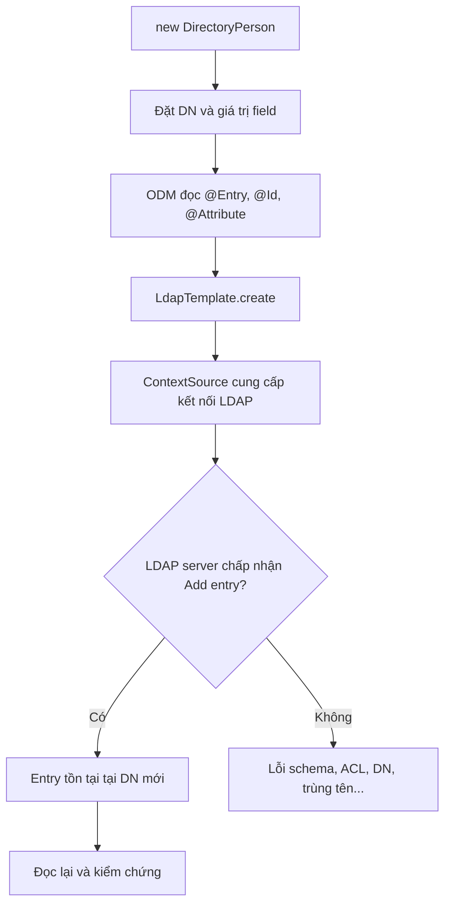
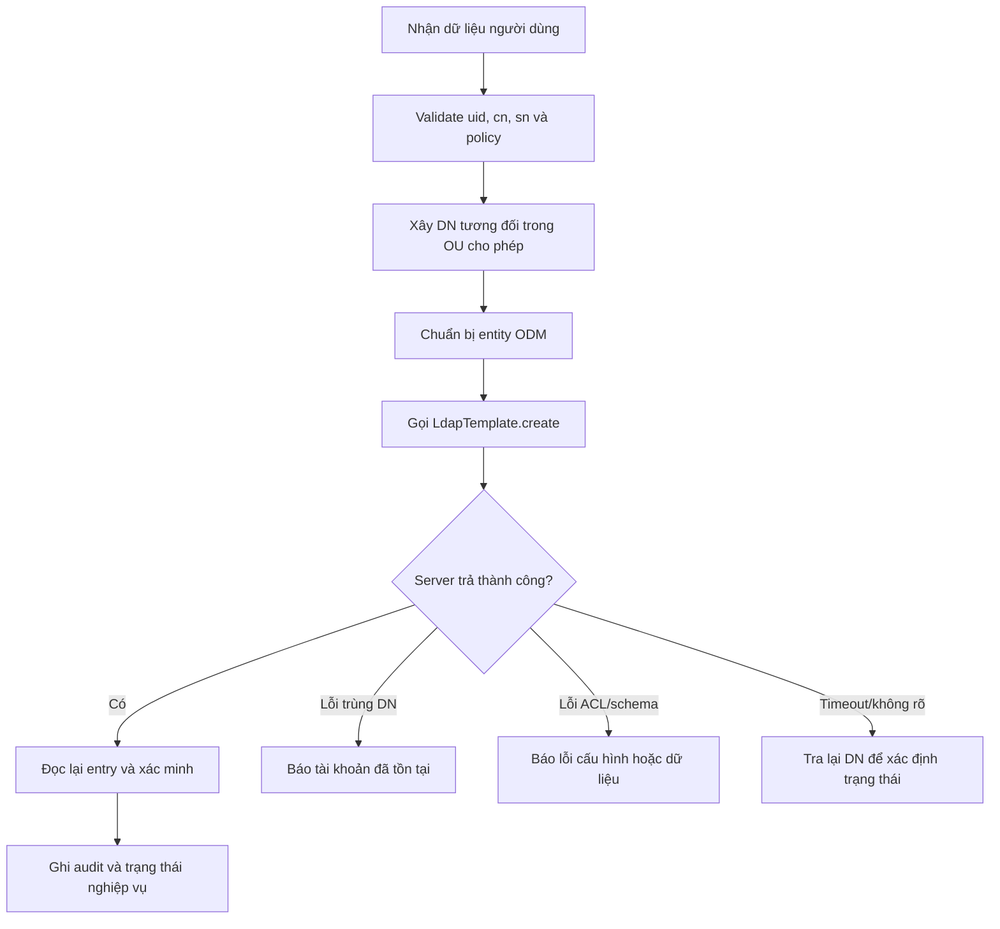

# Create object và bind entry trong Spring LDAP ODM

Khi cần thêm một tài khoản, một nhóm hoặc một đơn vị tổ chức vào LDAP, ứng dụng phải **tạo entry mới tại một DN xác định** với những thuộc tính phù hợp schema. Trong Spring LDAP, có ít nhất hai cách tiếp cận: tự chuẩn bị dữ liệu rồi gọi `LdapTemplate.bind(...)`, hoặc khai báo entity theo **Object-Directory Mapping (ODM)** và gọi `LdapTemplate.create(entity)`.

Cả hai cách đều hướng đến việc tạo một entry trên directory server. Sự khác nhau nằm ở cách mô tả và ánh xạ dữ liệu: **ODM dùng annotation để chuyển đối tượng Java thành entry LDAP**, còn cách bind trực tiếp cho lập trình viên quyền kiểm soát gần với `Attributes` và `DirContextOperations` hơn. Dù dùng cách nào, LDAP server vẫn quyết định DN có hợp lệ không, parent có tồn tại không, entry đích đã có chưa, schema có thỏa không và tài khoản kết nối có quyền tạo hay không.

Bài này thuộc phần **ODM operations** của module Spring LDAP. Nội dung tập trung vào quy trình **tạo đối tượng Java → khai báo DN/objectClass/attribute → tạo entry trên LDAP server**, kèm kiểm chứng kết quả, lỗi thường gặp, bảo mật và thực hành.

Sau bài học, bạn có thể:

- Phân biệt **khởi tạo Java object**, **ODM create** và **LDAP bind/add entry**.
- Khai báo `@Entry`, `@Id`, `@Attribute` để Spring LDAP biết dữ liệu cần lưu.
- Dùng `LdapTemplate.create(Object)` để thêm một entry theo mapping ODM.
- So sánh thao tác đó với `LdapTemplate.bind(DirContextOperations)`.
- Thiết kế DN tương đối bằng `LdapNameBuilder`, tránh ghép chuỗi DN từ dữ liệu đầu vào.
- Xử lý trường hợp thiếu object class/attribute, parent không tồn tại, trùng DN hoặc thiếu quyền.
- Đọc lại entry từ server và kiểm thử cả thành công lẫn thất bại.

## 1. Ba khái niệm dễ nhầm: object, entry và bind

Giả sử ứng dụng muốn tạo người dùng `lan`:

```text
DN dự kiến:
uid=lan,ou=people,dc=example,dc=org

Thuộc tính:
uid: lan
cn: Lan Nguyen
sn: Nguyen
mail: lan@example.org
objectClass: top, person, organizationalPerson, inetOrgPerson
```

Có ba bước mang ý nghĩa khác nhau:

1. **Tạo Java object:** `new DirectoryPerson()` chỉ tạo một đối tượng trong bộ nhớ JVM. Chưa có LDAP operation nào được gửi.
2. **Ánh xạ object sang LDAP entry:** ODM đọc annotation và các field để xác định DN, object classes và thuộc tính cần ghi.
3. **Tạo entry trên server:** `ldapTemplate.create(person)` kích hoạt thao tác ghi; server xử lý yêu cầu theo DN, schema và ACL.

Cách nhìn tổng quan:



**Quan trọng:** Tạo Java object thành công **không đồng nghĩa** entry đã tồn tại trong LDAP. Chỉ thao tác tạo trên server thành công mới cho phép ứng dụng khẳng định entry đã được ghi; với những yêu cầu quan trọng, nên đọc lại để đối chiếu.

### LDAP bind có hai nghĩa cần phân biệt

Thuật ngữ *bind* xuất hiện ở hai ngữ cảnh:

| Ngữ cảnh | Ý nghĩa |
| --- | --- |
| **LDAP authentication bind** | Client chứng minh danh tính với server bằng DN/credential hoặc cơ chế xác thực được hỗ trợ |
| **JNDI `Context.bind` / Spring LDAP `LdapTemplate.bind`** | Liên kết một đối tượng/tập thuộc tính với tên trong directory; với LDAP provider, thường dùng để **tạo entry** |

Khi tài liệu Spring LDAP nói `ldapTemplate.bind(...)` trong phần thao tác entry, đó là **tạo entry theo tên**, không phải thao tác đăng nhập bằng mật khẩu. Đừng nhầm hai ý nghĩa để rồi nghĩ rằng `bind` tạo tài khoản là bước xác thực người dùng.

## 2. Bối cảnh LDAP: DN, parent và schema

Giả sử cây LDAP thử nghiệm đã có:

```text
dc=example,dc=org
├── ou=people
│   └── (chưa có uid=lan)
└── ou=service
    └── uid=app-writer
```

Ứng dụng có thể tạo:

```text
uid=lan,ou=people,dc=example,dc=org
```

nếu có quyền và dữ liệu phù hợp.

Để thêm entry thành công, ít nhất phải xem xét:

| Điều kiện | Câu hỏi kiểm tra |
| --- | --- |
| DN | Có đúng cú pháp? Có nằm dưới nhánh ứng dụng được phép ghi? |
| Parent | `ou=people,dc=example,dc=org` đã tồn tại chưa? |
| Trùng tên | Đã có `uid=lan,ou=people,...` chưa? |
| Object class | Entry dùng `person`/`inetOrgPerson` có phù hợp schema server không? |
| MUST attributes | Các thuộc tính bắt buộc, đặc biệt `cn` và `sn` của `person`, đã có chưa? |
| RDN attribute | Entry có giá trị `uid=lan` tương ứng thành phần đặt tên không? |
| ACL | Tài khoản ứng dụng được phép tạo entry dưới parent này không? |
| Bảo mật kết nối | Kết nối dùng TLS được xác minh chứng chỉ/hostname chưa? |

Ví dụ với `inetOrgPerson` trong schema thường gặp:

```ldif
dn: uid=lan,ou=people,dc=example,dc=org
objectClass: top
objectClass: person
objectClass: organizationalPerson
objectClass: inetOrgPerson
uid: lan
cn: Lan Nguyen
sn: Nguyen
mail: lan@example.org
```

**`cn` và `sn` là thông tin bắt buộc** theo chuỗi object class dựa trên `person`. `mail` có thể là thuộc tính tùy chọn. `uid` có thể dùng làm RDN tùy thiết kế và schema của server. Annotation Java không thay thế các quy tắc này.

## 3. Khai báo entity ODM bằng `@Entry`, `@Id` và `@Attribute`

Spring LDAP ODM ánh xạ Java object với entry LDAP thông qua các annotation trong package `org.springframework.ldap.odm.annotations`.

Mô hình tối thiểu:

```java
import javax.naming.Name;

import org.springframework.ldap.odm.annotations.Attribute;
import org.springframework.ldap.odm.annotations.Entry;
import org.springframework.ldap.odm.annotations.Id;

@Entry(objectClasses = {
        "top",
        "person",
        "organizationalPerson",
        "inetOrgPerson"
})
public class DirectoryPerson {

    @Id
    private Name dn;

    @Attribute(name = "uid")
    private String username;

    @Attribute(name = "cn")
    private String fullName;

    @Attribute(name = "sn")
    private String familyName;

    @Attribute(name = "mail")
    private String email;

    public DirectoryPerson() {
        // Constructor không đối số để ODM có thể khởi tạo entity.
    }

    public Name getDn() {
        return dn;
    }

    public void setDn(Name dn) {
        this.dn = dn;
    }

    public String getUsername() {
        return username;
    }

    public void setUsername(String username) {
        this.username = username;
    }

    public String getFullName() {
        return fullName;
    }

    public void setFullName(String fullName) {
        this.fullName = fullName;
    }

    public String getFamilyName() {
        return familyName;
    }

    public void setFamilyName(String familyName) {
        this.familyName = familyName;
    }

    public String getEmail() {
        return email;
    }

    public void setEmail(String email) {
        this.email = email;
    }
}
```

Ý nghĩa:

| Khai báo | Vai trò |
| --- | --- |
| `@Entry(objectClasses = {...})` | Khai báo thông tin object classes của entry theo mapping ODM |
| `@Id private Name dn` | Chứa DN mà ODM dùng để định danh entry |
| `@Attribute(name = "uid")` | Ánh xạ field Java `username` với thuộc tính LDAP `uid` |
| `@Attribute(name = "cn")` | Ánh xạ `fullName` với LDAP `cn` |
| `@Attribute(name = "sn")` | Ánh xạ `familyName` với LDAP `sn` |
| `@Attribute(name = "mail")` | Ánh xạ `email` với LDAP `mail` |

Các **tên trong `@Attribute(name = "...")` là tên thuộc tính LDAP thực**, không phải tên field Java. Vì vậy, `@Attribute(name = "mail")` không có nghĩa server phải có một attribute type tên `email`.

**Không nhầm `@Id` với `uid`:** một DN có thể gồm nhiều RDN; `uid=lan` mới chỉ là RDN trong ví dụ, còn `uid=lan,ou=people,dc=example,dc=org` mới là DN đầy đủ.

### Có cần `@DnAttribute` không?

`@DnAttribute` là annotation ODM bổ sung dùng khi một field có quan hệ với thành phần đặt tên trong DN. Nó hữu ích cho các model muốn đồng bộ logic đặt tên và giá trị thuộc tính. Tuy nhiên, **không bắt buộc phải dùng nó trong mọi ví dụ tạo entry**.

Bài này chọn cách **đặt `@Id` tường minh** rồi dùng `@Attribute` để ánh xạ giá trị. Cách đó giúp người học nhìn thấy DN nào sẽ được gửi đến server và tránh suy đoán về việc tự xây DN theo `@DnAttribute`. Khi chọn cơ chế tạo DN tự động, phải kiểm tra kỹ hợp đồng và cú pháp `@DnAttribute` theo phiên bản Spring LDAP, số thành phần RDN và base DN thực tế.

## 4. Chuẩn bị `LdapContextSource` và `LdapTemplate`

ODM không tự mở kết nối độc lập. Các thao tác của `LdapTemplate` dựa trên một `ContextSource` đã được cấu hình. Ví dụ một ứng dụng Spring:

```java
import org.springframework.context.annotation.Bean;
import org.springframework.context.annotation.Configuration;
import org.springframework.ldap.core.LdapTemplate;
import org.springframework.ldap.core.support.LdapContextSource;

@Configuration
public class DirectoryConfig {
    @Bean
    LdapContextSource ldapContextSource() {
        LdapContextSource source = new LdapContextSource();
        source.setUrl("ldaps://ldap.example.org:636");
        source.setBase("dc=example,dc=org");

        // Chỉ để minh họa cách lấy thông tin xác thực bên ngoài code.
        source.setUserDn(System.getenv("LDAP_BIND_DN"));
        source.setPassword(System.getenv("LDAP_BIND_PASSWORD"));

        return source;
    }

    @Bean
    LdapTemplate ldapTemplate(LdapContextSource source) {
        return new LdapTemplate(source);
    }
}
```

Giải thích:

- `setUrl` chỉ định server LDAP; `ldaps://` dùng TLS từ khi mở kết nối.
- `setBase("dc=example,dc=org")` thiết lập base DN chung cho thao tác ứng dụng.
- `setUserDn` và `setPassword` minh họa tài khoản dịch vụ có quyền truy cập. Giá trị thực phải được quản lý bằng secret/configuration an toàn.
- `LdapTemplate` dùng `ContextSource` để lấy context và quản lý tài nguyên cho các lời gọi thông thường.
- `@Entry` không tự cấu hình URL, TLS hay tài khoản bind.

Trong ứng dụng Spring Boot, có thể dùng auto-configuration thích hợp thay vì tự khai báo mọi bean; lựa chọn phụ thuộc dependency và cấu hình hiện tại.

**Bảo mật:** Không đưa mật khẩu vào source control, không cho phép trust manager tin mọi chứng chỉ. LDAPS/StartTLS cần trust store và xác minh hostname đúng cách. Tài khoản tạo entry chỉ nên có quyền cần thiết trên nhánh được cấp phép.

## 5. Tạo đối tượng và DN trước khi gọi `create`

Nếu `ContextSource` có base `dc=example,dc=org` thì DN được truyền cho Spring LDAP thường là DN **tương đối**:

```text
ContextSource base:  dc=example,dc=org
DN tương đối:        uid=lan,ou=people
DN LDAP thực:        uid=lan,ou=people,dc=example,dc=org
```

Dùng `LdapNameBuilder` thay vì ghép chuỗi DN:

```java
import javax.naming.Name;
import org.springframework.ldap.support.LdapNameBuilder;

String uid = "lan";

Name relativeDn = LdapNameBuilder.newInstance("ou=people")
        .add("uid", uid)
        .build();
```

Tại sao không dùng `"uid=" + uid + ",ou=people"`? Dữ liệu thực có thể chứa dấu phẩy, dấu cộng, dấu gạch chéo ngược hoặc các ký tự cần escape trong RDN. `LdapNameBuilder.add("uid", uid)` giúp biểu diễn RDN an toàn hơn so với nối chuỗi từ đầu vào.

**Lưu ý:** Escaping DN/RDN khác với escaping LDAP search filter. Dùng `LdapQueryBuilder` cho filter, không dùng cách escape DN để xây filter.

### Khởi tạo một entity sẵn sàng tạo entry

```java
DirectoryPerson person = new DirectoryPerson();

person.setDn(relativeDn);
person.setUsername("lan");
person.setFullName("Lan Nguyen");
person.setFamilyName("Nguyen");
person.setEmail("lan@example.org");
```

Đến đây **chưa có thao tác LDAP nào được gửi**. Lập trình viên mới chỉ chuẩn bị trạng thái của một Java object.

Cần kiểm tra sự nhất quán giữa DN và attribute dùng làm RDN:

```text
DN:       uid=lan,ou=people
Attribute uid: lan
              └─ cùng giá trị
```

Đặt `person.setUsername("binh")` nhưng lại giữ DN `uid=lan,ou=people` là lỗi logic tạo dữ liệu: server có thể từ chối hoặc entry sau tạo không đúng kỳ vọng, tùy schema và chính sách.

## 6. `LdapTemplate.create(Object)`: tạo entry bằng ODM

Với entity ở mục 3 và `LdapTemplate` đã cấu hình, thao tác chính là:

```java
ldapTemplate.create(person);
```

Một ví dụ service hoàn chỉnh:

```java
import java.util.Objects;

import javax.naming.Name;

import org.springframework.ldap.core.LdapTemplate;
import org.springframework.ldap.support.LdapNameBuilder;

public final class DirectoryPersonCreationService {
    private final LdapTemplate ldapTemplate;

    public DirectoryPersonCreationService(LdapTemplate ldapTemplate) {
        this.ldapTemplate = ldapTemplate;
    }

    public Name createPerson(
            String uid,
            String commonName,
            String surname,
            String email) {

        Objects.requireNonNull(uid, "uid");
        Objects.requireNonNull(commonName, "commonName");
        Objects.requireNonNull(surname, "surname");

        if (uid.isBlank() || commonName.isBlank() || surname.isBlank()) {
            throw new IllegalArgumentException(
                    "uid, cn và sn không được rỗng");
        }

        Name relativeDn = LdapNameBuilder.newInstance("ou=people")
                .add("uid", uid)
                .build();

        DirectoryPerson person = new DirectoryPerson();
        person.setDn(relativeDn);
        person.setUsername(uid);
        person.setFullName(commonName);
        person.setFamilyName(surname);
        person.setEmail(email);

        // Gửi yêu cầu tạo entry theo mapping ODM.
        ldapTemplate.create(person);

        return relativeDn;
    }
}
```

Ví dụ gọi:

```java
DirectoryPersonCreationService service =
        new DirectoryPersonCreationService(ldapTemplate);

Name createdDn = service.createPerson(
        "lan",
        "Lan Nguyen",
        "Nguyen",
        "lan@example.org");

System.out.println(createdDn);
```

Trong mô hình này:

1. Service nhận dữ liệu, kiểm tra các trường bắt buộc theo nhu cầu ứng dụng.
2. `LdapNameBuilder` tạo DN tương đối `uid=lan,ou=people`.
3. Entity chứa DN cùng các thuộc tính Java được annotate.
4. `LdapTemplate.create(person)` dùng ánh xạ ODM để chuẩn bị việc thêm entry.
5. LDAP provider và server thực hiện thao tác thêm entry. Khi server từ chối, Spring LDAP chuyển lỗi theo cơ chế ngoại lệ của thư viện.
6. Tầng gọi chỉ nên coi đây là entry được tạo sau khi lời gọi thành công; nếu cần đối chiếu, đọc lại từ server theo DN trả về.

**Giới hạn quan trọng:** `create` dùng để **tạo mới**, không phải *upsert*. Không nên gọi `create` với một DN đã tồn tại rồi hy vọng dữ liệu cũ tự được cập nhật. Cập nhật entity hiện có dùng operation khác như `update`; đổi tên DN dùng `rename`; xóa dùng `delete` hoặc thao tác xóa tương ứng.

### Một điều cần kiểm tra trong môi trường của bạn

Mã ví dụ chọn `@Id` theo DN tương đối với `ContextSource` và không đặt `base` bên trong `@Entry`. Nếu dự án dùng đồng thời `@Entry(base = "...")`, `@DnAttribute` hoặc đặt base khác trong repository, cần xác minh **cách phiên bản Spring LDAP xây DN** trước khi tạo entry. Không cộng base DN hai lần và không giả định cùng một DN được mọi API diễn giải theo một quy tắc nếu chúng được cấu hình khác nhau.

## 7. So sánh với tạo entry bằng `LdapTemplate.bind(...)`

Cùng một entry có thể được tạo mà không dùng ODM. Khi sử dụng `DirContextAdapter`, ứng dụng khai báo rõ DN và từng thuộc tính:

```java
import javax.naming.Name;

import org.springframework.ldap.core.DirContextAdapter;
import org.springframework.ldap.core.LdapTemplate;
import org.springframework.ldap.support.LdapNameBuilder;

public final class DirectoryPersonBindService {
    private final LdapTemplate ldapTemplate;

    public DirectoryPersonBindService(LdapTemplate ldapTemplate) {
        this.ldapTemplate = ldapTemplate;
    }

    public void bindNewPerson(
            String uid, String commonName, String surname) {

        Name relativeDn = LdapNameBuilder.newInstance("ou=people")
                .add("uid", uid)
                .build();

        DirContextAdapter entry = new DirContextAdapter(relativeDn);

        entry.setAttributeValues("objectClass", new String[] {
                "top",
                "person",
                "organizationalPerson",
                "inetOrgPerson"
        });
        entry.setAttributeValue("uid", uid);
        entry.setAttributeValue("cn", commonName);
        entry.setAttributeValue("sn", surname);

        // Bind một entry tại DN mới. Đây không phải bind xác thực.
        ldapTemplate.bind(entry);
    }
}
```

Ví dụ này cho thấy sự khác biệt:

- **`ldapTemplate.create(person)`**: thông tin các attribute nằm trong entity + annotation ODM.
- **`ldapTemplate.bind(entry)`**: lập trình viên gán trực tiếp những thuộc tính cần ghi lên `DirContextAdapter`.
- Cả hai đều cần DN chưa tồn tại, parent hợp lệ, schema và ACL phù hợp.
- Cả hai đều có thể thất bại khi tạo entry; không có cơ chế “tự sửa cho đúng schema” chung.

### Bảng so sánh thực tế

| Tiêu chí | ODM `create(entity)` | `bind(DirContextOperations)` |
| --- | --- | --- |
| Mô hình dữ liệu | POJO Java annotate `@Entry`, `@Id`, `@Attribute` | `DirContextAdapter` và các attribute trực tiếp |
| Mapping tên Java → LDAP | Tập trung tại annotation | Thực hiện bằng các tên truyền vào `setAttributeValue` |
| Khai báo `objectClass` | Thường từ `@Entry(objectClasses=...)` | Đặt rõ trong context |
| Tái sử dụng model | Tốt khi ứng dụng CRUD nhiều entry cùng loại | Tốt cho thao tác thưa, dữ liệu động hoặc chỉ vài field |
| Kiểm soát từng attribute | Qua mapping và quy tắc ODM | Tường minh hơn ở nơi tạo entry |
| Độ phụ thuộc ODM | Có, cần entity và annotation hợp lệ | Không phụ thuộc annotation ODM |
| Parent/schema/ACL/trùng DN | Server vẫn quyết định | Server vẫn quyết định |

Chọn ODM nếu module đang có model object rõ ràng và cần thao tác lặp lại trên cùng loại entry. Chọn bind trực tiếp nếu cần kiểm soát từng thuộc tính hoặc không muốn khai báo entity ODM cho một dạng entry phát sinh ít lần.

**Không nên trộn hai hướng không có chủ đích.** Ví dụ, cùng một đối tượng được tạo bằng bind trực tiếp nhưng về sau lại được update qua ODM với mapping thiếu thuộc tính có thể gây khó khăn khi hiểu trạng thái và hành vi cập nhật.

## 8. `@DnAttribute`, RDN và object class: các chi tiết cần thiết

### `@DnAttribute` không phải tên khác của `@Attribute`

`@Attribute(name = "uid")` ánh xạ dữ liệu `uid`. `@DnAttribute` mô tả mối liên hệ giữa field và thành phần DN, thường dùng khi muốn framework hỗ trợ việc biểu diễn giá trị thuộc RDN trong entity.

Ví dụ logic:

```text
uid=lan,ou=people,dc=example,dc=org
│
└── RDN uid=lan
    ├─ attribute type: uid
    └─ attribute value: lan
```

Bạn có thể quản lý DN bằng `@Id` tường minh như ví dụ chính. Nếu thêm `@DnAttribute`, phải thiết kế đúng vị trí trong DN và kiểm tra cách mapper của phiên bản Spring LDAP xử lý quan hệ giữa RDN và field. Không tự giả định `@DnAttribute` làm LDAP server cho phép đổi DN bằng một setter.

### Tên attribute và giá trị RDN phải phù hợp

Nếu DN dùng `uid` làm RDN, entry cần phù hợp các quy tắc về giá trị đặt tên của server. Nếu DN là `cn=Lan Nguyen,ou=people,...` nhưng entity chỉ khai báo `uid` và không có giá trị `cn` bắt buộc, thao tác tạo có thể thất bại hoặc không đạt kỳ vọng.

### `@Entry` không thay thế schema server

Annotation:

```java
@Entry(objectClasses = {
    "top", "person", "organizationalPerson", "inetOrgPerson"
})
```

giúp Spring LDAP ODM biết các object class cần biểu diễn theo mapping. Nó **không cài schema**, không quyết định class nào được phép tồn tại trong DIT và không tự bổ sung mọi thuộc tính bắt buộc. Trước khi tạo, hãy xác minh object classes thực tế, `MUST`/`MAY`, syntax và ràng buộc của directory server.

### Thuộc tính đa trị và tùy chọn

Một số attribute như `telephoneNumber` hoặc `description` có thể chứa nhiều giá trị. Model dùng `String` chỉ phản ánh một giá trị; nếu nghiệp vụ cần giữ đầy đủ, hãy chọn collection/array được phiên bản ODM hỗ trợ và kiểm thử ánh xạ.

Trong thao tác tạo entry, một thuộc tính tùy chọn **không có giá trị** nên được xử lý theo hợp đồng mapper và schema, không tự ghi chuỗi rỗng như một giá trị mặc định. Attribute bắt buộc thì cần có dữ liệu hợp lệ trước khi gửi yêu cầu.

## 9. Các lỗi thường gặp khi tạo entry

| Lỗi hoặc hiện tượng | Nguyên nhân có thể | Hướng xử lý |
| --- | --- | --- |
| LDAP `entryAlreadyExists` (68) | DN đích đã được dùng | Không tạo đè; kiểm tra chính xác DN và nghiệp vụ có cần update không |
| LDAP `noSuchObject` (32) | Parent DN không tồn tại, hoặc base/name sai | Tạo/kiểm tra parent theo quyền và quy trình riêng; kiểm tra base DN |
| LDAP `insufficientAccessRights` (50) | Tài khoản bind thiếu quyền tạo entry | Kiểm tra ACL đối với parent và object class |
| LDAP `objectClassViolation` (65) | Thiếu `cn`/`sn` hoặc objectClass không hợp lệ | Đối chiếu schema, MUST attributes và mapping |
| LDAP `namingViolation` (64) | RDN/DN không hợp lệ với quy tắc đặt tên | Kiểm tra DN, attribute đặt tên và schema |
| LDAP `invalidAttributeSyntax` (21) | Giá trị có cú pháp không phù hợp | Kiểm tra định dạng attribute và schema |
| LDAP `constraintViolation` (19) | Giá trị, số lượng hoặc ràng buộc server bị vi phạm | Kiểm tra SINGLE-VALUE, quy tắc dữ liệu và policy |
| `CommunicationException` hoặc timeout | Mất kết nối/TLS/network/server quá tải | Kiểm tra TLS, timeout và trạng thái thao tác trước khi retry |
| Entity đã tạo nhưng chưa thấy trên replica khác | Replication chưa đồng bộ hoặc cache | Kiểm tra server/replica nguồn và độ trễ đồng bộ |
| Java object tạo được, LDAP entry không có | Chưa gọi `ldapTemplate.create` hoặc lời gọi bị lỗi | Kiểm tra đường thực thi và exception |
| Entry có `uid` khác RDN | Model/logic xây DN không nhất quán | Sử dụng cùng giá trị đã validate cho DN và thuộc tính |
| Attribute rỗng sau tạo | Sai `@Attribute(name)` hoặc thiếu thuộc tính tùy chọn | Đối chiếu mapping, LDIF thực và quyền đọc |

### Trùng DN không phải lỗi có thể bỏ qua

Nếu hai request đồng thời cùng tạo `uid=lan,ou=people`:

```text
Request A: kiểm tra "chưa có uid=lan"
Request B: kiểm tra "chưa có uid=lan"
Request A: create → thành công
Request B: create → entryAlreadyExists
```

Việc **kiểm tra tồn tại rồi tạo** không phải một giao dịch nguyên tử. LDAP server là nơi quyết định DN có bị trùng tại thời điểm thao tác hay không. Ứng dụng nên bắt lỗi trùng DN và trả kết quả nghiệp vụ rõ ràng; không tự chuyển lỗi đó thành cập nhật dữ liệu của entry khác.

### Timeout không luôn có nghĩa “entry chưa được tạo”

Một request có thể đã được server xử lý nhưng phản hồi bị mất khi kết nối gián đoạn. Nếu client nhận timeout và thử gửi lại ngay, lần thứ hai có thể gặp `entryAlreadyExists`. Do đó, với thao tác tạo nhạy cảm, cần **đọc lại DN đích để xác minh** trước khi quyết định retry hoặc báo thất bại hoàn toàn.

## 10. Xác minh kết quả bằng `findByDn` hoặc `lookupContext`

Một quy trình hoàn chỉnh không dừng ở `create` mà còn kiểm tra entry có những giá trị mong đợi. Với ODM:

```java
import javax.naming.Name;

Name relativeDn = service.createPerson(
        "lan", "Lan Nguyen", "Nguyen", "lan@example.org");

DirectoryPerson created =
        ldapTemplate.findByDn(relativeDn, DirectoryPerson.class);

if (!"lan".equals(created.getUsername())
        || !"Lan Nguyen".equals(created.getFullName())
        || !"Nguyen".equals(created.getFamilyName())) {
    throw new IllegalStateException("Giá trị LDAP khác dữ liệu đã tạo");
}
```

Khi cần đối chiếu đúng attribute LDAP mà không phụ thuộc mapping ODM, có thể dùng `lookupContext`:

```java
import org.springframework.ldap.core.DirContextOperations;

DirContextOperations stored = ldapTemplate.lookupContext(relativeDn);

String storedUid = stored.getStringAttribute("uid");
String storedCn = stored.getStringAttribute("cn");
String storedSn = stored.getStringAttribute("sn");

System.out.println(storedUid + " / " + storedCn + " / " + storedSn);
```

**Tại sao hai cách kiểm tra có giá trị?**

- `findByDn` xác minh **entity ODM** có thể được đọc đúng từ dữ liệu thực.
- `lookupContext` giúp xem tên attribute LDAP cụ thể; hữu ích khi nghi ngờ annotation ánh xạ sai.
- Đọc lại không đảm bảo mọi replica đã đồng bộ, và kết quả còn phụ thuộc tài khoản đọc/ACL.
- Không nên in đầy đủ entry hoặc credential vào log chỉ để xác minh một thao tác tạo người dùng.

### Kiểm tra thêm objectClass

Khi tạo `inetOrgPerson`, có thể kiểm tra attribute `objectClass` từ server để chắc rằng entry được lưu với bộ class phù hợp schema. Một số server có cách trả về/chuẩn hóa tên class khác nhau về chữ hoa chữ thường; hãy đối chiếu theo schema và ngữ nghĩa LDAP, không phụ thuộc cách viết hoa khi hiển thị.

## 11. Bảo mật và giới hạn quyền khi tạo entry

Thao tác tạo entry có tác động lâu dài đến directory, đặc biệt nếu entry được dùng cho đăng nhập và phân quyền. Một số quy tắc cần thiết:

1. **Giới hạn nhánh được tạo.** Application chỉ nên được cấp quyền tạo dưới `ou=people` hoặc nhánh chuyên dụng. Không nhận DN tùy ý rồi cho phép ghi vào mọi vị trí của DIT.
2. **Không nối chuỗi DN từ input.** Dùng `LdapNameBuilder`/`Rdn` để tránh sai cú pháp và rủi ro từ các ký tự đặc biệt.
3. **Không ghép LDAP filter từ input.** Nếu cần tra tìm trước khi tạo, dùng `LdapQueryBuilder` hoặc filter có tham số.
4. **Dùng LDAPS hoặc StartTLS đúng chuẩn.** Trust store và xác minh chứng chỉ/hostname phải được cấu hình; tránh gửi mật khẩu qua LDAP không bảo vệ.
5. **Áp dụng least privilege.** Tài khoản dùng để create không cần có quyền quản trị toàn thư mục hoặc đọc các thuộc tính bí mật.
6. **Không lưu mật khẩu người dùng dạng rõ trong entity mẫu.** Việc khởi tạo credential/tài khoản thực phải theo cơ chế xác thực, hashing và chính sách riêng của directory server.
7. **Không coi `uid` là duy nhất toàn hệ thống nếu schema không bảo đảm.** DN là định danh duy nhất trong cây; giá trị `uid` có thể xuất hiện ở nhiều OU nếu chính sách cho phép.
8. **Tách tạo tài khoản với cấp quyền.** Thêm một entry `inetOrgPerson` không đồng nghĩa đã hoàn thành các bước xác thực, kích hoạt, gán nhóm hoặc cấp vai trò cho ứng dụng.

Với hệ thống có nhiều quy trình sau tạo như thêm nhóm, cấp quyền, ghi audit hoặc cập nhật database, cần nhớ rằng nhiều operation LDAP và database **không mặc nhiên tạo thành một transaction nguyên tử**. Nếu bước thêm nhóm thất bại sau khi tạo entry, entry vẫn có thể đã tồn tại; cần thiết kế xử lý bù trừ hoặc trạng thái chờ.

## 12. Thiết kế dịch vụ tạo entry trong ứng dụng thực tế

Một service tạo tài khoản có thể chia thành các giai đoạn rõ ràng:



Bảng phân chia trách nhiệm:

| Tầng | Trách nhiệm |
| --- | --- |
| Controller/API | Nhận request và trả lỗi nghiệp vụ; không tự tạo DN tùy ý |
| Validation | Xác nhận đầu vào đủ, hợp lệ và nằm trong chính sách tài khoản |
| Service | Chọn OU/parent, xây DN an toàn, điều phối create và kiểm chứng |
| ODM entity | Khai báo mapping DN/objectClass/attribute |
| `LdapTemplate` / `ContextSource` | Thực hiện thao tác LDAP, quản lý kết nối, chuyển ngoại lệ |
| LDAP server | Kiểm tra DN duy nhất, schema, ACL và lưu entry |
| Audit/monitoring | Ghi người yêu cầu, loại operation, DN và kết quả; tránh credential |

**Không nên gộp tất cả trong controller.** Việc tạo entry cần logic bảo mật, khả năng test và xử lý lỗi; service giúp tập trung ranh giới này.

## 13. Kiểm thử tạo entry: không chỉ kiểm tra object trong RAM

### Những kịch bản bắt buộc nên có

| Kịch bản | Kỳ vọng |
| --- | --- |
| Tạo người dùng hợp lệ | Entry mới xuất hiện tại DN mong đợi, đủ objectClass/thuộc tính |
| Thiếu `cn` hoặc `sn` | Bị validation từ chối hoặc server báo schema violation |
| DN trùng | Server từ chối tạo mới, không ghi đè entry cũ |
| Parent OU không tồn tại | Nhận lỗi phù hợp, không tự tạo chuỗi parent ngoài chính sách |
| Tài khoản bind chỉ có quyền đọc | Thao tác tạo bị từ chối |
| UID chứa dấu phẩy hoặc ký tự DN đặc biệt | DN được escape đúng hoặc input bị từ chối theo policy |
| Không có `mail` tùy chọn | Quy trình xử lý theo schema/mapper; không ghi giá trị giả |
| Timeout giữa create | Tra lại entry để xác định đã tạo hay chưa trước khi retry |
| Thao tác tạo qua ODM, đọc bằng JNDI/lookupContext | Giá trị LDAP thực tế khớp mapping |
| Readback bằng ODM | `findByDn` ánh xạ đúng thuộc tính Java |

### Một integration test minh họa

Ví dụ dưới đây giả định có LDAP test server, Spring test context và nhánh `ou=people,dc=example,dc=org` đã được chuẩn bị. UID phải duy nhất cho mỗi lượt kiểm thử; **không chạy trên LDAP sản xuất**.

```java
import static org.junit.jupiter.api.Assertions.*;

import javax.naming.Name;

import org.junit.jupiter.api.Test;
import org.springframework.beans.factory.annotation.Autowired;
import org.springframework.ldap.core.LdapTemplate;

class DirectoryPersonCreationTest {
    @Autowired
    private DirectoryPersonCreationService service;

    @Autowired
    private LdapTemplate ldapTemplate;

    @Test
    void createAndReadBack() {
        // Dùng UID chỉ dành cho test, bảo đảm chưa tồn tại trong test DIT.
        String uid = "test-create-001";

        Name dn = service.createPerson(
                uid,
                "Test User",
                "User",
                "test-create-001@example.org");

        DirectoryPerson stored =
                ldapTemplate.findByDn(dn, DirectoryPerson.class);

        assertEquals(uid, stored.getUsername());
        assertEquals("Test User", stored.getFullName());
        assertEquals("User", stored.getFamilyName());
    }
}
```

**Ghi chú về môi trường test:** Ví dụ chỉ minh họa thân test; để chạy cần cấu hình tích hợp test tương ứng (bean dịch vụ, `LdapTemplate`, LDAP server thử nghiệm, schema/ACL). Khi tái chạy, phải làm sạch entry test đã tạo theo cơ chế an toàn hoặc dùng UID riêng để tránh lỗi trùng DN.

### Test trực tiếp mapping annotation

Ngoài integration test, có thể kiểm tra metadata bằng reflection:

```java
import static org.junit.jupiter.api.Assertions.*;

import java.lang.reflect.Field;

import org.junit.jupiter.api.Test;
import org.springframework.ldap.odm.annotations.Attribute;

class DirectoryPersonMetadataTest {
    @Test
    void emailMapsToMail() throws Exception {
        Field field = DirectoryPerson.class.getDeclaredField("email");
        Attribute attribute = field.getAnnotation(Attribute.class);

        assertNotNull(attribute);
        assertEquals("mail", attribute.name());
    }
}
```

Unit test annotation phát hiện lỗi đổi tên mapping khi refactor, **không xác minh** server cho phép create hoặc entity được ghi thật. Bởi vậy, cần kết hợp test mapping với test LDAP thực tế trong môi trường được phép.

## 14. Thực hành: thiết kế quy trình tạo entry an toàn

Giả sử môi trường thực hành có `ou=people,dc=example,dc=org` và bạn được phép tạo người dùng mới dưới OU này. Tên người dùng cần tạo:

```text
uid:      mai
cn:       Mai Tran
sn:       Tran
mail:     mai@example.org
DN:       uid=mai,ou=people,dc=example,dc=org
```

**Bài A – Tạo object ODM.** Khai báo lớp `DirectoryPerson` có `@Entry`, `@Id` và `@Attribute` cho `uid`, `cn`, `sn`, `mail`. Giải thích vì sao `@Id Name dn` khác `@Attribute(name = "uid")`.

**Bài B – Xây DN.** Dùng `LdapNameBuilder` tạo DN tương đối khi `ContextSource` có base `dc=example,dc=org`. Kiểm tra kết quả trước khi gọi `create`.

**Bài C – Tạo bằng ODM.** Tạo Java object, gán các field và gọi `ldapTemplate.create(person)`. Đọc lại `mail` từ server để kiểm chứng.

**Bài D – Tạo bằng bind trực tiếp.** Thử lại trên một UID khác với `DirContextAdapter` và `ldapTemplate.bind(entry)`. So sánh số dòng code và nơi định nghĩa mapping attribute.

**Bài E – Thử lỗi có kiểm soát.** Trong môi trường test, tạo trùng DN và quan sát kết quả; tiếp tục thử bỏ `sn` hoặc dùng parent không tồn tại. Phân biệt lỗi validation phía ứng dụng với lỗi server.

### Câu hỏi tự kiểm tra

**Câu 1.** `new DirectoryPerson()` có tạo một LDAP entry trên server không?

**Đáp án:** Không. Nó chỉ tạo Java object; phải thực hiện thao tác LDAP như `ldapTemplate.create(person)` hoặc bind entry tương ứng.

**Câu 2.** Dùng `@Entry(objectClasses=...)` có tự làm LDAP server chấp nhận thiếu `cn` và `sn` không?

**Đáp án:** Không. LDAP schema trên server vẫn áp các thuộc tính bắt buộc và quy tắc object class.

**Câu 3.** `@Id Name dn` và `@Attribute(name = "uid") String username` có giống nhau không?

**Đáp án:** Không. `@Id` biểu diễn DN của entry; `username` biểu diễn giá trị attribute `uid`. Trong ví dụ giá trị `uid` nằm trong RDN, nhưng không phải toàn bộ DN.

**Câu 4.** `ldapTemplate.create(person)` có tự cập nhật entry cũ khi DN đã tồn tại không?

**Đáp án:** Không nên coi như vậy. `create` dành cho tạo mới; DN trùng thông thường bị server từ chối. Cập nhật dùng operation dành cho entry hiện có.

**Câu 5.** Khi `ContextSource` đã có base `dc=example,dc=org`, vì sao cần chú ý DN tương đối?

**Đáp án:** Vì nếu truyền lại base vào DN mà API còn tự áp base, DN có thể bị nhân đôi. Cần thống nhất cách biểu diễn DN theo cấu hình Spring LDAP.

**Câu 6.** Vì sao cần đọc lại entry sau thao tác tạo có phản hồi lỗi timeout?

**Đáp án:** Server có thể đã xử lý Add request trước khi mất phản hồi. Đọc lại DN giúp xác định trạng thái trước khi retry và tránh kết luận sai.

**Câu 7.** Tạo entry và LDAP authentication bind là một thao tác giống nhau?

**Đáp án:** Không. Tạo entry bổ sung đối tượng vào directory; authentication bind xác thực client/tài khoản với LDAP server.

**Câu 8.** Nên dùng ODM `create` hay `bind` khi ứng dụng có model người dùng thống nhất?

**Đáp án:** ODM `create` thường thuận tiện vì mapping nằm tập trung ở entity; `bind` phù hợp khi cần kiểm soát thuộc tính trực tiếp. Cả hai vẫn chịu ràng buộc DN, schema và ACL của server.

## Ghi nhớ

**Create object là chuẩn bị dữ liệu trong Java; tạo/bind entry là thao tác ghi trên LDAP server.** Với Spring LDAP ODM, khai báo `@Entry`, `@Id` và `@Attribute` rồi dùng `LdapTemplate.create(Object)` để tạo entry theo model. Nếu cần thao tác ở mức thuộc tính tường minh, dùng `DirContextAdapter` cùng `LdapTemplate.bind(...)`. Dù cách nào, phải xây DN an toàn, bảo đảm parent tồn tại, object classes và thuộc tính bắt buộc đúng schema, tài khoản có quyền tạo, kết nối có TLS đáng tin cậy, và đọc lại để xác minh. Không nhầm `create` với upsert, `bind` tạo entry với bind xác thực, hoặc DN với một giá trị `uid` riêng lẻ.
