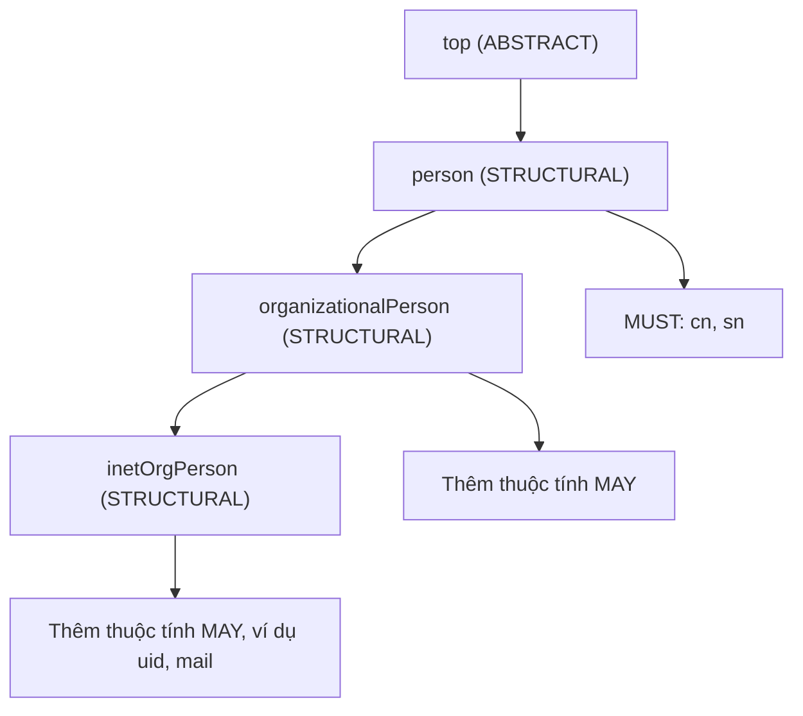
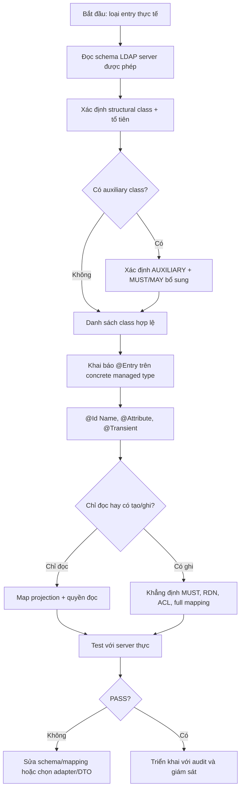

# Xử lý object class khi domain type có kế thừa

## Mục tiêu bài học

Trong **SPRING_LDAP**, Object-Directory Mapping (**ODM**) giúp ánh xạ một LDAP entry thành đối tượng Java. Khi các object class của LDAP có **kế thừa theo schema** hoặc các **domain type Java** được tổ chức thành lớp cha–lớp con, việc chọn `@Entry(objectClasses = ...)` rất dễ gây nhầm lẫn. Chẳng hạn, `inetOrgPerson` là một loại `person` ở tầng LDAP, nhưng điều đó **không có nghĩa** Spring LDAP sẽ tự tạo một instance của subclass Java tương ứng, tự suy toàn bộ annotation `@Entry`, hoặc tự tìm ra mọi attribute cần ghi khi `create()`.

Bài nằm trong chương **ODM operations**, gắn với các thao tác `LdapTemplate.find()`, `findByDn()`, `create()`, `update()`, `delete()` và mối quan hệ với `ContextSource`, DN, schema, LDAP filters, `LdapClient` hoặc `DirContextAdapter`. Người học sẽ thực hành mô hình hóa đối tượng có kế thừa, đọc đúng tập object class, thêm entry hợp lệ, tránh ghi sai attribute và kiểm tra an toàn với TLS, LDAP ACL, unit/integration test.

Sau bài này, bạn có thể:

1. Phân biệt **kế thừa LDAP object class** với **kế thừa kiểu Java**.
2. Giải thích `@Entry(objectClasses=...)`, `@Id`, `@Attribute`, `@DnAttribute` và `@Transient` trong ODM.
3. Chọn danh sách object class phù hợp khi đọc entry thuộc lớp con và khi **tạo** entry mới.
4. Thiết kế entity cho `inetOrgPerson` mà không bỏ sót thuộc tính `MUST` của lớp cha.
5. Nhận diện nguy cơ khi dùng Java inheritance nhưng trông đợi ODM tự chọn subclass hoặc tự hợp nhất annotation.
6. Phân biệt **structural** và **auxiliary object class**, phân tích trường hợp server có schema tùy biến.
7. Kiểm tra CRUD, lọc theo object class, ACL/TLS và những trường hợp cập nhật có thể ảnh hưởng dữ liệu không liên quan.

## 1. Cần phân biệt ba kiểu kế thừa

| Kế thừa/quan hệ | Nằm ở đâu? | Ý nghĩa |
| --- | --- | --- |
| **LDAP object class inheritance** | Schema của directory server | Object class con kế thừa các thuộc tính được phép/bắt buộc từ lớp cha (`SUP`) |
| **Java class inheritance** | Mã nguồn `extends` / `implements` | Class con thừa hưởng member/method Java theo quy tắc ngôn ngữ |
| **ODM mapping metadata** | Spring LDAP annotation và mapper | `@Entry` khai báo các object class mà **một class được quản lý** đại diện; field được ánh xạ theo quy tắc ODM |

Ba quan hệ này **không hoàn toàn tương ứng**. Một class Java có thể đại diện cho LDAP entry thuộc nhiều object class; một LDAP entry có thể phù hợp với nhiều phép chiếu Java; và hai subclass Java không tự trở thành hai structural object classes của LDAP.

### 1.1. Ví dụ schema LDAP thường gặp



Trong schema dùng phổ biến theo RFC 4519 và RFC 2798:

- `person` kế thừa `top`, có **MUST `cn` và `sn`**.
- `organizationalPerson` kế thừa `person` và cho phép thêm những thuộc tính liên quan tổ chức.
- `inetOrgPerson` kế thừa `organizationalPerson` và cho phép thêm các thuộc tính như `uid` và `mail`.
- `uid` có thể là MAY theo schema, nhưng khi entry mang RDN `uid=lan`, giá trị này còn cần phù hợp với **quy tắc đặt tên entry**.

Tập object class của một người trong fixture thử nghiệm có thể là:

```ldif
dn: uid=lan,ou=People,dc=example,dc=org
objectClass: top
objectClass: person
objectClass: organizationalPerson
objectClass: inetOrgPerson
uid: lan
cn: Lan Nguyen
sn: Nguyen
mail: lan@example.org
```

**Không hiểu “LDAP có objectClass=inetOrgPerson” là server có một Java subclass tên `InetOrgPerson`.** LDAP chỉ lưu dữ liệu theo schema. Java class nào được tạo là do **API mapping và kiểu đích** mà code chọn.

### 1.2. Sơ đồ đối chiếu hai thế giới

```text
LDAP schema:
  top -> person -> organizationalPerson -> inetOrgPerson
                  (SUP + MUST/MAY)

Java domain (một khả năng thiết kế):
  PersonView -> EmployeeView
                  (extends hoặc composition)

Spring LDAP ODM:
  @Entry(objectClasses={"top","person",
                        "organizationalPerson","inetOrgPerson"})
  class EmployeeEntry
                  (metadata ánh xạ, KHÔNG phải extends Java)
```

Một lớp như `EmployeeEntry` **không cần** `extends PersonEntry` chỉ để ODM nhận diện LDAP `person` trong chuỗi kế thừa. Trong nhiều dự án, một **entity cụ thể và các DTO độc lập** đơn giản, an toàn hơn một cây Java inheritance lớn.

## 2. @Entry(objectClasses): khai báo class ánh xạ, không tự khám phá schema

Spring LDAP yêu cầu entity ODM có `@Entry` ở cấp class và một field `@Id` kiểu `javax.naming.Name`. Một annotation ví dụ:

```java
import org.springframework.ldap.odm.annotations.Entry;

@Entry(
    objectClasses = {
        "top",
        "person",
        "organizationalPerson",
        "inetOrgPerson"
    },
    base = "ou=People"
)
public class EmployeeEntry {
    // Các field sẽ được định nghĩa ở phần tiếp theo.
}
```

**Đây là cấu trúc minh họa chưa hoàn chỉnh**: cần thêm `@Id` và các trường được map trong ví dụ đầy đủ. `base="ou=People"` được tính **tương đối với base DN của `ContextSource`**. Nếu `ContextSource.base=dc=example,dc=org`, entry thực nằm dưới `ou=People,dc=example,dc=org`. Không lặp `dc=example,dc=org` vào cả hai lớp cấu hình.

### 2.1. Khi đọc entry sẵn có

Theo tài liệu Spring LDAP ODM, nếu bạn chỉ muốn quản lý các thuộc tính thuộc phạm vi `person`, một mapping `@Entry(objectClasses={"person","top"})` **có thể dùng để đọc một entry thực tế thuộc `inetOrgPerson`**. Lý do: entry ở lớp con có các object class tổ tiên; mapper đang chọn tập thuộc tính/lớp có liên quan đến model được yêu cầu.

Nhưng nếu code muốn quản lý field của `inetOrgPerson` như `mail` hoặc `uid`, tài liệu Spring LDAP hướng dẫn khai báo **đầy đủ chuỗi** trong `@Entry`:

```java
@Entry(objectClasses = {
    "inetOrgPerson", "organizationalPerson", "person", "top"
})
public class FullPersonEntry {
    // Các field tương ứng với schema, DN và annotation.
}
```

**Không suy rằng `@Entry(objectClasses={"person","top"})` tự “nâng cấp” thành `inetOrgPerson` chỉ vì entry trên server có class đó.** Metadata là thứ ứng dụng công bố; phép đọc một lớp cha cũng không nhất thiết tạo object Java thuộc lớp con.

### 2.2. Khi tạo entry mới

Tài liệu Spring LDAP nêu rõ: **khi `create()` entity ODM mới, chỉ những object class đã khai báo trong `@Entry` được dùng để tạo entry**. Vì vậy:

```java
// KHÔNG PHÙ HỢP nếu muốn tạo một entry inetOrgPerson có uid/mail:
@Entry(objectClasses = {"person", "top"})
public class PartialPersonEntry {
    // ...
}
```

Đây có thể là một **phép chiếu đọc** hợp lệ trong một ngữ cảnh, nhưng không phải lựa chọn an toàn cho thao tác tạo `inetOrgPerson`. Với entity ghi đầy đủ, khai báo chuỗi `top/person/organizationalPerson/inetOrgPerson`, thiết lập `cn`, `sn`, RDN attribute và những field nghiệp vụ hợp lệ **trước khi `create()`**.

Không có quy tắc rằng Spring LDAP sẽ phân tích `extends SomeJavaClass` rồi tự thêm LDAP object class tương ứng vào annotation. Metadata object class là **cấu hình ODM tường minh** và schema thực sự do server quyết định.

### 2.3. Metadata và điều kiện tìm kiếm

`ObjectDirectoryMapper` của Spring LDAP biết các object class đã khai báo. Nó có API `filterFor(Class<?>, Filter)` để bổ sung điều kiện object class vào bộ lọc cho kiểu được quản lý. Khi dùng `ldapTemplate.find(..., EmployeeEntry.class)`, nên hiểu kết quả chịu ảnh hưởng của:

- Object class được khai báo trên **kiểu Java chỉ định**.
- Base DN, search scope và điều kiện truy vấn thực tế.
- Danh sách attribute trả về, LDAP ACL và schema.
- Cách `ObjectDirectoryMapper` ánh xạ đúng target class đã được yêu cầu.

**Không mặc định query kiểu cha sẽ tự khởi tạo mọi subclass Java**, hoặc query một type không đúng scope sẽ nhận đủ field của mọi subtype. Kiểm thử theo từng class cụ thể và lọc rõ object class cần thiết.

## 3. Entity ODM đầy đủ cho inetOrgPerson

Để tránh nhầm lẫn giữa ba loại kế thừa, trước hết hãy xây một **entity Java cụ thể**, không dùng `extends`, nhưng khai báo đủ chuỗi LDAP object class.

### 3.1. Khai báo entity

```java
import javax.naming.Name;
import org.springframework.ldap.odm.annotations.Attribute;
import org.springframework.ldap.odm.annotations.Entry;
import org.springframework.ldap.odm.annotations.Id;
import org.springframework.ldap.odm.annotations.Transient;

@Entry(objectClasses = {
    "top", "person", "organizationalPerson", "inetOrgPerson"
})
public class EmployeeEntry {
    @Id
    private Name dn;

    @Attribute(name = "uid")
    private String uid;

    @Attribute(name = "cn")
    private String fullName;

    @Attribute(name = "sn")
    private String surname;

    @Attribute(name = "mail")
    private String email;

    @Attribute(name = "description")
    private String description;

    @Transient
    private String displaySummary;

    public EmployeeEntry() {}

    public Name getDn() { return dn; }
    public void setDn(Name dn) { this.dn = dn; }

    public String getUid() { return uid; }
    public void setUid(String uid) { this.uid = uid; }

    public String getFullName() { return fullName; }
    public void setFullName(String fullName) {
        this.fullName = fullName;
    }

    public String getSurname() { return surname; }
    public void setSurname(String surname) {
        this.surname = surname;
    }

    public String getEmail() { return email; }
    public void setEmail(String email) { this.email = email; }

    public String getDescription() { return description; }
    public void setDescription(String description) {
        this.description = description;
    }
}
```

**Điểm cần đọc đúng:**

1. `@Entry(objectClasses=...)` mô tả **schema LDAP của entry**, không có quan hệ `extends` ở Java.
2. `@Id` định danh DN và phải đặt trên field tương thích `javax.naming.Name`, không phải `String uid`. `uid` có thể nằm trong RDN, nhưng **không thay thế DN**.
3. `@Attribute(name="cn")` đổi tên field Java `fullName` sang attribute LDAP `cn`; tương tự với `surname → sn`.
4. `@Transient` giữ `displaySummary` ngoài persistence ODM. **Tất cả field không được đánh dấu `@Transient` đều có thể được ODM map theo tên field**, nên cần kiểm soát chặt những field thêm mới sau này.
5. `cn` và `sn` phải được cung cấp khi tạo entry vì là **MUST của `person`** trong chuỗi schema.
6. `email` và `description` là trường nghiệp vụ/tùy chọn theo schema phổ biến; validation application có thể yêu cầu thêm nhưng không được gọi chúng là MUST LDAP chung.

Trong ví dụ trên, `@Entry` **không có `base`**, nên DN được set tường minh theo quy ước `ContextSource.base`. Một dự án cũng có thể dùng `@Entry(base="ou=People")` và DN được tính theo metadata; hãy chọn **một quy ước DN** được xác minh bằng test, không gắn suffix OU hai lần.

### 3.2. Xây DN tương đối với ContextSource và tạo entry

Giả định `ContextSource.base = dc=example,dc=org`, nhánh `ou=People` tồn tại, account có quyền Add và TLS được xác minh.

```java
import javax.naming.Name;
import org.springframework.ldap.core.LdapTemplate;
import org.springframework.ldap.support.LdapNameBuilder;

final class EmployeeRepository {
    private final LdapTemplate ldapTemplate;

    EmployeeRepository(LdapTemplate ldapTemplate) {
        this.ldapTemplate = ldapTemplate;
    }

    EmployeeEntry create(
            String uid, String fullName, String surname,
            String email) {
        requireText(uid, "uid");
        requireText(fullName, "cn");
        requireText(surname, "sn");

        // Dùng giá trị RDN thô; builder xử lý cú pháp DN.
        Name relativeDn = LdapNameBuilder.newInstance()
                .add("ou", "People")
                .add("uid", uid)
                .build();

        EmployeeEntry person = new EmployeeEntry();
        person.setDn(relativeDn);
        person.setUid(uid);
        person.setFullName(fullName);
        person.setSurname(surname);
        person.setEmail(email);

        ldapTemplate.create(person);
        return person;
    }

    EmployeeEntry findByDn(Name relativeDn) {
        return ldapTemplate.findByDn(
                relativeDn, EmployeeEntry.class);
    }

    private static void requireText(
            String value, String field) {
        if (value == null || value.isBlank()) {
            throw new IllegalArgumentException(
                    "Required field: " + field);
        }
    }
}
```

`ldapTemplate.create(person)` là **tạo LDAP entry bằng ODM**, không phải xác thực người dùng. Nó khác với giao thức **LDAP Bind** để thiết lập authentication. Đường tạo thông thường cần một entry chưa tồn tại, object class hợp lệ, các attribute MUST và DN có parent đã tồn tại.

**Không dùng `create()` để cập nhật entry đã có**, cũng không tự chuyển sang `rebind()` khi gặp trùng DN. Gặp xung đột thì trả trạng thái conflict theo hợp đồng; không ghi đè dữ liệu hiện tại.

### 3.3. Đọc và cập nhật entity đã có

Với entity được **load đầy đủ trong phạm vi attribute/quyền cần thiết**, một quy trình cập nhật bằng ODM có thể là:

```java
EmployeeEntry person =
        ldapTemplate.findByDn(relativeDn, EmployeeEntry.class);

if (person == null) {
    throw new IllegalStateException("Person not found");
}

person.setDescription("Đã xác minh hồ sơ");
ldapTemplate.update(person);
```

**Không tự suy** `update()` hoạt động như một JPA `EntityManager.merge()` trong mọi trường hợp. LDAP ODM sử dụng mapping metadata và thao tác directory, chứ không cung cấp đầy đủ transaction, lazy loading, optimistic locking hoặc inheritance strategy kiểu ORM.

Nếu entity Java được ánh xạ **chỉ một phần** hoặc server ẩn field do ACL, một quy trình update toàn object có thể mang rủi ro với các attribute không nằm trong snapshot. Khi chỉ muốn thay **một** field, cân nhắc đường ghi tường minh:

```java
import org.springframework.ldap.core.DirContextOperations;

DirContextOperations current =
        ldapTemplate.lookupContext(relativeDn);
current.setAttributeValue(
        "description", "Đã xác minh hồ sơ");
ldapTemplate.modifyAttributes(current);
```

Cách này gửi thay đổi được adapter tính theo snapshot và phù hợp với hợp đồng **partial update**. Không thay đổi field `objectClass` hoặc `uid` chỉ vì một request đổi `description`. Nếu cần đổi RDN, dùng workflow rename/move chuyên trách.

### 3.4. Bảng đối chiếu CRUD của ODM

| Mục tiêu | API ODM thường gặp | Điều phải kiểm tra |
| --- | --- | --- |
| Tìm theo DN | `findByDn(dn, EmployeeEntry.class)` | DN tương đối/base, class mapping, quyền đọc |
| Tìm bằng filter | `find(query, EmployeeEntry.class)` | Filter escaping, object class và scope |
| Tìm một entry | `findOne(query, EmployeeEntry.class)` | Có thực sự duy nhất hay không |
| Tạo entry | `create(person)` | Chuỗi objectClass, các MUST, RDN, parent, ACL |
| Cập nhật entry | `update(person)` | Mapping đầy đủ, attribute bị ẩn, dữ liệu đồng thời |
| Xóa entry | `delete(person)` | Authorization, DN và tác động tham chiếu |
| Chỉ sửa một attribute | `lookupContext()+modifyAttributes()` | Chỉ gửi field được phép |

Tên method và overload theo tài liệu Spring LDAP hiện hành; hãy đối chiếu phiên bản thư viện của dự án. **Không gộp “ODM CRUD” với cơ chế transaction xuyên nhiều entry**: một Add, Modify hoặc Delete có thể thành công trong khi thao tác với entry khác thất bại.

## 4. Java class có kế thừa: @Entry có tự đi theo extends không?

**Không nên mặc định là có.** Javadoc của `@Entry` khai báo `@Target(TYPE)`, `@Retention(RUNTIME)`, `@Documented` nhưng **không khai báo `@Inherited`**. Theo cơ chế reflection chuẩn của Java, một subclass **không tự nhận annotation này** chỉ vì superclass có `@Entry`.

Ví dụ:

```java
import org.springframework.ldap.odm.annotations.Entry;

@Entry(objectClasses = {"top", "person"})
class BasePersonEntry {
    // ...
}

// Không có @Entry ngay trên class này.
class EmployeeSubclass extends BasePersonEntry {
    // ...
}
```

Trong reflection Java chuẩn, `EmployeeSubclass.class.getAnnotation(Entry.class)` không trả annotation `@Entry` của `BasePersonEntry`. Một framework có thể có cơ chế duyệt annotation riêng, nhưng **không nên thiết kế dựa trên giả định chưa kiểm chứng** rằng ODM sẽ tự lấy/hợp nhất metadata của lớp cha.

### 4.1. Mô hình hóa lớp con có annotation tường minh

Nếu dự án thực sự cần kế thừa Java để dùng lại field hoặc method, mỗi **concrete ODM managed type** nên khai báo `@Entry` với **đúng object class mà nó quản lý**:

```java
import javax.naming.Name;
import org.springframework.ldap.odm.annotations.Attribute;
import org.springframework.ldap.odm.annotations.Entry;
import org.springframework.ldap.odm.annotations.Id;

abstract class PersonFields {
    @Attribute(name = "cn")
    protected String fullName;

    @Attribute(name = "sn")
    protected String surname;
}

@Entry(objectClasses = {
    "top", "person", "organizationalPerson", "inetOrgPerson"
})
class InheritedEmployeeEntry extends PersonFields {
    @Id
    private Name dn;

    @Attribute(name = "uid")
    private String uid;

    @Attribute(name = "mail")
    private String email;

    // Constructor/getters/setters của entity tùy ứng dụng.
}
```

**Đây là ví dụ về thiết kế class, không phải lời cam kết rằng mọi phiên bản ODM sẽ ánh xạ mọi field từ superclass đúng cách.** Khi dùng kế thừa Java, cần viết integration test **trên đúng phiên bản Spring LDAP** để chứng minh:

- Field `cn` và `sn` khai báo ở superclass được map khi đọc/ghi.
- Field `uid` và `mail` ở subclass được map.
- Chỉ có **một DN field `@Id`** hợp lệ trong toàn hierarchy.
- Không có field ẩn tên, mapping trùng attribute hoặc hai annotation mâu thuẫn.
- Tạo entry mới có đủ `objectClass`, `cn`, `sn` và giá trị RDN.

Nếu có bất kỳ điểm nào không hoạt động đúng, dùng **entity phẳng, composition hoặc explicit mapper** thay vì tiếp tục dựa vào giả định về kế thừa.

### 4.2. Đừng truy vấn kiểu cha rồi đòi field kiểu con

```java
// Nếu query đúng kiểu BasePersonEntry, không mặc nhiên
// có object InheritedEmployeeEntry và các field riêng của con.
List<BasePersonEntry> persons = ldapTemplate.find(
        query().where("cn").is("Lan Nguyen"),
        BasePersonEntry.class);
```

Đây là **ví dụ cảnh báo ý tưởng**, không phải khuyến nghị dùng `BasePersonEntry` thiếu metadata/field cho production. Khi query ODM, target class được truyền rõ vào `find(..., clazz)`; đừng kỳ vọng nó tự dispatch từng entry thành subclass Java chỉ từ `objectClass` theo kiểu JPA inheritance.

Nếu cần mô hình nhiều subtype, một chiến lược dễ kiểm soát là query kết quả LDAP ở mức `DirContextOperations` hoặc `AttributesMapper`, đọc `objectClass` rồi **tự chọn mapper/DTO** theo allowlist và schema thực tế; không đưa mọi unknown object class từ server thành class Java do người dùng tùy ý chỉ định.

## 5. Structural object class và auxiliary object class

Một LDAP entry có thể thuộc nhiều object class nhưng các class đó **không nhất thiết đều thuộc cùng loại**. Schema phân biệt:

| Loại | Vai trò | Ví dụ |
| --- | --- | --- |
| **ABSTRACT** | Định nghĩa cơ sở để class khác kế thừa | `top` |
| **STRUCTURAL** | Định nghĩa dạng entry chính trong DIT | `person`, `organizationalPerson`, `inetOrgPerson` |
| **AUXILIARY** | Bổ sung các thuộc tính/khả năng cho entry | Lớp phụ do schema hỗ trợ, có thể là class riêng của tổ chức |

Không thể chọn tùy ý hai structural object class thuộc **hai nhánh không tương thích** rồi đưa cả hai vào `@Entry` chỉ vì Java implements hai interface. LDAP server sẽ kiểm tra tính hợp lệ của structural object class chain và trả lỗi nếu entry không tuân thủ schema.

### 5.1. Kế thừa structural theo một chuỗi hợp lệ

```text
top (ABSTRACT)
  └─ person (STRUCTURAL)
       └─ organizationalPerson (STRUCTURAL)
            └─ inetOrgPerson (STRUCTURAL)
```

Một entry thuộc `inetOrgPerson` vẫn tuân thủ các MUST của `person`. Việc khai báo `"inetOrgPerson"` trong `@Entry` **không miễn** cho ứng dụng kiểm tra `cn` và `sn`. Các attribute do cha định nghĩa vẫn có hiệu lực kể cả khi không có một Java class `PersonEntry` tồn tại.

### 5.2. Trường hợp auxiliary class riêng

Giả sử tổ chức có **custom LDAP schema** định nghĩa một auxiliary object class giả định `corpEmployeeExtension`, cho phép dùng `corpCostCenter`. Ví dụ này **không thuộc schema chuẩn**; chỉ có thể chạy nếu server đã được provision schema phù hợp:

```java
@Entry(objectClasses = {
    "top",
    "person",
    "organizationalPerson",
    "inetOrgPerson",
    "corpEmployeeExtension"
})
public class CorporateEmployeeEntry {
    // @Id Name dn;
    // @Attribute(name="cn") String fullName;
    // @Attribute(name="sn") String surname;
    // @Attribute(name="uid") String uid;
    // @Attribute(name="corpCostCenter") String costCenter;
    // Các trường khác tùy schema; đây là ví dụ cấu trúc.
}
```

Đây **không phải entity hoàn chỉnh** dùng để gọi `create()`; phần code mô tả danh sách metadata cần thiết. Với schema doanh nghiệp thực:

1. Kiểm tra `corpEmployeeExtension` tồn tại, có loại `AUXILIARY` và được phép đi cùng structural chain đã chọn.
2. Xác định các attribute `MUST` mới (nếu có) và `MAY` của extension.
3. Xác định cú pháp/giới hạn giá trị `corpCostCenter` trước khi map sang Java.
4. Khai báo đúng class phụ và field trên **entity concrete**, không chỉ thêm field Java rồi kỳ vọng server tự sinh object class.
5. Kiểm thử LDAP Add/Modify thực, vì server policy/DIT content rule có thể áp hạn chế riêng.

### 5.3. Thêm auxiliary class không giống đổi structural class

Thêm một auxiliary class được schema cho phép có thể là một **thao tác thay đổi objectClass và bổ sung attribute**. Nhưng “nâng cấp từ `person` sang `inetOrgPerson`” hoặc “hạ từ `inetOrgPerson` về `person`” có thể là **thay đổi structural object class**, thường bị server hạn chế hoặc từ chối với lỗi schema/`objectClassModsProhibited`.

**Không biến nhu cầu thay đổi kiểu domain Java thành lệnh Modify LDAP objectClass tự động.** Nếu nghiệp vụ thật sự cần chuyển loại entry, hãy:

- Kiểm tra khả năng hỗ trợ và chính sách của directory server cụ thể.
- Phân tích các MUST/MAY và attribute hiện hữu sau thay đổi.
- Kiểm tra ACL, schema, định danh DN, tham chiếu nhóm và dữ liệu nghiệp vụ.
- Lập kế hoạch migration/provisioning riêng nếu server không cho đổi structural class.
- Không xóa–tạo lại entry một cách tự động để “đổi class”, vì nguy cơ mất metadata và tham chiếu.

### 5.4. Tên field Java giống nhau không nói lên cùng LDAP schema

Ví dụ `cn` có thể xuất hiện ở nhiều object class, nhưng `employeeNumber` hay một attribute riêng của tổ chức có thể mang schema/semantics khác. Hai class Java đều có field `String id` **không có nghĩa** chúng phải map cùng attribute LDAP.

Luôn định nghĩa một **bảng mapping theo loại entry**:

| Trường Java | LDAP attribute | Class/schema liên quan | Required? |
| --- | --- | --- | --- |
| `fullName` | `cn` | `person` | MUST |
| `surname` | `sn` | `person` | MUST |
| `uid` | `uid` | `inetOrgPerson` | MAY theo schema, cần cho RDN `uid=...` |
| `email` | `mail` | `inetOrgPerson` trong schema ví dụ | MAY |
| `costCenter` | `corpCostCenter` | Custom auxiliary giả định | Theo schema custom |

Chú ý `uid` không bắt buộc theo định nghĩa `inetOrgPerson` chung, nhưng **một entry có RDN `uid=lan` phải đặt tên hợp lệ**; đừng dùng từ MAY để bỏ trống RDN attribute.

## 6. Khi có nhiều domain subtype cần đọc từ cùng directory

Một LDAP search có thể trả những entry thuộc lớp người nói chung lẫn những entry có thêm extension. Ở tầng Java có hai hướng chính:

**Hướng A — entity theo target class tường minh.** Khi biết entry thuộc `inetOrgPerson`, dùng `ldapTemplate.find(..., EmployeeEntry.class)`, chọn mapping class cụ thể và query phù hợp.

**Hướng B — đọc dữ liệu trung lập rồi tự chọn DTO.** Nếu API cần danh sách hỗn hợp, truy vấn `objectClass` cùng những attribute cần thiết, rồi phân loại entry **theo schema và quy tắc ứng dụng** trong một mapper do developer kiểm soát.

### 6.1. Ví dụ phân loại entry đọc được

```java
import java.util.Arrays;
import java.util.Locale;
import java.util.Set;
import java.util.stream.Collectors;
import org.springframework.ldap.core.DirContextOperations;

enum DirectoryPersonKind {
    BASIC_PERSON, ORGANIZATIONAL_PERSON, INTERNET_PERSON
}

final class PersonKindClassifier {
    private PersonKindClassifier() {}

    static DirectoryPersonKind classify(DirContextOperations entry) {
    String[] values = entry.getStringAttributes("objectClass");
    if (values == null || values.length == 0) {
        throw new IllegalStateException(
                "objectClass was not returned");
    }
    Set<String> names = Arrays.stream(values)
            .map(x -> x.toLowerCase(Locale.ROOT))
            .collect(Collectors.toSet());

    if (names.contains("inetorgperson")) {
        return DirectoryPersonKind.INTERNET_PERSON;
    }
    if (names.contains("organizationalperson")) {
        return DirectoryPersonKind.ORGANIZATIONAL_PERSON;
    }
    if (names.contains("person")) {
        return DirectoryPersonKind.BASIC_PERSON;
    }
    throw new IllegalStateException("Unsupported entry type");
    }
}
```

Trong đoạn trên, logic xem **loại cụ thể nhất** trước, vì một entry `inetOrgPerson` còn có thể chứa `person` và `organizationalPerson`. Nếu code kiểm tra `"person"` trước, mọi `inetOrgPerson` có thể bị phân loại thành `BASIC_PERSON`.

**Giới hạn:** Đây chỉ là phân loại **các class đã được công nhận** trong hệ thống. Không dùng tên object class lấy từ LDAP để gọi `Class.forName()`, tạo class Java tùy ý hoặc tự cấp quyền. Dữ liệu `objectClass` không thay thế authorization của caller và LDAP ACL.

### 6.2. Phân loại không đồng nghĩa kết quả ODM polymorphic

```text
LDAP SearchResult
  -> ContextMapper / DirContextOperations
  -> đọc objectClass theo tập tên đã cho phép
  -> chọn DTO/mapper phù hợp (code ứng dụng)

KHÔNG mặc định:
  ldapTemplate.find(..., BasePerson.class)
  -> runtime tự chọn EmployeeSubclass / ContractorSubclass
```

Nếu cần mapping polymorphic phức tạp, có thể thiết kế **một DTO chung** với trường loại dữ liệu, hoặc một dispatcher mapping tường minh theo rule. Chỉ tạo các loại DTO đã được ứng dụng phê duyệt; không thiết kế một API cho client tự chọn `@Entry` hoặc Java class muốn đọc.

### 6.3. Chọn projection cho việc phân loại

Nếu cần dựa vào `objectClass`, query phải trả field đó. Không tự kết luận type từ một `null` vì:

- Search có thể **không yêu cầu** `objectClass`.
- Server/ACL có thể không trả về attribute mong muốn.
- Entry/schema có thể có đối tượng không thuộc tập model của ứng dụng.

Đối với một search API chỉ cần hiển thị tên/email của người dùng đã biết type, có thể dùng DTO hẹp hơn, không cần trả toàn bộ chuỗi objectClass cho browser. **Phân loại server-side filter và mapping** thường nên được quyết định ở repository, không đẩy cấu trúc LDAP ra API công khai.

## 7. @DnAttribute, @Id và inheritance: ba trách nhiệm khác nhau

Trong Spring LDAP:

- `@Id` giữ **DN của entry** thông qua `javax.naming.Name`.
- `@DnAttribute` có thể map thành phần của DN vào một field `String`.
- `@Attribute` map một field Java vào LDAP attribute.

Ví dụ field:

```java
@Id
private Name dn;

@Attribute(name = "uid")
@DnAttribute(value = "uid")
private String uid;
```

Đoạn trên mô tả mối quan hệ DN/attribute trong **một entity có các import và class thích hợp**. Theo tài liệu Spring LDAP, `@DnAttribute` **không tự làm field ngừng được map sang LDAP attribute**; muốn loại nó khỏi persistence attribute thì phải dùng `@Transient` theo hợp đồng.

Khi `@DnAttribute` có `index`, ODM có thể tính DN từ các thành phần và xử lý thay đổi DN ở một số thao tác update; đây là behavior cần **kiểm thử thật** theo schema và server. Không thay `@Id` bằng mỗi `@DnAttribute`, và không coi thay một field RDN trong DTO là rename thành công.

Nếu có kế thừa Java, cần xác minh chỉ có một field `@Id` hợp lệ được mapper nhận, tránh đặt `@Id` trùng ở superclass và subclass. Với DN tương đối/tuyệt đối, nhất quán `ContextSource.base` và `@Entry.base` là yêu cầu quan trọng.

## 8. Cập nhật entity: giữ object class và attribute không liên quan

Khi domain có các loại cha/con, một lỗi phổ biến là **load bằng một kiểu đơn giản** nhưng **ghi lại toàn bộ object bằng một metadata khác**. Ví dụ:

```text
Entry thực tế:
  objectClass: top
  objectClass: person
  objectClass: organizationalPerson
  objectClass: inetOrgPerson
  cn: Lan Nguyen
  sn: Nguyen
  uid: lan
  mail: lan@example.org

Ứng dụng chỉ map:
  @Entry(objectClasses={"top","person"})
  fullName, surname

Sau đó ứng dụng:
  ldapTemplate.update(partialPerson)
```

Đừng kết luận thao tác trên **entity ánh xạ một phần** sẽ chắc chắn bảo toàn mọi attribute/object class bổ sung. Điều đó phải được kiểm thử theo **đúng Spring LDAP version, LDAP server và cấu hình ODM**. Một kiểu đọc dạng projection không nhất thiết là kiểu ghi an toàn.

### 8.1. Tách read model và write model

| Mục tiêu | Đề xuất |
| --- | --- |
| Hiển thị tên và email | DTO hẹp/`AttributesMapper` hoặc ODM read model đã được test |
| Chỉnh một `description` | `lookupContext()` rồi sửa **chỉ** attribute có trong command |
| Tạo `inetOrgPerson` mới | Entity `@Entry` đủ class, MUST, RDN, và quyền Add |
| Thay đổi group membership | `modifyAttributes` theo giá trị DN, không replace bừa tập member |
| Chuyển loại entry/schema | Migration riêng có kiểm soát, không dùng `update()` như chuyển polymorphic type |
| Đổi DN/RDN | Quy trình rename/move, không chỉ set `uid` trong DTO |

Không nên dùng một generic REST endpoint như `PATCH /people/{id}` rồi map **mọi field JSON** thành field của entity ODM. Nếu caller truyền objectClass, uid, dn hoặc những thuộc tính không được phép, ứng dụng phải **bỏ qua hoặc từ chối theo hợp đồng**, không dùng reflection để ghi tất cả.

### 8.2. @Attribute(readonly=true) khác với ACL

Nếu một attribute chỉ nên được đọc vào entity, `@Attribute(readonly=true)` có thể dùng trong ODM:

```java
import org.springframework.ldap.odm.annotations.Attribute;

@Attribute(name = "modifyTimestamp", readonly = true)
private String modifiedAt;
```

Đây là **chính sách mapping**, không phải quyền LDAP server. Attribute operational như `modifyTimestamp` thường do server quản lý và không được trả cùng user attributes mặc định; dùng annotation này không tự yêu cầu nó ở mọi search và không làm server thay đổi ACL.

Ngược lại, nếu `@Attribute(readonly=true)` trên field ứng dụng quản lý, code có thể không persist các thay đổi của field đó qua ODM, nhưng một đường `LdapTemplate.modifyAttributes()` khác vẫn chịu quyền thực của server. Không coi ODM readonly là giải pháp thay server ACL hoặc authorization ở HTTP service.

### 8.3. Không tạo objectClass từ tên class Java

Một anti-pattern:

```java
// KHÔNG NÊN: mã hóa objectClass từ Java runtime class name.
String objectClass = entity.getClass().getSimpleName();
// Ví dụ EmployeeEntry không phải objectClass LDAP hợp lệ mặc định.
```

Tương tự, **không tạo objectClass mới trên server** chỉ vì developer thêm class Java `ContractorEntry extends EmployeeEntry`. Object class thuộc schema được quản trị, có OID/syntax/MUST/MAY và loại STRUCTURAL/AUXILIARY riêng; tên Java hoàn toàn không có thẩm quyền tạo schema.

### 8.4. Thay objectClass phải xét thêm/xóa các attribute

Giả sử công ty có auxiliary class tùy biến `corpEmployeeExtension` với MUST `corpCostCenter`. Nếu muốn thêm auxiliary class, phải tính đến:

1. LDAP server có cho phép gắn class phụ với structural chain hiện tại?
2. `corpCostCenter` có giá trị hợp lệ ngay trong transaction/Modify mong đợi không?
3. Có attribute đang tồn tại mà class mới không cho phép không?
4. ACL của account có quyền sửa cả `objectClass` và attribute cần thêm?
5. Replica, hệ thống tích hợp và mapper cũ có hỗ trợ schema mới không?

Trong một số server, một LDAP Modify có thể mang nhiều `ModificationItem` cho cùng entry; nhưng LDAP operations qua **nhiều entry khác nhau** không tự thuộc một transaction chung. Nếu schema update cần migration lớn, không chỉ chạy `ldapTemplate.update(newJavaSubtype)` rồi xem như hoàn thành.

## 9. Schema khác nhau giữa server: đừng lấy một mẫu làm chuẩn tuyệt đối

`inetOrgPerson` là class phổ biến trong LDAP, nhưng directory server và tổ chức có thể dùng:

- Các structural object class khác cho tài khoản người dùng.
- Auxiliary schema để quản lý thuộc tính riêng.
- Object class tên riêng của vendor, đặc biệt ở các directory như Active Directory.
- DIT content rules/ACL và naming constraints khác nhau.
- Operational attributes hoặc attribute có syntax/matching rule đặc thù.

**Đừng áp** một entity `@Entry(objectClasses={top,person,organizationalPerson,inetOrgPerson})` cho mọi LDAP server nếu object class thực tế của entry là khác. Đầu tiên hãy inspect schema và entry trong **môi trường được cấp quyền**, sau đó thiết kế mapping.

### 9.1. Ba bước kiểm tra schema đích

1. **Xác minh loại entry**: structural object class là gì; các lớp cha và auxiliary class nào có mặt; thuộc tính `objectClass` thực tế trả gì?
2. **Xác minh field**: attribute thuộc MUST/MAY của class nào, syntax và single-valued/multi-valued; những trường nào do server tự quản lý?
3. **Xác minh hành vi**: Spring LDAP tạo/read/update entity ra sao, với cùng version, schema, account và projection?

Không nên dựa vào class Java có tên “Employee” hoặc vào một LDIF mẫu trên blog để kết luận mọi directory đều hỗ trợ `employeeNumber`, `mail`, `uid` hay custom class theo cùng cách.

### 9.2. Dùng ldapsearch để quan sát một entry

Trên LDAP server thử nghiệm có account được quyền đọc:

```bash
ldapsearch -LLL -x \
  -H ldaps://ldap.example.org:636 \
  -D "cn=svc-reader,ou=Services,dc=example,dc=org" -W \
  -b "uid=lan,ou=People,dc=example,dc=org" \
  -s base "(objectClass=*)" \
  objectClass uid cn sn mail description
```

Lệnh dùng `-W` nhập password qua prompt, không nhúng secret trực tiếp vào shell history. Không bỏ certificate verification khi dùng `ldaps://`. Kết quả của account bị ACL hạn chế **không bảo đảm mọi attribute đều được hiển thị**, kể cả attribute có thực trên server.

### 9.3. LDIF thử nghiệm cho hai mức entity

Để đối chiếu class cha/con, có thể chuẩn bị **hai entry khác nhau** trong OU test:

```ldif
dn: cn=Basic Person,ou=People,dc=example,dc=org
objectClass: top
objectClass: person
cn: Basic Person
sn: Person

dn: uid=lan,ou=People,dc=example,dc=org
objectClass: top
objectClass: person
objectClass: organizationalPerson
objectClass: inetOrgPerson
uid: lan
cn: Lan Nguyen
sn: Nguyen
mail: lan@example.org
```

Ở đây, **RDN của entry `person` dùng `cn`**, còn entry `inetOrgPerson` dùng `uid`. Bài học là kiểu domain và tên DN không nhất thiết giống nhau; ODM phải có `@Id` tương ứng, và nếu dùng `@DnAttribute` thì phải kiểm thử quy tắc DN cho mỗi kiểu.

Không tạo fixture `uid=basic` chỉ có object class `person` nếu server không cho attribute `uid` dưới schema đó. Đây là một ví dụ tại sao **không lẫn thiết kế định danh của lớp con với schema của lớp cha**.

### 9.4. Search theo objectClass có phải bộ phân loại toàn năng?

Không. Filter `(objectClass=person)` thường khớp cả `inetOrgPerson` trong schema tổ tiên, nên nó không thể tự phân biệt mọi subtype. Nếu cần đúng loại, dùng thêm điều kiện và dữ liệu trả về, tùy chính sách/khả năng server. Các objectClass là **một tập không có thứ tự nghiệp vụ**, không được lấy phần tử đầu làm loại entry “chính”.

Một ví dụ filter dành cho class cụ thể:

```java
import static org.springframework.ldap.query.LdapQueryBuilder.query;

var request = query()
        .base("ou=People")
        .where("objectClass").is("inetOrgPerson")
        .and("uid").is(validatedUid);
```

`where(...).is(...)` đưa giá trị theo filter builder thay vì nối input thô vào chuỗi LDAP filter. Tuy nhiên, nếu API chỉ muốn tìm đúng UID có đặc quyền, vẫn phải kiểm tra authorization theo actor/tenant; filter escape **không** thay thế kiểm tra quyền.

## 10. Bảo mật và vận hành khi ODM quản lý nhiều class

### 10.1. Phân quyền theo thao tác và schema

| Tác vụ | Quyền server cần được xét | Quyền ứng dụng cần kiểm tra |
| --- | --- | --- |
| `find()` người dùng | Đọc nhánh/attribute liên quan | Caller được xem những entry/field nào |
| `create()` `inetOrgPerson` | Add entry vào parent OU, schema hợp lệ | Ai được tạo nhân viên mới, dưới OU nào |
| `update()` | Modify entry và từng attribute | Ai được thay trường nào |
| Sửa `objectClass` | Quyền Modify objectClass và thuộc tính liên quan | Có phê duyệt thay schema/loại entry không |
| `delete()` | Quyền xóa entry | Có quyền xóa và được kiểm tra tham chiếu không |
| Rename DN | Quyền rename/move theo server | Actor được đổi RDN/OU nào |

`@Entry` chỉ khai báo schema **cho mapper**. Nó không cấp quyền. Ngay cả một entity có class đúng và tất cả MUST vẫn có thể bị LDAP server từ chối vì ACL.

### 10.2. Reader và writer nên tách vai trò

Một thiết kế có thể dùng hai account:

```text
readContextSource:
  svc-reader -> chỉ đọc entry/attribute trong phạm vi được phép

writeContextSource:
  svc-editor -> Add/Modify theo nhánh và attribute cho phép
                KHÔNG phải toàn quyền quản trị schema
```

Điều này **không tự tạo ACL** trên directory server; administrator phải cấp quyền đúng. Application service còn phải kiểm tra actor trước khi dùng writer `LdapTemplate`. Các quyền khác nhau giữa các class cha/con không có nghĩa bạn được dùng một account rộng hơn để bỏ qua ACL của class con.

### 10.3. TLS, pooling, timeouts và DTO công khai

- Kết nối LDAP bằng **LDAPS** hoặc StartTLS có xác minh certificate/hostname; không tắt kiểm tra TLS để sửa lỗi ODM mapping.
- Credential bind qua secret manager/nguồn cấu hình bảo vệ, không ghi vào source control hoặc log.
- Khi dùng connection pooling, kiểm tra tương thích với TLS, danh tính bind và vòng đời context; không tái sử dụng connection của principal này cho principal khác.
- Đặt connect/read timeout và phân loại lỗi directory thực sự; một schema error **khác** với TLS failure hoặc network timeout.
- Không serialize trực tiếp entity ODM có nhiều field nội bộ vào HTTP response. Chuyển sang **DTO hẹp** sau authorization và attribute projection.
- Giới hạn returned attributes, base, scope và filter theo yêu cầu; đừng đọc toàn bộ schema hoặc userPassword chỉ vì ORM/ODM có thể map tất cả field.
- Giới hạn số entry, phân trang/sorting theo khả năng server và kiểm thử khi kết quả rất lớn.

### 10.4. Kế thừa Java không phải mô hình phân quyền

Không dùng `person instanceof AdminEmployee` làm bằng chứng actor có quyền LDAP hay HTTP role. Những phân loại kiểu domain chỉ là dữ liệu ứng dụng; permission phải dựa trên policy đã được xác minh và ACL server, chứ không phải tên subclass.

**Không tự cho client HTTP gửi tên `@Entry.objectClasses` hoặc class Java để thực hiện CRUD.** Những metadata này phải đến từ code/configuration đáng tin cậy, còn input chỉ được dùng làm dữ liệu đã validate và escape đúng DN/filter.

## 11. Lỗi thường gặp khi object class và domain type không khớp

| Triệu chứng | Nguyên nhân có thể | Hướng xử lý |
| --- | --- | --- |
| `create()` bị `objectClassViolation` (LDAP 65) | Thiếu MUST, sai structural class chain, attribute không được phép | Xem schema `SUP/MUST/MAY` và tập `@Entry` |
| `create()` bị `entryAlreadyExists` (68) | DN đã có entry | Báo xung đột, không `rebind` ghi đè |
| `create()` bị `noSuchObject` (32) | Parent DN chưa tồn tại hoặc sai base | Xác minh `@Entry.base`/`ContextSource.base` |
| `create()` bị `undefinedAttributeType` (17) | Custom class/attribute chưa được provision trong schema | Kiểm tra đăng ký schema trên server |
| `create()/update()` bị `invalidAttributeSyntax` (21) | Field Java được convert sang giá trị không hợp lệ | Đối chiếu LDAP syntax và converter |
| `create()/update()` bị `constraintViolation` (19) | Vi phạm single-valued/constraint hoặc policy khác | Kiểm tra quy tắc attribute, server policy |
| `update()` bị `objectClassModsProhibited` (69) | Cố thay đổi structural object class không cho phép | Không dùng update để “cast” loại entry; dùng migration được phê duyệt |
| Field `mail` null sau `find()` | Type đích chỉ map lớp cha, projection thiếu, hoặc ACL che | Chọn class đúng, kiểm tra projection/ACL |
| Field subclass null khi query parent class | Mapper nhận target type là class cha, không tự tạo subclass | Query đúng concrete type hoặc dispatcher tường minh |
| `@Id` không được tìm thấy/hai ID | Java inheritance có metadata/field trùng | Chỉ một DN field; kiểm tra mapper theo version |
| Mapping được nhưng field custom không persist | `@Transient`, `@Attribute(readonly=true)` hoặc schema/ACL | Đối chiếu annotation, attribute và server |
| Đổi `uid` rồi không tìm thấy DN cũ | RDN đã đổi hoặc object có metadata DN sai | Dùng workflow rename, ID ổn định và đối soát |
| Service account đọc được nhưng không sửa được | LDAP ACL khác nhau cho search/modify | Phân loại permission, không nâng quyền tùy tiện |
| TLS failure bị coi là “không có entry” | Exception bị catch và trả `null` | Phân biệt lỗi hạ tầng với kết quả search rỗng |

### 11.1. Không tự sửa objectClass khi thấy mapper lỗi

Đôi khi developer thấy `find(..., EmployeeEntry.class)` không trả dữ liệu và muốn “sửa cho khớp” bằng cách thêm `objectClass: inetOrgPerson` vào entry thật. Đây là hướng rủi ro:

- Có thể entry là một loại structural khác, không thể đổi hợp lệ bằng Modify.
- Entry có thể chứa thuộc tính/syntax không phù hợp với class mới.
- Thao tác trên dữ liệu thật có thể thay đổi authorization, index, tích hợp và hành vi ứng dụng khác.

Trước tiên cần kiểm tra **kiểu mapping có đúng không**, filter có đang ép điều kiện object class không, base DN và ACL có khớp không. Chỉ thực hiện migration schema/objectClass nếu có nhu cầu nghiệp vụ và được quản trị phê duyệt.

### 11.2. Thiếu một attribute không có nghĩa schema không cho phép

Một entry `inetOrgPerson` có thể có `mail` nhưng account dùng `ContextSource` không được đọc. Hoặc search chỉ yêu cầu `uid, cn` nên mapper nhận `mail=null`. Không ghi `mail=""` hoặc xóa mail chỉ để “đồng bộ” object với một snapshot thiếu dữ liệu.

Nếu một field bắt buộc theo nghiệp vụ bị thiếu khi đọc, báo lỗi mapping/cấu hình có ý nghĩa; nếu cần update field khác, chọn đường Modify tường minh mà không làm thay đổi field không liên quan.

### 11.3. Các giá trị objectClass không có thứ tự ưu tiên

Không viết:

```java
// KHÔNG NÊN: thứ tự attribute đa trị không phải discriminator.
String role = entry.getStringAttributes("objectClass")[0];
```

Một entry có `person` và `inetOrgPerson` có thể trả các giá trị theo thứ tự khác nhau. Nếu code cần xác định loại cụ thể, kiểm tra **tập tên** trong một danh sách allowlist như phần 6, không lấy giá trị ở index đầu làm type hoặc role.

### 11.4. Exception chuyển đổi không phải luôn là schema error

Một field `jpegPhoto` có kiểu binary nhưng entity định nghĩa `String jpegPhoto` có thể dẫn tới lỗi conversion; `member` là DN-valued attribute mà mapper dùng kiểu `String` tùy tiện cũng có thể tạo lỗi hoặc so sánh không đúng. Kiểm tra annotation `@Attribute`, LDAP syntax, conversion service và version Spring LDAP. Không gộp mọi `NamingException`/mapping exception thành “objectClass chưa khai báo”.

## 12. Unit test: kiểm tra contract của metadata

Unit test không cần LDAP server có thể kiểm tra **Java annotation và quy tắc xây DN**, giúp phát hiện lỗi sớm trước khi chạy CRUD thực.

### 12.1. Kiểm tra chuỗi object class khai báo trên entity

```java
import static org.junit.jupiter.api.Assertions.*;

import java.util.Set;
import java.lang.annotation.Inherited;
import org.junit.jupiter.api.Test;
import org.springframework.ldap.odm.annotations.Entry;

class EmployeeEntryMetadataTest {

    @Test
    void concreteTypeDeclaresFullObjectClassChain() {
        Entry metadata = EmployeeEntry.class.getAnnotation(Entry.class);
        assertNotNull(metadata);
        assertEquals(
                Set.of(
                        "top", "person",
                        "organizationalPerson", "inetOrgPerson"),
                Set.of(metadata.objectClasses())
        );
    }

    @Test
    void entryAnnotationIsNotJavaInherited() {
        assertFalse(Entry.class.isAnnotationPresent(Inherited.class));
        // Phép kiểm tra này nói về Java annotation @Inherited,
        // không thay thế test Spring LDAP metadata mapper thực tế.
    }
}
```

Test này có hai ý:

1. **Metadata của concrete entity** có đúng tập class cần thiết cho mô hình được định nghĩa không?
2. `@Entry` không phải một annotation Java mang `@Inherited`; nếu cần subclass được ODM quản lý, phải xác minh cách framework xử lý metadata của subclass.

Vì tập object class **không có thứ tự mang ngữ nghĩa**, test so `Set` thay vì giả định thứ tự trong array hay response LDAP. Nếu server có custom auxiliary class, test này phải phản ánh **schema đã được phê duyệt**.

### 12.2. Kiểm tra @Id và tên field mapping

```java
import static org.junit.jupiter.api.Assertions.*;

import java.lang.reflect.Field;
import javax.naming.Name;
import org.junit.jupiter.api.Test;
import org.springframework.ldap.odm.annotations.Attribute;
import org.springframework.ldap.odm.annotations.Id;
import org.springframework.ldap.odm.annotations.Transient;

class EmployeeEntryFieldMetadataTest {

    @Test
    void dnIsNameAndHasIdAnnotation() throws Exception {
        Field dn = EmployeeEntry.class.getDeclaredField("dn");
        assertTrue(Name.class.isAssignableFrom(dn.getType()));
        assertNotNull(dn.getAnnotation(Id.class));
    }

    @Test
    void commonNameIsExplicitlyMappedToCn() throws Exception {
        Field name = EmployeeEntry.class.getDeclaredField("fullName");
        Attribute meta = name.getAnnotation(Attribute.class);
        assertNotNull(meta);
        assertEquals("cn", meta.name());
    }

    @Test
    void displaySummaryIsNotPersisted() throws Exception {
        Field summary =
                EmployeeEntry.class.getDeclaredField("displaySummary");
        assertNotNull(summary.getAnnotation(Transient.class));
    }
}
```

Đây chỉ là kiểm thử **reflection của class Java**. Nó không chứng minh `ObjectDirectoryMapper` của phiên bản đang chạy đã quét superclass field như thế nào, hoặc LDAP server cho phép ghi entry. Khi có Java inheritance, thêm **integration test** kiểm chứng kết quả đọc/ghi các field ở cả lớp cha và lớp con.

### 12.3. Test DN builder không tạo nhánh ngoài ý định

```java
import static org.junit.jupiter.api.Assertions.*;
import javax.naming.Name;
import javax.naming.ldap.LdapName;
import org.junit.jupiter.api.Test;
import org.springframework.ldap.support.LdapNameBuilder;

class EmployeeDnTest {
    @Test
    void commaInUidIsEscapedAsOneRdnValue() throws Exception {
        Name dn = LdapNameBuilder.newInstance()
                .add("ou", "People")
                .add("uid", "lan,dev")
                .build();

        LdapName parsed = new LdapName(dn.toString());
        assertEquals(2, parsed.size());
        assertEquals("lan,dev", parsed.getRdn(1).getValue());
    }
}
```

`LdapName.getRdn(index)` đánh số từ RDN phía gốc tới lá. Test so **giá trị RDN đã parse**, không so raw string escape theo cảm tính. Validation nghiệp vụ có thể cấm UID chứa dấu phẩy dù DN builder có thể biểu diễn hợp lệ.

### 12.4. Unit test loại entry từ tập objectClass

```java
import static org.junit.jupiter.api.Assertions.*;
import javax.naming.directory.BasicAttribute;
import javax.naming.directory.BasicAttributes;
import javax.naming.ldap.LdapName;
import org.junit.jupiter.api.Test;
import org.springframework.ldap.core.DirContextAdapter;

class DirectoryPersonKindTest {
    @Test
    void choosesMostSpecificRecognizedClass() throws Exception {
        BasicAttributes attrs = new BasicAttributes(true);
        BasicAttribute objectClasses = new BasicAttribute("objectClass");
        objectClasses.add("top");
        objectClasses.add("person");
        objectClasses.add("organizationalPerson");
        objectClasses.add("inetOrgPerson");
        attrs.put(objectClasses);

        DirContextAdapter ctx = new DirContextAdapter(
                attrs, new LdapName("uid=lan,ou=People"));
        assertEquals(
                DirectoryPersonKind.INTERNET_PERSON,
                PersonKindClassifier.classify(ctx));
    }
}
```

Trong ví dụ này, `classify()` là helper static thuộc `PersonKindClassifier` ở phần 6. Test kiểm tra code phân loại theo **tập** object class, không phụ thuộc thứ tự do server trả.

### 12.5. Các unit test chưa thể kết luận điều gì?

Chúng chưa thể chứng minh:

- Server đã có schema `inetOrgPerson` và các custom class.
- Parent OU tồn tại, LDAP ACL cho phép Add/Modify hoặc chứng chỉ TLS được tin.
- ODM thực sự đọc/ghi field ở superclass của Java type như mong muốn.
- `ldapTemplate.update()` không ảnh hưởng attribute ngoài request.
- Một cơ chế kiểm soát cạnh tranh/transaction tự động tồn tại.

Những kết luận này phải dựa vào integration test với một LDAP server được cấp quyền và đúng Spring LDAP version.

## 13. Integration test: chứng minh trên LDAP server thật

Chuẩn bị server thử nghiệm với base `dc=example,dc=org`, `ou=People`, identity chỉ đọc và identity ghi được cấp quyền tối thiểu. Test trên **phiên bản Spring LDAP và loại directory server thực tế**, vì behavior mapping/kế thừa và hỗ trợ schema có thể khác nhau.

### 13.1. Ma trận kiểm thử theo tình huống

| Mã ca | Tình huống | Kết quả cần xác minh |
| --- | --- | --- |
| **ODM-OC-01** | Đọc entry `inetOrgPerson` vào `EmployeeEntry` | Tất cả field được yêu cầu có giá trị đúng |
| **ODM-OC-02** | Đọc entry `inetOrgPerson` bằng read model chỉ khai báo `top/person` | Chỉ dựa vào các field được model quản lý; không tự tạo subclass |
| **ODM-OC-03** | Query `find(..., EmployeeEntry.class)` với filter phù hợp | Điều kiện object class và base/scope đúng |
| **ODM-OC-04** | Tạo `EmployeeEntry` đủ `cn/sn/uid` | Entry được Add với đủ objectClass và attribute bắt buộc |
| **ODM-OC-05** | Tạo entry thiếu `sn` (chỉ test) | Server từ chối schema, không sinh entry hỏng |
| **ODM-OC-06** | Tạo entry thiếu `cn` (chỉ test) | Server từ chối schema |
| **ODM-OC-07** | Chỉ khai báo `top/person` khi cố tạo `inetOrgPerson` | Không giả định ODM tự thêm lớp con; kiểm tra behavior/lỗi |
| **ODM-OC-08** | Dùng DN `uid=lan` trong schema chỉ có `person` | Server xử lý naming/attribute theo schema, không lách bằng Java type |
| **ODM-OC-09** | `@Entry.base` và `ContextSource.base` | Không tạo DN lặp suffix, đọc đúng entry |
| **ODM-OC-10** | Entity concrete có field từ superclass Java | Xác minh cả field cha và con được map đúng |
| **ODM-OC-11** | `@Entry` chỉ nằm ở Java superclass | Phát hiện sự thiếu annotation Java kế thừa và behavior mapper thực tế |
| **ODM-OC-12** | Query class cha rồi kiểm tra subclass | Không mặc định instantiate subclass Java |
| **ODM-OC-13** | Tạo entry với custom auxiliary class đã provision | Đúng tập class và các MUST theo schema custom |
| **ODM-OC-14** | Custom auxiliary chưa được cài trên server | Server từ chối theo schema, không âm thầm bỏ qua |
| **ODM-OC-15** | Cố thêm hai structural object classes không tương thích | Server từ chối |
| **ODM-OC-16** | Cố đổi structural object class bằng `update()` | Không coi migration tự động là thành công; quan sát lỗi và không hỏng dữ liệu |
| **ODM-OC-17** | Update một `description` sau full read | Giá trị đổi và objectClass/attribute khác giữ đúng |
| **ODM-OC-18** | Update từ model chỉ chứa ít field | Phát hiện rủi ro field thiếu/ACL/projection |
| **ODM-OC-19** | Direct `modifyAttributes()` chỉ sửa mô tả | Những attribute không yêu cầu vẫn giữ nguyên |
| **ODM-OC-20** | `mail` bị ACL che | Không nhầm null với “server không có mail” |
| **ODM-OC-21** | `@Attribute(readonly=true)` | Không persist ngược qua ODM, server policy vẫn độc lập |
| **ODM-OC-22** | `@Transient` field nội bộ | Field không tạo LDAP attribute khi CRUD |
| **ODM-OC-23** | DN chứa dấu phẩy trong giá trị UID | Builder tạo tên đúng cấu trúc, policy vẫn được áp |
| **ODM-OC-24** | Writer account không có quyền sửa `objectClass` | LDAP ACL từ chối, không tự nâng quyền |
| **ODM-OC-25** | TLS certificate không tin cậy | Kết nối bị từ chối, không downgrade |
| **ODM-OC-26** | Mất kết nối sau `create()/update()` | Không retry mù; đọc và đối soát trạng thái |
| **ODM-OC-27** | Hai writer update cùng attribute đồng thời | Quan sát lost update và cơ chế xử lý của ứng dụng |
| **ODM-OC-28** | Dùng Spring LDAP version mới so với version cũ | Xác minh metadata/constructor field inheritance không đổi bất ngờ |

**Lưu ý:** Một số ca kiểm thử lỗi có thể gây thay đổi directory, nên chỉ chạy trong **OU test cô lập**. Nếu LDAP server đích không hỗ trợ một custom object class, không coi đó là lỗi của ODM. Test phải tách **sự tồn tại schema/feature** khỏi **tính đúng của implementation**.

### 13.2. Một integration test đọc, tạo và kiểm chứng

Với fixture riêng, có thể dùng JUnit 5 cùng Spring Test context. Pseudocode mô tả kịch bản:

```java
// Pseudocode kịch bản integration test trên LDAP fixture riêng:
// 1. Provision OU + schema cần thiết.
// 2. Tạo một EmployeeEntry với DN duy nhất trong OU test.
EmployeeEntry created = repo.create(
        "lan-test", "Lan Test", "Test", "lan-test@example.org");

// 3. Đọc bằng ODM concrete type.
EmployeeEntry loaded = repo.findByDn(created.getDn());
assertNotNull(loaded);
assertEquals("Lan Test", loaded.getFullName());
assertEquals("Test", loaded.getSurname());
assertEquals("lan-test", loaded.getUid());

// 4. Đọc lại entry như Attributes/DirContextOperations
//    và so tập objectClass thật trên server:
//    top, person, organizationalPerson, inetOrgPerson.
//
// 5. Cleanup theo đúng DN/ID của fixture đã được tạo,
//    không xóa entry khác chỉ vì có cùng uid.
```

Đây là **đoạn kiểm thử minh họa**, không phải một class JUnit hoàn chỉnh: `repo` và các assertion/import/test setup cần được đưa vào fixture đúng dự án. Không tự tạo/xóa entry tại nhánh production và không dùng DN có thể trùng với tài khoản thật.

### 13.3. Kiểm tra objectClass bằng ldapsearch

Nếu server được cấp phép và tool phù hợp, đọc lại entry sau `create()`:

```bash
ldapsearch -LLL -x \
  -H ldaps://ldap.example.org:636 \
  -D "cn=svc-reader,ou=Services,dc=example,dc=org" -W \
  -b "uid=lan-test,ou=People,dc=example,dc=org" \
  -s base "(objectClass=*)" \
  objectClass uid cn sn mail description
```

Kết quả mong đợi trong fixture:

```ldif
dn: uid=lan-test,ou=People,dc=example,dc=org
objectClass: top
objectClass: person
objectClass: organizationalPerson
objectClass: inetOrgPerson
uid: lan-test
cn: Lan Test
sn: Test
mail: lan-test@example.org
```

Thứ tự các giá trị `objectClass` **không phải thứ tự object class ưu tiên**. Dùng so sánh tập tên, không so thứ tự dòng. LDAP server có thể hiển thị thêm các operational attributes hoặc biến thể formatting; không giả định response sẽ trùng 100% thứ tự/cách viết của LDIF mẫu.

**Đọc bằng account khác có thể cho kết quả khác** do ACL. Để chứng minh một attribute còn nguyên sau update, cần có account được cấp quyền đọc phù hợp trong môi trường test; không dùng việc trường bị ẩn làm bằng chứng rằng field đã mất.

### 13.4. Tiêu chí PASS cho bài toán inheritance

Để kết luận mapping với kế thừa hoạt động, cần đồng thời:

1. Metadata `@Entry` của concrete type đúng object class trong directory đích.
2. `@Id` và DN đúng, không lặp base/OU.
3. Field từ superclass và subclass Java (nếu dùng `extends`) được map đúng cả hai chiều đọc/ghi.
4. Entry được tạo có đủ class, MUST, RDN và không có attribute trái schema.
5. Entity read model không vô tình làm mất thuộc tính khi thực hiện update.
6. Quyền ứng dụng, LDAP ACL và TLS đúng; lỗi kết nối/schema được báo rõ.
7. Test không dựa vào thứ tự objectClass, không nhầm polymorphic mapping với inheritance Java.

Nếu chỉ một unit test kiểm tra annotation `getAnnotation(Entry.class)` PASS thì **chưa đủ** để chứng minh server sẽ chấp nhận entry hoặc ODM sẽ tự map superclass fields.

## 14. Checklist triển khai ODM khi domain type có kế thừa

Trước khi đưa mapping vào production, hãy đối chiếu lần lượt:

| Nhóm kiểm tra | Câu hỏi cần trả lời |
| --- | --- |
| **Schema** | Structural chain cụ thể là gì? Lớp nào ABSTRACT/STRUCTURAL/AUXILIARY? |
| **MUST/MAY** | Các attribute từ lớp cha và lớp phụ có đầy đủ không? |
| **Entity type** | Concrete Java class có `@Entry` đúng các object class cần quản lý không? |
| **Java inheritance** | Field ở superclass có thật sự được ODM mapper của phiên bản đang dùng đọc/ghi không? |
| **DN** | Có đúng một `@Id Name`, base DN thống nhất và RDN attribute đúng không? |
| **Projection** | ODM đọc dữ liệu đầy đủ để ghi hay chỉ đang dùng một read model thiếu field? |
| **Create** | `create()` chỉ dùng declared object classes; đã chuẩn bị MUST/parent chưa? |
| **Update** | Có nguy cơ sửa objectClass hoặc xóa attribute ngoài ý định không? |
| **Polymorphism** | Có kỳ vọng nhầm `find(Base.class)` tự chọn subclass Java không? |
| **Custom schema** | Auxiliary class có được cài trên server và được phép kết hợp không? |
| **Security** | Caller được phép sửa field/entry nào; LDAP service identity có ACL nào? |
| **Transport** | TLS/certificate/hostname và timeout đã kiểm tra chưa? |
| **Concurrency** | Có lost update, duplicate DN, retry after timeout không? |
| **Testing** | Unit test metadata và integration test Add/Read/Modify/ACL đầy đủ chưa? |

### 14.1. Quy trình quyết định một entity nên có bao nhiêu objectClass



Nếu một Java domain type có quan hệ kế thừa phức tạp, trước tiên hãy đặt câu hỏi: **có thật sự cần kế thừa Java ở entity ODM không?** Nếu chỉ muốn dùng lại logic hiển thị, domain service hoặc DTO, có thể dùng composition/helper/mapper và giữ **ODM entity phẳng**. Đây thường là lựa chọn dễ kiểm chứng hơn, nhất là khi LDAP server có các class auxiliary và quy tắc schema riêng.

## 15. Bài tập tổng hợp: mô hình person và inetOrgPerson

**Bối cảnh:** Một hệ thống nhân sự dùng Spring LDAP để đọc và tạo người dùng. Directory thử nghiệm có hai loại entry:

```text
dc=example,dc=org
└── ou=People
    ├── cn=Basic Person     (top + person)
    └── uid=lan             (top + person +
                            organizationalPerson + inetOrgPerson)
```

Yêu cầu nghiệp vụ: giao diện có một trang danh bạ chung hiển thị tên; trang chi tiết của `inetOrgPerson` có thêm UID và email. Chức năng quản trị tạo `inetOrgPerson` mới, còn tác vụ sửa mô tả chỉ được thay `description`. Một số entry sau này có thể được mở rộng bằng một **custom auxiliary class** theo chính sách.

### Phần A — Phân tích schema

1. Vẽ chuỗi `top → person → organizationalPerson → inetOrgPerson` và ghi loại ABSTRACT/STRUCTURAL.
2. Liệt kê attribute MUST của `person`, phân biệt với MAY của `inetOrgPerson`.
3. Giải thích tại sao entry `uid=lan` nên có `uid` tương ứng dù `uid` không phải MUST phổ quát của `inetOrgPerson`.
4. Tạo bảng mapping Java field ↔ LDAP attribute, nguồn object class và chính sách required của ứng dụng.
5. Tìm hiểu schema server thực tế; ghi rõ khác biệt nếu không dùng `inetOrgPerson`.

### Phần B — Thiết kế entity

6. Tạo một `EmployeeEntry` với `@Entry(objectClasses={top,person,organizationalPerson,inetOrgPerson})`, `@Id Name dn`, các field `cn`, `sn`, `uid`, `mail`.
7. Dùng `@Attribute(name=...)` khi tên Java khác tên LDAP; dùng `@Transient` cho field chỉ phục vụ UI.
8. Viết read model cho `person` chỉ cần `cn/sn`, phân biệt nó với entity **đủ để tạo** `inetOrgPerson`.
9. Thử cho một concrete class Java `extends` một base class chứa `cn/sn`. Khai báo `@Entry` trên concrete class; **integration test** để xác nhận mapper có đọc/ghi inherited fields không.
10. Viết unit test kiểm tra `@Entry` metadata và chỉ có một `@Id` hợp lệ trong hierarchy.

### Phần C — ODM operations

11. Dùng `LdapNameBuilder` tạo DN tương đối với `ContextSource.base`; không nối chuỗi input.
12. Gọi `LdapTemplate.create()` tạo entry mới trên server test; đọc lại bằng `findByDn()` và `ldapsearch`.
13. Thử tạo entry thiếu `sn` trong test cố ý; ghi nhận lỗi schema, xác nhận entry không được tạo.
14. Thử query `find(..., EmployeeEntry.class)`, đối chiếu filter/objectClass/ACL và trường dữ liệu.
15. Dùng `lookupContext()`/`modifyAttributes()` cập nhật riêng `description` rồi xác minh `objectClass`, `uid`, `cn`, `sn` vẫn giữ nguyên.
16. Thử một read model thiếu field rồi đánh giá rủi ro nếu dùng `update()`. Không chạy thử nghiệm nguy hiểm trên entry thật.

### Phần D — Kế thừa Java và auxiliary schema

17. So sánh việc query class cha và query subclass, ghi nhận Spring LDAP thực sự instantiate loại Java nào.
18. Giải thích vì sao `@Entry` trên superclass không đủ để khẳng định subclass tự mang metadata.
19. Thiết kế custom auxiliary class **trên giấy** gồm một field tùy biến; chỉ provision và thử trên server được quản trị cho phép.
20. Mô tả tại sao không thể tự động đổi hai structural class không tương thích bằng `update()`.
21. Thiết kế DTO chung cho màn hình danh bạ và một dispatcher theo allowlist objectClass cho chi tiết nâng cao, không dùng class name đến từ input.

### Phần E — An toàn và kiểm thử

22. Dùng account reader và writer có ACL tối thiểu. Xác nhận reader không có quyền Add/Modify và writer không sửa được ngoài nhánh được cấp.
23. Kiểm tra TLS, truststore và hostname verification; kết nối lỗi certificate phải thất bại.
24. Khi `create()` hoặc `update()` timeout, đối soát bằng DN và identity phù hợp, không retry mù hoặc ghi đè entry khác.
25. Hoàn thành các tình huống trong ma trận `ODM-OC-01` đến `ODM-OC-28` tương ứng với môi trường được phép.

### Tiêu chí nghiệm thu

| Tiêu chí | Bằng chứng |
| --- | --- |
| **Phân biệt inheritance** | Mô tả đúng LDAP SUP và Java extends không phải một quan hệ |
| **Metadata đúng** | Concrete `@Entry` khai báo class cần thiết khi tạo/ghi |
| **Schema hợp lệ** | Có MUST, MAY, RDN và auxiliary class (nếu dùng) đúng server |
| **ODM đúng** | `findByDn/find/create/update` theo target class và DN |
| **Giữ dữ liệu** | Update một field không làm mất attribute/objectClass khác |
| **Không tự polymorphic** | Không giả định `find(Base.class)` tạo subclass |
| **Bảo mật** | Authorization ứng dụng + LDAP ACL + TLS đều được kiểm tra |
| **Kiểm thử** | Unit test annotation và integration test LDAP version thật |
| **Không làm hỏng dữ liệu** | Chỉ dùng fixture test, xử lý conflict và timeout rõ |

## 16. Câu hỏi tự kiểm tra

**1. `inetOrgPerson` kế thừa `person` trong LDAP có đồng nghĩa `class InetOrgPerson extends Person` ở Java không?**

Không. Đây là hai cơ chế khác nhau. LDAP `SUP` xác định schema/attribute; Java `extends` xác định quan hệ class trong source code.

**2. Vì sao `@Entry(objectClasses={"top","person"})` đôi khi đọc được entry thực tế có thêm `inetOrgPerson`?**

Vì entry con chứa các object class tổ tiên. Spring LDAP hướng dẫn có thể dùng phép chiếu `person/top` khi chỉ quản lý thuộc tính thuộc lớp đó. Không suy ra mapping ấy đủ để tạo `inetOrgPerson`.

**3. Khi `create()` một entity ODM, Spring LDAP có tự bổ sung các class con không khai báo không?**

Không nên trông đợi. Tài liệu nêu khi tạo entry mới, **chỉ các object class được khai báo trong `@Entry` được dùng**.

**4. `person` có các attribute MUST nào trong schema chuẩn thường gặp?**

`cn` và `sn`. `inetOrgPerson` kế thừa những yêu cầu đó.

**5. `@Entry` của Spring LDAP có `@Inherited` theo Java reflection chuẩn không?**

Không. Không nên để một subclass không có metadata riêng rồi trông đợi annotation trên superclass tự được kế thừa; cần kiểm tra cách ODM xử lý class hierarchy.

**6. Query `find(..., BasePersonEntry.class)` có tự tạo `EmployeeSubclass` nếu LDAP entry chứa `inetOrgPerson` không?**

Không được giả định. Target class do code chỉ định; nếu cần polymorphic DTO, thiết kế mapper/dispatcher tường minh và kiểm thử.

**7. Tại sao chỉ sửa `description` lại không nên dùng một entity ODM ánh xạ thiếu các field khác để gọi `update()`?**

Vì snapshot/mapping có thể không bao gồm những attribute đang tồn tại; cần kiểm chứng behavior để tránh thay đổi không liên quan. Với partial update, `lookupContext()` và Modify chỉ field được yêu cầu thường rõ hơn.

**8. Thêm auxiliary class có giống đổi structural object class không?**

Không. Auxiliary class bổ sung thuộc tính theo schema khi được cho phép; thay structural class có thể bị server cấm và yêu cầu migration riêng.

**9. Vì sao không lấy `objectClass[0]` làm loại người dùng?**

Vì `objectClass` là attribute đa trị không bảo đảm thứ tự ưu tiên. Cần kiểm tra tập giá trị và quy tắc chọn loại cụ thể nhất.

**10. Một field Java nằm ở superclass thì ODM chắc chắn sẽ lưu nó khi ghi subclass không?**

Không nên kết luận nếu chưa test Spring LDAP version/mapper đang dùng. Khi dùng inheritance Java, phải xác minh các field inherited, annotation và `@Id` cả hai chiều.

**11. `@Attribute(readonly=true)` có thay quyền LDAP ACL không?**

Không. Nó giới hạn persistence qua ODM mapping; LDAP server vẫn quyết định các thao tác theo schema và ACL.

**12. Vì sao `@Id` phải là `Name` chứ không chỉ `String uid`?**

Vì entry được định danh bằng DN, gồm RDN và các thành phần cha. UID riêng lẻ có thể trùng ở các nhánh khác nhau.

**13. Khi server từ chối `objectClassModsProhibited`, nên sửa bằng cách xóa rồi tạo entry mới tự động không?**

Không. Xóa–tạo lại có thể làm mất metadata, ACL, tham chiếu nhóm và identity. Cần chiến lược migration được kiểm soát.

**14. Nếu `mail` null trong entity Java, có chắc entry không có mail không?**

Không. Có thể do projection, ACL, schema, converter hoặc target mapping không có field phù hợp. Đối chiếu LDAP server và query trước khi kết luận.

**15. Một unit test kiểm tra `@Entry` có đủ chứng minh `create()` thành công không?**

Không. Server còn kiểm tra DN/parent, schema, MUST/MAY, ACL, syntax và kết nối; cần integration test.

## Tổng kết

**Xử lý object class khi domain type có kế thừa** là bài toán phân biệt đúng ba tầng: LDAP schema với `SUP/MUST/MAY`, Java inheritance với `extends`, và Spring LDAP ODM metadata với `@Entry`, `@Id`, `@Attribute`. Một entity `inetOrgPerson` không cần có superclass Java tương ứng, nhưng phải thỏa những thuộc tính bắt buộc của `person` và khai báo object class cần thiết khi tạo/ghi.

**Quy tắc quan trọng nhất:** Với ODM concrete entity, khai báo `@Entry(objectClasses=...)` một cách tường minh theo schema thực; khi `create()`, không mong Spring LDAP tự thêm object class con chưa khai báo. Nếu dùng Java inheritance, xác minh mapping field của lớp cha/con và metadata bằng integration test đúng phiên bản, không tự coi `find(Base.class)` là polymorphic query.

Khi chỉ đọc một phần, dùng read model/DTO phù hợp. Khi ghi, kiểm soát full mapping và dùng Modify tường minh cho partial update. Mọi thao tác vẫn phải tuân thủ **LDAP schema, DN, authorization của ứng dụng, ACL server, TLS, timeout, xử lý cạnh tranh và test dữ liệu thật**.

### Tài liệu tham khảo

- **Spring LDAP Reference — Object-Directory Mapping (ODM)**, annotation, objectClass và `LdapTemplate.find/create/update/delete`: https://docs.spring.io/spring-ldap/reference/odm.html.
- **Spring LDAP Javadoc — @Entry**: https://docs.spring.io/spring-ldap/reference/api/java/org/springframework/ldap/odm/annotations/Entry.html.
- **Spring LDAP Javadoc — @Id**: https://docs.spring.io/spring-ldap/reference/api/java/org/springframework/ldap/odm/annotations/Id.html.
- **Spring LDAP Javadoc — ObjectDirectoryMapper**: https://docs.spring.io/spring-ldap/reference/api/java/org/springframework/ldap/odm/core/ObjectDirectoryMapper.html.
- **Spring LDAP Reference — DirContextAdapter**: https://docs.spring.io/spring-ldap/reference/dirobjectfactory.html.
- **Spring LDAP Reference — LDAP Query Builder**: https://docs.spring.io/spring-ldap/reference/query-builder-advanced.html.
- **RFC 4512 — LDAP: Directory Information Models**, structural/auxiliary object classes và schema: https://www.rfc-editor.org/rfc/rfc4512.
- **RFC 4519 — LDAP: Schema for User Applications**, `person` và `organizationalPerson`: https://www.rfc-editor.org/rfc/rfc4519.
- **RFC 2798 — Definition of the inetOrgPerson LDAP Object Class**: https://www.rfc-editor.org/rfc/rfc2798.
- **RFC 4511 — LDAP: The Protocol**, Add, Modify và result codes: https://www.rfc-editor.org/rfc/rfc4511.
- **RFC 4514 — String Representation of Distinguished Names**: https://www.rfc-editor.org/rfc/rfc4514.
- **RFC 4515 — String Representation of Search Filters**: https://www.rfc-editor.org/rfc/rfc4515.
