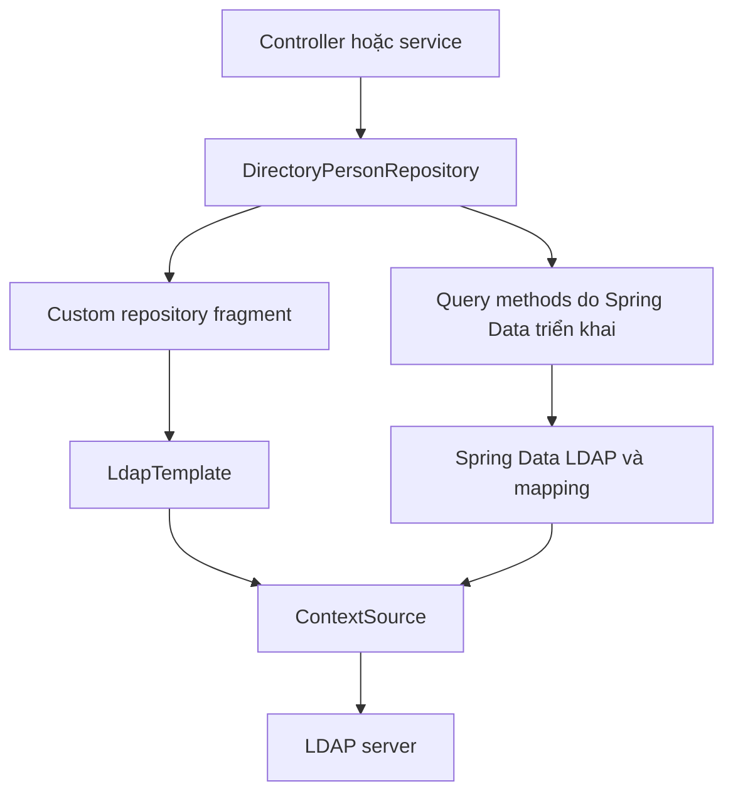

# Custom repository khi query method không đủ

Với **Spring Data LDAP**, một repository interface có thể khai báo các phương thức truy vấn dựa trên tên property của entity, chẳng hạn `findByFullName(...)`. Cách này gọn khi điều kiện cố định và đơn giản. Nhưng nghiệp vụ có thể yêu cầu **kết hợp những điều kiện tùy chọn**, chọn phạm vi tìm kiếm khác nhau, giới hạn số kết quả, chỉ đọc một số thuộc tính, dùng LDAP controls, hoặc trả về DTO không giống entity ODM.

Khi đó, thay vì cố viết một tên query method quá dài hoặc đưa toàn bộ truy vấn xuống tầng controller, ta có thể tạo **custom repository fragment**: một interface mô tả khả năng đặc biệt và một lớp implementation sử dụng `LdapTemplate` hoặc API Spring LDAP phù hợp. Spring Data ghép fragment này vào repository chính, để tầng nghiệp vụ vẫn gọi qua **một interface repository thống nhất**.

Bài thuộc chương **Repository** của module **Spring LDAP**. Mục tiêu là hiểu khi nào cần custom repository, cách viết và ghép fragment, ví dụ tìm kiếm động an toàn, quản lý kết quả lớn, kiểm thử và các giới hạn thực tế của directory server.

Sau bài học, bạn có thể:

- Phân biệt query method suy diễn, truy vấn khai báo và custom repository.
- Thiết kế fragment interface cùng lớp implementation đúng quy ước của Spring Data.
- Sử dụng `LdapTemplate`, `AndFilter`, `EqualsFilter` và `SearchControls` để tạo điều kiện tìm kiếm động.
- Đưa kết quả LDAP vào DTO có số field tối thiểu, thay vì bắt buộc tải cả ODM entity.
- Giải thích mối quan hệ giữa custom fragment, `@Entry`/`@Attribute`, `ContextSource` và LDAP filter.
- Kiểm soát size/time limit, TLS, ACL, lỗi từng phần và khả năng kiểm thử repository.

## 1. Vì sao query method chưa đủ?

Giả sử một LDAP directory có cây:

```text
dc=example,dc=org
├── ou=people
│   ├── uid=an
│   ├── uid=binh
│   └── ou=branches
│       └── uid=chi
└── ou=groups
    └── cn=developers
```

Các entry người dùng có thể chứa `uid`, `cn`, `sn`, `employeeType` và `departmentNumber`. Một màn hình quản trị cần tìm người dùng theo **một hoặc nhiều** điều kiện do người dùng chọn: phòng ban, loại nhân viên, số kết quả tối đa. Hai tiêu chí có thể được bỏ trống, nhưng **ít nhất một tiêu chí phải được cung cấp** để tránh một tìm kiếm vô tình quá rộng.

Với nhu cầu đơn giản, repository có thể khai báo:

```java
List<DirectoryPerson> findByFullName(String fullName);
```

Với điều kiện phức tạp hơn, người viết dễ bị cuốn vào nhiều biến thể:

```text
findByDepartmentNumber(...)
findByEmployeeType(...)
findByDepartmentNumberAndEmployeeType(...)
... thêm nhiều tổ hợp khác khi yêu cầu thay đổi
```

Tên method có thể vẫn hợp lệ, nhưng không phải cách duy trì tốt nếu các điều kiện có tính tùy chọn và chính sách tìm kiếm khác nhau.

| Cách tiếp cận | Khi phù hợp | Khi bắt đầu bất tiện |
| --- | --- | --- |
| **Query method** được suy diễn từ tên | Equality/điều kiện đơn giản và cố định | Nhiều điều kiện tùy chọn hoặc chính sách search đặc biệt |
| **Truy vấn khai báo** (ví dụ `@Query` trong khả năng phiên bản hỗ trợ) | Filter tương đối cố định, có tham số | Phải xây filter động theo nhiều tổ hợp |
| **Repository fragment tùy biến** | Search động, DTO riêng, scope/timeout/limit/controls | Cần viết implementation và tự chịu trách nhiệm kiểm thử |
| **Service dùng `LdapTemplate` trực tiếp** | Ứng dụng nhỏ hoặc thao tác một lần, không cần contract repository | Logic LDAP bị lặp giữa nhiều service |
| **API LDAP/JNDI thấp hơn** | Cần điều khiển chuyên biệt chưa tiện biểu diễn qua template | Nhiều mã quản lý context, enumeration và exception |

**Quyết định quan trọng:** Không tạo custom repository chỉ vì một query method dài hơn vài ký tự. Nó đáng dùng khi cần **một năng lực truy cập dữ liệu có chính sách riêng** mà các truy vấn suy diễn không diễn đạt rõ ràng hoặc khó duy trì.

## 2. Repository không phải chính LDAP server

Một repository Spring Data là tầng truy cập dữ liệu trong **ứng dụng Java**. Khi gọi một method của repository, lệnh cuối cùng vẫn phải tuân thủ ngữ nghĩa LDAP: DN, search base, scope, filter, schema, ACL và các giới hạn trên server.



Custom fragment **không tự tạo một loại LDAP operation mới**. Ví dụ, khi bạn xây filter từ các `EqualsFilter` và gọi `LdapTemplate.search(...)`, Spring LDAP vẫn phát một LDAP SearchRequest như bình thường.

Do đó:

- **Repository** quyết định giao diện gọi mà tầng nghiệp vụ nhìn thấy.
- **Fragment implementation** quyết định cách tìm kiếm phức tạp được xây và xử lý.
- **`LdapTemplate`** hỗ trợ search/lookup/bind/modify và quản lý tài nguyên context cho các thao tác thông thường.
- **`ContextSource`** cung cấp kết nối, base DN và cấu hình xác thực.
- **LDAP server** quyết định quyền, schema, filter matching, index và giới hạn kết quả.

## 3. Entity ODM dùng cho ví dụ

Ví dụ dùng object class `inetOrgPerson` với vài thuộc tính quen thuộc. `employeeType` và `departmentNumber` được dùng làm tiêu chí nghiệp vụ trong directory thử nghiệm; cần xác nhận schema và quyền đọc trên server thật.

```java
package example.directory.model;

import javax.naming.Name;

import org.springframework.ldap.odm.annotations.Attribute;
import org.springframework.ldap.odm.annotations.Entry;
import org.springframework.ldap.odm.annotations.Id;

@Entry(
    base = "ou=people",
    objectClasses = {
        "top", "person", "organizationalPerson", "inetOrgPerson"
    }
)
public class DirectoryPerson {
    @Id
    private Name dn;

    @Attribute(name = "uid")
    private String username;

    @Attribute(name = "cn")
    private String fullName;

    @Attribute(name = "sn")
    private String surname;

    @Attribute(name = "employeeType")
    private String employeeType;

    @Attribute(name = "departmentNumber")
    private String departmentNumber;

    public DirectoryPerson() {
    }

    public Name getDn() {
        return dn;
    }

    public String getUsername() {
        return username;
    }

    public String getFullName() {
        return fullName;
    }

    public String getSurname() {
        return surname;
    }

    public String getEmployeeType() {
        return employeeType;
    }

    public String getDepartmentNumber() {
        return departmentNumber;
    }
}
```

**Phân biệt tên Java và tên LDAP:** Một derived query method có thể dùng **tên property Java** như `findByFullName(...)`, còn code filter trực tiếp phải dùng **tên attribute LDAP** như `cn`. `@Attribute(name = "cn")` giúp nối hai thế giới nhưng không biến `fullName` thành attribute type trên LDAP server.

### Repository thông thường

```java
package example.directory.repository;

import java.util.List;

import org.springframework.data.ldap.repository.LdapRepository;

import example.directory.model.DirectoryPerson;

public interface DirectoryPersonRepository
        extends LdapRepository<DirectoryPerson> {

    List<DirectoryPerson> findByFullName(String fullName);
}
```

Một repository như vậy đủ cho nhiều tác vụ CRUD và truy vấn ngắn theo mô hình ODM, tùy khả năng query derivation của phiên bản Spring Data LDAP. Nhưng nó chưa cung cấp search động và một kết quả tóm tắt dành riêng cho màn hình quản trị.

## 4. Repository fragment: chia hợp đồng và implementation

Mẫu mở rộng phổ biến của Spring Data là **repository fragment**, gồm:

1. **Interface custom**: khai báo các method cần thêm.
2. **Implementation**: lớp Java triển khai interface custom, thường đặt tên theo **interface + `Impl`**.
3. **Repository chính**: kế thừa cả repository nền tảng lẫn interface custom.

Tổ chức mã minh họa:

```text
example.directory
├── model
│   └── DirectoryPerson.java
└── repository
    ├── DirectoryPersonRepository.java
    ├── DirectoryPersonRepositoryCustom.java
    ├── DirectoryPersonRepositoryCustomImpl.java
    └── PersonSummary.java
```

Quy ước `Impl` là hậu tố mặc định thường được Spring Data dùng để tìm implementation; nó có thể được tùy chỉnh trong cấu hình repository. Vị trí package, component scan và cách đăng ký fragment phải phù hợp **phiên bản Spring Data LDAP** của ứng dụng.

### Interface custom

```java
package example.directory.repository;

import java.util.List;

public interface DirectoryPersonRepositoryCustom {

    List<PersonSummary> searchSummaries(
            String departmentNumber,
            String employeeType,
            int maxResults);
}
```

Hợp đồng nói rõ: tìm người dùng theo hai điều kiện có thể tùy chọn và trả các trường tóm tắt, với số kết quả tối đa được kiểm soát. Nó **không** tiết lộ chi tiết LDAP filter, `SearchControls` hay tài khoản bind cho tầng gọi.

### Ghép vào repository chính

```java
package example.directory.repository;

import java.util.List;

import org.springframework.data.ldap.repository.LdapRepository;

import example.directory.model.DirectoryPerson;

public interface DirectoryPersonRepository
        extends LdapRepository<DirectoryPerson>,
                DirectoryPersonRepositoryCustom {

    List<DirectoryPerson> findByFullName(String fullName);
}
```

Bây giờ tầng nghiệp vụ có thể gọi cả `findByFullName(...)` do Spring Data xử lý và `searchSummaries(...)` do fragment cung cấp, thông qua **một bean repository**.

### Không bắt buộc implementation phải kế thừa repository chính

`DirectoryPersonRepositoryCustomImpl` **implements `DirectoryPersonRepositoryCustom`**; nó không cần triển khai lại toàn bộ `LdapRepository`. Spring Data kết hợp các fragment khi khởi tạo repository proxy.

Điều này tránh một sai lầm hay gặp: tạo class có tên `DirectoryPersonRepositoryImpl` và cố cài lại mọi CRUD method, dù chỉ muốn thêm một phương thức tùy biến. Cách phân tách theo fragment giúp mở rộng rõ trách nhiệm hơn.

## 5. DTO nhỏ cho kết quả tìm kiếm

Một màn hình chỉ cần `uid`, `cn` và `departmentNumber` không nhất thiết phải tạo toàn bộ `DirectoryPerson`. Ta định nghĩa một DTO nhỏ:

```java
package example.directory.repository;

public final class PersonSummary {
    private final String username;
    private final String fullName;
    private final String departmentNumber;

    public PersonSummary(
            String username,
            String fullName,
            String departmentNumber) {
        this.username = username;
        this.fullName = fullName;
        this.departmentNumber = departmentNumber;
    }

    public String getUsername() {
        return username;
    }

    public String getFullName() {
        return fullName;
    }

    public String getDepartmentNumber() {
        return departmentNumber;
    }
}
```

DTO này không có `@Entry`, `@Id` hay `@Attribute` vì fragment sẽ ánh xạ trực tiếp từ `Attributes` của JNDI sang DTO. Cách này hữu ích nếu không cần lưu/cập nhật entry thông qua DTO.

**Đánh đổi:** DTO không tự chứa đầy đủ DN. Nếu ứng dụng cần thao tác tiếp trên một entry chính xác, nhất là khi `uid` không duy nhất giữa các OU, nên trả thêm **DN đầy đủ hoặc định danh phù hợp**. Không dùng riêng `username` làm khóa toàn cây nếu directory chưa bảo đảm tính duy nhất toàn cục.

## 6. Cài đặt custom repository bằng `LdapTemplate`

Mục tiêu của fragment:

- Tìm dưới `ou=people`, tương đối với base DN cấu hình ở `ContextSource`.
- Chỉ chấp nhận 1–200 kết quả tối đa do ứng dụng yêu cầu.
- Ít nhất một trong hai điều kiện phải có giá trị.
- Dùng **`EqualsFilter`** để xử lý giá trị đầu vào; không nối chuỗi LDAP filter.
- Chỉ yêu cầu những attribute cần cho DTO.
- Cấu hình `SUBTREE_SCOPE` và giới hạn thời gian phù hợp.

### Implementation hoàn chỉnh

```java
package example.directory.repository;

import java.util.List;

import javax.naming.Name;
import javax.naming.NamingException;
import javax.naming.directory.Attribute;
import javax.naming.directory.Attributes;
import javax.naming.directory.SearchControls;

import org.springframework.ldap.core.AttributesMapper;
import org.springframework.ldap.core.LdapTemplate;
import org.springframework.ldap.filter.AndFilter;
import org.springframework.ldap.filter.EqualsFilter;
import org.springframework.ldap.support.LdapNameBuilder;

public final class DirectoryPersonRepositoryCustomImpl
        implements DirectoryPersonRepositoryCustom {

    private static final int MAX_ALLOWED_RESULTS = 200;

    private final LdapTemplate ldapTemplate;

    public DirectoryPersonRepositoryCustomImpl(LdapTemplate ldapTemplate) {
        this.ldapTemplate = ldapTemplate;
    }

    @Override
    public List<PersonSummary> searchSummaries(
            String departmentNumber,
            String employeeType,
            int maxResults) {

        if (maxResults < 1 || maxResults > MAX_ALLOWED_RESULTS) {
            throw new IllegalArgumentException(
                    "maxResults phải nằm trong khoảng 1..200");
        }

        if (!hasText(departmentNumber) && !hasText(employeeType)) {
            throw new IllegalArgumentException(
                    "Cần ít nhất một điều kiện tìm kiếm");
        }

        AndFilter filter = new AndFilter();
        filter.and(new EqualsFilter(
                "objectClass", "inetOrgPerson"));

        if (hasText(departmentNumber)) {
            filter.and(new EqualsFilter(
                    "departmentNumber", departmentNumber.trim()));
        }

        if (hasText(employeeType)) {
            filter.and(new EqualsFilter(
                    "employeeType", employeeType.trim()));
        }

        SearchControls controls = new SearchControls();
        controls.setSearchScope(SearchControls.SUBTREE_SCOPE);
        controls.setReturningAttributes(new String[] {
                "uid", "cn", "departmentNumber"
        });
        controls.setReturningObjFlag(false);
        controls.setCountLimit(maxResults);
        controls.setTimeLimit(5_000);

        Name base = LdapNameBuilder
                .newInstance("ou=people")
                .build();

        return ldapTemplate.search(
                base,
                filter.encode(),
                controls,
                (AttributesMapper<PersonSummary>) attrs ->
                        new PersonSummary(
                                readString(attrs, "uid"),
                                readString(attrs, "cn"),
                                readString(attrs, "departmentNumber")));
    }

    private static boolean hasText(String value) {
        return value != null && !value.trim().isEmpty();
    }

    private static String readString(Attributes attrs, String id)
            throws NamingException {
        Attribute attribute = attrs.get(id);

        if (attribute == null || attribute.size() == 0) {
            return null;
        }

        Object value = attribute.get();
        return value instanceof String ? (String) value : null;
    }
}
```

**Đoạn mã này là một ví dụ tự chứa về cách viết fragment.** Nó giả định ứng dụng có dependency Spring Data LDAP và Spring LDAP core tương thích, cùng bean `LdapTemplate` được cấu hình. Phần triển khai dùng filter trực tiếp với `LdapTemplate.search`, không yêu cầu Spring Data phải suy diễn tên method động.

### Phân tích các quyết định quan trọng

| Quyết định | Tác dụng |
| --- | --- |
| `DirectoryPersonRepositoryCustomImpl` triển khai đúng interface custom | Spring Data có thể tìm và ghép fragment theo quy ước |
| Constructor nhận `LdapTemplate` | Tách cấu hình kết nối khỏi logic search |
| `AndFilter` + `EqualsFilter` | Xây điều kiện động và escape giá trị theo LDAP filter |
| Bắt buộc ít nhất một điều kiện | Tránh search toàn nhánh quá rộng do input rỗng |
| `setCountLimit(maxResults)` | Giới hạn kết quả client yêu cầu |
| `setTimeLimit(5_000)` | Hạn chế thời gian của một search theo API JNDI |
| `SUBTREE_SCOPE` | Tìm cả OU con khi cấu trúc directory có nhiều tầng |
| `setReturningAttributes(...)` | Giảm dữ liệu truyền về và ánh xạ |
| `AttributesMapper<PersonSummary>` | Trả kết quả chuyên biệt, không tải toàn bộ entity ODM |

### Bộ lọc được tạo thế nào?

Nếu gọi:

```java
repository.searchSummaries("D01", "employee", 50);
```

thì filter logic tương đương:

```ldap
(&(objectClass=inetOrgPerson)(departmentNumber=D01)(employeeType=employee))
```

Nếu bỏ trống loại nhân viên:

```java
repository.searchSummaries("D01", null, 50);
```

filter logic tương đương:

```ldap
(&(objectClass=inetOrgPerson)(departmentNumber=D01))
```

Ứng dụng **không ghép trực tiếp giá trị đầu vào vào chuỗi filter**. Các filter object chịu trách nhiệm mã hóa ký tự đặc biệt của giá trị theo ngữ cảnh LDAP filter.

**Không nhầm escaping:** `LdapNameBuilder` hoặc `Rdn.escapeValue(...)` xử lý tên DN/RDN, còn `EqualsFilter` xử lý giá trị trong filter. Hai ngữ cảnh có cú pháp khác nhau và không nên dùng thay thế cho nhau.

## 7. Những giới hạn cố ý trong ví dụ

Để tập trung vào chủ đề custom repository, implementation trên có một số giới hạn cần hiểu.

**Giới hạn 200 là chính sách của ứng dụng**, không phải kết luận về khả năng của LDAP server. Directory server có thể áp size limit hoặc time limit thấp hơn, hoặc từ chối search vì ACL. Nếu số kết quả bằng đúng `maxResults`, không thể kết luận chắc rằng chỉ có bấy nhiêu entry khớp.

**`setCountLimit` không phải LDAP paging.** Nó không cung cấp cookie, không cho phép tự động lấy trang tiếp theo và không bảo đảm thứ tự kết quả. Nếu UI cần phân trang ổn định hoặc job phải quét hàng chục nghìn entry, cần cơ chế paging/sorting và chiến lược nhất quán theo server.

**`SearchControls.SUBTREE_SCOPE` là lựa chọn của ví dụ.** Nếu người dùng chỉ cần con trực tiếp của `ou=people`, hãy dùng `ONELEVEL_SCOPE`. Nếu tìm theo DN đã biết chính xác, lookup trực tiếp thường hiệu quả và rõ nghĩa hơn search.

**`uid` có thể vắng hoặc đa trị** tùy schema/dữ liệu. Mapper ví dụ đọc giá trị đầu tiên kiểu `String`; nghiệp vụ cần đầy đủ giá trị hoặc định danh tuyệt đối phải mở rộng DTO và mapper phù hợp.

**Độ chọn lọc vẫn tùy server.** Filter equality có thể được tối ưu nếu LDAP server có index phù hợp trên `departmentNumber` và `employeeType`. Lớp repository không tự tạo index cho server.

**Thời gian và giới hạn là guardrail**, không phải bảo đảm tất cả tài nguyên hoặc kết quả đã được kiểm soát tuyệt đối. Server policy, mạng và tài khoản bind vẫn có thể ảnh hưởng.

## 8. Repository chính được ứng dụng gọi như thế nào?

Tầng service không cần biết fragment tạo `AndFilter` hay dùng `SearchControls`:

```java
package example.directory.service;

import java.util.List;

import example.directory.repository.DirectoryPersonRepository;
import example.directory.repository.PersonSummary;

public final class DirectorySearchService {
    private final DirectoryPersonRepository repository;

    public DirectorySearchService(
            DirectoryPersonRepository repository) {
        this.repository = repository;
    }

    public List<PersonSummary> findActiveEmployeesInDepartment(
            String departmentNumber) {

        return repository.searchSummaries(
                departmentNumber, "employee", 100);
    }
}
```

Mức độ trừu tượng được giữ hợp lý: **service** quyết định yêu cầu nghiệp vụ, còn **repository** sở hữu chi tiết truy vấn LDAP. Điều này giúp kiểm thử service bằng một mock repository mà không phải tự tạo JNDI context.

### Cần cấu hình gì để Spring Data ghép fragment?

Thông thường dự án cần repository scanning cho package chứa interface repository, một `ContextSource` và cấu hình template phù hợp. Ví dụ minh họa vị trí package:

```java
package example.directory.config;

import org.springframework.context.annotation.Configuration;
import org.springframework.data.ldap.repository.config.EnableLdapRepositories;

@Configuration
@EnableLdapRepositories(
        basePackages = "example.directory.repository")
public class DirectoryRepositoryConfiguration {
}
```

Để dùng LDAP ở môi trường thật, ứng dụng còn cần cấu hình kết nối `LdapContextSource` và bean `LdapTemplate` như những phần nền tảng của Spring LDAP, hoặc dùng auto-configuration thích hợp trong Spring Boot. **Không phải chỉ thêm `@EnableLdapRepositories` là kết nối LDAP tự hoạt động.**

Với fragment, kiểm tra:

1. `DirectoryPersonRepository` kế thừa `DirectoryPersonRepositoryCustom`.
2. `DirectoryPersonRepositoryCustomImpl` triển khai chính xác method trong interface custom.
3. Class implementation nằm trong phạm vi Spring Data có thể tìm thấy theo quy ước package, postfix và cấu hình repository.
4. `LdapTemplate` có bean hợp lệ để constructor injection.
5. Không có nhiều implementation trùng tên hoặc bean có định danh gây mơ hồ.

Trong một số cấu hình hoặc phiên bản Spring Data, có thể đăng ký/đặt tên bean fragment một cách tường minh. **Quy tắc đặt tên nên được kiểm chứng theo Spring Data version của dự án**, thay vì giả định class nào có hậu tố `Impl` cũng tự động được ghép.

## 9. Khi nào nên dùng `@Query` thay vì custom fragment?

Một filter tương đối cố định có thể được biểu diễn bằng truy vấn khai báo mà không cần lớp Java riêng. Tuy vậy, trước khi dùng, phải kiểm tra **khả năng `@Query` và cú pháp tham số được phiên bản Spring Data LDAP đang dùng hỗ trợ**; không sao chép cú pháp SQL/JPA sang LDAP.

Dùng truy vấn khai báo nếu:

- Điều kiện tương đối ngắn và ổn định.
- Chỉ cần truyền vài giá trị tham số.
- Không cần tự thiết lập `SearchControls`, trả DTO khác thường hoặc dùng controls đặc thù.
- Team muốn cấu hình truy vấn tập trung trên interface.

Dùng fragment nếu:

- Có nhiều điều kiện tùy chọn, cần xây filter hợp lệ theo nhánh xử lý.
- Cần kiểm tra input và áp **chính sách giới hạn search** ở một nơi.
- Muốn dùng mapper riêng hoặc chuyển đổi nhiều loại kết quả.
- Cần điều khiển scope, time limit, count limit hoặc server controls.
- Cần tách một chiến lược đọc LDAP phức tạp thành module dễ kiểm thử.

Một custom repository **không mặc nhiên nhanh hơn** query method hay `@Query`. Hiệu năng phụ thuộc LDAP filter cuối cùng, base/scope, index, số kết quả, mạng và server. Lợi ích chính của fragment là **khả năng diễn đạt và kiểm soát logic**.

## 10. Khi custom repository cần xử lý dữ liệu lớn

Tìm kiếm 100 kết quả cho UI và quét 100.000 entry để đồng bộ là hai trường hợp rất khác nhau.

### Không gom mọi kết quả vào một `List`

Ví dụ trước trả `List<PersonSummary>` vì có giới hạn `maxResults` nhỏ. Nếu yêu cầu quét toàn bộ nhánh, một danh sách duy nhất có thể tăng bộ nhớ theo số entry.

Có thể dùng **`NameClassPairCallbackHandler`** của `LdapTemplate` để xử lý từng kết quả:

```java
import javax.naming.directory.SearchControls;
import javax.naming.directory.SearchResult;

import org.springframework.ldap.core.NameClassPairCallbackHandler;

SearchControls controls = new SearchControls();
controls.setSearchScope(SearchControls.SUBTREE_SCOPE);
controls.setReturningAttributes(new String[] { "uid" });

// Fragment có thể cung cấp một Consumer hoặc giao diện sink riêng.
// Đây là minh họa phần xử lý, giả sử ldapTemplate đã được cấu hình.
ldapTemplate.search(
        "ou=people",
        "(objectClass=inetOrgPerson)",
        controls,
        (NameClassPairCallbackHandler) pair -> {
            SearchResult result = (SearchResult) pair;
            // Xử lý ngay entry này; không thêm vào danh sách vô hạn.
            processOneResult(result);
        });
```

Trong ví dụ trên, `processOneResult` là hàm nghiệp vụ giả định. Khi triển khai thật, tránh giữ `SearchResult` hoặc kết quả trong queue không giới hạn. Nếu nơi nhận chậm, dùng batch hữu hạn và cơ chế backpressure.

**Callback không tự giải quyết size limit của LDAP server.** Nó chỉ giảm nhu cầu tích lũy kết quả phía ứng dụng.

### Paged Results Control

Với các server hỗ trợ Simple Paged Results (RFC 2696), fragment có thể điều phối paging qua API phù hợp của Spring LDAP, ví dụ `PagedResultsDirContextProcessor` khi phiên bản thư viện hỗ trợ. Mỗi trang được xử lý rồi giải phóng trước khi lấy trang tiếp theo.

Đặc biệt:

- **Page size** là số kết quả yêu cầu mỗi trang, không phải lời hứa server luôn trả đúng số đó.
- **Cookie** đến từ server; không tự dựng hoặc chỉnh sửa.
- Paging không mặc định cung cấp một snapshot nhất quán khi directory đang thay đổi.
- Cần tránh tái sử dụng context có trạng thái paging một cách không an toàn giữa nhiều request hoặc thread.
- Khi scan bị ngắt, phải báo **chưa hoàn tất** và có cách đối chiếu/chạy lại phù hợp.

Nếu chức năng chỉ là tìm kiếm có giới hạn nhỏ, đừng phức tạp hóa repository bằng paging khi chưa có yêu cầu thực tế.

## 11. Bảo mật trong custom repository

Custom implementation nhận input từ tầng nghiệp vụ nhưng không được mặc định mọi giá trị đều đáng tin.

| Rủi ro | Biện pháp |
| --- | --- |
| Ghép raw input vào filter | Dùng `EqualsFilter`, `AndFilter`, `LdapQueryBuilder` hoặc filter có tham số |
| Đầu vào bỏ trống tạo search toàn DIT | Validate và giới hạn base/scope theo nghiệp vụ |
| Count/time limit quá lớn | Đặt ngưỡng server/client phù hợp và từ chối yêu cầu vượt chính sách |
| Input là DN được nối chuỗi | Dùng `LdapNameBuilder`/`Rdn` và giới hạn nhánh được phép |
| Tài khoản LDAP có quyền quá rộng | Cấp quyền đọc/ghi tối thiểu cho chức năng |
| Kết nối bằng simple bind không có TLS | Dùng LDAPS/StartTLS và xác minh chứng chỉ/hostname |
| Log chứa cả entry hoặc credential | Chỉ ghi metadata cần chẩn đoán, hạn chế dữ liệu cá nhân |
| Client tin kết quả là danh sách đầy đủ | Nhận biết size/time limit, referral, ACL và paging |
| Fragment tự gọi nhiều LDAP search trên từng entry | Giảm N+1 queries, dùng filter có index, batch phù hợp |

**Custom repository không thay thế ACL LDAP.** Một query method do framework cung cấp và một custom method đều truy cập server theo quyền của identity đang bind. Ứng dụng phải tự kiểm tra ai được gọi chức năng tìm kiếm/đọc dữ liệu, trong khi server vẫn áp quyền thực sự lên entry và attribute.

### Lưu ý về kiểm soát dữ liệu trả về

Nếu UI chỉ cần `uid` và `cn`, đừng tự động trả mọi thuộc tính như `memberOf`, `mail`, `telephoneNumber` hoặc dữ liệu nhạy cảm khác. Projection/mapper nhỏ giúp giảm băng thông, bộ nhớ và mức độ tiếp xúc với thông tin không cần thiết.

## 12. Kiểm thử custom fragment

Một điểm mạnh của fragment là implementation có thể được kiểm thử **tách khỏi repository proxy**, còn việc Spring Data ghép fragment có thể được xác minh bằng integration test.

### Kiểm thử 1: filter phải escape dữ liệu đầu vào

`EqualsFilter` nên được dùng cho dữ liệu tìm kiếm chính xác. Có thể kiểm tra riêng việc mã hóa filter:

```java
import static org.junit.jupiter.api.Assertions.*;

import org.junit.jupiter.api.Test;
import org.springframework.ldap.filter.AndFilter;
import org.springframework.ldap.filter.EqualsFilter;

class LdapFilterConstructionTest {
    @Test
    void combinesConditions() {
        AndFilter filter = new AndFilter();
        filter.and(new EqualsFilter(
                "objectClass", "inetOrgPerson"));
        filter.and(new EqualsFilter(
                "departmentNumber", "D01"));

        assertEquals(
                "(&(objectClass=inetOrgPerson)(departmentNumber=D01))",
                filter.encode());
    }

    @Test
    void escapesSpecialInputAsValue() {
        EqualsFilter filter = new EqualsFilter(
                "uid", "a*)(uid=*)");

        String encoded = filter.encode();

        // Không còn chuỗi chèn filter gốc ở dạng nguyên vẹn.
        assertFalse(encoded.contains("a*)(uid=*)"));
    }
}
```

**Giới hạn test này:** Nó chỉ kiểm tra filter builder, không chứng minh server có index, kết quả tìm kiếm đúng schema hoặc tài khoản có quyền. Với filter đặc biệt và tính tương thích server, cần integration test LDAP.

### Kiểm thử 2: validate trước khi gửi query

Có thể tạo fragment với một mock `LdapTemplate` và kiểm tra rằng những input bị từ chối không gọi LDAP:

```java
import static org.junit.jupiter.api.Assertions.*;
import static org.mockito.Mockito.*;

import org.junit.jupiter.api.Test;
import org.springframework.ldap.core.LdapTemplate;

class DirectoryPersonRepositoryCustomImplTest {

    private final LdapTemplate ldapTemplate = mock(LdapTemplate.class);

    private final DirectoryPersonRepositoryCustomImpl fragment =
            new DirectoryPersonRepositoryCustomImpl(ldapTemplate);

    @Test
    void rejectsEmptyCriteria() {
        assertThrows(
                IllegalArgumentException.class,
                () -> fragment.searchSummaries(null, " ", 20));

        verifyNoInteractions(ldapTemplate);
    }

    @Test
    void rejectsExcessiveLimit() {
        assertThrows(
                IllegalArgumentException.class,
                () -> fragment.searchSummaries("D01", null, 10000));

        verifyNoInteractions(ldapTemplate);
    }
}
```

Các test này không cần directory server, nên chạy nhanh và giúp bảo vệ chính sách giới hạn. Đối với path thành công, có thể mock lời gọi `LdapTemplate.search(...)`, capture filter và `SearchControls`, sau đó xác minh scope, thuộc tính được yêu cầu, count limit và việc ánh xạ null an toàn.

### Kiểm thử 3: ghép fragment vào repository proxy

Integration test nên khởi động Spring context với repository scanning, bean `LdapTemplate` và một LDAP server thử nghiệm. Sau đó inject `DirectoryPersonRepository` và gọi `searchSummaries(...)` **qua interface chính**. Kiểm tra:

1. Spring tìm thấy và gắn `DirectoryPersonRepositoryCustomImpl`.
2. Input có hai điều kiện chỉ trả entry khớp cả hai.
3. Bỏ một điều kiện vẫn tạo filter hợp lệ.
4. Search không vượt base và scope dự kiến.
5. Kết quả DTO có giá trị `uid`, `cn`, `departmentNumber` hợp lệ.
6. Không có kết quả được trả về khi tài khoản không có quyền xem dữ liệu tương ứng.
7. Size/time limit và lỗi kết nối không bị diễn giải thành “không có người dùng”.

**Không cần kết nối LDAP sản xuất để kiểm thử.** Dùng server thử nghiệm/embedded directory có schema và ACL phù hợp, dữ liệu giả và quy trình dọn dẹp an toàn.

## 13. Những lỗi hay gặp trong dự án

| Hiện tượng | Nguyên nhân thường gặp | Cách xử lý |
| --- | --- | --- |
| Method custom bị báo chưa có implementation | Fragment không được ghép do sai tên, package hoặc cấu hình | Kiểm tra `DirectoryPersonRepositoryCustomImpl` và repository scanning |
| Spring không khởi tạo fragment | Không có bean `LdapTemplate` hoặc dependency khác | Kiểm tra cấu hình Spring context |
| Có hai fragment implementation giống nhau | Bean ambiguity, tên/postfix trùng | Đặt tên, package và đăng ký tường minh |
| Tìm theo tên property Java nhưng filter LDAP không khớp | Dùng `fullName` thay vì attribute `cn` trong filter trực tiếp | Phân biệt tên Java trong entity và tên LDAP trong filter |
| Có kết quả ngoài dự kiến | Quên điều kiện hoặc dùng scope quá rộng | Kiểm tra `AndFilter`, base, scope và input |
| Không có kết quả dù entry tồn tại | Sai base, ACL, filter hoặc objectClass | Đối chiếu DN thật và LDAP server |
| Search trả đúng 200 entry dù nhiều hơn | `setCountLimit(200)` | Đây là giới hạn có chủ đích; dùng paging khi nghiệp vụ cần nhiều hơn |
| Query method đơn giản chậm | Filter không có index hoặc phạm vi rộng | Đo hiệu năng server; custom fragment không tự làm query nhanh |
| DTO thiếu attribute | Projection không yêu cầu field, ACL hoặc entry thiếu giá trị | Kiểm tra `setReturningAttributes`, schema và quyền |
| Đã xử lý vài kết quả rồi lỗi | Size/time limit hoặc lỗi nơi nhận | Không báo hoàn tất; phân biệt kết quả đã ghi và chưa ghi |
| Dùng `@Transactional` nhưng LDAP không rollback | Transaction database không tự bao trùm LDAP | Thiết kế xử lý lỗi, retry/idempotency và khả năng phục hồi |

## 14. Bài thực hành

Giả sử có LDAP thử nghiệm với base DN `dc=example,dc=org`, nhánh `ou=people` và các entry:

```ldif
dn: uid=an,ou=people,dc=example,dc=org
objectClass: inetOrgPerson
uid: an
cn: An Nguyen
sn: Nguyen
employeeType: employee
departmentNumber: D01

dn: uid=binh,ou=people,dc=example,dc=org
objectClass: inetOrgPerson
uid: binh
cn: Binh Tran
sn: Tran
employeeType: contractor
departmentNumber: D01

dn: uid=chi,ou=people,dc=example,dc=org
objectClass: inetOrgPerson
uid: chi
cn: Chi Le
sn: Le
employeeType: employee
departmentNumber: D02
```

Các entry LDIF ở trên là dữ liệu rút gọn để đọc nhanh; khi nạp vào server thật, cần bảo đảm các thuộc tính và object classes đáp ứng schema của server (ví dụ chuỗi kế thừa objectClass và các thuộc tính bắt buộc).

**Bài A – Query method ban đầu.** Tạo repository `DirectoryPersonRepository` với một method tìm theo `fullName`. Thử trên dữ liệu mẫu và ghi nhận hạn chế của method này khi người quản trị cần tìm theo nhiều tiêu chí tùy chọn.

**Bài B – Custom fragment.** Tạo `DirectoryPersonRepositoryCustom` và `DirectoryPersonRepositoryCustomImpl`. Dùng `AndFilter` và `EqualsFilter` để xây filter theo department và employee type; chỉ trả `PersonSummary`.

**Bài C – Kiểm tra quy tắc tìm kiếm.** Chạy `searchSummaries("D01", "employee", 20)`, dự kiến chỉ có người dùng `an`. Chạy `searchSummaries("D01", null, 20)`, dự kiến gồm `an` và `binh` nếu ACL cho phép.

**Bài D – Giới hạn.** Thử `searchSummaries(null, null, 20)` và `searchSummaries("D01", null, 5000)`; xác nhận ứng dụng từ chối trước khi gửi LDAP search.

**Bài E – Kiểm thử.** Viết test cho filter escaping, validate input, repository proxy và dữ liệu LDAP thật. Kiểm tra search base tương đối với `ContextSource` không bị lặp `dc=example,dc=org`.

**Bài F – Mở rộng.** Bổ sung điều kiện loại tài khoản và nhánh OU theo quyền ứng dụng, nhưng không cho phép đầu vào tùy ý quyết định base DN ngoài những nhánh đã được cấp phép. Nếu cần hàng nghìn kết quả, thiết kế pagination hoặc streaming thay vì tăng `maxResults` vô hạn.

### Câu hỏi tự kiểm tra

**Câu 1.** Khi nào nên tạo custom repository thay vì một query method?

**Đáp án:** Khi truy vấn cần logic động, nhiều điều kiện tùy chọn, scope/limit/controls đặc biệt, mapping DTO riêng hoặc khó diễn đạt/duy trì bằng các method suy diễn đơn giản.

**Câu 2.** Nếu `DirectoryPersonRepository` kế thừa `DirectoryPersonRepositoryCustom`, implementation nên tên gì theo quy ước fragment mặc định?

**Đáp án:** `DirectoryPersonRepositoryCustomImpl` — theo tên của interface fragment cộng hậu tố `Impl`. Cần bảo đảm package và cấu hình scanning đúng.

**Câu 3.** Trong query method `findByFullName` và filter `(cn=An Nguyen)`, `fullName` và `cn` khác nhau thế nào?

**Đáp án:** `fullName` là tên property Java trên entity; `cn` là attribute type của LDAP server. Annotation `@Attribute(name = "cn")` ánh xạ giữa chúng.

**Câu 4.** `AndFilter` có tự tạo index trên LDAP server không?

**Đáp án:** Không. Nó chỉ xây một LDAP filter an toàn. Index và cách tối ưu do directory server quyết định.

**Câu 5.** `setCountLimit(200)` có phải cơ chế paging không?

**Đáp án:** Không. Đây là giới hạn số kết quả phía client; không có cookie để đi tới trang kế tiếp. Paging cần protocol control và server hỗ trợ.

**Câu 6.** Khi một search có 200 kết quả đúng bằng ngưỡng, có thể khẳng định chỉ có 200 entry khớp không?

**Đáp án:** Không. Có thể còn nhiều entry khác nhưng client đã chạm giới hạn. Cần kiểm tra theo yêu cầu nghiệp vụ và hỗ trợ paging khi cần.

**Câu 7.** Repository custom có được phép đọc những thuộc tính LDAP mà tài khoản bind bị ACL chặn không?

**Đáp án:** Không. Spring Data LDAP và `LdapTemplate` vẫn chịu ACL của server. Custom code không vượt được quyền LDAP.

**Câu 8.** Vì sao nên kiểm thử fragment tách khỏi LDAP server rồi mới kiểm thử tích hợp?

**Đáp án:** Unit test kiểm tra validate, filter và giới hạn nhanh chóng; integration test kiểm chứng việc Spring ghép fragment, schema, ACL và kết quả thật của server.

## Ghi nhớ

**Custom repository là cách mở rộng Spring Data LDAP khi query method không còn diễn đạt đủ yêu cầu truy cập dữ liệu.** Hãy tạo một interface fragment, một implementation theo quy ước, rồi cho repository chính kế thừa fragment đó. Trong implementation, dùng `LdapTemplate` và các filter builder để xây điều kiện động an toàn, giới hạn base/scope/attributes/count/time phù hợp và trả DTO đúng nhu cầu. Custom repository giúp mã dễ bảo trì và kiểm thử, nhưng không thay thế LDAP schema, ACL, TLS, index, paging hay chính sách xử lý lỗi của directory server.
