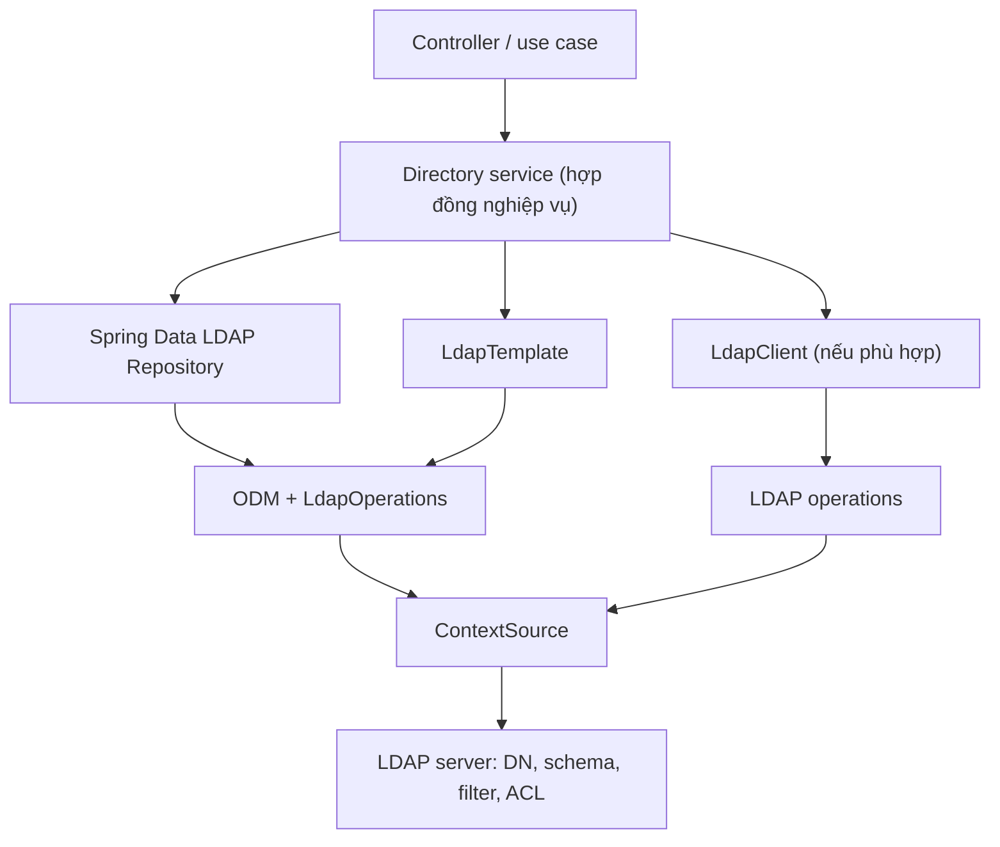

# Khi nên dùng `LdapTemplate` thay vì Repository trong Spring LDAP

## Mục tiêu học tập

Sau bài này, bạn có thể:

1. Phân biệt **Spring Data LDAP Repository**, **`LdapTemplate`** và **`LdapClient`** theo mức trừu tượng và khả năng kiểm soát thao tác LDAP.
2. Chọn Repository cho truy vấn và CRUD đơn giản trên **ODM entity**, nhưng nhận ra thời điểm một use case cần `LdapTemplate`.
3. Viết tìm kiếm bằng `LdapQueryBuilder` với base DN, scope, filter, danh sách attribute, số lượng kết quả và thời gian tìm kiếm.
4. Đọc entry không cần entity ODM bằng `AttributesMapper` / `ContextMapper`; sửa một attribute bằng LDAP modify operation.
5. Nhận biết nhu cầu dùng LDAP controls, xử lý kết quả lớn, xác thực bind, theo dõi lỗi và kiểm thử thao tác thư mục.
6. Đặt `LdapTemplate` sau một service hoặc một repository tùy biến để giữ API nghiệp vụ rõ ràng, an toàn.

> **Nguyên tắc:** Ưu tiên mức trừu tượng cao nhất **còn thể hiện đúng hành vi LDAP cần thiết**. Dùng Repository khi bài toán thực sự là thao tác entity và truy vấn gọn. Chọn `LdapTemplate` khi cần kiểm soát cách một operation được gửi tới directory, dữ liệu nào được đọc/sửa, hoặc cách LDAP server thực thi tìm kiếm. Không cần loại bỏ Repository chỉ vì có một truy vấn đặc biệt.

## 1. Một use case khiến Repository bắt đầu gượng ép

Giả sử ứng dụng nhân sự sử dụng LDAP, cấu hình `ContextSource` với base DN `dc=example,dc=org`. Directory có các nhánh:

```text
dc=example,dc=org
├── ou=people
│   ├── uid=lan
│   ├── uid=nam
│   └── ou=external
│       └── uid=mai
├── ou=groups
│   └── cn=developers
└── ou=service-accounts
    └── uid=buildbot
```

Một màn hình danh bạ thông thường cần “tìm người có `uid` bằng `lan`”:

```java
public interface PersonRepository extends LdapRepository<DirectoryPerson> {
    List<DirectoryPerson> findByUid(String uid);
}
```

Phương thức `findByUid` dễ đọc và có ích. Nhưng giả sử màn hình kiểm toán phải **chỉ quét con trực tiếp của `ou=people`**, lấy **`uid`, `cn`, `mail`**, lọc theo **nhiều điều kiện tùy chọn**, giới hạn **100 entry/2 giây**, và có thể kiểm tra **DN của từng kết quả**. Có thêm một thao tác quản trị là **bổ sung một giá trị vào attribute nhiều giá trị `member` của nhóm**.

Viết hàng loạt `findByUidAndCnOrMail...` rồi tải toàn bộ entity sẽ làm ý nghĩa của search trở nên khó kiểm soát. `@Query` có thể giải quyết phần **filter cố định, base, scope và giới hạn**, nhưng vẫn không phù hợp bằng một operation cụ thể khi cần tạo filter động, chỉ đọc một vài attribute, dùng mapper riêng hoặc gửi LDAP modify operation.

Đây là trường hợp nên cân nhắc `LdapTemplate`.

## 2. Ba tầng API và ranh giới trách nhiệm



| API | Phù hợp nhất | Kiểm soát | Điều cần nhớ |
| --- | --- | --- | --- |
| **Spring Data LDAP Repository** | CRUD/query quen thuộc trên entity có `@Entry`, `@Id`, `@Attribute` | Derived query, `@Query`, một số query method nhận `LdapQuery` | ID là DN (`javax.naming.Name`); `LdapRepository<T>` chỉ có một generic; **không** hỗ trợ paging/sorting kiểu Repository của JPA |
| **`LdapTemplate`** | Search có giới hạn cụ thể, mapper riêng, lookup, modify từng attribute, LDAP controls, ODM API cấp thấp hơn | `LdapQuery`, `SearchControls`, `AttributesMapper`, `ContextMapper`, `DirContextProcessor`; CRUD trên DN và ODM | Lập trình viên chịu trách nhiệm thiết kế search, giới hạn tài nguyên và diễn giải kết quả |
| **`LdapClient`** | Ứng dụng muốn fluent API mới cho search/bind/modify/unbind/authenticate, có nhu cầu stream | Chuỗi phương thức rõ ràng, tích hợp mapper/search controls | Theo tài liệu cấu hình Spring LDAP, `LdapClient` hiện **không hỗ trợ ODM**; khi cần ODM, dùng `LdapTemplate` hoặc Repository |
| **JNDI trực tiếp** | Chức năng rất đặc thù vượt khỏi API Spring LDAP | Quyền kiểm soát thấp nhất đối với giao thức/JNDI | Tự xử lý lifecycle, context, naming exception và cleanup; chỉ dùng khi thật cần |

Các API có thể **cùng tồn tại trong một ứng dụng**. Chẳng hạn, Repository phục vụ phần lớn thao tác trên `DirectoryPerson`; một service dùng `LdapTemplate` để sửa trực tiếp một thuộc tính nhóm mà không phải tải/ghi lại toàn bộ entity.

### Không nhầm Repository với các API của JPA

LDAP là một cây entry, mỗi entry có **distinguished name (DN)** và attribute theo schema. Tên method `findBy...` được dịch thành **LDAP search filter**, không phải SQL. Điều kiện tìm kiếm còn phụ thuộc:

- **Search base**: bắt đầu tại nhánh nào, ví dụ `ou=people` tương đối với `ContextSource` base.
- **Scope**: `OBJECT`, `ONELEVEL` hoặc `SUBTREE`.
- **Filter**: điều kiện LDAP như `(&(objectClass=inetOrgPerson)(uid=lan))`.
- **Controls/limits**: attribute trả về, giới hạn entry/thời gian và LDAP request controls.
- **ACL và schema**: tài khoản bind có thấy entry không; attribute có hợp lệ và có matching rule phù hợp không.

Do đó, một `findByUid("lan")` không có nghĩa “tìm bản ghi duy nhất” nếu nhiều OU có thể có cùng `uid`. ID của entity Spring Data LDAP là DN, không phải giá trị `uid`.

## 3. Những tín hiệu rõ ràng nên chọn `LdapTemplate`

| Nhu cầu thực tế | Repository giải quyết tới đâu? | Vì sao `LdapTemplate` hợp lý |
| --- | --- | --- |
| Query theo vài attribute cố định | `findByUid`, `findBySnAndGivenName`, `@Query` thường đủ | **Chưa cần đổi** sang Template |
| Search với base/scope/giới hạn cố định | `@Query(base=..., searchScope=..., countLimit=..., timeLimit=...)` có thể đủ | Template chỉ cần nếu có yêu cầu khác |
| Filter thay đổi theo lựa chọn, nhiều nhánh hoặc điều kiện tổ hợp | Phải tạo nhiều method, hoặc đưa `LdapQuery` vào Repository | Template + `LdapQueryBuilder`/`Filter` phù hợp khi cần kiểm soát chính xác |
| Chỉ lấy vài attribute, không cần toàn bộ entity | Repository ánh xạ ODM entity theo mô hình đã định | `search` + `AttributesMapper` có thể trả về DTO gọn |
| Cần DN bên cạnh các attribute nhưng không muốn entity ODM | Truy vấn entity có thể làm nặng mô hình | `ContextMapper` xử lý entry và DN qua context |
| Thêm/xóa/đổi **một giá trị** của attribute nhiều giá trị | `save` trên entity không luôn thể hiện đúng loại modify mong muốn | `modifyAttributes` với `ADD_ATTRIBUTE`, `REMOVE_ATTRIBUTE` hoặc `REPLACE_ATTRIBUTE` |
| Đổi DN, tạo/xóa entry theo đường dẫn LDAP | CRUD ODM xử lý case phổ thông | `rename`, `bind`, `unbind` hoặc ODM `create/update/delete` cho phép chọn thao tác cụ thể |
| Server-side paging, sort control hoặc control đặc thù | Spring LDAP Repository không hỗ trợ paging/sorting thông thường | `LdapTemplate.search(..., DirContextProcessor)` và kiểm soát kết nối |
| Đọc attribute đặc thù/operational | ODM không nhất thiết tải attribute không có trong schema entity | `lookup`/`search` với returning attributes tường minh |
| Kiểm soát bind authentication | Không phải trách nhiệm của CRUD Repository | `LdapTemplate.authenticate` hoặc tích hợp Spring Security LDAP |

Một điểm thực dụng: `LdapRepository<T>` **có** các phương thức như `findAll(LdapQuery)` và `findOne(LdapQuery)`. Nếu chỉ cần filter động mà vẫn muốn kết quả ODM, có thể tiếp tục dùng Repository. **Chỉ chuyển sang Template khi mức kiểm soát bổ sung thực sự có ích.**

## 4. Cấu hình tối thiểu và Repository cơ bản

Các ví dụ sau giả định dự án đã khai báo dependency Spring LDAP và Spring Data LDAP phù hợp phiên bản, tạo `ContextSource` dùng LDAPS/StartTLS theo hạ tầng và cấp quyền đọc phù hợp. Với cấu hình `ContextSource` base `dc=example,dc=org`, những DN dạng `ou=people` trong code là DN **tương đối**.

```java
package example.directory;

import org.springframework.context.annotation.Bean;
import org.springframework.context.annotation.Configuration;
import org.springframework.ldap.core.LdapTemplate;
import org.springframework.ldap.core.support.BaseLdapPathContextSource;

@Configuration
public class DirectoryAccessConfig {
    @Bean
    LdapTemplate ldapTemplate(BaseLdapPathContextSource contextSource) {
        return new LdapTemplate(contextSource);
    }
}
```

Trong ứng dụng thực tế, `ContextSource` đã có thể được cấu hình và `LdapTemplate` được tự động tạo bởi framework; chỉ khai báo bean trên khi dự án thực sự cần. Ví dụ dùng `BaseLdapPathContextSource` của Spring LDAP để nhận bean tương thích, tránh tự ghi username/password vào code. Cấu hình repository bằng `@EnableLdapRepositories` hoặc auto-configuration phù hợp môi trường.

Một entity ODM cho phần thao tác bình thường:

```java
package example.directory;

import javax.naming.Name;
import org.springframework.ldap.odm.annotations.Attribute;
import org.springframework.ldap.odm.annotations.Entry;
import org.springframework.ldap.odm.annotations.Id;

@Entry(
    base = "ou=people",
    objectClasses = {"top", "person", "organizationalPerson", "inetOrgPerson"}
)
public class DirectoryPerson {
    @Id
    private Name dn;

    @Attribute(name = "uid")
    private String uid;

    @Attribute(name = "cn")
    private String commonName;

    public DirectoryPerson() {}

    public Name getDn() { return dn; }
    public String getUid() { return uid; }
    public String getCommonName() { return commonName; }
}
```

```java
package example.directory;

import java.util.List;
import org.springframework.data.ldap.repository.LdapRepository;

public interface PersonRepository extends LdapRepository<DirectoryPerson> {
    List<DirectoryPerson> findByUid(String uid);
}
```

Lưu ý: khi kết hợp ODM `@Entry(base=...)` với query có base tường minh, cần kiểm chứng cách phiên bản Spring Data LDAP ghép/áp dụng thông tin mapping. Những ví dụ dùng `AttributesMapper` ở các mục sau **không phụ thuộc** vào mapping ODM. Đừng suy từ tên method Repository rằng mọi search đều tự giới hạn ở một nhánh nghiệp vụ như mong muốn.

## 5. Tình huống 1: chỉ lấy một số attribute, trả DTO thay vì ODM entity

Màn hình gợi ý tên không cần tải toàn bộ person, group membership hay các attribute không liên quan. Dùng `LdapTemplate.search(LdapQuery, AttributesMapper<T>)` để trả DTO gọn.

```java
package example.directory;

public record PersonSummary(String uid, String commonName, String mail) {}
```

```java
package example.directory;

import java.util.List;
import org.springframework.ldap.core.AttributesMapper;
import org.springframework.ldap.core.LdapTemplate;
import org.springframework.ldap.query.LdapQuery;
import org.springframework.ldap.query.LdapQueryBuilder;
import org.springframework.ldap.query.SearchScope;
import org.springframework.stereotype.Service;

@Service
public class PeopleLookupService {
    private final LdapTemplate ldap;

    public PeopleLookupService(LdapTemplate ldap) {
        this.ldap = ldap;
    }

    public List<PersonSummary> findDirectPeopleByUid(String uid) {
        if (uid == null || uid.isBlank()) {
            throw new IllegalArgumentException("uid is required");
        }

        LdapQuery query = LdapQueryBuilder.query()
            .base("ou=people")
            .searchScope(SearchScope.ONELEVEL)
            .attributes("uid", "cn", "mail")
            .countLimit(25)
            .timeLimit(2000)
            .where("objectClass").is("inetOrgPerson")
            .and("uid").is(uid);

        AttributesMapper<PersonSummary> mapper = attributes ->
            new PersonSummary(
                attributes.get("uid").get().toString(),
                attributes.get("cn").get().toString(),
                attributes.get("mail") == null
                    ? null
                    : attributes.get("mail").get().toString()
            );

        return ldap.search(query, mapper);
    }
}
```

Điểm quan trọng:

1. `base("ou=people")` chỉ truy vấn dưới `ou=people,dc=example,dc=org` khi `ContextSource` đã có base `dc=example,dc=org`.
2. `ONELEVEL` lấy các entry **con trực tiếp**; không tìm sâu xuống `ou=external`.
3. `attributes(...)` yêu cầu server chỉ gửi ba attribute cần dùng. `objectClass` vẫn có thể nằm trong **filter** dù không yêu cầu trả attribute đó trong kết quả.
4. `countLimit(25)` và `timeLimit(2000)` giới hạn một search; **không** biến danh sách thành trang có thứ tự.
5. `AttributesMapper` làm việc với `javax.naming.directory.Attributes`. Nó phù hợp khi kết quả chỉ cần dữ liệu attribute, **không cần DN**; nên kiểm tra attribute có thể vắng mặt trước khi gọi `get()`.
6. `.is(uid)` xây dựng điều kiện LDAP bằng giá trị đã được escape, an toàn hơn việc nối `"(uid=" + uid + ")"`.

Nếu `uid` là duy nhất theo quy tắc directory ở nhánh đang search, dùng `searchForObject`/`findOne` khi muốn hợp đồng **đúng một** kết quả; API tìm một kết quả có thể ném lỗi nếu không có hoặc có nhiều entry. Với màn hình gợi ý, `List` thường phù hợp hơn.

### Khi nào cần `ContextMapper`?

`AttributesMapper` chỉ nhận tập thuộc tính; để có **DN** hoặc cần thêm thông tin về entry, dùng `ContextMapper`. Ví dụ minh họa:

```java
import org.springframework.ldap.core.ContextMapper;
import org.springframework.ldap.core.DirContextAdapter;

record PersonWithDn(String dn, String uid) {}

ContextMapper<PersonWithDn> mapper = ctx -> {
    DirContextAdapter entry = (DirContextAdapter) ctx;
    return new PersonWithDn(
        entry.getDn().toString(),
        entry.getStringAttribute("uid")
    );
};

// ldap.search(query, mapper): cùng LdapQuery như mục trên.
```

DN nhận từ context cần được hiểu theo cách Spring LDAP trả về và `ContextSource` base của ứng dụng. Khi cần DN toàn phần cho hệ thống khác, hãy xác minh/chuẩn hóa rõ ràng trước khi truyền qua ranh giới dịch vụ.

## 6. Tình huống 2: filter linh hoạt có nhiều điều kiện tùy chọn

Giả sử form quản trị lọc người theo `uid` và `sn` tùy chọn. Nếu tạo các tên method `findByUid`, `findBySn`, `findByUidAndSn`, số tổ hợp sẽ tăng nhanh khi thêm thuộc tính. Dùng `Filter` có cấu trúc để xây LDAP expression từ những điều kiện được bật.

```java
package example.directory;

import java.util.List;
import org.springframework.ldap.core.AttributesMapper;
import org.springframework.ldap.core.LdapTemplate;
import org.springframework.ldap.filter.AndFilter;
import org.springframework.ldap.filter.EqualsFilter;
import org.springframework.ldap.query.LdapQuery;
import org.springframework.ldap.query.LdapQueryBuilder;
import org.springframework.ldap.query.SearchScope;
import org.springframework.stereotype.Service;

@Service
public class FlexiblePeopleSearch {
    private final LdapTemplate ldap;

    public FlexiblePeopleSearch(LdapTemplate ldap) {
        this.ldap = ldap;
    }

    public List<String> findCommonNames(String uid, String surname) {
        if ((uid == null || uid.isBlank()) &&
            (surname == null || surname.isBlank())) {
            throw new IllegalArgumentException("Specify a search criterion");
        }

        AndFilter filter = new AndFilter();
        filter.and(new EqualsFilter("objectClass", "inetOrgPerson"));
        if (uid != null && !uid.isBlank()) {
            filter.and(new EqualsFilter("uid", uid));
        }
        if (surname != null && !surname.isBlank()) {
            filter.and(new EqualsFilter("sn", surname));
        }

        LdapQuery query = LdapQueryBuilder.query()
            .base("ou=people")
            .searchScope(SearchScope.SUBTREE)
            .attributes("cn")
            .countLimit(100)
            .timeLimit(2000)
            .filter(filter);

        AttributesMapper<String> mapper = attrs ->
            attrs.get("cn").get().toString();
        return ldap.search(query, mapper);
    }
}
```

`AndFilter` và `EqualsFilter` xây các thành phần filter LDAP theo cú pháp có cấu trúc; giá trị được encoder xử lý đúng cho filter. Ví dụ `uid=lan` và `sn=Nguyen` tạo điều kiện logic:

```text
(&(objectClass=inetOrgPerson)(uid=lan)(sn=Nguyen))
```

Không kết hợp `.filter(...)` với `.where(...)` trên cùng `LdapQueryBuilder`: hai cơ chế xây filter loại trừ nhau. Khi dùng `filter(String)` với chuỗi **đã hoàn chỉnh**, API không tự escape dữ liệu người dùng. Với chuỗi định dạng, chọn `filter("(&(uid={0})(objectClass=person))", uid)` hoặc `Filter` có cấu trúc; không nối chuỗi thô từ request.

Nếu form cho phép chọn base DN, đừng lấy trực tiếp `baseDn` tùy ý từ client. Hãy ánh xạ lựa chọn nghiệp vụ (ví dụ `STAFF`/`CONTRACTOR`) sang danh sách base cố định và kiểm tra quyền của người gọi. Escape **filter** và kiểm soát **base DN** là hai trách nhiệm khác nhau.

## 7. Tình huống 3: sửa một attribute mà không ghi đè toàn entry

Với `Repository.save(entity)` hoặc ODM `LdapTemplate.update(entity)`, lập trình viên đang thể hiện ý định **cập nhật một entity**. Nhưng thao tác LDAP cụ thể đôi khi là “thay toàn bộ giá trị của attribute `telephoneNumber`” hoặc “thêm một DN vào tập `member` đang tồn tại”. Khi đó nên mô tả đúng LDAP modify operation.

### Thay thế một attribute đơn trị

```java
package example.directory;

import javax.naming.Name;
import javax.naming.directory.BasicAttribute;
import javax.naming.directory.DirContext;
import javax.naming.directory.ModificationItem;
import org.springframework.ldap.core.LdapTemplate;
import org.springframework.stereotype.Service;

@Service
public class PhoneNumberUpdate {
    private final LdapTemplate ldap;

    public PhoneNumberUpdate(LdapTemplate ldap) {
        this.ldap = ldap;
    }

    public void replacePhone(Name approvedRelativeDn, String phone) {
        // DN đã được xác định/ủy quyền tại tầng nghiệp vụ.
        ModificationItem change = new ModificationItem(
            DirContext.REPLACE_ATTRIBUTE,
            new BasicAttribute("telephoneNumber", phone)
        );
        ldap.modifyAttributes(
            approvedRelativeDn,
            new ModificationItem[] {change}
        );
    }
}
```

Ở đây `REPLACE_ATTRIBUTE` yêu cầu server thay toàn bộ giá trị attribute; với attribute nhiều giá trị, việc này có thể **xóa các giá trị cũ**. Đừng dùng nó để “thêm một member” khi ý định chỉ là bổ sung một giá trị. Với membership của group, cân nhắc `ADD_ATTRIBUTE`/`REMOVE_ATTRIBUTE` cùng một `BasicAttribute("member", memberDn)` theo schema và ACL.

### Ví dụ thao tác group nhiều giá trị

```java
import javax.naming.Name;
import javax.naming.directory.BasicAttribute;
import javax.naming.directory.DirContext;
import javax.naming.directory.ModificationItem;

void addGroupMember(Name approvedGroupDn, String approvedMemberDn) {
    ModificationItem addMember = new ModificationItem(
        DirContext.ADD_ATTRIBUTE,
        new BasicAttribute("member", approvedMemberDn)
    );
    ldap.modifyAttributes(approvedGroupDn, new ModificationItem[] {addMember});
}
```

Đây là **đoạn minh họa phương thức nằm trong service có field `ldap`** như ví dụ phía trên. Trước khi gọi, cần xác nhận group DN và member DN hợp lệ, người gọi có quyền quản trị nhóm và member DN trỏ tới entry đúng. Thêm giá trị đã tồn tại có thể bị LDAP server trả lỗi; loại bỏ giá trị không tồn tại cũng cần được xử lý theo hợp đồng nghiệp vụ. Không tự động coi các thay đổi LDAP như upsert idempotent.

### Khi cần thao tác dựa trên entry hiện có

```java
import javax.naming.Name;
import org.springframework.ldap.core.DirContextOperations;

void updateDescription(Name approvedRelativeDn, String description) {
    DirContextOperations ctx = ldap.lookupContext(approvedRelativeDn);
    ctx.setAttributeValue("description", description);
    ldap.modifyAttributes(ctx);
}
```

`lookupContext` trả về `DirContextOperations`; Spring LDAP theo dõi những attribute đã thay đổi, sau đó `modifyAttributes(ctx)` tạo các modification items. Cách này hữu ích khi cần đọc trạng thái cũ, nhưng có rủi ro **read-modify-write** nếu một tiến trình khác cập nhật cùng entry ở giữa. Nếu chỉ cần thao tác cộng/trừ một giá trị cụ thể, `ModificationItem[]` trực tiếp có thể diễn tả ý định chính xác hơn.

`LdapTemplate` còn hỗ trợ `bind`, `unbind`, `rename` và các ODM API `create`, `update`, `delete`, `findByDn`. Chỉ chọn `unbind` khi thật sự muốn xóa entry; xóa/move cần kiểm tra schema, các entry con, ACL và đặc tính máy chủ. LDAP không mặc nhiên cung cấp giao dịch ACID nhiều entry như một database quan hệ.

## 8. Tình huống 4: dùng LDAP search controls và xử lý kết quả lớn

### Tinh chỉnh `SearchControls`

`LdapQueryBuilder` bao phủ những tham số phổ biến, nhưng `LdapTemplate` cũng có overload nhận `javax.naming.directory.SearchControls` trực tiếp. Ví dụ chỉ trả `cn` trong search tại `ou=people`:

```java
import java.util.List;
import javax.naming.directory.SearchControls;
import org.springframework.ldap.core.AttributesMapper;

SearchControls controls = new SearchControls();
controls.setSearchScope(SearchControls.SUBTREE_SCOPE);
controls.setReturningAttributes(new String[] {"cn"});
controls.setCountLimit(100L);
controls.setTimeLimit(3000);

AttributesMapper<String> mapper = attrs ->
    attrs.get("cn").get().toString();

List<String> names = ldap.search(
    "ou=people",
    "(objectClass=inetOrgPerson)",
    controls,
    mapper
);
```

Giá trị mặc định của `SearchControls`, search scope và các ngưỡng cần được kiểm tra trong ngữ cảnh từng ứng dụng. Count/time limits giúp khống chế tải; một server có thể áp giới hạn thấp hơn hoặc trả lỗi khi quá ngưỡng. `countLimit=100` **không bảo đảm kết quả hoàn chỉnh**, càng không có nghĩa “trang đầu của dữ liệu đã được sắp xếp”.

### Paged results và sorting theo LDAP control

Spring LDAP Repository không hỗ trợ `Pageable`/`Sort` theo kiểu Spring Data JPA. LDAP server có thể hỗ trợ:

- **Simple Paged Results** (RFC 2696): search nhiều lần, mỗi lần một trang, giữ **cookie** do server cấp.
- **Server-side sort** (LDAP control): yêu cầu server sắp xếp kết quả nếu server hỗ trợ, tuân theo quy tắc của server.

`LdapTemplate.search(..., DirContextProcessor)` cho phép gắn request controls và nhận response controls. **Khác với `countLimit`**, một lần paged search là một phần của nhiều lượt trao đổi với server và cần giữ kết nối phù hợp để cookie có hiệu lực.

Tài liệu Spring LDAP **4.1** giới thiệu `PagedResultsControlExchangeDirContextProcessor` (thay thế `PagedResultsDirContextProcessor` cũ đã đánh dấu deprecated trong API hiện hành) và khuyến nghị `SingleContextSource` hoặc kết nối quản lý trong transaction/proxy để duy trì cùng kết nối giữa các lần gọi. Tên lớp và lifecycle có thể khác với dự án dùng Spring LDAP 3.x; kiểm tra **phiên bản dependency** trước khi sao chép ví dụ controls.

```text
Client                      LDAP server
  | -- search + page size --> |
  | <-- page 1 + cookie ----- |
  | -- search + cookie -----> |
  | <-- page 2 + cookie ----- |
  | -- search + cookie -----> |
  | <-- page cuối; hết cookie |
```

**Không giả định** server hỗ trợ mọi control. Cần kiểm tra Root DSE hoặc tài liệu server và kiểm thử với directory thực tế. Với dữ liệu lớn, nên thiết kế giới hạn tổng số entry/byte, timeout, xử lý lỗi mạng giữa các trang, và không log giá trị cookie hoặc dữ liệu nhạy cảm.

## 9. Tình huống 5: xác thực LDAP bind và các operation đặc biệt

Trong hệ thống đăng nhập, tránh dùng `repository.findByUid(uid)` rồi so sánh password hoặc attribute `userPassword` ở ứng dụng. Xác thực LDAP thông thường là **bind** bằng DN người dùng và password, có thể được thực hiện qua `LdapTemplate.authenticate` hoặc Spring Security LDAP.

```java
import org.springframework.ldap.query.LdapQuery;
import org.springframework.ldap.query.LdapQueryBuilder;
import org.springframework.ldap.query.SearchScope;

LdapQuery query = LdapQueryBuilder.query()
    .base("ou=people")
    .searchScope(SearchScope.SUBTREE)
    .where("objectClass").is("inetOrgPerson")
    .and("uid").is(uid);

// Với API Spring LDAP hiện hành: xác thực bằng LDAP bind;
// kết quả/thông báo lỗi được truyền qua hợp đồng exception của API.
ldap.authenticate(query, password);
```

Đoạn trên minh họa nằm trong service có `LdapTemplate ldap`. **Không gọi nó trong search danh bạ bình thường**; chỉ dùng trong luồng xác thực được thiết kế đầy đủ. Cần kết nối mã hóa (LDAPS hoặc StartTLS), kiểm tra certificate, hạn chế việc ghi log password, rate-limit, xử lý DN trùng và chính sách tài khoản bị khóa theo máy chủ. Nếu ứng dụng đã dùng Spring Security LDAP, nên giữ logic đăng nhập trong security layer thay vì tự dựng thêm cơ chế song song.

`LdapTemplate` cũng hữu ích khi phải đọc **operational attributes** vốn không được LDAP server trả về mặc định, hoặc cần sử dụng `lookup(Name, String[], AttributesMapper)` để yêu cầu chính xác tên attribute. Nếu nhiệm vụ chỉ là một operation fluent mới mà không liên quan ODM, `LdapClient` cũng là phương án hợp lý; theo tài liệu Spring LDAP, nó và `LdapTemplate` có thể cùng dùng `ContextSource`.

## 10. Thiết kế service phối hợp Repository và Template

Một kiến trúc dễ bảo trì là tách:

- **Repository hạ tầng**: CRUD và derived query đơn giản trên ODM entity.
- **Directory service**: hợp đồng nghiệp vụ, kiểm tra phạm vi/ủy quyền và quyết định gọi Repository hay Template.
- **LDAP infrastructure**: `ContextSource`, TLS, pooling, referral, timeout và cấu hình bind.

```java
package example.directory;

import java.util.List;
import org.springframework.stereotype.Service;

@Service
public class PeopleDirectory {
    private final PersonRepository repository;
    private final PeopleLookupService lookup;

    public PeopleDirectory(
        PersonRepository repository,
        PeopleLookupService lookup
    ) {
        this.repository = repository;
        this.lookup = lookup;
    }

    public List<DirectoryPerson> findMappedPeople(String uid) {
        return repository.findByUid(uid);
    }

    public List<PersonSummary> findDirectPeopleSummary(String uid) {
        return lookup.findDirectPeopleByUid(uid);
    }
}
```

Ở tầng web, chỉ inject `PeopleDirectory`, không đưa toàn bộ `LdapRepository` hoặc `LdapTemplate` ra controller. Nếu use case chỉ được tìm nhân viên dưới `ou=people`, giao diện nghiệp vụ phải nêu rõ base/scope. Nếu dùng đa tenant, ánh xạ tenant được phép sang base DN ở server và kiểm tra phân quyền trước search. Có thể giấu cách tạo filter, nhưng **không được giấu ranh giới dữ liệu**.

### Có cần tự viết custom repository không?

Có, khi team muốn giữ một điểm truy cập duy nhất theo phong cách repository nhưng vẫn dùng Template cho một operation đặc thù. Có thể tạo một interface fragment, cung cấp implementation dùng `LdapTemplate`, rồi cho Repository mở rộng fragment. Tuy nhiên, với vài operation riêng lẻ, một **service chuyên trách** thường đơn giản và rõ nghĩa hơn. Không đưa `LdapTemplate` vào mọi method chỉ để đồng nhất công nghệ.

## 11. Lỗi thường gặp và cách chẩn đoán

| Hiện tượng | Khả năng gây lỗi | Hướng kiểm tra |
| --- | --- | --- |
| `search` trả danh sách rỗng | Sai base DN, scope, filter, object class hoặc ACL | Đối chiếu `ContextSource` base, DN tương đối và fixture |
| `findByUid` trả nhiều entry | Cùng giá trị attribute ở nhiều OU | Kiểm tra DN của từng kết quả; thu hẹp scope/base |
| `AttributesMapper` lỗi `NullPointerException` | Attribute không tồn tại/không được trả về | Kiểm tra `attrs.get(...)`, schema và `returningAttributes` |
| Sửa group làm mất member cũ | Dùng `REPLACE_ATTRIBUTE` để thêm một giá trị | Chọn `ADD_ATTRIBUTE`/`REMOVE_ATTRIBUTE` theo ý định |
| `InvalidNameException` hoặc không tìm thấy DN | DN bị ghép sai hoặc escape không đúng | Dùng `Name`/`LdapName`, nhận diện DN tương đối và xác minh gốc |
| Size/time-limit error | Server giới hạn kết quả hoặc truy vấn rộng | Giảm base/scope, bổ sung index, giới hạn input, xác định giới hạn thực |
| Trang kế tiếp thất bại | Server/control không hỗ trợ hoặc cookie không còn hiệu lực | Kiểm tra supported controls, connection/cookie/timeout |
| Dữ liệu có dấu `*`/ngoặc làm lệch filter | Nối chuỗi filter từ input | Sử dụng `EqualsFilter`/`.is()` hoặc binding được escape |
| Authentication thất bại | Bind DN, certificate, password hoặc chính sách account | Phân loại lỗi, kiểm tra TLS và policy mà không log credential |

Spring LDAP giúp chuyển nhiều lỗi JNDI sang nhóm exception nhất quán của Spring; ứng dụng vẫn nên phân biệt **không tìm thấy**, **nhiều kết quả**, **không đủ quyền**, **lỗi kết nối**, **vi phạm schema**, **giới hạn server**. Tránh bắt mọi exception rồi trả về danh sách rỗng, vì hành vi đó biến lỗi hệ thống thành “không có dữ liệu”.

## 12. Kiểm thử trước khi đưa vào hệ thống

Fixture minh họa cho directory thử nghiệm:

```ldif
dn: ou=people,dc=example,dc=org
objectClass: top
objectClass: organizationalUnit
ou: people

dn: uid=lan,ou=people,dc=example,dc=org
objectClass: top
objectClass: person
objectClass: organizationalPerson
objectClass: inetOrgPerson
uid: lan
cn: Lan Nguyen
sn: Nguyen
mail: lan@example.org

dn: ou=external,ou=people,dc=example,dc=org
objectClass: top
objectClass: organizationalUnit
ou: external

dn: uid=lan,ou=external,ou=people,dc=example,dc=org
objectClass: top
objectClass: person
objectClass: organizationalPerson
objectClass: inetOrgPerson
uid: lan
cn: Lan External
sn: External
```

Chuẩn bị các entry cha còn thiếu nếu server yêu cầu. Với `ContextSource` base `dc=example,dc=org` và tài khoản đọc hợp lệ, hãy kiểm tra:

1. `PeopleLookupService.findDirectPeopleByUid("lan")` chỉ trả bản ghi ở `ou=people`, không lấy `ou=external`.
2. `FlexiblePeopleSearch.findCommonNames("lan", null)` với `SUBTREE` có thể trả hai tên; không được mặc định `uid` duy nhất toàn cây.
3. Query chỉ trả `uid/cn/mail` hoặc `cn` theo từng ví dụ; mapper xử lý entry không có `mail`.
4. Input `uid` chứa `*`, `(`, `)`, dấu `\` và ký tự không ASCII không làm thay đổi cấu trúc filter.
5. Thử search rộng hơn `countLimit` với nhiều entry và kiểm tra error/partial results theo server cụ thể; không mặc định kết quả đã đủ.
6. Thử `ADD_ATTRIBUTE` vào `member` của **nhóm thử nghiệm**, xác nhận các member cũ vẫn còn; thử thêm trùng để xác định cách xử lý lỗi.
7. Thử LDAPS/StartTLS, bind bị từ chối, server không truy cập được và người dùng không có quyền sửa entry; không bỏ qua lỗi bảo mật.
8. Nếu dùng paged results, test nhiều trang trên server có control tương ứng, kiểm tra cookie và cùng kết nối giữa các lần gọi.

Với các thao tác sửa entry, dùng môi trường LDAP test riêng hoặc fixture có thể khôi phục. Test với mock `LdapTemplate` chỉ chứng minh Java gọi đúng API; **integration test** mới có thể xác nhận schema, matching rules, ACL, controls và behavior thật của LDAP server.

## 13. Bài thực hành: chọn API đúng cho từng yêu cầu

Một hệ thống quản lý nhân sự cần:

1. Tìm entry theo `uid` để hiển thị toàn bộ ODM entity `DirectoryPerson`.
2. Tìm tên gợi ý trong `ou=people`, chỉ trả `uid`/`cn` và tối đa 20 kết quả.
3. Lọc theo `uid`, `sn` hoặc cả hai; người dùng có thể bỏ trống một trường.
4. Thêm một DN người dùng vào `member` của group mà không xóa các DN khác.
5. Đồng bộ 20.000 entry theo từng trang bằng LDAP server hỗ trợ Simple Paged Results.
6. Xác thực người dùng qua LDAP.

**Nhiệm vụ:** chọn giữa Repository, `LdapTemplate` và `LdapClient` cho mỗi trường hợp, nêu rõ base/scope/filter và lý do.

| Yêu cầu | Đáp án gợi ý | Vì sao |
| --- | --- | --- |
| 1 | Repository `findByUid` | Ánh xạ ODM và query cố định, miễn phạm vi tìm kiếm đã được xác định |
| 2 | `LdapTemplate.search` + `AttributesMapper` | DTO gọn, danh sách attribute và giới hạn cụ thể |
| 3 | `LdapTemplate` + `AndFilter`/`LdapQueryBuilder`; hoặc `LdapRepository.findAll(LdapQuery)` nếu vẫn muốn ODM | Xây filter động an toàn |
| 4 | `LdapTemplate.modifyAttributes` với `ADD_ATTRIBUTE` | Thêm một giá trị vào attribute nhiều giá trị |
| 5 | `LdapTemplate` + LDAP controls + connection/cookie management | Repository không có phân trang LDAP thông thường |
| 6 | Spring Security LDAP hoặc `LdapTemplate.authenticate` | Xác thực bind là operation của directory, không phải truy vấn mật khẩu |

**Câu hỏi mở:** Trong yêu cầu 3, bạn có thực sự cần đổi sang `LdapTemplate` nếu kết quả vẫn là ODM entity không? **Không nhất thiết.** Tạo `LdapQuery` rồi dùng `LdapRepository.findAll(query)` có thể giữ nguyên abstraction. Đó là điểm phân biệt giữa quyết định dựa trên **khả năng thực tế cần dùng** với quyết định theo thói quen.

## Tài liệu tham khảo

- [Spring LDAP — `LdapTemplate` API](https://docs.spring.io/spring-ldap/reference/api/java/org/springframework/ldap/core/LdapTemplate.html): các overload `search`, `lookup`, `modifyAttributes`, ODM API và `authenticate`.
- [Spring LDAP — Advanced LDAP Queries](https://docs.spring.io/spring-ldap/reference/query-builder-advanced.html): base/scope/filter, returning attributes, count/time limits.
- [Spring LDAP — `LdapQueryBuilder` API](https://docs.spring.io/spring-ldap/reference/api/java/org/springframework/ldap/query/LdapQueryBuilder.html): `filter(Filter)`, `filter(format, params)`, `where` và escape.
- [Spring LDAP — Repositories](https://docs.spring.io/spring-ldap/reference/repositories.html): ODM requirement, DN ID, giới hạn paging/sorting.
- [Spring Data LDAP — `@Query` API](https://docs.spring.io/spring-data/ldap/reference/api/java/org/springframework/data/ldap/repository/Query.html): search base, scope và count/time limits cố định.
- [Spring LDAP — Processing the DirContext](https://docs.spring.io/spring-ldap/reference/processing-the-dircontext.html): LDAP paged search và giữ cùng connection khi dùng cookie.
- [Spring LDAP — `PagedResultsControlExchangeDirContextProcessor` API](https://docs.spring.io/spring-ldap/reference/api/java/org/springframework/ldap/control/PagedResultsControlExchangeDirContextProcessor.html): paged results processor từ Spring LDAP 4.1.
- [Spring LDAP — Configuration](https://docs.spring.io/spring-ldap/reference/configuration.html): `ContextSource`, `LdapTemplate` và `LdapClient`, lưu ý hỗ trợ ODM.
