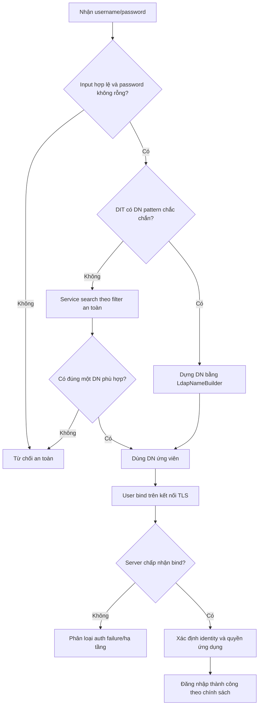

# User DN pattern và tìm DN trước khi bind trong Spring LDAP

Khi người dùng đăng nhập vào một ứng dụng dùng LDAP, họ thường nhập **tên đăng nhập** và **mật khẩu**, chẳng hạn `lan` và một mật khẩu bí mật. Nhưng LDAP server xác thực dựa trên một **authentication identity** thích hợp, trong nhiều cấu hình là **DN của entry**, ví dụ `uid=lan,ou=people,dc=example,dc=org`. Bài toán của ứng dụng là: **từ username, xác định đúng danh tính LDAP để thử bind**.

Trong Spring LDAP có hai chiến lược phổ biến:

1. **User DN pattern**: xây DN từ username theo một mẫu đã biết, khi mọi tài khoản nằm ở vị trí dự đoán được.
2. **Search DN rồi bind**: dùng một kết nối có quyền tìm kiếm để tra entry theo thuộc tính định danh, lấy DN thực tế, sau đó thử bind bằng mật khẩu của chính người dùng.

Hai chiến lược có thể cùng dùng LDAP **simple bind trên kết nối TLS an toàn**, nhưng khác nhau về giả định cấu trúc DIT, quyền tìm kiếm, số request và cách xử lý tài khoản ở nhiều OU. Bài thuộc chương **Authentication** của module **Spring LDAP**, tập trung vào lựa chọn chiến lược, các API của `LdapTemplate`/`ContextSource`, kiểm soát bảo mật và kiểm thử.

Sau bài học, bạn có thể:

- Phân biệt **username**, **DN**, **service bind** và **user bind**.
- Chọn User DN pattern khi vị trí tài khoản cố định, hoặc tìm DN trước khi bind khi vị trí thay đổi.
- Dựng DN bằng `LdapNameBuilder` và xây LDAP filter bằng `LdapQueryBuilder` đúng ngữ cảnh escaping.
- Sử dụng `LdapTemplate.authenticate(...)` cho luồng tìm kiếm và xác thực thông dụng.
- Tự tổ chức luồng **search → kiểm tra một DN duy nhất → bind** khi yêu cầu kiểm soát tính duy nhất hoặc trạng thái nghiệp vụ.
- Tránh lỗi nghiêm trọng với **mật khẩu rỗng**, LDAP filter injection, anonymous/unauthenticated bind, TLS không an toàn và log bí mật.
- Phân biệt tài khoản không tìm thấy, mật khẩu sai, LDAP server lỗi, tài khoản bị khóa và lỗi phân quyền ứng dụng.

## 1. Username, DN và bind là ba khái niệm khác nhau

Giả sử directory có các entry:

```text
dc=example,dc=org
├── ou=people
│   ├── ou=hanoi
│   │   └── uid=lan
│   └── ou=danang
│       └── uid=binh
└── ou=service
    └── uid=app-reader
```

Thông tin mà người dùng nhập:

```text
username: lan
password: [bí mật]
```

DN thực tế của người dùng:

```text
uid=lan,ou=hanoi,ou=people,dc=example,dc=org
```

Phân biệt:

| Khái niệm | Ví dụ | Vai trò |
| --- | --- | --- |
| Username | `lan` | Định danh người dùng cung cấp cho ứng dụng |
| Thuộc tính LDAP dùng tìm kiếm | `uid=lan` | Điều kiện để tìm entry phù hợp trong directory |
| User DN | `uid=lan,ou=hanoi,ou=people,dc=example,dc=org` | Danh tính LDAP cụ thể của entry được thử bind |
| Service bind DN | `uid=app-reader,ou=service,dc=example,dc=org` | Danh tính ứng dụng dùng khi cần tìm thông tin trước xác thực |
| User password | Mật khẩu do người dùng nhập | Credential gửi trong bước xác thực, không phải dữ liệu đem so sánh thủ công |
| Authentication | LDAP server chấp nhận hoặc từ chối bind | Xác minh credential của một danh tính |
| Authorization | Người dùng được phép làm gì sau khi đăng nhập | Quyết định bởi ứng dụng, nhóm, vai trò, ACL và chính sách thích hợp |

**Không phải LDAP nào cũng dùng `uid` làm RDN.** Có hệ thống dùng `cn`, nhiều tầng OU, hoặc cơ chế danh tính đăng nhập khác DN, chẳng hạn UPN trong Active Directory. Vì vậy, giá trị `username` **không thể mặc nhiên được coi là DN**.

### Bind xác thực không phải bind tạo entry

Trong LDAP, *BindRequest* là thao tác xác thực client. Trong Spring LDAP/JNDI còn có `LdapTemplate.bind(...)`/`Context.bind(...)` dùng cho **tạo entry**. Chúng là hai ý nghĩa khác nhau của từ *bind*.

Ở bài này, “bind bằng mật khẩu” có nghĩa **mở context/xác thực kết nối bằng danh tính người dùng**, không phải gọi `ldapTemplate.bind(entry)` để tạo tài khoản.

## 2. Hai luồng xác thực

### Luồng A — Dựng DN theo pattern

Ứng dụng đã biết mọi người dùng trực tiếp dưới `ou=people`:

```text
username = lan
       │
       ▼
DN pattern: uid={0},ou=people,dc=example,dc=org
       │
       ▼
DN thực: uid=lan,ou=people,dc=example,dc=org
       │
       ▼
Thử LDAP bind bằng DN và password người dùng
       │
       ├─ server chấp nhận → authentication thành công
       └─ server từ chối   → authentication thất bại
```

Ưu điểm: không cần search trước và không cần tài khoản đọc chỉ để xác định DN. Nhược điểm: nếu entry được chuyển vào OU khác, pattern cũ sẽ trỏ sai DN.

### Luồng B — Tìm DN trước rồi thử bind

Ứng dụng không biết tài khoản ở OU nào:

```text
username = lan
       │
       ▼
Service context search dưới ou=people
filter: (uid=lan)
       │
       ▼
Tìm entry và lấy DN thực
uid=lan,ou=hanoi,ou=people,dc=example,dc=org
       │
       ▼
Đóng/hoàn tất search context
       │
       ▼
Thử user bind bằng DN vừa tìm và password người dùng
       │
       ├─ server chấp nhận → authentication thành công
       └─ server từ chối   → authentication thất bại
```

Điểm quan trọng nhất: **Search thành công không đồng nghĩa xác thực thành công.** Tra được `uid=lan` chỉ chứng minh rằng entry có thể được tìm thấy theo quyền của kết nối tìm kiếm; **mật khẩu chỉ được xác minh khi server xử lý bind**.

### So sánh hai chiến lược

| Tiêu chí | User DN pattern | Search DN trước khi bind |
| --- | --- | --- |
| Dự đoán được DN từ username? | Bắt buộc | Không bắt buộc |
| Số thao tác LDAP điển hình | Một bind xác thực | Search rồi bind xác thực |
| Cần danh tính đọc để tìm DN? | Không nhất thiết | Thường có, trừ khi server cho anonymous search an toàn và được cho phép |
| Người dùng trải ở nhiều OU? | Khó duy trì nếu chỉ một pattern | Phù hợp khi search base bao phủ đúng các OU |
| Entry bị move/rename? | Pattern có thể không còn khớp | Search có thể tìm DN mới nếu thuộc tính lọc còn phù hợp |
| Rủi ro trùng `uid` trong scope | Pattern chỉ định một DN cụ thể | Cần quy tắc xử lý nhiều entry |
| Phụ thuộc search ACL/index | Ít hơn | Có |
| Khả năng chẩn đoán | DN không đúng, bind bị từ chối, TLS | Thêm lỗi search, quyền đọc, referral, size/time limit |
| Khi nên chọn | DIT cố định, naming rule đáng tin cậy | DIT phân tầng linh hoạt hoặc username không quyết định vị trí |

**Không có chiến lược luôn tốt hơn.** Chọn theo cấu trúc và chính sách LDAP thực tế, không chỉ theo việc cách nào viết ít dòng Java hơn.

## 3. User DN pattern phù hợp khi nào?

Một **DN pattern** là công thức tạo DN từ tên đăng nhập. Ví dụ:

```text
uid={0},ou=people,dc=example,dc=org
```

Trong đó `{0}` đại diện cho username đã được xác thực định dạng hoặc biểu diễn an toàn.

Nếu `username = "lan"`:

```text
uid=lan,ou=people,dc=example,dc=org
```

Pattern hợp lý khi:

- Mọi entry của nhóm tài khoản cần xác thực nằm dưới cùng một OU cố định.
- Thuộc tính dùng trong RDN (ví dụ `uid`) là giá trị username mà người dùng nhập.
- Không có cơ chế di chuyển entry giữa nhiều OU làm thay đổi vị trí.
- Danh tính đăng nhập tuân thủ một quy tắc thống nhất và được quản trị viên directory xác nhận.
- Ứng dụng cần một luồng bind trực tiếp, không phải liệt kê/tìm kiếm người dùng.

### Trường hợp DN pattern dễ thất bại

Giả sử entry thật là:

```text
uid=lan,ou=hanoi,ou=people,dc=example,dc=org
```

Nhưng ứng dụng dùng:

```text
uid={0},ou=people,dc=example,dc=org
```

Kết quả dựng:

```text
uid=lan,ou=people,dc=example,dc=org
```

Đây là **DN khác**. Mật khẩu đúng của Lan cũng không làm DN sai trở thành đúng. Tùy server và cơ chế tìm danh tính, bind thông thường sẽ thất bại.

Tương tự, nếu RDN dùng `cn=Lan Nguyen` và `uid=lan` chỉ là một thuộc tính dữ liệu, pattern `uid={0},...` sẽ không khớp DN thật.

## 4. Dựng DN pattern bằng `LdapNameBuilder` an toàn

Trong Spring LDAP, nên dùng `LdapNameBuilder` thay vì thay `{0}` trong một chuỗi DN không kiểm soát.

Ví dụ giả định `uid` chỉ được phép gồm chữ cái, chữ số, dấu chấm, gạch dưới hoặc dấu gạch ngang, từ 1 đến 64 ký tự. Đây **chỉ là chính sách username mẫu của ứng dụng**, không phải quy tắc bắt buộc của mọi LDAP server.

```java
import javax.naming.Name;

import org.springframework.ldap.support.LdapNameBuilder;

public final class UserDnFactory {
    private UserDnFactory() {
    }

    public static Name absoluteUserDn(String username) {
        if (username == null
                || !username.matches("[A-Za-z0-9._-]{1,64}")) {
            throw new IllegalArgumentException(
                    "Username không hợp lệ theo chính sách ứng dụng");
        }

        return LdapNameBuilder
                .newInstance("dc=example,dc=org")
                .add("ou", "people")
                .add("uid", username)
                .build();
    }
}
```

Ví dụ:

```java
Name userDn = UserDnFactory.absoluteUserDn("lan");

// uid=lan,ou=people,dc=example,dc=org
System.out.println(userDn);
```

**Vì sao cần builder?**

LDAP DN có ngữ pháp riêng: dấu phẩy, dấu cộng, dấu gạch chéo ngược, dấu bằng hoặc khoảng trắng tại vị trí đặc biệt có thể phải escape. Nối chuỗi `"uid=" + username + ",ou=people"` có thể tạo một DN khác ý định nếu dữ liệu chứa ký tự đặc biệt. Builder tạo các RDN từ loại attribute và giá trị một cách có cấu trúc.

**Hai điểm không được nhầm:**

1. `LdapNameBuilder` bảo vệ **cú pháp DN/RDN**; nó không phải cơ chế xác thực tính hợp lệ của username theo nghiệp vụ. Cần cả kiểm tra chính sách đầu vào và xây DN an toàn.
2. Escaping DN **khác** escaping LDAP filter. Không dùng `Rdn.escapeValue(...)` để tự xây filter như `(uid=...)`.

### DN tương đối và DN tuyệt đối

Nếu `LdapContextSource` cấu hình base `dc=example,dc=org`, các thao tác `LdapTemplate.search(...)` thường dùng **DN tương đối**:

```text
ou=people
```

Trong khi đó, một **bind identity** truyền trực tiếp qua `ContextSource.getContext(principal, credentials)` thường cần một danh tính bind **đầy đủ**, ví dụ:

```text
uid=lan,ou=people,dc=example,dc=org
```

Cần kiểm tra hợp đồng API của phương thức đang dùng: **DN dùng làm search base** và **principal dùng để xác thực** không nhất thiết có cùng quy tắc về base. Không tự nối `dc=example,dc=org` hai lần.

## 5. Bind trực tiếp bằng `ContextSource.getContext(...)`

Spring LDAP có interface `ContextSource` để cung cấp LDAP contexts. Khi xác thực trực tiếp một DN đã biết, có thể yêu cầu một context với **principal và password của người dùng**.

Ví dụ minh họa với `ContextSource` đã được cấu hình LDAPS/StartTLS đúng cách:

```java
import javax.naming.Name;
import javax.naming.directory.DirContext;

import org.springframework.ldap.AuthenticationException;
import org.springframework.ldap.core.ContextSource;
import org.springframework.ldap.support.LdapUtils;

public final class PatternBindAuthenticator {
    private final ContextSource contextSource;

    public PatternBindAuthenticator(ContextSource contextSource) {
        this.contextSource = contextSource;
    }

    public boolean authenticate(String username, String password) {
        if (password == null || password.isEmpty()) {
            return false;
        }

        Name principal = UserDnFactory.absoluteUserDn(username);

        DirContext userContext = null;
        try {
            // Mở context bằng danh tính/mật khẩu người dùng.
            userContext = contextSource.getContext(
                    principal.toString(), password);

            // Nếu server chấp nhận bind và context được tạo thành công.
            return true;
        } catch (AuthenticationException badCredentials) {
            // Phản hồi công khai không phân biệt username/mật khẩu sai.
            return false;
        } finally {
            LdapUtils.closeContext(userContext);
        }
    }
}
```

**Tại sao không gọi `ldapTemplate.bind(...)`?** Vì `LdapTemplate.bind(...)` dành cho thao tác tạo entry, trong khi `ContextSource.getContext(principal, credentials)` yêu cầu mở context dưới danh tính được chỉ định.

### Kiểm tra mật khẩu rỗng là bắt buộc

Đây là một bẫy quan trọng của LDAP. Trong một số cấu hình, một request mang DN nhưng credential rỗng có thể được xử lý theo cơ chế **unauthenticated authentication** của LDAP, hoặc đi đến hành vi anonymous/bind không đúng kỳ vọng của ứng dụng. Nếu code chỉ kiểm tra “mở được context” mà không chặn mật khẩu rỗng, có nguy cơ coi một tình huống **không xác thực bằng mật khẩu** là đăng nhập thành công.

Vì vậy, **từ chối `null` và chuỗi mật khẩu rỗng trước khi gọi bind**:

```java
if (password == null || password.isEmpty()) {
    return false;
}
```

Không được dùng `password.trim()` hay `password.isBlank()` để biến đổi mật khẩu trước khi thử bind. Khoảng trắng có thể là ký tự hợp lệ trong mật khẩu thật; chính sách có thể từ chối một đầu vào cụ thể nhưng **không được âm thầm sửa password người dùng đã nhập**.

### Phân biệt lỗi xác thực với lỗi hạ tầng

`AuthenticationException` thường biểu thị lỗi xác thực từ phía LDAP provider/server. Tuy nhiên, server có thể có chính sách tài khoản khóa, hết hạn hoặc các quy định riêng, khiến việc phân loại chính xác cần kiểm tra LDAP result và tài liệu máy chủ.

**Không bắt mọi `Exception` rồi trả `false`**. Lỗi mất kết nối, timeout, DNS, TLS hoặc server không sẵn sàng phải được báo/ghi nhận như **lỗi dịch vụ xác thực**, không phải “mật khẩu sai”. Ứng dụng có thể hiển thị thông báo chung để tránh lộ thông tin, nhưng hệ thống quan sát nội bộ phải phân biệt nguyên nhân.

### `DirContext` phải được đóng

`DirContext` không phải `AutoCloseable`, nên không dùng cú pháp try-with-resources trực tiếp như với `InputStream`. `LdapUtils.closeContext(...)` trong `finally` giúp đóng context sau khi thử bind, kể cả khi xảy ra lỗi.

Với ứng dụng web, không giữ context đã bind bằng mật khẩu người dùng để tái sử dụng tùy tiện giữa các request hoặc phiên đăng nhập. Vòng đời context, connection pooling và quyền chạy thao tác LDAP cần được thiết kế riêng.

## 6. Search DN trước rồi bind: khi vị trí entry không cố định

Giả sử ứng dụng có ba nhánh:

```text
ou=people,dc=example,dc=org
├── ou=hanoi
│   └── uid=lan
├── ou=danang
│   └── uid=binh
└── ou=saigon
    └── uid=chi
```

`uid=lan` có DN đầy đủ:

```text
uid=lan,ou=hanoi,ou=people,dc=example,dc=org
```

Thay vì đoán OU, ứng dụng có thể tìm entry bằng `(uid=lan)` dưới `ou=people` với scope bao gồm các cấp con, rồi thử bind bằng DN tìm được.

Quy trình đầy đủ gồm:

1. **Kiểm tra username/password ở tầng ứng dụng**; đặc biệt từ chối mật khẩu rỗng.
2. **Search bằng context có quyền đọc** (thường dùng service account với quyền tối thiểu).
3. **Kiểm tra số kết quả**: không có entry, đúng một entry hay nhiều entry.
4. **Kiểm tra DN**: thuộc đúng naming context và nhánh cho phép.
5. **Mở context bằng DN người dùng và mật khẩu vừa nhập**, qua kết nối an toàn.
6. **Đóng context và trả kết quả**, không ghi mật khẩu hoặc DN nhạy cảm vào log công khai.

### Vì sao dùng service account để search?

Trước khi xác thực, ứng dụng chưa có context người dùng đã bind thành công. Nếu directory không cho anonymous search — một cấu hình hợp lý về bảo mật — ứng dụng cần một **service identity** được cấp quyền **chỉ đọc những thuộc tính và entry cần cho việc xác định DN**.

Service account không được dùng để “xác thực thay” người dùng. Search chạy bằng quyền của service account, nhưng việc xác minh password phải dùng **user bind** (hoặc một cơ chế authentication khác được server hỗ trợ và hệ thống tin cậy).

**Không so sánh mật khẩu trực tiếp với thuộc tính `userPassword` qua LDAP search.** Thuộc tính đó có thể chứa giá trị đã hash, không được cấp quyền đọc hoặc tuân thủ chính sách riêng. Đối với simple bind, hãy để server xử lý xác thực.

## 7. Dùng `LdapTemplate.authenticate(...)` cho search-and-bind thông dụng

Spring LDAP cung cấp các overload `authenticate` của `LdapTemplate` giúp mô tả tìm entry theo LDAP filter và xác thực bằng mật khẩu người dùng.

Ví dụ dùng `LdapQueryBuilder`:

```java
import org.springframework.ldap.core.LdapTemplate;
import org.springframework.ldap.query.LdapQuery;
import org.springframework.ldap.query.LdapQueryBuilder;
import org.springframework.ldap.query.SearchScope;

public final class SearchBindAuthenticator {
    private final LdapTemplate ldapTemplate;

    public SearchBindAuthenticator(LdapTemplate ldapTemplate) {
        this.ldapTemplate = ldapTemplate;
    }

    public boolean authenticate(String username, String password) {
        if (username == null || username.trim().isEmpty()) {
            return false;
        }
        if (password == null || password.isEmpty()) {
            return false;
        }

        LdapQuery query = LdapQueryBuilder.query()
                .base("ou=people")
                .searchScope(SearchScope.SUBTREE)
                .where("uid").is(username);

        return ldapTemplate.authenticate(query, password);
    }
}
```

Giả sử `ContextSource` có base `dc=example,dc=org`, câu query dùng base tương đối `ou=people`. `LdapQueryBuilder` giúp biểu diễn điều kiện `uid` bằng giá trị input được escape đúng **LDAP filter syntax**.

Ở mức khái niệm, `LdapTemplate.authenticate(query, password)` thực hiện logic tìm ứng viên rồi kiểm tra credential bằng LDAP. Chi tiết xử lý khi có nhiều entry, callback và chuyển ngoại lệ phụ thuộc overload và phiên bản Spring LDAP, nên **không mặc định** phương thức đơn giản này đáp ứng yêu cầu *fail closed nếu có trùng UID* hoặc mọi chính sách tài khoản riêng của ứng dụng.

### Câu hỏi cần trả lời trước khi dùng API gọn

- Search base có bao phủ đúng tất cả OU được phép không?
- `uid` có được quản lý duy nhất trong phạm vi đó không?
- Filter có chọn lọc và được index đủ để dùng trong luồng đăng nhập không?
- Tài khoản service được phép search nhưng không có quyền quá rộng chứ?
- Khi server từ chối bind do tài khoản khóa, hết hạn hoặc thiếu quyền, ứng dụng sẽ xử lý thế nào?
- Có yêu cầu kiểm tra trạng thái riêng như `accountStatus`, nhóm LDAP hoặc MFA sau khi authentication thành công không?
- Hệ thống có cần phân biệt kết quả **không tìm thấy / trùng identity / mật khẩu sai / lỗi hạ tầng** ở log nội bộ không?

Nếu cần kiểm soát chặt **tính duy nhất của DN ứng viên**, dùng luồng search riêng trước khi bind như mục tiếp theo.

## 8. Tự triển khai search → duy nhất một DN → bind

Ví dụ sau cố ý tách các trách nhiệm:

- `LdapTemplate` dùng context tìm kiếm (service identity).
- `ContextSource.getContext(...)` dùng user principal và password.
- Search trả `Name` của entry, không tải toàn bộ thuộc tính hồ sơ.
- Chỉ xác thực khi tìm được **đúng một** entry.
- Không chấp nhận mật khẩu rỗng và không coi lỗi mạng là mật khẩu sai.

### Mã Java minh họa

```java
import java.util.List;

import javax.naming.Name;
import javax.naming.InvalidNameException;
import javax.naming.ldap.LdapName;
import javax.naming.directory.DirContext;

import org.springframework.ldap.AuthenticationException;
import org.springframework.ldap.core.ContextMapper;
import org.springframework.ldap.core.ContextSource;
import org.springframework.ldap.core.DirContextOperations;
import org.springframework.ldap.core.LdapTemplate;
import org.springframework.ldap.query.LdapQuery;
import org.springframework.ldap.query.LdapQueryBuilder;
import org.springframework.ldap.query.SearchScope;
import org.springframework.ldap.support.LdapUtils;

public final class StrictSearchBindAuthenticator {
    private static final String LDAP_BASE_DN = "dc=example,dc=org";

    private final LdapTemplate ldapTemplate;
    private final ContextSource contextSource;

    public StrictSearchBindAuthenticator(
            LdapTemplate ldapTemplate,
            ContextSource contextSource) {
        this.ldapTemplate = ldapTemplate;
        this.contextSource = contextSource;
    }

    public boolean authenticate(String username, String password) {
        if (username == null || username.trim().isEmpty()
                || password == null || password.isEmpty()) {
            return false;
        }

        // 1. Tìm đúng entry theo uid bằng service context.
        LdapQuery query = LdapQueryBuilder.query()
                .base("ou=people")
                .searchScope(SearchScope.SUBTREE)
                .where("uid").is(username);

        List<Name> candidates = ldapTemplate.search(
                query,
                (ContextMapper<Name>) context ->
                        ((DirContextOperations) context).getDn());

        // 2. Không chọn ngẫu nhiên entry đầu tiên.
        if (candidates.size() != 1) {
            return false;
        }

        // 3. Nối DN tương đối với ContextSource base đúng một lần.
        String absoluteDn = toAbsoluteDn(candidates.get(0));

        // 4. Thử bind bằng danh tính thực và password người dùng.
        DirContext userContext = null;
        try {
            userContext = contextSource.getContext(absoluteDn, password);
            return true;
        } catch (AuthenticationException invalidCredentials) {
            return false;
        } finally {
            LdapUtils.closeContext(userContext);
        }
    }

    private static String toAbsoluteDn(Name relativeDn) {
        try {
            Name fullDn = new LdapName(LDAP_BASE_DN);
            fullDn.addAll(relativeDn);
            return fullDn.toString();
        } catch (InvalidNameException ex) {
            throw new IllegalArgumentException(
                    "DN LDAP không hợp lệ", ex);
        }
    }
}
```

Giải thích:

1. `LdapTemplate.search(...)` thực hiện search theo filter có giá trị được escape, dưới `ou=people`.
2. `ContextMapper` lấy DN của entry tìm thấy qua `DirContextOperations.getDn()`. Ví dụ này **giả định DN được trả tương đối với `ContextSource` base**; khi dùng provider hoặc mapping khác, cần xác nhận cách biểu diễn DN và không cộng base hai lần.
3. `candidates.size() != 1` từ chối trường hợp không có entry **hoặc** có nhiều entry khớp. Đây là chính sách *fail closed* khi `uid` chưa được đảm bảo duy nhất.
4. `new LdapName(LDAP_BASE_DN)` và `addAll(relativeDn)` ghép hai DN có cấu trúc, tránh nối chuỗi hoặc làm sai escaping của RDN.
5. `getContext(absoluteDn, password)` mới là bước xác thực bằng credential người dùng.
6. `AuthenticationException` được xử lý như kết quả xác thực thất bại; lỗi service, network hoặc TLS khác tiếp tục được ném cho tầng vận hành/phân loại.
7. `LdapUtils.closeContext(...)` giúp đóng user context trong mọi trường hợp.

**Giới hạn của ví dụ:** Code chưa triển khai timeout, giới hạn search, kiểm tra referral hoặc sự thay đổi DN đồng thời. Một lần search có thể trả dữ liệu chưa đầy đủ do ACL hoặc size/time limit, và tên entry có thể bị đổi giữa search và bind. Khi triển khai production, bảo đảm kết quả tìm kiếm được coi là đầy đủ, giới hạn scope hợp lý, theo dõi lỗi và áp chính sách retry an toàn.

### Cách hiểu đúng về DN trả về

Trong cùng một ứng dụng, có thể có:

```text
ContextSource base:
dc=example,dc=org

DN tương đối từ mapper:
uid=lan,ou=hanoi,ou=people

User DN tuyệt đối dùng bind:
uid=lan,ou=hanoi,ou=people,dc=example,dc=org
```

Tùy overload hoặc API, provider có thể trả DN ở định dạng khác. **Đừng dùng `String.contains(...)` hoặc nối `"," + base` vô điều kiện** để suy đoán DN. Khi áp dụng vào hệ thống thật, nên kiểm thử tên được trả bằng một entry có DN xác định.

### Vì sao không nên tự lấy một ứng viên rồi bind ngay?

Nếu search theo `uid=lan` dưới hai OU và có:

```text
uid=lan,ou=employees,dc=example,dc=org
uid=lan,ou=partners,dc=example,dc=org
```

chọn `results.get(0)` có thể khiến người dùng được ánh xạ sai account, nhất là khi các nhánh có chính sách khác nhau. Một lần LDAP search thường **không bảo đảm thứ tự kết quả** theo nghiệp vụ.

Nếu tổ chức cho phép username trùng, phải thiết kế tên đăng nhập đầy đủ hoặc tiêu chí phân biệt khác (realm, tenant, namespace), sau đó tìm đúng DN trong phạm vi đã xác thực. Không dựa vào may rủi thứ tự search.

## 9. Phạm vi tìm kiếm, filter và tính duy nhất của identity

### Search base và scope phải phản ánh cấu trúc DIT

`ou=people` có thể chứa người dùng trực tiếp hoặc trong OU con. Với hệ thống chia theo vùng:

```text
ou=people
├── ou=hanoi
│   └── uid=lan
└── ou=danang
    └── uid=binh
```

Nếu search chỉ có **ONELEVEL_SCOPE** từ `ou=people`, nó sẽ không tìm thấy `uid=lan` nằm sâu hơn một tầng. Với LDAP query builder, lựa chọn search scope cần phù hợp cấu trúc, thường là `SUBTREE_SCOPE` khi phải tìm xuyên OU.

Ngược lại, search từ `dc=example,dc=org` có thể quá rộng, quét cả nhóm hoặc service accounts. Base hẹp hơn thường giúp giảm tải và giới hạn phạm vi danh tính được phép xác thực.

### Filter chính xác và có index

Ví dụ filter equality:

```text
(uid=lan)
```

Một số hệ thống cần thêm object class:

```text
(&(objectClass=inetOrgPerson)(uid=lan))
```

Những điều kiện này cần được xây bằng `LdapQueryBuilder` hoặc filter builder, không nối `uid` từ user input vào chuỗi filter.

Ví dụ nguy hiểm:

```java
// KHÔNG dùng raw string concatenation để tạo LDAP filter.
String unsafe = "(uid=" + username + ")";
```

Đầu vào chứa `*`, dấu ngoặc, backslash hoặc NUL có thể bị hiểu thành cú pháp filter, làm mở rộng hoặc thay đổi điều kiện tìm kiếm.

### Search không đảm bảo duy nhất nếu schema không bảo đảm

LDAP **DN** duy nhất trong naming context, nhưng attribute như `uid` không phải lúc nào cũng duy nhất trên toàn DIT. Ứng dụng cần chính sách:

- Chọn đúng OU/realm cho loại tài khoản.
- Áp quy tắc duy nhất của username trong phạm vi đăng nhập.
- Nếu có nhiều ứng viên, từ chối hoặc yêu cầu định danh cụ thể hơn.
- Không tiết lộ ra giao diện công khai rằng username tồn tại ở những nhánh nào.

**Không đánh đồng** “tìm đúng một entry hiện tại” với “schema bảo đảm độc nhất mãi mãi”. Nhiều tổ chức phải kiểm soát uniqueness bằng quy trình provisioning hoặc tính năng riêng của directory server.

## 10. LDAP lỗi và hành vi xác thực cần phân biệt

### Nhóm lỗi thường gặp

| Tình huống | Biểu hiện có thể gặp | Cách ứng dụng nên xử lý |
| --- | --- | --- |
| Username không hợp lệ theo policy | Không tạo được DN/filter hợp lệ | Từ chối input, không gửi LDAP request vô ích |
| Không tìm thấy entry | Search trả 0 kết quả | Trả thất bại xác thực với thông báo công khai chung |
| Nhiều entry trùng username | Search trả nhiều DN | Từ chối hoặc yêu cầu realm rõ ràng; không chọn phần tử đầu |
| Mật khẩu sai | LDAP bind trả lỗi xác thực, thường result code 49 | Trả thất bại, không log password |
| Mật khẩu rỗng | Có thể phát sinh cơ chế anonymous/unauthenticated bind tùy server | Từ chối trước khi gọi LDAP |
| Tài khoản bị khóa/hết hạn | Server có thể trả mã hoặc diagnostic riêng | Phân loại nội bộ đúng theo server, bảo vệ thông tin công khai |
| Search thiếu quyền | Không thấy entry hoặc server từ chối search | Kiểm tra ACL service account, không mở rộng quyền vô tội vạ |
| LDAP không liên lạc được | Timeout, DNS, kết nối thất bại | Báo sự cố hạ tầng, không coi là password sai |
| TLS không hợp lệ | Lỗi trust chain/hostname/handshake | Dừng xác thực, sửa chứng chỉ/trust config |
| DN thay đổi giữa search và bind | Bind bằng DN cũ thất bại | Kiểm tra rename/move đồng thời, retry có giới hạn nếu được phép |
| Kết quả search không đầy đủ | Size/time limit, referral, ACL | Không chọn DN tùy ý; xác minh tính đầy đủ trước bind |
| Ứng dụng đã auth nhưng thiếu quyền | Authentication thành công, authorization thất bại | Kiểm tra nhóm/vai trò/ACL riêng, không gọi đó là password sai |

Một **failure** của authentication không phải lúc nào cũng cùng một nguyên nhân. Tầng API có thể trả một phản hồi chung như “Không thể đăng nhập với thông tin đã cung cấp”, nhưng log/metric nội bộ nên phân loại theo nhóm nguyên nhân **mà không lộ dữ liệu nhạy cảm**.

### Tránh tạo oracle cho việc dò username

Nếu giao diện nói:

```text
Không tìm thấy người dùng lan
Mật khẩu của binh không đúng
Tài khoản chi đã bị khóa
```

kẻ tấn công có thể dò xem account nào tồn tại hoặc đang có trạng thái đặc biệt. Cân nhắc thông báo thất bại đồng nhất cho người dùng chưa xác thực, kết hợp rate limit, backoff, MFA, audit và giám sát hành vi dò quét.

**Không ghi** user password, chuỗi connection URL chứa credential, authorization headers hoặc toàn bộ LDAP entry vào log. Khi cần điều tra, chỉ ghi request correlation ID, loại lỗi đã chuẩn hóa và thông tin tối thiểu được phê duyệt.

## 11. Kết nối TLS và identity của tài khoản dịch vụ

**Simple bind truyền credential trong giao thức LDAP**, vì vậy phải được bảo vệ khi đi qua mạng không tin cậy. Dùng **LDAPS** (`ldaps://...:636`) hoặc **StartTLS** được triển khai đúng quy trình, xác thực CA, certificate chain và hostname.

Ví dụ cấu hình cơ bản với LDAPS:

```java
import org.springframework.context.annotation.Bean;
import org.springframework.context.annotation.Configuration;
import org.springframework.ldap.core.LdapTemplate;
import org.springframework.ldap.core.support.LdapContextSource;

@Configuration
public class LdapAuthenticationConfig {
    @Bean
    public LdapContextSource ldapContextSource() {
        LdapContextSource source = new LdapContextSource();

        source.setUrl("ldaps://ldap.example.org:636");
        source.setBase("dc=example,dc=org");

        // Chỉ tài khoản dùng để SEARCH trước user bind.
        source.setUserDn(System.getenv("LDAP_READER_DN"));
        source.setPassword(System.getenv("LDAP_READER_PASSWORD"));

        // Trust store/certificate validation được cấu hình
        // tại runtime phù hợp; không tắt xác minh TLS.
        return source;
    }

    @Bean
    public LdapTemplate ldapTemplate(LdapContextSource source) {
        return new LdapTemplate(source);
    }
}
```

Giải thích:

- Bean `LdapContextSource` quản lý cấu hình kết nối, base và tài khoản dịch vụ phục vụ tìm kiếm.
- `LdapTemplate` được dùng cho search và một số cơ chế xác thực của Spring LDAP.
- Khi dùng `getContext(userDn, userPassword)`, mục tiêu là **thử bind với identity người dùng**, không tái sử dụng password tài khoản dịch vụ.
- Mật khẩu service account không được hard-code; dùng secrets/environment variables hoặc secret manager phù hợp.
- Ví dụ **không** mô tả cách cài trust store đầy đủ; cần đảm bảo chứng chỉ server được xác minh theo môi trường vận hành.

### StartTLS không giống `ldap://` thuần

`ldap://` trên cổng 389 **không tự mã hóa traffic**. StartTLS là yêu cầu nâng cấp phiên LDAP sang TLS trước khi trao đổi thông tin xác thực. Không gửi simple bind chứa password trước khi StartTLS được thiết lập và xác minh thành công.

Nếu tổ chức dùng StartTLS thay LDAPS, hãy cấu hình chiến lược StartTLS và vòng đời context đúng với Spring LDAP/JNDI và server. Không coi việc bật một flag chung hay thay URL là đủ nếu ứng dụng không xác minh handshake.

### Pooling và user bind

Connection pooling giúp giảm chi phí kết nối cho một số workload, nhưng authentication liên quan đến **identity/credential riêng**. Không dùng lại một context đã bind bằng người dùng A cho người dùng B, không cho phép một LDAP context mutable bị dùng đồng thời giữa nhiều request, và cần hiểu cấu hình pooling/connection reuse do framework áp dụng.

Mô hình dễ quản lý là tách **service context dùng search** với **user context ngắn hạn dùng bind**, rồi đóng user context khi xác thực xong.

## 12. Spring LDAP thuần và Spring Security LDAP

Bài này chủ yếu dùng Spring LDAP `ContextSource` và `LdapTemplate`. Trong các ứng dụng cần tích hợp cơ chế bảo mật tổng thể, **Spring Security LDAP** có các thành phần khác để tạo luồng authentication:

- Cách xác thực dựa trên **user DN pattern** có thể sử dụng danh sách pattern, chẳng hạn `uid={0},ou=people`, với đường dẫn được giải thích tương đối hay tuyệt đối theo cấu hình Spring Security.
- Cách xác thực dựa trên **user search** cho phép tìm DN thông qua base và filter, rồi dùng bind authentication.
- Authentication thành công mới là một phần của hệ thống; Spring Security còn quản lý authentication token, authorities, session/security context và authorization.

Đừng trộn API của Spring Security LDAP với `LdapTemplate.authenticate(...)` như thể chúng là cùng một interface. Phiên bản `spring-security-ldap` và `spring-ldap-core` cũng cần tương thích. Khi dùng Spring Security, nên áp dụng cơ chế authenticator/user search chính thức thay vì tự viết lại tất cả chi tiết trong controller.

### DN pattern dưới cấu hình có base

Ví dụ pattern:

```text
uid={0},ou=people
```

thường được diễn giải **tương đối với base DN cấu hình trong context source** của framework tương ứng. Một ví dụ khác:

```text
uid={0},ou=people,dc=example,dc=org
```

là DN đầy đủ. Chỉ dùng dạng đúng với hợp đồng component đang cấu hình. Việc ghép base hai lần có thể khiến ứng dụng luôn báo thất bại, kể cả khi mật khẩu đúng.

### Hệ thống không dùng DN làm username bind

Trong một số hệ thống như Active Directory, ứng dụng còn có thể xác thực theo principal dạng `userPrincipalName` hoặc cơ chế riêng của server. Khi đó một DN pattern theo `uid` có thể không phù hợp, và cơ chế resolver/user search cũng phải theo chính sách domain.

Không giả định mọi LDAP directory đều có `uid`, mọi username đều bằng RDN, hoặc mọi server đều có cùng hành vi với account disabled/locked.

## 13. Thiết kế một dịch vụ xác thực an toàn

Một dịch vụ thực tế không nên chỉ có kết quả boolean ở mọi tầng; nội bộ cần biết **phân loại lỗi** để vận hành và audit, trong khi response công khai vẫn hạn chế tiết lộ thông tin.

Ví dụ một mô hình tổng quát:



Nên phân chia trách nhiệm:

| Tầng | Trách nhiệm |
| --- | --- |
| Controller/API | Nhận request qua HTTPS, giới hạn tốc độ, trả thông báo phù hợp |
| Input policy | Kiểm tra username, chặn password rỗng, không tự chỉnh sửa password |
| DN resolver | Dựng DN theo pattern **hoặc** tìm DN theo search |
| LDAP bind authenticator | Đưa credential đến LDAP server an toàn và đóng context |
| Authorization | Kiểm tra nhóm, vai trò, trạng thái tài khoản, MFA và policy ứng dụng |
| Audit/observability | Phân loại lỗi nội bộ, ghi metadata tối thiểu, giám sát sự cố |
| LDAP server | Quyết định bind có thành công theo credential và chính sách server |

**Xác thực thành công chưa chắc được phép truy cập.** Một người dùng có thể bind đúng mật khẩu nhưng không thuộc nhóm dùng ứng dụng. Kiểm tra nhóm và vai trò cần được đặt ở tầng authorization hoặc hệ thống bảo mật thích hợp; không suy ra mọi người bind được đều có mọi quyền.

## 14. Tình huống thử nghiệm và các ca biên

Chuẩn bị một LDAP server thử nghiệm, không dùng tài khoản hoặc mật khẩu thật. Các entry mẫu:

```ldif
dn: uid=lan,ou=hanoi,ou=people,dc=example,dc=org
objectClass: top
objectClass: person
objectClass: organizationalPerson
objectClass: inetOrgPerson
uid: lan
cn: Lan Nguyen
sn: Nguyen

dn: uid=binh,ou=danang,ou=people,dc=example,dc=org
objectClass: top
objectClass: person
objectClass: organizationalPerson
objectClass: inetOrgPerson
uid: binh
cn: Binh Tran
sn: Tran
```

Đây là dữ liệu minh họa dạng rút gọn; cơ chế thiết lập password, các object classes bổ sung và việc kiểm thử credential phải tuân theo schema, cấu hình và chính sách của **server thử nghiệm**. Không ghi mật khẩu vào bài học hoặc file LDIF chia sẻ.

### Ma trận kiểm thử

| Ca kiểm thử | DN pattern | Search DN rồi bind |
| --- | --- | --- |
| User nằm đúng OU cố định, password đúng | Thành công nếu pattern đúng | Thành công khi tìm đúng entry |
| User ở OU con khác pattern | Thường thất bại | Có thể thành công nếu search scope bao phủ |
| Password sai | Bind từ chối | Search có thể tìm thấy nhưng bind từ chối |
| Password là chuỗi rỗng | **Phải từ chối trước bind** | **Phải từ chối trước search/bind** |
| Username không tồn tại | Dựng DN nhưng bind thất bại | Search không thấy entry |
| Hai entry có cùng `uid` ở hai OU | Pattern nhắm một DN | Resolver chặt chẽ phải từ chối tính mơ hồ |
| Username chứa ký tự đặc biệt | Builder/policy phải xử lý an toàn | Filter builder phải escape đúng |
| Service account thiếu quyền đọc | Không ảnh hưởng bước DN dựng trực tiếp, nếu không search | Có thể không tìm thấy entry hoặc search bị từ chối |
| LDAP server không kết nối được | Lỗi hạ tầng | Lỗi search hoặc bind; phải phân loại |
| TLS certificate không hợp lệ | Phải dừng | Phải dừng |
| User bị rename/move | Pattern có thể lỗi | Search có thể tìm DN mới nếu dữ liệu lọc còn đúng |
| User bind được nhưng không có quyền vào ứng dụng | Authentication có thể thành công | Authentication có thể thành công; authorization vẫn từ chối |

### Bài tập A — Dựng DN từ pattern

Với `ContextSource` base `dc=example,dc=org`, tạo hàm dựng DN cho người dùng trực tiếp dưới `ou=people`. Dùng `LdapNameBuilder` và kiểm tra:

```text
Input:  lan
Output: uid=lan,ou=people,dc=example,dc=org
```

Thử username chứa dấu phẩy hoặc dấu bằng. Xác định ứng dụng sẽ **từ chối theo policy** hay **chấp nhận và escape đúng**, không để chuỗi input bị hiểu như một DN khác.

### Bài tập B — Search-before-bind

Tạo hai OU `ou=hanoi` và `ou=danang` trong directory thử nghiệm. Đặt một entry người dùng dưới `ou=hanoi`, sau đó:

1. Dùng `LdapQueryBuilder` tìm `uid` dưới `ou=people` theo phạm vi subtree.
2. Kiểm tra DN tương đối và DN tuyệt đối của kết quả.
3. Thử bind bằng mật khẩu đúng của người dùng đã chuẩn bị.
4. Thử lại với mật khẩu sai; chứng minh search thành công **không** có nghĩa password đúng.
5. Thử với password rỗng và xác minh **không có user bind được thực hiện**.

### Bài tập C — Kiểm tra tính duy nhất

Tạo hai entry có cùng `uid` dưới hai OU khác nhau (chỉ khi schema/chính sách server thử nghiệm cho phép). Thực hiện search với base bao phủ cả hai. Yêu cầu hệ thống:

- Không tự chọn kết quả đầu tiên.
- Báo một lỗi mơ hồ danh tính ở log nội bộ.
- Trả phản hồi công khai không tiết lộ cấu trúc OU.
- Cân nhắc bổ sung realm/tenant vào định danh đăng nhập hoặc áp uniqueness.

### Bài tập D — Xử lý sự cố

Giả lập LDAP server không thể kết nối hoặc dùng chứng chỉ TLS không được tin cậy. Quan sát rằng ứng dụng **không** được hiển thị “mật khẩu sai” như thể server đã kiểm tra password, và cũng không được bỏ qua kiểm tra TLS để chạy cho xong.

## 15. Câu hỏi tự kiểm tra

**Câu 1.** User DN pattern là gì và vì sao không dùng được cho mọi DIT?

**Đáp án:** Đó là công thức tạo DN từ username theo một vị trí đã biết, ví dụ `uid={0},ou=people`. Nó không phù hợp khi các tài khoản nằm ở nhiều OU hoặc RDN không tuân theo cùng quy tắc.

**Câu 2.** Vì sao tìm thấy entry bằng filter `(uid=lan)` chưa chứng minh Lan đã đăng nhập thành công?

**Đáp án:** Search chỉ tìm dữ liệu theo quyền kết nối search. Password của Lan phải được kiểm chứng bằng bind hoặc một cơ chế authentication được server và ứng dụng chấp nhận.

**Câu 3.** Service bind và user bind khác nhau ở điểm nào?

**Đáp án:** Service bind thường dùng danh tính ứng dụng để tìm DN/attribute được cấp quyền; user bind dùng identity và credential của người dùng nhằm xác minh mật khẩu.

**Câu 4.** Có nên gửi password rỗng đến LDAP server và coi việc tạo context thành công là authentication thành công?

**Đáp án:** Không. Một số server/provider có cơ chế anonymous/unauthenticated bind với credential rỗng. Phải từ chối password rỗng trước khi gửi yêu cầu xác thực.

**Câu 5.** Vì sao dùng `LdapNameBuilder` để dựng DN nhưng dùng `LdapQueryBuilder` để tìm username?

**Đáp án:** DN/RDN và LDAP search filter có quy tắc escaping khác nhau. Builder cần phù hợp ngữ cảnh cú pháp và dữ liệu đầu vào.

**Câu 6.** Nếu search trả hai entry cùng `uid`, có an toàn khi chọn entry đầu và thử bind không?

**Đáp án:** Không nên. Kết quả search không có thứ tự nghiệp vụ được bảo đảm. Nên từ chối danh tính mơ hồ hoặc bổ sung yếu tố định danh để tìm chính xác một account.

**Câu 7.** `LdapTemplate.bind(entry)` có phải API xác thực password không?

**Đáp án:** Không. Trong Spring LDAP, `bind(entry)` thuộc nhóm thao tác tạo entry. Xác thực dùng `LdapTemplate.authenticate(...)` hoặc bind credential qua `ContextSource`/cơ chế bảo mật tương ứng.

**Câu 8.** Nếu một người dùng bind thành công, họ có tự động được phép vào mọi chức năng của ứng dụng không?

**Đáp án:** Không. Bind xác minh credential; quyền truy cập phải được kiểm tra riêng theo nhóm, vai trò và chính sách ứng dụng.

**Câu 9.** Khi LDAP server không kết nối được, nên trả “sai password” hay xử lý sự cố?

**Đáp án:** Phải phân loại đây là lỗi hạ tầng, không giả định password sai. Thông báo công khai có thể chung, nhưng metric/log nội bộ cần ghi đúng nguyên nhân và tránh lộ thông tin nhạy cảm.

**Câu 10.** Nếu DN được search trả về đã gồm `dc=example,dc=org`, có nên cộng tiếp base DN đó lần nữa trước khi bind không?

**Đáp án:** Không. Phải biết API trả DN tương đối hay tuyệt đối và ghép base đúng **một lần**; ghép trùng sẽ tạo DN sai.

## Ghi nhớ

**User DN pattern dùng khi username quyết định được chính xác DN; search-before-bind dùng khi ứng dụng phải tìm vị trí thật của entry trước khi thử credential.** Với Spring LDAP, có thể dựng DN bằng `LdapNameBuilder` và xác thực qua `ContextSource.getContext(...)`, hoặc dùng `LdapTemplate.authenticate(LdapQuery, password)` cho luồng tìm kiếm rồi bind thông dụng. Khi có yêu cầu chặt về uniqueness, hãy tự tổ chức **search → xác nhận đúng một DN → user bind**.

Dù chọn cách nào, hãy **từ chối mật khẩu rỗng**, dùng filter/DN builder đúng ngữ cảnh, bảo vệ kết nối bằng TLS được xác minh, phân biệt lỗi xác thực với lỗi server, đóng context đúng vòng đời và không đưa password vào log. Cuối cùng, **authentication không đồng nghĩa authorization**: người dùng bind được vẫn phải qua các chính sách quyền của ứng dụng.
