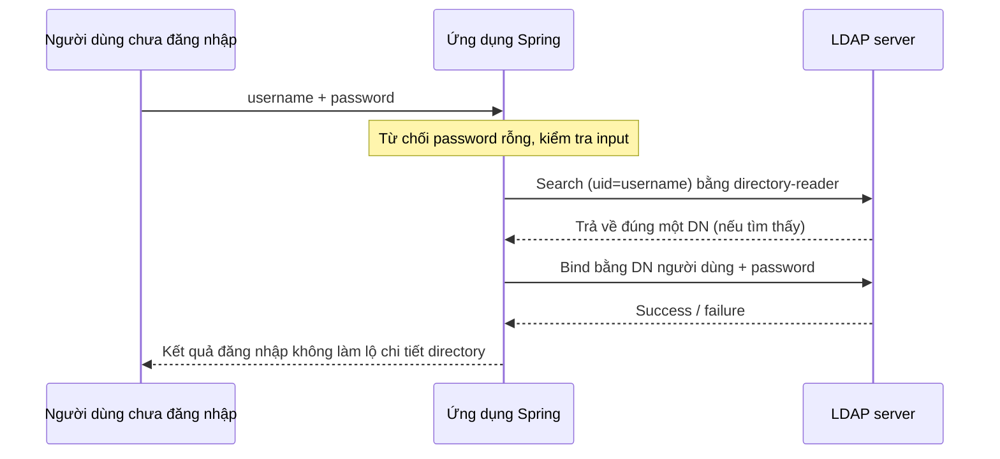

# Anonymous search trước xác thực và rủi ro trong Spring LDAP

## Mục tiêu học tập

Sau bài này, bạn có thể:

1. Giải thích **anonymous LDAP search** và phân biệt nó với **anonymous bind**, **unauthenticated bind** và bind bằng tài khoản dịch vụ.
2. Xác định **danh tính thực sự thực hiện tìm kiếm** trong một luồng đăng nhập kiểu *search-then-bind*, kể cả khi người dùng web chưa đăng nhập.
3. Nhận ra rủi ro lộ thông tin, liệt kê tài khoản, tìm kiếm quá rộng, LDAP filter injection, từ chối dịch vụ và bỏ qua xác thực do password rỗng.
4. Cấu hình `ContextSource`, `LdapTemplate` hoặc Spring Security LDAP để dùng tài khoản đọc quyền tối thiểu, phạm vi tìm kiếm rõ ràng và xác thực người dùng bằng LDAP bind.
5. Kiểm thử các trạng thái anonymous/read-only/service bind, TLS, ACL và xử lý lỗi mà không để lộ mật khẩu hoặc dữ liệu directory.

> **Ý chính:** Việc tìm DN người dùng **trước khi** kiểm tra mật khẩu là một bước bình thường trong nhiều hệ thống LDAP. Nhưng việc đó **không buộc** ứng dụng phải tìm bằng anonymous. Một ứng dụng có thể chưa xác thực người dùng web nhưng vẫn tìm LDAP bằng một **service account có quyền đọc giới hạn**, sau đó mới bind với DN và mật khẩu của người dùng.

## 1. Vì sao phải tìm người dùng trước khi xác thực?

Trong LDAP, tài khoản có thể nằm ở nhiều nhánh, ví dụ:

```text
dc=example,dc=org                    ← ContextSource base
├── ou=people
│   ├── uid=lan                      ← uid=lan,ou=people,dc=example,dc=org
│   └── ou=engineering
│       └── uid=nam                  ← uid=nam,ou=engineering,ou=people,...
├── ou=groups
│   └── cn=developers
└── ou=service-accounts
    └── cn=directory-reader
```

Người dùng gửi `username=nam` và một mật khẩu. Muốn xác thực bằng **simple bind**, phía client cần biết **DN thật của entry người dùng**, ví dụ `uid=nam,ou=engineering,ou=people,dc=example,dc=org`. Có hai hướng chính:

**Hướng A — Dựng DN trực tiếp từ username:** Nếu toàn bộ người dùng thật sự nằm trong cùng một nhánh và có quy tắc DN cố định, ứng dụng có thể suy ra `uid={username},ou=people,...` rồi bind. Cách này tránh một lượt tìm kiếm, nhưng không phù hợp với nhánh lồng nhau hoặc cấu trúc DN không đồng nhất.

**Hướng B — Search rồi bind:** Dùng một kết nối có quyền tìm dưới một base đã biết để tìm entry theo `(uid=nam)`, lấy DN chính xác, sau đó **tạo phiên bind riêng với chính DN đó và mật khẩu vừa nhập**. Kết nối tìm kiếm có thể anonymous **nếu** LDAP server cho phép, hoặc được bind bằng tài khoản đọc chuyên dụng.



Trong sơ đồ trên, người dùng web chưa được xác thực tại bước Search, **nhưng Search vẫn có thể sử dụng danh tính `directory-reader`**. Cần phân biệt hai lớp danh tính:

- **HTTP/application identity:** Ai đang gọi màn hình đăng nhập?
- **LDAP connection identity:** Kết nối tới directory hiện là anonymous, bind bằng service account, hay bind bằng tài khoản người dùng?

Chúng **không tự động giống nhau**. Ngay cả sau khi web login thành công, các thao tác đọc LDAP của ứng dụng vẫn có thể chạy bằng một service account; cần kiểm tra thiết kế và ACL để biết rõ.

## 2. Phân biệt các loại bind: dễ nhầm nhất là password rỗng

Theo **RFC 4513**, simple bind có ba tình huống rất khác nhau:

| DN trong Bind request | Password | Trạng thái danh tính theo LDAP | Ý nghĩa |
| --- | --- | --- | --- |
| Chuỗi rỗng | Chuỗi rỗng | **Anonymous** | Chủ động xác lập anonymous authorization state |
| DN không rỗng | Chuỗi rỗng | **Unauthenticated**, vẫn là anonymous authorization state nếu server chấp nhận | **Không xác thực** danh tính được ghi trong DN |
| DN không rỗng | Mật khẩu không rỗng | **Authenticated**, nếu server kiểm tra thành công | Cách simple bind bằng tên/mật khẩu thông thường |

Lưu ý:

1. **Anonymous bind được giao thức hỗ trợ không có nghĩa server cho phép anonymous search trên nhánh người dùng.** Việc đọc/so khớp entry phải theo **access control list (ACL)** của directory.
2. **Unauthenticated bind không phải đăng nhập thành công.** RFC cho phép tình huống DN không rỗng, password rỗng đưa phiên vào trạng thái anonymous. Một số server chủ động từ chối kiểu bind này; mã kết quả của server không phải căn cứ duy nhất để kết luận người dùng đã xác thực.
3. Nếu ứng dụng không chặn password rỗng rồi xem một phản hồi Bind “success” là đã xác thực, nó có nguy cơ **authentication bypass**. Do đó, giao diện đăng nhập **phải từ chối password null/rỗng trước khi gọi LDAP**.
4. Trạng thái authorization của kết nối phụ thuộc kết quả Bind mới nhất. Không dùng lại kết nối với giả định “vẫn đang là admin” sau một bind khác; pool và lifecycle kết nối phải được thiết kế đúng.

Ví dụ nguy hiểm về **logic**:

```text
Người dùng gửi DN = "uid=lan,ou=people,dc=example,dc=org"
Người dùng gửi password = "" (rỗng)
Ứng dụng gửi simple Bind không kiểm tra password
LDAP server có thể chấp nhận unauthenticated Bind nhưng quyền vẫn anonymous
Ứng dụng hiểu nhầm "Bind success" thành đăng nhập bằng uid=lan
=> Có thể vượt qua xác thực ở tầng ứng dụng
```

Đó là lỗi **kiểm tra trạng thái danh tính**, không phải khả năng đặc biệt của Spring LDAP. Spring Security và các API authentication nên được dùng đúng, kèm kiểm tra dữ liệu đầu vào và test với server mục tiêu.

## 3. Anonymous search hoạt động ra sao?

Một LDAP search có các thành phần:

| Thành phần | Ví dụ | Vai trò |
| --- | --- | --- |
| Search base | `ou=people` | Nhánh bắt đầu tìm kiếm, tương đối với `ContextSource` base nếu đã cấu hình |
| Search scope | `ONELEVEL` hoặc `SUBTREE` | Chỉ các entry con trực tiếp hay cả cây con |
| Filter | `(&(objectClass=inetOrgPerson)(uid=lan))` | Điều kiện trên attribute của entry |
| Returning attributes | `uid`, `cn` | Chỉ dữ liệu thật sự cần cho bước tìm DN |
| Count/time limits | 2 kết quả, 2 giây | Hạn chế tài nguyên và phát hiện nhiều entry khớp |
| **Bind identity** | Anonymous hoặc `directory-reader` | Danh tính dùng để kiểm tra ACL cho kết quả |

Với anonymous search, LDAP server đánh giá yêu cầu dưới **quyền anonymous**. Server có thể:

- Cho phép đọc một tập nhỏ, chẳng hạn một phần **Root DSE** hoặc danh bạ công khai.
- Trả **không có entry** vì anonymous không có quyền thấy/so khớp thuộc tính.
- Trả lỗi như **insufficientAccessRights** hay yêu cầu bind trước, tùy server và cấu hình.

Một kết quả rỗng **không đủ chứng minh rằng username không tồn tại**. Nó cũng có thể có nghĩa client chọn sai base/scope, ACL ẩn entry, filter sai hoặc schema không khớp.

### Ví dụ trong Spring LDAP

`LdapQueryBuilder` mô tả được phạm vi và filter, **nhưng bản thân query không quyết định danh tính bind**. Danh tính phụ thuộc `ContextSource` mà `LdapTemplate` sử dụng.

```java
package example.directory;

import java.util.List;
import org.springframework.ldap.core.AttributesMapper;
import org.springframework.ldap.core.LdapTemplate;
import org.springframework.ldap.query.LdapQuery;
import org.springframework.ldap.query.LdapQueryBuilder;
import org.springframework.ldap.query.SearchScope;

public class UserDirectoryLookup {
    private final LdapTemplate ldap;

    public UserDirectoryLookup(LdapTemplate ldap) {
        this.ldap = ldap;
    }

    public List<String> lookupUids(String username) {
        if (username == null || username.isBlank()) {
            throw new IllegalArgumentException("username must not be blank");
        }

        LdapQuery query = LdapQueryBuilder.query()
            .base("ou=people")
            .searchScope(SearchScope.SUBTREE)
            .attributes("uid")
            .countLimit(2)
            .timeLimit(2000)
            .where("objectClass").is("inetOrgPerson")
            .and("uid").is(username);

        AttributesMapper<String> mapper =
            attributes -> attributes.get("uid").get().toString();

        return ldap.search(query, mapper);
    }
}
```

Đoạn code **minh họa search, không phải một cơ chế xác thực**. Trả về `uid` chưa đủ để bind; một luồng đăng nhập còn cần lấy DN, xác định duy nhất một entry, rồi xác thực mật khẩu qua LDAP bind. Trong Spring LDAP, có thể dùng `ContextMapper` để lấy DN từ entry context hoặc sử dụng trực tiếp `LdapTemplate.authenticate(LdapQuery, password)` để framework tìm DN và bind; khi dùng biến thể `authenticate(LdapQuery, String)` hiện hành, phương thức trả về `void` và báo lỗi qua exception.

Việc sử dụng `.where(...).is(username)` giúp escape các ký tự đặc biệt trong **giá trị filter**. Không tự ghép `"(uid=" + username + ")"`. Tên attribute và search base nếu có lựa chọn động vẫn phải được giới hạn bởi allowlist từ server.

## 4. Spring LDAP có thể âm thầm dùng anonymous cho thao tác đọc

`LdapContextSource` thông thường dùng một **authenticated context** cho cả hoạt động đọc và ghi khi đã cấu hình principal/credential. Nhưng `AbstractContextSource` có tùy chọn:

```java
// Chỉ để minh họa cấu hình cần rà soát:
contextSource.setAnonymousReadOnly(true);
```

Khi bật, **read-only contexts** do `ContextSource` cấp sẽ là anonymous, trong khi các operation dùng read-write context có thể vẫn dùng principal cấu hình. Đây là tính năng có chủ đích cho directory công khai, nhưng rất dễ gây hiểu nhầm nếu ứng dụng dùng cùng `LdapTemplate` cho bước tìm người dùng đăng nhập.

**Tình huống lỗi cấu hình:**

1. Team cấu hình `userDn=cn=directory-reader,ou=service-accounts,...` và mật khẩu dịch vụ.
2. Đồng thời bật `anonymousReadOnly=true` với ý nghĩ “chỉ đọc nên không cần quyền”.
3. Bước `ldap.search(...)` lấy read-only context và thực hiện search dưới quyền anonymous.
4. LDAP server chặn anonymous search ở `ou=people`, dù tài khoản `directory-reader` có quyền.
5. Người dùng hợp lệ không đăng nhập được vì bước tìm DN thất bại; hoặc dữ liệu hiển thị khác giữa môi trường dev và production.

Khi chẩn đoán, kiểm tra **cả** username/password cấu hình **và** `anonymousReadOnly`. Tính năng này **không phải** công tắc “chỉ cho phép thao tác đọc” của toàn hệ thống và không thay thế ACL trên LDAP server.

### Cấu hình dùng reader account quyền tối thiểu

Ví dụ dưới đây minh họa cách **chủ động** dùng authenticated read context. Giả sử dịch vụ đã nạp secret từ môi trường/secret manager và sử dụng LDAPS với chứng thư hợp lệ:

```java
package example.directory;

import org.springframework.context.annotation.Bean;
import org.springframework.context.annotation.Configuration;
import org.springframework.ldap.core.support.LdapContextSource;

@Configuration
public class DirectoryConnectionConfig {
    @Bean
    LdapContextSource contextSource() {
        LdapContextSource source = new LdapContextSource();
        source.setUrl("ldaps://ldap.example.org:636");
        source.setBase("dc=example,dc=org");
        source.setUserDn(System.getenv("LDAP_READER_DN"));
        source.setPassword(System.getenv("LDAP_READER_SECRET"));
        source.setAnonymousReadOnly(false);
        return source;
    }
}
```

Ở đây:

- `LDAP_READER_DN` nên là DN đầy đủ của **service account chỉ đọc**; `LDAP_READER_SECRET` được cấp qua secret manager hoặc môi trường chạy được kiểm soát, không commit vào source control.
- `setAnonymousReadOnly(false)` thể hiện rõ search cần chạy dưới danh tính reader; đây cũng là mặc định của `AbstractContextSource`.
- TLS phải được cấu hình **kiểm tra certificate và hostname thật**, truststore cần phù hợp; không dùng trust-all hoặc bỏ qua xác thực chứng thư.
- Các bean tự định nghĩa phải thống nhất với cơ chế Spring Boot auto-configuration đang có để không tạo nhầm hai `ContextSource` khác chính sách.
- Trước khi đưa vào production, kiểm tra `System.getenv(...)` đã có giá trị; fail startup khi thiếu secret thay vì thử anonymous như một đường lui.

**Phạm vi quyền tối thiểu cho reader:** được tìm đúng nhánh `ou=people`, được so khớp `uid`/`objectClass` và đọc những attribute cần thiết để lấy DN, không có quyền sửa người dùng, reset password, đọc `userPassword` hoặc toàn bộ nhóm nhạy cảm. Chính sách ACL được cấu hình **trên LDAP server**, không thể được bảo đảm chỉ bằng Java.

## 5. Các phương án xác thực: chọn đúng nơi thực hiện search

| Phương án | Bước tìm DN | Bước xác thực | Khi phù hợp | Rủi ro cần quản lý |
| --- | --- | --- | --- | --- |
| **Direct DN pattern** | Không cần search nếu DN suy ra được chắc chắn | Bind bằng DN người dùng | Tất cả user cùng cấu trúc DN ổn định | Không khớp nếu user ở OU con/di chuyển DN |
| **Anonymous search rồi bind** | Search bằng anonymous identity | Bind bằng DN tìm được và password | Chỉ khi directory chủ động công khai dữ liệu cần tìm | Enumeration, data exposure, ACL thay đổi |
| **Reader account search rồi bind** | Search bằng tài khoản chỉ đọc | Bind bằng DN người dùng | Cấu trúc DN phức tạp, directory private | Quản lý secret reader, least privilege, tránh mở rộng base |
| **Service xác thực chuyên dụng/SSO** | Qua dịch vụ danh tính phù hợp | Theo giao thức do IdP quản lý | Hệ thống đã triển khai IdP, SSO | Chính sách trust/configuration ngoài phạm vi LDAP đơn thuần |

Trong hệ thống doanh nghiệp không có yêu cầu danh bạ công khai, **reader account search rồi user bind** thường là lựa chọn dễ kiểm soát hơn anonymous search. Nhưng nó chỉ an toàn khi reader được cấp quyền tối thiểu, kết nối bảo mật và API không phơi bày một search không xác thực cho client.

### Cấu hình Spring Security LDAP cho search-then-bind

Spring Security cung cấp `LdapBindAuthenticationManagerFactory`, giúp cấu hình tìm user và bind theo chuẩn authentication của ứng dụng:

```java
package example.directory;

import org.springframework.context.annotation.Bean;
import org.springframework.context.annotation.Configuration;
import org.springframework.ldap.core.support.BaseLdapPathContextSource;
import org.springframework.security.authentication.AuthenticationManager;
import org.springframework.security.config.ldap.LdapBindAuthenticationManagerFactory;

@Configuration
public class DirectoryAuthenticationConfig {
    @Bean
    AuthenticationManager ldapAuthenticationManager(
            BaseLdapPathContextSource contextSource) {
        LdapBindAuthenticationManagerFactory factory =
            new LdapBindAuthenticationManagerFactory(contextSource);
        factory.setUserSearchBase("ou=people");
        factory.setUserSearchFilter(
            "(&(objectClass=inetOrgPerson)(uid={0}))"
        );
        return factory.createAuthenticationManager();
    }
}
```

`{0}` là username được Spring Security đưa vào bộ lọc tìm user. Với `ContextSource` base `dc=example,dc=org`, `ou=people` là nhánh tương đối. Search này vẫn sẽ **anonymous hay reader-bound tùy chính sách ContextSource**, nên cần kiểm tra cấu hình ở mục trước.

Không đặt `userSearchBase=""` một cách tùy tiện: khi base rỗng, việc search có thể mở rộng tới gốc đã cấu hình. Không dùng filter `(uid=*)` cho một luồng đăng nhập hay cho phép username chứa biểu thức LDAP được nối thẳng vào filter.

Nếu đã biết DN pattern:

```java
factory.setUserDnPatterns("uid={0},ou=people");
```

Đây là **phương án thay thế** cho search filter trong hệ thống mà mọi user đều nằm ở `ou=people` trực tiếp và DN có thể suy ra. Với người dùng ở `ou=engineering,ou=people`, pattern này sẽ không xác định đúng DN. Không cấu hình hai phương án tùy tiện với kỳ vọng cơ chế fallback tương đương trên mọi phiên bản; hãy chọn theo cấu trúc directory thực tế và kiểm thử kỹ.

### Từ chối password rỗng tại ranh giới đăng nhập

Ngay cả khi dùng authentication manager, cần kiểm tra request trước khi gọi LDAP:

```java
package example.directory;

import org.springframework.security.authentication.AuthenticationManager;
import org.springframework.security.authentication.BadCredentialsException;
import org.springframework.security.authentication.UsernamePasswordAuthenticationToken;
import org.springframework.security.core.Authentication;

public class DirectorySignInService {
    private final AuthenticationManager authManager;

    public DirectorySignInService(AuthenticationManager authManager) {
        this.authManager = authManager;
    }

    public Authentication signIn(String username, String password) {
        if (username == null || username.isBlank()
                || password == null || password.isEmpty()) {
            throw new BadCredentialsException("Invalid credentials");
        }
        return authManager.authenticate(
            new UsernamePasswordAuthenticationToken(username, password)
        );
    }
}
```

Trong ứng dụng web, cần thêm rate limit, chống tự động hóa/brute force, giới hạn độ dài username, bảo vệ endpoint và chính sách thông báo lỗi. Không log password dưới bất kỳ hình thức nào. Dùng cùng một phản hồi đăng nhập không thành công cho **không tồn tại user**, **password sai** hoặc **không đủ điều kiện đăng nhập**; phân loại nguyên nhân ở log nội bộ theo chính sách bảo mật.

### Dùng `LdapTemplate.authenticate` khi không tích hợp Spring Security

Spring LDAP cũng có API search-then-bind:

```java
import org.springframework.ldap.core.LdapTemplate;
import org.springframework.ldap.query.LdapQuery;
import org.springframework.ldap.query.LdapQueryBuilder;
import org.springframework.ldap.query.SearchScope;

void authenticateWithLdapTemplate(
        LdapTemplate ldap, String username, String password) {
    if (username == null || username.isBlank()
            || password == null || password.isEmpty()) {
        throw new IllegalArgumentException("Missing credentials");
    }

    LdapQuery query = LdapQueryBuilder.query()
        .base("ou=people")
        .searchScope(SearchScope.SUBTREE)
        .countLimit(2)
        .timeLimit(2000)
        .where("objectClass").is("inetOrgPerson")
        .and("uid").is(username);

    // API hiện hành trả void; lỗi xác thực/tìm kiếm được báo qua exception.
    ldap.authenticate(query, password);
}
```

Ví dụ này chỉ diễn tả **thao tác LDAP**. Ứng dụng phải ánh xạ exception theo chính sách xác thực, giám sát lỗi hạ tầng và đảm bảo filter trả về **duy nhất một entry**. Không catch mọi exception rồi xem đó là “mật khẩu sai”; LDAP server timeout, unavailable, ACL từ chối và duplicate DN là các lỗi cần xử lý riêng ở nội bộ.

## 6. Rủi ro đặc thù khi để anonymous search trước login

### 6.1. Liệt kê tài khoản (username enumeration)

Nếu anonymous có quyền search bằng `uid`/`mail`, một client có thể thử lần lượt nhiều giá trị để xác định tài khoản nào tồn tại. Ngay cả khi API không trả entry, sự khác nhau về mã lỗi, thời gian phản hồi hoặc thông báo “user not found” và “wrong password” có thể làm rò thông tin.

**Giảm thiểu:** hạn chế quyền anonymous ở LDAP server, giới hạn các search base public, không cung cấp endpoint tra cứu user không cần thiết trước đăng nhập, rate-limit và dùng thông báo lỗi thống nhất. Với hệ thống thực sự cần public directory, xác định trước những attribute nào được công khai và giới hạn search thích hợp.

### 6.2. Lộ dữ liệu tổ chức và dữ liệu cá nhân

Một ACL anonymous quá rộng có thể lộ `mail`, `telephoneNumber`, `memberOf`, `manager`, phòng ban, group membership hoặc cách tổ chức cây DN. Các trường đó có thể được kết hợp để suy ra cấu trúc nội bộ, kể cả khi người dùng chưa đăng nhập.

**Giảm thiểu:** cấu hình ACL theo **nhánh**, **attribute**, loại thao tác **search/compare/read** và nhóm người truy cập. Chỉ trả attribute cần thiết cho bước tìm DN; lựa chọn `.attributes("uid")` ở phía client giảm dữ liệu trả về nhưng **không thay thế** ACL của directory.

### 6.3. LDAP filter injection

Filter tạo bằng nối chuỗi từ `username` có thể thay đổi cấu trúc câu search, ví dụ trường hợp input chứa `*`, `(`, `)`, dấu `\` hoặc NUL. Điều này nguy hiểm hơn khi anonymous đã có quyền search rộng.

**Giảm thiểu:** dùng `LdapQueryBuilder.where("uid").is(username)`, `EqualsFilter` hoặc tham số bind được Spring xử lý. Trong Spring LDAP, `LdapQueryBuilder.filter(String)` với chuỗi thô **không tự escape** dữ liệu người dùng. Phân biệt escape LDAP **filter value** với escape **DN**; hai cú pháp khác nhau.

### 6.4. Mở rộng search base và truy vấn nặng

Một search dưới DN rỗng (tương đối với gốc `ContextSource`) với `SUBTREE` có thể tìm cả cây directory. Khi kết hợp wildcard và attribute không được index, nhiều request trước login có thể gây tải, chạm size/time limit hoặc làm chậm dịch vụ.

**Giảm thiểu:** cố định base `ou=people`, chọn `ONELEVEL` nếu hợp đồng chỉ tìm con trực tiếp, dùng filter khớp chính xác username, limit số entry/thời gian và cấu hình index trên server. `countLimit` không phải paging hay bảo đảm tập kết quả đầy đủ. Không cho client chọn DN tìm kiếm tùy ý.

### 6.5. Bỏ qua xác thực vì unauthenticated bind

Đây là rủi ro nghiêm trọng nhất với các luồng tự viết: password rỗng có thể tạo **unauthenticated bind**, trong khi code chỉ nhìn vào phản hồi success. Một số server từ chối, nhưng ứng dụng phải tự có cơ chế chặn trước.

**Giảm thiểu:** từ chối password null/rỗng trước lời gọi LDAP; chỉ cấp session khi thực hiện cơ chế xác thực đã chứng minh đúng danh tính. Kiểm thử server có thể chấp nhận DN không rỗng + password rỗng trong môi trường test để phát hiện logic hiểu sai.

### 6.6. Không có TLS hoặc xác thực chứng thư

Simple bind gửi thông tin mật khẩu trong thông điệp LDAP; nếu không có kênh bảo mật, password có nguy cơ bị đọc trên mạng. Ngay cả anonymous search không có mật khẩu vẫn có thể để lộ tên, mail hoặc DN nếu truyền qua kênh không mã hóa.

**Giảm thiểu:** dùng **LDAPS hoặc StartTLS** với cấu hình truststore và kiểm tra hostname; không chấp nhận chứng thư giả và không fallback sang LDAP cleartext khi TLS lỗi. Tùy server và phiên bản Spring LDAP, cân nhắc chiến lược TLS, vòng đời kết nối/pooling phù hợp.

### 6.7. Lẫn lộn phiên kết nối, fallback và quyền

Kết nối được bind bằng service account, anonymous hoặc người dùng có các quyền khác nhau. Dùng connection pooling không kiểm soát, tự chuyển bind identity trên cùng connection hoặc fallback “reader bind thất bại thì thử anonymous” có thể làm ứng dụng hành xử không dự đoán được.

**Giảm thiểu:** xác định rõ identity cho từng loại thao tác; dùng API Spring LDAP quản lý context lifecycle; tách cấu hình search và user authentication nếu cần. Khi bind reader thất bại, **fail closed** và báo lỗi hạ tầng phù hợp thay vì tự tìm anonymous. Không dùng lại user-bound context từ request này cho request khác.

## 7. Thiết kế ACL và chính sách truy cập phù hợp

Mỗi LDAP server có cú pháp ACL riêng (OpenLDAP, Active Directory và các triển khai khác không hoàn toàn giống nhau). Không sao chép một cấu hình ACL mẫu thành luật áp dụng chung. Hãy mô tả **ma trận quyền cần đạt**, sau đó triển khai bằng cơ chế ACL tương ứng và kiểm thử trực tiếp.

| Danh tính | `ou=people`: tìm theo uid | Đọc `cn`/`mail` | Đọc `userPassword` | Sửa entry | Ghi chú |
| --- | --- | --- | --- | --- | --- |
| Anonymous | Không, trừ vùng public được duyệt | Chỉ thuộc tính public nếu có | Không | Không | Root DSE có thể có dữ liệu được công khai có kiểm soát |
| `directory-reader` | Có, trong base/scope cần thiết | Chỉ các attribute bắt buộc | Không | Không | Được dùng ở bước tìm DN |
| Người dùng vừa bind | Theo ACL của chính người dùng | Theo ACL | Không dựa vào việc đọc password | Theo ACL | Bind success không có nghĩa có quyền admin |
| Tài khoản quản trị directory | Theo vai trò quản trị | Theo vai trò | Theo chính sách server | Được cấp riêng | Không dùng làm reader cho login thường ngày |

**Lưu ý:** Một số server phân biệt quyền dùng attribute trong **filter** (search/compare) với quyền **nhìn thấy giá trị attribute**; để search theo `uid` thành công, reader cần quyền liên quan. Hãy kiểm tra hành vi thực trên server, không chỉ dựa vào việc `uid` không có trong `returningAttributes`.

Nếu tổ chức chủ động mở directory công khai, chỉ cho phép anonymous đọc một OU hoặc tập attribute đã đánh giá trước, và bảo đảm API không vô tình làm lộ dữ liệu ở nhánh private. Public LDAP directory là một **quyết định sản phẩm và bảo mật**, không phải hệ quả tự động của việc người dùng đang ở trang đăng nhập.

## 8. Kiểm tra anonymous search bằng công cụ LDAP ở môi trường thử nghiệm

Giả sử một LDAP test server có endpoint `ldaps://ldap.example.org:636`. Các lệnh sau dùng công cụ `ldapsearch` (OpenLDAP client), **chỉ chạy với server thử nghiệm hoặc server bạn có quyền kiểm tra**.

**Thử tìm anonymous** (không truyền DN/password cho bind):

```bash
ldapsearch -LLL -x \
  -H ldaps://ldap.example.org:636 \
  -b "ou=people,dc=example,dc=org" \
  -s sub \
  "(uid=lan)" dn uid cn
```

**Đối chiếu với reader-bound search** (`-W` yêu cầu nhập password an toàn, không đưa password vào command line):

```bash
ldapsearch -LLL -x \
  -H ldaps://ldap.example.org:636 \
  -D "cn=directory-reader,ou=service-accounts,dc=example,dc=org" \
  -W \
  -b "ou=people,dc=example,dc=org" \
  -s sub \
  "(uid=lan)" dn uid cn
```

Ghi nhận ít nhất **mã kết quả LDAP**, tập DN trả về và thời gian thực thi của hai truy vấn. Nếu anonymous rỗng nhưng reader có kết quả, cần kiểm tra ACL trước khi nghi ngờ Spring map entity sai. Nếu cả hai đều thất bại, kiểm tra TLS/truststore, kết nối, search base/scope, filter và schema. Không in mật khẩu hoặc lưu thông tin cá nhân của entry thử nghiệm lên hệ thống log công cộng.

## 9. Kế hoạch kiểm thử bảo mật và hành vi

Fixture tối thiểu:

```ldif
dn: ou=people,dc=example,dc=org
objectClass: top
objectClass: organizationalUnit
ou: people

dn: uid=lan,ou=people,dc=example,dc=org
objectClass: top
objectClass: person
objectClass: organizationalPerson
objectClass: inetOrgPerson
uid: lan
cn: Lan Nguyen
sn: Nguyen
mail: lan@example.org

dn: ou=engineering,ou=people,dc=example,dc=org
objectClass: top
objectClass: organizationalUnit
ou: engineering

dn: uid=nam,ou=engineering,ou=people,dc=example,dc=org
objectClass: top
objectClass: person
objectClass: organizationalPerson
objectClass: inetOrgPerson
uid: nam
cn: Nam Nguyen
sn: Nguyen
```

Thêm entry cha `dc=example,dc=org` và tài khoản test theo yêu cầu directory server; cấu hình ACL riêng cho anonymous/reader/user. Mật khẩu test phải được cấp bằng phương thức hỗ trợ của server, tránh ghi secret vào file LDIF được commit.

| Ca kiểm thử | Thao tác | Kỳ vọng |
| --- | --- | --- |
| Anonymous bị hạn chế | Anonymous search `(uid=lan)` dưới `ou=people` | Bị chặn hoặc không thấy entry theo ACL đã định; không suy luận user không tồn tại |
| Reader tìm được DN | Service account search cùng filter/base | Đúng một entry và DN mong đợi |
| Search base giới hạn | Reader search `ou=people` | Không thấy entry `ou=service-accounts` |
| Scope thay đổi | `ONELEVEL` rồi `SUBTREE` | `uid=nam` chỉ xuất hiện ở `SUBTREE` |
| Password đúng | Tìm `uid=lan` rồi bind bằng DN + password test đúng | Xác thực thành công |
| Password sai | Tìm đúng DN, bind bằng password sai | Không được cấp session |
| Password rỗng | Đăng nhập với `password=""` hoặc null | Bị từ chối **trước** lời gọi LDAP |
| User không tồn tại | `uid=unknown` | Thông báo ngoài giống các lỗi credential khác |
| Trùng username | Hai entry có cùng `uid` trong phạm vi search | Từ chối/hành vi được quy định rõ; không tùy tiện chọn entry đầu |
| LDAP injection | `uid` có `*`, ngoặc, backslash | Filter coi input là giá trị, không mở rộng tập kết quả |
| Reader secret sai | Search bằng reader bị từ chối | Lỗi hạ tầng; **không fallback anonymous** |
| TLS sai certificate | Kết nối đến endpoint không đáng tin | Không kết nối/không gửi credential |
| Directory chậm | Time/count limits bị chạm | Có xử lý timeout/size-limit; không xem partial result là đầy đủ |
| Role/ACL khác nhau | So sánh anonymous, reader, user bind | Chỉ thấy attribute và entry đúng quyền |

**Integration test** với LDAP server thật hoặc test container phù hợp cần thiết vì mock `LdapTemplate` không mô phỏng chính xác ACL, matching rules, Root DSE, referral và phân biệt anonymous/unauthenticated bind. Có thể dùng một môi trường cố tình cho phép unauthenticated bind **chỉ để kiểm thử** rằng ứng dụng vẫn từ chối password rỗng.

## 10. Khi gặp sự cố: chẩn đoán theo đúng lớp lỗi

| Triệu chứng | Khả năng | Hướng xử lý |
| --- | --- | --- |
| Dev login được, production không tìm thấy user | Dev cho anonymous search, production chặn; `anonymousReadOnly` khác nhau | Kiểm tra bind identity, ACL và property |
| Không đọc được attribute dù entry tồn tại | ACL chỉ cho search/match nhưng không cho read, hoặc mapper yêu cầu attribute thiếu | Kiểm tra ACL theo attribute và returning attributes |
| Anonymous login tưởng là thành công với password rỗng | Unauthenticated bind bị hiểu sai | Chặn password rỗng, kiểm tra logic xác nhận danh tính |
| Kết quả thay đổi khi chuyển từ `ONELEVEL` sang `SUBTREE` | Có user trong OU con | Xác định đúng phạm vi, kiểm tra uniqueness |
| Lỗi “user not found” nhưng reader search thấy user | Search bằng connection identity khác hoặc search base khác | So sánh ContextSource, base, filter, scope |
| Login chậm khi username ngắn | Search wildcard/rộng, index thiếu, DoS | Filter khớp chính xác, rate limit, index, time limit |
| TLS handshake lỗi | Truststore, hostname hoặc certificate không phù hợp | Sửa cấu hình TLS; không hạ cấp bảo mật |
| LDAP server unavailable | Lỗi mạng/timeout/pool | Trả lỗi dịch vụ phù hợp, retry có kiểm soát, không chuyển qua anonymous |

Đối với API đăng nhập, phía người dùng chỉ nên thấy thông báo không tiết lộ tài khoản có tồn tại hay không. Bên trong hệ thống, có thể lưu **mã lỗi, thời gian, loại thao tác, base/scope và correlation ID** để chẩn đoán; tránh ghi password, full DN không cần thiết, hoặc dữ liệu cá nhân của kết quả search vào log.

## 11. Bài thực hành

Ứng dụng Spring LDAP của một trường học lưu người học trong `ou=students,dc=example,dc=org` và giảng viên trong `ou=teachers,dc=example,dc=org`. Server không cho anonymous đọc hai nhánh trên, nhưng có tài khoản `cn=login-reader,ou=service-accounts,dc=example,dc=org` được tìm theo `uid` và lấy DN. Một trang login dùng filter `(uid={username})`.

**Yêu cầu:**

1. Vẽ hai luồng *anonymous search rồi bind* và *reader search rồi bind*. Giải thích tại sao luồng đầu thất bại theo chính sách ACL.
2. Với `ContextSource` base `dc=example,dc=org`, đề xuất search base và scope cho học viên và giảng viên. Vì sao phải có quy tắc xác định nhánh khi cùng `uid` có thể xuất hiện ở cả hai?
3. Chỉ ra rủi ro nếu cấu hình `anonymousReadOnly=true` dù đã khai báo DN/password của `login-reader`.
4. Viết `LdapQueryBuilder` tìm chính xác `uid` dưới `ou=students`, trả tối đa 2 entry, không quá 2 giây và giới hạn những attribute trả về ở `uid`.
5. Đề xuất test password rỗng, username chứa ký tự `*`, credential reader hết hạn, TLS certificate không hợp lệ và trường hợp hai entry khớp filter.

**Gợi ý lời giải truy vấn:**

```java
LdapQuery q = LdapQueryBuilder.query()
    .base("ou=students")
    .searchScope(SearchScope.SUBTREE)
    .attributes("uid")
    .countLimit(2)
    .timeLimit(2000)
    .where("objectClass").is("inetOrgPerson")
    .and("uid").is(username);
```

Ở đây `countLimit(2)` giúp tìm ra trường hợp hai kết quả nếu server trả đầy đủ, nhưng không bảo đảm không gặp lỗi giới hạn; luồng xác thực phải yêu cầu **đúng một** entry, xử lý exception và luôn từ chối trường hợp bất định. Lựa chọn nhánh theo vai trò người dùng phải được kiểm soát; không nhận trực tiếp base DN tùy ý từ client. Sau khi tìm thấy DN, cần **bind bằng mật khẩu người dùng không rỗng**, không xem kết quả search là xác thực thành công.

## Tài liệu tham khảo

- [RFC 4513 — LDAP Authentication Methods and Security Mechanisms](https://www.rfc-editor.org/rfc/rfc4513): anonymous bind, unauthenticated bind, name/password bind và yêu cầu bảo vệ kết nối.
- [Spring LDAP — Configuration](https://docs.spring.io/spring-ldap/reference/configuration.html): `ContextSource`, anonymous read-only, TLS và cơ chế bind.
- [Spring LDAP — `AbstractContextSource` API](https://docs.spring.io/spring-ldap/reference/api/java/org/springframework/ldap/core/support/AbstractContextSource.html): default authenticated contexts và `anonymousReadOnly`.
- [Spring LDAP — Advanced LDAP Queries](https://docs.spring.io/spring-ldap/reference/query-builder-advanced.html): `base`, `searchScope`, `attributes`, `countLimit`, `timeLimit`, escape filter.
- [Spring LDAP — `LdapTemplate` API](https://docs.spring.io/spring-ldap/reference/api/java/org/springframework/ldap/core/LdapTemplate.html): `search` và các overload `authenticate`.
- [Spring Security — LDAP Authentication](https://docs.spring.io/spring-security/reference/servlet/authentication/passwords/ldap.html): `LdapBindAuthenticationManagerFactory`, DN pattern và user search.
- [Spring Security — `LdapBindAuthenticationManagerFactory` API](https://docs.spring.io/spring-security/reference/api/java/org/springframework/security/config/ldap/LdapBindAuthenticationManagerFactory.html): cấu hình search base/filter và authentication manager.
