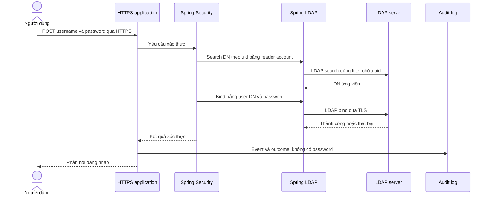

# Xử lý mật khẩu không được ghi log khi xác thực bằng Spring LDAP

## Mục tiêu học tập

Sau bài học, bạn có thể:

1. Phân biệt mật khẩu **người dùng** dùng cho LDAP bind và mật khẩu **tài khoản dịch vụ** mà `ContextSource` dùng để tìm kiếm; bảo vệ cả hai.
2. Nhận ra những đường rò rỉ credentials qua request log, DTO `toString()`, `Authentication`, LDAP/JNDI, exception, tracing, proxy và audit server.
3. Viết một luồng xác thực bằng Spring Security LDAP hoặc `LdapTemplate.authenticate` mà không in, trả về hoặc lưu password vào log.
4. Cấu hình request logging và audit event theo nguyên tắc **không thu thập bí mật ngay từ đầu**.
5. Kiểm thử bằng mật khẩu giả có đánh dấu (canary) và xử lý đúng khi phát hiện bí mật đã bị ghi vào log.

> **Quy tắc:** Mật khẩu chỉ dùng để chứng minh danh tính với LDAP server. **Không ghi password, token, session cookie, bind secret hay HTTP body chứa những giá trị đó vào log**, kể cả ở mức `DEBUG` hoặc `TRACE`. Hệ thống vẫn phải ghi sự kiện đăng nhập thành công/thất bại dưới dạng thông tin đã chọn lọc để phục vụ bảo mật và vận hành.

## 1. Mật khẩu đi qua những thành phần nào?

Ứng dụng làm việc với hai loại credentials:

- **User password:** Người dùng gửi tới màn hình đăng nhập. Với LDAP simple bind, ứng dụng dùng mật khẩu này khi bind bằng DN thực của user. Không đưa mật khẩu vào search filter và không đọc attribute `userPassword` về để tự so sánh.
- **Service account password:** Secret cấu hình trong `ContextSource`, chẳng hạn của `cn=directory-reader,ou=service-accounts,dc=example,dc=org`. Ứng dụng dùng connection này để tìm DN người dùng. Secret này cần quản lý và xoay vòng độc lập với mật khẩu của từng người.

Giả sử `ContextSource` base là `dc=example,dc=org`, còn user nằm trong `ou=people`:



Có **hai ranh giới bảo vệ** khác nhau. Trên đường truyền, HTTP cần HTTPS và LDAP simple bind cần LDAPS/StartTLS với chứng thư máy chủ được xác thực. Tại mỗi điểm cuối, dù kênh TLS được mã hóa, mật khẩu vẫn xuất hiện ở dạng dùng được trong đối tượng request, thư viện và bộ nhớ. Logger, APM hoặc crash dump có thể rò dữ liệu **sau khi TLS đã giải mã**.

TLS không thể khôi phục quyền riêng tư của password đã bị ghi xuống file log hay chuyển tới dịch vụ quan sát bên ngoài.

## 2. Bản đồ các điểm có thể rò rỉ

| Tầng | Tình huống nguy hiểm | Cách phòng tránh |
| --- | --- | --- |
| Client/browser | Password trong URL, console, analytics, crash report | Dùng HTTPS POST body; không đưa password vào URL, telemetry |
| Proxy, gateway, WAF | Access log có query/body/header hoặc lưu nguyên request | Loại trừ payload trên đường dẫn auth; bảo vệ `Authorization`/`Cookie` |
| Spring MVC | `CommonsRequestLoggingFilter` bật `includePayload` | Không capture request body; loại trừ endpoint xác thực |
| DTO / controller | `log.info("{}", loginRequest)`, Lombok `@Data`, record `toString()` | Không log DTO mang secret; có `toString()` an toàn như biện pháp phụ |
| Spring Security | Log raw `Authentication`, `getCredentials()`, token | Chỉ log sự kiện đã chuẩn hóa, không in đối tượng nhạy cảm |
| Spring LDAP / JNDI | Trace bind hoặc in environment chứa `java.naming.security.credentials` | Không log bind credentials và protocol dump; kiểm soát debug |
| Exception | `log.error("LDAP failed", ex)`, `ex.getMessage()` chứa DN/filter/credentials | Dùng loại lỗi đã cho phép; kiểm tra nội dung trước khi log |
| MDC / tracing / APM | Password trong span attribute, baggage, context | Không gửi secret vào metadata của log/trace |
| LDAP server | Audit bind ở mức trace quá chi tiết | Không lưu giá trị password; chỉ giữ kết quả xác thực theo chính sách |
| Heap dump / support bundle | Snapshot còn chứa DTO, secret, buffer | Hạn chế tạo, lưu, truy cập và chia sẻ dump |

Một dự án chỉ xóa một câu `log.info("password={}", password)` nhưng vẫn bật **request-body logging** tại gateway thì chưa giải quyết được vấn đề. Phải kiểm tra toàn bộ luồng từ client, Java process, collector tới directory server.

### Cái gì được phép ghi?

| Trường audit | Ghi log? | Điều kiện |
| --- | --- | --- |
| `event=ldap_login` và `outcome=success/failure` | Có | Dùng danh mục event cố định |
| Request/correlation ID do server sinh | Có | Không tạo từ password hoặc token |
| Duration, mã trạng thái, loại lỗi đã chuẩn hóa | Có | Không dùng nguyên exception message |
| Search scope hoặc tên nhánh logical cố định | Có điều kiện | Tránh in DN có dữ liệu cá nhân |
| Username, full DN, IP | Tùy chính sách | Cân nhắc dữ liệu cá nhân, quyền truy cập, thời gian lưu |
| User password / bind secret | **Không** | Cả bản rõ, Base64, giá trị che một phần hoặc hash chỉ để debug |
| Access/refresh token, session cookie | **Không** | Đều là thông tin xác thực |
| Request/response body của login | **Không** | Có thể chứa mật khẩu, OTP, token hoặc thông tin nhạy cảm |

Không nên “hash password rồi log”: kể cả giá trị hash ổn định cũng có thể là dữ liệu nhạy cảm và hỗ trợ đoán mật khẩu. Khi cần liên kết các lần đăng nhập, dùng request ID hoặc định danh tài khoản được kiểm soát, không lấy password làm khóa.

## 3. Anti-pattern trong code Java

Các đoạn sau **chỉ để nhận diện lỗi khi review**, không dùng trong production:

```java
// SAI: in trực tiếp mật khẩu.
log.info("username={} password={}", username, password);

// SAI: DTO có thể in password qua toString().
log.debug("login={}", request);

// SAI: Authentication có thể mang credentials trong bộ nhớ.
log.trace("auth={}", authentication);
log.debug("credentials={}", authentication.getCredentials());

// SAI: context của tracing/MDC có thể phát tán secret.
MDC.put("ldap.password", password);

// SAI: LDAP context environment có thể chứa bind password.
log.debug("JNDI env={}", contextEnvironment);

// RỦI RO: message/cause có thể chứa dữ liệu request, DN hoặc filter.
log.error("LDAP failed", exception);
log.warn("LDAP failed: {}", exception.getMessage());
```

Một bản ghi tối thiểu an toàn hơn:

```java
// requestId được server sinh ra và không chứa thông tin nhạy cảm.
log.info("event=ldap_login outcome=success request_id={}", requestId);
log.warn(
    "event=ldap_login outcome=failure type={} request_id={}",
    failure.getClass().getSimpleName(), requestId
);
```

Ngay cả khi `Authentication.toString()` của một phiên bản Spring Security hiển thị `[PROTECTED]`, không nên dùng nó làm hợp đồng bảo mật. DTO tùy biến, serializer JSON hoặc phiên bản khác có thể hiển thị credentials.

## 4. DTO đăng nhập và vòng đời password

Trong Java, `record` tự sinh `toString()` chứa các component; Lombok `@Data` hoặc `@ToString` có thể đưa mọi field vào chuỗi. Một `record LoginRequest(String username, String password) {}` vì vậy là nguồn rò nếu bị log.

Một DTO phòng ngừa:

```java
package example.directory.auth;

public record LoginRequest(String username, String password) {
    @Override
    public String toString() {
        return "LoginRequest[REDACTED]";
    }
}
```

Đây chỉ là **lớp bảo vệ bổ sung** cho `toString()`: serializer, tracer hoặc code trực tiếp gọi `password()` vẫn đọc được secret. Quy tắc chính vẫn là **không log DTO** và không capture login payload.

Với login đơn giản, từ chối username trống và password null/rỗng trước khi bind. Đừng `trim()` hoặc `strip()` password vì khoảng trắng có thể là một phần hợp lệ của mật khẩu; chuyển giá trị gốc tới API xác thực.

```java
if (input == null
        || input.username() == null || input.username().isBlank()
        || input.password() == null || input.password().isEmpty()) {
    throw new BadCredentialsException("Invalid credentials");
}
```

Không đưa password vào thông điệp exception. Phản hồi đăng nhập thất bại nên có thông điệp chung, không tiết lộ việc username có tồn tại trong LDAP hay không.

### `String`, `char[]` và xóa credentials sau khi dùng

Trong các luồng HTTP/Spring Security, password thường được biểu diễn bằng `String` bất biến, khó có thể chủ động xóa mọi bản sao trong heap. `char[]` có thể được ghi đè **nếu bạn thực sự sở hữu buffer**, nhưng không xóa các `String` hay buffer do framework đã tạo. Vì vậy cần hạn chế bản sao, phạm vi biến và vòng đời secret, không hứa rằng `Arrays.fill(...)` sẽ xóa sạch password khỏi JVM.

Spring Security hỗ trợ `CredentialsContainer`. `ProviderManager` mặc định bật `eraseCredentialsAfterAuthentication = true` để xóa credentials khỏi đối tượng `Authentication` **được trả về** nếu nó triển khai interface phù hợp. Điều này giúp giảm thông tin nhạy cảm còn nằm trong đối tượng sau đăng nhập thành công nhưng:

- Không thu hồi một giá trị đã được ghi xuống log trước đó.
- Không bảo đảm mọi bản sao trong request DTO, HTTP buffer, heap dump hoặc APM đã được xóa.
- Khi dùng `Authentication` custom, cần đảm bảo nó không cất password trong `principal`/`details` và thực hiện xóa credentials đúng cách.
- Không tắt mặc định xóa credentials chỉ để debug; nếu ứng dụng cache `UserDetails`, cần kiểm tra tương tác với cơ chế xóa theo hướng dẫn Spring Security.

## 5. Xác thực qua Spring Security LDAP và ghi audit an toàn

Spring Security có `LdapBindAuthenticationManagerFactory` cho quy trình tìm DN bằng search filter rồi bind bằng user DN và password. Khi `ContextSource` base là `dc=example,dc=org`, search base `ou=people` là đường dẫn tương đối.

```java
package example.directory.auth;

import org.springframework.context.annotation.Bean;
import org.springframework.context.annotation.Configuration;
import org.springframework.ldap.core.support.BaseLdapPathContextSource;
import org.springframework.security.authentication.AuthenticationManager;
import org.springframework.security.config.ldap.LdapBindAuthenticationManagerFactory;

@Configuration
public class LdapAuthenticationConfig {
    @Bean
    AuthenticationManager authenticationManager(
            BaseLdapPathContextSource contextSource) {
        LdapBindAuthenticationManagerFactory factory =
            new LdapBindAuthenticationManagerFactory(contextSource);
        factory.setUserSearchBase("ou=people");
        factory.setUserSearchFilter(
            "(&(objectClass=inetOrgPerson)(uid={0}))"
        );
        return factory.createAuthenticationManager();
    }
}
```

`{0}` là username được đưa vào LDAP filter qua cơ chế substitution của framework; **password không nằm trong search filter**. Cấu hình reader account phải có quyền tìm đúng nhánh `ou=people`, còn user password chỉ dùng cho LDAP bind qua TLS.

Service minh họa việc xác thực và tạo event không mang password:

```java
package example.directory.auth;

import org.slf4j.Logger;
import org.slf4j.LoggerFactory;
import org.springframework.security.authentication.AuthenticationManager;
import org.springframework.security.authentication.BadCredentialsException;
import org.springframework.security.authentication.UsernamePasswordAuthenticationToken;
import org.springframework.security.core.Authentication;
import org.springframework.security.core.AuthenticationException;
import org.springframework.stereotype.Service;

@Service
public class LdapCredentialVerifier {
    private static final Logger LOG =
        LoggerFactory.getLogger(LdapCredentialVerifier.class);

    private final AuthenticationManager manager;

    public LdapCredentialVerifier(AuthenticationManager manager) {
        this.manager = manager;
    }

    public Authentication verify(LoginRequest input) {
        if (input == null
                || input.username() == null || input.username().isBlank()
                || input.password() == null || input.password().isEmpty()) {
            throw new BadCredentialsException("Invalid credentials");
        }

        try {
            Authentication result = manager.authenticate(
                new UsernamePasswordAuthenticationToken(
                    input.username(), input.password()
                )
            );

            LOG.info("event=ldap_login outcome=success");
            return result; // Không log result hoặc getCredentials().
        } catch (AuthenticationException failure) {
            LOG.warn(
                "event=ldap_login outcome=failure error_type={}",
                failure.getClass().getSimpleName()
            );
            throw new BadCredentialsException("Invalid credentials");
        }
    }
}
```

Đây là **phần kiểm tra credentials trong ứng dụng đã cấu hình Spring Security**. Một endpoint login hoàn chỉnh còn cần Spring Security quản lý `SecurityContext`, session/cookie hoặc token; chỉ gọi `verify` không có nghĩa đã xây xong cơ chế đăng nhập.

Trong ứng dụng thật, nên tách phân loại **bad credentials** khỏi **directory unavailable/timeout** để monitoring không đánh đồng lỗi hạ tầng và lỗi người dùng. Không dùng `failure.getMessage()`, nguyên `failure` hoặc raw `Authentication` làm nội dung event. Thông báo phía client không cần nêu nguyên nhân cụ thể có thể tiết lộ danh tính tài khoản; thêm rate limit và chính sách chống brute force.

## 6. Xác thực trực tiếp với `LdapTemplate.authenticate`

Nếu ứng dụng chưa sử dụng Spring Security cho luồng LDAP, `LdapTemplate.authenticate(LdapQuery, String password)` là một lựa chọn khác. Theo API Spring LDAP hiện hành, overload này **trả về `void` và báo lỗi bằng exception**. Các overload cũ dùng base/filter có thể trả `boolean`, vì thế không nên đoán kiểu trả về khi chuyển giữa hai API.

```java
package example.directory.auth;

import org.springframework.ldap.core.LdapTemplate;
import org.springframework.ldap.query.LdapQuery;
import org.springframework.ldap.query.LdapQueryBuilder;
import org.springframework.ldap.query.SearchScope;

public class DirectLdapAuthenticator {
    private final LdapTemplate ldap;

    public DirectLdapAuthenticator(LdapTemplate ldap) {
        this.ldap = ldap;
    }

    public void authenticate(String username, String password) {
        if (username == null || username.isBlank()
                || password == null || password.isEmpty()) {
            throw new IllegalArgumentException("Missing credentials");
        }

        LdapQuery query = LdapQueryBuilder.query()
            .base("ou=people")
            .searchScope(SearchScope.SUBTREE)
            .countLimit(2)
            .timeLimit(2000)
            .where("objectClass").is("inetOrgPerson")
            .and("uid").is(username);

        // Chỉ dùng password cho LDAP bind; không log query + password.
        ldap.authenticate(query, password);
    }
}
```

Điểm cần hiểu:

- `where("uid").is(username)` xây LDAP **search filter** bằng giá trị được escape; password **không** nằm trong filter.
- `base("ou=people")` là DN tương đối so với gốc `ContextSource` đã cấu hình; `SUBTREE` tìm cả OU con. Cần giới hạn search base/scope theo nghiệp vụ.
- `countLimit(2)`/`timeLimit(2000)` giúp kiểm soát tài nguyên và phát hiện bất thường khi có nhiều entry cùng username. Chúng không phải chức năng phân trang; nếu server báo lỗi giới hạn, không xem một phần kết quả là đủ để xác thực.
- `ContextSource` dùng cho search DN có thể bind bằng service reader; kiểm tra `anonymousReadOnly` và ACL nếu search trả kết quả khác kỳ vọng.
- Ở boundary xử lý lỗi, chuyển exception thành nhóm lỗi đã định nghĩa. Không tự động in `Throwable` hoặc `getMessage()` vào log, nhất là khi không kiểm soát nội dung sinh bởi LDAP/JNDI.

Ví dụ này chỉ thể hiện **thao tác LDAP**; một giải pháp đăng nhập hoàn chỉnh còn cần quản lý phiên, HTTPS, CSRF phù hợp, rate limit và kiểm soát quyền. Để debug, ghi loại operation, timeout, duration, tên nhánh logical và mã lỗi đã chuẩn hóa; không ghi password để biết “bind đang gửi giá trị gì”.

## 7. Bảo vệ mật khẩu tài khoản dịch vụ trong `ContextSource`

Spring Boot có thể cấu hình kết nối LDAP qua thuộc tính như sau. Các giá trị tham chiếu dưới đây lấy từ môi trường chạy/secret manager, **không phải secret được commit trong Git**:

```yaml
spring:
  ldap:
    urls: ldaps://ldap.example.org:636
    base: dc=example,dc=org
    username: ${LDAP_READER_DN}
    password: ${LDAP_READER_PASSWORD}
```

`LDAP_READER_DN` chứa DN của một service account chỉ có quyền tìm kiếm tối thiểu; `LDAP_READER_PASSWORD` là secret của account đó. Tùy môi trường triển khai, có thể dùng secret manager, deployment secret hoặc cơ chế credential provider dành riêng cho tổ chức. Biến môi trường thuận tiện nhưng vẫn là **thông tin nhạy cảm**, có thể lộ qua process dump, cấu hình container hoặc quyền truy cập host.

Khi triển khai:

1. **Fail startup** khi thiếu credential bắt buộc, thay vì tự fallback sang anonymous bind.
2. Không log toàn bộ `Environment`, `PropertySource`, bean `ContextSource` hoặc JNDI environment (đặc biệt là thuộc tính `java.naming.security.credentials`).
3. Giới hạn quyền truy cập các endpoint quản trị như `/actuator/env`, `/actuator/configprops`; kiểm tra cơ chế che giá trị thực tế của phiên bản đang chạy và không mở endpoint chỉ để debug password.
4. Reader account phải có quyền LDAP **search/read tối thiểu**, không dùng tài khoản quản trị directory cho các lần tìm DN thông thường.
5. Có cơ chế xoay vòng password reader, quản lý secret trong CI/CD và phân quyền hệ thống log. Việc làm mới secret không nên yêu cầu dán nó vào issue/chat.

Nếu mật khẩu reader đã từng bị commit vào Git, **chỉ sửa file hiện tại là chưa đủ**; cần xoay secret, đánh giá lịch sử repository, artifact CI, clone của nhà phát triển và log đã sao chép.

### LDAPS hoặc StartTLS với kiểm tra chứng thư

LDAP simple bind truyền mật khẩu trong một thông điệp xác thực; không được gửi qua kênh không mã hóa. Dùng LDAPS hoặc StartTLS với truststore đáng tin cậy và xác minh certificate/hostname. Nếu handshake thất bại, không tắt certificate validation hoặc hạ cấp sang `ldap://...:389` không mã hóa để “kiểm tra nhanh”.

TLS bảo vệ secret khi truyền đi, còn **phạm vi truy cập log** và **không ghi password** bảo vệ secret tại ứng dụng, LDAP client và server. Hai phần đều bắt buộc.

Khi xử lý sự cố connection pooling hay TLS, dùng metrics như số kết nối, thời gian chờ, lỗi handshake và timeout; không in thông số JNDI kèm mật khẩu của bind account.

## 8. Không để request logging, proxy và tracing thu thập password

Trong Spring MVC, `CommonsRequestLoggingFilter` có thể được cấu hình ghi query string, headers và request payload. Các giá trị này có thể chứa `password`, `Authorization`, `Cookie` hoặc token. Với endpoint xác thực, cách tốt nhất là **không thu thập payload** từ đầu.

Ví dụ khi ứng dụng thật sự cần request logging cho endpoint thường, nhưng phải loại trừ đường dẫn `/api/auth/...`. Đoạn code dành cho Spring Framework 6 / Servlet `jakarta.*`:

```java
package example.directory.auth;

import jakarta.servlet.http.HttpServletRequest;
import org.springframework.context.annotation.Bean;
import org.springframework.context.annotation.Configuration;
import org.springframework.web.filter.CommonsRequestLoggingFilter;

@Configuration
public class SafeRequestLoggingConfig {
    @Bean
    CommonsRequestLoggingFilter requestLoggingFilter() {
        CommonsRequestLoggingFilter filter =
            new CommonsRequestLoggingFilter() {
                @Override
                protected boolean shouldLog(HttpServletRequest request) {
                    return !request.getRequestURI()
                        .startsWith("/api/auth/");
                }
            };

        filter.setIncludePayload(false);
        filter.setIncludeQueryString(false);
        filter.setIncludeHeaders(false);
        filter.setIncludeClientInfo(false);
        return filter;
    }
}
```

Nếu dùng Spring Framework 5 / Servlet API cũ, import tương ứng là `javax.servlet.http.HttpServletRequest`. Nếu không có nhu cầu ghi request, không cần đăng ký filter này.

**Giới hạn của cấu hình trên:** nó chỉ kiểm soát một `CommonsRequestLoggingFilter`. Gateway, Nginx/Apache, WAF, API management, service mesh, APM, HTTP client/server wire logger và interceptor tự viết có thể capture độc lập. Phải rà soát từng thành phần thực tế:

- **Không truyền password trong URL/path/query string**. Access log của proxy thường ghi URL dù application không log body.
- Tắt request body capture đối với login, reset password, đổi mật khẩu, OTP và refresh token ở **tất cả** tầng.
- Loại `Authorization`, `Cookie`, Set-Cookie, token và credential khỏi log/trace. Nếu cần header cho chẩn đoán, dùng allowlist các header không nhạy cảm.
- Không đưa raw request/response, parameter map, DTO, password hoặc token vào `MDC`, baggage hay span attributes.
- Không mở HTTP wire log/JNDI protocol dump cho request chứa credential thật. Mức `TRACE` của một thư viện có thể ghi nhiều hơn dự kiến; kiểm tra tài liệu và cấu hình phiên bản cụ thể.
- Chỉ dùng password giả trong môi trường test để tái hiện lỗi; không sao chép payload của người dùng thật lên ticket hoặc kênh chat.

Ví dụ mức log hạn chế hơn cho production:

```yaml
logging:
  level:
    org.springframework.security: INFO
    org.springframework.ldap: WARN
    org.springframework.web: INFO
```

Đây là **biện pháp bổ sung**, không phải bảo đảm không có password trong log: một câu `log.info("password={}", password)` do ứng dụng tự viết vẫn có thể chạy, hoặc APM có thể thu request mà không phụ thuộc các mức log trên.

## 9. Ghi audit event đủ dùng mà không lưu credentials

Để điều tra thành công/thất bại của LDAP bind, nên xây **schema sự kiện allowlist**:

```text
event_type: ldap_authentication
outcome: failure
request_id: <UUID do server sinh>
authentication_method: ldap_bind
directory_area: people
error_category: invalid_credentials | directory_unavailable | directory_timeout
duration_ms: <số đo>
```

Các trường như `password`, `bind_secret`, `raw_request`, `session_cookie` **không tồn tại trong schema**, kể cả với giá trị `***`. Không biến việc ghi log một chuỗi đã che thành thói quen lưu toàn bộ field nhạy cảm.

Các mã lỗi từ LDAP có thể phân loại thành **không có entry**, **sai credentials**, **nhiều DN khớp**, **timeout**, **server unavailable**, **không đủ quyền search**. Đây là dữ liệu vận hành hữu ích, nhưng không cần in DN đầy đủ hoặc password. Khi trả lỗi cho client, dùng thông báo chung cho các tình huống có thể gây username enumeration; lỗi hạ tầng có thể sử dụng mã phản hồi phù hợp mà không làm lộ cấu trúc LDAP.

Ví dụ ý tưởng audit tại một service có `LdapTemplate ldap`, `LdapQuery query`, `String password` và `Logger auditLogger`:

```java
try {
    ldap.authenticate(query, password);
    auditLogger.info("event=ldap_auth outcome=success");
} catch (org.springframework.ldap.AuthenticationException ex) {
    // Không log ex, ex.getMessage(), query hoặc password.
    auditLogger.warn(
        "event=ldap_auth outcome=failure category=bad_credentials"
    );
    throw new SecurityException("Invalid credentials");
}
```

Đây là đoạn **minh họa về ghi log**, không phải bộ xử lý exception đầy đủ. Directory unavailable, timeout hoặc lỗi cấu hình có thể thuộc loại exception khác và cần được phân loại riêng. Nếu phải dùng stack trace trong một tình huống đặc biệt, cần đánh giá khả năng nó chứa dữ liệu nhạy cảm, môi trường được phép ghi và người được đọc trước khi bật.

Nếu ứng dụng dùng event listener của Spring Security, đừng chuyển nguyên đối tượng `Authentication`/`Principal` hoặc raw exception sang hệ thống audit để mặc cho serializer quyết định field nào được ghi. Xây event DTO nhỏ, chỉ chứa các trường được cho phép.

## 10. Kiểm thử không rò password trong log

Việc grep một file source không đủ chứng minh an toàn; cần test **giá trị canary** trong log thật và các đích observability. Canary là mật khẩu giả chỉ dùng trong môi trường thử nghiệm, khác biệt rõ với các chuỗi thường xuất hiện ở log.

### 10.1. Unit test logger của service

Ví dụ với JUnit 5 và Logback Classic, dùng `ListAppender` để kiểm tra logger `LdapCredentialVerifier` không in password trong một lần đăng nhập thất bại:

```java
import static org.junit.jupiter.api.Assertions.assertFalse;
import static org.junit.jupiter.api.Assertions.assertThrows;

import ch.qos.logback.classic.Logger;
import ch.qos.logback.classic.spi.ILoggingEvent;
import ch.qos.logback.core.read.ListAppender;
import java.util.stream.Collectors;
import org.junit.jupiter.api.Test;
import org.slf4j.LoggerFactory;
import org.springframework.security.authentication.AuthenticationManager;
import org.springframework.security.authentication.BadCredentialsException;

class LdapCredentialVerifierTest {
    @Test
    void failureDoesNotWritePasswordToApplicationLog() {
        String canary = "TEST_ONLY_Password_(*)_98765";
        AuthenticationManager manager = auth -> {
            throw new BadCredentialsException("Invalid credentials");
        };
        LdapCredentialVerifier service = new LdapCredentialVerifier(manager);

        Logger logger = (Logger) LoggerFactory.getLogger(
            LdapCredentialVerifier.class
        );
        ListAppender<ILoggingEvent> appender = new ListAppender<>();
        appender.start();
        logger.addAppender(appender);

        try {
            assertThrows(BadCredentialsException.class,
                () -> service.verify(new LoginRequest("tester", canary)));

            String renderedLog = appender.list.stream()
                .map(ILoggingEvent::getFormattedMessage)
                .collect(Collectors.joining("\n"));

            assertFalse(renderedLog.contains(canary));
            assertFalse(renderedLog.contains("98765"));
        } finally {
            logger.detachAppender(appender);
            appender.stop();
        }
    }
}
```

Test này **chỉ** bao phủ log của một class, không kiểm tra đầy đủ HTTP/proxy/APM/JNDI. Nó cũng chưa thử các exception có message chứa canary, đường đăng nhập thành công, hoặc logger do thư viện bên ngoài sử dụng. Cần có kiểm thử tích hợp toàn tuyến ở môi trường test.

### 10.2. Ma trận kiểm thử tích hợp

| Ca kiểm thử | Thao tác | Kỳ vọng |
| --- | --- | --- |
| Đăng nhập thành công | Gửi username/password canary đúng qua HTTPS | Có event success, không có password ở bất kỳ log nào |
| Sai mật khẩu | Dùng canary khác, bind thất bại | Có event failure, không log request body/secret |
| Password rỗng | Gửi `password=""` hoặc null | Bị từ chối trước khi bind; không tạo log password |
| Username không tồn tại | Tìm DN không thành công | Client không nhận thông tin đủ để liệt kê username |
| LDAP không truy cập được | Mô phỏng timeout/unavailable | Có mã lỗi đã phân loại, không đính kèm raw request |
| Request logging | Bật cấu hình production, gửi POST chứa canary | Application/proxy/gateway logs không chứa canary |
| Tracing / APM | Theo dõi trace của request canary | Không có password trong span tags, baggage, payload |
| Service reader secret | Khởi động với secret reader giả | Không in secret trong startup, config dump, metrics |
| LDAP server audit | Bind bằng tài khoản test | Có event phù hợp, không có giá trị password |
| Ký tự đặc biệt | Password canary có dấu `*`, `(`, `)`, `\` và Unicode | Không bị log, không bị sửa nội dung trước bind |
| Sự cố TLS | Kết nối tới test server có certificate không đáng tin | Không gửi credential bằng kênh bị hạ cấp |

Kiểm tra cả log dạng text và các pipeline mà ứng dụng thực tế gửi tới (stdout container, file, syslog, collector, SIEM, trace backend). Có thể kiểm tra canary ở dạng raw và dạng mà pipeline có thể mã hóa như URL-encoded hoặc JSON-escaped. **Không đưa password thật** vào lệnh tìm kiếm hoặc báo cáo kiểm thử.

### 10.3. Tìm điểm đáng nghi trong code

Một số từ khóa gợi ý cho code review:

```text
log.*password
log.*credentials
log.*getCredentials
log.*request
log.*authentication
setIncludePayload(true)
includeRequestBody
captureBody
MDC.put(
@Data trên DTO đăng nhập
toString() của DTO chứa password
```

Đây chỉ là **gợi ý để định vị mã cần đánh giá**, không phải regex hoàn chỉnh hay bằng chứng mọi kết quả đều là lỗi. `@Data` trên lớp không chứa secret là bình thường; nguy cơ nằm ở luồng truyền và in dữ liệu nhạy cảm.

## 11. Phản ứng khi phát hiện mật khẩu đã bị ghi xuống log

Ngay cả log nội bộ có ít người truy cập cũng phải được xem là một nơi có thể làm lộ credentials:

1. **Ngăn phát sinh thêm:** tắt request-body capture hoặc điểm ghi log gây rò; cập nhật mã và cấu hình thu thập, giữ lại audit event không chứa secret.
2. **Đánh giá phạm vi:** xác định loại secret, khoảng thời gian, nguồn, máy chủ, hệ thống log tập trung, quyền truy cập và nơi dữ liệu đã được sao chép (backup, SIEM, ticket, artifact CI).
3. **Thu hồi/đổi credentials:** xoay secret của service account bị ảnh hưởng; với mật khẩu người dùng, thực hiện reset/thu hồi phiên theo chính sách ứng phó sự cố và phạm vi thực tế.
4. **Kiểm soát bản sao:** hạn chế truy cập và xử lý log tại nguồn, collector, archive và bản sao theo quy trình của tổ chức; lưu ý yêu cầu bảo toàn chứng cứ.
5. **Ngăn tái diễn:** bổ sung test canary, rà soát gateway/tracing/JNDI, cảnh báo rò secret và review cấu hình mỗi khi thay đổi logger hoặc auth flow.

Không copy raw log chứa password sang issue, chat, email hoặc tài liệu hậu kiểm. Hãy mô tả bằng request ID, tên hệ thống, loại credential, mốc thời gian và dữ liệu đã loại bí mật.

## 12. Bài thực hành

Một ứng dụng Spring Boot dùng Spring Security LDAP và tài khoản `directory-reader` để tìm người dùng trong `ou=people`. Team phát hiện controller cũ:

```java
@PostMapping("/login")
public void login(@RequestBody LoginRequest input) {
    log.debug("request={}", input);
    log.info("password={}", input.password());
    Authentication result = authenticationManager.authenticate(
        new UsernamePasswordAuthenticationToken(
            input.username(), input.password()
        )
    );
    log.debug("result={}", result);
}
```

Ngoài ra, `CommonsRequestLoggingFilter` bật `includePayload=true` và proxy thu toàn bộ HTTP body của `/login`.

**Yêu cầu:**

1. Chỉ ra ít nhất **năm** đường rò rỉ có thể xảy ra, kể cả ở các thành phần ngoài code controller.
2. Đề xuất sửa controller/service sao cho chỉ ghi `event=ldap_login`, `outcome` và request ID do server sinh, không log raw request hay exception message.
3. Cấu hình request logging cho endpoint auth, giải thích tại sao đổi `logging.level...=WARN` không tự bảo vệ được proxy/APM.
4. Dùng `LdapBindAuthenticationManagerFactory` với base `ou=people` và filter `(uid={0})`. Giải thích rõ password có nằm trong search filter hay không.
5. Viết ít nhất một test dùng password canary, và lập kế hoạch kiểm tra các bản ghi thật từ application, proxy, tracing và LDAP server.
6. Giải thích vì sao `eraseCredentials()` sau xác thực không giải quyết một secret đã nằm trong log aggregator.

**Gợi ý lời giải:** Query tìm DN chỉ dùng username, password được gửi cho bước LDAP bind qua TLS. DTO `toString` và mọi request-body capture phải được kiểm soát. Audit cần kết quả, thời gian và mã sự kiện, không cần password. Khi secret đã bị ghi, phải xử lý sự cố và xoay/reset credential theo chính sách, thay vì chỉ sửa câu log.

## Tài liệu tham khảo

- [OWASP — Logging Cheat Sheet](https://cheatsheetseries.owasp.org/cheatsheets/Logging_Cheat_Sheet.html): loại trừ mật khẩu, token và dữ liệu nhạy cảm khỏi log.
- [OWASP ASVS — Log Content](https://cornucopia.owasp.org/taxonomy/asvs-4.0.3/07-error-handling-and-logging/01-log-content): yêu cầu không log credentials nhưng vẫn ghi nhận sự kiện bảo mật.
- [Spring Security — LDAP Authentication](https://docs.spring.io/spring-security/reference/servlet/authentication/passwords/ldap.html): `LdapBindAuthenticationManagerFactory` và search-then-bind.
- [Spring Security — CredentialsContainer](https://docs.spring.io/spring-security/reference/servlet/authentication/passwords/credentials-container.html): `eraseCredentials()` và `ProviderManager`.
- [Spring Security — ProviderManager API](https://docs.spring.io/spring-security/reference/api/java/org/springframework/security/authentication/ProviderManager.html): `eraseCredentialsAfterAuthentication` mặc định.
- [Spring LDAP — `LdapTemplate` API](https://docs.spring.io/spring-ldap/reference/api/java/org/springframework/ldap/core/LdapTemplate.html): `authenticate(LdapQuery, String)`.
- [Spring LDAP — Configuration](https://docs.spring.io/spring-ldap/reference/configuration.html): `ContextSource`, reader bind, TLS và `anonymousReadOnly`.
- [Spring Framework — AbstractRequestLoggingFilter API](https://docs.spring.io/spring-framework/docs/current/javadoc-api/org/springframework/web/filter/AbstractRequestLoggingFilter.html): `includePayload`, `includeHeaders`, `includeQueryString`, `shouldLog`.
- [RFC 4513 — LDAP Authentication Methods and Security Mechanisms](https://www.rfc-editor.org/rfc/rfc4513): simple bind và yêu cầu bảo vệ kênh LDAP.

