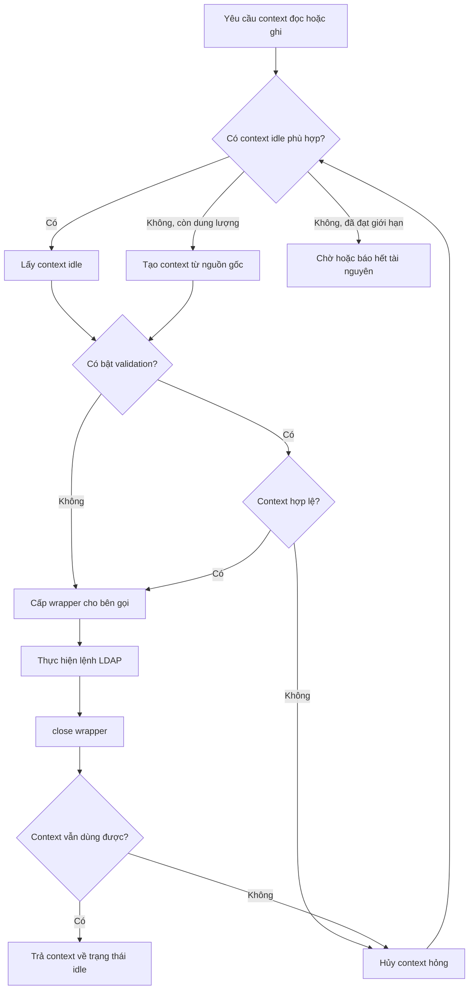

# PoolingContextSource và vòng đời context

Trong **Spring LDAP**, `ContextSource` là điểm cấp phát context cho các thao tác tra cứu DN, tìm kiếm theo filter, đọc thuộc tính và cập nhật entry trong dịch vụ thư mục. `PoolingContextSource` là một `ContextSource` đặc biệt: nó bao một nguồn context gốc và quản lý **pool các `DirContext`**, nhờ đó có thể tái sử dụng context đã khởi tạo giữa nhiều lần thao tác LDAP thay vì luôn tạo mới.

Bài học thuộc chương **Pooling** của **SPRING_LDAP**. Trọng tâm là cách `PoolingContextSource` cấp phát, cho mượn, nhận trả, kiểm tra và hủy context; cách kết hợp với `LdapTemplate`, `LdapClient` hoặc ODM; cách quản lý kết nối TLS và xác thực an toàn; cuối cùng là xử lý lỗi, đo hiệu quả và tránh rò rỉ context.

## 1. Phân biệt nguồn context, context và pool

| Khái niệm | Chức năng | Vòng đời |
|---|---|---|
| `LdapContextSource` | Giữ URL, base DN, tài khoản bind và cách tạo context để truy cập LDAP | Spring quản lý bean; mỗi context được tạo có vòng đời riêng |
| `DirContext` / `LdapContext` | Môi trường thực hiện `search`, `getAttributes`, `modifyAttributes` và các thao tác thư mục | Phải được bên mượn đóng hoặc được template quản lý việc đóng |
| `PoolingContextSource` | Bao `ContextSource` gốc, quản lý pool và trả wrapper của context cho bên gọi | Quyết định tạo, cho mượn, kiểm tra, nhận trả và hủy context |
| `LdapTemplate` | API nghiệp vụ, tự lấy và giải phóng context cho các thao tác LDAP | Mỗi thao tác quản lý việc lấy/trả context theo hợp đồng Spring |

Một context thông thường đại diện cho phiên làm việc có trạng thái xác thực, cấu hình và các tài nguyên nền. Khi lấy context qua pool, code bên ngoài nhận một **wrapper** như `DelegatingDirContext` hoặc `DelegatingLdapContext`. Wrapper chuyển các lệnh LDAP đến context thật và giữ thông tin để trả context vào pool khi gọi `close()`.

`PoolingContextSource` của package `org.springframework.ldap.pool.factory` sử dụng các nhóm context riêng cho đường đọc (`getReadOnlyContext()`) và đường ghi (`getReadWriteContext()`). Việc chia nhóm không có nghĩa là hai nhóm tự động dùng hai danh tính khác nhau; quyền thực tế vẫn phụ thuộc `ContextSource` gốc và cấu hình xác thực. Một pool không phải bộ nhớ đệm kết quả `search` và không cấp quyền LDAP mới.

## 2. Dòng đời: mượn, dùng, hoàn trả và hủy

Một lượt truy cập đi qua các bước sau:

1. **Yêu cầu:** `LdapTemplate` hoặc mã JNDI gọi `getReadOnlyContext()` / `getReadWriteContext()`.
2. **Mượn:** pool tìm một context rảnh đúng nhóm. Nếu không có và giới hạn cho phép, pool nhờ `ContextSource` gốc tạo context thật. Nếu đã hết khả năng cấp phát, yêu cầu chờ hoặc thất bại theo chính sách.
3. **Kiểm tra trước khi mượn (nếu bật):** `DirContextValidator` thử một thao tác nhẹ để phát hiện context đã mất kết nối.
4. **Sử dụng:** bên gọi thao tác với wrapper; context đang **active** và phải được xem là do đúng một lượt mượn sở hữu.
5. **Hoàn trả:** bên gọi thực hiện `close()` trên wrapper, thường ở khối `finally`. Context hợp lệ trở lại **idle** và có thể được mượn ở lần sau.
6. **Loại bỏ và hủy:** context bị lỗi, dư thừa, quá hạn idle hoặc bị dọn khi pool đóng sẽ được hủy theo chính sách của pool; kết nối nền được giải phóng.



### Ý nghĩa của `close()`

Đây là điểm dễ nhầm nhất khi học `PoolingContextSource`:

- Trên context không sử dụng pool, `close()` yêu cầu đóng context; kết nối vật lý được giải phóng theo hành vi của JNDI provider.
- Trên **wrapper do `PoolingContextSource` cấp**, `close()` là thao tác **trả quyền sử dụng context về pool**. Pool tự quyết định giữ context thật cho lượt sau hay đóng nó.

Vì vậy, **phải gọi `close()` kể cả khi thao tác LDAP lỗi**. Nếu quên đóng, context vẫn được tính là active; khi số lượt mượn chưa hoàn trả đạt giới hạn, các request mới có thể đứng chờ hoặc thất bại. Cũng không được tiếp tục sử dụng wrapper sau `close()` vì context thật có thể đã được cho request khác mượn. Không chia sẻ một wrapper đang active cho nhiều thread.

## 3. `LdapTemplate` tự quản lý phần lớn vòng đời

Trong code Spring LDAP thường dùng, hãy đưa `PoolingContextSource` vào `LdapTemplate`. Template sẽ yêu cầu context phù hợp, thực thi tác vụ và giải phóng context sau khi hoàn thành, kể cả các nhánh lỗi được nó quản lý.

```text
Service.findByUid(uid)
    -> LdapTemplate.search(query, mapper)
        -> PoolingContextSource.getReadOnlyContext()
            -> mượn hoặc tạo context, cấp wrapper
        -> LDAP search và ánh xạ entry
        -> giải phóng tài nguyên tìm kiếm và context
            -> wrapper.close()
            -> hoàn trả vào pool
```

Ví dụ truy vấn thuộc tính `cn` theo `uid`:

```java
import java.util.List;
import org.springframework.ldap.core.AttributesMapper;
import org.springframework.ldap.core.LdapTemplate;
import org.springframework.ldap.query.LdapQuery;
import static org.springframework.ldap.query.LdapQueryBuilder.query;

public final class DirectoryService {
    private final LdapTemplate ldapTemplate;

    public DirectoryService(LdapTemplate ldapTemplate) {
        this.ldapTemplate = ldapTemplate;
    }

    public List<String> findCommonNames(String uid) {
        LdapQuery q = query()
                .base("ou=people")
                .where("uid").is(uid);

        return ldapTemplate.search(q,
                (AttributesMapper<String>) attrs -> {
                    if (attrs.get("cn") == null) {
                        return null;
                    }
                    return (String) attrs.get("cn").get();
                });
    }
}
```

`LdapQueryBuilder` hỗ trợ xây dựng filter với giá trị được escape phù hợp. Pool không tự xử lý LDAP injection, xác minh DN, giới hạn số entry hay phân quyền. Tương tự, những API của `LdapClient` và ODM được cấu hình dùng cùng nguồn context có thể hưởng lợi từ pooling; cần kiểm tra đường đi thực tế của framework/phiên bản thay vì giả định mọi thao tác đều sử dụng pool.

## 4. Tự mượn context bằng JNDI: bắt buộc có `finally`

Khi phải dùng `DirContext` trực tiếp, gọi `close()` để trả tài nguyên trong `finally`:

```java
import javax.naming.NamingException;
import javax.naming.directory.Attributes;
import javax.naming.directory.DirContext;
import org.springframework.ldap.core.ContextSource;

public class DirectLookup {
    private final ContextSource pooledSource;

    public DirectLookup(ContextSource pooledSource) {
        this.pooledSource = pooledSource;
    }

    public String readName() throws NamingException {
        DirContext ctx = pooledSource.getReadOnlyContext();
        try {
            Attributes a = ctx.getAttributes(
                    "uid=alice,ou=people", new String[]{"cn"});
            return (String) a.get("cn").get();
        } finally {
            ctx.close(); // Với pool: hoàn trả context đã mượn.
        }
    }
}
```

Trong ví dụ, DN được hiểu tương đối với base DN đã cấu hình trên nguồn gốc. Cần xử lý thuộc tính `cn` thiếu và các lỗi nghiệp vụ theo schema thực tế. Nếu thao tác trả về `NamingEnumeration`, hãy đóng enumeration đó theo hợp đồng JNDI để tránh giữ tài nguyên tìm kiếm. `DirContext` không mặc nhiên triển khai `AutoCloseable` nên không thể coi `try (DirContext ctx = ...)` là thay thế trực tiếp cho `try/finally`.

Tốt nhất đừng cất context được mượn trong singleton hoặc field dùng chung. Giữ nó đúng trong phạm vi thao tác rồi hoàn trả ngay, thay vì chờ đến khi request HTTP hoặc ứng dụng kết thúc.

## 5. Cấu hình `PoolingContextSource` bằng Java Config

Ví dụ này áp dụng cho API `org.springframework.ldap.pool.factory.PoolingContextSource`, dựa trên **Apache Commons Pool 1.x**; constructor nhận `ContextSource` có trong Spring LDAP 4.1 trở lên. Nếu dự án dùng phiên bản cũ hơn, cần tham khảo constructor/setter tương ứng. Spring LDAP còn có họ `org.springframework.ldap.pool2.factory.PooledContextSource` dùng Commons Pool 2; tên class, validator và thuộc tính có thể khác, không trộn hai họ API.

```java
import org.springframework.beans.factory.annotation.Qualifier;
import org.springframework.context.annotation.Bean;
import org.springframework.context.annotation.Configuration;
import org.springframework.core.env.Environment;
import org.springframework.ldap.core.LdapTemplate;
import org.springframework.ldap.core.support.LdapContextSource;
import org.springframework.ldap.pool.factory.PoolingContextSource;
import org.springframework.ldap.pool.validation.DefaultDirContextValidator;

@Configuration
public class LdapPoolingConfig {

    @Bean("rawLdapContextSource")
    LdapContextSource rawLdapContextSource(Environment env) {
        LdapContextSource source = new LdapContextSource();
        source.setUrl(env.getRequiredProperty("app.ldap.url"));
        source.setBase(env.getRequiredProperty("app.ldap.base"));
        source.setUserDn(env.getRequiredProperty("app.ldap.bind-dn"));
        source.setPassword(env.getRequiredProperty("app.ldap.bind-password"));
        source.setPooled(false); // Tắt JNDI native pool ở tầng gốc.
        return source;
    }

    @Bean
    PoolingContextSource poolingContextSource(
            @Qualifier("rawLdapContextSource") LdapContextSource raw) {
        PoolingContextSource pool = new PoolingContextSource(raw);
        pool.setMaxActive(8);
        pool.setMaxTotal(16);
        pool.setMaxIdle(4);
        pool.setMaxWait(2_000L);

        pool.setDirContextValidator(new DefaultDirContextValidator());
        pool.setTestOnBorrow(true);
        pool.setTestWhileIdle(true);
        pool.setTimeBetweenEvictionRunsMillis(60_000L);
        pool.setMinEvictableIdleTimeMillis(300_000L);
        return pool;
    }

    @Bean
    LdapTemplate ldapTemplate(PoolingContextSource pooledSource) {
        return new LdapTemplate(pooledSource);
    }
}
```

Giá trị cấu hình minh họa:

```properties
app.ldap.url=ldaps://directory.example.org:636
app.ldap.base=dc=example,dc=org
app.ldap.bind-dn=cn=app-reader,ou=services,dc=example,dc=org
# Cấp app.ldap.bind-password từ secret manager/biến môi trường.
```

Mã minh họa sử dụng **DN dịch vụ cố định**, phù hợp với cách pool phân nhóm context. Không đưa mật khẩu thật vào mã nguồn hoặc repository. Với `ldaps://`, phải kiểm tra chứng chỉ server và cấu hình trust store đúng; pool không thay TLS. Không nên chồng thêm cơ chế JNDI native pooling khi chưa có lý do, vì việc quan sát và quản lý vòng đời lúc đó phức tạp hơn.

### Giới hạn và chính sách khi pool cạn

| Thuộc tính | Vai trò | Điều cần nhớ |
|---|---|---|
| `maxActive` | Số context active tối đa trên **mỗi nhóm** đọc/ghi | `8` không nhất thiết là số socket tối đa cho toàn ứng dụng |
| `maxTotal` | Giới hạn tổng context active của các nhóm | Giúp kiểm soát lượng cấp phát tổng |
| `maxIdle` / `minIdle` | Mức giữ lại context rảnh ở từng nhóm | Tăng giữ idle sẽ tăng tài nguyên tồn tại |
| `maxWait` | Thời gian chờ khi đã cạn và chính sách là `BLOCK` | Chờ quá lâu làm tăng latency và hàng đợi |
| `whenExhaustedAction` | Chọn `BLOCK`, `FAIL` hoặc `GROW` | `GROW` có thể vượt giới hạn nhóm; cần hiểu rủi ro |
| `testOnBorrow` | Validation trước khi cấp context | Tăng độ an toàn nhưng tốn lượt kiểm tra |
| `testOnReturn` | Validation khi context được trả | Tốn chi phí thêm tại lúc hoàn trả |
| `testWhileIdle` | Kiểm tra context đang idle | Cần bật lịch quét idle thích hợp |
| `timeBetweenEvictionRunsMillis` | Chu kỳ quét idle | Nếu không có runner thì kiểm tra idle không chạy |
| `minEvictableIdleTimeMillis` | Ngưỡng thời gian idle để xét loại bỏ | Hữu ích khi hạ tầng cắt kết nối sau thời gian rảnh |

Các số trong ví dụ chỉ phục vụ minh họa; phải đo tải và giới hạn của LDAP server trước khi dùng trong production. Các cấu hình của họ Commons Pool 2 không hoàn toàn trùng mặc định hoặc tên phương thức.

## 6. Validation: phát hiện context không còn hoạt động

Firewall, load balancer hoặc LDAP server có thể đóng kết nối lâu không hoạt động. Context rảnh vẫn có thể tồn tại trong pool dù socket không còn dùng được. Khi bật `testOnBorrow`, pool có cơ hội loại context hỏng trước khi trả về cho request.

`DefaultDirContextValidator` thường thực hiện một tìm kiếm LDAP rất nhỏ ở tên rỗng, filter `(objectClass=*)`, giới hạn một kết quả và yêu cầu thuộc tính `objectClass`. Nếu search thất bại hoặc không có kết quả, validation không đạt. Validation kiểm tra **khả năng phản hồi của context**, không bảo đảm tài khoản có đủ quyền sửa mọi entry nghiệp vụ.

| Chính sách | Thời điểm | Đánh đổi |
|---|---|---|
| `testOnBorrow=true` | Trước khi mỗi lượt mượn | Giảm context stale, thêm lượt LDAP search trên đường nóng |
| `testOnReturn=true` | Khi trả về pool | Có thể lọc context lỗi sớm, tăng thời gian hoàn trả |
| `testWhileIdle=true` | Trong đợt quét context rảnh | Kiểm tra ngoài đường nóng, thêm tải nền |
| Không validation | Không có kiểm tra chủ động | Lời gọi nghiệp vụ có thể phát hiện socket chết đầu tiên |

Khi base DN, schema hoặc quyền bind không tương thích với phép tìm mặc định, cần cấu hình base/filter/search controls của validator cho một entry ổn định mà tài khoản dịch vụ có quyền đọc. Không chọn phép kiểm tra tốn nhiều tài nguyên. Không mặc định coi mọi lỗi `NamingException` là kết nối chết: có thể chỉ là DN không tồn tại, thiếu quyền hoặc filter không hợp lệ. Pool có cơ chế đánh dấu hỏng khi gặp exception nghiêm trọng, chẳng hạn lỗi truyền thông; các lớp exception không thể phục hồi được có thể cấu hình qua `setNonTransientExceptions(...)`.

## 7. Pooling và danh tính xác thực: điều phải bảo vệ

`PoolingContextSource` giả định mỗi nhóm context trả về từ `getReadOnlyContext()` hoặc `getReadWriteContext()` có môi trường kết nối **ổn định**. Nếu `LdapContextSource` gốc sử dụng `AuthenticationSource` động để lấy principal/credentials từ từng request, pool có thể tái sử dụng context đã được bind bằng người dùng A khi người dùng B yêu cầu cùng một loại context.

Để tránh rò rỉ quyền:

- Chỉ dùng pool này cho **tài khoản dịch vụ cố định**, với quyền tối thiểu cho mục đích đọc/ghi dự định.
- Tách luồng **xác thực mật khẩu người dùng** khỏi pool dịch vụ. API `PoolingContextSource#getContext(principal, credentials)` thuộc họ package `pool.factory` không hỗ trợ dùng như đường mượn context tùy ý.
- Không thay đổi quyền, DN bind hoặc credential trên context rồi trả về pool như thể nó chưa bị đổi trạng thái.
- Khi xoay vòng mật khẩu bind hoặc chứng chỉ TLS, lên phương án hủy/tạo lại pool, tránh tiếp tục dùng phiên cũ ngoài dự định.
- Khi sử dụng StartTLS, kiểm tra chiến lược TLS và vòng đời context thực tế trước khi quyết định pooling; tuyệt đối không hạ bảo mật đường truyền để buộc pooling hoạt động.

Context source gốc có thể phục vụ luồng xác thực riêng theo cơ chế phù hợp mà không dùng chung pool dịch vụ. Với API xác thực của Spring LDAP hoặc Spring Security, cần đảm bảo nó không lấy nhầm bean pool được thiết kế cho truy vấn bằng tài khoản dịch vụ.

## 8. Khi ứng dụng lỗi hoặc dừng, context được xử lý ra sao?

Một số tình huống phổ biến:

**Mượn thất bại:** pool không thể tạo context hoặc chờ quá giới hạn; mã gọi có thể nhận ngoại lệ tài nguyên như `DataAccessResourceFailureException`. Phân biệt trường hợp pool cạn với LDAP server không thể kết nối, chứng chỉ TLS không hợp lệ hay bind sai mật khẩu.

**Lỗi trong lúc tìm kiếm:** `LdapTemplate` vẫn cần dọn context và các tài nguyên đi kèm. Với code JNDI thủ công, `finally` phải được thực thi; context không còn hợp lệ sẽ bị loại theo chính sách pool.

**Server LDAP khởi động lại:** những context idle có thể đã stale. Validation sẽ giúp loại bỏ chúng; những request phục hồi có thể tốn thời gian tạo kết nối và bind mới.

**ApplicationContext bị đóng:** `PoolingContextSource` triển khai `DisposableBean` và được Spring gọi `destroy()` để giải phóng pool. Không gọi `destroy()` thủ công trong khi ứng dụng còn xử lý request; đảm bảo công việc đang chạy được kết thúc theo quy trình shutdown của ứng dụng.

**Ghi LDAP bị timeout:** không mặc nhiên retry `modifyAttributes`, `bind` hoặc `unbind`; server có thể đã hoàn tất thay đổi trước khi client nhận lỗi. Cần chiến lược retry có kiểm tra trạng thái và tính lặp an toàn.

## 9. Đo hiệu quả và phát hiện rò rỉ context

Khi thử nghiệm, so sánh cùng endpoint LDAP, cùng filter, cùng dữ liệu và mức tải giữa một `LdapTemplate` dùng context source trực tiếp và một template dùng pool. Theo dõi độ trễ truy vấn, số context active/idle, thời gian chờ mượn và số kết nối/bind mới ở server.

| Triệu chứng | Nguyên nhân khả dĩ | Cách xử lý |
|---|---|---|
| `numActive` tăng, `numIdle` về 0 | Context mượn không được đóng; tác vụ giữ context quá lâu | Kiểm tra mọi đường `finally`, enumeration và các thao tác bị treo |
| Request chờ gần hết `maxWait` | Pool cạn vì tải, rò rỉ hoặc LDAP phản hồi chậm | Đo thời gian giữ context, số request đồng thời, giới hạn LDAP server |
| Validation liên tục thất bại | Context stale hoặc filter/base kiểm tra không phù hợp | Kiểm tra mạng, idle timeout, quyền đọc và validator |
| p95 cao hơn khi bật `testOnBorrow` | Lượt search kiểm tra phát sinh trên mỗi lần mượn | So sánh validation khi mượn với quét idle dựa trên đo đạc |
| Rất nhiều phiên LDAP còn mở khi ít request | Cấu hình idle quá cao hoặc chính sách eviction chưa chạy | Điều chỉnh maxIdle/eviction theo giới hạn server |
| Vấn đề xác thực sau khi đổi mật khẩu | Context giữ trạng thái bind cũ | Tái tạo pool theo quy trình xoay vòng secret |

**Thực hành trong môi trường lab:**

1. Tạo `LdapTemplate` dùng pool và truy vấn một entry bằng filter đơn giản trên DN thử nghiệm. Lặp truy vấn, đo `numActive`/`numIdle` và độ trễ.
2. Tự mượn một `DirContext` mà chưa đóng để quan sát số active tăng; sau đó gọi `close()` và xác nhận nó quay về idle hoặc được hủy theo chính sách.
3. Khởi động lại LDAP server thử nghiệm hoặc ngắt kết nối idle; chạy lại với `testOnBorrow` tắt/bật rồi so sánh ngoại lệ và thời gian phục hồi.
4. Thử một lệnh ghi trên entry lab, cố ý gây lỗi và xác nhận context được hoàn trả. Không sử dụng tài khoản quản trị hoặc dữ liệu thật trong bài tập.

## 10. Câu hỏi tự kiểm tra

1. Điểm khác biệt quan trọng nhất giữa `close()` trên context thường và trên wrapper của `PoolingContextSource` là gì?
2. Vì sao thiếu `close()` có thể làm toàn bộ ứng dụng chờ pool dù LDAP server còn sống?
3. `maxActive` theo nhóm khác `maxTotal` như thế nào khi cùng lúc có thao tác đọc và ghi?
4. Khi nào `testOnBorrow` hữu ích hơn `testWhileIdle`, và chi phí cần đo là gì?
5. Vì sao không dùng pool theo loại context cho những credential thay đổi theo request?
6. Vì sao timeout của một thao tác ghi không đồng nghĩa server chưa thực hiện thao tác?

**Kết luận:** `PoolingContextSource` giảm chi phí khởi tạo lại context bằng cách quản lý vòng đời **mượn → sử dụng → `close()` → trả/hủy**. Muốn sử dụng hiệu quả trong Spring LDAP, cần đóng context đúng thời điểm, có validator phù hợp, đặt giới hạn pool theo tải thực tế, giữ tách biệt thông tin xác thực và kết hợp các phép thử LDAP an toàn.

### Tài liệu tham khảo

- [Spring LDAP Reference — Pooling Support](https://docs.spring.io/spring-ldap/reference/pooling.html)
- [Spring LDAP API — PoolingContextSource](https://docs.spring.io/spring-ldap/reference/api/java/org/springframework/ldap/pool/factory/PoolingContextSource.html)
- [Spring LDAP API — ContextSource](https://docs.spring.io/spring-ldap/docs/current/api/org/springframework/ldap/core/ContextSource.html)
