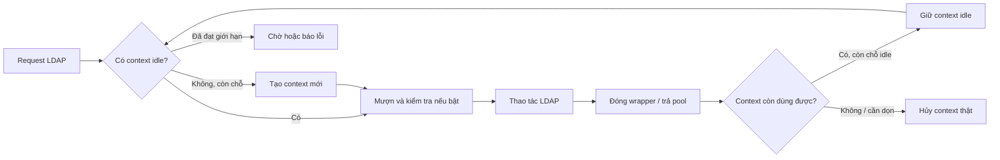

# Pool size, idle context và validation

Trong **Spring LDAP**, pooling giúp ứng dụng tái sử dụng LDAP context giữa nhiều thao tác tìm kiếm, đọc thuộc tính hoặc sửa entry, giảm số lần phải khởi tạo kết nối và bind lại. Nhưng bật pool chưa đủ: **pool size**, số **idle context** và cơ chế **validation** quyết định ứng dụng có đáp ứng được tải thực tế, có giữ quá nhiều kết nối trên LDAP server và có trả nhầm context đã mất kết nối cho yêu cầu mới hay không.

Bài học thuộc chương **Pooling** của **SPRING_LDAP**. Các nguyên tắc áp dụng khi ứng dụng truy cập thư mục bằng `ContextSource`, `LdapTemplate`, `LdapClient` hoặc ODM; chúng không thay thế kiến thức về DN, schema, filter, xác thực, TLS, xử lý lỗi và kiểm thử truy cập LDAP an toàn. Ví dụ dưới đây tập trung vào pool context của Spring LDAP với một tài khoản bind dịch vụ ổn định. Nếu dự án dùng **JNDI native connection pooling** hoặc `PooledContextSource` dựa trên Commons Pool 2, API và ngữ nghĩa từng thuộc tính cần đối chiếu với phiên bản được cài đặt.

## 1. Ba bài toán vận hành của pool

Một request LDAP thường trải qua: **mượn context → thực hiện thao tác → `close()` để trả context**. Context được trả và còn hợp lệ có thể chuyển sang trạng thái idle để request sau dùng tiếp.



Ba câu hỏi liên hệ chặt chẽ:

| Câu hỏi | Tham số liên quan | Nếu cấu hình chưa phù hợp |
|---|---|---|
| Bao nhiêu thao tác LDAP được sử dụng context đồng thời? | `maxActive`, `maxTotal`, chính sách khi pool cạn, thời gian chờ | Pool quá nhỏ gây chờ; quá lớn làm quá tải LDAP server |
| Giữ lại bao nhiêu context sau khi request kết thúc? | `minIdle`, `maxIdle`, chính sách eviction | Quá ít làm tăng tạo kết nối lại; quá nhiều giữ socket và phiên không cần thiết |
| Context được tái sử dụng có còn hoạt động không? | `testOnBorrow`, `testOnReturn`, `testWhileIdle`, `DirContextValidator` | Không kiểm tra dễ gặp socket stale; kiểm tra quá thường xuyên làm tăng độ trễ |

**Pooling context không phải cache dữ liệu LDAP.** Filter, base DN, quyền bind, index của server và số entry trả về vẫn quyết định chi phí truy vấn.

## 2. Đọc đúng các trạng thái và giới hạn

### Active, idle và tổng context

- **Active:** context đang được một lượt thao tác mượn, chưa được trả qua `close()`. Nó có thể đang thực hiện lệnh LDAP hoặc đang bị code giữ chờ xử lý khác.
- **Idle:** context đã được trả về pool, chưa được mượn lại. Một context idle vẫn có thể giữ kết nối vật lý và trạng thái bind trên server.
- **Created / total:** số context hiện do pool quản lý, thường bao gồm active và idle. Đừng đồng nhất số object Java với số socket TCP: cách kết nối được khởi tạo và JNDI provider có thể khác nhau.
- **Waiters:** số yêu cầu đang chờ mượn context khi không còn context rảnh và giới hạn tạo mới đã đạt.

Với `PoolingContextSource` dùng Commons Pool 1, pool có thể phân **nhóm (key)** cho `getReadOnlyContext()` và `getReadWriteContext()`. Một số thông số áp dụng theo nhóm, trong khi thông số khác giới hạn tổng. Khi đo số lượng context, phải xác định đây là **một nhóm, toàn pool, một ứng dụng hay toàn bộ các replica**.

| Thông số của họ `PoolingContextSource` | Cách hiểu khi điều chỉnh | Sai lầm thường gặp |
|---|---|---|
| `maxActive` | Giới hạn context đang mượn cho mỗi nhóm | Xem là tổng tuyệt đối số kết nối của cả cụm |
| `maxTotal` | Giới hạn active tính trên các nhóm trong pool, nếu API/phiên bản hỗ trợ | Bỏ qua việc có nhiều nhóm đọc/ghi |
| `maxIdle` | Giới hạn context idle giữ lại trên mỗi nhóm | Nghĩ rằng đặt 10 thì pool luôn tạo sẵn 10 context |
| `minIdle` | Mức idle mong muốn/tối thiểu theo cơ chế duy trì pool | Nghĩ rằng ứng dụng khởi động là chắc chắn đã có đủ kết nối |
| `maxWait` | Thời gian tối đa chờ tài nguyên khi chính sách là chờ | Nhầm với LDAP search timeout hoặc TCP connect timeout |
| Chính sách hết tài nguyên | Chờ (`BLOCK`), báo lỗi (`FAIL`), hoặc tăng vượt một giới hạn (`GROW`) theo API | Dùng tăng vô hạn để che vấn đề thiếu context |

Không có quy tắc “càng nhiều connection càng nhanh”: khi đã đủ context cho số tác vụ đồng thời, pool lớn thêm có thể chỉ tăng số socket mở, tải bộ nhớ, kiểm tra kết nối và giới hạn phiên trên server.

### Một dòng thời gian minh họa

```text
09:00:00  Pool ban đầu chưa có context
09:00:01  Request A mượn: tạo context #1 → active=1, idle=0
09:00:02  Request B mượn: tạo context #2 → active=2, idle=0
09:00:03  A hoàn tất, close() → active=1, idle=1
09:00:04  Request C mượn context #1 → active=2, idle=0
09:00:05  B và C close() → active=0, idle=2
09:05:05  Evictor có thể loại context idle theo chính sách
```

Số liệu chỉ minh họa cơ chế chuyển trạng thái. Việc hai lời gọi có thể dùng chung một kết nối thật hay tạo kết nối lúc nào còn phụ thuộc provider và cấu hình nguồn context.

## 3. Chọn pool size theo tải và thời gian giữ context

Điểm bắt đầu hợp lý là đo **tốc độ thao tác LDAP** và **thời gian một thao tác giữ context**. Có thể ước lượng số context active trung bình bằng định luật Little:

\[
L \approx \lambda \times W
\]

Trong đó:

- \(L\): số context active **trung bình**;
- \(\lambda\): số thao tác LDAP bắt đầu/hoàn thành mỗi giây trong trạng thái ổn định;
- \(W\): thời gian trung bình giữ context, tính bằng giây, gồm cả LDAP search/modify và thời gian xử lý khi context vẫn còn được mượn.

**Ví dụ giả định:** ứng dụng nhận 160 thao tác LDAP/giây, mỗi thao tác giữ context trung bình 50 ms:

\[
L \approx 160 \times 0{,}050 = 8
\]

Tám context là **mức đang bận trung bình**, không phải một giá trị `maxActive` được bảo đảm đáp ứng p95/p99. Khi request đến theo đợt hoặc server chậm bất thường, số context cần mượn đồng thời có thể cao hơn rõ rệt.

Ví dụ cách đo và tinh chỉnh:

1. Đo p50/p95/p99 **thời gian giữ context** và số thao tác đồng thời ở tải bình thường lẫn đỉnh.
2. Thử một giới hạn lớn hơn mức active trung bình, ví dụ 12 hoặc 16 cho một nhóm trong tình huống minh họa; đây là **giả định thử nghiệm**, không phải khuyến nghị cố định.
3. Đo **thời gian chờ pool**, tỷ lệ hết thời gian chờ, số context active/idle và độ trễ LDAP; tăng giới hạn chỉ khi pool đang là nút thắt thực sự.
4. Kiểm tra phía server: số kết nối đang mở, CPU, giới hạn bind, tốc độ xử lý search, tỷ lệ lỗi. Nếu server đã quá tải, tăng pool có thể làm tình hình xấu hơn.
5. Lặp lại phép đo khi tăng số replica của ứng dụng, lúc deploy hoặc khi traffic đột ngột tăng.

### Tính theo nhiều replica và nhiều nhóm context

Giả sử ứng dụng chạy 6 replica, mỗi replica cho phép tối đa 16 context. Mức tối đa lý thuyết có thể là **96 context** cho các pool đó, trước khi xét các kết nối LDAP khác của ứng dụng, admin tools hoặc health checks. Nếu giới hạn server nhỏ hơn hoặc có nhiều ứng dụng cùng kết nối, hãy phân bổ ngân sách kết nối trên **toàn hệ thống**, không chỉ một instance.

Nếu pool phân nhóm đọc/ghi, phải hiểu phạm vi của `maxActive` và `maxTotal` trong phiên bản đang dùng. Một giới hạn 16 ở nhóm đọc và 16 ở nhóm ghi không có nghĩa tổng luôn là 16. Đồng thời, một request nghiệp vụ đôi khi thực hiện nhiều truy vấn LDAP liên tiếp: chỉ tính số context **thực sự bị giữ cùng lúc**, không nhân vô điều kiện theo số truy vấn trong mỗi request.

## 4. Khi pool cạn: thời gian chờ quan trọng ngang số lượng

Pool cạn khi không còn context idle và đã đạt giới hạn cấp mới. Với cơ chế cho phép chờ, request chuyển sang hàng đợi tới khi có context được trả hoặc hết thời gian `maxWait`.

```text
Pool tối đa 3 context active:

Request A ── mượn #1 ─── dùng ─── trả
Request B ── mượn #2 ─────── dùng ─── trả
Request C ── mượn #3 ─── dùng ──── trả
Request D ── [chờ context] ── mượn ─── trả
Request E ── [chờ quá maxWait] ── lỗi
```

Việc chờ là một phần của **độ trễ ứng dụng**, ngay cả khi truy vấn LDAP sau khi mượn chỉ mất vài mili giây. Dùng `maxWait` hợp lý giúp hạn chế request treo quá lâu khi có rò rỉ context hoặc LDAP server chậm. Tuy nhiên, thời gian chờ pool không thay thế các timeout cho TCP connect, đọc phản hồi LDAP hoặc timeout của HTTP request phía ngoài.

Một số API cho phép chế độ tạo thêm (`GROW`) khi hết tài nguyên, nhưng nó có thể bỏ qua một giới hạn theo nhóm và tăng số kết nối bất ngờ. Với ứng dụng cần bảo vệ LDAP server, nên ưu tiên giới hạn có chủ đích, theo dõi saturation và lỗi rõ ràng.

## 5. Idle context: lợi ích và cái giá của việc giữ kết nối rảnh

Context idle là tài nguyên **sẵn sàng để mượn lại**, không phải request đang chạy. Giữ một lượng context idle hợp lý giảm TCP/TLS handshake và bind lặp lại khi traffic trở lại sau khoảng nghỉ ngắn.

Ngược lại, quá nhiều context rảnh gây ra:

- Tiêu tốn socket, bộ nhớ và phiên bind trên cả client/server.
- Tăng số kết nối phải quản lý khi scale out nhiều replica.
- Có thêm context có thể bị firewall, proxy, load balancer hoặc LDAP server ngắt trong lúc nhàn rỗi.
- Tốn phép kiểm tra định kỳ nếu bật validation trên idle.

Hai nhóm tham số thường phối hợp:

| Nhóm | Vai trò | Ghi nhớ |
|---|---|---|
| `maxIdle` / `minIdle` | Giới hạn hoặc duy trì lượng context rảnh | `minIdle` là mục tiêu theo chính sách pool; không có nghĩa pool luôn khởi tạo đủ ngay lập tức |
| `timeBetweenEvictionRunsMillis` | Chu kỳ chạy công việc quét context rảnh | Nếu không chạy, `testWhileIdle` và chính sách loại bỏ theo thời gian có thể không hoạt động |
| `minEvictableIdleTimeMillis` | Ngưỡng nhàn rỗi để có thể loại bỏ theo điều kiện của pool | Cần cân nhắc timeout idle của mạng và tải thực tế |
| `testWhileIdle` | Kiểm tra context rảnh khi eviction runner chạy | Dùng thêm kết nối và truy vấn nhỏ cho validation |

**Ví dụ vận hành:** một ứng dụng có vài chục truy vấn mỗi phút, nhưng mỗi ngày có hai đợt tải cao. Nếu giữ hàng trăm context idle suốt đêm, lợi ích khi có request sáng hôm sau có thể không bù được tài nguyên giữ lâu và nguy cơ stale. Có thể giữ một số ít context sẵn có và cho phép pool mở thêm đến mức đỉnh khi cần.

Khi chỉnh thời gian eviction, tránh hiểu đơn giản là “cứ đúng 5 phút pool sẽ đóng mọi context rảnh”. Hành vi phụ thuộc điều kiện đủ tuổi idle, mức `minIdle`, số context được xét trong mỗi lượt quét và phiên bản thư viện pool. Một context đã rảnh 5 phút cũng không nhất thiết còn kết nối đến server; thiết bị mạng có thể đã đóng sớm hơn.

### Idle timeout trên hạ tầng

Ví dụ đường truyền gồm:

```text
Ứng dụng Spring → load balancer / firewall → LDAP server
          idle cutoff: 120 giây
          chính sách pool: giữ context idle 10 phút
```

Trong tình huống minh họa này, một context có thể tồn tại trong pool sau 120 giây dù socket nền đã bị cắt. Nếu context ấy được mượn mà không có validation, lệnh LDAP có thể nhận lỗi I/O. Đặt thời gian eviction thấp hơn một ngưỡng hạ tầng có thể giúp giảm tình huống đó, nhưng không thay thế validation và xử lý lỗi. Các cutoff thực tế phải được xác nhận bằng cấu hình mạng hoặc phép thử.

## 6. Validation: kiểm tra context trước và trong khi tái sử dụng

**Validation** là việc thử xem context còn dùng được trước khi đưa nó trở lại phục vụ request. Một `DirContextValidator` phù hợp thường thực hiện một lệnh LDAP nhẹ. Ví dụ, `DefaultDirContextValidator` trong Spring LDAP có thể dùng tìm kiếm phạm vi nhỏ với filter `(objectClass=*)`, giới hạn kết quả để kiểm tra kết nối và quyền đọc ở một vị trí thích hợp.

Một context trả lời được phép kiểm tra vẫn **không bảo đảm** mọi truy vấn nghiệp vụ sẽ thành công: DN có thể không tồn tại, filter có thể sai, schema và quyền sửa entry có thể khác, server có thể mất kết nối ngay sau kiểm tra.

| Chế độ | Thời điểm xác minh | Ưu điểm | Chi phí / hạn chế |
|---|---|---|---|
| `testOnBorrow` | Trước khi pool trao context cho request | Giảm nguy cơ giao context đã chết | Mỗi lần mượn có thể thêm một LDAP round-trip |
| `testOnReturn` | Khi trả context về pool | Loại context lỗi sớm ở đường trả | Tăng thời gian trả và tải phép kiểm tra |
| `testWhileIdle` | Khi eviction runner kiểm tra context đang rảnh | Giảm chi phí kiểm tra ở request mới, phát hiện lỗi nền | Có thể kiểm tra nhiều kết nối nhàn rỗi; cần bật runner |
| Không kiểm tra chủ động | Khi phép nghiệp vụ đầu tiên dùng context | Chi phí mượn thấp | Request đầu tiên có thể gặp lỗi socket stale |

**Không nên bật tất cả chế độ theo thói quen.** Nếu validation tốn 5 ms mà phép LDAP lookup chỉ tốn 2 ms, `testOnBorrow` có thể làm tăng đáng kể độ trễ đường nóng, dù giúp giảm lỗi do context stale. So sánh bằng số liệu và lựa chọn cân bằng giữa độ trễ, độ tin cậy và tải LDAP server.

### Chọn phép kiểm tra phù hợp quyền truy cập

Validator nên dùng:

1. Một DN ổn định mà tài khoản dịch vụ thực sự có quyền đọc.
2. Search base, filter và scope nhỏ, tốt nhất là kiểm tra một entry đã biết.
3. Thuộc tính công khai hoặc cho phép đọc; tránh truy vấn dữ liệu nhạy cảm, nhiều entry hoặc filter không được index.
4. Giới hạn thời gian và số kết quả phù hợp, để một lần validation không chiếm context quá lâu khi server chậm.

Nếu validator mặc định chọn một điểm mà bind DN không được phép đọc, pool có thể hủy context **đang hoạt động tốt** vì validation thất bại. Cần phân biệt **authentication/authorization failure** của phép kiểm tra với lỗi transport thực sự. Không cấu hình validator thực hiện phép ghi chỉ để đánh giá một context đọc.

## 7. Ví dụ cấu hình Spring LDAP với giới hạn, idle và validation

Ví dụ minh họa API `org.springframework.ldap.pool.factory.PoolingContextSource` của Spring LDAP dựa trên **Commons Pool 1**. API `org.springframework.ldap.pool2.factory.PooledContextSource` dùng **Commons Pool 2** khác tên và cách cấu hình. Trước khi áp dụng mã, kiểm tra phiên bản Spring LDAP và module pooling hiện có trong dependency của dự án; một số bản cũ dùng constructor hoặc setter khác.

```java
import org.springframework.beans.factory.annotation.Qualifier;
import org.springframework.context.annotation.Bean;
import org.springframework.context.annotation.Configuration;
import org.springframework.core.env.Environment;
import org.springframework.ldap.core.LdapTemplate;
import org.springframework.ldap.core.support.LdapContextSource;
import org.springframework.ldap.pool.factory.PoolingContextSource;
import org.springframework.ldap.pool.validation.DefaultDirContextValidator;

@Configuration
public class DirectoryPoolConfig {
    @Bean("ldapRawContextSource")
    LdapContextSource ldapRawContextSource(Environment env) {
        LdapContextSource raw = new LdapContextSource();
        raw.setUrl(env.getRequiredProperty("app.ldap.url"));
        raw.setBase(env.getRequiredProperty("app.ldap.base"));
        raw.setUserDn(env.getRequiredProperty("app.ldap.bind-dn"));
        raw.setPassword(env.getRequiredProperty("app.ldap.bind-password"));
        raw.setPooled(false); // Không chồng thêm JNDI native pooling.
        return raw;
    }

    @Bean
    PoolingContextSource poolingContextSource(
            @Qualifier("ldapRawContextSource") LdapContextSource raw) {
        PoolingContextSource pool = new PoolingContextSource(raw);

        // Các giá trị dưới đây chỉ là giả định để bắt đầu đo tải.
        pool.setMaxActive(12);
        pool.setMaxTotal(20);
        pool.setMaxIdle(6);
        pool.setMinIdle(1);
        pool.setMaxWait(1500L);

        pool.setDirContextValidator(new DefaultDirContextValidator());
        pool.setTestOnBorrow(true);
        pool.setTestOnReturn(false);
        pool.setTestWhileIdle(true);
        pool.setTimeBetweenEvictionRunsMillis(60_000L);
        pool.setMinEvictableIdleTimeMillis(180_000L);
        return pool;
    }

    @Bean
    LdapTemplate ldapTemplate(PoolingContextSource pool) {
        return new LdapTemplate(pool);
    }
}
```

Ví dụ cấu hình đầu vào:

```properties
app.ldap.url=ldaps://ldap.example.org:636
app.ldap.base=dc=example,dc=org
app.ldap.bind-dn=cn=app-reader,ou=services,dc=example,dc=org
# app.ldap.bind-password lấy từ secret manager hoặc biến môi trường.
```

Trong ví dụ, `maxActive=12` được hiểu theo nhóm của cơ chế pool; `maxTotal=20` giới hạn tổng active nếu API đang dùng hỗ trợ. `minIdle=1` là mục tiêu duy trì lượng context rảnh, không phải cam kết lúc khởi động đã có một kết nối sẵn. `maxWait=1500` là thời gian chờ mượn, **không phải** LDAP search timeout. Tất cả số đều cần đo và hiệu chỉnh theo tải, số replica và giới hạn server.

Chỉ dùng **tài khoản dịch vụ cố định** trong pool này. Khi xác thực từng người dùng bằng bind với principal/password động, không gom context của các danh tính khác nhau vào cùng một nhóm pool; cần luồng xác thực riêng. Với `ldaps://`, cấu hình trust store và xác minh chứng chỉ server. Với StartTLS, phải xác nhận vòng đời kết nối/phiên TLS có tương thích với cơ chế tái sử dụng đang dùng hay không. Đừng làm yếu cấu hình bảo mật để cố sử dụng pooling.

Nếu ứng dụng khai báo `PoolingContextSource` là bean Spring, việc kết thúc `ApplicationContext` sẽ kích hoạt cơ chế hủy bean/pool khi được hỗ trợ. Khi xoay vòng mật khẩu dịch vụ, cần kế hoạch tạo lại pool để không giữ các phiên xác thực cũ quá lâu.

## 8. Quan sát: nhìn vào dấu hiệu thay vì đoán tham số

Một dashboard giám sát hữu ích phải phân biệt **độ trễ LDAP thực sự** và **độ trễ chờ mượn context**. Nếu không, sự chậm trễ do pool cạn dễ bị quy nhầm cho filter hoặc network.

| Chỉ số | Vì sao cần | Gợi ý diễn giải |
|---|---|---|
| `numActive` theo nhóm và toàn pool | Biết mức dùng đồng thời | Liên tục chạm trần khi request chờ: có thể thiếu capacity hoặc giữ context quá lâu |
| `numIdle` | Biết lượng kết nối sẵn | Bằng 0 trong giờ cao điểm chưa chắc xấu nếu không có hàng đợi |
| Thời gian chờ mượn context | Đo bão hòa trực tiếp | p95/p99 tăng cho thấy contention trong pool |
| Số lỗi không mượn được | Xác định giới hạn vận hành | Điều tra context leak, timeout và lỗi tạo kết nối |
| Số context tạo/hủy / validation thất bại | Phát hiện churn và context stale | Tỷ lệ cao gợi ý timeout của hạ tầng hoặc validator sai |
| p50/p95/p99 của thao tác LDAP | Đo trải nghiệm ứng dụng | Cần tách thời gian chờ pool và LDAP response |
| Số kết nối LDAP và bind trên server | Biết chi phí ở phía dịch vụ thư mục | Quá nhiều socket ở nhiều replica có thể gây áp lực server |

API cung cấp metric active/idle tùy họ pool và phiên bản; không giả định tên metric cụ thể đã được xuất qua Actuator/Micrometer. Nếu chưa có metric, có thể instrument thời gian nghiệp vụ và thời gian mượn qua lớp wrapper phù hợp, kết hợp log server và thống kê socket. Không log mật khẩu hoặc nội dung entry nhạy cảm.

### Các triệu chứng phổ biến

**Active tăng mãi, idle gần 0:** có thể quên `close()` khi tự mượn context hoặc giữ kết quả `NamingEnumeration` không đóng. Sửa vòng đời trước khi tăng `maxActive`.

**Nhiều context tạo lại sau thời gian nhàn rỗi:** xem giới hạn idle của firewall/load balancer/server, chu kỳ eviction và validation. Kết nối cần được thay thế thì pool hoạt động đúng; tỷ lệ tạo lại quá cao mới là vấn đề cần tối ưu.

**Validation thất bại liên tục, nhưng search nghiệp vụ đôi lúc thành công:** kiểm tra DN/filter/scope của validator, quyền bind DN và cách phân loại exception.

**p95 tăng sau khi bật `testOnBorrow`:** đo chi phí của phép validation, thử điều chỉnh kiểm tra idle và ngưỡng thời gian nhàn rỗi. Không tắt validation chỉ dựa trên p50; phải đo cả tỷ lệ lỗi khi context stale.

**Pool mở rộng đến giới hạn, LDAP server quá tải:** giảm concurrency, tối ưu truy vấn (filter, index, size limit, phân trang), cân nhắc giới hạn ở tầng gọi và ngân sách kết nối cho toàn cụm.

## 9. Xử lý lỗi và an toàn tài nguyên

`LdapTemplate` thực hiện quản lý context trong phần lớn thao tác phổ biến. Nếu cần dùng `DirContext` trực tiếp, phải hoàn trả trong `finally` dù xảy ra exception:

```java
import javax.naming.NamingException;
import javax.naming.directory.DirContext;
import org.springframework.ldap.core.ContextSource;

public class DirectoryHealthProbe {
    private final ContextSource source;

    public DirectoryHealthProbe(ContextSource source) {
        this.source = source;
    }

    public boolean canReadBase() throws NamingException {
        DirContext context = source.getReadOnlyContext();
        try {
            context.getAttributes("", new String[]{"objectClass"});
            return true;
        } finally {
            context.close(); // Trả context cho pool.
        }
    }
}
```

Đây là một probe minh họa; thư mục thật có thể không cho phép đọc `objectClass` ở base DN, và mọi health check cũng tiêu tốn tài nguyên. Không dùng đoạn này thay thế một validator đã được thiết kế cho pool. `DirContext` không mặc nhiên triển khai `AutoCloseable`, vì vậy sử dụng `try/finally` là cách rõ ràng.

Khi server restart, pool có thể phải hủy context stale và tạo context mới. Khi thao tác ghi bị timeout, không tự động gửi lại `add`, `modify` hay `delete` nếu chưa đánh giá khả năng thao tác đã được server áp dụng; cần kiểm tra trạng thái hoặc thiết kế thao tác có thể retry an toàn. Khi credential tài khoản dịch vụ bị đổi, không dựa vào pool để tự làm mới mọi phiên bind; thực hiện quy trình thay pool/khởi tạo lại bean phù hợp.

## 10. Bài tập đo và tinh chỉnh pool

Chuẩn bị LDAP test server có một nhánh `ou=people,dc=example,dc=org`, một tài khoản dịch vụ quyền đọc và các entry thử nghiệm có `uid`, `cn`. Thực hiện truy vấn bằng `LdapTemplate` với filter xây dựng an toàn, ví dụ:

```java
LdapQuery q = LdapQueryBuilder.query()
        .base("ou=people")
        .where("uid").is(userId);
```

Thực hiện ba vòng so sánh dưới cùng điều kiện dữ liệu, server và TLS:

1. **Đo kích thước:** chạy tải đều rồi tải burst với `maxActive` nhỏ, vừa và lớn; ghi tốc độ thành công, p95 chờ pool, p95 tổng thời gian, active/idle, kết nối ở server.
2. **Đo idle:** giữ `maxIdle` thấp và cao trong giai đoạn ít truy vấn; ghi số kết nối tồn tại và thời gian request đầu tiên sau khi hệ thống rảnh.
3. **Đo validation:** mô phỏng kết nối idle bị cắt hoặc restart test server; so sánh `testOnBorrow` tắt/bật và `testWhileIdle` có/không có runner; ghi tỷ lệ lỗi request đầu tiên, thời gian hồi phục và chi phí validation.

Tự tính \(L=\lambda W\) bằng số liệu vừa đo và đối chiếu với active peak. Tăng pool chỉ khi biết đang thiếu context và server vẫn có dung lượng. Trong bài thử lỗi kết nối, tránh dùng hệ thống LDAP production và không đưa credential thật vào log.

### Câu hỏi tự kiểm tra

1. Vì sao `maxIdle=10` không đồng nghĩa pool luôn có đúng 10 context đang chờ?
2. Tại sao cần quan sát `maxActive` cùng thời gian chờ mượn, thay vì chỉ nhìn p95 LDAP search?
3. Với 100 thao tác/giây và mỗi thao tác giữ context 40 ms, số context active trung bình xấp xỉ bao nhiêu? Vì sao cần thêm chỗ cho burst?
4. Nếu firewall đóng socket sau một khoảng idle, `testOnBorrow` và `testWhileIdle` giúp giảm rủi ro theo cách nào?
5. Vì sao một validator dùng DN không đọc được có thể khiến pool loại bỏ context vẫn đang hoạt động?
6. Khi một ứng dụng tăng từ 2 lên 8 replica, điều gì phải xem lại ở ngân sách kết nối đến LDAP server?

**Kết luận:** cấu hình pooling tốt là sự cân bằng có đo đạc giữa **capacity cho context active**, **chi phí giữ context idle** và **độ tin cậy của validation**. Bắt đầu từ tốc độ thao tác, thời gian giữ context, số replica, giới hạn LDAP server và idle timeout của mạng; sau đó điều chỉnh từng tham số dựa trên p95/p99, hàng đợi chờ, tỷ lệ lỗi và số kết nối thực tế.

### Tài liệu tham khảo

- [Spring LDAP Reference Documentation](https://docs.spring.io/spring-ldap/reference/)
- [Spring LDAP API Documentation](https://docs.spring.io/spring-ldap/docs/current/api/)
- [Apache Commons Pool — Concepts and configuration](https://commons.apache.org/proper/commons-pool/)
