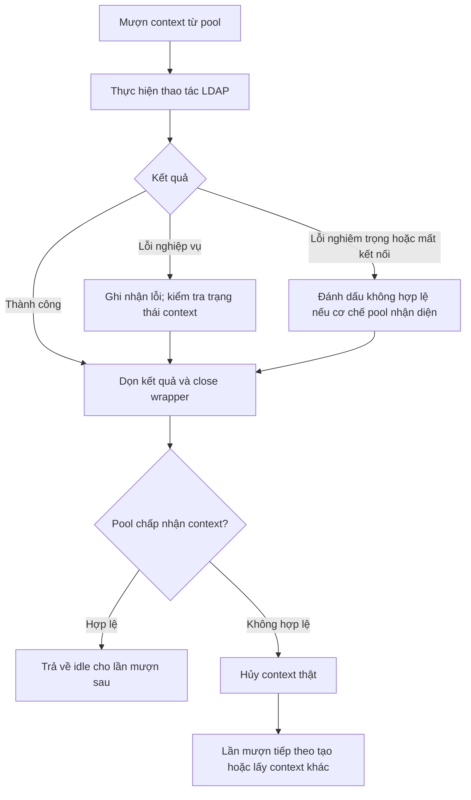

# Context không thể tái sử dụng sau thao tác bất thường

Khi dùng **Spring LDAP**, một context được mượn từ pool thường được trả lại sau thao tác `search`, `lookup` hoặc `modifyAttributes` để request kế tiếp tái sử dụng. Tuy nhiên, nếu kết nối đứt giữa chừng, LDAP server khởi động lại hoặc trạng thái xác thực của context bị thay đổi, việc tiếp tục tái sử dụng context cũ có thể gây lỗi lặp lại, làm tăng độ trễ hoặc nghiêm trọng hơn là thực hiện lệnh dưới danh tính không như mong đợi.

Chủ đề **“Context không thể tái sử dụng sau thao tác bất thường”** thuộc chương **Pooling** của **SPRING_LDAP**. Mục tiêu là phân biệt lỗi nghiệp vụ với lỗi làm mất tính hợp lệ của context, hiểu cách pool loại bỏ kết nối hỏng, áp dụng xử lý ngoại lệ và retry an toàn khi làm việc với LDAP qua `ContextSource`, `LdapTemplate`, `LdapClient` hoặc ODM. Kiến thức này liên hệ trực tiếp tới DN, schema, filter, xác thực, TLS, quản lý tài nguyên và kiểm thử truy cập thư mục.

## 1. “Không thể tái sử dụng” thực sự có nghĩa gì?

Một LDAP context (thường là `DirContext` hoặc `LdapContext`) đại diện cho môi trường thực hiện thao tác thư mục theo cấu hình kết nối và danh tính xác thực cụ thể. Tùy JNDI provider, kết nối vật lý có thể được tạo khi khởi tạo context hoặc vào lúc thao tác đầu tiên. Trong hệ thống có pool, context đã sử dụng có thể quay về trạng thái rảnh (**idle**) để mượn lại.

Context chỉ phù hợp để tái sử dụng khi các điều kiện quan trọng vẫn đúng:

1. Kết nối và phiên làm việc với LDAP server còn hoạt động hoặc có thể phục hồi đúng hợp đồng của provider.
2. Trạng thái context vẫn phù hợp: danh tính bind, bảo mật TLS, môi trường JNDI và quyền truy cập không bị thay đổi ngoài ý muốn.
3. Tất cả kết quả tìm kiếm dạng stream/enumeration và các tài nguyên liên quan đã được sử dụng, đóng hoặc dọn đúng cách.
4. Không có lỗi nghiêm trọng khiến client **không thể tin cậy** rằng context còn ở trạng thái dùng được.
5. Context đã được trả về pool đúng vòng đời; không bị đồng thời dùng bởi một request khác.

“Không tái sử dụng” **không đồng nghĩa** “mọi lệnh LDAP bị lỗi đều phải hủy context”. Một filter sai hoặc DN không tồn tại có thể tạo ra phản hồi lỗi hợp lệ từ server trong khi kết nối vẫn tốt. Ngược lại, mất kết nối khi chưa nhận đủ phản hồi có thể khiến context không đáng tin cậy dù chưa có thông báo rõ ràng về trạng thái socket.

| Kết quả thao tác | Trạng thái có thể có của context | Hành động hợp lý |
|---|---|---|
| Lệnh thành công; không thay đổi trạng thái phiên | Thường vẫn hợp lệ | Đóng wrapper để hoàn trả cho pool |
| Server trả lỗi nghiệp vụ rõ ràng | Kết nối **có thể** vẫn hợp lệ | Xử lý lỗi nghiệp vụ; pool/validator quyết định việc giữ lại |
| Lỗi truyền thông, kết nối reset hoặc server ngắt phiên | Có khả năng không hợp lệ | Không cố dùng lại cùng context; để pool loại bỏ/thay thế |
| Thay bind principal, môi trường xác thực hoặc trạng thái TLS | Không còn đúng giả định của pool | Không trả vào pool dùng chung như context ban đầu |
| Không đóng context hoặc enumeration sau khi lỗi | Tài nguyên vẫn đang bị giữ | Dọn trong `finally`, tránh làm cạn pool |

## 2. Phân loại ngoại lệ LDAP trước khi quyết định

JNDI cung cấp các ngoại lệ thuộc họ `javax.naming.NamingException`; `LdapTemplate` thường chuyển chúng thành ngoại lệ Spring LDAP/DataAccess tương ứng. Việc phân loại nên dựa trên **nguyên nhân và trạng thái tài nguyên**, thay vì chỉ tìm chuỗi thông báo lỗi.

| Tình huống và ví dụ ngoại lệ JNDI | Ý nghĩa thường gặp | Hệ quả đối với context và retry |
|---|---|---|
| `NameNotFoundException` | DN cần đọc không tồn tại | Không chứng minh kết nối hỏng; báo không tìm thấy, không retry mù quáng |
| `InvalidSearchFilterException`, `InvalidNameException` | Filter/DN không hợp lệ | Sửa đầu vào hoặc code; tạo kết nối mới không giúp |
| `NoPermissionException` | Bind DN không có quyền thực hiện thao tác | Thường là vấn đề quyền; không đổi principal ngay trên context đang pool |
| `AuthenticationException` khi bind | Credential sai, hết hiệu lực hoặc bị từ chối | Không dùng phiên thất bại như phiên đã xác thực; sửa credential, xử lý khóa tài khoản và ranh giới danh tính |
| `CommunicationException` | Lỗi mạng, reset hoặc đứt kết nối | Cần coi kết nối có nguy cơ hỏng; hủy/thay context theo chính sách pool |
| `ServiceUnavailableException` | Dịch vụ hoặc server không khả dụng | Context có thể không dùng tiếp được; kiểm tra kết nối và cơ chế khôi phục |
| `TimeLimitExceededException`, `SizeLimitExceededException` | Vượt giới hạn thời gian/số kết quả của LDAP | Không tự kết luận socket hỏng; cần đóng enumeration và đánh giá tình trạng phiên |
| Timeout đọc socket khi lệnh đang chạy | Không nhận được phản hồi đầy đủ | Có thể không rõ server đã thực hiện lệnh hay chưa; tránh tái sử dụng mù quáng và retry ghi |

Một exception có thể bị bọc bởi nhiều lớp. Ví dụ `CommunicationException` ở JNDI có thể trở thành exception Spring ở lớp nghiệp vụ; nên quan sát nguyên nhân gốc, mã kết quả LDAP và log server để kết luận. Danh sách trên là **hướng dẫn chẩn đoán**, không phải bảo đảm mọi JNDI provider đánh dấu context lỗi giống nhau.

### Một lỗi nghiệp vụ không làm kết nối tự động hỏng

Giả sử ứng dụng tìm `uid=missing` dưới `ou=people,dc=example,dc=org` nhưng không có entry nào khớp. LDAP server có thể trả một tập kết quả rỗng. Khi ứng dụng `lookup` trực tiếp một DN không tồn tại, có thể nhận `NameNotFoundException`. Trong cả hai trường hợp, sự vắng mặt của dữ liệu không đủ để kết luận rằng socket đã bị đóng.

Tương tự, nếu một tài khoản dịch vụ quyền đọc thử sửa `userPassword` và bị từ chối, đây là thất bại về phân quyền. Mở một kết nối mới bằng cùng DN và quyền thường không giải quyết được nguyên nhân.

### Lỗi truyền thông khiến lần mượn kế tiếp có nguy cơ thất bại

Ví dụ firewall đóng TCP socket sau thời gian nhàn rỗi nhưng pool vẫn còn giữ wrapper của context. Nếu pool trả lại context không được kiểm tra, `search` có thể lỗi I/O ngay khi gửi yêu cầu. Nếu kết nối đã bị reset trong lúc một phép tìm kiếm đang chạy, trạng thái của response và các tài nguyên đang đọc có thể cũng không còn tin cậy. Đường an toàn là loại context lỗi và tạo tài nguyên mới theo chính sách pool, không cố tiếp tục sử dụng **cùng instance** sau ngoại lệ nghiêm trọng.

## 3. Pool và wrapper biết context hỏng bằng cách nào?

Với một pool context như `PoolingContextSource`, code nghiệp vụ không nên giữ `DirContext` thật lâu dài. Pool có thể cấp một wrapper như `DelegatingDirContext` hoặc `DelegatingLdapContext`; khi wrapper được đóng, nó trả context thật về pool hoặc khiến pool hủy context tùy trạng thái.

Một số cơ chế hỗ trợ phát hiện context hỏng:

- **Kiểm tra ngoại lệ trong wrapper:** loại exception nghiêm trọng có thể khiến wrapper đánh dấu context không còn phù hợp để tái sử dụng. Các phiên bản API `PoolingContextSource` có cơ chế cấu hình danh sách ngoại lệ không thể phục hồi, thường được gọi là `nonTransientExceptions`; cần đối chiếu cách cấu hình cụ thể với thư viện đang dùng.
- **Validation trước khi mượn:** `testOnBorrow` dùng `DirContextValidator` kiểm tra context rảnh trước khi cấp cho request.
- **Validation khi trả:** `testOnReturn` có thể kiểm tra context trước khi giữ lại ở pool.
- **Validation lúc idle:** `testWhileIdle`, kết hợp lịch eviction, kiểm tra các context rảnh ngoài đường nóng của request.
- **Loại bỏ vì chính sách pool:** context rảnh quá lâu, vượt giới hạn idle hoặc bị dọn khi pool đóng cũng có thể bị hủy dù chưa từng phát sinh lỗi nghiệp vụ.



**Không có validator nào bảo đảm 100%**: server có thể đóng kết nối ngay sau lần kiểm tra thành công. Ngoài ra, một validator chỉ thử lệnh đọc đơn giản không thể chứng minh rằng context có quyền sửa một DN cụ thể hoặc đã hoàn toàn được khôi phục sau mọi thay đổi trạng thái.

## 4. Quản lý vòng đời đúng khi có exception

### Khi dùng `LdapTemplate`

Trong phần lớn ứng dụng Spring LDAP, nên để `LdapTemplate` quản lý lấy và giải phóng context. Template thực thi thao tác và dọn tài nguyên sau đó; pool được cấu hình ở `ContextSource` nên mã nghiệp vụ thường không trực tiếp thao tác với context.

```java
import java.util.List;
import org.springframework.ldap.core.AttributesMapper;
import org.springframework.ldap.core.LdapTemplate;
import org.springframework.ldap.query.LdapQuery;

import static org.springframework.ldap.query.LdapQueryBuilder.query;

public final class DirectoryLookupService {
    private final LdapTemplate ldapTemplate;

    public DirectoryLookupService(LdapTemplate ldapTemplate) {
        this.ldapTemplate = ldapTemplate;
    }

    public List<String> findCommonNames(String uid) {
        LdapQuery ldapQuery = query()
                .base("ou=people")
                .where("uid").is(uid);

        return ldapTemplate.search(ldapQuery,
                (AttributesMapper<String>) attrs -> {
                    if (attrs.get("cn") == null) {
                        return null;
                    }
                    return (String) attrs.get("cn").get();
                });
    }
}
```

Nếu server trả ngoại lệ nghiêm trọng, code phía trên không cần cố dùng lại context bằng tay. Tùy Spring LDAP và provider, exception được chuyển đổi; pool nhận lại hoặc loại tài nguyên theo hợp đồng cấu hình. Đoạn ví dụ dùng `LdapQueryBuilder` để tạo filter từ giá trị `uid` thay vì nối chuỗi filter thô. Pooling không thay thế escaping, phân trang, giới hạn kết quả hoặc kiểm tra quyền truy cập.

### Khi sử dụng JNDI trực tiếp

Nếu không dùng template, trách nhiệm đóng context thuộc về code đã mượn:

```java
import javax.naming.NamingException;
import javax.naming.directory.Attributes;
import javax.naming.directory.DirContext;
import org.springframework.ldap.core.ContextSource;

public class DirectAttributesReader {
    private final ContextSource contextSource;

    public DirectAttributesReader(ContextSource contextSource) {
        this.contextSource = contextSource;
    }

    public Attributes read(String relativeDn) throws NamingException {
        DirContext ctx = contextSource.getReadOnlyContext();
        try {
            return ctx.getAttributes(relativeDn, new String[]{"cn", "mail"});
        } finally {
            ctx.close(); // Đóng wrapper để pool nhận trả/loại context.
        }
    }
}
```

`finally` vẫn chạy khi `getAttributes` ném ngoại lệ; nhưng khi cả thao tác và `close()` đều lỗi, exception đóng có thể che exception ban đầu nếu không được xử lý thận trọng. Trong ứng dụng thực tế, dùng cơ chế dọn tài nguyên của Spring hoặc ghi nhận lỗi đóng riêng để không mất nguyên nhân gốc. `DirContext` không mặc nhiên là `AutoCloseable` để sử dụng trực tiếp trong `try-with-resources`.

Với `DirContext.search(...)`, đối tượng `NamingEnumeration<SearchResult>` có vòng đời riêng. Phải đóng enumeration theo hợp đồng JNDI (thường trong `finally`), kể cả khi đọc kết quả bị ngắt giữa chừng. Đừng đóng context rồi tiếp tục duyệt enumeration, và đừng giữ enumeration qua thời điểm wrapper đã được trả cho pool.

## 5. Cấu hình phát hiện context cũ không còn dùng được

Ví dụ sau minh họa các chính sách validation trong API `org.springframework.ldap.pool.factory.PoolingContextSource`. Đây là họ pool dựa trên Commons Pool 1; `org.springframework.ldap.pool2.factory.PooledContextSource` thuộc họ Commons Pool 2, có API và cách cấu hình khác. Cần đối chiếu với phiên bản Spring LDAP thực tế trước khi sử dụng.

```java
import org.springframework.beans.factory.annotation.Qualifier;
import org.springframework.context.annotation.Bean;
import org.springframework.context.annotation.Configuration;
import org.springframework.ldap.core.LdapTemplate;
import org.springframework.ldap.core.support.LdapContextSource;
import org.springframework.ldap.pool.factory.PoolingContextSource;
import org.springframework.ldap.pool.validation.DefaultDirContextValidator;

@Configuration
public class DirectoryPoolConfiguration {

    @Bean
    PoolingContextSource pooledContextSource(
            @Qualifier("ldapRawContextSource") LdapContextSource raw) {
        // raw phải được cấu hình URL, base DN, DN/mật khẩu dịch vụ
        // và TLS hợp lệ ở bean khác; tắt JNDI native pooling trên raw.
        PoolingContextSource pool = new PoolingContextSource(raw);
        pool.setMaxActive(8);
        pool.setMaxIdle(4);
        pool.setMaxWait(2_000L);

        pool.setDirContextValidator(new DefaultDirContextValidator());
        pool.setTestOnBorrow(true);
        pool.setTestOnReturn(false);
        pool.setTestWhileIdle(true);
        pool.setTimeBetweenEvictionRunsMillis(60_000L);
        pool.setMinEvictableIdleTimeMillis(300_000L);
        return pool;
    }

    @Bean
    LdapTemplate ldapTemplate(PoolingContextSource pooledContextSource) {
        return new LdapTemplate(pooledContextSource);
    }
}
```

Các giá trị trên chỉ để minh họa. Ví dụ, `testOnBorrow=true` giúp phát hiện context đã bị firewall đóng trong lúc idle nhưng có thể thêm một LDAP round-trip trước mỗi lượt mượn. `testWhileIdle=true` chỉ có tác dụng khi cơ chế quét idle đã được cấu hình và vận hành. Nếu validator mặc định tìm kiếm ở một DN mà tài khoản bind không được đọc, nó có thể kết luận sai rằng context hỏng.

Không nên mặc định đặt mọi exception vào nhóm “không thể phục hồi”. `NameNotFoundException` do DN không tồn tại và `CommunicationException` do socket đứt có ý nghĩa khác nhau. Tùy cơ chế, có thể khai báo các ngoại lệ không thể phục hồi và dùng validator để kiểm tra trạng thái trước khi tái sử dụng. Quan trọng là **kiểm tra lỗi gốc và phép validation thực tế**, không chỉ bật nhiều cờ.

## 6. Những trạng thái thay đổi khiến context không nên quay về pool

Không cần một exception rõ ràng mới phát sinh rủi ro. Một context đang còn kết nối cũng không nên quay về pool chung nếu trạng thái của nó đã bị thay đổi:

| Thay đổi xảy ra khi mượn | Nguy cơ khi tái sử dụng | Cách xử lý |
|---|---|---|
| Bind lại với principal hoặc credential khác | Request kế tiếp có thể thực hiện với danh tính sai | Không dùng chung pool dịch vụ cho xác thực theo từng người dùng |
| Thay đổi thuộc tính xác thực trong JNDI environment | Trạng thái phiên không còn khớp cấu hình tạo pool | Giữ môi trường kết nối ổn định; tạo nguồn context khác khi cần |
| Đàm phán StartTLS rồi không xử lý vòng đời TLS đúng | Kết nối còn ở trạng thái bảo mật khác dự kiến | Dùng chiến lược TLS có vòng đời rõ ràng; không tái sử dụng tùy tiện |
| Lỗi khi đang đọc dở `NamingEnumeration` | Tài nguyên tìm kiếm còn mở hoặc phản hồi chưa hoàn chỉnh | Đóng enumeration và context; đánh giá tính hợp lệ trước khi tái sử dụng |
| Sử dụng wrapper sau khi đã `close()` | Context thật có thể đã được mượn bởi thread khác | Không giữ wrapper ngoài phạm vi thao tác |
| Đổi mật khẩu tài khoản dịch vụ hoặc endpoint | Phiên cũ và cấu hình mới có thể cùng tồn tại | Tái tạo pool theo quy trình xoay vòng cấu hình/secret |

**Tách danh tính là yêu cầu bảo mật.** `PoolingContextSource` thường phân loại context theo loại đọc/ghi chứ không mặc định tách theo principal của từng request. Một pool dùng credential dịch vụ cố định không phù hợp để chứa các context vừa bind bằng tài khoản người dùng A, B, C. Khi cần `authenticate` bằng credential riêng, dùng luồng xác thực phù hợp, tránh biến context đã xác thực thành một tài nguyên chia sẻ sai ranh giới.

Với LDAPS hoặc StartTLS, luôn xác minh chứng chỉ server và cấu hình trust store phù hợp. Nếu một kết nối phải bị hủy do lỗi TLS, không chuyển sang kết nối không mã hóa để “giữ cho pool hoạt động”.

## 7. Thao tác bất thường và nguy cơ retry hai lần

Vấn đề nguy hiểm nhất thường không nằm ở pool mà ở **kết quả nghiệp vụ chưa rõ ràng**. Hãy xét trường hợp ứng dụng gửi một thao tác sửa entry nhưng socket bị ngắt trước khi nhận được phản hồi:

```text
Ứng dụng                      LDAP server
   |                               |
   | --- modifyAttributes -------> |
   |                               | cập nhật có thể đã hoàn tất
   | <--- phản hồi bị mất --- X     |
   |                               |
   | thấy timeout/CommunicationException
   | không biết chắc thay đổi đã áp dụng
```

Có hai khả năng: server chưa thực hiện lệnh, hoặc đã thực hiện nhưng phản hồi bị mất. **Tạo context mới không giải quyết được sự bất định đó.**

| Nhóm thao tác | Retry sau lỗi kết nối | Điều kiện cần |
|---|---|---|
| `search`, `getAttributes` | Thường có thể thử lại có giới hạn | Giới hạn số lần, timeout, backoff; kết quả có thể thay đổi giữa hai lần đọc |
| `modifyAttributes` với phép thay thế một giá trị | Có thể thiết kế retry an toàn hơn | Đọc lại trạng thái bằng context mới, so sánh giá trị mong muốn, cân nhắc concurrency |
| Thêm thành viên nhóm hoặc sửa thuộc tính đa trị | Có nguy cơ ghi trùng hoặc va chạm | Kiểm tra entry hiện có, schema, xử lý kết quả tương ứng và điều kiện cạnh tranh |
| `bind` / thêm entry / xóa entry | Không retry mù quáng | Kiểm tra kết quả hiện tại và tính lặp an toàn của nghiệp vụ |
| `authenticate` với mật khẩu người dùng | Không tự động thử liên tục | Tránh gây khóa tài khoản, tuân thủ hạn mức và chính sách bảo mật |

Với hệ thống quan trọng, thiết kế thao tác ghi dựa trên trạng thái hiện tại, dùng kiểm tra trước khi thay đổi hoặc cơ chế kiểm soát cạnh tranh phù hợp với LDAP server. Nếu không xác định được tác vụ đã hoàn tất, báo trạng thái **chưa xác định** cho tầng nghiệp vụ thay vì tự động tuyên bố thất bại tuyệt đối.

### Mẫu quyết định khi phát hiện lỗi

1. **Xác định loại thao tác:** đọc hay ghi, có tác dụng phụ hay không.
2. **Đánh giá nguyên nhân:** kết quả LDAP hợp lệ, lỗi dữ liệu, lỗi quyền, timeout hay đứt kết nối.
3. **Dọn tài nguyên:** đóng enumeration, đóng/trả wrapper; để cơ chế pool loại context không hợp lệ.
4. **Quyết định có thử lại:** ưu tiên phép đọc idempotent; giới hạn số lần và thời gian chờ; với phép ghi chưa rõ kết quả, xác minh trạng thái trước.
5. **Giám sát:** ghi loại lỗi, thời gian, endpoint và correlation ID; không log mật khẩu hoặc dữ liệu thư mục nhạy cảm.

## 8. Phân biệt ba tầng timeout

Khi lỗi xảy ra, “timeout” có thể đến từ các tầng khác nhau:

| Tầng | Ví dụ | Hệ quả |
|---|---|---|
| Chờ mượn context từ pool | `maxWait` của pool | Có thể chưa hề gửi thao tác LDAP; cần kiểm tra pool cạn/rò rỉ |
| Kết nối TCP, bắt tay TLS, LDAP bind | Connect timeout hoặc lỗi certificate | Có thể chưa thiết lập được context hợp lệ |
| Chờ server trả phản hồi search/modify | Read timeout, LDAP time/size limit | Có thể đã gửi lệnh; riêng thao tác ghi có thể không rõ server đã áp dụng hay chưa |

Để xử lý đúng, cần biết **lệnh đã được gửi đến server hay chưa**. Ví dụ timeout khi chờ một context rảnh hoàn toàn khác timeout sau khi `modifyAttributes` được gửi. Cũng cần phân biệt timeout LDAP từ phía server với timeout đọc socket phía client; chúng không nhất thiết làm context mất tính hợp lệ theo cùng cách.

Không dùng một cơ chế retry chung cho mọi exception: lặp lại một filter sai không hữu ích, retry lỗi xác thực có thể dẫn đến khóa tài khoản, còn retry ghi không có kiểm soát có thể tạo tác dụng phụ.

## 9. Cách đo context lỗi và xác minh khả năng phục hồi

Trong môi trường thử nghiệm, nên mô phỏng lỗi mạng, LDAP server restart, lỗi quyền và kết quả trả về lớn để quan sát cách pool xử lý. Các tín hiệu quan trọng:

| Chỉ số hoặc triệu chứng | Diễn giải có thể | Hướng điều tra |
|---|---|---|
| Số context bị hủy tăng mạnh sau restart | Pool đang loại tài nguyên stale | Kiểm tra sau đó có tạo được context mới và hết lỗi không |
| Lỗi `CommunicationException` lặp lại qua nhiều request | Context stale hoặc kết nối đến server vẫn hỏng | Xem validator, idle timeout, mạng và DNS/failover |
| `numActive` tăng mãi, `numIdle` giảm | Context không được đóng hoặc thao tác bị treo | Rà soát `finally`, enumeration, timeout, thread dump |
| `testOnBorrow` làm tăng độ trễ p95 | Validator thêm LDAP round-trip | Đo tỷ lệ lỗi giảm và chi phí kiểm tra để chọn chính sách |
| Validation báo hỏng cả khi server đang chạy | Validator dùng DN/filter không đọc được | Kiểm tra bind DN, base DN, schema và quyền |
| Sau xoay vòng mật khẩu xuất hiện lỗi không nhất quán | Pool còn phiên bind cũ trong lúc đã đổi credential | Kiểm tra quy trình thay pool và kết nối mới |

**Bài thực hành đề xuất:**

1. Dùng một LDAP server thử nghiệm với tài khoản bind quyền đọc và `LdapTemplate` chạy `search` theo `uid` trong `ou=people`. Theo dõi số context active/idle và thời gian truy vấn.
2. Đưa một DN không tồn tại và một filter sai. Ghi lại loại exception; xác nhận request hợp lệ kế tiếp vẫn hoạt động mà không bắt buộc phải tạo kết nối mới.
3. Ngắt kết nối sau khi context idle hoặc restart LDAP server thử nghiệm. So sánh hành vi với `testOnBorrow` tắt/bật, số context bị loại, số lần lỗi và thời gian phục hồi.
4. Dùng một entry thử nghiệm, thực hiện thao tác sửa có thể kiểm chứng. Mô phỏng mất phản hồi rồi đọc lại entry từ **context hợp lệ mới**; tránh retry khi chưa rõ trạng thái.
5. Tự mượn `DirContext` và tạo nhánh exception có chủ đích; xác minh `finally` đóng wrapper và `numActive` không tăng liên tục.

Chỉ thực hiện fault injection và thao tác ghi trên môi trường lab. Không cắt kết nối hoặc thử mật khẩu sai hàng loạt trên LDAP production.

## 10. Câu hỏi tự kiểm tra

1. Vì sao `NameNotFoundException` và `CommunicationException` không nên dẫn đến quyết định hủy context giống nhau trong mọi trường hợp?
2. Điều gì xảy ra nếu một context đang active không được `close()` sau ngoại lệ?
3. Vì sao `testOnBorrow` giảm rủi ro nhưng không bảo đảm không còn lỗi kết nối?
4. Tại sao một context đã bind lại dưới danh tính người dùng khác không nên được trả vào pool chung của tài khoản dịch vụ?
5. Khi một lệnh `modifyAttributes` bị timeout sau khi gửi, vì sao chỉ tạo kết nối mới rồi gửi lại là chưa đủ?
6. Cần quan sát những chỉ số gì để phân biệt pool cạn với LDAP server không khả dụng?

**Kết luận:** context không thể tái sử dụng khi tính hợp lệ của kết nối, môi trường xác thực hoặc trạng thái tài nguyên không còn được bảo đảm. Cách xử lý đúng là **phân loại lỗi → dọn tài nguyên → để pool kiểm tra/loại context hỏng → khôi phục bằng context phù hợp**, đồng thời quyết định retry dựa trên loại thao tác và khả năng server đã áp dụng thay đổi. Pooling chỉ an toàn khi cơ chế quản lý vòng đời kết hợp đúng với bảo mật LDAP, TLS và xử lý lỗi nghiệp vụ.

### Tài liệu tham khảo

- [Spring LDAP Reference Documentation](https://docs.spring.io/spring-ldap/reference/)
- [Spring LDAP API Documentation](https://docs.spring.io/spring-ldap/docs/current/api/)
- [Java Naming and Directory Interface (JNDI) — NamingException](https://docs.oracle.com/en/java/javase/17/docs/api/java.naming/javax/naming/NamingException.html)
