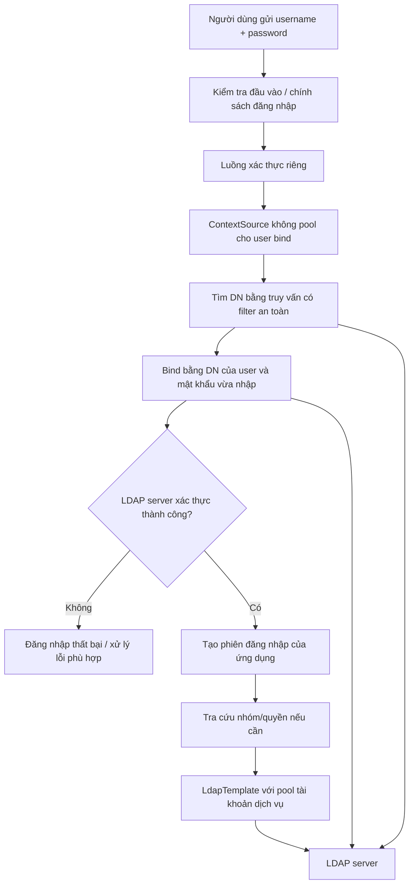

# Pooling với authentication theo user

Trong **Spring LDAP**, tái sử dụng context thường giúp giảm chi phí mở kết nối TCP, bắt tay TLS và bind khi ứng dụng liên tục tra cứu thuộc tính, nhóm hoặc entry của người dùng. Tuy nhiên, **xác thực theo từng người dùng** (user authentication) có yêu cầu khác việc tra cứu bằng một tài khoản dịch vụ: một lần đăng nhập phải kiểm tra **danh tính và mật khẩu của đúng người đang đăng nhập**. Nếu một pool trả lại context vốn đã bind bằng người khác, hoặc trả một phiên đã xác thực mà không kiểm tra mật khẩu mới, tính đúng đắn và tính bảo mật của hệ thống có thể bị ảnh hưởng.

Bài học thuộc chương **Pooling** của module **SPRING_LDAP**. Chúng ta sẽ phân biệt hai loại bind, tìm hiểu vì sao pool dùng chung có thể không phù hợp cho xác thực theo user, thiết kế luồng tách biệt với `ContextSource`, `LdapTemplate` và Spring Security, đồng thời kiểm tra TLS, DN, filter, schema, ngoại lệ và hành vi của LDAP server. Các nguyên tắc cũng hữu ích cho ứng dụng dùng `LdapClient` hoặc ODM để thực hiện những thao tác entry sau đăng nhập.

## 1. Hai mục đích truy cập LDAP không giống nhau

**Service-account bind:** ứng dụng dùng một DN dịch vụ ổn định, ví dụ `cn=app-reader,ou=services,dc=example,dc=org`, để đọc thông tin tài khoản, nhóm hoặc quyền. Nhiều request thực hiện cùng loại truy vấn với **cùng một danh tính LDAP**, nên pool có thể tái sử dụng context được tạo bằng credential của dịch vụ.

**User bind:** khi người dùng đăng nhập, ứng dụng yêu cầu LDAP server xác thực **DN của chính người dùng** và mật khẩu họ vừa cung cấp. Thành công chỉ có ý nghĩa đối với cặp danh tính–credential của lần xác thực đó; kết quả không được suy ra chỉ từ một context khác đang tồn tại trong pool.

| Khía cạnh | Truy vấn bằng tài khoản dịch vụ | Xác thực theo user |
|---|---|---|
| Danh tính dùng để bind | DN dịch vụ cố định | DN của từng người dùng |
| Credential | Secret của ứng dụng, quản lý tập trung | Mật khẩu do người dùng cung cấp cho lần xác thực |
| Mục tiêu | Đọc/ghi entry trong quyền được cấp | Kiểm tra credential của một danh tính cụ thể |
| Khả năng tái sử dụng | Hợp lý khi nguồn context có cấu hình ổn định | Cần xem xét riêng; không chia sẻ phiên đã bind giữa các user |
| Rủi ro chính | Pool cạn, credential dịch vụ bị xoay vòng, context stale | Nhầm danh tính, bỏ qua kiểm tra mật khẩu mới, rò rỉ quyền truy cập |
| Cách triển khai thường phù hợp | `PoolingContextSource` hoặc pool tương thích | Bind mới theo mỗi lần xác thực qua nguồn context **không pool theo user** |

Trong nhiều hệ thống, *cả hai* luồng cùng tồn tại: ứng dụng dùng tài khoản dịch vụ để tìm DN chính xác từ `uid`, rồi dùng user bind để kiểm tra mật khẩu. Sau khi xác thực thành công, các thao tác tra cứu nhóm bằng tài khoản dịch vụ có thể tiếp tục dùng pool.

## 2. Vì sao không nên dùng chung context đã bind theo user?

### 2.1. Rủi ro sai danh tính

Giả sử một pool chỉ phân loại context theo `read-only`/`read-write` nhưng bên tạo context lấy principal động từ request:

```text
Request A: uid=alice + password A
        → pool tạo context → LDAP bind dưới DN Alice
        → xử lý xong → trả context vào nhóm read-only

Request B: uid=bob + password B
        → mượn context idle trong cùng nhóm
        → context thực tế vẫn có thể đang bind dưới DN Alice
```

Nếu pool **không khóa phân loại theo danh tính và trạng thái xác thực**, request B có thể dùng quyền của Alice; đây là rủi ro bảo mật, không đơn thuần là lỗi hiệu năng. Không nên biến `AuthenticationSource` phụ thuộc request thành nguồn context gốc cho một `PoolingContextSource` dùng chung khi chưa chứng minh được cơ chế phân vùng theo danh tính và credential.

### 2.2. Tái sử dụng phiên không chứng minh mật khẩu mới đúng

Một phiên LDAP đã bind thành công không đồng nghĩa lần nhập mật khẩu mới của người dùng cũng đúng. Nếu ứng dụng “xác thực” bằng cách lấy một context đã bind sẵn rồi xem đó là bằng chứng đăng nhập, nó có thể bỏ qua việc kiểm tra credential vừa gửi. Thay đổi mật khẩu hoặc vô hiệu hóa tài khoản cũng có thể không lập tức hủy mọi phiên đang tồn tại, tùy chính sách server. **Xác thực đăng nhập phải có bằng chứng từ cơ chế kiểm tra credential phù hợp với lần đăng nhập đó.**

### 2.3. Pool theo từng user có thể tốn kém

Có thể có hệ thống pool phân nhóm theo principal và credential, nhưng cách này khác xa pool chung theo tài khoản dịch vụ:

- Số nhóm kết nối tăng theo số người dùng và sự thay đổi credential.
- Một số lượng lớn phiên ít dùng có thể giữ socket và tài nguyên server.
- Mật khẩu đổi, tài khoản bị khóa hoặc quyền bị thu hồi làm vòng đời context phức tạp hơn.
- Cần bảo đảm không trộn phiên của hai danh tính, không tái dùng phiên cũ như một lần kiểm tra mật khẩu mới và không giữ credential nhạy cảm ngoài ý muốn.

Vì vậy, một cơ chế pooling có khả năng phân tách theo credential **không tự động** là lựa chọn đúng cho chức năng đăng nhập. Nếu thật sự cần pool theo user cho những thao tác LDAP *sau khi đã xác thực*, phải thiết kế riêng danh tính, quyền, thời hạn phiên và cơ chế thu hồi; không áp dụng mặc định cho mỗi lần kiểm tra mật khẩu.

## 3. Kiến trúc khuyến nghị: tách tra cứu và xác thực

Thiết kế đơn giản, dễ kiểm soát trong Spring LDAP:



Hai nguồn context có hợp đồng khác nhau:

1. **`servicePooledContextSource`:** dùng credential cố định của ứng dụng; phục vụ tìm kiếm và đọc thuộc tính thường xuyên. Pool trả context về sau mỗi thao tác.
2. **`authenticationContextSource`:** dùng trong luồng đăng nhập, thực hiện bind theo người dùng qua API xác thực; không tái sử dụng một context đã bind user A cho user B. Một nguồn riêng có thể dùng tài khoản dịch vụ để *tìm DN* nhưng phải tạo context mới cho bước *user bind*.

Lợi ích của việc tách luồng là dễ quan sát số lượng đăng nhập thực, tỷ lệ bind thất bại, độ trễ truy vấn theo dịch vụ và vòng đời credential. Khi thay đổi chính sách pooling, quá trình kiểm tra mật khẩu không bị thay đổi âm thầm.

**Ghi nhớ:** user đăng nhập với DN cá nhân không có nghĩa mọi truy vấn LDAP tiếp theo phải dùng bind cá nhân của họ. Ứng dụng có thể ủy quyền ở tầng nghiệp vụ rồi dùng tài khoản dịch vụ có quyền tối thiểu để đọc thông tin nhóm. Tuy nhiên, phải thực thi kiểm tra phân quyền tương ứng; pool không tự đảm bảo phân quyền ở tầng ứng dụng.

## 4. Tra cứu DN đúng cách trước khi bind

Người dùng thường nhập `uid` hoặc email, **không nhập đầy đủ DN**. Ứng dụng phải tìm được một DN duy nhất tương ứng với tài khoản cần xác thực, ví dụ:

```text
Username nhập:  alice
Base DN:         dc=example,dc=org
Search base:     ou=people
Filter:          (uid=alice)
DN tìm được:     uid=alice,ou=people,dc=example,dc=org
```

Không ghép chuỗi chưa kiểm tra:

```java
// Tránh cách này: username có thể chứa ký tự đặc biệt của LDAP filter.
String filter = "(uid=" + username + ")";
```

Sử dụng API tạo query của Spring LDAP để escaping giá trị:

```java
import org.springframework.ldap.query.LdapQuery;
import static org.springframework.ldap.query.LdapQueryBuilder.query;

LdapQuery loginQuery = query()
        .base("ou=people")
        .where("uid").is(username);
```

Một số quy tắc cần có:

- **Filter escaping khác DN escaping.** Khi tìm kiếm theo `uid`, dùng builder cho giá trị filter; nếu xây DN, dùng API xử lý DN chứ không nối tên tùy ý.
- Chỉ chấp nhận DN thuộc phạm vi tìm kiếm dự kiến; tránh để người dùng chỉ định base DN hoặc LDAP endpoint.
- Với `uid` có thể trùng, quy định rõ xử lý khi có **0, 1 hoặc nhiều** entry khớp. Không chọn bừa entry đầu tiên nếu ứng dụng cần định danh duy nhất.
- Xác định thuộc tính đăng nhập đúng theo schema của server. LDAP server có thể dùng `uid`, `sAMAccountName` hoặc `userPrincipalName`, nhưng không nên mặc định chúng là tương đương.
- Nếu directory cho phép tài khoản bị vô hiệu hóa hoặc yêu cầu chính sách riêng, xử lý trạng thái tài khoản theo cơ chế LDAP/server tương ứng.

Các danh tính LDAP có thể dùng DN chứa dấu phẩy, dấu cộng, khoảng trắng và ký tự đặc biệt. Việc dùng đúng DN do directory trả về giúp tránh giả định đơn giản rằng mọi user luôn có DN dạng `uid=<username>,ou=people,...`.

## 5. Ví dụ Spring LDAP: hai `ContextSource` cho hai nhiệm vụ

Ví dụ sau minh họa Java Config cho một ứng dụng có hai luồng. Nguồn truy vấn dùng một tài khoản dịch vụ **cố định** và được bọc bởi `PoolingContextSource`. Nguồn xác thực là `LdapContextSource` riêng, đặt `setPooled(false)` để không bật **JNDI native connection pooling**. Cần kiểm tra dependency và API đúng theo **phiên bản Spring LDAP**: ví dụ sử dụng lớp `org.springframework.ldap.pool.factory.PoolingContextSource` thuộc họ Commons Pool 1; họ `org.springframework.ldap.pool2.factory.PooledContextSource` có cách cấu hình khác.

```java
import org.springframework.beans.factory.annotation.Qualifier;
import org.springframework.context.annotation.Bean;
import org.springframework.context.annotation.Configuration;
import org.springframework.core.env.Environment;
import org.springframework.ldap.core.LdapTemplate;
import org.springframework.ldap.core.support.LdapContextSource;
import org.springframework.ldap.pool.factory.PoolingContextSource;

@Configuration
public class LdapAuthenticationConfiguration {

    private LdapContextSource configuredSource(Environment env) {
        LdapContextSource source = new LdapContextSource();
        source.setUrl(env.getRequiredProperty("app.ldap.url"));
        source.setBase(env.getRequiredProperty("app.ldap.base"));
        source.setUserDn(env.getRequiredProperty("app.ldap.service-dn"));
        source.setPassword(env.getRequiredProperty("app.ldap.service-password"));
        source.setPooled(false);
        return source;
    }

    // Cùng DN dịch vụ cố định, dành cho truy vấn có tần suất cao.
    @Bean("serviceRawContextSource")
    LdapContextSource serviceRawContextSource(Environment env) {
        return configuredSource(env);
    }

    @Bean("servicePooledContextSource")
    PoolingContextSource servicePooledContextSource(
            @Qualifier("serviceRawContextSource") LdapContextSource source) {
        PoolingContextSource pool = new PoolingContextSource(source);
        pool.setMaxActive(8);
        pool.setMaxIdle(4);
        pool.setMaxWait(2_000L);
        return pool;
    }

    @Bean("directoryTemplate")
    LdapTemplate directoryTemplate(
            @Qualifier("servicePooledContextSource")
            PoolingContextSource source) {
        return new LdapTemplate(source);
    }

    // Nguồn riêng cho tìm DN và user bind trong luồng đăng nhập.
    @Bean("authenticationContextSource")
    LdapContextSource authenticationContextSource(Environment env) {
        return configuredSource(env);
    }

    @Bean("authenticationTemplate")
    LdapTemplate authenticationTemplate(
            @Qualifier("authenticationContextSource")
            LdapContextSource source) {
        return new LdapTemplate(source);
    }
}
```

Trong ví dụ trên, nguồn xác thực ban đầu cũng có **DN dịch vụ** để có thể tìm DN người dùng nếu directory không cho anonymous search. Điều đó **không đồng nghĩa** bước user bind dùng credential dịch vụ: API xác thực sẽ dùng DN tìm được và mật khẩu người dùng cung cấp để yêu cầu LDAP server kiểm tra. Cần bảo đảm tài khoản dịch vụ chỉ có quyền tra cứu cần thiết.

Ví dụ cấu hình, trong đó mật khẩu được cấp qua nguồn secrets của ứng dụng:

```properties
app.ldap.url=ldaps://ldap.example.org:636
app.ldap.base=dc=example,dc=org
app.ldap.service-dn=cn=app-reader,ou=services,dc=example,dc=org
# app.ldap.service-password phải được cấp qua secret manager / môi trường.
```

`PoolingContextSource` trong ví dụ là một lựa chọn cho **dịch vụ truy vấn**. Không đưa bean `servicePooledContextSource` làm nguồn xác thực theo user chỉ vì nó tiết kiệm kết nối. Tránh cho Spring tự chọn nhầm giữa hai bean `LdapTemplate`: khi inject vào service, dùng `@Qualifier("directoryTemplate")` hoặc `@Qualifier("authenticationTemplate")` theo mục đích.

### Ví dụ gọi `LdapTemplate.authenticate`

`LdapTemplate` có các phương thức xác thực bằng query hoặc DN. Trong luồng này, phương thức `authenticate(query, password)` tìm người dùng theo query rồi thực hiện bind theo credential được cung cấp:

```java
import org.springframework.beans.factory.annotation.Qualifier;
import org.springframework.ldap.core.LdapTemplate;
import org.springframework.ldap.query.LdapQuery;
import static org.springframework.ldap.query.LdapQueryBuilder.query;

public final class DirectoryLoginService {
    private final LdapTemplate authenticationTemplate;

    public DirectoryLoginService(
            @Qualifier("authenticationTemplate")
            LdapTemplate authenticationTemplate) {
        this.authenticationTemplate = authenticationTemplate;
    }

    public boolean checkCredentials(String username, String password) {
        // Không đưa mật khẩu rỗng vào LDAP: một số server có thể
        // coi bind như yêu cầu anonymous hoặc unauthenticated bind.
        if (username == null || username.isBlank()
                || password == null || password.isEmpty()) {
            return false;
        }

        LdapQuery q = query()
                .base("ou=people")
                .where("uid").is(username);

        return authenticationTemplate.authenticate(q, password);
    }
}
```

Ví dụ chỉ minh họa **kiểm tra credential**. Một chức năng đăng nhập thật còn phải thực hiện rate limiting, kiểm tra chính sách tài khoản, xử lý trường hợp DN không duy nhất, quản lý session/token và phân quyền sau khi xác thực. Ngoại lệ do LDAP server không sẵn sàng hoặc TLS thất bại phải được xử lý khác với kết quả “sai mật khẩu”; không nên quy mọi lỗi vận hành thành thông báo chẩn đoán rằng tài khoản không tồn tại.

## 6. Không tái sử dụng context xác thực như một phiên đăng nhập

Ngay cả khi `getContext(principal, credentials)` tạo ra một context đã bind thành công, không nên trả context đó vào pool dùng chung theo danh tính dịch vụ. Nếu cần tự tạo context:

```java
import javax.naming.directory.DirContext;
import org.springframework.ldap.core.ContextSource;
import org.springframework.ldap.support.LdapUtils;

public final class DirectUserBinder {
    private final ContextSource authenticationContextSource;

    public DirectUserBinder(ContextSource authenticationContextSource) {
        this.authenticationContextSource = authenticationContextSource;
    }

    public void verifyUserDn(String userDn, String password) {
        if (userDn == null || userDn.isBlank()
                || password == null || password.isEmpty()) {
            throw new IllegalArgumentException("Thông tin xác thực không hợp lệ");
        }

        DirContext context = null;
        try {
            // Cần dùng DN đầy đủ đã được xác minh từ directory.
            context = authenticationContextSource.getContext(userDn, password);
            // Nếu không có exception xác thực, việc bind đã thành công.
        } finally {
            LdapUtils.closeContext(context);
        }
    }
}
```

Hàm minh họa ném exception khi bind không thành công để tầng ngoài phân loại đúng. Không tự dựng `userDn` từ username tùy ý hay dùng một context đã mượn từ pool rồi cố bind lại. Trong luồng thực, dùng `LdapTemplate.authenticate` hoặc thành phần xác thực của Spring Security để giảm nguy cơ xử lý sai ngoại lệ và vòng đời.

**Quan trọng:** với `LdapContextSource` và JNDI, `setPooled(false)` điều khiển **pool kết nối tích hợp JNDI**; còn `PoolingContextSource` là **một wrapper pool riêng**. Tắt native pooling ở nguồn xác thực không có tác dụng nếu sau đó lại bọc chính nguồn ấy bằng pool dùng chung. Đường gọi của chức năng login phải thật sự sử dụng bean `authenticationContextSource`/`authenticationTemplate` đã thiết kế.

## 7. Spring Security LDAP và lựa chọn phương thức xác thực

Nếu dùng **Spring Security LDAP**, có thể cấu hình bộ xác thực bind theo DN của người dùng thay vì tự xây mọi bước. Cần phân biệt:

| Phương pháp | Ý tưởng | Lưu ý về pooling |
|---|---|---|
| **Bind authentication** | Tìm hoặc tạo DN, bind bằng credential người dùng, sau đó giải phóng context | Mỗi lần đăng nhập phải được kiểm tra đúng; không lấy một context đã bind user cũ từ pool chung |
| **Password comparison** | Đọc/so sánh thuộc tính mật khẩu theo cơ chế phù hợp của server | Không tương đương bind; có thể bị hạn chế bởi ACL, hashing và chính sách server; phải đánh giá bảo mật riêng |
| **Service-account search** | Dùng tài khoản dịch vụ tìm DN, thuộc tính hoặc nhóm | Có thể pool khi credential, quyền và môi trường kết nối ổn định |

Một số directory, nhất là Active Directory, có cách xác thực và schema khác OpenLDAP. Đừng giả định thuộc tính `userPassword` đọc được hay chứa mật khẩu dạng cleartext. Với xác thực bằng bind, LDAP server chịu trách nhiệm so khớp credential và áp dụng các chính sách liên quan.

Spring Security có thể phối hợp authentication provider với user-detail/authorities mapper để biến kết quả LDAP thành danh tính đăng nhập của ứng dụng. Khi đó, vẫn phải kiểm tra rằng bộ xác thực đang dùng context source dành cho user bind, trong khi lookup nhóm/quyền có thể sử dụng service pool riêng.

## 8. TLS, mật khẩu và bảo vệ thông tin đăng nhập

**Xác thực LDAP phải dùng đường truyền được bảo vệ**. LDAPS (`ldaps://`) hoặc StartTLS cần xác minh chứng chỉ server và trust chain. Chỉ bật pooling khi đã hiểu cách TLS context được tạo, duy trì và đóng. Không thay LDAPS bằng LDAP cleartext để tối ưu tốc độ bind.

Các yêu cầu thực tế:

- **Không cho phép mật khẩu rỗng.** Một số LDAP server có thể chấp nhận unauthenticated/anonymous bind khi mật khẩu rỗng; không được hiểu trường hợp đó là xác thực người dùng thành công.
- **Không ghi log mật khẩu** hoặc đưa credential vào metric, exception text, URL hay thông báo lỗi. Username/DN cũng có thể chứa dữ liệu cá nhân, cần log có chủ đích.
- **Không đưa mật khẩu dịch vụ vào repository.** Lấy từ secret manager hoặc cơ chế cấu hình bảo mật, giới hạn quyền tài khoản bind.
- **Không tiết lộ chi tiết tài khoản qua UI.** Tránh phản hồi khác nhau quá chi tiết giữa username không tồn tại, mật khẩu sai và tài khoản không có quyền. Vẫn cần giữ nguyên phân loại lỗi nội bộ để vận hành.
- **Giới hạn số lần thử đăng nhập.** Rate limiting, phát hiện đăng nhập bất thường và chính sách khóa tài khoản giúp giảm password spraying; không retry hàng loạt khi LDAP trả lỗi xác thực.
- **Giám sát trạng thái tài khoản.** Đổi mật khẩu hoặc khóa tài khoản không đồng nghĩa mọi phiên ứng dụng đang đăng nhập tự hết hiệu lực; đây là chính sách session/revocation cần quản lý riêng.

### Những trường hợp cần xử lý riêng

| Trường hợp | Hướng xử lý |
|---|---|
| Username không tồn tại | Từ chối xác thực, không tiết lộ chi tiết nhạy cảm |
| Query trả nhiều DN cùng username | Từ chối hoặc xử lý theo chính sách định danh; không chọn tùy ý |
| Mật khẩu rỗng | Từ chối trước khi bind |
| Mật khẩu sai / LDAP từ chối bind | Từ chối và ghi metric phù hợp, tránh retry tự động |
| Lỗi DNS, TLS, network, server không sẵn sàng | Phân loại thành lỗi dịch vụ, bảo toàn observability, tránh xem là “sai mật khẩu” |
| Người dùng bị khóa hoặc mật khẩu hết hạn | Theo mã lỗi/chính sách server; không cố bỏ qua bằng cách tái dùng phiên cũ |
| Đổi mật khẩu user đang có session | Thực thi chính sách reauthentication/session và truy cập dữ liệu theo yêu cầu hệ thống |
| Xoay vòng mật khẩu tài khoản dịch vụ | Tạo lại context/pool dịch vụ theo quy trình; không âm thầm giữ phiên cũ vô hạn |

## 9. Đo pooling riêng cho tra cứu và authentication

Nếu đánh giá pooling chỉ bằng p95 của endpoint đăng nhập, dễ bỏ sót khác biệt giữa **lookup DN**, **user bind** và **lookup nhóm**. Một request đăng nhập có thể cần ba thao tác LDAP riêng, mỗi thao tác có chi phí và cơ chế kết nối khác nhau.

```text
Tổng độ trễ login ≈
    thời gian kiểm tra input
  + thời gian tìm DN
  + thời gian user bind
  + thời gian lấy nhóm/quyền
  + thời gian tạo phiên ứng dụng
```

Với thiết kế tách nguồn context, pool dịch vụ có thể giảm chi phí tìm DN và tra cứu nhóm. **User bind** vẫn phải kiểm tra credential của lần đăng nhập hiện tại; không coi việc tái sử dụng một context đã xác thực là tối ưu hợp lệ cho bước này.

| Chỉ số | Để giải thích điều gì? |
|---|---|
| p50/p95/p99 của DN lookup | Tìm DN có chậm do filter, scope, index hoặc chờ pool không |
| p50/p95/p99 của user bind | Chi phí xác thực thật qua TLS/network/server |
| p50/p95/p99 của group lookup | Pool dịch vụ và LDAP query đang vận hành thế nào |
| Active/idle và thời gian chờ của pool dịch vụ | Pool có thiếu context hoặc bị rò rỉ không |
| Số lần bind dịch vụ so với bind user | Luồng nào đang mở kết nối nhiều, có vô tình tái sử dụng user bind không |
| Tỷ lệ xác thực thất bại theo nhóm nguyên nhân | Phân biệt sai credential, account policy và lỗi hệ thống |
| Số kết nối đang mở trên LDAP server | Pool quá lớn có gây áp lực hoặc vượt giới hạn server không |

Khi tăng tải, tính ngân sách kết nối của **toàn bộ replica**. Không tăng kích thước pool chỉ để làm giảm tổng độ trễ đăng nhập trong khi nguyên nhân thật nằm ở search filter thiếu index, LDAP bind chậm, lỗi DNS hoặc TLS. Đừng đo độ trễ bằng cách log credential hay dữ liệu entry đầy đủ.

## 10. Kiểm thử xác thực và ranh giới pool

Thực hành trên LDAP server thử nghiệm với ít nhất hai tài khoản A/B, một tài khoản dịch vụ quyền đọc, một số nhóm và trường hợp tài khoản không tồn tại. Mọi mật khẩu dùng cho kiểm thử phải là credential thử nghiệm.

| Kịch bản | Kết quả mong đợi |
|---|---|
| A đăng nhập với đúng mật khẩu | User bind thành công; không để lại context của A trong pool dùng chung |
| B đăng nhập sau A với mật khẩu sai | Bị từ chối; không có chuyện lấy phiên A đã bind để cho qua |
| B đăng nhập với mật khẩu đúng | Được xác thực đúng danh tính B |
| A đổi mật khẩu rồi thử lại mật khẩu cũ | Tuân thủ chính sách LDAP server; không dựa vào phiên đã xác thực từ trước |
| Username chứa `*`, `(`, `)` hoặc ký tự đặc biệt | Không gây LDAP filter injection; tìm theo query builder |
| Username không tồn tại hoặc có nhiều DN | Từ chối hoặc xử lý theo quy tắc định danh đã xác định |
| Mật khẩu rỗng | Bị từ chối trước khi gửi user bind |
| LDAP server không khả dụng | Báo lỗi dịch vụ, không kết luận sai mật khẩu; không retry vô hạn |
| Lookup nhóm của A và B cùng lúc | Pool dịch vụ tái sử dụng đúng bind DN, không trộn quyền người dùng |
| Xoay vòng credential dịch vụ | Pool dịch vụ thay thế context cũ theo kế hoạch; luồng user bind vẫn đúng |

Một chuỗi kiểm thử gợi ý:

1. Tạo `LdapTemplate` truy vấn dùng `PoolingContextSource` và một template xác thực riêng, như ví dụ Java Config.
2. Kiểm tra đăng nhập A đúng, B sai, B đúng; đối chiếu log **bind result** ở LDAP server mà không lưu mật khẩu.
3. Lặp lại 100–1.000 truy vấn tìm nhóm bằng tài khoản dịch vụ; đo kết nối mới, context active/idle và độ trễ.
4. Thay mật khẩu thử nghiệm của A, thử đăng nhập bằng mật khẩu cũ/mới; đảm bảo cơ chế xác thực kiểm tra credential của **lần đăng nhập hiện tại**.
5. Thử lỗi TLS, LDAP server restart và trường hợp DN không tìm được; xác nhận kết quả được phân loại chính xác và tài nguyên được đóng.

**Câu hỏi tự kiểm tra:**

1. Vì sao pool với một tài khoản dịch vụ cố định khác pool chứa context bind theo từng người dùng?
2. Nếu request của B mượn context vẫn bind dưới DN của A, những lỗi bảo mật nào có thể xảy ra?
3. Vì sao trả về “đăng nhập thành công” từ một context đã bind sẵn là không đủ để xác minh mật khẩu người dùng vừa nhập?
4. Vì sao phải từ chối mật khẩu rỗng trước khi gọi LDAP bind?
5. Tại sao cần dùng `LdapQueryBuilder` khi tìm DN theo username và cần xác minh chỉ có một DN khớp?
6. Mỗi request đăng nhập gồm lookup DN, user bind và lookup nhóm: những phần nào có thể hưởng lợi từ pool tài khoản dịch vụ?
7. Khi LDAP server không hoạt động, ứng dụng có nên coi mọi lần đăng nhập là sai mật khẩu không?

**Kết luận:** với xác thực theo user, yếu tố bắt buộc là **kiểm tra đúng credential của đúng danh tính trong lần đăng nhập hiện tại**. Pooling phù hợp nhất cho những thao tác LDAP lặp lại bằng tài khoản dịch vụ cố định; user bind cần đường xác thực được cô lập và quản lý vòng đời context rõ ràng. Trong Spring LDAP, hai `ContextSource` theo mục đích sử dụng, cùng filter an toàn, DN chính xác, TLS, kiểm soát truy cập và kiểm thử danh tính chéo là cách triển khai dễ hiểu và dễ vận hành.

### Tài liệu tham khảo

- [Spring LDAP Reference Documentation](https://docs.spring.io/spring-ldap/reference/)
- [Spring LDAP Javadoc — LdapTemplate](https://docs.spring.io/spring-ldap/docs/current/api/org/springframework/ldap/core/LdapTemplate.html)
- [Spring Security Reference — LDAP Authentication](https://docs.spring.io/spring-security/reference/servlet/authentication/passwords/ldap.html)
- [LDAP Bind Operation — RFC 4511, Section 4.2](https://www.rfc-editor.org/rfc/rfc4511#section-4.2)
