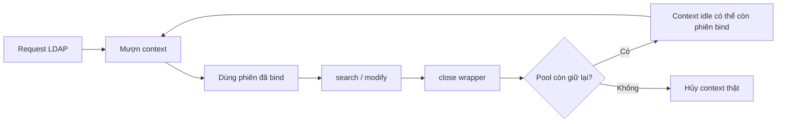
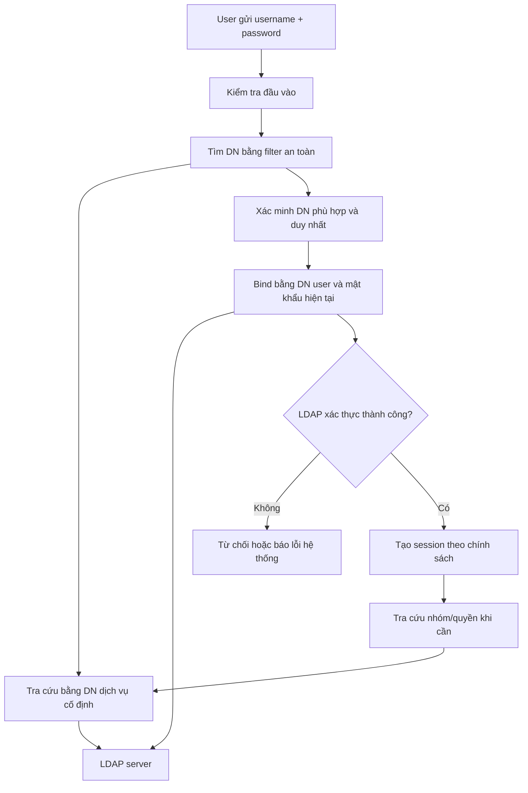

# Rủi ro giữ thông tin xác thực trong pool

Trong **Spring LDAP**, pool giúp tái sử dụng context đã khởi tạo để giảm số lần tạo kết nối TCP, thực hiện TLS handshake và LDAP bind. Tuy nhiên, một LDAP context có thể gắn với **danh tính đã xác thực** và những thông tin cấu hình nhạy cảm. Nếu context được giữ trong pool lâu hơn vòng đời của một request, ứng dụng phải đảm bảo rằng phiên đó chỉ được dùng lại đúng danh tính, quyền và mục đích ban đầu. Nếu không, việc tối ưu hiệu năng có thể gây lỗi xác thực, giữ lại phiên đã hết hiệu lực hoặc để lộ credential.

Bài học thuộc chương **Pooling** của **SPRING_LDAP**. Người học sẽ tìm hiểu rủi ro với `ContextSource`, `LdapTemplate`, `LdapClient` và ODM, phân biệt truy vấn bằng tài khoản dịch vụ với user bind, quản lý credential khi đổi mật khẩu, kết nối LDAPS/StartTLS, xử lý lỗi và kiểm thử truy cập thư mục an toàn. Các nguyên tắc liên quan trực tiếp đến DN, schema, filter, LDAP ACL và vòng đời context.

## 1. Pool giữ tài nguyên gì sau khi request kết thúc?

`LdapContextSource` tạo context JNDI (thường là `DirContext` hoặc `LdapContext`) dựa trên URL LDAP, base DN, phương thức xác thực và credential. LDAP server có thể gắn một danh tính đã bind với kết nối bên dưới context. Trong context pool, khi wrapper được `close()`, pool thường **nhận lại context thật** để tái sử dụng, thay vì đóng ngay kết nối mạng.



Cần phân biệt ba lớp thông tin:

| Lớp | Ví dụ | Rủi ro khi tồn tại lâu |
|---|---|---|
| **Principal** | `cn=app-reader,ou=services,dc=example,dc=org` | Request tiếp theo thực hiện lệnh dưới DN/quyền không mong muốn |
| **Credential** | Mật khẩu bind, thuộc tính JNDI `Context.SECURITY_CREDENTIALS` hoặc thông tin trong authentication strategy | Dữ liệu bí mật có thể xuất hiện trong memory dump, log hoặc cấu hình bị lộ |
| **Phiên đã xác thực** | Kết nối từng bind thành công với LDAP server | Có thể tiếp tục tồn tại sau thay đổi mật khẩu/khóa tài khoản tùy chính sách server |

Không thể khẳng định mọi JNDI provider đều giữ mật khẩu ở cùng chỗ hoặc cùng dạng. Tuy nhiên, `ContextSource`, JNDI environment, context và cơ chế pooling **có thể** giữ tham chiếu đến credential hoặc duy trì phiên đã xác thực. `close()` trên wrapper không phải một thao tác xóa mật khẩu khỏi toàn bộ bộ nhớ.

## 2. Phân biệt tài khoản dịch vụ và bind theo từng người dùng

Một ứng dụng có thể dùng DN dịch vụ cố định để tìm kiếm nhóm, tra cứu DN, đọc thuộc tính hoặc cập nhật entry theo quyền được cấp. Vì cùng một danh tính truy cập LDAP lặp đi lặp lại, **pool dành cho tài khoản dịch vụ** là lựa chọn thường hợp lý.

Ngược lại, khi user đăng nhập, ứng dụng cần kiểm tra **DN và mật khẩu của người đó trong lần đăng nhập hiện tại**. Một kết nối đã bind thành công trước đây không thể tự nó chứng minh mật khẩu người dùng vừa nhập là đúng.

| Thuộc tính | Tra cứu bằng service account | User authentication |
|---|---|---|
| Principal | DN dịch vụ ổn định | DN riêng của từng user |
| Mật khẩu | Secret do ứng dụng quản lý | Credential của lần đăng nhập |
| Mục tiêu | Search/modify trong phạm vi ACL dịch vụ | Xác thực danh tính của user |
| Pool | Có thể tái dùng khi cấu hình bind cố định | Không nên chia sẻ context đã bind giữa nhiều user |
| Nguy cơ chính | Secret tồn tại lâu, pool giữ phiên cũ khi rotate | Trộn danh tính, bỏ qua mật khẩu mới, sai quyền |
| Hướng thiết kế | Pool cho luồng tra cứu định kỳ | `ContextSource` riêng cho user bind từng lần |

### Tình huống trộn danh tính

Giả sử một `PoolingContextSource` chỉ phân nhóm theo `getReadOnlyContext()` và `getReadWriteContext()`, nhưng nguồn context gốc đọc principal/credential động từ request:

```text
Request A: username=alice, password A
  -> tạo context, bind dưới DN Alice
  -> close wrapper, context trở thành idle

Request B: username=bob, password B
  -> mượn context idle cùng nhóm read-only
  -> context nền có thể vẫn đang bind dưới DN Alice
```

Nếu cơ chế pool không phân vùng theo danh tính và trạng thái xác thực phù hợp, request B có thể được thực thi dưới quyền của A. Việc giữ `AuthenticationSource` phụ thuộc request trong một pool context chia sẻ là mẫu thiết kế có rủi ro cao. **Không tái sử dụng context đã bind user A cho user B**.

Ngay cả pool có phân vùng theo credential cũng không tự động phù hợp cho xác thực: số nhóm tăng theo số user, vòng đời password và phiên bind trở nên phức tạp, và một phiên cũ vẫn không chứng minh một lần đăng nhập mới hợp lệ.

## 3. Khi credential thay đổi, phiên trong pool có tự hết hiệu lực?

Không nên giả định như vậy. LDAP server có thể hoặc không chủ động cắt phiên đã bind khi mật khẩu đổi, tài khoản bị khóa hoặc quyền bị thay đổi. Trạng thái và thời điểm có hiệu lực phụ thuộc server, kiểu thao tác và chính sách bảo mật.

```text
09:00  Tạo context dịch vụ, bind với mật khẩu cũ
09:10  Context được trả về pool, tiếp tục idle
09:15  Quản trị viên cập nhật mật khẩu của DN dịch vụ
09:16  Ứng dụng tải cấu hình mật khẩu mới
09:17  Pool vẫn có thể chứa context đã bind lúc 09:00
```

Như vậy, cập nhật secret trong cấu hình **không chứng minh** toàn bộ context hiện có đã được bind lại. Với đăng nhập người dùng, tái sử dụng phiên cũ làm “kết quả xác thực” thậm chí có thể bỏ qua việc kiểm tra credential của lần đăng nhập mới.

Một quy trình xoay vòng credential dịch vụ nên gồm:

1. Chuẩn bị secret mới và phối hợp thời điểm thay đổi với LDAP server.
2. Khởi tạo nguồn context/pool mới dùng credential mới, xác minh bind và phép tra cứu có quyền tối thiểu.
3. Chuyển request mới sang pool mới; ngừng cấp phát từ pool cũ và hoàn tất các request đang mượn theo chiến lược shutdown.
4. Hủy pool cũ, xác minh không còn kết nối cũ của ứng dụng trên server; với nhiều replica, kiểm tra tất cả instance đã chuyển.
5. Theo dõi lỗi bind, timeout và chính sách thu hồi phiên sau chuyển đổi.

Đóng pool ở một client không thể bảo đảm chấm dứt phiên LDAP còn tồn tại ở những client khác. Nếu yêu cầu thu hồi quyền ngay, cần kiểm soát ở **LDAP server** và cả quản lý session ứng dụng.

## 4. Rủi ro trong bộ nhớ, log và hệ thống vận hành

Mật khẩu có thể xuất hiện ở nhiều vị trí ngoài pool. Ngay cả khi tắt pooling, `LdapContextSource` vẫn có thể giữ credential dịch vụ để tạo kết nối mới.

| Vị trí | Nguy cơ | Biện pháp |
|---|---|---|
| Repository và file cấu hình | Mật khẩu bị commit, sao chép vào artifact | Sử dụng secret manager, injection từ môi trường, phân quyền đọc |
| `ContextSource` / JNDI environment | Credential hoặc trạng thái bind tồn tại trong JVM | Giới hạn người được truy cập process và công cụ debug |
| Context idle trong pool | Phiên bind sống lâu hơn request; có thể giữ tham chiếu bí mật | Giới hạn idle, đóng pool cũ khi rotate |
| Heap dump, memory diagnostics | Dump có thể chứa credential | Bảo vệ quyền tạo/đọc, lưu giữ và xóa theo chính sách |
| Log/tracing | Lộ `Context.SECURITY_CREDENTIALS`, password, request body | Redact field nhạy cảm; không dump object context |
| Metrics | Dùng DN/user làm label gây lộ dữ liệu, cardinality cao | Gắn nhãn bằng loại lỗi, endpoint, loại thao tác |
| Exception response | Trả chi tiết cấu hình hoặc nguyên nhân gốc ra client | Ghi lỗi nội bộ phù hợp, trả thông điệp công khai an toàn |

`String` trong Java không được đảm bảo xóa ngay khi biến hết phạm vi. Garbage collection và `close()` **không phải cơ chế tẩy bí mật đáng tin cậy**. Khi API thư viện yêu cầu `String`, cần hạn chế bản sao, không log, không cache mật khẩu người dùng và giảm thời gian giữ dữ liệu khi có thể.

Nên ghi log thời gian, correlation ID, loại thao tác, loại ngoại lệ và thời gian chờ pool. Không ghi giá trị `Context.SECURITY_CREDENTIALS`, mật khẩu bind, token session, toàn bộ JNDI environment hoặc dữ liệu entry nhạy cảm.

## 5. Kiến trúc tách pool dịch vụ khỏi xác thực user

Thiết kế rõ ràng là dùng **hai nguồn context**:

1. `serviceContextPool` bọc một `LdapContextSource` được cấu hình bằng **DN dịch vụ cố định** để thực hiện search/group lookup. Các thao tác được trả context về pool sau khi hoàn tất.
2. `authenticationContextSource` là nguồn riêng để tìm DN và thực hiện user bind theo credential hiện tại. Không bọc nó bằng pool context chia sẻ cho nhiều user.



Lưu ý quyền tài khoản dịch vụ: chỉ cấp những quyền cần thiết cho việc đọc/ghi nghiệp vụ. Pool không thay thế kiểm tra phân quyền tại tầng ứng dụng.

### Java Config minh họa

Ví dụ dùng `org.springframework.ldap.pool.factory.PoolingContextSource`. API pooling thay đổi theo phiên bản Spring LDAP; một số hệ thống dùng họ `org.springframework.ldap.pool2.factory.PooledContextSource` dựa trên Commons Pool 2. Cần khớp dependency và chữ ký API trước khi triển khai.

```java
import org.springframework.beans.factory.annotation.Qualifier;
import org.springframework.context.annotation.Bean;
import org.springframework.context.annotation.Configuration;
import org.springframework.core.env.Environment;
import org.springframework.ldap.core.LdapTemplate;
import org.springframework.ldap.core.support.LdapContextSource;
import org.springframework.ldap.pool.factory.PoolingContextSource;

@Configuration
public class SecureLdapConfiguration {
    private LdapContextSource rawSource(Environment env) {
        LdapContextSource source = new LdapContextSource();
        source.setUrl(env.getRequiredProperty("app.ldap.url"));
        source.setBase(env.getRequiredProperty("app.ldap.base"));
        source.setUserDn(env.getRequiredProperty("app.ldap.service-dn"));
        source.setPassword(env.getRequiredProperty("app.ldap.service-password"));
        source.setPooled(false); // Không chồng thêm JNDI native pool.
        return source;
    }

    @Bean("serviceRawContextSource")
    LdapContextSource serviceRawContextSource(Environment env) {
        return rawSource(env);
    }

    @Bean("serviceContextPool")
    PoolingContextSource serviceContextPool(
            @Qualifier("serviceRawContextSource") LdapContextSource raw) {
        PoolingContextSource pool = new PoolingContextSource(raw);
        pool.setMaxActive(8);
        pool.setMaxIdle(4);
        pool.setMaxWait(2_000L);
        return pool;
    }

    @Bean("directoryTemplate")
    LdapTemplate directoryTemplate(
            @Qualifier("serviceContextPool") PoolingContextSource source) {
        return new LdapTemplate(source);
    }

    // Nguồn cho lookup DN và user bind: không dùng context pool chia sẻ.
    @Bean("authenticationContextSource")
    LdapContextSource authenticationContextSource(Environment env) {
        return rawSource(env);
    }

    @Bean("authenticationTemplate")
    LdapTemplate authenticationTemplate(
            @Qualifier("authenticationContextSource") LdapContextSource source) {
        return new LdapTemplate(source);
    }
}
```

Trong ví dụ, nguồn xác thực cũng dùng DN dịch vụ để **tìm DN người dùng** nếu server không cho anonymous search. Khi gọi `authenticate`, bước kiểm tra credential phải bind theo **DN của user** và mật khẩu họ nhập. Không phải cứ có DN dịch vụ trên context source thì user bind cũng sử dụng mật khẩu dịch vụ.

Ví dụ cấu hình ứng dụng:

```properties
app.ldap.url=ldaps://directory.example.org:636
app.ldap.base=dc=example,dc=org
app.ldap.service-dn=cn=app-reader,ou=services,dc=example,dc=org
# app.ldap.service-password được cung cấp qua secret manager.
```

`setPooled(false)` chỉ tắt **JNDI native connection pooling** của `LdapContextSource`. Nó không ngăn một lớp khác bọc nguồn này bằng `PoolingContextSource`. Phải kiểm tra chính xác bean được đưa vào luồng đăng nhập.

## 6. Bind theo user phải kiểm tra credential của lần đăng nhập hiện tại

`LdapTemplate.authenticate(query, password)` là một cách để tìm DN theo query rồi xác thực với mật khẩu được cung cấp. Ví dụ dùng nguồn xác thực riêng:

```java
import org.springframework.beans.factory.annotation.Qualifier;
import org.springframework.ldap.core.LdapTemplate;
import org.springframework.ldap.query.LdapQuery;
import static org.springframework.ldap.query.LdapQueryBuilder.query;

public final class UserLoginService {
    private final LdapTemplate authenticationTemplate;

    public UserLoginService(
            @Qualifier("authenticationTemplate") LdapTemplate template) {
        this.authenticationTemplate = template;
    }

    public boolean authenticate(String username, String password) {
        if (username == null || username.isBlank()
                || password == null || password.isEmpty()) {
            return false;
        }

        LdapQuery q = query()
                .base("ou=people")
                .where("uid").is(username);

        return authenticationTemplate.authenticate(q, password);
    }
}
```

**Chặn mật khẩu rỗng trước khi bind.** Theo cơ chế LDAP simple bind, một số server có thể xử lý tên không rỗng và mật khẩu độ dài 0 như unauthenticated bind, hoặc áp dụng hành vi anonymous theo chính sách. Kết quả kiểu này **không chứng minh** user nhập đúng mật khẩu.

Không nối filter thô như `"(uid=" + username + ")"`; sử dụng `LdapQueryBuilder` để escape giá trị filter. Filter escaping khác DN escaping: tìm DN từ directory và áp dụng chính sách xử lý kết quả 0, 1 hoặc nhiều entry. Tránh tự ghép DN từ username không được kiểm soát.

Đây mới là phần xác minh credential. Hệ thống login thực tế còn cần rate limiting, xử lý trạng thái khóa/hết hạn tài khoản, session/token, kiểm tra quyền và thông điệp lỗi nhất quán. Lỗi server ngắt kết nối, TLS thất bại hoặc LDAP timeout phải được phân loại khác **sai mật khẩu**.

## 7. LDAPS, StartTLS và trạng thái bảo mật của context

LDAP simple bind có thể làm lộ mật khẩu nếu dùng kết nối không được mã hóa. Dùng **LDAPS hoặc StartTLS có xác minh chứng chỉ, hostname và trust chain**; pooling không thay thế TLS.

| Cơ chế | Điều cần chú ý khi pool |
|---|---|
| LDAP simple bind qua kênh không TLS | Không phù hợp để gửi mật khẩu thật; pooling không làm dữ liệu an toàn hơn |
| LDAPS | Kết nối bảo mật có thể tồn tại lâu; cần kiểm soát phiên cũ sau thay credential hoặc certificate |
| StartTLS | Kết nối được nâng cấp bảo mật có vòng đời đặc biệt; không giả định mọi pool/provider đều hỗ trợ tái sử dụng đúng |
| Lỗi TLS/certificate | Thất bại an toàn, không fallback sang kết nối cleartext |

Không đổi TLS sang plain LDAP hoặc bỏ hostname verification để buộc pooling hoạt động. Khi xoay vòng certificate, phải đánh giá kết nối đang mở và cách thay pool theo yêu cầu của hệ thống.

## 8. Context stale, lỗi LDAP và kiểm tra tính hợp lệ

Một context idle có thể mất kết nối khi firewall, load balancer hoặc LDAP server đóng socket. Validator có thể kiểm tra context trước khi mượn, khi hoàn trả hoặc trong lúc idle:

| Cơ chế | Phát hiện vấn đề gì? | Không giải quyết được |
|---|---|---|
| `testOnBorrow` | Kết nối có thể đã hỏng trước khi đưa vào request | Không chứng minh mật khẩu người dùng hiện tại đúng |
| `testWhileIdle` và eviction | Context nhàn rỗi lỗi hoặc cần loại bỏ | Không đảm bảo kết nối không hỏng ngay sau validation |
| `testOnReturn` | Phản hồi lỗi khi trả một context | Không thay thế chính sách thu hồi phiên đã bind |
| Phân loại exception nghiêm trọng | Có thể loại context lỗi truyền thông | Không biến lỗi DN/filter/quyền thành lỗi socket |

Không xem mọi `NamingException` là dấu hiệu kết nối hỏng: `NameNotFoundException` do DN không tồn tại thường khác `CommunicationException` do mất kết nối. Đồng thời, một context trả lời được phép search validator vẫn có thể còn **trạng thái bind cũ**. Validation kiểm tra khả năng kết nối, không xác thực lại user.

Nếu dùng `DirContext` trực tiếp, phải đóng context trong `finally`, kể cả lúc lệnh LDAP lỗi. `NamingEnumeration` trả về từ search cũng cần đóng theo hợp đồng JNDI. Với `LdapTemplate`, framework thường quản lý việc giải phóng context cho thao tác. Mượn context rồi quên `close()` có thể làm tăng số active, khiến pool cạn và kéo dài thời gian tồn tại của phiên.

Đối với `modifyAttributes` hoặc lệnh ghi bị timeout, không retry vô hạn: LDAP server có thể đã xử lý lệnh dù phản hồi bị mất. Pool tạo context mới cũng không giải quyết được tính bất định của kết quả ghi.

## 9. Giám sát và kiểm thử ranh giới bảo mật

Khi đo pooling, cần tách các số liệu của **luồng service-account query** và **luồng user authentication**. Không kết luận rằng login nhanh hơn là đã an toàn nếu chưa chứng minh mỗi lần login được kiểm tra đúng danh tính.

| Quan sát | Ý nghĩa |
|---|---|
| Số lần user bind thực tế | Xác nhận từng lần đăng nhập được kiểm tra credential phù hợp |
| p95 lookup DN, p95 user bind, p95 group lookup | Phân biệt chi phí truy vấn dịch vụ với xác thực |
| Context active/idle, thời gian chờ pool | Phát hiện rò rỉ, bão hòa hoặc pool giữ quá nhiều phiên |
| Số context tạo/hủy sau secret rotation | Xác nhận các phiên dịch vụ cũ được thay thế |
| Tỷ lệ lỗi bind theo nhóm nguyên nhân | Tách sai credential, chính sách tài khoản và lỗi vận hành |
| Số kết nối LDAP trên server và từng replica | Kiểm soát ngân sách kết nối của toàn cụm |
| Kết quả kiểm tra redaction | Bảo đảm log/tracing/metric không để lộ mật khẩu |

**Bài tập lab:** tạo hai user A/B, một tài khoản dịch vụ quyền đọc và một vài entry thuộc `ou=people`. Dùng mật khẩu giả lập chỉ dành cho môi trường thử nghiệm.

1. Đăng nhập A đúng, rồi thử B sai, B đúng, A sai. Xác minh B không thể đi qua nhờ context đã bind bằng A.
2. Đổi mật khẩu A trong directory. Thử mật khẩu cũ/mới và ghi nhận kết quả của **lần bind hiện tại**.
3. Xoay vòng secret của tài khoản dịch vụ, thay pool cũ bằng pool mới, kiểm tra tất cả replica và log server.
4. Bật logging/tracing thử nghiệm, rà soát để chắc chắn không xuất hiện password hoặc `Context.SECURITY_CREDENTIALS`.
5. Mô phỏng cắt kết nối idle, quan sát pool loại context hỏng; xác minh lỗi mạng không bị hiển thị như một phép đăng nhập sai mật khẩu.
6. Thử username chứa `*`, `(`, `)` và mật khẩu rỗng; bảo đảm builder xử lý filter an toàn và app từ chối mật khẩu rỗng.

Không chạy fault injection hoặc ghi nhận credential thật trên LDAP production.

## 10. Câu hỏi tự kiểm tra

1. Vì sao `close()` trên wrapper của context pool không đồng nghĩa với việc mọi bản sao credential đã được xóa khỏi bộ nhớ?
2. Điều gì xảy ra nếu pool trả context đã bind bằng Alice cho request của Bob?
3. Vì sao đổi mật khẩu tài khoản dịch vụ cần xem xét cả pool cũ lẫn toàn bộ replica?
4. Vai trò của `setPooled(false)` trong `LdapContextSource` là gì? Vì sao vẫn phải kiểm tra có wrapper pool bên ngoài không?
5. Vì sao `testOnBorrow` không thể thay thế việc xác thực mật khẩu của lần đăng nhập mới?
6. Những thông tin nào cần được loại khỏi log, tracing và metric khi tích hợp LDAP?
7. Khi LDAP server không sẵn sàng, vì sao không nên trả về kết luận “sai mật khẩu”?
8. Vì sao không được tắt TLS certificate validation chỉ để tái sử dụng kết nối?

**Kết luận:** pooling chỉ an toàn khi context được mượn lại vẫn phù hợp về **principal, quyền, credential và trạng thái phiên**. Trong Spring LDAP, nên sử dụng pool cho các truy vấn bằng tài khoản dịch vụ cố định, tách user bind theo từng lần đăng nhập, bảo vệ secret trong cấu hình/bộ nhớ/log và thay pool có kiểm soát khi xoay vòng thông tin xác thực. Kiểm thử bảo mật danh tính và trạng thái phiên quan trọng không kém kiểm thử hiệu năng.

### Tài liệu tham khảo

- [Spring LDAP Reference Documentation](https://docs.spring.io/spring-ldap/reference/)
- [Spring LDAP API — LdapTemplate](https://docs.spring.io/spring-ldap/docs/current/api/org/springframework/ldap/core/LdapTemplate.html)
- [Spring Security Reference — LDAP Authentication](https://docs.spring.io/spring-security/reference/servlet/authentication/passwords/ldap.html)
- [RFC 4511 — LDAP Bind Operation](https://www.rfc-editor.org/rfc/rfc4511#section-4.2)
- [RFC 4513 — LDAP Authentication and Security Mechanisms](https://www.rfc-editor.org/rfc/rfc4513)
