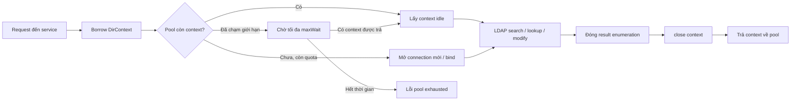
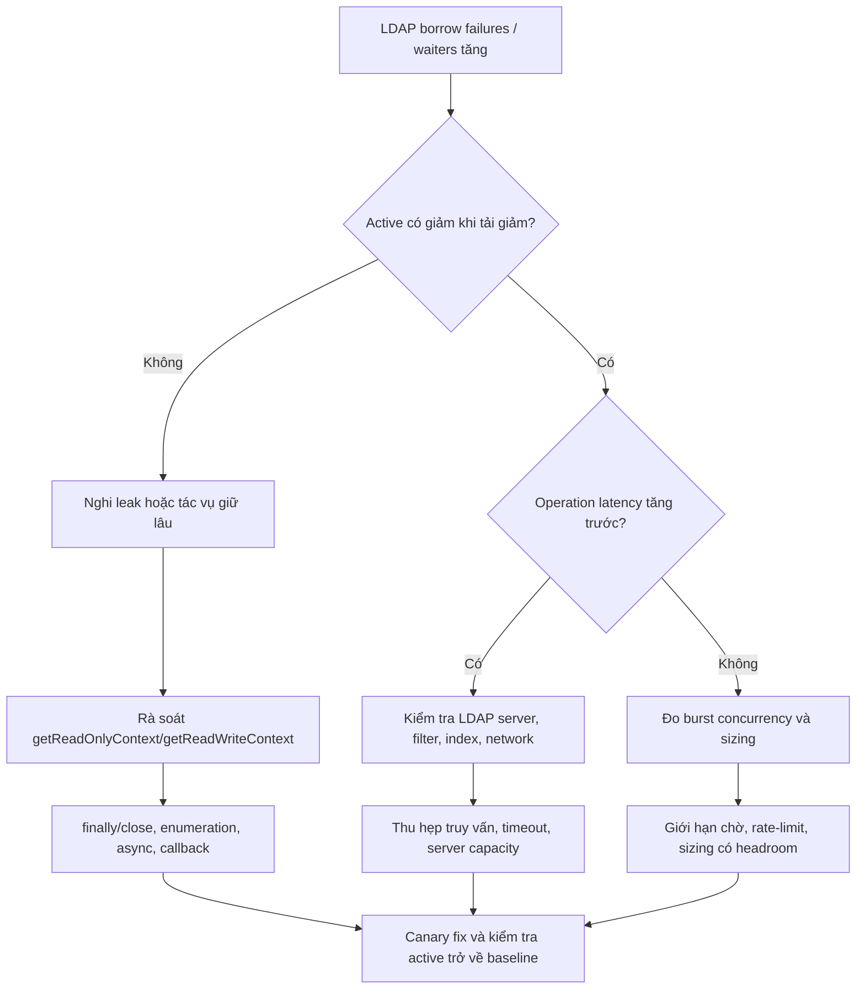

# Xử lý leak và cạn pool khi tải cao trong Spring LDAP

## Mục tiêu học tập

Sau bài này, bạn có thể:

1. Phân biệt **LDAP connection leak**, **cạn pool do tải cao**, **truy vấn LDAP chậm**, **kết nối idle bị hỏng** và **lỗi giới hạn kết nối phía LDAP server**.
2. Giải thích vòng đời `ContextSource` → mượn `DirContext` → xử lý → `close()` trả tài nguyên, cũng như vai trò của `LdapTemplate` và `LdapClient`.
3. Cấu hình giới hạn số context, thời gian chờ, validation/eviction bằng `PooledContextSource`, đồng thời nhận biết sự khác biệt với **JNDI native pooling**.
4. Dùng chỉ số `active`, `idle`, `waiters`, thời gian chờ mượn và LDAP operation latency để xác định nguyên nhân cạn pool.
5. Sửa code quên đóng `DirContext`/`NamingEnumeration`, tránh giữ connection qua tác vụ dài hoặc bất đồng bộ và thiết kế giới hạn tải hợp lý.
6. Kiểm thử với LDAP server thực nghiệm, theo dõi hồi phục sau tải, lỗi mạng, bind failure và bảo mật connection identity.

> **Nguyên tắc:** Tăng `maxTotal` chỉ giúp khi ứng dụng thực sự cần thêm kết nối và LDAP server đủ công suất. Nếu code đang giữ `DirContext` không trả lại, tăng pool chỉ trì hoãn sự cố. Nếu LDAP server đã chậm hoặc cạn tài nguyên, tăng pool có thể làm hệ thống tệ hơn.

## 1. Pool thực sự giữ cái gì?

LDAP dùng một kết nối mạng để thực hiện search, lookup, bind, modify và các operation khác. Trong Java/JNDI, đối tượng `DirContext` (hoặc `LdapContext`) đại diện cho một ngữ cảnh thao tác LDAP, liên quan tới kết nối, trạng thái xác thực và thuộc tính môi trường.

Spring LDAP có thể dùng pool cho các context này nhằm tránh tạo TCP/TLS handshake và bind service account cho **mỗi** operation. Với pool, lifecycle cơ bản là:



`close()` trên **context mượn từ pool** thường là hành động **trả context về pool** để tái sử dụng; nó không nhất thiết đóng TCP socket ngay. Ngược lại, nếu một context đang được mượn mà code quên `close()`, pool vẫn xem nó là **active**, không cấp cho request khác.

Ví dụ khi một pool có `maxTotalPerKey=8` và mọi request mượn read-only context:

| Khoảnh khắc | Active read | Idle read | Waiters | Diễn giải |
| --- | ---: | ---: | ---: | --- |
| Trước khi có tải | 0 | 4 | 0 | Bốn context sẵn sàng |
| Tải ngắn | 6 | 0 | 0 | Một số context đã được tạo thêm |
| Tải vượt khả năng | 8 | 0 | 12 | Pool hết slot, 12 request chờ |
| Sau khi request hoàn tất, nếu không leak | 0 | Tối đa giới hạn idle | 0 | Slot được trả và hàng đợi giảm |
| Sau khi tải đã ngừng, nếu có leak | Ví dụ 5 | 0–3 | 0 lúc yên | Năm context chưa bao giờ được trả |

Các số trong bảng là **tình huống mô phỏng**. Pool còn có giới hạn tổng và các key riêng, nên active/idle thực tế không nhất thiết luôn cộng lại bằng đúng `maxTotalPerKey`.

### Pool có nhiều loại context

Spring LDAP phân biệt **read-only** và **read-write** context. Nếu cấu hình `anonymousReadOnly`, read-only có thể dùng danh tính anonymous, trong khi read-write dùng reader/writer account; vì thế hai nhóm cần được theo dõi riêng. Trong triển khai dùng Commons Pool2, pool có chỉ số như `getNumActiveRead()`, `getNumActiveWrite()`, `getNumIdleRead()` và `getNumWaiters()`.

Không giả định chữ “read-only” có nghĩa **LDAP server sẽ áp quyền chỉ đọc**: quyền thực sự đến từ bind identity và ACL. Nếu code/`ContextSource` thay danh tính theo từng người dùng, không tự gộp các context vào một pool chung; điều đó có thể tái sử dụng phiên của người trước.

## 2. Năm nguyên nhân dễ bị gọi nhầm là “connection leak”

| Hiện tượng | Dấu hiệu đặc trưng | Nguyên nhân thường gặp |
| --- | --- | --- |
| **Leak context thật** | `active` tăng dần qua nhiều đợt, **không về gần baseline** sau khi hết request; cuối cùng `waiters` tăng | Nhánh exception/return sớm không `close()`, context bị cất trong field hoặc truyền sang async |
| **Cạn pool do concurrency hợp lệ** | `active` chạm giới hạn lúc tải đỉnh; `waiters` xuất hiện; khi tải giảm thì `active` cũng giảm | Nhiều request đồng thời hơn pool cho phép, queue không đủ |
| **LDAP operation chậm hoặc treo** | `active` cao kéo dài, operation latency/read timeout tăng; khó tìm kết nối sẵn | Search subtree rộng, filter không có index, LDAP server chậm, referral/network |
| **Idle context hỏng/stale** | `idle` còn nhưng mượn ra bị `CommunicationException` hoặc bind/search lỗi; nhiều reconnect | Load balancer đóng kết nối idle, LDAP server restart, firewall timeout |
| **Giới hạn server hoặc xếp hàng phía kết nối** | Client muốn mở thêm nhưng connect/bind fail hoặc timeout; server có connection cap/CPU cao | Quá nhiều app instance, pool mỗi node quá lớn, TLS handshake/bind flood |

**Không dùng một metric đơn lẻ để kết luận leak**. Chẳng hạn, `active=8` liên tục có thể do một job LDAP chạy 30 giây trên 8 worker, hoàn toàn không có mã quên close. Ngược lại, một ứng dụng chạy ít tải vẫn có thể leak từng context và chỉ bộc lộ sau nhiều ngày.

## 3. Xác định vòng đời đúng với `LdapTemplate`, `LdapClient` và Repository

### Dùng `LdapTemplate` để framework quản lý tài nguyên

`LdapTemplate` thực hiện các thao tác phổ biến, gồm lấy context, duyệt và đóng `NamingEnumeration`, đóng context ở cuối operation kể cả khi có exception. Vì vậy, ưu tiên:

```java
package example.directory;

import java.util.List;
import org.springframework.ldap.core.LdapTemplate;
import org.springframework.ldap.query.LdapQuery;
import org.springframework.ldap.query.LdapQueryBuilder;
import org.springframework.ldap.query.SearchScope;
import org.springframework.stereotype.Service;

@Service
public class DirectorySearch {
    private final LdapTemplate ldap;

    public DirectorySearch(LdapTemplate ldap) {
        this.ldap = ldap;
    }

    public List<String> findUidsBySurname(String surname) {
        if (surname == null || surname.isBlank()) {
            throw new IllegalArgumentException("surname is required");
        }
        LdapQuery query = LdapQueryBuilder.query()
            .base("ou=people")
            .searchScope(SearchScope.SUBTREE)
            .attributes("uid")
            .countLimit(100)
            .timeLimit(2000)
            .where("objectClass").is("inetOrgPerson")
            .and("sn").is(surname);

        return ldap.search(query,
            attrs -> attrs.get("uid").get().toString());
    }
}
```

Giả sử `ContextSource` base `dc=example,dc=org`, query chỉ tìm dưới `ou=people,dc=example,dc=org`. `countLimit` hạn chế số entry và `timeLimit` giới hạn thời gian search ở mức LDAP/JNDI; chúng **không thay thế** connection timeout, read timeout hay pool borrow timeout.

Ngay cả khi gọi `LdapTemplate` đúng, code vẫn có thể khiến pool bị giữ lâu nếu mapper/callback làm việc tốn thời gian hoặc bị block trong lúc đang dùng context. Không thực hiện HTTP call, ghi file lớn, chờ khóa hoặc xử lý dữ liệu nặng trong callback cần context.

### Repository và `LdapClient`

Spring Data LDAP Repository thường gọi cơ chế Spring LDAP/ODM bên dưới; thông thường các thao tác đồng bộ như `findBy...` hoặc `save` không yêu cầu application tự quản lý `DirContext`. `LdapClient` cũng cung cấp abstraction fluent cho LDAP operation. Tuy nhiên, nếu tự mở context trong **custom repository**, `DirContextProcessor`, callback nâng cao hoặc extension code, phải biết rõ trách nhiệm đóng tài nguyên của từng API.

Không giữ một `DirContext`/`NamingEnumeration` vượt ra ngoài callback `LdapTemplate`. Một stream/lazy result tự viết có thể khiến caller không bao giờ đóng enumerator, dù phương thức bên ngoài nhìn giống một search trả kết quả.

## 4. Ví dụ leak điển hình và cách sửa

### 4.1. Code quên đóng context khi có exception

Đoạn sau **cố tình chứa lỗi**:

```java
import javax.naming.directory.DirContext;
import org.springframework.ldap.core.ContextSource;

String unsafeLookup(ContextSource source) throws Exception {
    DirContext ctx = source.getReadOnlyContext(); // borrow
    Object value = ctx.lookup("uid=lan,ou=people");
    ctx.close();                                  // chỉ chạy nếu không có lỗi
    return value.toString();
}
```

Nếu `lookup` ném exception, `ctx.close()` không được chạy. Khi `source` là pooled source, borrowed context có thể không trở về pool; sau nhiều request lỗi, `active` chạm giới hạn.

**Sửa bằng `finally`**:

```java
import javax.naming.NamingException;
import javax.naming.directory.Attributes;
import javax.naming.directory.DirContext;
import org.springframework.ldap.core.ContextSource;
import org.springframework.ldap.support.LdapUtils;

String safeLookup(ContextSource source) throws NamingException {
    DirContext ctx = source.getReadOnlyContext();
    try {
        Attributes attrs = ctx.getAttributes(
            "uid=lan,ou=people", new String[] {"cn"});
        return attrs.get("cn").get().toString();
    } finally {
        LdapUtils.closeContext(ctx);
    }
}
```

`LdapUtils.closeContext(ctx)` gọi `close()` và xử lý ngoại lệ phát sinh khi đóng; với context từ pool, đó là thao tác hoàn trả wrapper. Code vẫn cần xử lý khi attribute thiếu và phân loại lỗi LDAP phù hợp, nhưng **mọi đường thoát** sau khi mượn thành công sẽ đi qua `finally`.

**Tốt hơn:** nếu không cần JNDI trực tiếp, dùng `ldapTemplate.lookup(...)` / `ldapTemplate.search(...)` hoặc `ldapTemplate.executeReadOnly(...)` để giảm số nơi ứng dụng tự quản lý context:

```java
String commonName = ldapTemplate.executeReadOnly(ctx ->
    ctx.getAttributes("uid=lan,ou=people", new String[] {"cn"})
       .get("cn").get().toString()
);
```

Ví dụ này là một đoạn expression trong service có field `LdapTemplate ldapTemplate`. `executeReadOnly` đóng context khi callback kết thúc; **không giữ lại `ctx`** bên ngoài callback.

### 4.2. Rò `NamingEnumeration` trong search viết tay

`DirContext.search(...)` trả `NamingEnumeration<SearchResult>`. Cần đóng **enumeration trước**, sau đó context. Nếu chỉ đóng context, một số provider vẫn giải phóng được kết quả, nhưng không nên dựa vào hành vi phụ thuộc triển khai.

```java
import java.util.ArrayList;
import java.util.List;
import javax.naming.NamingEnumeration;
import javax.naming.NamingException;
import javax.naming.directory.DirContext;
import javax.naming.directory.SearchControls;
import javax.naming.directory.SearchResult;
import org.springframework.ldap.core.ContextSource;
import org.springframework.ldap.support.LdapUtils;

List<String> searchUids(ContextSource source) throws NamingException {
    DirContext ctx = source.getReadOnlyContext();
    NamingEnumeration<SearchResult> results = null;
    try {
        SearchControls controls = new SearchControls();
        controls.setSearchScope(SearchControls.SUBTREE_SCOPE);
        controls.setReturningAttributes(new String[] {"uid"});
        controls.setCountLimit(100);
        controls.setTimeLimit(2000);

        results = ctx.search(
            "ou=people", "(objectClass=inetOrgPerson)", controls);

        List<String> uids = new ArrayList<>();
        while (results.hasMore()) {
            SearchResult row = results.next();
            if (row.getAttributes().get("uid") != null) {
                uids.add(
                    row.getAttributes().get("uid").get().toString());
            }
        }
        return uids;
    } finally {
        try {
            if (results != null) {
                results.close();
            }
        } finally {
            LdapUtils.closeContext(ctx);
        }
    }
}
```

`NamingEnumeration.close()` có thể ném `NamingException`; phần `finally` lồng bảo đảm vẫn trả context dù việc đóng enumeration gặp lỗi. Trong hệ thống cần giữ nguyên exception gốc khi cleanup thất bại, viết helper xử lý/suppressed exceptions phù hợp. Không nên tái dùng trực tiếp đoạn JNDI dài này khi `LdapTemplate.search(...)` đã đáp ứng yêu cầu.

### 4.3. Giữ context qua async hoặc tác vụ chậm

Ví dụ cần tránh:

```java
DirContext ctx = source.getReadOnlyContext();
executor.submit(() -> useLdapContextLater(ctx));
// Request đã kết thúc, ai sẽ close ctx, khi nào?
```

Việc truyền borrowed context sang thread khác tạo vấn đề về **ownership**, thời gian giữ slot và khả năng an toàn luồng. Nếu một job cần LDAP, hãy để job mượn context **bên trong** task và đóng ở `finally`, hoặc dùng `LdapTemplate` trong job. Tránh giữ connection trong lúc chờ queue/HTTP API hoặc ngủ.

## 5. Cấu hình pool có giới hạn và validation

Spring LDAP hỗ trợ hai họ pool:

- `org.springframework.ldap.pool.factory.PoolingContextSource`: lớp dựa trên Apache Commons Pool **thế hệ cũ**.
- `org.springframework.ldap.pool2.factory.PooledContextSource`: lớp dùng **Apache Commons Pool2** với `PoolConfig`; ví dụ dưới đây theo API hiện hành.

Các class, package và tên tham số khác nhau; không copy `setMaxActive` của Pool1 sang Pool2 hoặc mặc định cấu hình Commons Pool2 giống HikariCP. Cần khai báo đúng artifact Spring LDAP hỗ trợ pool2 và Apache Commons Pool2 tương ứng với phiên bản ứng dụng.

### 5.1. Ví dụ Java Config với Pool2

```java
package example.directory;

import java.util.Map;
import org.springframework.context.annotation.Bean;
import org.springframework.context.annotation.Configuration;
import org.springframework.ldap.core.LdapTemplate;
import org.springframework.ldap.core.support.LdapContextSource;
import org.springframework.ldap.pool2.factory.PoolConfig;
import org.springframework.ldap.pool2.factory.PooledContextSource;
import org.springframework.ldap.pool2.validation.DefaultDirContextValidator;

@Configuration
public class DirectoryPoolConfiguration {

    @Bean
    LdapContextSource targetLdapContextSource() {
        String readerDn = System.getenv("LDAP_READER_DN");
        String readerSecret = System.getenv("LDAP_READER_SECRET");
        if (readerDn == null || readerDn.isBlank()
                || readerSecret == null || readerSecret.isEmpty()) {
            throw new IllegalStateException("Missing LDAP reader credentials");
        }

        LdapContextSource source = new LdapContextSource();
        source.setUrl("ldaps://ldap.example.org:636");
        source.setBase("dc=example,dc=org");
        source.setUserDn(readerDn);
        source.setPassword(readerSecret);
        source.setAnonymousReadOnly(false);
        source.setPooled(false); // Không chồng thêm JNDI native pool.
        source.setBaseEnvironmentProperties(Map.of(
            "com.sun.jndi.ldap.connect.timeout", "2000",
            "com.sun.jndi.ldap.read.timeout", "3000"
        ));
        return source;
    }

    @Bean(destroyMethod = "destroy")
    PooledContextSource pooledContextSource(
            LdapContextSource targetLdapContextSource) {
        PoolConfig cfg = new PoolConfig();
        cfg.setMaxTotal(24);
        cfg.setMaxTotalPerKey(16);
        cfg.setMaxIdlePerKey(8);
        cfg.setMinIdlePerKey(0);
        cfg.setBlockWhenExhausted(true);
        cfg.setMaxWaitMillis(750);
        cfg.setTestOnBorrow(true);
        cfg.setTestWhileIdle(true);
        cfg.setTimeBetweenEvictionRunsMillis(30_000);

        PooledContextSource pool = new PooledContextSource(cfg);
        pool.setContextSource(targetLdapContextSource);
        pool.setDirContextValidator(new DefaultDirContextValidator());
        return pool;
    }

    @Bean
    LdapTemplate ldapTemplate(PooledContextSource pooledContextSource) {
        return new LdapTemplate(pooledContextSource);
    }
}
```

Ví dụ sử dụng **LDAPS với JSSE truststore đã được cấu hình và xác minh đúng**, chỉ là một cấu hình tham khảo để học về pool. Trong Spring Boot, tự khai báo các bean này có thể **thay thế auto-configuration**. Tránh tạo hai `LdapTemplate` dùng hai `ContextSource` có pool khác nhau mà không chủ ý.

Các giá trị `24`, `16`, `8`, `750ms`, `2–3s` chỉ là **giá trị minh họa**, phải được xác định bằng tải đo thực tế, hạn mức LDAP server và số instance. Không xem đây là mức khuyến nghị chung cho mọi ứng dụng.

**Vì sao cấu hình trên giảm rủi ro:**

- `maxTotal` giới hạn tổng context được cấp trong pool; `maxTotalPerKey` giới hạn từng nhóm (ví dụ read/write). Nếu một nhóm không có idle, toàn bộ `maxTotal` vẫn có thể cản tạo thêm context.
- `maxWaitMillis` giới hạn thời gian chờ **mượn** context khi pool đã đầy. Thời gian này **không bao gồm** thời gian LDAP search đã bắt đầu.
- `blockWhenExhausted=true` cho phép chờ có giới hạn; nếu hết thời gian chờ, ứng dụng nhận lỗi từ pool và nên trả response/metric phù hợp. `false` là kiểu fail-fast khi hết slot.
- `testOnBorrow` thử context trước khi cấp cho request, giảm khả năng giao context đã bị firewall/server đóng. Có thêm chi phí validation.
- `testWhileIdle` chỉ hữu ích khi eviction thread chạy định kỳ (`timeBetweenEvictionRunsMillis` dương).
- `DefaultDirContextValidator` mặc định search trên base rỗng với `(objectclass=*)`, `OBJECT_SCOPE` và giới hạn nhỏ. Nếu root trong `ContextSource` không được reader đọc hoặc ACL chặn object class, validator có thể loại context tốt; khi đó cấu hình validation query tới **entry sentinel được phép đọc**.
- `setPooled(false)` giữ **JNDI native pooling** tắt, tránh hai cơ chế pool chồng nhau.

Nhớ cấu hình bean lifecycle: khi instance shutdown hoặc xoay TLS certificate/secret, phải cho pool cơ hội `destroy()` để đóng các context. Một context đang được mượn ở thread khác vẫn cần được trả bằng `finally`; thao tác đóng pool không sửa được code leak đã tồn tại.

### 5.2. Với cấu hình XML hoặc Commons Pool đời cũ

Một ứng dụng Spring LDAP lâu đời có thể dùng `<ldap:pooling>` hoặc `org.springframework.ldap.pool.factory.PoolingContextSource` (khác lớp Pool2). Các tham số như `max-active`, `max-total`, `max-wait`, `when-exhausted` thuộc phiên bản Pool1. Trong Pool2, Spring LDAP cung cấp `<ldap:pooling2>` với `max-total-per-key`, `block-when-exhausted` và tập tùy chọn tương ứng.

Đặc biệt, **mặc định có thể vô hạn**: tài liệu cấu hình Spring LDAP ghi `max-total=-1`, `max-wait=-1` ở cả hai họ pool. Việc dùng mặc định cho ứng dụng tải cao có thể dẫn tới mở quá nhiều connection hoặc chờ không giới hạn. Rà soát tất cả thông số theo **phiên bản thực tế**, không chỉ đọc cấu hình bean hoặc tên property giống Hikari.

### 5.3. Bốn loại timeout khác nhau

| Timeout/giới hạn | Áp dụng lúc nào? | Ví dụ | Triệu chứng khi hết hạn |
| --- | --- | --- | --- |
| **Pool borrow wait** `maxWaitMillis` | Khi thread cần mượn context nhưng pool không còn slot | 750 ms | Lỗi mượn context, dù chưa gửi LDAP search |
| **TCP connect timeout** `com.sun.jndi.ldap.connect.timeout` | Khi mở kết nối tới LDAP server; JNDI native pool có thể còn dùng để chờ connection | 2.000 ms | Không kết nối được LDAP endpoint |
| **LDAP socket read timeout** `com.sun.jndi.ldap.read.timeout` | Khi đang chờ kết quả từ server | 3.000 ms | LDAP operation bị timeout sau khi đã có connection |
| **LDAP search time limit** `LdapQueryBuilder.timeLimit` hoặc `SearchControls.setTimeLimit` | Hạn chế thời gian một search cụ thể | 2.000 ms | Server/provider có thể trả lỗi giới hạn/thời gian |

**Không dùng một giá trị `timeout` mơ hồ cho tất cả.** Cần lập “time budget” tính cả chờ pool, connect, bind, search, mapping và thời gian phản hồi HTTP. Ví dụ request API có giới hạn 5 giây không nên cấu hình các bước tuần tự cho phép chờ cộng dồn 10–15 giây.

Ngoài ra `countLimit`, LDAP server `sizeLimit` và `timeLimit` của directory đều có thể cắt kết quả. Một search theo `SUBTREE` với wildcard rộng có thể giữ một context lâu, làm pool cạn dù mọi method đều đóng tài nguyên đúng cách. Thu hẹp base/scope/filter, index thuộc tính tra cứu và chỉ lấy attribute cần thiết trước khi xem xét tăng pool.

## 6. Khác biệt giữa Spring LDAP Pool2 và JNDI native pooling

**JNDI native pooling** là cơ chế của Java LDAP provider, được bật trên `LdapContextSource` bằng `setPooled(true)`. Khi bật, kết nối được pool ở **mức JVM** theo *connection identity*; nhiều `ContextSource` trong cùng JVM có thể cùng chịu tác động cấu hình hệ thống. Chức năng validation và quản lý maintenance hạn chế hơn Spring LDAP Pool2.

Một số system properties dành riêng cho JNDI:

```properties
# Ví dụ minh họa; là Java system properties, không phải application.yml.
com.sun.jndi.ldap.connect.pool.maxsize=20
com.sun.jndi.ldap.connect.pool.prefsize=10
com.sun.jndi.ldap.connect.pool.timeout=300000
com.sun.jndi.ldap.connect.pool.protocol=plain ssl
```

- `maxsize` giới hạn số connection **mỗi connection identity**, không giống `maxTotal` trên Pool2.
- `pool.timeout` là khoảng idle connection được giữ trước khi đóng, **không phải** timeout mượn connection.
- `com.sun.jndi.ldap.connect.timeout` là environment property để giới hạn connect/chờ pooled connection trong JNDI.
- Mặc định JNDI pooling chỉ xét giao thức `plain`; muốn native pooling LDAPS phải cấu hình thêm `ssl`, nhưng điều đó **không có nghĩa nên bật cùng lúc** Spring LDAP Pool2.
- Các system properties được xác định ở thời điểm khởi động JVM; thay giá trị trong `application.yml` không phải cách bảo đảm cập nhật cấu hình native pool.

**Không dùng JNDI native pooling cho StartTLS.** Tài liệu Oracle nói rõ không pool context nếu ứng dụng gửi StartTLS extended operation hoặc thay security-related properties trên connection, vì provider không theo dõi đúng thay đổi trạng thái TLS/bind identity. Với StartTLS, cần dùng cơ chế pool do Spring LDAP hỗ trợ và kiểm tra chiến lược tạo/đóng context cùng SSL/TLS lifecycle.

### Pool context theo người dùng: một nguy cơ bảo mật

`PoolingContextSource`/`PooledContextSource` thiết kế phù hợp khi các context read-only và read-write dùng **identity ổn định**. Nếu `ContextSource` có `AuthenticationSource` lấy DN/password khác nhau theo request/thread rồi bọc bằng pool chung, context của user A có thể được trả ra cho request user B. Tài liệu Spring LDAP nêu đây là một **known issue**.

Không dùng pool này để tái sử dụng tùy tiện **user-bound authentication contexts**. Hãy để cơ chế xác thực Spring LDAP/Spring Security quản lý phiên bind theo đường đi phù hợp; nếu xây pool theo user, phải có thiết kế isolation, security review và test chứng minh không có cross-user reuse.

Phải phân biệt một kết nối **reader service account** dùng để tìm DN với kết nối **user DN + password** dùng để xác thực người dùng. Giữ nguyên `anonymousReadOnly=false` nếu yêu cầu search dưới danh tính reader, và kiểm tra ACL ở LDAP server; pool không tự cấp quyền cho account.

## 7. Cách đặt kích thước pool khi có tải cao

Kích thước pool là bài toán **đồng thời và thời gian giữ context**, không chỉ đếm request/giây.

Một ước lượng sơ bộ:

\[
N_{\text{active trung bình}}\ \approx\ \lambda_{\text{LDAP operations/giây}}\times W_{\text{giây giữ context}}
\]

Đây là áp dụng gần đúng *Little's Law* cho hệ thống ổn định. Nếu 40 LDAP operation/giây và mỗi operation giữ context trung bình 0,2 giây:

\[
N\approx 40\times 0{,}2=8\ \text{context}
\]

Con số **8** chỉ là nhu cầu trung bình, **không phải** pool size bảo đảm không chờ. Cần thêm biên cho burst, p95/p99 latency, retry, operation read/write và sự cố server. Một pool với 12 slot có thể chạy tốt lúc bình thường nhưng vẫn nghẽn nếu latency tăng lên 1 giây dưới cùng throughput.

### Tính theo toàn cluster, không chỉ một pod

Nếu mỗi instance có tối đa 24 context và triển khai 6 instance, lý thuyết có thể có tới **144 context** từ ứng dụng này, chưa tính user bind không dùng pool, job nền, app khác và kết nối admin. LDAP server có thể có giới hạn kết nối/CPU thấp hơn tổng này.

Hãy đánh giá:

1. **Nhu cầu thật:** ops/s trên mỗi instance, số operation đồng thời, thời gian giữ context, tỷ lệ đọc/ghi và p95/p99.
2. **Giới hạn backend:** max connections, CPU, TLS handshakes/s, read/search capacity, index, size/time limits và ACL.
3. **Số bản sao app:** HPA/autoscaling có thể nhân tổng số connection lên theo số pod.
4. **Chính sách queue:** `maxWaitMillis` dương đủ nhỏ để caller không treo vô hạn; khi hết slot, trả lỗi có thể retry/backoff theo ngữ cảnh.
5. **Giới hạn ở phía caller:** bounded executor, rate limit và số search đồng thời; tránh tạo hàng nghìn thread chỉ để chờ pool 16 slot.

Không tăng `maxTotal` tới hàng trăm chỉ vì báo lỗi “pool exhausted” một lần. Nếu `active` đã bão hòa do LDAP server trả lời chậm, tăng kết nối đồng thời có thể làm CPU, network và độ trễ server tăng tiếp.

### Pool size, queue và throughput minh họa

| Kịch bản | Pool max | Context được giữ trung bình | Tác động có thể quan sát |
| --- | ---: | ---: | --- |
| 40 ops/s, 0,2 s/op | 12 | ~8 active trung bình | Có dư một phần cho biến động |
| 40 ops/s, 0,8 s/op | 12 | ~32 active nếu không giới hạn | Pool bị nghẽn, queue/wait tăng |
| Có leak 1 context mỗi 500 request | 12 | Active tăng không quay về 0 | Cuối cùng hết slot dù tải thấp |
| Tăng max từ 12 lên 120 khi LDAP server đã chậm | 120 | Có thể quá nhiều kết nối | Thêm tải backend, chưa sửa nguyên nhân |

Đây là **mô hình suy luận**, không phải số liệu benchmark. Test tải thật mới xác định cấu hình phù hợp, đặc biệt khi latency phân bố đuôi dài hoặc request có nhiều LDAP operation nối tiếp.

## 8. Quan sát pool bằng metric và log an toàn

### Những chỉ số cần có

| Metric | Khi nào cần chú ý | Giải thích |
| --- | --- | --- |
| `ldap.pool.active` | Tăng theo tải nhưng không giảm sau khi tải kết thúc | Nghi leak hoặc operation bị giữ |
| `ldap.pool.idle` | Luôn bằng 0 khi có hàng đợi | Không còn context sẵn để mượn |
| `ldap.pool.waiters` | Tăng và kéo dài | Request xếp hàng vì hết slot |
| Pool borrow wait p50/p95/p99 | p95 tăng trước khi có lỗi timeout | Pool gần bão hòa hoặc backend giữ context lâu |
| Pool borrow failures / exhaustion | Tăng cùng request timeout | Cần phân biệt thiếu slot và lỗi tạo context |
| Context validation failures | Tăng sau idle, restart LDAP, network flap | Stale/invalid connection; kiểm tra eviction/validation |
| LDAP search/bind latency p95/p99 | Tăng trước cả active/waiters | Nghi backend chậm, query thiếu index hoặc mạng |
| LDAP server active connections | Sát quota hoặc liên tục tăng | Toàn cluster có thể mở quá nhiều |
| Thread pool queue / HTTP latency | Cùng tăng với waiters | Tác động đã lan sang endpoint |

Pool2 cung cấp các phép đọc trạng thái như `getNumActive()`, `getNumIdle()`, `getNumWaiters()` và các chỉ số riêng read/write. Ví dụ phát metric bằng **Micrometer** trong Spring Boot đã có `MeterRegistry`:

```java
package example.directory;

import io.micrometer.core.instrument.Gauge;
import io.micrometer.core.instrument.MeterRegistry;
import org.springframework.context.annotation.Configuration;
import org.springframework.ldap.pool2.factory.PooledContextSource;

@Configuration
public class LdapPoolMetrics {
    public LdapPoolMetrics(
            MeterRegistry registry, PooledContextSource pool) {
        Gauge.builder(
            "ldap.pool.active", pool, PooledContextSource::getNumActive)
            .description("Borrowed LDAP contexts")
            .register(registry);

        Gauge.builder(
            "ldap.pool.idle", pool, PooledContextSource::getNumIdle)
            .description("Idle LDAP contexts")
            .register(registry);

        Gauge.builder(
            "ldap.pool.waiters", pool, PooledContextSource::getNumWaiters)
            .description("Threads waiting for LDAP contexts")
            .register(registry);
    }
}
```

Đây là metric **gauge hiện thời**, chưa đo p95 borrow wait hay tổng số failure. Muốn biết thời gian mượn/giữ context, cần thêm instrumentation ở wrapper/service hoặc qua pool statistics/JMX nếu phù hợp; phải tránh ghi user DN, password, nội dung LDAP filter hoặc per-user labels có cardinality quá cao.

**Cảnh báo:** mỗi app instance có **pool riêng**. Dashboard cần hiển thị cả tổng theo service và chi tiết per-instance; nếu chỉ nhìn trung bình qua 10 pod, một pod bị leak tới `active=max` có thể bị che khuất.

### Đọc chuỗi chỉ số theo thứ tự nguyên nhân

1. Nếu `ldap.operation.duration` tăng **trước** `pool.active`, ưu tiên tìm LDAP server latency, search scope/filter/index, timeout và sự cố mạng.
2. Nếu `active` tăng dần dù throughput gần như không đổi, và không giảm sau khi request kết thúc, nghi **leak** hoặc job giữ context; xem code path `getReadOnlyContext()`/`getReadWriteContext()`.
3. Nếu `active=max` chỉ trong giờ cao điểm, `waiters` tăng rồi trở lại 0 sau giờ cao điểm, đây có thể là **pool thiếu dung lượng cho burst**; đánh giá throughput/latency/backend trước khi tăng.
4. Nếu `idle>0` nhưng request lỗi khi mượn, kiểm tra **validation**, stale socket, timeout của firewall/load balancer, credential/TLS được xoay và lỗi backend.
5. Nếu `active` giảm nhưng kết nối ở LDAP server vẫn nhiều, xem pool **idle retention**, JNDI native pooling chồng lớp, số app instance và khoảng thời gian server dọn connection; đó chưa chắc là leak.

### Thread dump có ích nhưng phải hiểu giới hạn

Khi pool cạn, một thread dump có thể cho biết nhiều thread đang chờ `GenericKeyedObjectPool.borrowObject`, hoặc đang chờ LDAP read. Nhưng thread dump **không chứng minh** nơi gây leak nếu context đã bị mượn từ lâu và thread mượn đã kết thúc.

Trong test có instrumentation, gắn **borrow timestamp, operation name, request ID do server sinh và stack trace lấy ở thời điểm borrow**; có thể cảnh báo khi borrowed duration vượt ngưỡng. Chỉ bật thu thập stack trace ở phạm vi kiểm thử/diagnostic được kiểm soát vì chi phí bộ nhớ và nguy cơ lộ dữ liệu nhạy cảm trong stack/context; không log passwords, full DN không cần thiết hay raw LDAP request.

## 9. Runbook khi production báo “LDAP pool exhausted”

Một incident xảy ra khi HTTP login/search đồng loạt chậm, nhiều thread không mượn được `DirContext`. Thay vì lập tức tăng `maxTotal`, xử lý theo thứ tự sau.

### Bước 1 — Đảm bảo có bằng chứng

Ghi snapshot tại **từng instance**: `active`, `idle`, `waiters`, pool limit, borrow failures, LDAP search/bind latency, read/connect timeout và số connection server. Đối chiếu cùng biểu đồ HTTP request rate, lỗi 5xx, job nền, autoscaling và sự kiện deploy/gia hạn certificate/reader secret gần nhất.

Ghi số liệu đã tổng hợp/metric; không dump JNDI environment, credentials, password người dùng, raw LDAP filter hoặc nội dung entry nhạy cảm vào log.

### Bước 2 — Bảo vệ dịch vụ khỏi hiệu ứng dây chuyền

- Giữ `maxWaitMillis` **hữu hạn**, cho caller nhận kết quả lỗi có thể xử lý thay vì hàng nghìn request treo vô hạn.
- Giới hạn concurrency tới LDAP bằng bounded executor hoặc bulkhead; ưu tiên các luồng thiết yếu như authentication, tránh một tác vụ đồng bộ hàng loạt chiếm tất cả context.
- Giới hạn những search tốn kém: thu hẹp base/scope, filter dùng index, `countLimit`/`timeLimit`, không retry vô hạn.
- Nếu endpoint không bắt buộc phải đọc LDAP ở mọi request, dùng caching đã được thiết kế đúng và có thời gian sống ngắn cho **dữ liệu không nhạy cảm, phù hợp ACL**. Không cache mật khẩu, bind result tùy tiện hay thông tin authorization không kiểm soát.
- Dùng timeout/retry có backoff và jitter hợp lý tại đúng tầng; tránh retry storm làm LDAP server quá tải.

**Chú ý:** Restart instance có thể giải phóng context đang bị giữ trong pool và tạm giảm lỗi, nhưng **không sửa** code leak. Nếu chưa khắc phục nguyên nhân, active sẽ lại tăng đến giới hạn.

### Bước 3 — Chẩn đoán nhánh nguyên nhân



Nếu số active không giảm, tìm ở code các chỗ gọi `getReadOnlyContext()`, `getReadWriteContext()`, JNDI `search()`, `list()`, `lookup()`, `executeReadOnly` custom, nơi tự trả `NamingEnumeration` hoặc context cho caller. Xem mọi nhánh `return`, `throw`, timeout, interrupt và callback lỗi. Ưu tiên sửa đường **không giải phóng** trước khi tăng pool.

Nếu active có giảm nhưng tốc độ phục vụ thấp, đo thời gian **borrow wait** và thời gian **LDAP operation** riêng: tăng `maxTotal` có thể hữu ích khi backend còn dư sức; không hữu ích khi backend đang từ chối connection hoặc chậm do search rộng.

### Bước 4 — Thay đổi có kiểm soát

Sau khi biết nguyên nhân:

| Nguyên nhân xác nhận | Sửa lâu dài | Mitigation tạm nếu cần |
| --- | --- | --- |
| Quên `close()` khi exception | `finally`/`LdapUtils.closeContext`, đóng enumeration, ưu tiên Template | Rolling restart sau khi giảm tải, giới hạn concurrency |
| Callback/async giữ context lâu | Rút ngắn vùng mượn, chuyển tác vụ chậm ra ngoài callback | Giảm số tác vụ song song, áp timeout |
| Pool size thấp so với concurrency và backend đủ sức | Benchmark, tăng `maxTotal`/per-key hợp lý, theo dõi queue | Scale pool từng bước theo số connection còn lại của server |
| LDAP search chậm | Index, base/scope/filter, giới hạn count/time, chỉ đọc attribute cần | Hạn chế search rộng và retry |
| Context idle stale | Validation on borrow, idle evictor, idle lifetime hợp lý | Drain/close pool và warm-up bằng connection mới |
| Server connection cap | Giảm tổng pool của cluster, phối hợp tài nguyên server | Rate limit, giảm replicas hoặc worker nếu phù hợp |
| Cert/reader secret vừa xoay | Tái tạo SSL/`ContextSource`/pool, xác minh fresh TLS/bind | Rolling replace instances, rollback chỉ nếu vật liệu cũ còn an toàn |

### Bước 5 — Xác nhận sự cố đã hết

Chạy tải canary và đo ở **cùng throughput** như trước khi sửa. Một fix tốt sẽ có `active` giảm khi kết thúc tải, `waiters` về 0, borrow failures giảm, không tạo lỗi mới ở TLS/bind/search, và LDAP server không bị tăng bất thường số connection.

Để tránh tái diễn, thêm cảnh báo khi `active/maxTotal` liên tục cao, `waiters>0` kéo dài và p95 borrow wait vượt SLO. Không thiết lập alert chỉ dựa vào một đỉnh ngắn có thể tự hồi phục.

## 10. Kiểm thử leak và cạn pool có chủ đích

### 10.1. Test hoạt động thường và test đường exception

Với integration test, dùng LDAP server chuyên dụng (ví dụ UnboundID test server hoặc container LDAP), không gây tải/gián đoạn lên production. Tạo fixture dưới `ou=people,dc=example,dc=org`, reader account có quyền đọc và cấu hình pool nhỏ để dễ quan sát.

```ldif
dn: ou=people,dc=example,dc=org
objectClass: top
objectClass: organizationalUnit
ou: people

dn: uid=lan,ou=people,dc=example,dc=org
objectClass: top
objectClass: person
objectClass: organizationalPerson
objectClass: inetOrgPerson
uid: lan
cn: Lan Nguyen
sn: Nguyen
```

Đoạn fixture giả định các entry cha như `dc=example,dc=org` đã được tạo và schema server hỗ trợ objectClasses. Không lưu secret thật trong LDIF test.

Ví dụ JUnit 5 dùng `LdapTemplate` và `PooledContextSource`:

```java
package example.directory;

import static org.junit.jupiter.api.Assertions.assertEquals;
import static org.junit.jupiter.api.Assertions.assertFalse;

import java.util.List;
import org.junit.jupiter.api.Test;
import org.springframework.beans.factory.annotation.Autowired;
import org.springframework.boot.test.context.SpringBootTest;
import org.springframework.ldap.core.LdapTemplate;
import org.springframework.ldap.pool2.factory.PooledContextSource;
import org.springframework.ldap.query.LdapQuery;
import org.springframework.ldap.query.LdapQueryBuilder;
import org.springframework.ldap.query.SearchScope;

@SpringBootTest
class LdapPoolLifecycleIT {
    @Autowired LdapTemplate ldap;
    @Autowired PooledContextSource pool;

    @Test
    void searchReturnsBorrowedContextToPool() {
        LdapQuery q = LdapQueryBuilder.query()
            .base("ou=people")
            .searchScope(SearchScope.ONELEVEL)
            .countLimit(10)
            .timeLimit(1000)
            .where("uid").is("lan");

        for (int i = 0; i < 20; i++) {
            List<String> result = ldap.search(q,
                attrs -> attrs.get("uid").get().toString());
            assertFalse(result.isEmpty());
            assertEquals(0, pool.getNumActive(),
                "Synchronous search must release borrowed contexts");
        }
    }
}
```

**Giới hạn test:** `getNumActive()==0` ở cuối mỗi vòng chỉ đúng khi test chạy **đơn luồng và không có tác vụ LDAP khác dùng chung pool**. Với test đồng thời, cần đợi toàn bộ task kết thúc rồi mới so baseline, hoặc chạy môi trường riêng/đo per-operation. Để test exception, chủ động tạo lỗi theo fixture (search không hợp lệ, mapper ném exception) và kiểm tra số active không tăng sau mỗi lần; cần đảm bảo test không khiến LDAP server/bind account bị khóa.

### 10.2. Tái hiện cạn pool bằng tải có kiểm soát

Trong test, cấu hình `maxTotalPerKey=2`, `maxTotal=2`, `maxWaitMillis=200` và chạy ba task cùng tranh **read-only context**. Hai task đầu giữ context trong thời gian ngắn đã kiểm soát; task thứ ba phải chờ hoặc báo hết thời gian. Sau khi hai task đầu trả context, pool phải phục hồi.

Nên viết test với `CountDownLatch` để đồng bộ thay vì ngủ tùy ý và hạn chế flakiness. Luôn đặt timeout cho task test, **không giữ context vô thời hạn** trong môi trường dùng chung. Ý nghĩa test là chứng minh:

1. `active` không vượt hạn mức đã thiết kế.
2. `waiters` xuất hiện trong thời gian hết slot.
3. Timeout mượn xảy ra khi thiếu context quá lâu, lỗi được dịch qua lớp Spring LDAP/pool phù hợp phiên bản.
4. Sau khi trả context ở `finally`, active và waiters trở về baseline.

Đừng ràng buộc test với một chuỗi message exception duy nhất: Pool1/Pool2, Spring version và Commons Pool có thể bọc `NoSuchElementException` trong loại exception dữ liệu/tài nguyên khác. Kiểm tra loại nguyên nhân và hành vi theo version thực tế.

### 10.3. Test tải dài và lỗi hạ tầng

| Kịch bản | Cách kiểm tra | Kỳ vọng quan sát |
| --- | --- | --- |
| Warm-up | Tăng dần số user đồng thời, giữ throughput ổn định | Pool tạo/giữ idle ở mức hợp lý |
| Burst lớn | Tăng concurrency vài lần so với baseline | Waiters/latency tăng có giới hạn; không treo vô hạn |
| Soak test 30–60 phút | Tải ổn định với truy vấn và lỗi mô phỏng | Active không tăng đơn điệu sau khi workload ổn định |
| Error-heavy workload | Query invalid/base không tồn tại, mapper ném exception | Không tăng borrowed contexts sau các lỗi |
| Mất kết nối LDAP | Ngắt test server hoặc đóng idle socket rồi phục hồi | Validation/eviction loại context hỏng; hồi phục có kiểm soát |
| Backend chậm | Thêm network latency hoặc query chậm trên test server | Phân biệt read timeout và pool wait timeout |
| Server hạn chế connection | Set cap nhỏ trên LDAP server test | Client không mở vô hạn; có backpressure và báo lỗi |
| Xoay TLS/secret | Đổi test certificate/reader secret và tạo client mới | Fresh handshake/bind thành công, pool cũ được drain |
| Read/write traffic hỗn hợp | Song song read và modify trên fixture được phép | Hiểu đúng quota per-key và tổng quota |
| Không có LDAP instance | Endpoint không truy cập được | Connect timeout có giới hạn, không fallback cleartext/anonymous |

**Không đánh giá leak từ một lần spike `active`**. Chỉ kết luận leak khi có bằng chứng không trả context trên đường code hoặc thời gian dài **sau khi toàn bộ in-flight operation đã kết thúc**, active vẫn tăng theo lượng request đã chạy.

## 11. Lỗi vận hành và cấu hình thường gặp

| Triệu chứng | Lỗi thường gặp | Hành động |
| --- | --- | --- |
| `NoSuchElementException` hoặc lỗi resource khi borrow | Pool chạm `maxTotal`/per-key và `maxWait` hết | Kiểm tra `active/idle/waiters`, thời gian LDAP ops, traffic |
| Request bị treo rất lâu | `maxWait=-1` hoặc connect/read timeout không có giới hạn | Đặt timeout theo budget, kiểm tra queue |
| Active không về 0 sau test | Quên `close()` hoặc callback giữ context | Rà soát `finally`, enumeration và async ownership |
| Dùng `LdapTemplate` nhưng vẫn nghẽn | Search rộng, mapper chậm, LDAP server chậm | Đo search latency; thu hẹp filter/base/scope, kiểm tra index |
| Idle còn nhiều mà borrow thất bại | Idle context stale, bind identity hết hạn, TLS certificate thay | Bật validation phù hợp, tạo fresh connection |
| Bật `testWhileIdle` nhưng không có tác dụng | Không chạy idle evictor (`timeBetweenEvictionRunsMillis <= 0`) | Cấu hình eviction interval dương, theo dõi validation |
| Pool validation loại mọi context | Default validation base/filter không được ACL cho đọc | Dùng sentinel DN/attribute được phép và xác nhận kết quả |
| SSL errors xuất hiện sau rolling deploy | Một số app/LDAP node giữ truststore cũ | Đồng bộ JVM trust và drain pool, kiểm tra handshake mới |
| Chỉ một số user bị sai danh tính | Pool dùng `AuthenticationSource` thay đổi theo thread | Ngừng dùng pool chung cho user-bound identity, kiểm tra isolation |
| LDAP server hết connection dù mỗi app pool nhỏ | Tổng `maxTotal` × replicas và app khác quá lớn | Tính capacity toàn cluster |
| Đổi secret reader nhưng query cũ vẫn chạy | Pool giữ context đã bind trước khi secret đổi | Tái tạo context sau khi đổi secret, thử fresh bind |
| JNDI native pool bật cùng Spring Pool2 | Chồng pool và khó dự đoán số socket/idle lifecycle | Tắt native pool cho `LdapContextSource` khi dùng Pool2 |

## 12. Bài thực hành

Một hệ thống có **4 pod Spring Boot**, mỗi pod dùng `PooledContextSource`. Cấu hình hiện tại ở mỗi pod:

```text
maxTotal = 12
maxTotalPerKey = 10
maxIdlePerKey = 5
maxWaitMillis = -1
testOnBorrow = false
testWhileIdle = true
timeBetweenEvictionRunsMillis = -1
```

Khi tải cao, dashboard ghi nhận:

| Thời điểm | RPS LDAP/pod | Avg LDAP operation latency | Active | Idle | Waiters |
| --- | ---: | ---: | ---: | ---: | ---: |
| 09:00 | 30 | 100 ms | 3 | 4 | 0 |
| 09:10 | 50 | 200 ms | 10 | 0 | 15 |
| 09:20 | 20 | 200 ms | 10 | 0 | 8 |
| 09:40 | 0 | Không còn operation | 6 | 4 | 0 |

Kỹ thuật viên kiểm tra code và thấy một nhánh xử lý exception trong `ContextSource.getReadOnlyContext()` + `search()` không gọi `close()`.

**Yêu cầu:**

1. Giải thích vì sao bảng trên vừa có dấu hiệu **pool không đủ capacity lúc 09:10** vừa có bằng chứng mạnh về **context leak lúc 09:40**.
2. Tìm và sửa vị trí thiếu `finally`, bảo đảm cả `NamingEnumeration` và `DirContext` được đóng khi search thất bại.
3. Đề xuất giá trị giới hạn chờ hữu hạn, kiểm tra lại `maxTotal`/per-key theo tải thực; giải thích vì sao **không nên** đổi `maxTotal=120` ngay.
4. Bật validator đúng cách và một eviction interval dương; giải thích giới hạn của validation trong việc phát hiện leak.
5. Tính ước lượng số context trung bình với 50 ops/s và 200 ms mỗi operation; so với pool max per-key là 10.
6. Tính **trần kết nối lý thuyết toàn cluster** với 4 pod × `maxTotal=12`. Cần kiểm tra thêm những kết nối nào ngoài con số này?
7. Thiết kế test đơn luồng, test có exception và soak test có đủ metric để kết luận fix hoạt động.
8. Với một luồng login bằng user DN/password, giải thích vì sao không được dùng pool chung chứa `AuthenticationSource` đổi danh tính theo request.

**Gợi ý đáp án:**

- `09:10`: `active=10`, `waiters=15`, idle=0; cần phân biệt burst/latency với pool size. `09:40`: không còn LDAP operation mà `active=6`, phù hợp với **leak hoặc context chưa hoàn tất**; phải xác minh in-flight task thực sự đã dừng.
- Với `50 × 0,2 = 10`, nhu cầu trung bình đã bằng `maxTotalPerKey`; burst hoặc p95 tăng sẽ tạo queue. Đây không phải cỡ pool an toàn tối ưu; cần đo phân bố latency và giới hạn server.
- Trần pool lý thuyết `4 × 12 = 48` context, chưa tính JNDI pool chồng, user bind, app khác, worker ngoài cluster và LDAP admin.
- `maxWaitMillis=-1` cho phép chờ không giới hạn; cần time budget và giới hạn chờ hữu hạn. `testWhileIdle=true` nhưng eviction interval âm thì **không có idle evictor** để chạy định kỳ.
- `testOnBorrow` và validation idle giúp loại **connection hỏng**, không tự thu hồi một context ứng dụng đã mượn mà không trả; sửa `finally` mới giải quyết leak thật.
- Test với `LdapTemplate`/manual context cần assert active về baseline sau các tình huống thành công, exception, restart LDAP và tải dài; so sánh cả `waiters`, latency, error rate.

## 13. Tài liệu tham khảo

- [Spring LDAP — Pooling Support](https://docs.spring.io/spring-ldap/reference/pooling.html): Pool1/Pool2, max-total, per-key, max-wait, validation, idle eviction và cảnh báo AuthenticationSource.
- [Spring LDAP — PooledContextSource API](https://docs.spring.io/spring-ldap/reference/api/java/org/springframework/ldap/pool2/factory/PooledContextSource.html): quản lý pool2 và các chỉ số active/idle/waiters.
- [Spring LDAP — PoolConfig API](https://docs.spring.io/spring-ldap/reference/api/java/org/springframework/ldap/pool2/factory/PoolConfig.html): cấu hình max-total, max-wait, block-when-exhausted, testOnBorrow, eviction.
- [Spring LDAP — DefaultDirContextValidator API](https://docs.spring.io/spring-ldap/reference/api/java/org/springframework/ldap/pool2/validation/DefaultDirContextValidator.html): filter/base/controls mặc định cho validation.
- [Spring LDAP — LdapTemplate API](https://docs.spring.io/spring-ldap/reference/api/java/org/springframework/ldap/core/LdapTemplate.html): tìm kiếm và tự đóng context/enumeration, `executeReadOnly`.
- [Spring LDAP — LdapUtils API](https://docs.spring.io/spring-ldap/reference/api/java/org/springframework/ldap/support/LdapUtils.html): `closeContext(DirContext)`.
- [Spring LDAP — AbstractContextSource API](https://docs.spring.io/spring-ldap/reference/api/java/org/springframework/ldap/core/support/AbstractContextSource.html): `setPooled`, `setBaseEnvironmentProperties`, `AuthenticationSource`.
- [Oracle — JNDI Connection Pooling Configuration](https://docs.oracle.com/javase/jndi/tutorial/ldap/connect/config.html): native pool size, idle timeout và pool protocol.
- [Oracle — JNDI Connection Pooling](https://docs.oracle.com/javase/jndi/tutorial/ldap/connect/pool.html): giới hạn pooled connection, connect timeout và cảnh báo StartTLS.
- [Spring LDAP — Advanced LDAP Queries](https://docs.spring.io/spring-ldap/reference/query-builder-advanced.html): base/scope/count/time limits giúp giảm thời gian giữ context.


