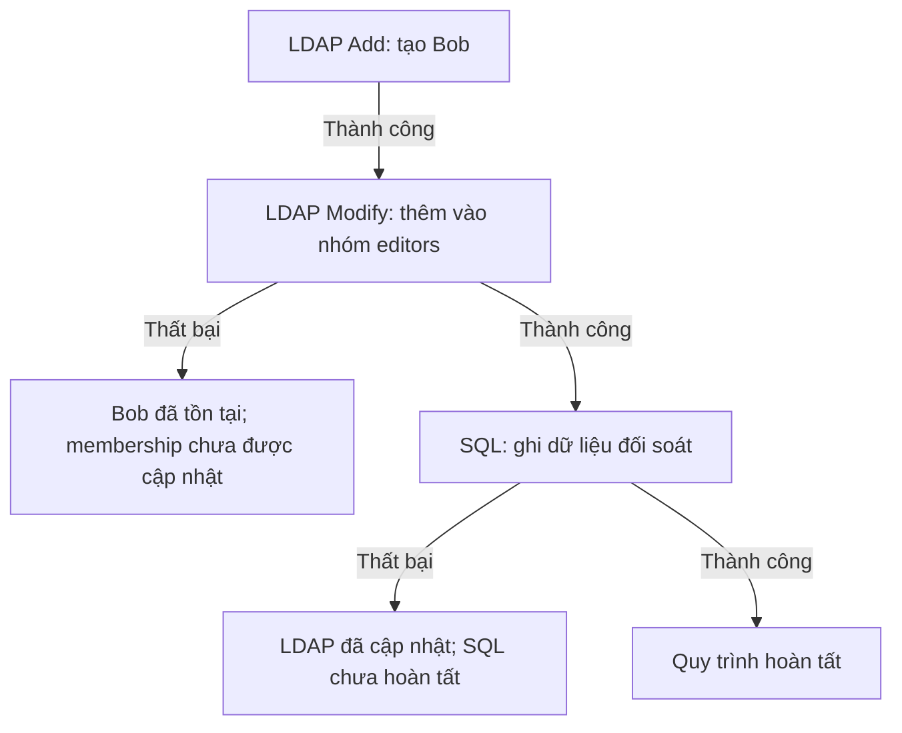

# Khả năng giao dịch của LDAP khác với database transaction

Khi làm việc với **Spring LDAP**, việc gọi nhiều phương thức của `LdapTemplate`, `LdapClient` hoặc ODM trong cùng một hàm Java **không tự tạo ra một giao dịch ACID** như khi cập nhật dữ liệu bằng JPA/JDBC. Điểm mấu chốt là phân biệt **tính nguyên tử của một thao tác LDAP** với **giao dịch bao trùm nhiều thao tác hoặc nhiều hệ thống**.

## 1. Mục tiêu học tập

Sau bài này, người học có thể:

- Giải thích vì sao một lệnh LDAP `Modify` có thể nguyên tử nhưng chuỗi nhiều lệnh LDAP thường không có rollback chung.
- So sánh phạm vi atomicity, isolation, rollback và commit giữa LDAP và cơ sở dữ liệu quan hệ.
- Nhận biết giới hạn của `@Transactional` khi mã Spring vừa ghi vào database vừa ghi vào LDAP.
- Phân biệt cơ chế **compensating transaction** của Spring LDAP với giao dịch gốc do máy chủ hỗ trợ.
- Chọn cách thiết kế và kiểm thử hợp lý khi cập nhật thông tin người dùng, nhóm hoặc quyền truy cập trong dịch vụ thư mục.

## 2. “Transaction” trong database và trong LDAP có nghĩa gì?

Với database quan hệ, một transaction điển hình gom nhiều câu lệnh vào một đơn vị công việc. Nếu mọi bước thành công, ứng dụng `COMMIT`; nếu một bước thất bại, `ROLLBACK` có thể hoàn tác các thay đổi **thuộc cùng giao dịch**. Những bảo đảm cụ thể về isolation phụ thuộc hệ quản trị và mức cô lập đã cấu hình.

LDAP là **giao thức truy cập dịch vụ thư mục**. Một yêu cầu ghi LDAP thường tác động đến một entry được xác định bởi **Distinguished Name (DN)**, chẳng hạn:

```text
uid=alice,ou=people,dc=example,dc=org
```

Các thao tác ghi phổ biến gồm `Add`, `Modify`, `Delete` và `ModifyDN` (đổi tên hoặc di chuyển entry). Trong LDAP thông thường, **mỗi yêu cầu được xử lý riêng**. Gửi chúng liên tiếp qua cùng một kết nối không đồng nghĩa với việc có một `BEGIN ... COMMIT` bao trùm tất cả.

| Khía cạnh | Database transaction thông thường | Các yêu cầu LDAP thông thường |
|---|---|---|
| Đơn vị công việc | Nhiều câu lệnh SQL trong một transaction | Từng yêu cầu `Add`, `Modify`, `Delete`, `ModifyDN` |
| Atomicity | Các thay đổi thuộc giao dịch cùng thành công hoặc cùng rollback | Một `Modify` trên một entry có tính nguyên tử; nhiều yêu cầu riêng biệt không mặc nhiên nguyên tử cùng nhau |
| Commit / rollback | Có cơ chế transaction do database cung cấp | Không có commit/rollback chung cho chuỗi yêu cầu LDAP theo cách sử dụng phổ biến |
| Isolation | Có các mức cô lập transaction theo database | Không thể suy ra mức cô lập của database cho chuỗi yêu cầu LDAP |
| Ràng buộc dữ liệu | Constraint và transaction của database | Schema, ACL và quy tắc máy chủ thư mục; không thay thế transaction nhiều entry |
| Kết hợp với hệ khác | Có thể phối hợp theo cơ chế transaction phù hợp | LDAP và SQL không tự có transaction phân tán chỉ vì cùng chạy trong một service Spring |

**Lưu ý:** Một số máy chủ có hỗ trợ **LDAP Transactions extension** (RFC 5805) hoặc cơ chế giao dịch riêng của nhà cung cấp. Đây là tính năng tùy chọn, phụ thuộc cả máy chủ lẫn thư viện khách; không nên giả định mọi hệ LDAP hoặc `LdapTemplate` đều hỗ trợ.

## 3. Tính nguyên tử của một lệnh `Modify`

Theo ngữ nghĩa LDAP `Modify` (RFC 4511), các thay đổi thuộc **cùng một yêu cầu Modify** trên **một entry** phải được áp dụng theo thứ tự và như một thao tác nguyên tử. Nếu một thay đổi không hợp lệ, toàn bộ yêu cầu `Modify` đó thất bại; không có trạng thái “thành công một nửa” trong cùng yêu cầu.

Ví dụ, entry Alice có hai thuộc tính:

```text
dn: uid=alice,ou=people,dc=example,dc=org
displayName: Alice Nguyen
telephoneNumber: 0900000000
```

Ứng dụng muốn sửa `displayName` và `telephoneNumber`. Nếu gộp vào **một** `ModifyRequest`, hai sửa đổi được xử lý cùng nhau. Nếu thuộc tính hoặc giá trị vi phạm schema hay quyền truy cập, máy chủ trả lỗi và không áp dụng riêng phần sửa đổi còn lại của yêu cầu.

Ngược lại, nếu gửi hai lệnh `Modify` độc lập:

1. Sửa `telephoneNumber` thành công.
2. Sửa `displayName` thất bại vì ràng buộc hoặc thiếu quyền.

Thì số điện thoại **đã được thay đổi**; LDAP không tự động hoàn tác lệnh đầu tiên.

### Ví dụ Spring LDAP: gộp thay đổi của một entry

```java
import javax.naming.Name;
import javax.naming.directory.BasicAttribute;
import javax.naming.directory.DirContext;
import javax.naming.directory.ModificationItem;

import org.springframework.ldap.core.LdapTemplate;
import org.springframework.ldap.support.LdapNameBuilder;
import org.springframework.stereotype.Service;

@Service
public class DirectoryProfileService {

    private final LdapTemplate ldapTemplate;

    public DirectoryProfileService(LdapTemplate ldapTemplate) {
        this.ldapTemplate = ldapTemplate;
    }

    public void updateProfile(String uid, String displayName, String phone) {
        Name dn = LdapNameBuilder
                .newInstance("ou=people,dc=example,dc=org")
                .add("uid", uid)
                .build();

        ModificationItem[] changes = {
                new ModificationItem(
                        DirContext.REPLACE_ATTRIBUTE,
                        new BasicAttribute("displayName", displayName)),
                new ModificationItem(
                        DirContext.REPLACE_ATTRIBUTE,
                        new BasicAttribute("telephoneNumber", phone))
        };

        // Một ModifyRequest dành cho một entry.
        ldapTemplate.modifyAttributes(dn, changes);
    }
}
```

Ở đây, `ModificationItem[]` biểu diễn **nhiều thay đổi trong một lệnh** `Modify`. `LdapNameBuilder` giúp tạo DN có escape phù hợp cho thành phần `uid`. Trước khi chạy, entry phải tồn tại và object class/schema của server phải cho phép các thuộc tính được sửa.

**Không suy rộng:** Đặt hai lần gọi `ldapTemplate.modifyAttributes(...)` trong cùng phương thức `updateProfile` không mang lại cùng bảo đảm nguyên tử như ví dụ trên. Quy tắc này cũng áp dụng khi dùng `LdapClient` hoặc LDAP ODM, vì các API đó vẫn gửi thao tác tới máy chủ LDAP.

## 4. Vì sao nhiều thao tác LDAP không tự rollback cùng nhau?

Xét quy trình cấp quyền:

1. Thêm entry mới `uid=bob,...`.
2. Thêm DN của Bob vào thuộc tính `member` của nhóm `cn=editors,...`.
3. Ghi thông tin đối soát vào database.

Nếu bước 2 thất bại sau khi bước 1 thành công, Bob vẫn có thể tồn tại trong thư mục nhưng chưa thuộc nhóm `editors`. Nếu bước 3 thất bại sau khi hai bước LDAP thành công, database và LDAP lại có thể khác nhau.



Nguyên nhân là **mỗi lần gọi LDAP được máy chủ xử lý độc lập** trừ khi một cơ chế transaction thật sự được hỗ trợ, kích hoạt và sử dụng đúng. Cùng một kết nối, cùng request HTTP hoặc cùng hàm Java không làm thay đổi điều đó.

Cần phân biệt thêm:

- **Schema validation:** ngăn một entry chứa dữ liệu không hợp lệ theo schema, nhưng không tự bảo đảm quan hệ nhất quán giữa nhiều entry.
- **Tham chiếu nhóm:** cập nhật `member` của một nhóm và cập nhật thuộc tính liên quan ở entry khác là các thao tác riêng, trừ khi máy chủ cung cấp tính năng đặc thù.
- **Replication:** phản hồi thành công từ một LDAP server không chứng minh mọi replica đã nhìn thấy thay đổi ngay lập tức; cần xem cơ chế đồng bộ của hệ thư mục cụ thể.

## 5. `@Transactional` của Spring có bảo vệ thao tác LDAP không?

**Không thể kết luận chỉ từ annotation.** `@Transactional` thực thi thông qua `PlatformTransactionManager` được Spring chọn. Transaction manager cho JDBC/JPA quản lý transaction của database; nó **không biến lệnh LDAP thành một phần của SQL transaction**.

Ví dụ minh họa (các repository và tham số được rút gọn):

```java
@Transactional(transactionManager = "dbTransactionManager")
public void changeEmployee(String userId, Name userDn,
                           ModificationItem[] ldapChanges) {
    employeeRepository.updateTitle(userId, "Editor"); // SQL
    ldapTemplate.modifyAttributes(userDn, ldapChanges); // LDAP
    auditRepository.insertChange(userId);               // SQL
}
```

Giả sử:

- Lệnh SQL đầu tiên thành công trong transaction của database.
- Lệnh `ldapTemplate.modifyAttributes(...)` thành công, LDAP đã nhận sửa đổi.
- Lệnh `auditRepository.insertChange(...)` ném lỗi, transaction SQL rollback.

**Kết quả:** thay đổi SQL có thể bị hoàn tác, trong khi thay đổi LDAP vẫn còn. `@Transactional(transactionManager = "dbTransactionManager")` chỉ điều khiển tài nguyên mà transaction manager đó quản lý. Việc ném exception trong Java không tự phát sinh một `LDAP rollback`.

Ngay cả khi chỉ có các lời gọi LDAP, annotation đơn thuần cũng chưa đủ: cần biết ứng dụng đã cấu hình transaction manager nào, thư viện Spring LDAP có cơ chế hỗ trợ nào và máy chủ LDAP có extension tương ứng hay không.

### Compensating transaction trong Spring LDAP

Spring LDAP có cơ chế **compensating transaction** thông qua các thành phần như `ContextSourceTransactionManager` (nếu phiên bản sử dụng hỗ trợ và cấu hình thích hợp). Ý tưởng là ghi nhận thông tin cần thiết để **thử thực hiện thao tác ngược** khi có lỗi, chẳng hạn:

| Thao tác đã thành công | Hành động bù trừ có thể thực hiện |
|---|---|
| Add entry | Delete entry vừa thêm |
| Delete entry | Tạo lại entry từ dữ liệu đã lưu |
| Modify attribute | Khôi phục giá trị trước đó |
| Rename entry | Đổi về DN trước đó |

Đây là **bù trừ tại phía ứng dụng**, không tương đương rollback nguyên tử do máy chủ quản lý:

- Bù trừ là các lệnh LDAP mới; chúng cũng có thể thất bại do mạng, ACL, schema hoặc máy chủ không sẵn sàng.
- Dữ liệu có thể đã bị tác nhân khác sửa trong khoảng thời gian giữa thay đổi ban đầu và bù trừ.
- Tác nhân đọc thư mục có thể đã thấy trạng thái trung gian; không có bảo đảm isolation như một SQL transaction.
- Việc phối hợp với database **không mặc nhiên là XA/two-phase commit** và không tạo bảo đảm all-or-nothing giữa LDAP và SQL.

Vì vậy, trước khi dùng `ContextSourceTransactionManager`, hãy kiểm tra tài liệu đúng phiên bản Spring LDAP, đường đi của `ContextSource`/`LdapTemplate` và kiểm thử tình huống bù trừ thất bại. Không nên xem cấu hình này là lời hứa ACID.

### Nếu máy chủ hỗ trợ LDAP Transactions extension

RFC 5805 mô tả khả năng giao dịch qua LDAP extension. Khi đánh giá sản phẩm LDAP cụ thể, cần kiểm tra:

1. Máy chủ có hỗ trợ và công bố extension phù hợp (có thể tìm hiểu từ `supportedExtension` trong root DSE).
2. Client/library đang dùng có thực sự gửi đúng yêu cầu, control và kết thúc giao dịch theo giao thức.
3. Những loại thao tác, giới hạn, lỗi và thời điểm công bố kết quả mà máy chủ hỗ trợ.

**Hỗ trợ trên máy chủ không đồng nghĩa `@Transactional` hoặc `LdapTemplate` mặc nhiên sử dụng extension đó.** Không nên xây dựng thiết kế phụ thuộc vào giao dịch LDAP nhiều entry khi chưa xác nhận bằng kiểm thử tích hợp trên đúng server.

## 6. Chọn giải pháp theo phạm vi cập nhật

| Nhu cầu | Cách tiếp cận hợp lý | Giới hạn cần nhớ |
|---|---|---|
| Sửa nhiều thuộc tính của **một entry** | Gộp các `ModificationItem` trong **một** `modifyAttributes` | Chỉ bảo đảm tính nguyên tử của một yêu cầu Modify |
| Tạo người dùng rồi gán vào nhóm | Thiết kế quy trình có thể chạy lại, kiểm tra trạng thái và bù trừ khi cần | Có thể xuất hiện entry đã tạo nhưng chưa gán nhóm |
| Ghi database và đồng bộ LDAP | Chọn một nguồn dữ liệu chính; dùng outbox/event, retry và reconciliation | Đồng bộ thường là **eventual consistency**, không phải commit đồng thời |
| Hệ LDAP có extension giao dịch | Xác minh tính năng thực tế và dùng client hỗ trợ đầy đủ | Tùy server, phiên bản và thao tác |
| Bắt buộc all-or-nothing giữa SQL và LDAP | Xem lại ranh giới dữ liệu và yêu cầu nghiệp vụ; thiết kế workflow phục hồi | Không được mặc nhiên dựa vào `@Transactional` để đạt XA |

### Ví dụ: đồng bộ qua transactional outbox

Giả sử database là nguồn dữ liệu chính cho chức danh nhân viên, LDAP là bản sao phục vụ tra cứu/xác thực:

1. Trong **một SQL transaction**, cập nhật chức danh và ghi một bản ghi outbox chứa sự kiện `EmployeeTitleChanged`.
2. Sau khi commit SQL, worker đọc outbox và gửi lệnh `Modify` tới LDAP.
3. Nếu LDAP tạm lỗi, worker retry theo chính sách; không phát sinh thay đổi SQL mới.
4. Trước khi gửi lại, worker kiểm tra trạng thái đích hoặc áp dụng thao tác idempotent (ví dụ `REPLACE_ATTRIBUTE` bằng giá trị mong muốn).
5. Theo dõi các sự kiện retry nhiều lần, lỗi vĩnh viễn và chạy đối soát định kỳ.

Cách này đưa ra quy tắc **phục hồi được khi lỗi**, nhưng có độ trễ đồng bộ. Khi LDAP là nguồn dữ liệu chính, cần đảo chiều dòng cập nhật và thiết kế lại quy tắc đối soát cho phù hợp, thay vì áp dụng outbox máy móc.

**Lưu ý bảo mật và vận hành:** chỉ đồng bộ thuộc tính cần thiết, dùng kết nối LDAP được bảo vệ bởi TLS, tài khoản có quyền tối thiểu, xử lý lỗi mà không ghi bí mật (đặc biệt mật khẩu hoặc credential) vào log. Với thuộc tính mang tính bảo mật như membership/quyền, cần xác định rõ hành vi khi LDAP cập nhật chậm hoặc thất bại, không mặc nhiên cấp quyền khi chưa xác nhận.

## 7. Thực hành xác minh tính nhất quán

Thực hành trên một LDAP server dùng cho kiểm thử, với hai entry thử nghiệm và một tài khoản có quyền phù hợp.

**Thí nghiệm A — Một yêu cầu Modify:**

1. Chuẩn bị một entry hợp lệ, ghi lại giá trị hai thuộc tính hiện tại.
2. Dùng một lần `ldapTemplate.modifyAttributes(dn, changes)` để sửa cả hai thuộc tính.
3. Tạo một thay đổi thứ hai cố ý vi phạm schema/ACL trong **cùng** `ModificationItem[]` (tùy schema của server).
4. Quan sát exception và đọc lại entry: cả hai thay đổi trong yêu cầu lỗi đều không được áp dụng.

**Thí nghiệm B — Hai yêu cầu Modify:**

1. Gửi lệnh `Modify` đầu tiên hợp lệ và xác nhận thành công.
2. Gửi lệnh `Modify` thứ hai cố ý bị từ chối.
3. Đọc lại entry: thay đổi đầu tiên vẫn có thể tồn tại dù lệnh thứ hai thất bại.

**Thí nghiệm C — SQL transaction kết hợp LDAP:**

1. Bao chuỗi cập nhật SQL–LDAP–SQL bằng `@Transactional` sử dụng database transaction manager.
2. Cho thao tác LDAP thành công rồi tạo lỗi tại bước SQL cuối.
3. Kiểm tra riêng database và LDAP sau khi lỗi xảy ra; so sánh hai trạng thái.
4. Lặp lại với cơ chế retry/đối soát được thiết kế và ghi nhận cách hệ thống khôi phục.

Khi đánh giá kết quả, log riêng **DN, loại thao tác, thời điểm, mã lỗi và correlation ID** (đã loại dữ liệu nhạy cảm). Không chỉ nhìn exception ở tầng service: phải đọc lại dữ liệu để biết thao tác nào thực sự đã được áp dụng.

## 8. Những nhầm lẫn thường gặp

- **“LDAP không có atomicity.”** Sai. Một yêu cầu `Modify` theo RFC 4511 có bảo đảm nguyên tử ở mức một entry; điều không có mặc định là transaction chung cho **nhiều yêu cầu**.
- **“Cùng một connection là cùng một transaction.”** Sai. Connection là kênh trao đổi, không tự tạo ranh giới giao dịch.
- **“Thêm `@Transactional` là LDAP sẽ rollback cùng JPA.”** Sai. Phải xác định transaction manager và cơ chế giao dịch của từng tài nguyên.
- **“Compensating transaction bảo đảm rollback 100%.”** Sai. Thao tác ngược là yêu cầu mới và có thể gặp lỗi hoặc xung đột với thay đổi đồng thời.
- **“LDAP có transaction extension thì Spring tự dùng.”** Sai. Cần client hỗ trợ, cấu hình chính xác và kiểm chứng trên máy chủ triển khai.

## 9. Ghi nhớ khi thiết kế ứng dụng Spring LDAP

Với các nghiệp vụ cập nhật thư mục, hãy hỏi **“Có bao nhiêu LDAP request và bao nhiêu tài nguyên phải thay đổi?”** trước khi quyết định ranh giới transaction. Một `Modify` gộp nhiều thuộc tính trên một entry khác bản chất với việc tạo user, sửa group và ghi database qua ba lệnh riêng. Trong trường hợp nhiều bước, hãy thiết kế trạng thái trung gian, retry, bù trừ và đối soát một cách rõ ràng; chỉ dựa vào transaction thực sự khi máy chủ và client đã được xác nhận hỗ trợ.

### Tài liệu đối chiếu

- [RFC 4511 — Lightweight Directory Access Protocol (LDAP): The Protocol](https://www.rfc-editor.org/rfc/rfc4511), đặc biệt phần `Modify Operation`.
- [RFC 5805 — LDAP Transactions](https://www.rfc-editor.org/rfc/rfc5805), mô tả extension giao dịch tùy chọn.
- Tài liệu Spring LDAP của **đúng phiên bản ứng dụng** về `LdapTemplate` và **compensating transactions**.
