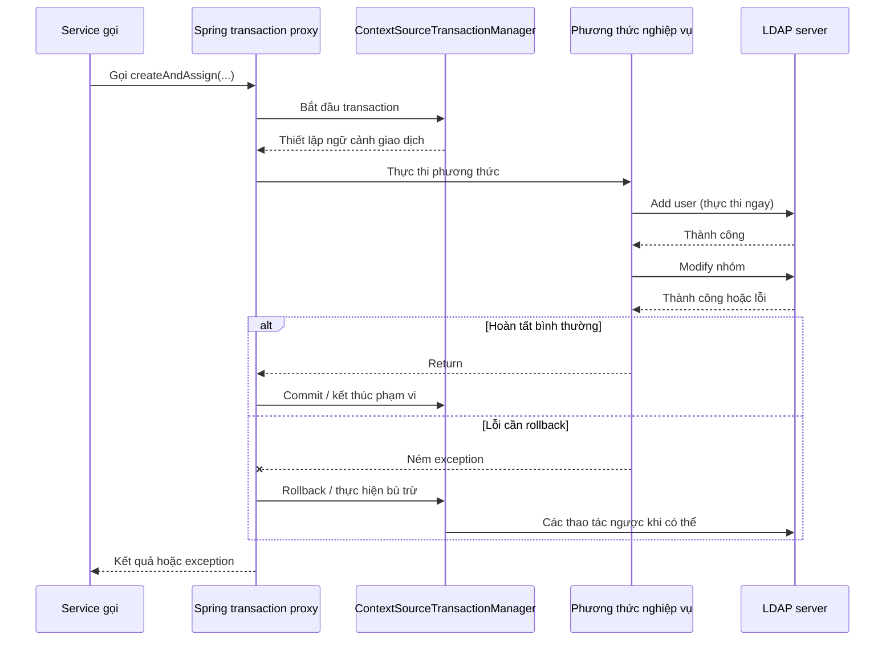

# ContextSourceTransactionManager và transaction boundary trong Spring LDAP

Trong ứng dụng Spring LDAP, `ContextSourceTransactionManager` cung cấp một cách quản lý **giao dịch bù trừ** (compensating transaction) cho các thao tác LDAP tương thích. Điều cần hiểu trước khi dùng là **transaction boundary**: khi nào một chuỗi thao tác được Spring xem là cùng một đơn vị công việc, lỗi nào kích hoạt rollback và rollback thực sự làm gì trên máy chủ LDAP.

Không nên đánh đồng `ContextSourceTransactionManager` với transaction database. Các yêu cầu ghi LDAP thường được áp dụng **ngay khi gửi đến server**; khi cần rollback, Spring LDAP cố gắng thực hiện những thao tác ngược đã chuẩn bị. Điều đó không tạo ra isolation hoặc bảo đảm nguyên tử giữa nhiều yêu cầu giống một database transaction.

## 1. Mục tiêu học tập

Sau bài này, người học có thể:

- Giải thích trách nhiệm của `ContextSourceTransactionManager` và sự khác biệt giữa **rollback bù trừ** với rollback ACID của database.
- Xác định transaction boundary khi gọi phương thức Spring có `@Transactional`.
- Cấu hình một transaction manager riêng cho LDAP và chỉ định manager khi ứng dụng có cả LDAP lẫn JDBC/JPA.
- Nhận diện các tình huống `@Transactional` không kích hoạt như mong đợi: tự gọi trong cùng bean, bắt rồi nuốt exception hoặc thực thi ở thread khác.
- Thiết kế phép thử tích hợp để xác minh kết quả sau lỗi và tình huống bù trừ thất bại.

## 2. Một transaction boundary biểu diễn điều gì?

**Transaction boundary** là đoạn thực thi mà một transaction manager kiểm soát: từ lúc bắt đầu tham gia/mở transaction đến lúc yêu cầu **commit** hoặc **rollback**.

Trong Spring, đoạn này thường hình thành khi một bean khác gọi vào phương thức `@Transactional` **qua proxy do Spring quản lý**:



Điểm đáng chú ý: lệnh `Add` hoặc `Modify` có thể đã thay đổi thư mục **trước lúc phương thức kết thúc**. Gọi `commit` trong mô hình bù trừ chủ yếu kết thúc phạm vi và không phải “gửi một lệnh LDAP commit chung” cho nhiều request thông thường. Nếu xảy ra lỗi, rollback cố sửa lại trạng thái bằng những request LDAP khác.

Ba ranh giới cần phân biệt:

| Ranh giới | Ý nghĩa | Bảo đảm |
|---|---|---|
| **Một LDAP request** | Chẳng hạn một `Modify` chứa nhiều `ModificationItem` cho một entry | Một yêu cầu Modify nguyên tử theo giao thức LDAP (RFC 4511) |
| **Spring transaction boundary** | Phạm vi do `ContextSourceTransactionManager` kiểm soát | Cơ chế ghi nhận và thử **bù trừ** các thao tác được hỗ trợ |
| **Database transaction boundary** | Phạm vi quản lý bởi `DataSourceTransactionManager`/JPA transaction manager | Commit/rollback theo bảo đảm của database và transaction manager tương ứng |

Một đoạn mã chạy trong cùng HTTP request hoặc cùng kết nối LDAP không tự tạo thành transaction boundary.

## 3. `ContextSourceTransactionManager` làm gì?

`ContextSourceTransactionManager` thuộc cơ chế transaction bù trừ của Spring LDAP. Đây là một triển khai của `PlatformTransactionManager`, cho phép tích hợp vào hạ tầng transaction của Spring.

Về mặt khái niệm, cơ chế làm việc như sau:

1. **Bắt đầu:** transaction manager chuẩn bị ngữ cảnh gắn với luồng thực thi hiện tại.
2. **Theo dõi thao tác:** các lệnh ghi LDAP đi qua đường tích hợp transaction-aware tương thích được ghi nhận; có thể cần đọc trạng thái cũ để tạo thao tác đảo ngược.
3. **Thực thi:** lệnh LDAP được gửi tới server và có thể nhìn thấy bởi các client khác.
4. **Commit:** khi phương thức hoàn tất hợp lệ, manager kết thúc giao dịch bù trừ.
5. **Rollback:** khi Spring quyết định rollback, manager thử thực hiện các thao tác ngược để đưa dữ liệu về trạng thái cũ.

Ví dụ trực quan:

| Thao tác trong boundary | Bù trừ có thể cần khi rollback |
|---|---|
| Thêm entry `uid=bob,...` | Xóa entry vừa thêm |
| Xóa entry | Tạo lại entry từ dữ liệu đã lưu trước khi xóa |
| Thay đổi một thuộc tính | Phục hồi giá trị trước khi thay đổi |
| Đổi tên/di chuyển entry | Đưa entry về DN cũ |

Khả năng bù trừ **phụ thuộc thao tác, dữ liệu được ghi nhận, đường truy cập LDAP và hỗ trợ của phiên bản Spring LDAP**. Không được mặc định mọi thao tác trên `DirContext`, `LdapTemplate`, `LdapClient` hay ODM đều được theo dõi như nhau. Phải đối chiếu tài liệu API của **phiên bản đang dùng** và kiểm tra qua server thật.

### Vì sao rollback bù trừ có thể không hoàn hảo?

Giả sử transaction thêm Bob thành công. Trước khi Spring kịp bù trừ, một dịch vụ khác thay đổi Bob hoặc thêm các tham chiếu tới Bob. Khi lệnh xóa bù trừ chạy, nó có thể bị từ chối, hoặc xóa cả thay đổi vừa phát sinh từ bên ngoài.

Rollback bù trừ cũng cần kết nối mạng, quyền truy cập và trạng thái máy chủ phù hợp. Vì thế:

- Không có isolation chung cho nhiều LDAP request: client khác có thể đọc trạng thái trung gian.
- Có thể xảy ra lỗi ở ngay thao tác bù trừ.
- Dữ liệu được phục hồi chưa chắc phản ánh mọi thay đổi đồng thời.
- Cần kiểm tra **trạng thái cuối cùng trong LDAP**, thay vì chỉ dựa vào việc phương thức ném exception.

## 4. Cấu hình transaction manager cho LDAP

Ví dụ sau minh họa phần **khai báo transaction manager** bằng Java Configuration. Giả sử ứng dụng đã có một bean `ContextSource` cấu hình URL, base DN, tài khoản kết nối và TLS phù hợp.

```java
import org.springframework.context.annotation.Bean;
import org.springframework.context.annotation.Configuration;
import org.springframework.transaction.annotation.EnableTransactionManagement;
import org.springframework.ldap.core.ContextSource;
import org.springframework.ldap.transaction.compensating.manager.ContextSourceTransactionManager;

@Configuration
@EnableTransactionManagement
public class LdapTransactionConfiguration {

    @Bean("ldapTransactionManager")
    public ContextSourceTransactionManager ldapTransactionManager(
            ContextSource contextSource) {
        ContextSourceTransactionManager manager =
                new ContextSourceTransactionManager();
        manager.setContextSource(contextSource);
        return manager;
    }
}
```

**Đây là phần cấu hình manager, chưa phải một cấu hình LDAP giao dịch đầy đủ có thể dùng nguyên xi trong mọi dự án.** Việc tạo và sử dụng `LdapTemplate`/client phải đi qua `ContextSource` có hỗ trợ nhận biết giao dịch theo yêu cầu của phiên bản thư viện, thường liên quan đến đường đi/proxy transaction-aware và cùng tài nguyên `ContextSource` được manager quản lý. Nếu cấu hình sai, mã vẫn có thể kết nối/ghi LDAP nhưng **không được bù trừ**.

Khi triển khai:

1. Kiểm tra module Spring LDAP trong dependency có các lớp transaction này và phiên bản đang dùng vẫn hỗ trợ chúng.
2. Cấu hình `ContextSource` và đường đi của `LdapTemplate` theo tài liệu transaction của đúng phiên bản.
3. Chọn tên manager rõ ràng, ví dụ `ldapTransactionManager`, đặc biệt khi dự án có manager cho database.
4. Bật quản lý transaction bằng `@EnableTransactionManagement` hoặc cấu hình Spring Boot tương ứng.
5. Dùng phép thử tích hợp có lỗi ở bước thứ hai để xác nhận thao tác thứ nhất thực sự được bù trừ.

Các tùy chọn kết nối như TLS, credentials, referral handling và context pooling cần phù hợp với mô hình giao dịch; không được giả định một `ContextSource` kết nối được LDAP đồng nghĩa đã hoạt động đúng với bù trừ. Không ghi mật khẩu hoặc thông tin xác thực vào log khi thử nghiệm.

## 5. Xác định transaction boundary bằng `@Transactional`

Xét một nghiệp vụ gồm hai bước: tạo user và thêm user vào nhóm. Mỗi bước là một yêu cầu LDAP độc lập.

```java
import javax.naming.Name;
import javax.naming.directory.Attributes;
import javax.naming.directory.BasicAttribute;
import javax.naming.directory.DirContext;
import javax.naming.directory.ModificationItem;

import org.springframework.ldap.core.LdapTemplate;
import org.springframework.stereotype.Service;
import org.springframework.transaction.annotation.Transactional;

@Service
public class DirectoryEnrollmentService {

    private final LdapTemplate ldapTemplate;

    public DirectoryEnrollmentService(LdapTemplate ldapTemplate) {
        this.ldapTemplate = ldapTemplate;
    }

    @Transactional(
            transactionManager = "ldapTransactionManager",
            rollbackFor = Exception.class)
    public void createAndAssign(Name userDn, Attributes userAttributes,
                                Name groupDn) throws Exception {
        ldapTemplate.bind(userDn, null, userAttributes);

        ModificationItem addMember = new ModificationItem(
                DirContext.ADD_ATTRIBUTE,
                new BasicAttribute("member", userDn.toString()));

        ldapTemplate.modifyAttributes(
                groupDn, new ModificationItem[] { addMember });
    }
}
```

Ví dụ giả định DN và `Attributes` đã được tạo/kiểm tra an toàn, đối tượng LDAP đúng schema, nhóm dùng thuộc tính `member` và kết nối đủ quyền. Khi gọi `createAndAssign(...)` qua proxy của Spring:

- Nếu cả hai thao tác thành công, boundary kết thúc bình thường.
- Nếu thêm user thành công nhưng thêm vào nhóm thất bại và exception khiến Spring rollback, cơ chế bù trừ **có thể thử xóa user vừa thêm**.
- Nếu lệnh xóa bù trừ bị từ chối hoặc không thể thực thi, user có thể vẫn tồn tại; cần đối soát hoặc xử lý tiếp.

Việc đặt `rollbackFor = Exception.class` làm ví dụ rõ ràng đối với cả checked exception. Theo mặc định, `@Transactional` của Spring thường rollback với `RuntimeException` và `Error`; checked exception không tự kích hoạt rollback trừ khi cấu hình quy tắc thích hợp. Các ngoại lệ của Spring LDAP thường là runtime exception, nhưng không nên dựa vào suy đoán khi nghiệp vụ tự chuyển đổi exception.

**Phương pháp tốt hơn khi có thể:** nếu chỉ sửa nhiều thuộc tính của **cùng một entry**, hãy gộp thay đổi vào **một** `ldapTemplate.modifyAttributes(dn, ModificationItem[])`. Tính nguyên tử của một `Modify` là bảo đảm phía LDAP, đơn giản và rõ ràng hơn so với cần bù trừ nhiều request.

## 6. Khi annotation tồn tại nhưng transaction không chạy như mong đợi

### 6.1. Tự gọi phương thức trong cùng bean (self-invocation)

```java
@Service
public class UserWorkflow {

    public void outer() {
        inner(); // Gọi trực tiếp trong cùng object, thường bỏ qua proxy.
    }

    @Transactional(transactionManager = "ldapTransactionManager")
    public void inner() {
        // Các thao tác LDAP...
    }
}
```

Trong chế độ transaction proxy mặc định, `outer()` gọi `inner()` trực tiếp, **không đi qua proxy** của Spring. Do đó annotation trên `inner()` có thể không kích hoạt một transaction mới.

Giải pháp thông thường là đặt ranh giới giao dịch trên một phương thức được bean khác gọi qua Spring proxy, ví dụ tách `inner()` vào một service được inject. Việc chuyển annotation sang phương thức private hoặc chỉ dựa vào cùng bean không khắc phục self-invocation.

### 6.2. Bắt exception rồi tiếp tục trả về bình thường

```java
@Transactional(transactionManager = "ldapTransactionManager")
public void unsafeFlow(Name dn, ModificationItem[] changes) {
    try {
        ldapTemplate.modifyAttributes(dn, changes);
    } catch (RuntimeException ex) {
        // Ví dụ cố ý nuốt lỗi: method trả về bình thường.
        // Transaction interceptor có thể xem đây là thành công.
    }
}
```

Khi phương thức không ném lỗi ra ngoài và chưa đánh dấu rollback-only, transaction interceptor có thể xem nó là thành công. Cách đúng tùy nghiệp vụ: truyền lỗi lên cho lớp có trách nhiệm xử lý, hoặc chủ động đánh dấu rollback-only thông qua API transaction của Spring nếu cần hấp thụ exception.

### 6.3. Chọn sai transaction manager

Nếu ứng dụng đồng thời có:

- `ldapTransactionManager`: quản lý cơ chế bù trừ LDAP.
- `dbTransactionManager`: quản lý transaction SQL.

thì annotation nên nói rõ manager tương ứng:

```java
@Transactional(transactionManager = "ldapTransactionManager")
public void changeDirectoryMembership() {
    // LDAP operations
}

@Transactional(transactionManager = "dbTransactionManager")
public void updateEmployeeRecord() {
    // SQL operations
}
```

Một `@Transactional` không chỉ định manager có thể dùng default manager không như ý hoặc gây mơ hồ nếu nhiều manager cùng tồn tại. Quan trọng hơn, dùng `dbTransactionManager` **không làm LDAP tham gia SQL transaction**.

### 6.4. Bước xử lý chạy ở luồng khác

Ngữ cảnh transaction của Spring thường gắn với **thread thực thi hiện tại**. Các tác vụ khởi chạy bằng `@Async`, thread pool hoặc callback được thực thi sau khi hàm trả về không mặc nhiên chia sẻ cùng transaction boundary. Nếu tác vụ con cần transaction, nó phải có ranh giới riêng, được kích hoạt đúng theo cách Spring hỗ trợ.

### 6.5. Propagation và kỳ vọng về savepoint

Thuộc tính `propagation` quyết định cách tham gia hay mở transaction trong hạ tầng Spring, nhưng mức hỗ trợ thực tế còn phụ thuộc transaction manager. Đặc biệt, không mặc định `NESTED`, savepoint hoặc `REQUIRES_NEW` của LDAP có ngữ nghĩa giống JDBC. Hãy kiểm tra hành vi và các ngoại lệ do manager đang dùng trả về; tránh dùng propagation phức tạp khi chưa có phép thử phù hợp.

`@Transactional(readOnly = true)` cũng không thay thế ACL của LDAP server và không nên được xem là cơ chế chặn mọi thao tác ghi.

## 7. Giao dịch LDAP và database trong cùng workflow

Xét luồng cập nhật hồ sơ nhân viên:

```text
1. UPDATE employee (SQL)
2. MODIFY uid=alice,... (LDAP)
3. INSERT audit_log (SQL)
```

Nếu bao cả ba bằng `@Transactional(transactionManager = "dbTransactionManager")`, thao tác LDAP thành công ở bước 2 **không tự rollback** khi bước 3 lỗi và SQL rollback.

Nếu bao bằng `@Transactional(transactionManager = "ldapTransactionManager")`, các câu SQL không tự tham gia giao dịch của database theo đúng nghĩa chỉ vì dùng cùng annotation.

Một số phiên bản Spring LDAP có hỗ trợ phối hợp tài nguyên LDAP và JDBC, ví dụ lớp `ContextSourceAndDataSourceTransactionManager`. Đây là cơ chế **điều phối có bù trừ**; không được hiểu là XA/2-phase commit với atomic commit tuyệt đối. Khi một tài nguyên đã commit hoặc khi bù trừ thất bại, vẫn có thể phát sinh trạng thái lệch giữa hai hệ thống.

Với nghiệp vụ quan trọng, nên thiết kế theo nguồn dữ liệu chính và cơ chế phục hồi rõ ràng:

| Tình huống | Thiết kế thường phù hợp |
|---|---|
| Chỉ sửa nhiều thuộc tính của một user | Gộp vào một LDAP Modify request |
| Hai thao tác LDAP liên tiếp, chấp nhận bù trừ có điều kiện | Dùng transaction bù trừ nếu đã kiểm chứng; thêm retry và đối soát |
| Cập nhật SQL rồi đồng bộ thuộc tính LDAP | SQL transactional outbox, worker gửi LDAP, retry idempotent và reconciliation |
| Nhiều thay đổi thuộc nhóm/quyền cần nhất quán nghiêm ngặt | Thiết kế trạng thái pending/activated, chỉ cấp quyền khi LDAP xác nhận; đánh giá lại ranh giới dữ liệu |
| Yêu cầu transaction LDAP nhiều thao tác từ server | Xác minh máy chủ và client thực sự hỗ trợ LDAP Transactions extension (RFC 5805) |

Transaction bù trừ phía Spring và **LDAP Transactions extension** (RFC 5805) là **hai cơ chế khác nhau**. Không được suy luận rằng khai báo `ContextSourceTransactionManager` sẽ kích hoạt extension giao dịch của máy chủ.

## 8. Kiểm thử transaction boundary bằng tình huống lỗi có kiểm soát

Nên kiểm thử trên LDAP server riêng, với dữ liệu giả và quyền phù hợp. Không dùng tài khoản quản trị thư mục hoặc entry người dùng thật để thử rollback.

### Ca A — Boundary hợp lệ và rollback bù trừ

1. Gọi service có `@Transactional(transactionManager = "ldapTransactionManager")` từ **một Spring bean khác**.
2. Bước một tạo entry thử nghiệm thành công.
3. Bước hai cố ý gây lỗi LDAP xác định trước, ví dụ thay đổi không được schema/ACL chấp nhận.
4. Để exception lan ra khỏi phương thức, kích hoạt rollback.
5. Đọc lại LDAP qua một context độc lập để xem entry được tạo đã được bù trừ hay chưa.

**Kỳ vọng:** nếu cấu hình đúng và thao tác đảo ngược được hỗ trợ, entry mới được xóa khi rollback. Kết quả thực tế phải được kiểm chứng; một exception **không phải bằng chứng** dữ liệu đã khôi phục.

### Ca B — Không qua Spring proxy

1. Tạo một method gắn `@Transactional` nhưng được method khác trong **cùng bean** gọi trực tiếp.
2. Gây lỗi sau khi LDAP Add thành công.
3. Đọc lại entry và so sánh với ca A.

**Mục đích:** xác nhận liệu transaction interceptor có thật sự chạy ở ranh giới dự định hay không.

### Ca C — Kiểm tra rollback rule

1. Trong một phương thức transactional, tạo thay đổi LDAP.
2. Chủ động ném một checked exception từ nghiệp vụ.
3. Chạy hai cấu hình: mặc định và thêm `rollbackFor = Exception.class`.
4. Đọc trạng thái LDAP sau mỗi trường hợp.

**Mục đích:** nhận diện sự khác biệt giữa “có exception” và “Spring quyết định rollback”.

### Ca D — Bù trừ không thực hiện được

Thiết kế môi trường kiểm thử cô lập để gây lỗi có kiểm soát khi thao tác ngược chạy, chẳng hạn cơ chế mock/stub ở lớp LDAP hoặc ngắt kết nối tại thời điểm xác định. Sau đó xác định ứng dụng có:

- Ghi nhận lỗi rollback đủ để điều tra mà không lộ dữ liệu nhạy cảm.
- Cảnh báo hoặc đưa yêu cầu vào hàng đợi đối soát.
- Dùng correlation ID để liên kết các thao tác trong cùng workflow.
- Khôi phục bằng quy trình vận hành có thể lặp lại và kiểm tra được.

Trong kiểm thử bảo mật, bảo vệ mật khẩu, token, chuỗi bind credentials và thông tin cá nhân khi log; ưu tiên DN đã được kiểm soát, mã kết quả LDAP và request ID.

## 9. Checklist trước khi đưa vào hệ thống

- **Phạm vi:** xác định số request LDAP, số entry và có database tham gia hay không.
- **Đường giao dịch:** đảm bảo `LdapTemplate` hoặc API LDAP được sử dụng đi qua hạ tầng transaction-aware phù hợp với đúng phiên bản Spring LDAP.
- **Proxy và manager:** gọi phương thức qua Spring proxy, chỉ rõ `ldapTransactionManager` và kiểm tra rollback rules.
- **Bù trừ:** ghi nhận thao tác đảo ngược có thực sự khả thi với schema/ACL hiện tại.
- **Kết nối:** cấu hình TLS, timeouts và pooling phù hợp; không giả định lỗi mạng đồng nghĩa thao tác server chưa thực thi.
- **Quan sát:** sau lỗi, đọc lại server để phân biệt transaction bị lỗi, bù trừ đã thành công hay còn dữ liệu cần sửa.
- **Khôi phục:** có retry, idempotency, đối soát và cảnh báo cho trạng thái lỗi kéo dài.

## 10. Câu hỏi tự kiểm tra

1. Vì sao hai lần gọi `ldapTemplate.modifyAttributes(...)` trong một phương thức `@Transactional` vẫn có thể để lộ trạng thái trung gian?
2. Điều gì xảy ra nếu bước LDAP thứ nhất thành công, bước thứ hai ném lỗi nhưng exception bị bắt rồi phương thức trả về bình thường?
3. Vì sao một phương thức gắn `@Transactional` được gọi từ chính bean chứa nó có thể không tạo transaction boundary?
4. Trong ứng dụng có `dbTransactionManager` và `ldapTransactionManager`, phải làm gì để tránh dùng nhầm manager?
5. Sau khi Spring báo rollback, tại sao kiểm thử vẫn phải đọc lại entry LDAP?
6. Điều gì phải được xác minh trước khi kỳ vọng cả SQL và LDAP thay đổi hoặc cùng bị hoàn tác?

## 11. Kết luận

`ContextSourceTransactionManager` giúp Spring tổ chức **một phạm vi bù trừ** đối với những thao tác LDAP được hỗ trợ. Transaction boundary xác định lúc Spring mở/kết thúc phạm vi đó và khi nào thử rollback, nhưng **không biến nhiều LDAP request thành một transaction ACID ở máy chủ**. Cấu hình manager, đường kết nối transaction-aware, cách gọi qua Spring proxy và quy tắc exception đều ảnh hưởng đến kết quả. Thiết kế đáng tin cậy phải kết hợp thử nghiệm lỗi thực tế, quan sát trạng thái cuối cùng và phương án đối soát khi bù trừ không thành công.

### Tài liệu tham khảo

- [Spring Framework Reference — Declarative Transaction Management](https://docs.spring.io/spring-framework/reference/data-access/transaction/declarative.html): proxy, `@Transactional`, propagation và rollback rules.
- [Spring LDAP Reference](https://docs.spring.io/spring-ldap/reference/): cấu hình `ContextSource`, thao tác với `LdapTemplate` và cơ chế transaction của phiên bản tương ứng.
- [RFC 4511 — Lightweight Directory Access Protocol (LDAP): The Protocol](https://www.rfc-editor.org/rfc/rfc4511): ngữ nghĩa các yêu cầu LDAP như `Modify`.
- [RFC 5805 — LDAP Transactions](https://www.rfc-editor.org/rfc/rfc5805): extension giao dịch tùy chọn phía LDAP server.
