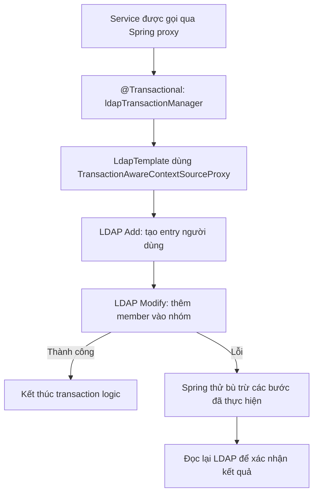

# Thao tác LDAP tham gia cùng một transaction

Trong ứng dụng **Spring LDAP**, đôi khi một nghiệp vụ gồm nhiều thao tác thư mục: tạo tài khoản, gán vào nhóm, đổi thuộc tính hoặc chuyển entry sang nhánh khác. Người phát triển muốn các lệnh gọi qua `LdapTemplate`, `LdapClient` hay ODM cùng nằm trong một ranh giới `@Transactional` để có thể xử lý khi bước sau thất bại.

Spring LDAP hỗ trợ một kiểu **transaction bù trừ ở phía ứng dụng** (*client-side compensating transaction*). Khi được cấu hình đúng, nhiều thao tác LDAP có thể **tham gia cùng một transaction logic do Spring quản lý**. Tuy nhiên, việc tham gia này **không tương đương giao dịch ACID của database**: máy chủ LDAP vẫn xử lý từng thao tác; khi rollback, phía Spring cố gắng gửi các thao tác ngược để khôi phục trạng thái.

Bài viết tập trung vào **cách đưa các thao tác LDAP thực sự tham gia transaction logic của Spring**, cách cấu hình, phạm vi áp dụng, tình huống lỗi và kiểm chứng.

## 1. Mục tiêu học tập

Sau bài này, người học có thể:

- Phân biệt transaction logic của Spring LDAP với transaction do máy chủ LDAP hỗ trợ.
- Cấu hình đúng bộ ba `ContextSource` gốc, `TransactionAwareContextSourceProxy` và `ContextSourceTransactionManager`.
- Tổ chức hai thao tác LDAP liên tiếp bên trong một phương thức service dùng `@Transactional(transactionManager = "...")`.
- Giải thích thao tác nào được ghi nhận để bù trừ, khi nào rollback được kích hoạt và khi nào bù trừ có thể thất bại.
- Nhận diện giới hạn khi cùng một nghiệp vụ ghi LDAP và JDBC/JPA.
- Thiết kế bài kiểm thử đọc lại trạng thái LDAP sau cả nhánh thành công lẫn nhánh lỗi.

## 2. “Tham gia cùng transaction” có nghĩa gì?

Xét nghiệp vụ tạo một nhân viên mới:

1. Tạo entry `uid=linh,ou=people,dc=example,dc=org`.
2. Thêm DN của nhân viên vào thuộc tính `member` của nhóm `cn=editors,ou=groups,dc=example,dc=org`.
3. Nếu bước thứ hai gặp lỗi, ứng dụng muốn thử hoàn tác việc tạo entry ở bước đầu.

Khi **không có hỗ trợ transaction**, hai lệnh LDAP được thực hiện độc lập; entry từ bước 1 có thể vẫn tồn tại sau khi bước 2 lỗi.

Khi **có transaction bù trừ của Spring LDAP** và cả hai lệnh đi qua cùng `TransactionAwareContextSourceProxy`, transaction manager ghi nhận thông tin cần thiết trước các lệnh ghi. Nếu ứng dụng yêu cầu rollback, nó cố thực hiện các thao tác ngược theo logic bù trừ. Với trường hợp thành công, transaction kết thúc sau khi các bước ghi đều hoàn tất.



Ở đây, các thao tác **tham gia chung cơ chế quản lý và bù trừ ở phía client**. Điều này không khóa cả cây thư mục, không ngăn client khác đọc trạng thái trung gian và không bảo đảm mọi thao tác ngược sẽ thành công.

| Khái niệm | Ý nghĩa trong Spring LDAP |
|---|---|
| `@Transactional` | Đánh dấu phạm vi transaction logic theo Spring AOP, khi phương thức được gọi qua proxy phù hợp |
| `PlatformTransactionManager` | Thành phần Spring xác định bắt đầu, hoàn tất hoặc rollback transaction |
| `ContextSourceTransactionManager` | Transaction manager cho LDAP, sử dụng chiến lược bù trừ |
| `TransactionAwareContextSourceProxy` | Bọc `ContextSource` để các thao tác ghi qua context được theo dõi và gắn với transaction hiện hành |
| `LdapTemplate` / `LdapClient` | Giao diện gọi LDAP; chỉ tham gia cơ chế nói trên khi dùng đường `ContextSource` phù hợp |
| Máy chủ LDAP | Vẫn thực thi từng thao tác LDAP; không biết về transaction bù trừ của Spring |

**Phân biệt:** Tính nguyên tử của **một** yêu cầu `Modify` trên một entry (LDAP RFC 4511) là một bảo đảm riêng của giao thức. Nó không tạo transaction chung cho **nhiều yêu cầu** `Add`/`Modify`/`Delete`. Ngoài ra, LDAP Transactions extension trong RFC 5805 là tính năng phía máy chủ tùy chọn và **khác** với cơ chế bù trừ đang xét.

## 3. Cấu hình Spring LDAP để các thao tác được theo dõi

Để transaction bù trừ hoạt động, cần hai đường tham chiếu khác nhau đến cùng tài nguyên thực:

- **Transaction manager nhận `ContextSource` gốc** để quản lý ngữ cảnh giao dịch.
- **Client LDAP nhận `TransactionAwareContextSourceProxy` bọc `ContextSource` gốc** để ghi lại các thao tác và chuẩn bị lệnh bù trừ.

Không được dùng `LdapTemplate` trỏ trực tiếp vào nguồn gốc trong khi chỉ khởi tạo `ContextSourceTransactionManager`: các thao tác sẽ không đi qua lớp proxy theo dõi.

### Ví dụ cấu hình Java

Ví dụ dưới đây sử dụng API Spring LDAP **4.1 trở lên** cho constructor của `ContextSourceTransactionManager`. Với phiên bản cũ hơn, kiểm tra API tương ứng (thường là constructor rỗng rồi gọi `setContextSource(target)`).

```java
import org.springframework.beans.factory.annotation.Qualifier;
import org.springframework.context.annotation.Bean;
import org.springframework.context.annotation.Configuration;
import org.springframework.core.env.Environment;
import org.springframework.ldap.core.ContextSource;
import org.springframework.ldap.core.LdapTemplate;
import org.springframework.ldap.core.support.LdapContextSource;
import org.springframework.ldap.transaction.compensating.manager.ContextSourceTransactionManager;
import org.springframework.ldap.transaction.compensating.manager.TransactionAwareContextSourceProxy;
import org.springframework.transaction.annotation.EnableTransactionManagement;

@Configuration
@EnableTransactionManagement
public class DirectoryTransactionConfig {

    @Bean("ldapTargetContextSource")
    public LdapContextSource ldapTargetContextSource(Environment env) {
        LdapContextSource target = new LdapContextSource();
        target.setUrl(env.getRequiredProperty("directory.url"));
        target.setBase("dc=example,dc=org");
        target.setUserDn(env.getRequiredProperty("directory.bind-dn"));
        target.setPassword(env.getRequiredProperty("directory.password"));
        return target;
    }

    @Bean("ldapAwareContextSource")
    public ContextSource ldapAwareContextSource(
            @Qualifier("ldapTargetContextSource") ContextSource target) {
        return new TransactionAwareContextSourceProxy(target);
    }

    @Bean("ldapTemplate")
    public LdapTemplate ldapTemplate(
            @Qualifier("ldapAwareContextSource") ContextSource aware) {
        return new LdapTemplate(aware);
    }

    @Bean("ldapTransactionManager")
    public ContextSourceTransactionManager ldapTransactionManager(
            @Qualifier("ldapTargetContextSource") ContextSource target) {
        // Spring LDAP 4.1+: truyền ContextSource gốc cho manager.
        return new ContextSourceTransactionManager(target);
    }
}
```

Ví dụ về cấu hình môi trường:

```properties
directory.url=ldaps://ldap.example.org:636
directory.bind-dn=cn=app-writer,ou=service-accounts,dc=example,dc=org
# directory.password: cung cấp từ secret manager / biến môi trường
```

**Đọc đúng cấu hình:**

- `target` là `LdapContextSource` thật, mang URL, base DN, principal và credential.
- `aware` là `TransactionAwareContextSourceProxy(target)`. Client thực hiện `bind`, `modifyAttributes`, `unbind`, `rename` qua proxy này.
- `ldapTransactionManager` nhận chính `target`, **không nhận proxy**.
- Tên `ldapTransactionManager` được tham chiếu rõ trong `@Transactional`, tránh dùng nhầm transaction manager của database nếu ứng dụng có nhiều manager.
- Vì `base` đã đặt thành `dc=example,dc=org`, DN truyền cho các phương thức `LdapTemplate` là DN **tương đối với base** (chẳng hạn `uid=linh,ou=people`). Giá trị của thuộc tính kiểu DN như `member` thường phải là **DN đầy đủ**, phù hợp schema.

Đừng hardcode mật khẩu thực vào source, log hay tài liệu. Nên dùng tài khoản service có quyền tối thiểu, LDAPS hoặc StartTLS với xác thực chứng chỉ và chính sách kết nối phù hợp. Cơ chế bù trừ cần quyền thực hiện các thao tác ngược, ví dụ `Delete` sau `Add`.

**Phiên bản và auto-configuration:** Nếu dùng Spring Boot hoặc tự khai báo thêm các bean `ContextSource`/`LdapTemplate`, hãy kiểm tra bean nào thực sự được inject. Một client do auto-configuration tạo dựa trên `ContextSource` khác có thể đi ngoài proxy mà ta chủ đích sử dụng. Đoạn cấu hình trên là ví dụ nguyên lý; tên property, bean và API constructor cần khớp phiên bản dự án.

## 4. Đưa nhiều lệnh LDAP vào cùng phương thức `@Transactional`

Giả sử nhánh `ou=people` và nhóm `cn=editors,ou=groups` đã tồn tại, schema chấp nhận các object class/thuộc tính trong ví dụ, và tài khoản service có quyền thêm entry người dùng, sửa thuộc tính nhóm.

```java
import javax.naming.Name;
import javax.naming.directory.Attributes;
import javax.naming.directory.BasicAttribute;
import javax.naming.directory.BasicAttributes;
import javax.naming.directory.DirContext;
import javax.naming.directory.ModificationItem;

import org.springframework.ldap.core.LdapTemplate;
import org.springframework.ldap.support.LdapNameBuilder;
import org.springframework.stereotype.Service;
import org.springframework.transaction.annotation.Transactional;

@Service
public class DirectoryProvisioningService {

    private final LdapTemplate ldapTemplate;

    public DirectoryProvisioningService(LdapTemplate ldapTemplate) {
        this.ldapTemplate = ldapTemplate;
    }

    @Transactional(transactionManager = "ldapTransactionManager")
    public void createUserAndJoinEditors(
            String uid, String commonName, String surname) {

        // LdapTemplate đang làm việc dưới base dc=example,dc=org.
        Name userRelativeDn = LdapNameBuilder.newInstance("ou=people")
                .add("uid", uid)
                .build();

        Name userFullDn = LdapNameBuilder.newInstance("dc=example,dc=org")
                .add("ou", "people")
                .add("uid", uid)
                .build();

        Name editorsRelativeDn = LdapNameBuilder.newInstance("ou=groups")
                .add("cn", "editors")
                .build();

        Attributes attributes = new BasicAttributes(true);
        BasicAttribute classes = new BasicAttribute("objectClass");
        classes.add("top");
        classes.add("person");
        classes.add("organizationalPerson");
        classes.add("inetOrgPerson");
        attributes.put(classes);
        attributes.put("uid", uid);
        attributes.put("cn", commonName);
        attributes.put("sn", surname);

        // Bước 1: ghi entry người dùng.
        ldapTemplate.bind(userRelativeDn, null, attributes);

        // Bước 2: sửa một entry nhóm khác.
        ModificationItem addMember = new ModificationItem(
                DirContext.ADD_ATTRIBUTE,
                new BasicAttribute("member", userFullDn.toString()));

        ldapTemplate.modifyAttributes(
                editorsRelativeDn, new ModificationItem[] { addMember });
    }
}
```

Hàm này có **hai yêu cầu ghi LDAP**, mỗi yêu cầu là một thao tác độc lập tại máy chủ. Điểm kết nối chúng vào cùng transaction logic của Spring nằm ở:

1. Lời gọi đi **từ một Spring bean khác** qua transactional proxy của `DirectoryProvisioningService`.
2. `@Transactional` chọn đúng `ldapTransactionManager`.
3. `ldapTemplate` đang dùng `ldapAwareContextSource` đã cấu hình.
4. Cả hai thao tác thực thi trong ranh giới phương thức, trên ngữ cảnh transaction mà Spring liên kết với thread hiện hành.

Nếu bước 2 phát sinh lỗi LDAP và exception truyền ra theo quy tắc rollback, Spring LDAP có thể thử gỡ entry vừa tạo ở bước 1. Nếu cả hai bước thành công, luồng kết thúc transaction logic bình thường.

**Chú ý với `member`:** Ví dụ dùng `groupOfNames` theo cách thường gặp. Một số máy chủ dùng `uniqueMember` hoặc schema/ACL khác, nên phải chỉnh thao tác theo dịch vụ thư mục thực tế. Nếu DN đã tồn tại trong nhóm, thao tác `ADD_ATTRIBUTE` có thể bị từ chối vì trùng giá trị.

### Vì sao tự gọi phương thức có `@Transactional` có thể không có tác dụng?

```java
@Service
public class UserOrchestrator {
    public void provision() {
        createInLdap(); // Gọi nội bộ cùng đối tượng: có thể bỏ qua Spring proxy.
    }

    @Transactional(transactionManager = "ldapTransactionManager")
    public void createInLdap() {
        // ... gọi LdapTemplate ...
    }
}
```

Trong chế độ Spring AOP proxy thông thường, lời gọi nội bộ từ `provision()` tới `createInLdap()` không đi qua proxy. Hãy để bean khác gọi public service được Spring quản lý; hoặc tổ chức lại ranh giới transaction/ dùng `TransactionTemplate` khi cần điều khiển bằng mã.

Cũng cần tránh kỳ vọng các thao tác trong một task `@Async`, thread mới hoặc callback chạy ngoài phạm vi transaction sẽ tự động tham gia cùng transaction của thread gọi.

## 5. Khi rollback, Spring LDAP bù trừ những gì?

Spring LDAP ghi nhận trước trạng thái hoặc thông tin cần thiết để dựng thao tác ngược. Cơ chế này có thể trải qua các pha **recording**, **preparation**, **commit** và **rollback**, tùy loại thao tác.

| Lệnh ghi LDAP | Phương án bù trừ điển hình | Lưu ý |
|---|---|---|
| `bind` (Add) | `unbind` entry vừa tạo | Delete có thể lỗi vì quyền, cấu trúc cây hoặc kết nối |
| `modifyAttributes` | Gửi một yêu cầu Modify khác để khôi phục giá trị cũ | Có rủi ro ghi đè thay đổi xảy ra đồng thời |
| `rename` | Đổi từ DN mới về DN cũ | Có thể xung đột nếu DN cũ bị chiếm |
| `unbind` | Đổi tên entry sang vị trí tạm khi chuẩn bị; rollback đổi về | Cần quyền rename, vị trí DN tạm hợp lệ |
| `rebind` | Giữ dữ liệu gốc ở DN tạm để có thể hoàn tác | Có thêm thao tác và trạng thái trung gian |

Đặc biệt, `unbind` và `rebind` trong cơ chế compensating transaction **không nhất thiết xóa/thay thế ngay theo cách thông thường**: Spring LDAP có thể tạm đổi tên entry để giữ dữ liệu cần phục hồi. `TempEntryRenamingStrategy` quyết định DN tạm. Chiến lược mặc định có hạn chế với một số cây entry có con; khi làm việc với subtree, cần cân nhắc chiến lược lưu DN tạm ở nhánh khác và kiểm chứng ACL/schema.

Các điều kiện sau có thể khiến bù trừ không hoàn chỉnh:

- Mất kết nối với LDAP server đúng lúc cần gửi lệnh ngược.
- Service account có quyền tạo/sửa nhưng thiếu quyền xóa hoặc rename.
- Entry bị một client khác thay đổi, di chuyển hoặc xóa.
- Quy tắc schema, tham chiếu hoặc ràng buộc server đã thay đổi.
- Transaction mất context do thao tác đi qua `ContextSource` khác, thread khác hoặc đoạn mã gọi thẳng JNDI không đi qua proxy.

Vì thế, không nên viết yêu cầu nghiệp vụ theo giả định “cứ rollback là LDAP chắc chắn trở về trạng thái ban đầu”.

## 6. Quy tắc kích hoạt rollback của `@Transactional`

Theo mặc định trong Spring transaction AOP, lỗi kiểu `RuntimeException` và `Error` thường kích hoạt rollback; checked exception có thể **không** kích hoạt rollback nếu không cấu hình bổ sung.

Ví dụ yêu cầu rollback cả khi phương thức ném checked exception:

```java
@Transactional(
    transactionManager = "ldapTransactionManager",
    rollbackFor = Exception.class
)
public void updateDirectory() throws Exception {
    // Các lệnh gọi LDAP qua transaction-aware proxy.
}
```

Nếu service tự bắt ngoại lệ rồi trả về kết quả thành công bình thường, interceptor có thể kết thúc bằng commit. Khi cần rollback, hãy chủ động ném ngoại lệ thuộc quy tắc rollback, hoặc đánh dấu rollback-only trong luồng giao dịch phù hợp.

**Ví dụ lỗi thường gặp:**

```java
@Transactional(transactionManager = "ldapTransactionManager")
public void unsafeFlow() {
    ldapTemplate.modifyAttributes(dnA, changesA);
    try {
        ldapTemplate.modifyAttributes(dnB, changesB);
    } catch (RuntimeException e) {
        logger.warn("Lỗi sửa LDAP entry thứ hai", e);
        // Nếu nuốt lỗi rồi return, giao dịch có thể được xem là thành công.
    }
}
```

Không được hiểu `@Transactional` như một cơ chế độc lập khắc phục toàn bộ exception. Quy tắc rollback, exception propagation và đường đi qua proxy đều là điều kiện quan trọng.

## 7. Có thể cho LDAP và database cùng tham gia một `@Transactional` không?

Có thể viết phương thức chứa cả `JpaRepository`/JDBC và `LdapTemplate`, nhưng **chỉ một annotation không làm LDAP và database chia sẻ một ACID transaction**.

```java
@Transactional(transactionManager = "databaseTransactionManager")
public void changeRole(String uid) {
    employeeRepository.updateRole(uid, "EDITOR");  // SQL transaction
    ldapTemplate.modifyAttributes(groupDn, changes); // LDAP request
}
```

Ví dụ này chọn rõ **database transaction manager**. Kết quả LDAP không được bảo đảm rollback cùng SQL. Nếu transaction manager chọn là `ldapTransactionManager`, các lời gọi SQL cũng không tự động tham gia transaction database.

Spring LDAP từng cung cấp `ContextSourceAndDataSourceTransactionManager` để phối hợp LDAP và JDBC trong **một transaction logic**. Tuy nhiên, lớp này **đã bị đánh dấu deprecated** trong các phiên bản Spring LDAP được tài liệu hóa (ví dụ 3.3). Lý do là việc bao hai transaction manager mà không có XA không mang lại commit nguyên tử. Dù logic kết thúc LDAP và JDBC có được sắp thứ tự, sự cố giữa các lần commit vẫn có thể gây trạng thái lệch.

Với nghiệp vụ thực tế cần ghi đồng thời hai hệ thống, nên xác định:

- Hệ nào là nguồn dữ liệu chuẩn (*source of truth*).
- Thứ tự cập nhật, điều kiện retry và tiêu chí nhận biết cập nhật đã có hiệu lực.
- Cách bù trừ, đối soát và cảnh báo khi hai hệ thống lệch nhau.
- Có nên dùng transactional outbox/event để đồng bộ LDAP từ một database đã commit, chấp nhận độ trễ và phục hồi khi lỗi.

**Không cấu hình manager kết hợp đã deprecated làm giải pháp mặc định cho hệ thống mới** mà chưa đánh giá đầy đủ phiên bản, giới hạn commit và phương án phục hồi.

## 8. Kiểm thử LDAP transaction bằng tình huống lỗi thực tế

Có thể dùng ApacheDS, UnboundID In-Memory Directory Server hoặc LDAP server riêng dành cho integration test. Ưu tiên kiểm thử qua đúng cấu hình `ContextSource`, transaction manager, schema và ACL dự kiến sử dụng; mock chỉ xác nhận tương tác Java, khó chứng minh trạng thái thực của thư mục.

| Kịch bản | Cách thực hiện | Kết quả cần quan sát |
|---|---|---|
| Cả hai lệnh thành công | Tạo user, thêm membership | User tồn tại và nhóm chứa DN user |
| Bước thứ hai thất bại | Tạo user, cố sửa nhóm không tồn tại hoặc thiếu quyền | Exception xuất hiện; đọc lại entry để biết bù trừ có xóa user hay không |
| Không đi qua transaction-aware proxy | Cấu hình có chủ ý `LdapTemplate` nhận nguồn gốc trong môi trường thử nghiệm | Lệnh đầu có thể vẫn được áp dụng sau khi lệnh sau lỗi |
| Lỗi do nuốt exception | Bắt lỗi và trả về bình thường | Không giả định sẽ rollback; kiểm tra trạng thái thực |
| Lỗi mạng khi bù trừ | Mô phỏng mất kết nối sau một thay đổi đã được server chấp nhận | Ghi nhận giới hạn: có thể không khôi phục được |
| Chạy đồng thời | Client khác sửa entry trong khoảng giữa các bước | Bộc lộ vấn đề thiếu isolation và xung đột |

Quy trình kiểm tra một transaction bù trừ thất bại:

1. Chuẩn bị user thử nghiệm chưa tồn tại và nhóm thử nghiệm có trạng thái biết trước.
2. Gọi service **qua Spring bean proxy** với `ldapTransactionManager`.
3. Ép bước ghi thứ hai ném lỗi sau khi bước đầu thành công.
4. Đọc lại LDAP bằng một kết nối độc lập và kiểm tra **entry lẫn membership**; không suy kết quả từ exception.
5. Kiểm tra log mã lỗi, DN, thứ tự bước và lỗi phát sinh trong quá trình rollback; không ghi credential hoặc dữ liệu nhạy cảm.
6. Dọn dữ liệu thử nghiệm bằng quy trình có kiểm soát và lặp lại dưới cấu hình ACL/TLS tương đương môi trường dự kiến.

Nhớ phân biệt kiểm thử **bù trừ trong điều kiện bình thường** với kiểm thử **bù trừ bị gián đoạn**. Test đầu chứng minh một luồng phục hồi có thể chạy đúng; test sau làm rõ trường hợp mà transaction logic không thể bảo đảm khôi phục.

## 9. Checklist trước khi xem các thao tác đã “tham gia transaction”

- [ ] Service được quản lý bởi Spring và gọi qua transactional proxy thực sự.
- [ ] `@Transactional` chỉ rõ `transactionManager = "ldapTransactionManager"` khi có nhiều manager.
- [ ] `ContextSourceTransactionManager` tham chiếu `ContextSource` **gốc**.
- [ ] `LdapTemplate`/`LdapClient`/ODM dùng `TransactionAwareContextSourceProxy` tương ứng.
- [ ] Các thao tác ghi nằm trong cùng ranh giới gọi service; không thoát qua luồng khác.
- [ ] Quy tắc rollback bao phủ đúng loại exception của nghiệp vụ.
- [ ] Tài khoản LDAP có quyền cần thiết để hoàn tác; schema và DN tạm hợp lệ với `unbind`/`rebind`.
- [ ] Có integration test kiểm tra dữ liệu sau lỗi, cùng cơ chế đối soát khi bù trừ thất bại.
- [ ] Nếu có JDBC/JPA, đã thiết kế rõ tính nhất quán giữa hai hệ thống, không giả định XA.

## 10. Kết luận và bài tập ứng dụng

Một thao tác LDAP thực sự **tham gia cùng transaction logic của Spring LDAP** khi đường gọi LDAP được bọc bởi `TransactionAwareContextSourceProxy` và phương thức thực thi trong phạm vi `ContextSourceTransactionManager`. Đây là cơ chế tổ chức và **thử bù trừ nhiều yêu cầu LDAP ở phía ứng dụng**, khác giao dịch database có commit/rollback nguyên tử do server đảm nhận.

**Bài tập:** Mở rộng `DirectoryProvisioningService` với bước thứ ba để sửa thuộc tính `description` của user vừa tạo. Chạy hai nhánh: thành công cả ba bước và lỗi ở bước ba. Đọc lại user và membership sau mỗi nhánh; tiếp theo tạo một ca lỗi do thiếu quyền hoàn tác và đề xuất cơ chế phát hiện, đối soát trạng thái lệch. Trình bày rõ phần nào được Spring LDAP hỗ trợ tự động và phần nào ứng dụng phải tự phục hồi.

### Tài liệu tham khảo

- [Spring LDAP — Transaction Support](https://docs.spring.io/spring-ldap/docs/3.1.4/reference/#transaction-support): cấu hình, JDBC integration, các thao tác bù trừ.
- [ContextSourceTransactionManager API](https://docs.spring.io/spring-ldap/reference/api/java/org/springframework/ldap/transaction/compensating/manager/ContextSourceTransactionManager.html): transaction manager bù trừ và yêu cầu dùng proxy.
- [TransactionAwareContextSourceProxy API](https://docs.spring.io/spring-ldap/docs/current/api/org/springframework/ldap/transaction/compensating/manager/TransactionAwareContextSourceProxy.html): ngữ cảnh nhận diện transaction.
- [ContextSourceAndDataSourceTransactionManager API (deprecated)](https://docs.spring.io/spring-ldap/docs/3.3.x/api/org/springframework/ldap/transaction/compensating/manager/ContextSourceAndDataSourceTransactionManager.html): giới hạn khi phối hợp LDAP/JDBC.
- [RFC 4511 — LDAP Protocol](https://www.rfc-editor.org/rfc/rfc4511) và [RFC 5805 — LDAP Transactions](https://www.rfc-editor.org/rfc/rfc5805): phân biệt thao tác LDAP với extension giao dịch tùy chọn.
