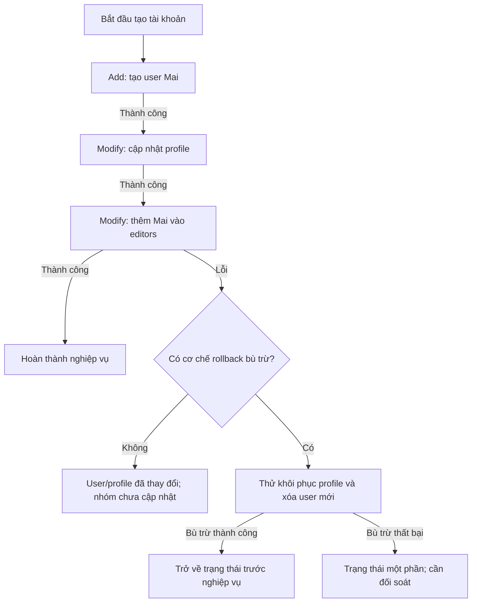
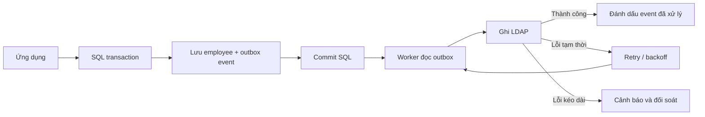

# Rollback khi nhiều thay đổi trong cùng nghiệp vụ

Trong **Spring LDAP**, một nghiệp vụ thường gồm nhiều thay đổi liên quan: tạo tài khoản, cập nhật thuộc tính người dùng, thêm tài khoản vào nhóm, ghi lịch sử hoặc đồng bộ dữ liệu sang hệ thống khác. Nếu một bước thất bại, ứng dụng phải xác định **những thay đổi nào đã được áp dụng** và **cách đưa hệ thống về trạng thái nhất quán**.

Chủ đề này cần được hiểu khác với transaction của database. Một lệnh LDAP `Modify` trên một entry có tính nguyên tử ở phạm vi yêu cầu đó, nhưng nhiều lệnh `bind`, `modifyAttributes`, `rename` hoặc `unbind` không mặc nhiên nằm trong một giao dịch ACID. Spring LDAP cung cấp **compensating transaction** (giao dịch bù trừ) để thử hoàn tác chuỗi thao tác LDAP khi xảy ra lỗi; thành công của việc hoàn tác phụ thuộc vào trạng thái và khả năng truy cập máy chủ tại thời điểm rollback.

Bài học trình bày từng mức bảo đảm, cách cấu hình `LdapTemplate` với `ContextSourceTransactionManager`, xử lý lỗi, ví dụ Java và phương án phục hồi khi nghiệp vụ đi qua cả LDAP lẫn database.

## 1. Mục tiêu học tập

Sau bài này, người học có thể:

1. Xác định một lỗi giữa quy trình nhiều bước sẽ để lại trạng thái gì trong LDAP.
2. Giải thích tính nguyên tử của một yêu cầu `Modify` so với rollback của nhiều yêu cầu.
3. Cấu hình Spring LDAP để các lệnh ghi được ghi nhận và bù trừ trong cùng transaction logic.
4. Kích hoạt rollback đúng lúc bằng `@Transactional`, đồng thời hiểu ảnh hưởng của kiểu exception và việc tự bắt lỗi.
5. Xây dựng phương án retry, bù trừ, idempotency và đối soát khi rollback không hoàn thành.
6. Kiểm thử trạng thái thực của thư mục sau lỗi thay vì chỉ kiểm tra exception.

## 2. Tình huống: tạo tài khoản rồi cấp quyền nhóm

Một hệ thống quản trị nhân viên cần thực hiện ba bước:

1. Tạo entry `uid=mai,ou=people,dc=example,dc=org`.
2. Ghi thuộc tính `telephoneNumber` và `displayName` cho Mai.
3. Thêm DN của Mai vào thuộc tính `member` của nhóm `cn=editors,ou=groups,dc=example,dc=org`.

Giả sử bước 1 và 2 thành công, nhưng bước 3 bị từ chối vì tài khoản dịch vụ không có quyền ghi nhóm. Nếu không có cơ chế phục hồi, LDAP sẽ chứa người dùng Mai với profile mới nhưng Mai **chưa thuộc nhóm editors**. Một retry không được thiết kế tốt có thể lại cố tạo entry đã tồn tại và thất bại ngay bước đầu.



Từ đây phải trả lời ba câu hỏi riêng: **phạm vi nào được xử lý nguyên tử**, **cách thực hiện thao tác ngược**, và **cần làm gì nếu thao tác ngược cũng lỗi**.

## 3. Phân biệt ba mức rollback

| Phạm vi | Cơ chế | Khi gặp lỗi |
|---|---|---|
| Nhiều sửa đổi trong **một** yêu cầu LDAP `Modify` của **một entry** | LDAP server xử lý nguyên tử theo giao thức | Nếu yêu cầu không hợp lệ, toàn bộ thay đổi thuộc yêu cầu đó không được áp dụng |
| Nhiều yêu cầu LDAP `Add`/`Modify`/`Delete`/`ModifyDN` | Spring LDAP có thể ghi nhận thao tác và thử **bù trừ** qua transaction-aware `ContextSource` | Lệnh đã thành công vẫn có thể hiển thị trên server; rollback là các thao tác ngược và có thể thất bại |
| Một nghiệp vụ ghi **LDAP + SQL/JPA + hệ ngoài** | Các tài nguyên có cơ chế commit khác nhau | Không tự có rollback chung; cần thiết kế điều phối, bù trừ, retry và đối soát |

**Ví dụ nguyên tử cấp yêu cầu:** Nếu cần sửa cả số điện thoại và tên hiển thị của cùng một entry, nên gửi hai `ModificationItem` trong **một** lần `ldapTemplate.modifyAttributes(dn, changes)`. Nếu chia thành hai lần gọi, lần đầu có thể thành công trong khi lần hai lỗi.

```java
ModificationItem[] changes = {
    new ModificationItem(
        DirContext.REPLACE_ATTRIBUTE,
        new BasicAttribute("telephoneNumber", "0900000000")),
    new ModificationItem(
        DirContext.REPLACE_ATTRIBUTE,
        new BasicAttribute("displayName", "Mai Tran"))
};
ldapTemplate.modifyAttributes(userDn, changes);
```

Đây là **một LDAP ModifyRequest**, có nguyên tử ở cấp entry. Nếu sau đó ứng dụng gửi lệnh sửa một entry nhóm khác thì lệnh thứ hai vẫn là một thao tác độc lập. Một `@Transactional` không tự biến chuỗi nhiều yêu cầu LDAP thành transaction của máy chủ.

Một số máy chủ có thể triển khai **LDAP Transactions extension** theo RFC 5805. Tính năng này là **tùy chọn**, cần máy chủ và client hỗ trợ rõ ràng; nó khác cơ chế bù trừ của Spring LDAP.

## 4. Spring LDAP rollback theo cơ chế bù trừ như thế nào?

Spring LDAP có các thành phần như `ContextSourceTransactionManager` và `TransactionAwareContextSourceProxy`. Khi được cấu hình đúng, các lệnh ghi LDAP đi qua transaction-aware context sẽ được theo dõi:

- Trước thao tác ghi: thu thập DN/trạng thái hoặc dữ liệu cần thiết để tạo thao tác ngược.
- Khi thực thi: gửi lệnh thay đổi lên LDAP server.
- Khi kết thúc bình thường: hoàn tất xử lý transaction logic và các bước commit đặc thù.
- Khi rollback: cố thực hiện các thao tác bù trừ để phục hồi trạng thái ban đầu.

| Lệnh ban đầu | Ý tưởng bù trừ | Giới hạn |
|---|---|---|
| `bind` / Add entry | `unbind` entry vừa thêm | Cần kết nối và quyền Delete |
| `modifyAttributes` | Khôi phục giá trị cũ bằng Modify khác | Thay đổi đồng thời có thể bị ghi đè |
| `rename` | Đổi DN về tên/vị trí trước đó | DN cũ có thể bị chiếm; cần quyền Rename |
| `unbind` / Delete entry | Thường tạm đổi tên entry; commit sẽ xóa entry tạm, rollback sẽ đổi tên về | Cần DN tạm hợp lệ và quyền di chuyển/đổi tên |
| `rebind` | Giữ entry cũ tại vị trí tạm để có đường khôi phục | Có trạng thái trung gian và thao tác bổ sung |

Trường hợp `unbind` đáng chú ý: chỉ đọc thuộc tính rồi tạo lại entry sau khi Delete có thể **không phục hồi đầy đủ** dữ liệu mà client không được đọc. Vì vậy, Spring LDAP có thể dùng chiến lược đổi DN tạm thông qua `TempEntryRenamingStrategy`. Chiến lược mặc định thêm hậu tố vào RDN để tạo tên tạm, nhưng có thể gây xung đột DN và làm các tìm kiếm nhìn thấy entry tạm trong quá trình giao dịch.

Đây **không phải rollback ACID**. LDAP server không giữ một snapshot transaction chung để khôi phục. Khi mạng đứt, ACL thay đổi hoặc client khác sửa entry, thao tác bù trừ có thể thất bại, thậm chí làm trạng thái khác kỳ vọng. Spring LDAP cũng không tự cung cấp isolation giữa các client.

## 5. Cấu hình Spring LDAP để có thể rollback nhiều thao tác

Để các thay đổi qua `LdapTemplate` hoặc API sử dụng cùng context được theo dõi, cần cấu hình đúng ba thành phần:

1. `LdapContextSource` gốc chứa địa chỉ server, base DN và bind credential.
2. `TransactionAwareContextSourceProxy` bọc context gốc, được đưa vào client LDAP.
3. `ContextSourceTransactionManager` nhận **context gốc**, là transaction manager được chỉ định cho service.

Ví dụ sử dụng cách khởi tạo `ContextSourceTransactionManager(ContextSource)` của Spring LDAP **4.1+**:

```java
import org.springframework.beans.factory.annotation.Qualifier;
import org.springframework.context.annotation.Bean;
import org.springframework.context.annotation.Configuration;
import org.springframework.core.env.Environment;
import org.springframework.ldap.core.ContextSource;
import org.springframework.ldap.core.LdapTemplate;
import org.springframework.ldap.core.support.LdapContextSource;
import org.springframework.ldap.transaction.compensating.manager.ContextSourceTransactionManager;
import org.springframework.ldap.transaction.compensating.manager.TransactionAwareContextSourceProxy;
import org.springframework.transaction.annotation.EnableTransactionManagement;

@Configuration
@EnableTransactionManagement
public class LdapTransactionConfig {

    @Bean("ldapTargetContextSource")
    public LdapContextSource ldapTargetContextSource(Environment env) {
        LdapContextSource target = new LdapContextSource();
        target.setUrl(env.getRequiredProperty("directory.url"));
        target.setBase("dc=example,dc=org");
        target.setUserDn(env.getRequiredProperty("directory.bind-dn"));
        target.setPassword(env.getRequiredProperty("directory.password"));
        return target;
    }

    @Bean("ldapTransactionAwareContextSource")
    public ContextSource ldapTransactionAwareContextSource(
            @Qualifier("ldapTargetContextSource") ContextSource target) {
        return new TransactionAwareContextSourceProxy(target);
    }

    @Bean
    public LdapTemplate ldapTemplate(
            @Qualifier("ldapTransactionAwareContextSource") ContextSource aware) {
        return new LdapTemplate(aware);
    }

    @Bean("ldapTransactionManager")
    public ContextSourceTransactionManager ldapTransactionManager(
            @Qualifier("ldapTargetContextSource") ContextSource target) {
        return new ContextSourceTransactionManager(target);
    }
}
```

Thuộc tính cấu hình gợi ý:

```properties
directory.url=ldaps://ldap.example.org:636
directory.bind-dn=cn=app-writer,ou=service-accounts,dc=example,dc=org
# directory.password được cấp từ secret manager hoặc nguồn bí mật thích hợp
```

**Các điểm không được nhầm:**

- `LdapTemplate` phải dùng **transaction-aware proxy**, còn `ContextSourceTransactionManager` nhận **ContextSource gốc**.
- Khi ứng dụng có cả `DataSourceTransactionManager` hoặc `JpaTransactionManager`, phải nêu rõ `transactionManager = "ldapTransactionManager"` để tránh chọn nhầm.
- Nếu dùng `LdapClient`, ODM hoặc repository, cần xác minh các thao tác cuối cùng có đi qua context được bọc hay không; cùng tên service không chứng minh đã tham gia transaction.
- Với Spring LDAP trước 4.1, kiểm tra API của phiên bản dự án; constructor nhận `ContextSource` có thể chưa tồn tại, cấu hình setter tương ứng là lựa chọn của các phiên bản cũ.
- Nếu cấu hình `base = "dc=example,dc=org"`, DN truyền vào `LdapTemplate` là **DN tương đối** với base; giá trị `member` thường lưu DN **đầy đủ** theo schema của server.

## 6. Ví dụ hoàn chỉnh: tạo user, sửa nhóm rồi chủ động gây lỗi

Ví dụ dưới đây minh họa **hai lệnh ghi LDAP trên hai entry khác nhau**. Để quan sát rollback, ví dụ có tham số `failAfterWrites` phục vụ **kiểm thử**, không phải quy tắc thiết kế API production. Giả sử các nhánh `ou=people`, `ou=groups` và nhóm `cn=editors` đã tồn tại; schema nhóm dùng thuộc tính `member`.

```java
import javax.naming.Name;
import javax.naming.directory.Attributes;
import javax.naming.directory.BasicAttribute;
import javax.naming.directory.BasicAttributes;
import javax.naming.directory.DirContext;
import javax.naming.directory.ModificationItem;

import org.springframework.ldap.core.LdapTemplate;
import org.springframework.ldap.support.LdapNameBuilder;
import org.springframework.stereotype.Service;
import org.springframework.transaction.annotation.Transactional;

@Service
public class AccountProvisioningService {

    private final LdapTemplate ldapTemplate;

    public AccountProvisioningService(LdapTemplate ldapTemplate) {
        this.ldapTemplate = ldapTemplate;
    }

    @Transactional(transactionManager = "ldapTransactionManager")
    public void createAccountAndGrantGroup(
            String uid, String fullName, String surname,
            boolean failAfterWrites) {

        Name userDn = LdapNameBuilder.newInstance("ou=people")
                .add("uid", uid)
                .build();

        // member là một giá trị DN đầy đủ, không tương đối với base.
        Name absoluteUserDn =
                LdapNameBuilder.newInstance("dc=example,dc=org")
                        .add("ou", "people")
                        .add("uid", uid)
                        .build();

        Name groupDn = LdapNameBuilder.newInstance("ou=groups")
                .add("cn", "editors")
                .build();

        Attributes attrs = new BasicAttributes(true);
        BasicAttribute objectClasses = new BasicAttribute("objectClass");
        objectClasses.add("top");
        objectClasses.add("person");
        objectClasses.add("organizationalPerson");
        objectClasses.add("inetOrgPerson");
        attrs.put(objectClasses);
        attrs.put("uid", uid);
        attrs.put("cn", fullName);
        attrs.put("sn", surname);

        // Bước 1: thêm user mới.
        ldapTemplate.bind(userDn, null, attrs);

        // Bước 2: thêm user vào nhóm editors.
        ModificationItem memberChange = new ModificationItem(
                DirContext.ADD_ATTRIBUTE,
                new BasicAttribute("member", absoluteUserDn.toString()));
        ldapTemplate.modifyAttributes(
                groupDn, new ModificationItem[] { memberChange });

        // Bước 3: chỉ dùng trong bài kiểm thử lỗi sau hai lệnh ghi.
        if (failAfterWrites) {
            throw new IllegalStateException(
                    "Forced failure after LDAP writes");
        }
    }
}
```

### Chạy theo hai nhánh

**Nhánh thành công:**

```java
service.createAccountAndGrantGroup(
    "mai", "Mai Tran", "Tran", false);
```

Khi hàm trở về bình thường, đọc lại LDAP để xác nhận entry Mai tồn tại và nhóm `editors` chứa DN của Mai.

**Nhánh lỗi sau khi hai lệnh ghi thành công:**

```java
service.createAccountAndGrantGroup(
    "mai-test", "Mai Test", "Test", true);
```

Vì `IllegalStateException` là `RuntimeException`, interceptor `@Transactional` mặc định kích hoạt rollback. Nếu cơ chế bù trừ thành công, Spring LDAP sẽ cố **loại DN vừa thêm khỏi nhóm** rồi **xóa entry `mai-test`**. Tuy nhiên, đó là **kết quả kỳ vọng có điều kiện**, không phải cam kết phục hồi tuyệt đối: phải đọc lại LDAP để xác minh.

Điều kiện tiên quyết để quan sát đúng:

- Hàm service được gọi **qua Spring transactional proxy** (thường từ một Spring bean khác), không phải gọi nội bộ bằng `this.createAccountAndGrantGroup(...)`.
- Đúng `LdapTemplate` sử dụng `TransactionAwareContextSourceProxy` được inject.
- Tài khoản service đủ quyền thêm, sửa và hoàn tác; các entry không bị tác nhân khác sửa trong lúc chạy.
- DN `mai-test` chưa tồn tại, và giá trị `member` của nhóm chưa chứa DN đó.
- Quy tắc object class, DN, ACL phù hợp với server; ví dụ không phù hợp nguyên dạng với mọi schema.

### Trình tự trạng thái khi rollback thành công

| Thời điểm | User `mai-test` | Nhóm editors |
|---|---|---|
| Trước chạy | Không tồn tại | Chưa có DN của `mai-test` |
| Sau Add thành công | Đã tồn tại | Chưa có DN |
| Sau Modify nhóm | Đã tồn tại | Có DN |
| Exception kích hoạt rollback | Bù trừ đang diễn ra | Bù trừ đang diễn ra |
| Sau bù trừ hoàn tất | Không còn user | DN đã được loại bỏ |

Bảng mô tả **kịch bản kiểm thử thành công**. Trong sự cố mạng hoặc xung đột đồng thời, trạng thái cuối có thể khác.

## 7. Kiểm soát rollback của `@Transactional`

### 7.1. Ngoại lệ nào kích hoạt rollback?

Theo mặc định, Spring transaction interceptor rollback khi một `RuntimeException` hoặc `Error` thoát ra khỏi phương thức. Với checked exception, phải kiểm tra cấu hình: mặc định nó thường **không** kích hoạt rollback nếu không chỉ định quy tắc bổ sung.

```java
@Transactional(
    transactionManager = "ldapTransactionManager",
    rollbackFor = Exception.class
)
public void changeDirectoryData() throws Exception {
    // Nhiều thao tác LDAP qua transaction-aware ContextSource.
}
```

Cần phân biệt lỗi phát sinh **trước bước ghi**, **sau một bước ghi**, và **trong chính quá trình rollback**. Cùng một exception ở tầng service không đủ để kết luận trạng thái cuối.

### 7.2. Nuốt exception có thể khiến transaction kết thúc bình thường

```java
@Transactional(transactionManager = "ldapTransactionManager")
public void riskyUpdate() {
    ldapTemplate.modifyAttributes(firstDn, firstChanges);

    try {
        ldapTemplate.modifyAttributes(secondDn, secondChanges);
    } catch (RuntimeException ex) {
        logger.warn("Failed to modify second entry", ex);
        // Không ném tiếp: interceptor có thể xem method là thành công.
    }
}
```

Khi service bắt lỗi và trả về bình thường, cơ chế `@Transactional` có thể đi vào nhánh commit. Để kích hoạt rollback khi cần, nên ném lại exception hoặc chủ động đánh dấu transaction hiện tại là rollback-only nếu biết rõ cách quản lý transaction đang dùng.

### 7.3. Tự gọi nội bộ và thay đổi luồng

Trong chế độ AOP proxy thông thường, `this.methodWithTransactional()` bỏ qua proxy nên annotation có thể không được áp dụng. Các thao tác chạy trên thread khác (chẳng hạn `@Async`, executor) không tự thừa hưởng transaction gắn với thread gọi.

Do đó hãy đặt ranh giới transaction tại một service Spring được gọi qua proxy. Nếu cần điều khiển bằng mã, có thể dùng `TransactionTemplate` với đúng `ldapTransactionManager` và thiết kế rõ phạm vi thread.

### 7.4. Kết thúc thành công không chứng minh mọi bên đã đồng bộ

Trong cơ chế bù trừ, các thay đổi có thể đã được gửi lên LDAP **trước khi phương thức trả về**. Client khác có thể đã đọc thấy trạng thái trung gian. Ngoài ra, replication giữa các LDAP server có thể có độ trễ. Không gắn việc “transaction đã commit” với giả định tất cả replica đều thấy trạng thái mới ngay lập tức.

## 8. Khi rollback thất bại, hệ thống nên làm gì?

Giả sử sau khi thêm user, dịch vụ mất kết nối mạng trước hoặc trong lúc rollback. Thao tác Add có thể đã được server chấp nhận, còn lệnh bù trừ Delete chưa tới được server. Nếu ứng dụng khởi chạy lại, cơ chế bù trừ đang chạy trong bộ nhớ trước đó có thể không còn đủ điều kiện hoàn tất.

**Vì vậy, rollback phải đi cùng cơ chế phục hồi ở cấp nghiệp vụ.** Một thiết kế thực tế thường gồm:

1. **Trạng thái nghiệp vụ rõ ràng:** `PENDING`, `APPLIED`, `COMPENSATING`, `FAILED` hoặc `NEEDS_REVIEW` nằm trong kho có tính bền vững phù hợp.
2. **Idempotency:** mỗi lần chạy lại nhận diện được user/operation đã tồn tại và kiểm tra trạng thái thay vì Add mù quáng; dùng khóa nghiệp vụ ổn định, ví dụ `employeeId`.
3. **Read-after-write:** khi timeout hoặc lỗi mơ hồ, truy vấn LDAP để xác định lệnh trước đã thực sự áp dụng hay chưa.
4. **Retry có giới hạn:** dùng backoff, nhận diện lỗi tạm thời và lỗi không thể tự phục hồi. Lỗi schema/ACL cần sửa cấu hình hoặc quyền, retry liên tục sẽ không có ích.
5. **Compensation có điều kiện:** chỉ thực hiện thao tác ngược khi xác minh entry vẫn thuộc quyền sở hữu của nghiệp vụ; tránh xóa nhầm dữ liệu do tác nhân khác tạo.
6. **Đối soát và cảnh báo:** phát hiện user không thuộc nhóm dự kiến, membership mồ côi, DN tạm hoặc trạng thái lệch giữa LDAP và hệ thống nguồn.
7. **Dấu vết kiểm toán:** lưu correlation ID, DN, loại thao tác, mã lỗi và trạng thái hoàn tác; không lưu mật khẩu hoặc dữ liệu bí mật.

### Bảng quyết định sau lỗi

| Tình huống | Rủi ro | Hướng xử lý |
|---|---|---|
| Lệnh LDAP thứ hai bị từ chối, rollback bước đầu thành công | Quy trình chưa hoàn thành nhưng trạng thái đã phục hồi | Trả lỗi có ý nghĩa, sửa nguyên nhân rồi chạy lại |
| Lệnh LDAP thứ hai lỗi, bù trừ bước đầu cũng lỗi | Có entry hoặc membership còn sót | Đánh dấu `NEEDS_REVIEW`; đọc lại và xử lý theo trạng thái thực |
| Server nhận ghi nhưng client timeout trước phản hồi | Không rõ lệnh có thành công | Query xác minh trước retry để tránh trùng hoặc ghi đè |
| Client khác thay đổi entry trước khi bù trừ | Thao tác ngược có thể ghi đè dữ liệu mới | So sánh phiên bản/trạng thái; dùng assertion control nếu server/client hỗ trợ |
| Mất kết nối, service restart | Thông tin bù trừ trong bộ nhớ không còn đáng tin | Dựa vào trạng thái nghiệp vụ bền vững và job đối soát |
| Delete/rename dùng DN tạm không đủ quyền | Rollback không hoàn chỉnh | Kiểm tra ACL cả cho bước thuận lẫn bước ngược, xử lý DN tạm |

### Quy tắc idempotent đơn giản

Đối với cập nhật một thuộc tính theo trạng thái mong muốn, `REPLACE_ATTRIBUTE` bằng **giá trị đích xác định** thường thuận lợi hơn so với cứ `ADD_ATTRIBUTE` không kiểm tra. Với membership, phải đọc dữ liệu và xác định DN đã có trong nhóm hay chưa; nếu có, việc Add lần nữa có thể sinh lỗi duplicate value.

Tuy nhiên, **đọc rồi ghi không tự ngăn race condition**: hai client có thể đọc cùng trạng thái trước khi ghi. Nếu cần chống ghi đè đồng thời, xem xét cơ chế assertion/conditional update mà LDAP server và client thực sự hỗ trợ.

## 9. Một nghiệp vụ ghi cả LDAP và database

Cùng một hàm Java có thể cập nhật hai tài nguyên:

```java
@Transactional(transactionManager = "databaseTransactionManager")
public void onboardEmployee(Employee employee) {
    employeeRepository.save(employee);              // SQL
    ldapTemplate.bind(employeeDn, null, attributes); // LDAP
}
```

Annotation ở đây điều khiển transaction của **databaseTransactionManager**; nó không làm LDAP tham gia SQL commit/rollback. Nếu lệnh LDAP thành công nhưng SQL commit cuối cùng lỗi, LDAP có thể vẫn chứa user. Nếu chọn `ldapTransactionManager`, JDBC cũng không mặc nhiên tham gia giao dịch LDAP.

Một số phiên bản Spring LDAP từng cung cấp cách phối hợp JDBC và LDAP trong transaction logic, nhưng **không đem lại XA/atomic commit** giữa hai hệ thống và có các API đã deprecated. Không nên diễn giải việc “chung một `@Transactional`” là có rollback phân tán bảo đảm.

### Phương án transactional outbox

Khi database là **nguồn dữ liệu chính** và LDAP phục vụ đồng bộ thông tin tài khoản:



Ưu điểm là thay đổi dữ liệu chính và sự kiện cần đồng bộ được ghi **trong cùng một SQL transaction**. Worker retry sự kiện khi LDAP tạm lỗi và có thể theo dõi trạng thái cho đến khi đồng bộ xong.

Hệ quả: LDAP và database có thể khác nhau trong một khoảng thời gian (**eventual consistency**). Với nghiệp vụ cấp quyền, cần quy định hành vi an toàn: không báo đã cấp quyền nếu membership LDAP chưa được xác nhận; không tạo hiệu lực truy cập trước khi bước bắt buộc hoàn tất.

Nếu LDAP là nguồn dữ liệu chính, cách điều phối phải đảo chiều và xử lý riêng, không áp dụng outbox SQL theo thói quen.

## 10. Kiểm thử rollback trên LDAP thật hoặc môi trường tích hợp

Kiểm thử bằng mock `LdapTemplate` chỉ chứng minh số lần gọi Java. Để chứng minh hệ thống thực sự phục hồi trạng thái, cần một LDAP server thử nghiệm (ví dụ ApacheDS hoặc UnboundID In-Memory Directory Server) với schema và quyền phù hợp, rồi đọc lại entry sau lỗi.

### Bộ ca kiểm thử tối thiểu

| Ca | Chuẩn bị / kích hoạt | Kiểm tra sau lời gọi |
|---|---|---|
| 1. Thành công | User chưa tồn tại; nhóm cho phép thêm `member` | User tồn tại, nhóm có DN user |
| 2. Lỗi sau Add | Tạo user rồi cố tình ném `RuntimeException` | Sau bù trừ thành công, user không tồn tại |
| 3. Lỗi sau Modify nhóm | Cả Add và Modify thành công, sau đó ném exception | Sau bù trừ thành công, user không tồn tại và member không còn |
| 4. Không dùng transaction-aware proxy | Thử trong cấu hình riêng với client đi thẳng vào source gốc | Quan sát thay đổi còn lại dù có exception |
| 5. Exception bị nuốt | Catch lỗi rồi return bình thường | Không mặc định kỳ vọng rollback; đọc lại trạng thái |
| 6. Checked exception | Ném checked exception, thử có/không có `rollbackFor` | So sánh khác biệt quy tắc rollback |
| 7. Mất kết nối khi hoàn tác | Mô phỏng LDAP không sẵn sàng trong rollback | Xác định trạng thái còn sót và job đối soát |
| 8. Xung đột đồng thời | Client khác sửa membership khi nghiệp vụ chạy | Kiểm tra dữ liệu có bị ghi đè hoặc sai khác |

Các bước chung cho mỗi ca:

1. Tạo dữ liệu test có tên duy nhất, kiểm tra state ban đầu.
2. Gọi service từ **một Spring bean khác** để `@Transactional` được áp dụng qua proxy.
3. Gây lỗi tại thời điểm xác định trước, sau khi biết bước trước đã hoàn thành.
4. Đọc lại user và group bằng một LDAP context độc lập để quan sát dữ liệu server lưu.
5. Ghi nhận exception gốc và nếu có, exception phát sinh trong quá trình rollback.
6. So sánh trạng thái thực với trạng thái mong muốn; chỉ dọn dữ liệu thử nghiệm sau khi đã ghi nhận kết quả.

**Tiêu chí đánh giá:** Một test rollback thành công trong điều kiện bình thường là cần thiết, nhưng **không chứng minh** ứng dụng sẽ phục hồi được trong lỗi mạng, sự cố server, thiếu ACL hoặc thay đổi đồng thời.

### Ví dụ khung test tích hợp

```java
// Mã minh họa: cần cấu hình Spring test, LDAP server và dữ liệu seed.
@Test
void restoresBothEntriesWhenPostCheckFails() {
    String uid = "rollback-test-001";

    assertThrows(
            IllegalStateException.class,
            () -> provisioningService.createAccountAndGrantGroup(
                    uid, "Rollback Test", "Test", true));

    // Đọc lại bằng một LDAP client độc lập sau lời gọi đã ném lỗi.
    // assertFalse(directoryProbe.userExists(uid));
    // assertFalse(directoryProbe.groupHasMember("editors", fullDn(uid)));
}
```

Hai lệnh kiểm tra được chú thích vì cách tra cứu phụ thuộc cấu trúc DN, schema và công cụ kiểm thử. Khi triển khai, **bắt buộc biến chúng thành assertion thực**, không chỉ kiểm tra `assertThrows`.

## 11. Những lỗi thiết kế phổ biến

**“Có `@Transactional` thì mọi bước LDAP đều rollback được.”** Sai. Cần chọn đúng transaction manager, đi qua `TransactionAwareContextSourceProxy` và chấp nhận giới hạn bù trừ.

**“Nếu rollback không báo lỗi, mọi replica và hệ tích hợp đều đã đồng bộ.”** Sai. Cần đọc lại trạng thái trên endpoint phù hợp và hiểu cơ chế replication.

**“Có thể thử lại từ đầu bao nhiêu lần cũng được.”** Nguy hiểm nếu retry khiến tạo entry trùng, thêm membership lặp hoặc xóa nhầm dữ liệu hiện có. Cần idempotency và kiểm tra trạng thái.

**“Spring có thể hoàn tác cả email, API gọi ngoài và dữ liệu SQL.”** Sai. Mỗi hệ thống có giao thức và ranh giới cam kết riêng; side effect bên ngoài cần quy trình bù trừ hoặc eventual consistency.

**“Rollback LDAP có isolation giống database.”** Sai. Client khác vẫn có thể đọc hoặc ghi entry trong lúc transaction bù trừ đang diễn ra.

## 12. Checklist thiết kế trước khi triển khai

- [ ] Đã liệt kê toàn bộ bước ghi LDAP, SQL và hệ thống ngoài trong nghiệp vụ.
- [ ] Các thay đổi cùng một entry đã được gộp vào một `ModifyRequest` khi phù hợp.
- [ ] `LdapTemplate`/`LdapClient`/ODM đi qua transaction-aware context nếu dựa vào Spring LDAP compensation.
- [ ] `@Transactional` chọn đúng manager, được gọi qua Spring proxy và có quy tắc rollback phù hợp.
- [ ] Tài khoản dịch vụ có quyền tối thiểu nhưng đủ cho cả thao tác thuận và bù trừ; kết nối dùng TLS xác thực server.
- [ ] Có chính sách retry, idempotency, đối soát và xử lý trạng thái `NEEDS_REVIEW`.
- [ ] Đã xem xét concurrency, rename tạm và giới hạn của schema/ACL.
- [ ] Nếu dùng SQL/JPA, đã xác định nguồn dữ liệu chuẩn và cách đồng bộ thay vì giả định commit nguyên tử giữa hệ thống.
- [ ] Test tích hợp đọc lại cả entry và membership sau lỗi, bao gồm trường hợp rollback không hoàn thành.

## 13. Bài tập thực hành

Xây dựng chức năng **tạo nhân viên và cấp quyền truy cập nhóm editors** trên một LDAP server thử nghiệm:

1. Viết service dùng `LdapTemplate` và `@Transactional(transactionManager = "ldapTransactionManager")`.
2. Tạo người dùng, sửa một số thuộc tính profile bằng **một** lệnh `Modify`, sau đó cập nhật `member` trong nhóm.
3. Cho lỗi lần lượt tại ba điểm: ngay sau Add, sau Modify profile và sau Modify nhóm.
4. Kiểm tra entry user, thuộc tính profile và membership sau mỗi trường hợp; giải thích những thao tác bù trừ cần thiết.
5. Thử bỏ `TransactionAwareContextSourceProxy` trong cấu hình test và so sánh kết quả.
6. Thiết kế cơ chế đối soát khi user đã tồn tại nhưng thiếu membership hoặc khi bước bù trừ bị mất kết nối.

**Câu hỏi phân tích:** Nếu việc cấp quyền cho nhóm editors là yêu cầu bắt buộc trước khi user được đăng nhập, bạn sẽ thể hiện trạng thái “chưa sẵn sàng” của account như thế nào để bảo đảm chính sách truy cập an toàn, ngay cả khi LDAP hoặc database gặp lỗi giữa chừng?

## Tài liệu tham khảo

- [Spring LDAP Reference — Transaction Support](https://docs.spring.io/spring-ldap/docs/3.1.4/reference/#transaction-support): cơ chế, cấu hình và các pha của thao tác bù trừ.
- [ContextSourceTransactionManager API](https://docs.spring.io/spring-ldap/reference/api/java/org/springframework/ldap/transaction/compensating/manager/ContextSourceTransactionManager.html): transaction phía client, yêu cầu về target `ContextSource` và proxy.
- [TransactionAwareContextSourceProxy API](https://docs.spring.io/spring-ldap/docs/current/api/org/springframework/ldap/transaction/compensating/manager/TransactionAwareContextSourceProxy.html): ghi nhận thay đổi và thao tác rollback tương ứng.
- [DefaultTempEntryRenamingStrategy API](https://docs.spring.io/spring-ldap/docs/current/api/org/springframework/ldap/transaction/compensating/support/DefaultTempEntryRenamingStrategy.html): quy tắc tạo DN tạm.
- [RFC 4511 — LDAP Protocol](https://www.rfc-editor.org/rfc/rfc4511) và [RFC 5805 — LDAP Transactions](https://www.rfc-editor.org/rfc/rfc5805): thao tác LDAP và extension giao dịch tùy chọn.
