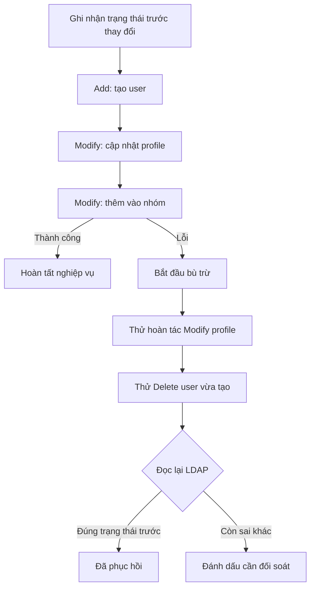
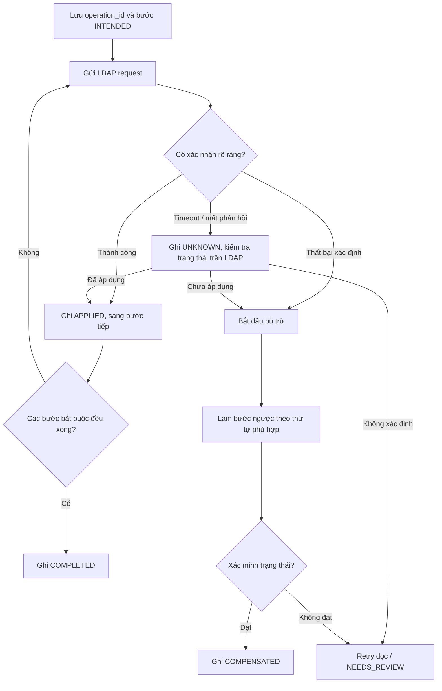

# Compensating transaction khi server không hỗ trợ rollback đầy đủ

Trong một ứng dụng dùng **Spring LDAP**, nghiệp vụ “tạo nhân viên và cấp quyền” có thể gồm nhiều yêu cầu LDAP: thêm entry người dùng, cập nhật thuộc tính và thêm DN của người dùng vào nhóm. Khi bước cuối thất bại, ta muốn hoàn tác các bước đã thành công. Tuy nhiên, phần lớn cách dùng LDAP thông thường **không cung cấp transaction ACID bao trùm nhiều yêu cầu** như `BEGIN–COMMIT–ROLLBACK` của database.

**Compensating transaction** (giao dịch bù trừ) là cách xử lý thực tế khi máy chủ không có khả năng rollback toàn bộ chuỗi thay đổi: ứng dụng ghi nhận các thao tác đã thực hiện và **gửi những thao tác ngược** khi quy trình phải hủy. Spring LDAP có cơ chế transaction bù trừ ở phía client; với nghiệp vụ kéo dài qua nhiều hệ thống, ứng dụng thường cần thêm nhật ký trạng thái, retry và đối soát.

Bài này thuộc chương **Transaction** của module **SPRING_LDAP**. Các ví dụ sử dụng `LdapTemplate`, nhưng nguyên tắc về ngữ nghĩa LDAP, DN, schema, quyền truy cập, TLS và xử lý lỗi cũng cần được áp dụng khi làm việc qua `LdapClient` hoặc ODM.

## 1. Mục tiêu học tập

Học xong bài, bạn có thể:

- Giải thích tại sao LDAP có thể áp dụng nguyên tử một lệnh `Modify` nhưng không rollback nguyên tử một chuỗi thao tác trên nhiều entry.
- Mô tả vòng đời của compensating transaction: **ghi nhận trạng thái trước thay đổi → thực hiện → bù trừ → xác minh**.
- Phân tích ưu điểm và giới hạn của `ContextSourceTransactionManager` và `TransactionAwareContextSourceProxy` trong Spring LDAP.
- Thiết kế thao tác bù trừ tương ứng với `bind`, `modifyAttributes`, `rename` và `unbind`.
- Xử lý trường hợp thao tác ngược lỗi, request LDAP timeout không rõ kết quả, hoặc client khác sửa cùng entry.
- Thiết kế kiểm thử tích hợp và quy trình khôi phục dữ liệu khi hệ thống có cả LDAP lẫn database.

## 2. Vì sao cần bù trừ?

Xét quy trình cấp tài khoản cho nhân viên:

1. **Add**: tạo entry `uid=lan,ou=people,dc=example,dc=org`.
2. **Modify**: đặt thuộc tính `displayName` cho Lan.
3. **Modify**: thêm DN của Lan vào thuộc tính `member` của `cn=editors,ou=groups,dc=example,dc=org`.
4. **SQL**: ghi trạng thái cấp quyền vào database nghiệp vụ.

Nếu bước 3 hoặc 4 lỗi sau khi các bước trước thành công, LDAP và database có thể ở trạng thái không nhất quán. Ví dụ, tài khoản đã được tạo nhưng chưa được cấp quyền nhóm; hoặc LDAP đã cập nhật đầy đủ nhưng bước SQL cuối rollback.

Ở tầng giao thức, các lệnh `Add`, `Modify`, `Delete` và `ModifyDN` thường là những yêu cầu riêng. **Một yêu cầu `Modify` thay đổi nhiều thuộc tính trên cùng một entry có tính nguyên tử theo RFC 4511**; điều đó không có nghĩa nhiều yêu cầu gửi liên tiếp cũng nguyên tử. Một kết nối LDAP, một hàm Java hay một HTTP request không tự biến các lệnh này thành một transaction của máy chủ.

Một số LDAP server có hỗ trợ **LDAP Transactions extension** (RFC 5805) hoặc cơ chế riêng, nhưng đây là khả năng tùy chọn: phải xác nhận hỗ trợ từ server và client. Không nên giả định Spring LDAP tự kích hoạt extension đó.

### Ví dụ trạng thái trung gian

| Thời điểm | Entry người dùng | Thuộc tính tên | Nhóm editors | SQL |
|---|---|---|---|---|
| Ban đầu | Chưa có | — | Chưa có DN | Chưa ghi |
| Sau bước 1 | Đã có | Giá trị ban đầu | Chưa có DN | Chưa ghi |
| Sau bước 2 | Đã có | Đã cập nhật | Chưa có DN | Chưa ghi |
| Bước 3 lỗi | Đã có | Đã cập nhật | Chưa có DN | Chưa ghi |

Không có bù trừ thì lỗi bước 3 không tự xóa entry đã tạo hoặc khôi phục thuộc tính được sửa tại bước 2. Nếu tự chạy lại bước 1, LDAP còn có thể báo entry đã tồn tại.

## 3. Compensating transaction hoạt động như thế nào?

Một compensating transaction không làm máy chủ “quay ngược thời gian”. Nó thực hiện **một chuỗi hành động mới**, thường theo thứ tự ngược với các thay đổi trước đó.



Trong ví dụ trên, vì bước thêm thành viên vào nhóm **đã thất bại**, không có thay đổi nhóm nào được xác nhận thành công để hoàn tác. Nếu bước thêm nhóm đã thành công nhưng bước **SQL** sau đó thất bại, đường bù trừ của LDAP cần bắt đầu bằng **loại membership khỏi nhóm**, rồi khôi phục profile và xử lý entry người dùng theo chính sách nghiệp vụ.

Một transaction bù trừ cần trả lời được:

- **Đã thay đổi gì?** Lưu DN, loại thao tác, giá trị trước/sau và mã nghiệp vụ.
- **Thao tác ngược nào hợp lệ?** Khôi phục giá trị cũ, xóa entry vừa tạo, đổi tên về DN cũ hoặc thu hồi membership.
- **Ai sở hữu thay đổi?** Không xóa entry sẵn có từ trước hoặc dữ liệu đã được tác nhân khác cập nhật hợp lệ.
- **Khi nào xác định thành công?** Sau khi xác minh trạng thái thực trên LDAP, không chỉ khi một method Java trả về.
- **Nếu bù trừ cũng thất bại?** Phải có trạng thái có thể đối soát, retry an toàn và đường xử lý thủ công.

## 4. Ánh xạ thao tác LDAP và hành động bù trừ

| Thao tác thuận | Dữ liệu cần ghi nhận trước/sau | Bù trừ điển hình | Rủi ro |
|---|---|---|---|
| `bind` / Add entry | DN, entry có tồn tại trước không, dấu vết nghiệp vụ | `unbind` / Delete **entry do chính nghiệp vụ tạo** | Entry có thể đã được sửa hoặc có con sau khi Add |
| `modifyAttributes` | Giá trị thuộc tính trước khi ghi | Modify lại để phục hồi giá trị cũ | Client khác có thể cập nhật cùng thuộc tính trong khoảng giữa |
| `rename` / ModifyDN | DN cũ và DN mới | Rename ngược về DN ban đầu | DN cũ bị chiếm, ACL đổi hoặc có thao tác con phát sinh |
| `unbind` / Delete | Entry cũ và cách khôi phục an toàn | Nếu có thể, giữ entry bằng đổi tên tạm rồi hoàn nguyên | Đã xóa thật có thể không khôi phục đủ thuộc tính không đọc được |
| `rebind` | Entry cũ, entry mới và trạng thái trước ghi | Hoàn trả entry cũ; loại entry thay thế | Có nguy cơ mất thông tin hoặc xung đột tên |
| Thêm DN vào nhóm qua `member` | DN đầy đủ, nhóm ban đầu đã có DN chưa | Xóa đúng giá trị vừa thêm | Có thể thu hồi quyền đã được thay đổi hợp lệ bởi tiến trình khác |

**Không được đảo ngược một thao tác mà chưa kiểm tra sở hữu thay đổi.** Ví dụ, nếu user đã tồn tại từ trước, thao tác “Delete user để rollback” sẽ xóa dữ liệu không thuộc phạm vi nghiệp vụ. Tương tự, nếu membership đã có trước khi chạy, không được xóa membership đó khi một bước khác thất bại.

### 4.1. Khôi phục `Modify` không chỉ là gửi `DELETE_ATTRIBUTE`

Giả sử `telephoneNumber` trước đó là `0900000000`, sau thay đổi thành `0911111111`. Nếu bù trừ bằng cách xóa toàn bộ `telephoneNumber`, entry vẫn khác trạng thái gốc. Thao tác ngược đúng phải **khôi phục giá trị trước đó**, hoặc xóa thuộc tính chỉ khi trước đó thuộc tính thực sự không tồn tại.

Với thuộc tính đa trị như `member`, cần xác định **giá trị nào** đã thêm hoặc xóa. Cập nhật toàn bộ danh sách bằng snapshot cũ có thể ghi đè thay đổi đồng thời của nhóm khác. Nên sử dụng thao tác theo từng giá trị và cân nhắc assertion control khi server/client hỗ trợ điều kiện cập nhật.

### 4.2. Vì sao `Delete` khó bù trừ hơn `Add`?

Một entry LDAP có thể chứa các thuộc tính mà tài khoản ứng dụng không đọc được, thuộc tính vận hành hoặc dữ liệu phụ thuộc schema và ACL. Sau khi `Delete` thành công, việc tạo lại entry từ dữ liệu đọc trước đó có thể **không hoàn nguyên đầy đủ**.

Cơ chế compensating transaction của Spring LDAP đối với `unbind`/`rebind` có thể **đổi tên entry sang DN tạm** trong giai đoạn chuẩn bị rồi xóa/hoàn tất khi transaction logic kết thúc. Khi rollback, nó cố đổi entry về DN ban đầu. Chiến lược `TempEntryRenamingStrategy` và quyền rename là những chi tiết cần kiểm thử, đặc biệt nếu entry có con hoặc DN tạm không hợp lệ trong schema/ACL hiện tại.

## 5. Spring LDAP hỗ trợ bù trừ ở lớp nào?

Spring LDAP có một cơ chế **client-side compensating transaction**, chủ yếu thông qua:

- `ContextSourceTransactionManager`: quản lý ranh giới transaction logic theo Spring.
- `TransactionAwareContextSourceProxy`: bọc nguồn kết nối LDAP để ghi nhận thao tác cần bù trừ.
- `LdapTemplate`: cung cấp các lời gọi LDAP; để tham gia cơ chế bù trừ, template phải được dựng với context đã bọc.
- `@Transactional`: mở/kết thúc ranh giới quản lý transaction khi phương thức được gọi đúng qua Spring AOP proxy.

Cơ chế này **khác** giao dịch ACID nội tại trên server:

| Đặc tính | Spring LDAP compensating transaction | Transaction ACID của database |
|---|---|---|
| Nơi điều phối | Client / Spring application | Database engine |
| Phương thức hoàn tác | Gửi **thao tác ngược** lên LDAP | Rollback thay đổi trong transaction engine |
| Trạng thái trung gian | Client khác có thể nhìn thấy | Phụ thuộc isolation, thường có cơ chế cô lập transaction |
| Rủi ro khi mất kết nối | Có thể không bù trừ được | Database tự quản lý transaction theo ngữ nghĩa của engine |
| Nhiều hệ thống | Không tự đồng bộ với JDBC/JPA | SQL transaction quản lý tài nguyên DB tương ứng |
| Bảo đảm khôi phục tuyệt đối | **Không** | Theo cam kết ACID và cấu hình của hệ quản trị |

Việc đánh dấu `@Transactional` trên service **chưa đủ**. Nếu template sử dụng `ContextSource` gốc thay vì transaction-aware proxy, manager có thể tồn tại nhưng không theo dõi các thao tác ghi.

## 6. Cấu hình transaction bù trừ trong Spring LDAP

Ví dụ Java dưới đây tách **ContextSource gốc** và **ContextSource đã bọc**. Giả sử ứng dụng sử dụng phiên bản Spring LDAP hỗ trợ constructor `ContextSourceTransactionManager(ContextSource)` (ví dụ Spring LDAP 4.1+); với phiên bản khác cần đối chiếu API và sử dụng cách cấu hình setter tương ứng.

```java
import org.springframework.beans.factory.annotation.Qualifier;
import org.springframework.context.annotation.Bean;
import org.springframework.context.annotation.Configuration;
import org.springframework.core.env.Environment;
import org.springframework.ldap.core.ContextSource;
import org.springframework.ldap.core.LdapTemplate;
import org.springframework.ldap.core.support.LdapContextSource;
import org.springframework.ldap.transaction.compensating.manager.ContextSourceTransactionManager;
import org.springframework.ldap.transaction.compensating.manager.TransactionAwareContextSourceProxy;
import org.springframework.transaction.annotation.EnableTransactionManagement;

@Configuration
@EnableTransactionManagement
public class LdapCompensationConfig {

    @Bean("ldapTargetContextSource")
    public LdapContextSource ldapTargetContextSource(Environment env) {
        LdapContextSource target = new LdapContextSource();
        target.setUrl(env.getRequiredProperty("ldap.url"));
        target.setBase("dc=example,dc=org");
        target.setUserDn(env.getRequiredProperty("ldap.bind-dn"));
        target.setPassword(env.getRequiredProperty("ldap.bind-password"));
        return target;
    }

    @Bean("ldapTransactionAwareContextSource")
    public ContextSource ldapTransactionAwareContextSource(
            @Qualifier("ldapTargetContextSource") ContextSource target) {
        return new TransactionAwareContextSourceProxy(target);
    }

    @Bean
    public LdapTemplate ldapTemplate(
            @Qualifier("ldapTransactionAwareContextSource") ContextSource aware) {
        return new LdapTemplate(aware);
    }

    @Bean("ldapTransactionManager")
    public ContextSourceTransactionManager ldapTransactionManager(
            @Qualifier("ldapTargetContextSource") ContextSource target) {
        // Manager dùng ContextSource gốc, template dùng proxy.
        return new ContextSourceTransactionManager(target);
    }
}
```

Cấu hình môi trường minh họa:

```properties
ldap.url=ldaps://ldap.example.org:636
ldap.bind-dn=cn=directory-writer,ou=services,dc=example,dc=org
# ldap.bind-password phải lấy từ secret manager hoặc cấu hình bảo mật
```

Lưu ý:

1. **Manager nhận context gốc**, còn **template nhận proxy**. Cùng một bean `ContextSource` ở hai vị trí này không tạo được đường đi bù trừ mong muốn.
2. Nếu dự án có thêm `JpaTransactionManager`/`DataSourceTransactionManager`, phải chỉ rõ `transactionManager = "ldapTransactionManager"` trên service.
3. Nếu dùng `LdapClient` hoặc ODM, phải xác minh client thực sự sử dụng transaction-aware `ContextSource` và thao tác tương ứng được cơ chế bù trừ hỗ trợ; không suy ra điều này từ tên API.
4. `LdapContextSource` đã có base `dc=example,dc=org`: DN đối số cho `LdapTemplate` là **DN tương đối**; nhưng thuộc tính `member` của nhóm thường nhận **DN đầy đủ**.
5. Dùng LDAPS hoặc StartTLS được cấu hình và xác thực chứng chỉ hợp lệ; áp dụng quyền tối thiểu, đồng thời tính cả quyền **hoàn tác** như xóa/rename. Không đưa bind password vào source hoặc log.
6. Khi có auto-configuration của Spring Boot, cần xác nhận bean `LdapTemplate` thực tế được inject đúng là bean sử dụng transaction-aware proxy.

## 7. Ví dụ: tạo user, gán vào nhóm và rollback khi lỗi

Ví dụ sau giả định:

- Nhánh `ou=people` và `ou=groups` đã tồn tại.
- Có nhóm `cn=editors,ou=groups,dc=example,dc=org` sử dụng thuộc tính `member`.
- Schema cho phép entry `inetOrgPerson`, và service account được cấp quyền Add/Delete entry, Modify nhóm.
- User thử nghiệm chưa tồn tại, DN chưa có trong thuộc tính `member` của nhóm.
- Client dùng đúng `LdapTemplate` đã cấu hình ở phần trên.

```java
import javax.naming.Name;
import javax.naming.directory.Attributes;
import javax.naming.directory.BasicAttribute;
import javax.naming.directory.BasicAttributes;
import javax.naming.directory.DirContext;
import javax.naming.directory.ModificationItem;

import org.springframework.ldap.core.LdapTemplate;
import org.springframework.ldap.support.LdapNameBuilder;
import org.springframework.stereotype.Service;
import org.springframework.transaction.annotation.Transactional;

@Service
public class DirectoryOnboardingService {

    private final LdapTemplate ldapTemplate;

    public DirectoryOnboardingService(LdapTemplate ldapTemplate) {
        this.ldapTemplate = ldapTemplate;
    }

    @Transactional(transactionManager = "ldapTransactionManager")
    public void createAndGrantEditors(
            String uid, String displayName, String surname,
            boolean failAfterBothWrites) {

        Name userDn = LdapNameBuilder.newInstance("ou=people")
                .add("uid", uid)
                .build();

        Name userAbsoluteDn =
                LdapNameBuilder.newInstance("dc=example,dc=org")
                        .add("ou", "people")
                        .add("uid", uid)
                        .build();

        Name groupDn = LdapNameBuilder.newInstance("ou=groups")
                .add("cn", "editors")
                .build();

        Attributes attrs = new BasicAttributes(true);
        BasicAttribute classes = new BasicAttribute("objectClass");
        classes.add("top");
        classes.add("person");
        classes.add("organizationalPerson");
        classes.add("inetOrgPerson");
        attrs.put(classes);
        attrs.put("uid", uid);
        attrs.put("cn", displayName);
        attrs.put("sn", surname);

        // Thao tác LDAP 1: thêm entry user.
        ldapTemplate.bind(userDn, null, attrs);

        // Thao tác LDAP 2: thêm DN đầy đủ vào nhóm.
        ModificationItem groupUpdate = new ModificationItem(
                DirContext.ADD_ATTRIBUTE,
                new BasicAttribute("member", userAbsoluteDn.toString()));
        ldapTemplate.modifyAttributes(
                groupDn, new ModificationItem[] { groupUpdate });

        // Chỉ sử dụng để mô phỏng lỗi khi integration test.
        if (failAfterBothWrites) {
            throw new IllegalStateException(
                    "Simulated failure after LDAP updates");
        }
    }
}
```

### Luồng thành công

Gọi service thông qua Spring-managed proxy:

```java
onboardingService.createAndGrantEditors(
    "lan-test", "Lan Test", "Test", false);
```

Sau khi method kết thúc, đọc lại LDAP để xác minh cả user lẫn membership.

### Luồng lỗi sau hai thao tác đã thành công

```java
onboardingService.createAndGrantEditors(
    "lan-rollback-test", "Lan Rollback", "Test", true);
```

Exception kiểu `RuntimeException` thoát ra khỏi method nên, theo mặc định của Spring transaction interceptor, kích hoạt rollback. Cơ chế compensating transaction **thử** gỡ giá trị `member` vừa thêm và xóa entry do nghiệp vụ tạo. Các thao tác ngược được thực hiện **sau các thao tác ghi ban đầu**, vì vậy không có bảo đảm một client LDAP khác chưa từng đọc thấy trạng thái trung gian.

**Điều cần xác minh:** Sau exception, hãy truy vấn lại LDAP bằng một kết nối độc lập. Nếu user vẫn còn hoặc membership vẫn tồn tại thì bù trừ chưa hoàn chỉnh; không được kết luận trạng thái chỉ từ exception ở Java.

### Giới hạn cần lưu ý trong mã trên

- Đây là ví dụ minh họa cơ chế. Trong hệ thật, tham số `failAfterBothWrites` chỉ nên tồn tại trong mã test.
- Method phải được gọi **qua Spring proxy**; tự gọi `this.createAndGrantEditors(...)` trong cùng bean thường làm `@Transactional` không có hiệu lực ở chế độ proxy.
- `@Async`, executor hoặc thread mới không tự thừa hưởng transaction đang gắn với thread gọi.
- Cần chú ý exception được bắt và nuốt bên trong method: interceptor có thể xem method kết thúc thành công nên không rollback.
- `@Transactional(rollbackFor = Exception.class)` có thể được dùng khi muốn checked exception cũng kích hoạt rollback; mặc định `RuntimeException` và `Error` là các trường hợp rollback thông thường.
- Việc bù trừ có thể tạo thêm yêu cầu LDAP và gặp lỗi quyền, schema, kết nối hoặc cạnh tranh đồng thời.

## 8. Khi nào không nên chỉ trông đợi Spring LDAP bù trừ tự động?

Compensating transaction trong Spring LDAP phù hợp với một số chuỗi thao tác **ngắn, đồng bộ và sử dụng cùng context**. Với quy trình kéo dài, nhiều tài nguyên hoặc cần khôi phục sau khi ứng dụng chết, cần bổ sung **bù trừ cấp nghiệp vụ**.

### Tình huống 1: server chấp nhận thay đổi nhưng client bị timeout

Một thao tác LDAP có thể đã ghi thành công vào server nhưng response bị mất trên đường truyền. Nếu client tự cho rằng thao tác thất bại rồi gửi lại `Add`, có thể gặp `entryAlreadyExists`. Tương tự, gửi lại `ADD_ATTRIBUTE` cho một giá trị `member` đã tồn tại có thể trả lỗi trùng.

**Giải pháp:** dùng correlation/operation ID, đọc lại DN/giá trị thuộc tính để xác định trạng thái thực trước khi retry, rồi thực hiện hành động cần thiết để đạt trạng thái mong muốn.

### Tình huống 2: bù trừ thất bại giữa chừng

Giả sử bước Add và cập nhật membership thành công, nhưng lỗi phát sinh trước khi kết thúc nghiệp vụ. Trong rollback, xóa membership thành công nhưng xóa user thất bại do mất kết nối. Kết quả là **user còn tồn tại mà chưa thuộc nhóm**, dù mã Java đã ném lỗi.

**Giải pháp:** lưu trạng thái cấp quyền như `NEEDS_RECONCILIATION` trong hệ thống bền vững, đọc lại LDAP khi kết nối phục hồi, thử bù trừ có điều kiện và cảnh báo nếu quá ngưỡng retry.

### Tình huống 3: client khác sửa dữ liệu cùng lúc

Trong lúc ứng dụng định khôi phục `displayName` về giá trị cũ, tác nhân khác có thể đã ghi một giá trị mới hợp lệ. Bù trừ bằng `REPLACE_ATTRIBUTE` không kiểm tra điều kiện sẽ ghi đè sửa đổi mới.

**Giải pháp:** có thể dùng thuộc tính phiên bản/định danh nghiệp vụ hoặc LDAP assertion control nếu server và client hỗ trợ. Trước hành động ngược, phải kiểm tra thay đổi còn do chính nghiệp vụ sở hữu không. Nếu trạng thái đã thay đổi ngoài dự kiến, chuyển sang xử lý xung đột thay vì ghi đè mù quáng.

### Tình huống 4: workflow có thao tác ngoài LDAP

Ví dụ cùng một nghiệp vụ vừa ghi SQL vừa gọi LDAP vừa phát email thông báo. Email đã gửi không thể “rollback” theo cách Delete entry; rollback SQL cũng không làm LDAP tự động khôi phục. Cần thiết kế bù trừ tương ứng với tác động của từng hệ thống: vô hiệu hóa account, thu hồi quyền, gửi thông báo hiệu chỉnh, cập nhật trạng thái đối soát và chỉ phát sự kiện “hoàn tất” khi các bước bắt buộc đã xác nhận.

## 9. Thiết kế compensating workflow có trạng thái bền vững

Một thiết kế kiểu **Saga / workflow bù trừ** hữu ích nếu nghiệp vụ cần nhiều bước và phải chịu được restart của ứng dụng. Đây là **mẫu kiến trúc của ứng dụng**, không phải một giao thức transaction tích hợp sẵn trong LDAP.

### 9.1. Ghi nhận từng bước

Một bảng trạng thái hoặc journal được lưu bền vững có thể có các trường:

| Trường | Vai trò |
|---|---|
| `operation_id` | Định danh duy nhất cho một lần thực hiện nghiệp vụ |
| `employee_id` | Khóa nghiệp vụ ổn định; tránh phụ thuộc DN có thể đổi tên |
| `step` | `CREATE_USER`, `UPDATE_PROFILE`, `ADD_GROUP_MEMBER` |
| `target_dn` | Entry đích của thao tác |
| `before_state` | Dữ liệu tối thiểu để hoàn tác, lưu theo chính sách bảo mật |
| `desired_state` | Trạng thái mục tiêu cần đạt |
| `step_status` | `INTENDED`, `APPLIED`, `COMPENSATING`, `COMPENSATED`, `UNKNOWN`, `FAILED` |
| `retry_count` | Số lần thử thực hiện/hoàn tác |
| `last_error` | Mã lỗi và mô tả đã loại bí mật |

**Điểm tinh tế:** việc ghi nhật ký vào database và thao tác LDAP không chia sẻ một atomic commit. Nếu ghi `APPLIED` trước khi server xác nhận, nhật ký có thể sai. Nếu server đã nhận nhưng response bị mất, nhật ký cũng chưa đủ để kết luận thất bại. Vì vậy, nên lưu **ý định** trước khi gửi, rồi cập nhật kết quả sau khi có phản hồi; với kết quả mơ hồ, chuyển sang `UNKNOWN` và **đọc lại LDAP** để quyết định.

### 9.2. Trình tự bù trừ cấp nghiệp vụ



**Không tự động đảo thứ tự một cách máy móc** nếu dữ liệu có quan hệ phụ thuộc hoặc đã thay đổi từ bên ngoài. Khi cấp user và membership, thường nên thu hồi giá trị membership **do nghiệp vụ thêm** trước khi quyết định xóa user. Nếu account đã được ứng dụng khác sử dụng hợp lệ, lựa chọn vô hiệu hóa/khóa tài khoản và xử lý thủ công có thể an toàn hơn xóa.

### 9.3. Idempotency và điều kiện an toàn

Một bước idempotent là bước có thể lặp lại mà không tạo thêm tác động ngoài mong muốn. Ví dụ:

- Với thuộc tính đơn trị, `REPLACE_ATTRIBUTE` bằng giá trị đích thường dễ kiểm soát hơn cộng dồn giá trị.
- Với nhóm, kiểm tra DN có nằm trong thuộc tính `member` trước khi thêm; khi hoàn tác, chỉ xóa giá trị do operation đang xử lý thêm.
- Với entry mới, phân biệt “đã tồn tại trước nghiệp vụ” với “đã được tạo bởi operation này”. Không lấy một lỗi `entryAlreadyExists` làm bằng chứng rằng có thể xóa entry đó khi rollback.
- Với timeout, luôn xét khả năng server đã áp dụng thao tác; làm bước xác minh trước khi thực hiện lại.

**Đọc rồi ghi không tạo isolation.** Một client khác có thể sửa dữ liệu giữa hai lệnh. Nếu nghiệp vụ có cạnh tranh đồng thời, cần cơ chế phối hợp/khóa ở cấp ứng dụng, assertion control của LDAP hoặc chính sách phát hiện xung đột có thể giải quyết được.

### 9.4. Pseudocode điều phối phục hồi

```text
provision(operationId, employee):
    journal.createIfAbsent(operationId, INTENDED)
    createUserIfOwnedOrAbsent(employee, operationId)
    journal.markApplied(operationId, CREATE_USER)

    try:
        ensureProfileMatches(employee)
        journal.markApplied(operationId, UPDATE_PROFILE)

        ensureMembership(employee.dn, "editors", operationId)
        journal.markApplied(operationId, ADD_GROUP_MEMBER)

        journal.markCompleted(operationId)
    catch failure:
        journal.markCompensating(operationId)
        reconcileActualLdapState(operationId)

        if membershipWasAddedByOperationAndIsSafeToRemove:
            compensateMembership()

        if userWasCreatedByOperationAndIsSafeToDelete:
            compensateUser()

        if verificationPassed:
            journal.markCompensated(operationId)
        else:
            journal.markNeedsReview(operationId, failure)
        raise failure
```

Đây là **pseudocode thiết kế**, không phải API có sẵn của `LdapTemplate`. Các hàm `ensure...` và `compensate...` phải được triển khai theo schema, ACL, điều kiện cạnh tranh và trạng thái thực. Nếu quy trình chết bất kỳ lúc nào, một worker phục hồi có thể đọc journal, xác minh LDAP và tiếp tục từ trạng thái đã ghi nhận.

## 10. Kết hợp compensating transaction với SQL/JPA

Ví dụ:

```java
@Transactional(transactionManager = "databaseTransactionManager")
public void registerEmployee(Employee employee) {
    employeeRepository.save(employee);             // SQL
    ldapTemplate.bind(employeeDn, null, ldapAttrs); // LDAP
}
```

Transaction manager ở ví dụ chỉ quản lý **SQL**. Nếu LDAP đã Add entry nhưng SQL commit cuối thất bại, **không có bảo đảm** LDAP tự rollback theo SQL. Ngược lại, sử dụng `ldapTransactionManager` không tự tạo transaction JDBC cho repository.

Một số phiên bản Spring LDAP có `ContextSourceAndDataSourceTransactionManager` nhằm phối hợp ở cấp ứng dụng, nhưng cơ chế ghép hai manager không mang đến XA/two-phase commit nguyên tử; API phối hợp này cũng đã được đánh dấu deprecated trong những phiên bản Spring LDAP được tài liệu hóa. Không nên dùng nó như bằng chứng có một transaction ACID bao trùm LDAP và SQL.

Nếu database là **nguồn dữ liệu chuẩn**, phương án thông dụng là **transactional outbox**:

1. Trong **một SQL transaction**, lưu employee và event yêu cầu đồng bộ LDAP vào bảng outbox.
2. Sau khi SQL commit, worker xử lý event, gửi các yêu cầu LDAP.
3. Worker ghi nhận trạng thái từng bước; khi LDAP tạm thời lỗi thì retry có kiểm soát.
4. Khi xảy ra trạng thái không xác định hoặc bù trừ lỗi, worker đọc lại LDAP và đối soát.
5. Chỉ đánh dấu `provisioned` khi các điều kiện LDAP bắt buộc đã xác minh.

Kỹ thuật này chấp nhận **eventual consistency**: LDAP có thể cập nhật muộn so với database. Đối với quyền truy cập, phải thiết kế quy tắc **fail closed** khi cấp quyền chưa được xác nhận, tránh hiển thị “cấp quyền thành công” nếu trạng thái membership vẫn chưa rõ ràng.

Nếu LDAP là nguồn dữ liệu chuẩn, luồng cập nhật và phục hồi cần được thiết kế lại theo hướng LDAP chủ đạo. Không áp dụng outbox SQL một cách máy móc.

## 11. Xử lý lỗi và bảo mật trong quá trình bù trừ

| Dạng lỗi | Cách phát hiện | Hướng xử lý |
|---|---|---|
| `NoPermissionException` hoặc quyền ghi/rename thiếu | LDAP result code về quyền truy cập | Không retry vô hạn; sửa ACL và đối soát |
| Vi phạm schema | LDAP từ chối Add/Modify | Sửa dữ liệu hoặc schema; xác minh thao tác trước còn hay không |
| Entry/attribute đã tồn tại | Result code trùng DN/giá trị | Đọc trạng thái, xác định sở hữu, rồi chọn skip/update/đối soát |
| Timeout hoặc kết nối bị cắt | Không có kết quả xác định | Đánh dấu `UNKNOWN`; đọc lại LDAP trước retry |
| DN bị đổi hoặc entry bị sửa đồng thời | Snapshot khác trạng thái thực | Dừng bù trừ mù quáng, đánh dấu xung đột |
| Mất quyền Delete sau khi Add | Bù trừ không xóa được entry | Cảnh báo và chuyển xử lý với quyền phù hợp |
| Restart giữa các bước | Journal còn bước `INTENDED`/`APPLIED` chưa hoàn tất | Worker phục hồi kiểm tra trạng thái, rồi tiếp tục/bù trừ |

**Các nguyên tắc an toàn:**

- Kết nối qua TLS với xác minh server certificate; không gửi bind password trên đường truyền không được bảo vệ.
- Service account chỉ được cấp quyền cần thiết; song cần tính đủ quyền cho thao tác **thuận và ngược**. Đặc biệt, rename tạm có thể đòi quyền khác Add/Modify.
- Ghi log correlation ID, DN đã xử lý, loại thao tác, result code và số lần retry; không ghi mật khẩu, credential hoặc dữ liệu cá nhân không cần thiết.
- Với các thuộc tính nhạy cảm như mật khẩu, đừng giả định có thể đọc giá trị cũ để phục hồi; một số thuộc tính không được phép đọc hoặc đã bị mã hóa/một chiều. Thiết kế lại quy trình để không cần “undo password”.
- Không tự xóa entry, thành viên nhóm hoặc sửa quyền truy cập ngoài phạm vi operation mà bạn có thể xác minh sở hữu.
- Nếu cơ chế bù trừ xung đột với hoạt động hiện tại, ưu tiên trạng thái an toàn và quy trình xử lý thủ công có kiểm soát.

## 12. Kiểm thử thực tế với LDAP server

Compensating transaction liên quan đến trạng thái trên server. Vì vậy, mock `LdapTemplate` không đủ để chứng minh rollback thực sự diễn ra; nên có **integration test** với LDAP server dành riêng cho kiểm thử (ví dụ ApacheDS hoặc một LDAP server in-memory phù hợp schema).

### 12.1. Bộ tình huống tối thiểu

| Kịch bản | Thiết lập | Điều cần xác minh |
|---|---|---|
| Không lỗi | Add user rồi thêm nhóm thành công | User tồn tại, nhóm có DN của user |
| Lỗi sau Add | Ném `RuntimeException` sau tạo entry | Nếu bù trừ thành công: entry đã bị xóa |
| Lỗi sau Modify | Sửa profile rồi gây lỗi | Giá trị thuộc tính được khôi phục đúng |
| Lỗi sau cả hai lệnh | Tạo user, thêm nhóm, rồi ném lỗi | User và membership trở về trạng thái ban đầu sau bù trừ thành công |
| Template không qua proxy | Tạo riêng cấu hình test dùng context gốc | Thay đổi LDAP có thể tồn tại mặc dù method ném lỗi |
| Bắt lỗi rồi return | Catch exception trong method và không ném tiếp | Không mặc định kỳ vọng rollback |
| Timeout mơ hồ | Cắt response sau khi server có thể đã ghi | Workflow đọc lại LDAP trước retry |
| Compensation cũng lỗi | Mất kết nối/thiếu quyền lúc hoàn tác | Ghi nhận trạng thái còn sót và đánh dấu cần đối soát |
| Hai client cập nhật đồng thời | Client ngoài sửa thuộc tính/nhóm trong lúc rollback | Không ghi đè dữ liệu ngoài phạm vi operation |

### 12.2. Cách thực hiện

1. Seed OU, nhóm, tài khoản test và ACL phù hợp; mỗi lần chạy dùng UID duy nhất.
2. Đọc lại trạng thái user/nhóm trước khi thay đổi, lưu bản ghi mong đợi.
3. Gọi phương thức transactional **từ một Spring bean khác** để bảo đảm đi qua AOP proxy.
4. Gây lỗi ở bước xác định, sau khi bước trước đã được server xác nhận.
5. Sau khi method kết thúc bằng exception, đọc lại LDAP qua **một context độc lập**.
6. Kiểm tra user có tồn tại không, thuộc tính cũ đã phục hồi chưa, membership có còn không, DN tạm có bị bỏ lại không.
7. Khi mô phỏng mất kết nối hoặc restart, kiểm tra journal và cơ chế đối soát có khôi phục/đánh dấu chính xác không.
8. Dọn dữ liệu test theo quy trình riêng, tránh xóa dữ liệu không do bài kiểm thử tạo.

### 12.3. Khung integration test

```java
// Khung minh họa: cần bổ sung Spring test config, server và probe.
@Test
void compensationRestoresDirectoryAfterFailure() {
    String uid = "compensate-test-001";

    assertThrows(
            IllegalStateException.class,
            () -> onboardingService.createAndGrantEditors(
                    uid, "Compensate Test", "Test", true));

    // Phải thay bằng assertion thật, thông qua một LDAP client độc lập:
    // assertFalse(directoryProbe.userExists(uid));
    // assertFalse(directoryProbe.editorsContains(fullDn(uid)));
}
```

Một test chỉ có `assertThrows` **chưa đủ**: nó không kiểm tra kết quả LDAP. Các assertion đọc lại user và membership là tiêu chí bắt buộc khi triển khai bài thực hành.

## 13. Những hiểu lầm thường gặp

**“Bù trừ giống rollback của database.”** Không. Bù trừ gửi những yêu cầu mới lên LDAP; có thể thất bại và không có isolation giống transaction ACID.

**“Một yêu cầu `Modify` cũng cần bù trừ để tránh thay đổi một nửa.”** Với một `ModifyRequest` trên một entry, các thay đổi trong yêu cầu đã được LDAP xử lý nguyên tử. Bù trừ chỉ cần xét nếu yêu cầu đó **đã thành công** nhưng một bước khác trong nghiệp vụ thất bại.

**“Có `@Transactional` là các lệnh LDAP tự được quản lý.”** Không. Phải cấu hình manager phù hợp, template đi qua `TransactionAwareContextSourceProxy`, lời gọi qua Spring proxy và quy tắc rollback đúng.

**“Timeout nghĩa là chắc chắn chưa ghi.”** Sai. Cần xác minh trạng thái LDAP trước khi retry hoặc bù trừ.

**“Thao tác ngược có thể xóa tất cả những gì đã thấy.”** Sai. Chỉ bù trừ thay đổi do chính nghiệp vụ tạo ra; phải tránh xóa hoặc ghi đè thay đổi của tác nhân khác.

**“Đã commit LDAP là SQL sẽ commit cùng.”** Sai. LDAP và database là các tài nguyên độc lập, trừ khi có giải pháp phân tán được hỗ trợ và kiểm chứng rõ ràng; Spring LDAP compensation không cung cấp atomic commit giữa hai hệ thống.

## 14. Bài tập vận dụng

Hãy xây dựng quy trình **tạo account LDAP và gán vào nhóm `editors`** với hai phiên bản:

1. **Phiên bản A:** sử dụng `ContextSourceTransactionManager` và `TransactionAwareContextSourceProxy` để hai lệnh LDAP nằm trong transaction logic của Spring. Gây lỗi sau khi thêm membership; quan sát hành động bù trừ và đọc lại LDAP.
2. **Phiên bản B:** viết workflow bù trừ cấp nghiệp vụ có `operation_id` và nhật ký trạng thái bền vững. Giả lập mất kết nối ngay sau khi server nhận `Add` nhưng trước khi client nhận phản hồi. Khôi phục dựa trên đọc lại trạng thái, không thử Add mù quáng.
3. Trong cả hai phiên bản, thêm một client thứ hai sửa membership cùng lúc. Nêu điều kiện cho phép bù trừ và điều kiện phải chuyển sang `NEEDS_REVIEW`.
4. Nếu bạn bổ sung bước ghi SQL, giải thích tại sao một annotation `@Transactional` không bảo đảm đồng thời LDAP và SQL rollback, và chọn chiến lược đối soát phù hợp.

**Tiêu chí hoàn thành:** mô tả chính xác trạng thái cuối của entry và membership trong từng nhánh; phân biệt “rollback đã được yêu cầu” với “đã xác minh thư mục phục hồi”; có cách phát hiện và xử lý bù trừ thất bại.

## 15. Ghi nhớ

Khi LDAP server không hỗ trợ rollback đầy đủ cho nhiều yêu cầu, hãy xem **compensating transaction như một quy trình phục hồi có thể thất bại**: ghi nhận trạng thái, chọn thao tác ngược phù hợp, thực hiện có điều kiện, đọc lại server và đối soát phần sai khác. Spring LDAP cung cấp công cụ tiện ích cho transaction bù trừ ở lớp client, nhưng khả năng phục hồi sau timeout, crash, xung đột đồng thời và thao tác liên hệ thống vẫn là trách nhiệm thiết kế của ứng dụng.

### Tài liệu đối chiếu

- [RFC 4511 — Lightweight Directory Access Protocol (LDAP): The Protocol](https://www.rfc-editor.org/rfc/rfc4511), đặc biệt ngữ nghĩa nguyên tử của `Modify Operation`.
- [RFC 5805 — LDAP Transactions](https://www.rfc-editor.org/rfc/rfc5805), extension giao dịch tùy chọn ở phía máy chủ.
- [Spring LDAP Reference — Transaction Support](https://docs.spring.io/spring-ldap/docs/3.1.4/reference/#transaction-support): transaction bù trừ, cấu hình và các loại thao tác.
- [Spring LDAP API — ContextSourceTransactionManager](https://docs.spring.io/spring-ldap/reference/api/java/org/springframework/ldap/transaction/compensating/manager/ContextSourceTransactionManager.html): quản lý compensating transaction.
- [Spring LDAP API — TransactionAwareContextSourceProxy](https://docs.spring.io/spring-ldap/docs/current/api/org/springframework/ldap/transaction/compensating/manager/TransactionAwareContextSourceProxy.html): theo dõi các thao tác trên LDAP context.
