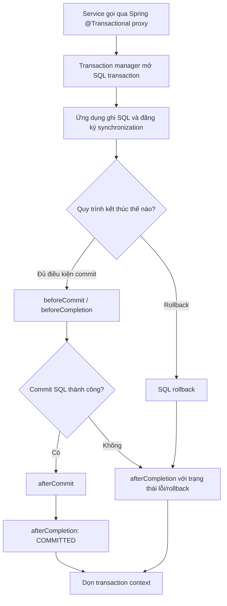
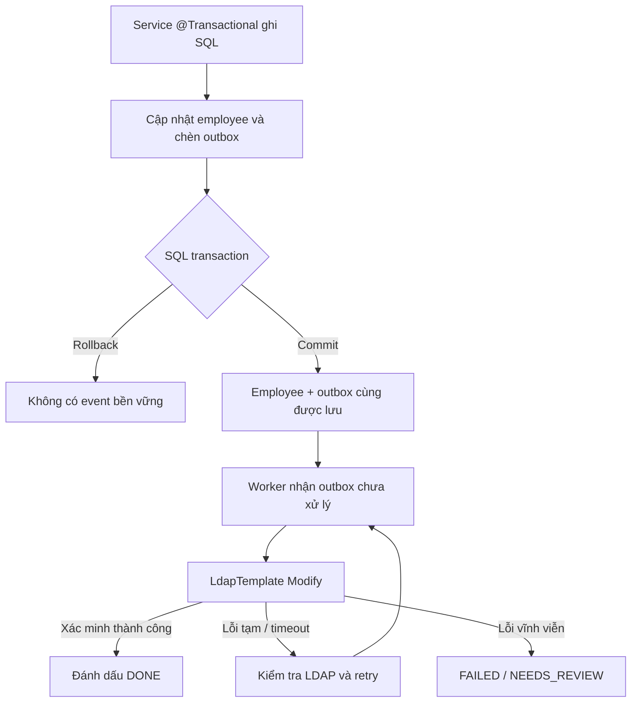

# Transaction synchronization với Spring

Trong một ứng dụng **Spring LDAP**, có những nghiệp vụ vừa cập nhật cơ sở dữ liệu bằng JPA/JDBC vừa truy cập dịch vụ thư mục qua `LdapTemplate`, `LdapClient` hoặc ODM. Ví dụ, khi thông tin nhân viên được lưu thành công trong database, ứng dụng cần đồng bộ tên hiển thị của nhân viên sang LDAP; ngược lại, nếu database rollback, ứng dụng không nên phát lệnh cập nhật LDAP dựa trên dữ liệu chưa được chấp nhận.

**Transaction synchronization** trong Spring là cơ chế đăng ký tác vụ hoặc callback tại các mốc trong vòng đời transaction, chẳng hạn **trước commit, sau commit, sau rollback hoặc sau khi transaction kết thúc**. Nó giúp sắp xếp thời điểm thực hiện việc liên quan đến LDAP, cache, log hoặc sự kiện nghiệp vụ. Tuy nhiên, **synchronization không biến LDAP thành tài nguyên cùng commit/rollback nguyên tử với database**.

Bài này thuộc chương **Transaction** của module **SPRING_LDAP**. Trọng tâm là hiểu API Spring, áp dụng đúng trong quy trình SQL–LDAP, nhận diện rủi ro mất sự kiện và thiết kế kiểm thử nhất quán, an toàn.

## 1. Mục tiêu học tập

Sau bài học, bạn có thể:

1. Phân biệt *transaction synchronization*, *transaction manager* và *LDAP compensating transaction*.
2. Trình bày các callback `beforeCommit`, `afterCommit`, `afterCompletion` và trạng thái hoàn tất.
3. Đăng ký callback bằng `TransactionSynchronizationManager`, nhận biết khi nào transaction thực sự đang hoạt động.
4. Dùng `@TransactionalEventListener` để chỉ gọi LDAP sau khi một transaction database commit thành công.
5. Giải thích vì sao lỗi LDAP ở `AFTER_COMMIT` không thể rollback dữ liệu SQL đã commit.
6. So sánh callback trực tiếp với *transactional outbox* khi cần retry bền vững và đối soát.
7. Kiểm thử commit, rollback, callback failure, timeout và việc gọi qua Spring proxy.

## 2. Ba khái niệm dễ bị nhầm lẫn

### 2.1. Transaction manager quản lý tài nguyên

`PlatformTransactionManager` của Spring là giao diện quản lý vòng đời transaction. Với JPA hoặc JDBC, `JpaTransactionManager` và `DataSourceTransactionManager` quản lý tài nguyên database tương ứng. Spring LDAP cũng có `ContextSourceTransactionManager` nhằm hỗ trợ **transaction bù trừ ở phía client**, khi được cấu hình đúng với `TransactionAwareContextSourceProxy`.

Một phương thức Java có thể gọi cả database và LDAP, nhưng chú thích:

```java
@Transactional(transactionManager = "databaseTransactionManager")
public void updateEmployee() {
    // Gọi JPA...
    // Gọi LDAP...
}
```

**chỉ xác định manager điều khiển transaction ở đây là databaseTransactionManager**. Lệnh LDAP không tự trở thành một phần của commit/rollback SQL chỉ vì nằm trong cùng phương thức.

### 2.2. Transaction synchronization cung cấp mốc sự kiện

Transaction manager có thể kích hoạt cơ chế synchronization của Spring để những thành phần liên quan đăng ký callback. Ví dụ:

- Trước khi database commit: chuẩn bị dữ liệu phụ trợ hoặc kiểm tra điều kiện trong phạm vi an toàn.
- Sau khi database commit: thông báo cho hệ thống khác rằng dữ liệu nguồn đã được lưu.
- Sau khi rollback: xóa trạng thái trong bộ nhớ, ghi nhận kết quả hoặc hủy tác vụ chưa phát.
- Sau khi transaction hoàn tất: thu dọn tài nguyên hoặc ghi metrics cho cả hai nhánh commit và rollback.

Synchronization quản lý **thời điểm thực thi callback**, không cung cấp một giao thức commit phân tán cho LDAP.

### 2.3. Compensating transaction cố hoàn tác LDAP

Nếu ứng dụng cần thao tác nhiều entry LDAP và phục hồi khi bước sau lỗi, Spring LDAP có cơ chế bù trừ (*compensating transaction*) thông qua `ContextSourceTransactionManager` và context proxy phù hợp. Cơ chế này **thử gửi các thao tác LDAP ngược**; nó không có isolation và rollback ACID giống database.

| Khái niệm | Mục đích | Có làm LDAP và SQL commit nguyên tử không? |
|---|---|---|
| `PlatformTransactionManager` cho SQL | Bắt đầu, commit, rollback transaction database | Không |
| `TransactionSynchronization` | Thực thi callback tại các mốc của transaction hiện hành | Không |
| `@TransactionalEventListener` | Gắn xử lý event với pha của transaction Spring | Không |
| `ContextSourceTransactionManager` | Điều phối LDAP compensating transaction | Không |
| LDAP Transactions extension (RFC 5805) | Giao dịch phía LDAP server nếu được hỗ trợ | Không tự phối hợp với SQL |

**Quy tắc thực hành:** Nếu muốn “chỉ gửi lệnh LDAP sau khi SQL đã commit”, hãy cân nhắc synchronization. Nếu muốn “nhiều thay đổi LDAP được bù trừ khi lỗi”, cần đánh giá compensating transaction. Nếu muốn “SQL và LDAP cùng thành công hoặc cùng thất bại bảo đảm tuyệt đối”, các cơ chế trên **không tự đáp ứng yêu cầu đó**.

## 3. TransactionSynchronization hoạt động trong vòng đời transaction

Trong các ứng dụng Spring theo mô hình transaction đồng bộ thông thường, Spring gắn trạng thái transaction và các synchronization vào **thread hiện hành** qua `TransactionSynchronizationManager`. Khi transaction tiến tới các mốc hoàn tất, framework kích hoạt callback đã đăng ký.



Sơ đồ minh họa dòng chính. Khi callback trước commit ném lỗi, transaction manager có thể chuyển sang rollback; thứ tự chi tiết và hành vi khi tài nguyên commit lỗi phụ thuộc implementation. Đừng suy luận chỉ từ một exception rằng database đã commit hay chưa: hãy kiểm tra kết quả thực.

### Các mốc callback

| API | Khi nào chạy | Cách sử dụng phù hợp |
|---|---|---|
| `beforeCommit(boolean readOnly)` | Trước khi transaction cố commit; vẫn còn khả năng rollback | Flush/kiểm tra hoặc chuẩn bị dữ liệu, tránh phát tác động bên ngoài không thể thu hồi |
| `beforeCompletion()` | Trước khi transaction hoàn tất | Thu dọn thông tin chuẩn bị, không coi là xác nhận commit |
| `afterCommit()` | Sau khi transaction commit thành công | Thực hiện xử lý phụ thuộc dữ liệu đã commit, biết rằng lỗi sau đó không hoàn tác commit |
| `afterCompletion(int status)` | Sau khi transaction đã hoàn tất | Ghi log, metrics, dọn tài nguyên; đọc trạng thái `COMMITTED`, `ROLLED_BACK` hoặc `UNKNOWN` |
| `suspend()` / `resume()` | Khi Spring tạm treo hoặc khôi phục synchronization | Chủ yếu dành cho thành phần quản lý tài nguyên cần giữ đúng ngữ cảnh |

Các hằng trạng thái từ `TransactionSynchronization` gồm `STATUS_COMMITTED`, `STATUS_ROLLED_BACK` và `STATUS_UNKNOWN`. Callback `afterCompletion` có thể nhận `UNKNOWN` nếu kết quả không được xác định chắc chắn do lỗi hệ thống.

**Không đồng nhất `beforeCommit` với “đã commit”.** Transaction vẫn có thể rollback sau khi callback này chạy. Vì vậy, gửi email cấp quyền, phát event không bền vững hoặc ghi LDAP trong `beforeCommit` có thể tạo side effect cho một giao dịch SQL sau đó bị hủy.

## 4. Dùng TransactionSynchronizationManager để đăng ký callback

`TransactionSynchronizationManager` cung cấp các phương thức quan trọng:

- `isSynchronizationActive()`: đang có cơ chế synchronization để đăng ký callback hay không.
- `isActualTransactionActive()`: có transaction thực tế được Spring ghi nhận là đang hoạt động hay không.
- `registerSynchronization(TransactionSynchronization)`: đăng ký callback cho synchronization hiện hành; nếu không active sẽ ném `IllegalStateException`.
- `getSynchronizations()`: lấy bản snapshot các synchronization đã đăng ký; thường dùng khi xây dựng hạ tầng, ít cần trong logic nghiệp vụ.

**Hai phép kiểm tra đầu không đồng nghĩa.** Một manager có thể bật synchronization dù không có transaction thực tế ở tầng tài nguyên. Nếu logic cần chắc chắn có transaction database, hãy xác định đúng transaction manager, propagation và kiểm tra cả trạng thái actual transaction.

### Ví dụ helper đăng ký hành động sau commit

```java
import org.springframework.transaction.support.TransactionSynchronization;
import org.springframework.transaction.support.TransactionSynchronizationManager;

public final class CommitCallbacks {

    private CommitCallbacks() {
    }

    public static void afterSuccessfulCommit(Runnable action) {
        if (!TransactionSynchronizationManager.isSynchronizationActive()
                || !TransactionSynchronizationManager.isActualTransactionActive()) {
            throw new IllegalStateException(
                    "Cần transaction Spring đang hoạt động");
        }

        TransactionSynchronizationManager.registerSynchronization(
                new TransactionSynchronization() {
                    @Override
                    public void afterCommit() {
                        action.run();
                    }

                    @Override
                    public void afterCompletion(int status) {
                        // Dùng status để thu dọn/ghi metrics nếu cần.
                        // STATUS_COMMITTED, STATUS_ROLLED_BACK, STATUS_UNKNOWN.
                    }
                });
    }
}
```

Một service có thể gọi `CommitCallbacks.afterSuccessfulCommit(() -> ...)` khi đã nằm trong phạm vi `@Transactional`. Tuy nhiên, callback thực thi trong lúc framework đang hoàn tất transaction; **nếu hành động sau commit lỗi, database đã commit rồi**. Helper trên minh họa cơ chế API, chưa giải quyết được retry hay phục hồi sau khi ứng dụng dừng đột ngột.

Đối với sự kiện nghiệp vụ, Spring cung cấp `@TransactionalEventListener` để diễn đạt ý định rõ ràng hơn. Cách này thường dễ bảo trì hơn việc rải callback thủ công khắp service.

## 5. Transactional event listener và các pha xử lý

`@TransactionalEventListener` gắn một listener với pha transaction chứa thời điểm event được publish. Các pha do `TransactionPhase` định nghĩa:

| Pha | Ý nghĩa | Gợi ý sử dụng |
|---|---|---|
| `BEFORE_COMMIT` | Thực thi trước commit, khi transaction vẫn có thể rollback | Chuẩn bị/kiểm tra dữ liệu; không phát side effect ngoài hệ thống |
| `AFTER_COMMIT` | Chỉ xử lý khi transaction hoàn tất theo hướng commit thành công | Đồng bộ best-effort sau khi dữ liệu nguồn đã được chấp nhận |
| `AFTER_ROLLBACK` | Chỉ xử lý nếu transaction đã rollback | Dọn trạng thái tạm, metrics, thông báo lỗi nội bộ phù hợp |
| `AFTER_COMPLETION` | Thực thi sau khi hoàn tất, bất kể commit hay rollback | Log/metrics hoặc thu dọn chung |

Mặc định, `@TransactionalEventListener` sử dụng **`AFTER_COMMIT`**. Nếu event được phát **ngoài transaction được quản lý phù hợp**, listener thường **không chạy**, trừ khi cấu hình `fallbackExecution = true`. Bật fallback chỉ khi chấp nhận chạy listener ngay cả khi không có transaction; nó không tạo ra một commit trước đó.

Một listener thông thường chạy đồng bộ theo cơ chế publish và hoàn tất transaction. Dùng thêm `@Async` sẽ chuyển việc thực thi sang thread khác; transaction và context liên kết với thread cũ **không tự được truyền sang**. Đồng thời, việc đưa callback sang executor không tạo hàng đợi bền vững khi ứng dụng gặp sự cố.

## 6. Ví dụ Spring Boot: SQL commit xong mới cập nhật LDAP

Giả sử bảng nhân viên trong database là **nguồn dữ liệu chính**. Khi người quản trị đổi tên hiển thị, hệ thống:

1. Cập nhật `displayName` trong SQL.
2. Publish event `EmployeeNameChanged` khi transaction SQL đang hoạt động.
3. Chỉ sau khi SQL **commit thành công**, listener gửi lệnh LDAP `Modify` để cập nhật entry người dùng.

### 6.1. Event và service ghi SQL

```java
import org.springframework.context.ApplicationEventPublisher;
import org.springframework.stereotype.Service;
import org.springframework.transaction.annotation.Transactional;

record EmployeeNameChanged(String uid, String displayName) {
}

@Service
public class EmployeeService {

    private final EmployeeRepository employees;
    private final ApplicationEventPublisher events;

    public EmployeeService(EmployeeRepository employees,
                           ApplicationEventPublisher events) {
        this.employees = employees;
        this.events = events;
    }

    @Transactional(transactionManager = "databaseTransactionManager")
    public void renameEmployee(String uid, String newDisplayName) {
        Employee employee = employees.findByUid(uid)
                .orElseThrow(() -> new IllegalArgumentException(
                        "Không tìm thấy nhân viên: " + uid));

        employee.setDisplayName(newDisplayName);

        // Event phát trong SQL transaction. Listener đợi AFTER_COMMIT.
        events.publishEvent(new EmployeeNameChanged(uid, newDisplayName));
    }
}
```

Ví dụ giả định ứng dụng đã có `Employee` là JPA entity, `EmployeeRepository` với phương thức `findByUid`, và bean transaction manager tên `databaseTransactionManager`. Trong một JPA transaction, thay đổi entity được đồng bộ xuống database khi flush/commit theo cấu hình JPA; nếu commit thất bại, listener ở pha `AFTER_COMMIT` không thực hiện cập nhật LDAP.

### 6.2. Listener gửi LDAP Modify sau commit

```java
import javax.naming.Name;
import javax.naming.directory.BasicAttribute;
import javax.naming.directory.DirContext;
import javax.naming.directory.ModificationItem;

import org.springframework.ldap.core.LdapTemplate;
import org.springframework.ldap.support.LdapNameBuilder;
import org.springframework.stereotype.Component;
import org.springframework.transaction.event.TransactionPhase;
import org.springframework.transaction.event.TransactionalEventListener;

@Component
public class EmployeeLdapSyncListener {

    private final LdapTemplate ldapTemplate;

    public EmployeeLdapSyncListener(LdapTemplate ldapTemplate) {
        this.ldapTemplate = ldapTemplate;
    }

    @TransactionalEventListener(phase = TransactionPhase.AFTER_COMMIT)
    public void syncName(EmployeeNameChanged event) {
        // Giả sử LdapTemplate đã cấu hình base dc=example,dc=org.
        // Entry uid=<uid>,ou=people phải tồn tại.
        Name userDn = LdapNameBuilder
                .newInstance("ou=people")
                .add("uid", event.uid())
                .build();

        ModificationItem change = new ModificationItem(
                DirContext.REPLACE_ATTRIBUTE,
                new BasicAttribute("displayName", event.displayName()));

        ldapTemplate.modifyAttributes(
                userDn, new ModificationItem[] { change });
    }
}
```

**Điều kiện:** LDAP server chấp nhận thuộc tính `displayName` theo schema của entry, service account đủ quyền Modify, DN được tạo hợp lệ và `LdapTemplate` đang trỏ tới đúng thư mục. Sử dụng `LdapNameBuilder` thay cho ghép DN bằng chuỗi trực tiếp để tránh lỗi escape các thành phần của DN. Nếu LDAP entry chưa tồn tại, `Modify` thất bại; ứng dụng cần một quy trình provisioning riêng.

### Trạng thái trong các trường hợp khác nhau

| Tình huống | Database | Listener LDAP | Trạng thái cuối |
|---|---|---|---|
| SQL commit thành công, LDAP thành công | Đã ghi tên mới | Chạy và thành công | Hai hệ thống khớp tại thời điểm xác minh |
| SQL rollback | Không ghi tên mới | Không chạy ở pha `AFTER_COMMIT` | LDAP không bị cập nhật do event này |
| SQL commit thành công, LDAP trả lỗi | Đã ghi tên mới | Chạy nhưng thất bại | SQL đã commit, LDAP có thể còn tên cũ |
| SQL commit thành công, app dừng trước callback | Đã ghi tên mới | Có thể chưa chạy | Có nguy cơ bỏ lỡ đồng bộ |
| LDAP timeout khi gửi Modify | Đã ghi tên mới | Không biết server đã áp dụng hay chưa | Cần đọc lại LDAP, rồi mới quyết định retry |

**Cảnh báo về semantics:** Một lỗi từ listener `AFTER_COMMIT` có thể lan lên luồng gọi và khiến HTTP request trông như thất bại, trong khi **SQL thực sự đã commit**. Không được retry cả quy trình tạo/sửa nhân viên theo cách mù quáng từ nhận định “request lỗi” vì có thể tạo side effect trùng.

### 6.3. Khi nào callback sau commit đủ dùng?

Callback trực tiếp phù hợp hơn cho tác vụ **best-effort**, ngắn, thất bại có thể được xử lý theo cách khác và không cần bảo đảm giao hàng tuyệt đối: metrics, cache invalidation có đường khôi phục, notification không quan trọng.

Đối với LDAP dùng để xác thực, phân quyền hoặc đồng bộ danh tính, việc bỏ lỡ cập nhật có thể ảnh hưởng bảo mật và vận hành. Lúc này nên có cơ chế bền vững theo dõi trạng thái, retry và đối soát, như transactional outbox ở phần tiếp theo.

## 7. Transaction synchronization không bảo đảm atomicity giữa SQL và LDAP

Có hai lựa chọn thứ tự dễ gặp, mỗi lựa chọn đều có “khoảng trống”:

**Ghi LDAP trước khi SQL commit**

```text
SQL transaction bắt đầu
  -> SQL UPDATE
  -> LDAP MODIFY thành công
  -> SQL COMMIT thất bại
Kết quả: LDAP đã thay đổi, SQL chưa commit.
```

**Chỉ ghi LDAP sau khi SQL commit**

```text
SQL transaction bắt đầu
  -> SQL UPDATE
  -> SQL COMMIT thành công
  -> LDAP MODIFY bị từ chối hoặc timeout
Kết quả: SQL đã commit, LDAP chưa chắc đồng bộ.
```

Phương án thứ hai tránh phát hành lệnh LDAP khi transaction SQL đã rollback, nhưng **không bảo đảm cả hai tài nguyên cùng thành công**. Phương án thứ nhất có nguy cơ LDAP thay đổi ngay cả khi SQL không thành công. Cả hai đều khác XA/two-phase commit có cơ chế điều phối commit thực sự.

Cần phân biệt thêm: **compensating transaction của Spring LDAP** có thể thử hoàn tác một chuỗi thay đổi LDAP, nhưng không tạo ACID commit chung với `JpaTransactionManager`. Ngay cả khi phối hợp nhiều manager theo một transaction logic, việc commit lần lượt vẫn có cửa sổ lỗi giữa các tài nguyên.

## 8. Thiết kế an toàn hơn bằng transactional outbox

Đối với đồng bộ LDAP quan trọng, cách tiếp cận thực tế là:

1. Trong **cùng một transaction SQL**, cập nhật bản ghi nhân viên **và** chèn bản ghi yêu cầu đồng bộ vào bảng outbox.
2. SQL commit thành công thì cả dữ liệu nhân viên và ý định đồng bộ cùng bền vững; SQL rollback thì cả hai đều không được lưu.
3. Worker đọc những outbox record chưa xử lý, gửi yêu cầu LDAP và xác minh kết quả.
4. Khi lỗi tạm thời, worker retry có backoff. Khi timeout không rõ server đã nhận hay chưa, worker **đọc lại LDAP** rồi quyết định bước tiếp.
5. Chỉ đánh dấu outbox event đã xử lý khi đã xác minh trạng thái LDAP mong muốn; với lỗi vĩnh viễn phải cảnh báo và cho đối soát.



### Ví dụ thao tác ghi trong một SQL transaction

```java
@Transactional(transactionManager = "databaseTransactionManager")
public void renameEmployee(String uid, String newName) {
    Employee employee = employees.findByUid(uid)
            .orElseThrow();

    employee.setDisplayName(newName);

    outboxRepository.save(new OutboxEvent(
            "EMPLOYEE_NAME_CHANGED",
            uid,
            newName,
            "PENDING"));
}
```

Đoạn mã giả định các type `OutboxEvent` và `outboxRepository` được ứng dụng định nghĩa. Trong thực tế, payload nên có **operation ID**, phiên bản bản ghi, thời điểm tạo, trạng thái retry và số lần xử lý. Worker nên dùng `REPLACE_ATTRIBUTE` với giá trị đích xác định để hỗ trợ retry, đồng thời xử lý thứ tự event để cập nhật cũ không ghi đè cập nhật mới.

**Outbox không biến LDAP thành giao dịch SQL.** Nó cung cấp một **ý định đồng bộ được lưu bền vững** và khả năng khôi phục sau restart. Đồng bộ vẫn có thể trễ (*eventual consistency*), và event có thể được xử lý hơn một lần; vì thế cần tính idempotent và cơ chế xử lý phiên bản/thứ tự.

### Kết hợp event sau commit với outbox

Có thể dùng `@TransactionalEventListener(AFTER_COMMIT)` để **đánh thức worker** ngay sau khi SQL commit, giúp giảm độ trễ. Tuy nhiên, worker cũng phải quét outbox định kỳ hoặc nhận sự kiện từ kênh bền vững để khôi phục nếu callback bị bỏ lỡ. **Outbox lưu trong SQL là nguồn sự thật về công việc chưa xong**, còn callback chỉ là tín hiệu tối ưu hóa thời gian.

## 9. Nếu transaction hiện hành là LDAP thì sao?

Một service có thể khai báo:

```java
@Transactional(transactionManager = "ldapTransactionManager")
public void updateSeveralEntries() {
    // Nhiều lời gọi LdapTemplate qua transaction-aware ContextSource.
}
```

Khi được cấu hình đúng, `ContextSourceTransactionManager` quản lý transaction bù trừ của LDAP. Những synchronization được đăng ký cho transaction đó sẽ theo **vòng đời transaction LDAP do manager quản lý**, không phải transaction SQL. Callback `afterCommit` nghĩa là manager đã đi qua pha hoàn tất thành công của transaction logic đó; nó **không chứng minh các hệ thống khác đã commit** hay tất cả LDAP replica đã nhìn thấy dữ liệu.

Để sử dụng compensating transaction đúng cách, thường cần:

- `ContextSourceTransactionManager` giữ tham chiếu tới `ContextSource` gốc.
- `TransactionAwareContextSourceProxy` bọc context gốc.
- `LdapTemplate`/`LdapClient`/ODM sử dụng đúng context đã bọc và các API ghi được hỗ trợ.
- Method được gọi qua Spring proxy với `transactionManager` đúng tên.

Các hành động bù trừ là **yêu cầu LDAP mới**, có thể thất bại do ACL, schema, mất kết nối hoặc thay đổi đồng thời. Nếu nghiệp vụ dùng cả LDAP và JPA, cần xác định rõ transaction manager nào đang kích hoạt synchronization và nguồn dữ liệu nào là chuẩn. Không suy đoán rằng callback “sau commit” của một manager là “sau commit của mọi hệ thống”.

**Không cần tự viết mã transaction synchronization để được hưởng tính nguyên tử một lần `Modify`.** Theo ngữ nghĩa LDAP, các thay đổi trong cùng một `ModifyRequest` của một entry có tính nguyên tử riêng; vấn đề đồng bộ nảy sinh khi có nhiều yêu cầu hoặc nhiều tài nguyên.

## 10. Những bẫy kỹ thuật khi dùng synchronization

### 10.1. Tự gọi phương thức có `@Transactional`

Trong chế độ Spring AOP proxy thông thường:

```java
@Service
public class EmployeeFacade {
    public void outer() {
        changeName(); // Gọi nội bộ: có thể không đi qua transactional proxy.
    }

    @Transactional(transactionManager = "databaseTransactionManager")
    public void changeName() {
        // Publish event / register synchronization...
    }
}
```

Lời gọi nội bộ qua `this` không được Spring proxy chặn như lời gọi từ bean khác. Do đó event có thể được publish **ngoài transaction thực**, khiến `@TransactionalEventListener` không chạy theo kỳ vọng. Nên đặt ranh giới transaction tại service được bean khác gọi hoặc sử dụng `TransactionTemplate` khi cần điều khiển trực tiếp.

### 10.2. Transaction ở thread khác

`TransactionSynchronizationManager` thông thường sử dụng trạng thái gắn với thread. Chuyển phần việc sang `@Async`, executor hay thread tự tạo **không tự truyền** transaction hiện hành. Đừng kiểm tra `isActualTransactionActive()` ở thread mới rồi mặc định nó có cùng SQL transaction với thread gốc.

Nếu muốn xử lý sau commit bất đồng bộ, dùng một kênh công việc bền vững với ID và trạng thái riêng; không phụ thuộc vào việc thread mới thừa hưởng context.

### 10.3. Viết database trong `AFTER_COMMIT`

Một số tài nguyên transaction vẫn còn được Spring giữ tạm trong quá trình callback sau commit. Nếu listener cần ghi **một bản ghi SQL mới** và muốn bảo đảm nó được commit, nên gọi một phương thức ở bean khác sử dụng transaction mới như `@Transactional(propagation = Propagation.REQUIRES_NEW)`, cùng transaction manager phù hợp.

```java
@Service
public class SyncAuditService {

    @Transactional(
        transactionManager = "databaseTransactionManager",
        propagation = Propagation.REQUIRES_NEW
    )
    public void recordSyncResult(String uid, String status) {
        // Ghi trạng thái trong transaction SQL mới.
    }
}
```

Đoạn mã giả định đã import `org.springframework.transaction.annotation.Propagation` và có repository tương ứng. Để proxy có hiệu lực, gọi phương thức từ **bean khác**, không tự gọi nội bộ cùng lớp. Tuy nhiên, nếu ghi audit này thất bại sau khi LDAP đã thành công, lại phát sinh một trạng thái cần đối soát; outbox thường là kiến trúc bền vững hơn cho công việc bắt buộc.

### 10.4. Hiểu sai quy tắc rollback

Theo mặc định, `@Transactional` thường rollback khi `RuntimeException` hoặc `Error` thoát khỏi method; checked exception cần quy tắc `rollbackFor` nếu muốn rollback. Bắt và nuốt exception có thể khiến method kết thúc bình thường và manager thực hiện commit.

```java
@Transactional(
    transactionManager = "databaseTransactionManager",
    rollbackFor = Exception.class
)
public void changeCriticalData() throws Exception {
    // Nếu ném checked exception ra ngoài, yêu cầu rollback.
}
```

Dù có quy tắc rollback đầy đủ, lỗi **sau khi commit hoàn tất** không thể biến SQL thành rollback. Các chính sách exception chỉ ảnh hưởng trước khi transaction thật sự được quyết định.

### 10.5. Thứ tự nhiều callback

Spring có cơ chế sắp thứ tự synchronization thông qua `Ordered`/`getOrder()` hoặc `@Order` tùy loại listener. Nếu một luồng phụ thuộc vào thứ tự chính xác giữa nhiều callback, hãy cấu hình và kiểm thử theo API/phiên bản Spring sử dụng; đừng dựa vào thứ tự đăng ký tình cờ. Thứ tự callback cũng không giải quyết việc thiếu atomicity giữa các hệ thống.

## 11. Kiểm thử integration: quan sát commit và trạng thái LDAP

Mock event publisher hoặc mock `LdapTemplate` có thể hữu ích cho unit test, nhưng không đủ xác nhận SQL có commit thực và LDAP nhận đúng thay đổi. Nên có **integration test** dùng database thử nghiệm, LDAP server thử nghiệm và transaction manager đúng cấu hình.

| Kịch bản | Cách kích hoạt | Điều cần xác minh |
|---|---|---|
| SQL commit thành công | Đổi tên nhân viên không lỗi | Listener `AFTER_COMMIT` được gọi; LDAP nhận giá trị mới |
| SQL rollback | Ném `RuntimeException` trước commit | Database không lưu tên mới; listener `AFTER_COMMIT` không gửi LDAP |
| SQL commit thành công, LDAP lỗi | Cho server LDAP từ chối Modify | SQL vẫn có tên mới; ghi nhận lỗi/đối soát, không báo rollback SQL |
| LDAP timeout sau commit | Mô phỏng mất phản hồi | Đọc lại LDAP trước retry vì server có thể đã áp dụng |
| Publish event ngoài transaction | Gọi publisher mà không có transaction | Listener không chạy nếu `fallbackExecution = false` (mặc định) |
| Self-invocation bỏ qua proxy | Gọi method `@Transactional` nội bộ | Quan sát không có transaction như kỳ vọng |
| Thread khác | Chuyển xử lý sang executor | Không có transaction context gốc mặc định |
| App dừng sau SQL commit | Gián đoạn trước khi xử lý LDAP | Outbox còn `PENDING` và được worker khôi phục |
| Hai event đổi tên sát nhau | Cho event cũ đến sau event mới | Worker kiểm tra phiên bản/thứ tự, không ghi đè giá trị mới |

### Cách kiểm tra sau commit

1. Seed một entry LDAP hợp lệ và một nhân viên SQL có cùng `uid`.
2. Gọi service đổi tên **qua Spring bean proxy**, cho SQL commit.
3. Sau khi listener hoặc worker chạy xong, đọc lại database và LDAP bằng **kết nối độc lập** để so sánh.
4. Lặp lại với lỗi trước commit; bảo đảm không có yêu cầu LDAP tương ứng được phát.
5. Lặp lại với LDAP Modify bị từ chối hoặc timeout; xác nhận trạng thái database, outbox/retry và log đều phản ánh thực tế.
6. Nếu dùng replica LDAP, nêu rõ endpoint đọc lại (writer hay replica) và thời điểm quan sát; kết quả có thể khác vì độ trễ replication.

**Lưu ý với test `@Transactional`:** Nếu chính phương thức test được bọc transaction rồi framework test tự rollback ở cuối, callback `AFTER_COMMIT` sẽ **không chạy** như khi service thực sự commit. Muốn kiểm thử callback sau commit, hãy chủ động kết thúc và commit transaction test bằng tiện ích phù hợp hoặc gọi service từ một test không giữ transaction bao ngoài.

### Kiểm tra việc đăng ký callback

Có thể viết một unit/integration test trong transaction đã bật synchronization để kiểm tra:

```java
assertTrue(TransactionSynchronizationManager.isSynchronizationActive());
assertTrue(TransactionSynchronizationManager.isActualTransactionActive());
```

Hai assertion này phải chạy **trong transaction thực**, không phải ở mọi nơi trong test suite. Để xác nhận hành vi ứng dụng, kiểm tra thêm side effect sau commit/rollback; chỉ có hai cờ trên chưa chứng minh callback đã thực thi.

## 12. Bảo mật và vận hành khi đồng bộ LDAP

Transaction synchronization chủ yếu giải quyết **thời điểm** cập nhật, không thay thế thiết kế truy cập LDAP an toàn:

- **DN:** Dựng DN bằng `LdapNameBuilder` hoặc API có escape đúng; không ghép trực tiếp dữ liệu người dùng vào DN hay LDAP filter. Với tìm kiếm, ưu tiên builder/filter parameterization tương ứng.
- **Schema và ACL:** Xác định entry tồn tại, object class cho phép thuộc tính cần ghi và service account có quyền thích hợp.
- **Kết nối:** Sử dụng LDAPS hoặc StartTLS và xác minh chứng chỉ server; cấu hình timeout, connection pooling phù hợp với LDAP library và nhu cầu transaction.
- **Dữ liệu nhạy cảm:** Không đưa password, credential, secret hoặc dữ liệu cá nhân không cần thiết vào event payload, outbox hay log.
- **Nhất quán quyền:** Nếu membership LDAP quyết định quyền truy cập, chưa có xác nhận đồng bộ thì không mặc định cấp quyền. Cần trạng thái `PENDING`/`FAILED` và cơ chế từ chối an toàn theo yêu cầu nghiệp vụ.
- **Quan sát:** Theo dõi số outbox pending, độ trễ đồng bộ, số lần retry, lỗi LDAP theo result code và chênh lệch trạng thái SQL–LDAP.
- **Khôi phục:** Đối với timeout, không coi mất phản hồi là chắc chắn thao tác chưa áp dụng. Đọc lại LDAP và so sánh giá trị mong muốn trước khi thử lại.

## 13. Những nhầm lẫn thường gặp

**“Transaction synchronization là một distributed transaction manager.”** Sai. Nó chỉ điều phối callback gắn với vòng đời transaction được Spring quản lý.

**“`AFTER_COMMIT` nghĩa là LDAP và SQL cùng commit.”** Sai. SQL đã commit trước; LDAP vẫn có thể thất bại khi callback chạy.

**“Phát event trong `@Transactional` là event đã được lưu bền vững.”** Sai. Spring application event thông thường là xử lý trong bộ nhớ; restart đúng thời điểm có thể làm bỏ lỡ. Outbox mới lưu được ý định đồng bộ cùng SQL.

**“`AFTER_ROLLBACK` có thể hoàn tác mọi side effect đã phát ra.”** Sai. Callback có thể thực hiện hành động bù trừ nhưng thao tác ngược vẫn có thể thất bại và không thể thu hồi mọi tác động ngoài hệ thống.

**“`isSynchronizationActive()` chứng minh đang có một SQL transaction.”** Sai. Nó cho biết khả năng đăng ký synchronization, không thay cho việc xác nhận manager và actual transaction.

**“Một listener có `@Async` vẫn dùng chung transaction context cũ.”** Sai với cơ chế thread-bound thông thường. Context không tự lan truyền sang thread mới.

## 14. Bài tập thực hành

Xây dựng mini-service quản lý tên hiển thị nhân viên với một database và một LDAP server dành cho kiểm thử:

1. Tạo bảng employee và entry LDAP tương ứng trong `ou=people,dc=example,dc=org`.
2. Viết phương thức JPA `@Transactional` cập nhật tên hiển thị và publish `EmployeeNameChanged`.
3. Viết `@TransactionalEventListener(phase = AFTER_COMMIT)` dùng `LdapTemplate` để gửi **một** `ModifyRequest` cho `displayName`.
4. Kiểm tra hai trường hợp: commit thành công thì LDAP được sửa; SQL rollback thì LDAP không nhận event này.
5. Cố ý làm LDAP timeout sau SQL commit; ghi lại sự sai khác và giải thích vì sao không thể rollback SQL.
6. Bổ sung bảng outbox cùng transaction SQL, worker retry và kiểm tra thứ tự event. Mô phỏng restart để xác nhận event chưa đồng bộ vẫn tồn tại.
7. Thử chuyển listener sang `@Async` và so sánh khả năng quan sát, thread context, thời điểm thực thi với listener đồng bộ.
8. Viết kết luận: điểm nào synchronization giải quyết được, điểm nào cần retry/đối soát hay cơ chế bù trừ.

**Tiêu chí hoàn thành:** Có test đọc lại cả SQL và LDAP sau mỗi tình huống; phân biệt rõ “callback được gọi”, “LDAP đã nhận thay đổi” và “hai hệ thống đã nhất quán”; lỗi mạng không gây retry mù quáng hoặc cấp quyền ngoài ý muốn.

## 15. Ghi nhớ

**Transaction synchronization với Spring** cho phép liên kết công việc với mốc commit/rollback của một transaction đã được chọn và quản lý đúng. Trong ứng dụng Spring LDAP, `TransactionSynchronization` và `@TransactionalEventListener` đặc biệt hữu ích khi chỉ muốn gửi thay đổi LDAP **sau khi SQL commit thành công**. Dù vậy, callback không thể đảm bảo hai hệ thống cùng commit nguyên tử và không tự lưu sự kiện bền vững.

Với cập nhật LDAP quan trọng, hãy kết hợp **transactional outbox, idempotency, kiểm tra lại trạng thái và đối soát**. Nếu sử dụng thêm cơ chế compensating transaction của Spring LDAP, phải coi rollback LDAP là các thao tác ngược có thể thất bại, độc lập với vòng đời SQL.

### Tài liệu tham khảo

- [Spring Framework — Transaction-bound Events](https://docs.spring.io/spring-framework/reference/data-access/transaction/event.html): `@TransactionalEventListener` và `TransactionPhase`.
- [Spring Framework API — TransactionSynchronization](https://docs.spring.io/spring-framework/docs/current/javadoc-api/org/springframework/transaction/support/TransactionSynchronization.html): các callback trước/sau commit và afterCompletion.
- [Spring Framework API — TransactionSynchronizationManager](https://docs.spring.io/spring-framework/docs/current/javadoc-api/org/springframework/transaction/support/TransactionSynchronizationManager.html): quản lý synchronization và transaction context gắn với thread.
- [Spring Framework — Declarative Transaction Management](https://docs.spring.io/spring-framework/reference/data-access/transaction/declarative.html): `@Transactional`, quy tắc rollback và AOP proxy.
- [Spring LDAP — Transaction Support](https://docs.spring.io/spring-ldap/docs/3.1.4/reference/#transaction-support): cơ chế transaction bù trừ LDAP và giới hạn với JDBC.
- [RFC 4511 — LDAP Protocol](https://www.rfc-editor.org/rfc/rfc4511) và [RFC 5805 — LDAP Transactions](https://www.rfc-editor.org/rfc/rfc5805): ngữ nghĩa thao tác LDAP và extension giao dịch phía server.
