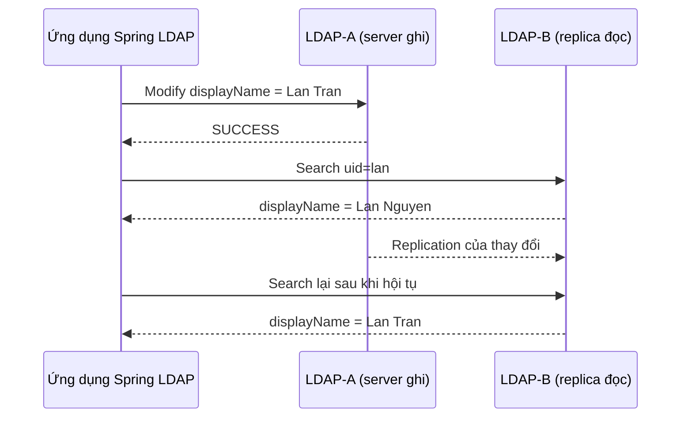
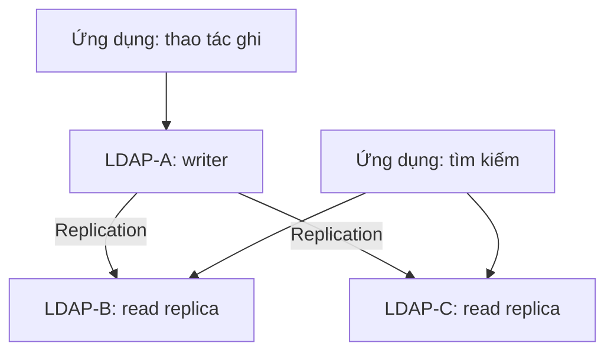
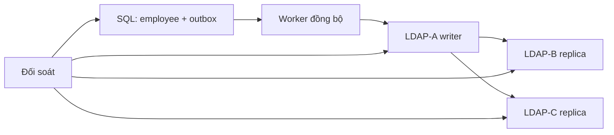

# Giới hạn nhất quán giữa nhiều LDAP server

Trong hệ thống thực tế, dịch vụ thư mục hiếm khi chỉ có một máy chủ. Doanh nghiệp có thể triển khai nhiều LDAP server để tăng khả dụng, phân tải đọc, phục vụ các khu vực địa lý khác nhau hoặc giảm phụ thuộc vào một điểm lỗi. Ứng dụng **Spring LDAP** thường kết nối qua `ContextSource`, rồi tìm kiếm và cập nhật entry bằng `LdapTemplate`, `LdapClient` hoặc ODM.

Khi dữ liệu được **sao chép (replication)** giữa các LDAP server, câu hỏi quan trọng là: **một thao tác ghi đã thành công trên server A thì server B có nhìn thấy ngay không?** Thông thường, không được mặc định câu trả lời là có. Mức nhất quán phụ thuộc topology, sản phẩm LDAP, cấu hình replication, tình trạng mạng và server đang được client sử dụng.

Bài thuộc chương **Transaction** của module **SPRING_LDAP** và tập trung vào ranh giới nhất quán dữ liệu trong môi trường nhiều server, đặc biệt khi ứng dụng vừa ghi vừa đọc, dùng kết nối dự phòng, xử lý thay đổi mật khẩu, nhóm quyền hoặc phối hợp LDAP với database.

## 1. Mục tiêu học tập

Sau bài này, người học có thể:

1. Phân biệt **atomicity của một yêu cầu LDAP**, **rollback của nhiều thao tác** và **nhất quán giữa các LDAP replica**.
2. Mô tả các topology *single-writer với replica*, *multi-writer* và cách chúng ảnh hưởng đến hành vi đọc/ghi.
3. Nhận diện tình huống **stale read**, *read-after-write không nhất quán*, failover sang server chưa đồng bộ và xung đột ghi đồng thời.
4. Thiết kế `ContextSource` cho endpoint ghi và endpoint đọc riêng trong Spring LDAP khi hệ thống yêu cầu.
5. Lựa chọn chiến lược đọc lại server ghi, đợi hội tụ có giới hạn, gắn version hoặc kiểm tra trạng thái và đối soát.
6. Kiểm thử replication lag, mất kết nối, kết quả ghi không xác định và các rủi ro với dữ liệu xác thực/phân quyền.
7. Giải thích rõ vì sao `@Transactional` hoặc transaction synchronization của Spring không làm các LDAP server nhất quán tức thì.

## 2. Trường hợp cơ bản: ghi thành công nhưng đọc từ replica vẫn thấy giá trị cũ

Giả sử LDAP có hai server cùng phục vụ dữ liệu dưới base DN:

```text
dc=example,dc=org
  ou=people
    uid=lan
  ou=groups
    cn=editors
```

Ứng dụng cập nhật thuộc tính `displayName` của Lan từ `Lan Nguyen` thành `Lan Tran` tại **LDAP-A**, sau đó một request khác tìm kiếm Lan trên **LDAP-B**.



Hai phản hồi LDAP có thể đều hợp lệ:

- **A trả SUCCESS** nghĩa là A đã chấp nhận và xử lý thao tác theo ngữ nghĩa của server A.
- **B trả giá trị cũ** vì replication tới B chưa hoàn tất tại thời điểm đọc.

Điểm quyết định: **kết quả SUCCESS từ một server không mặc nhiên cam kết dữ liệu đã có trên mọi server khác**. Một triển khai cụ thể có thể cung cấp các bảo đảm mạnh hơn hoặc cơ chế chờ đồng bộ, nhưng ứng dụng phải xác minh chúng từ tài liệu và cấu hình thực tế.

### Ba ranh giới cần tách biệt

| Phạm vi | Ý nghĩa | Điều không được suy ra |
|---|---|---|
| **Một LDAP ModifyRequest** trên một entry | Các thay đổi trong cùng yêu cầu được xử lý nguyên tử theo LDAP (RFC 4511) | Các replica đã đồng bộ ngay |
| **Nhiều LDAP request** | Các lệnh Add/Modify/Delete/ModifyDN được xử lý độc lập, trừ cơ chế transaction được xác nhận hỗ trợ | Một lỗi sẽ rollback tất cả lệnh trước |
| **Nhiều LDAP server** | Replication chuyển dữ liệu hoặc trạng thái thay đổi giữa server | Đọc từ bất kỳ server nào cũng thấy dữ liệu mới nhất |

Spring LDAP có cơ chế *compensating transaction* cho một số thao tác khi được cấu hình, nhưng đây là **các yêu cầu bù trừ từ client**. Bản thân việc bù trừ cũng cần được sao chép tới replica; nó không đem lại atomic commit nhiều server.

## 3. Các loại nhất quán cần hiểu

**Nhất quán mạnh (strong consistency)** theo nghĩa thực tế của một thao tác đọc là: sau khi ghi đã được xác nhận thành công, những lần đọc nằm trong phạm vi bảo đảm đó thấy giá trị tương ứng với thứ tự cập nhật đã hoàn tất. Không được gán mặc định tính chất này cho toàn bộ cụm LDAP chỉ vì các server cùng chứa một naming context.

**Nhất quán cuối cùng (eventual consistency)** là: nếu không có cập nhật mới và replication hoạt động bình thường, các replica dự kiến sẽ hội tụ về trạng thái phù hợp. Thuật ngữ này **không hứa thời hạn cố định** và không tự bảo đảm hội tụ trong khi có lỗi kéo dài hoặc xung đột chưa được giải quyết.

**Read-your-writes** là mong muốn client sau khi ghi có thể đọc lại chính dữ liệu vừa ghi. Cách đơn giản thường là giữ các thao tác liên quan trên **cùng server ghi**, nhưng phải biết rõ kết nối có bị load balancer điều hướng sang backend khác không.

**Monotonic reads** nghĩa là các lần đọc liên tiếp trong cùng phiên không quay lại trạng thái cũ hơn. Nếu ứng dụng lần lượt đọc B (đã nhận cập nhật) rồi C (chưa nhận cập nhật), tính chất này có thể không được bảo đảm.

**Consistent snapshot** giữa **nhiều entry** là vấn đề khó hơn: đọc user từ một replica và group từ replica khác có thể thu được hai phiên bản dữ liệu thuộc hai thời điểm khác nhau.

| Tình huống | Điều có thể xảy ra |
|---|---|
| Đọc từ A ngay sau khi A xác nhận ghi | Thường thấy cập nhật trên A nếu không có thay đổi cạnh tranh và backend không chuyển hướng; cần xác minh triển khai |
| Ghi A, đọc B ngay | Có thể đọc dữ liệu cũ |
| Đọc B rồi đọc C | Có thể quay lại phiên bản cũ hơn |
| Đọc entry user ở A, đọc group ở B | Có thể quan sát tổ hợp user/nhóm chưa từng tồn tại cùng lúc trên một server |
| Failover sang replica chưa cập nhật | Ghi trước đó có thể chưa quan sát được từ endpoint mới |
| Các writer cập nhật cùng entry | Có thể cần giải quyết xung đột theo quy tắc sản phẩm cụ thể |

### “Nhất quán” còn có thể mang nghĩa khác

Một LDAP directory có thể áp dụng **schema validation** và **ACL** đúng trên mỗi server nhưng replica vẫn chậm so với nhau. Schema hợp lệ không đồng nghĩa dữ liệu đã hội tụ; cho phép tìm kiếm thành công cũng không chứng minh kết quả là mới nhất.

Tương tự, một truy vấn trả **không có entry** từ replica chưa đồng bộ không nhất thiết có nghĩa entry chưa từng được tạo. Nếu đây là dữ liệu ảnh hưởng phân quyền hoặc xác thực, ứng dụng cần chính sách rõ ràng về việc tin vào phản hồi cũ.

## 4. Topology ảnh hưởng thế nào đến nhất quán?

### 4.1. Một server ghi, nhiều server đọc



Mô hình này dễ hiểu hơn vì ứng dụng có một điểm ghi được chỉ định. Tuy nhiên, độ trễ sao chép vẫn có thể khiến B và C trả kết quả khác A. Trong trường hợp writer hỏng, chuyển sang writer dự phòng cần một **quy trình failover được hỗ trợ** để tránh hai writer cùng nhận ghi hoặc writer mới chưa có đầy đủ thay đổi đã xác nhận.

Không nên giả định chỉ cần cấu hình nhiều URL trong JNDI là đã có cơ chế election, replication hoặc failover an toàn về dữ liệu.

### 4.2. Nhiều server cùng được phép ghi

Ở hệ **multi-writer/multi-master**, A và B có thể cùng tiếp nhận Modify đối với một entry:

```text
t0: A và B đều thấy displayName = "Lan Nguyen"
t1: Client 1 ghi displayName = "Lan Tran" trên A
t2: Client 2 ghi displayName = "Lan Le" trên B
t3: Replication trao đổi hai thay đổi
```

Giá trị cuối cùng và thứ tự xử lý phụ thuộc nhà cung cấp, topology và cơ chế phát hiện/giải quyết xung đột. **Không có quy tắc chung của giao thức LDAP rằng “lệnh nào client gửi cuối cùng chắc chắn thắng”**. Một hệ thống có thể dựa trên timestamp, change sequence, server ID, thứ tự cập nhật hoặc quy tắc riêng; nhiều giá trị thuộc tính và các thao tác rename/delete còn tạo những trường hợp phức tạp.

Đặc biệt, khi hai client cập nhật thuộc tính đa trị như `member`:

- Client 1 muốn thêm Lan vào nhóm.
- Client 2 muốn xóa một thành viên khác.
- Nếu mỗi client đọc toàn bộ membership, sửa danh sách rồi **REPLACE** lại toàn bộ, một thay đổi có thể ghi đè thay đổi của client kia.
- Nếu dùng thao tác **ADD/DELETE đúng một giá trị**, mức độ xung đột có thể giảm nhưng **không được bảo đảm loại bỏ hoàn toàn** vấn đề replication/concurrency.

### 4.3. Replication dây chuyền, nhiều vùng địa lý và directory proxy

Một số hệ thống đồng bộ A → B → C, hoặc định tuyến qua một LDAP proxy/load balancer. Client có thể không biết máy chủ thực tế xử lý request. Latency mạng, hàng đợi replication và tuyến routing ảnh hưởng đến khoảng thời gian dữ liệu xuất hiện tại một vị trí.

Cần phân biệt:

- **Replication**: sao chép thay đổi giữa các thư mục.
- **Referral**: server hướng client tới endpoint/naming context khác theo cơ chế LDAP.
- **Load balancing/failover**: điều hướng hoặc chuyển kết nối tới máy chủ khác.
- **Cache**: giữ kết quả ở một tầng trung gian hoặc trong ứng dụng.

Các cơ chế này có thể cùng tồn tại nhưng **không thay thế nhau**. Một referral hoặc failover thành công không chứng minh đích đã nhận đủ mọi thay đổi.

## 5. Các tình huống lỗi và tác động tới dữ liệu

| Tình huống | Biểu hiện ở ứng dụng | Nguy cơ |
|---|---|---|
| Replication lag | Ghi A thành công, đọc B thấy giá trị cũ | Thông báo sai “chưa lưu”, quyết định theo dữ liệu cũ |
| Replica mất kết nối lâu | B không nhận thay đổi mới | Kết quả tìm kiếm và membership lỗi thời |
| Failover sau ghi | Request kế tiếp tới C chưa đồng bộ | Không đáp ứng read-your-writes |
| Timeout khi ghi | Client không nhận response từ A | Không biết A đã áp dụng ghi hay chưa |
| Hai writer ghi xung đột | Các server tạm có trạng thái khác nhau | Ghi đè giá trị, kết quả hội tụ tùy sản phẩm |
| Rename/Move entry | Replica còn DN cũ một thời gian | Đọc theo DN mới lỗi hoặc tìm thấy hai trạng thái không khớp |
| Xóa user và thu hồi nhóm riêng | Một server thấy Delete, server khác chưa thấy Modify group | Trạng thái tham chiếu nhóm không đồng nhất |
| Cache kết quả tìm kiếm | App vẫn thấy thuộc tính cũ dù replica đã cập nhật | Chẩn đoán sai replication lag |
| ACL/schema không đồng nhất | Cùng request được phép ở A nhưng bị từ chối ở B | Hành vi failover không tương đương |

### Một timeline cần phân tích

```text
10:00:00  LDAP-A xác nhận thêm uid=lan vào nhóm editors.
10:00:01  Application load balancer đưa truy vấn group tới LDAP-B.
10:00:01  LDAP-B chưa nhận thay đổi, trả membership cũ.
10:00:03  LDAP-B áp dụng bản sao thay đổi từ A.
10:00:04  Truy vấn lại LDAP-B thấy Lan trong nhóm.
```

Các mốc thời gian chỉ là **ví dụ minh họa**, không phải SLA của LDAP. Trong triển khai thật, độ trễ có thể khác hoàn toàn và phải đo trên chính hệ thống.

## 6. Giới hạn của transaction trong Spring LDAP khi có nhiều server

Trong Spring LDAP, `LdapTemplate` thực hiện thao tác trên `ContextSource` đang được cấu hình. Lệnh:

```java
ldapTemplate.modifyAttributes(userDn, changes);
```

gửi một yêu cầu LDAP tới endpoint mà context lựa chọn. Khi server trả SUCCESS, client biết kết quả của request tại endpoint đó theo ngữ nghĩa giao thức và server triển khai; **không nhận được một bằng chứng chung rằng tất cả các replica đã đồng bộ**.

### `@Transactional` giải quyết gì và không giải quyết gì?

Giả sử:

```java
@Transactional(transactionManager = "ldapTransactionManager")
public void changeDirectory() {
    ldapTemplate.modifyAttributes(userDn, userChanges);
    ldapTemplate.modifyAttributes(groupDn, groupChanges);
}
```

Với `ContextSourceTransactionManager` và `TransactionAwareContextSourceProxy` được cấu hình đúng, Spring LDAP có thể theo dõi và **thử bù trừ** các thao tác ghi khi rollback. Tuy vậy:

1. Mỗi lệnh ghi vẫn phải được LDAP server thực hiện.
2. Sau mỗi lệnh thành công, thay đổi có thể được sao chép đến replica theo lịch riêng.
3. Nếu transaction bù trừ, những yêu cầu Modify ngược cũng đi qua quá trình sao chép.
4. Một replica có thể tạm thấy bước tiến và bước bù trừ ở các thời điểm khác nhau.
5. Spring transaction manager không điều khiển thời điểm từng replica nhận hoặc công bố thay đổi.

Nếu `@Transactional` chọn `JpaTransactionManager` hoặc `DataSourceTransactionManager`, nó còn **không tự quản lý rollback LDAP**. Các callback `AFTER_COMMIT` và `@TransactionalEventListener` có thể giúp chỉ gửi lệnh LDAP sau khi SQL commit, nhưng **không loại bỏ replication lag** giữa LDAP server A và B.

### Phân biệt với giao dịch phía máy chủ

LDAP Transactions extension (RFC 5805) là extension tùy chọn mà server và client phải hỗ trợ rõ ràng. Ngay cả khi một server hỗ trợ transaction nhiều request, cần kiểm tra riêng **bảo đảm replication của hệ thống đó**. Không được mặc định extension này đem đến commit nguyên tử trên mọi replica hoặc kết hợp với SQL.

## 7. Thiết kế truy cập LDAP trong Spring: tách endpoint ghi và đọc

Khi nghiệp vụ cần kiểm soát nơi gửi request, một cách dễ quan sát hơn là tạo **hai `ContextSource` tường minh**:

- `writerContextSource` trỏ tới endpoint cho phép ghi.
- `readerContextSource` trỏ tới endpoint đọc/replica.
- Mỗi nguồn có `LdapTemplate` riêng và được inject bằng `@Qualifier`.

Ví dụ Java dùng bean riêng, phù hợp với mô hình Spring LDAP truyền thống:

```java
import org.springframework.beans.factory.annotation.Qualifier;
import org.springframework.context.annotation.Bean;
import org.springframework.context.annotation.Configuration;
import org.springframework.core.env.Environment;
import org.springframework.ldap.core.ContextSource;
import org.springframework.ldap.core.LdapTemplate;
import org.springframework.ldap.core.support.LdapContextSource;

@Configuration
public class DirectoryTopologyConfig {

    @Bean("writerContextSource")
    public LdapContextSource writerContextSource(Environment env) {
        LdapContextSource source = new LdapContextSource();
        source.setUrl(env.getRequiredProperty("ldap.writer-url"));
        source.setBase("dc=example,dc=org");
        source.setUserDn(env.getRequiredProperty("ldap.bind-dn"));
        source.setPassword(env.getRequiredProperty("ldap.bind-password"));
        return source;
    }

    @Bean("readerContextSource")
    public LdapContextSource readerContextSource(Environment env) {
        LdapContextSource source = new LdapContextSource();
        source.setUrl(env.getRequiredProperty("ldap.reader-url"));
        source.setBase("dc=example,dc=org");
        source.setUserDn(env.getRequiredProperty("ldap.bind-dn"));
        source.setPassword(env.getRequiredProperty("ldap.bind-password"));
        return source;
    }

    @Bean("writerLdapTemplate")
    public LdapTemplate writerLdapTemplate(
            @Qualifier("writerContextSource") ContextSource source) {
        return new LdapTemplate(source);
    }

    @Bean("readerLdapTemplate")
    public LdapTemplate readerLdapTemplate(
            @Qualifier("readerContextSource") ContextSource source) {
        return new LdapTemplate(source);
    }
}
```

Cấu hình minh họa:

```properties
ldap.writer-url=ldaps://ldap-a.example.org:636
ldap.reader-url=ldaps://ldap-b.example.org:636
ldap.bind-dn=cn=app-reader-writer,ou=service-accounts,dc=example,dc=org
# ldap.bind-password lấy từ secret manager, không commit vào source
```

**Lưu ý cấu hình:**

- Hai bean trỏ tới endpoint do hạ tầng thực sự quy định. Tên “writer” và “reader” **không khiến server tự thay đổi vai trò**; nếu B không được phép đọc hoặc A không được phép ghi, cần sửa topology/ACL.
- Nếu ứng dụng sử dụng `@EnableTransactionManagement` và compensating transaction riêng, phải cấu hình rõ client/proxy tương ứng; ví dụ trên chỉ thể hiện **routing**, chưa cấu hình transaction bù trừ.
- Cần kiểm tra các bean tự động do Spring Boot cung cấp. Nếu có nhiều `LdapTemplate`, dùng `@Qualifier` để tránh inject nhầm.
- LDAP base `dc=example,dc=org` đã gắn vào `ContextSource` nên DN đưa cho `LdapTemplate` trong các ví dụ tiếp theo là **DN tương đối**.
- Dùng LDAPS hoặc StartTLS với xác minh chứng chỉ server đúng hostname; cấu hình TLS/truststore theo môi trường.
- Không mở rộng quyền tài khoản đọc nếu không cần thiết; ví dụ dùng chung principal chỉ để trình bày ngắn gọn. Production có thể sử dụng credential và ACL riêng cho reader/writer.

### Đừng dùng danh sách URL như một bảo đảm nhất quán

Một `ContextSource` có thể được cấu hình với danh sách endpoint tùy API/provider. Nhưng failover, thứ tự chọn server hoặc lựa chọn kết nối thực tế tùy thư viện và môi trường. Danh sách URL **không bảo đảm**:

- Request sau nối tới đúng server đã xử lý request trước.
- Replica thay thế chứa mọi cập nhật vừa được xác nhận.
- Hai server có schema, ACL hoặc trạng thái replication giống nhau.
- Client tự kiểm tra version trước khi chấp nhận kết quả.

Khi một chuỗi thao tác bắt buộc đọc được chính thay đổi vừa ghi, hãy chỉ định rõ endpoint hoặc dùng cơ chế session/routing được sản phẩm hỗ trợ và kiểm thử cả đường failover.

## 8. Ví dụ Java: so sánh đọc trên writer và reader

Service sau cập nhật `displayName` trên writer và cho phép đọc từ cả hai server để quan sát sự khác biệt. Ví dụ giả định user đã tồn tại và schema cho phép thuộc tính `displayName`.

```java
import javax.naming.Name;
import javax.naming.directory.Attribute;
import javax.naming.directory.BasicAttribute;
import javax.naming.directory.DirContext;
import javax.naming.directory.ModificationItem;

import org.springframework.beans.factory.annotation.Qualifier;
import org.springframework.ldap.core.AttributesMapper;
import org.springframework.ldap.core.LdapTemplate;
import org.springframework.ldap.support.LdapNameBuilder;
import org.springframework.stereotype.Service;

@Service
public class EmployeeDirectoryService {

    private final LdapTemplate writer;
    private final LdapTemplate reader;

    public EmployeeDirectoryService(
            @Qualifier("writerLdapTemplate") LdapTemplate writer,
            @Qualifier("readerLdapTemplate") LdapTemplate reader) {
        this.writer = writer;
        this.reader = reader;
    }

    public void changeDisplayName(String uid, String displayName) {
        Name dn = userDn(uid);

        ModificationItem replaceName = new ModificationItem(
                DirContext.REPLACE_ATTRIBUTE,
                new BasicAttribute("displayName", displayName));

        // Ghi trên endpoint writer được cấu hình.
        writer.modifyAttributes(
                dn, new ModificationItem[] { replaceName });
    }

    public String readFromWriter(String uid) {
        return readDisplayName(writer, userDn(uid));
    }

    public String readFromReader(String uid) {
        return readDisplayName(reader, userDn(uid));
    }

    private static String readDisplayName(LdapTemplate template, Name dn) {
        return template.lookup(dn, (AttributesMapper<String>) attrs -> {
            Attribute attribute = attrs.get("displayName");
            return attribute == null ? null : (String) attribute.get();
        });
    }

    private static Name userDn(String uid) {
        return LdapNameBuilder.newInstance("ou=people")
                .add("uid", uid)
                .build();
    }
}
```

Một chương trình kiểm tra có thể thực hiện:

```java
service.changeDisplayName("lan", "Lan Tran");

String onWriter = service.readFromWriter("lan");
String onReader = service.readFromReader("lan");

// Có thể khác nhau tạm thời nếu LDAP-B chưa nhận replication.
// Ghi nhận timestamp, endpoint, operationId và hai giá trị để kiểm thử.
```

Điều quan trọng: **không dùng giá trị đọc trên reader ngay sau ghi để kết luận lệnh Modify trên writer thất bại**. Để xác nhận trực tiếp trạng thái của server ghi, đọc lại qua writer. Để xác nhận trạng thái đã lan truyền, phải kiểm tra trên replica cần thiết.

Đoạn mã minh họa tác động của routing, **không** tự xây dựng transaction nhiều server hay retry logic. Nếu `lookup` ném lỗi vì entry chưa xuất hiện ở reader, cần phân biệt **replica lag** với DN sai, ACL không cho đọc, connection error hoặc entry thực sự không tồn tại.

## 9. Chiến lược đọc và ghi theo yêu cầu nghiệp vụ

### 9.1. Ghi rồi đọc ngay trên cùng writer

Phù hợp với quy trình cần xác nhận nhanh một thay đổi, ví dụ trang quản trị hiển thị thông tin vừa sửa. Nếu toàn bộ thao tác đi tới cùng backend và không có thay đổi cạnh tranh, có thể đạt hành vi read-your-writes ở phạm vi server đó.

**Giới hạn:** Quy tắc này không chứng minh replica đã cập nhật, không ngăn ghi đồng thời và không giải quyết failover giữa request. Nếu writer endpoint là một load balancer tới nhiều backend, phải xác minh cơ chế routing thực tế.

### 9.2. Đọc replica và hiển thị trạng thái đồng bộ

Phù hợp với danh sách tìm kiếm, báo cáo hoặc tính năng chấp nhận dữ liệu trễ. UI có thể cho biết “đang đồng bộ” khi một write vừa hoàn tất nhưng read model chưa hội tụ.

Không nên phát biểu “đã đồng bộ toàn hệ thống” chỉ vì một lần đọc trên một replica thấy giá trị mới. Các replica khác có thể chưa cập nhật, hoặc một thay đổi khác đã xuất hiện sau đó.

### 9.3. Đợi replica đạt điều kiện với timeout hữu hạn

Một số nghiệp vụ cần **chờ** đến khi replica nhận thay đổi. Cách kiểm tra ở phía ứng dụng có thể là:

1. Ghi lên writer và lưu **giá trị mong muốn**, operation ID hoặc version logic.
2. Kiểm tra trạng thái trên replica đích.
3. Nếu chưa khớp, thử lại theo chính sách backoff có giới hạn.
4. Dừng khi đạt điều kiện hoặc hết thời gian chờ; trả trạng thái `PENDING`/`UNKNOWN` phù hợp.
5. Đưa phần chưa hội tụ vào job theo dõi và đối soát.

```text
writeToWriter(update, operationId)
if not acknowledged:
    verifyWriterStateBeforeRetry()

deadline = configuredDeadline
while before(deadline):
    observed = readReplica(entryDn)
    if observedMatchesExpectedVersionAndState(observed, operationId):
        return REPLICATED_TO_TARGET
    boundedBackoff()

recordPendingReplication(operationId)
return PENDING_REPLICATION
```

Đây là **pseudocode**, không phải API của `LdapTemplate`. Thực tế nên chạy worker/async job cho chờ dài, tránh chặn thread HTTP hoặc giữ SQL transaction mở trong lúc đợi replication.

**Kiểm tra chỉ bằng giá trị có thể không đủ.** Nếu thuộc tính đã từng có cùng giá trị trước đó, việc đọc thấy giá trị đó không chứng minh replica đã nhận đúng lần cập nhật mới. Nếu yêu cầu chứng cứ theo từng thay đổi, dùng version/change marker hoặc replication cursor **được hệ LDAP cụ thể hỗ trợ**, và thiết kế điều kiện so sánh phù hợp.

### 9.4. Mốc thay đổi và metadata đặc thù của server

Một số directory có thuộc tính hoặc API về replication/version, ví dụ cơ chế *syncrepl/contextCSN* trong OpenLDAP hoặc replication metadata của Active Directory. Các thuộc tính và ý nghĩa của chúng **không thống nhất giữa các sản phẩm**. Không nên so sánh mù quáng một sequence number từ hai DC khác nhau hoặc coi mọi timestamp là thứ tự toàn cục.

Nếu dùng metadata để xác nhận độ mới:

- Xác minh thuộc tính được cập nhật khi nào và phạm vi sequence của nó.
- Xác minh server có cho client đọc thuộc tính đó không.
- Hiểu cách metadata hoạt động khi entry bị rename, delete hoặc có nhiều writer.
- Chỉ kết luận về những endpoint thực sự đã được kiểm tra.

LDAP Content Synchronization Operation (RFC 4533) mô tả cơ chế đồng bộ nội dung LDAP, nhưng **không tự biến client Search thông thường thành phép đọc nhất quán mạnh**.

## 10. Nhiều thay đổi trên user và group: nguy cơ “ảnh chụp lệch”

Giả sử ứng dụng thực hiện:

1. Add `uid=lan,ou=people,dc=example,dc=org` tại A.
2. Modify `cn=editors,ou=groups,dc=example,dc=org` để thêm DN của Lan vào `member` tại A.
3. Kiểm tra user trên B và membership trên C.

Ngay cả khi cả hai lệnh tại A đều trả SUCCESS, B có thể chỉ nhận bước Add còn C chưa nhận bước Modify, hoặc ngược lại. Ứng dụng có thể quan sát tổ hợp trạng thái không hoàn chỉnh.

| Đọc từ đâu | User Lan | Membership editors | Nhận xét |
|---|---|---|---|
| Writer A sau hai lệnh thành công | Có | Có | Trạng thái dự kiến ở A tại thời điểm đọc |
| Replica B nhận Add trước Modify | Có | Chưa có | Thông tin quyền chưa hội tụ |
| Replica C chưa nhận Add, đã có bản cập nhật group | Chưa thấy | Có DN | Tạm có tham chiếu đến entry chưa thấy ở C |
| Một reader qua load balancer | Không ổn định theo backend | Không ổn định theo backend | Kết quả giữa các request có thể không đồng nhất |

Bảng chỉ minh họa **khả năng quan sát khi không có bảo đảm snapshot giữa các entry/replica**, không khẳng định mọi LDAP server đều phát replication theo thứ tự bất kỳ. Nhiều sản phẩm áp dụng quy tắc thứ tự và xử lý referential integrity riêng; phải xác minh cơ chế của hệ đang dùng.

### Biện pháp thực tế

- **Giữ những bước ghi phụ thuộc nhau trên cùng writer** và xử lý lỗi từng bước.
- **Gộp nhiều thay đổi trên cùng một entry** thành một LDAP `ModifyRequest` nếu phù hợp để được atomicity cấp entry.
- **Thiết kế provisioning state**: account vừa tạo chỉ được coi là `READY` sau khi các bước quyền bắt buộc đã xác minh.
- **Chọn nguồn kiểm tra quyền đáng tin**: không ra quyết định cấp quyền dựa trên một replica chưa đạt yêu cầu cập nhật.
- **Có bù trừ và đối soát**: nếu một bước lỗi hoặc replication kẹt, cần phát hiện trạng thái lệch và xử lý có kiểm soát.
- **Không xóa dữ liệu dựa trên stale read**: “không thấy entry trên B” không đủ để kết luận có thể tạo/xóa lại tại A.

## 11. Xác thực và phân quyền nhạy cảm hơn dữ liệu hồ sơ

Trong thư mục, một thay đổi `displayName` bị trễ thường ảnh hưởng trải nghiệm hiển thị; một thay đổi **mật khẩu, trạng thái khóa tài khoản hoặc membership nhóm quyền** bị trễ có thể ảnh hưởng trực tiếp đến bảo mật.

### 11.1. Đổi hoặc vô hiệu hóa mật khẩu

Nếu người dùng thay đổi mật khẩu ở A nhưng bước Bind kế tiếp được chuyển sang B chưa đồng bộ, một password mới có thể chưa được chấp nhận ở B trong khi dữ liệu ở A đã thay đổi. Tùy directory, chính sách mật khẩu và cơ chế replication của credential, hành vi có thể khác; một số hệ có đường đồng bộ đặc thù. **Không suy ra thời gian hiệu lực mật khẩu đồng nhất giữa các server nếu chưa kiểm chứng.**

Điều này càng quan trọng với tài khoản vừa bị khóa/vô hiệu hóa. Routing của hệ thống xác thực phải tuân thủ yêu cầu bảo mật; khi trạng thái chưa xác định, hệ thống không được mặc định cấp quyền.

### 11.2. Thêm/thu hồi quyền nhóm

Khi thêm một user vào nhóm, độ trễ làm user chưa có quyền tại một số điểm đọc. Khi **thu hồi** quyền, độ trễ có thể khiến một replica tiếp tục trả membership cũ, tạo rủi ro lớn hơn.

Một thiết kế an toàn cần xác định:

- Endpoint nào được dùng để ra quyết định authorization.
- Có cần xác minh trạng thái cập nhật trước khi cho phép truy cập hay không.
- SLA mục tiêu cho việc thu hồi quyền và cách phát hiện server không đạt.
- Cách ứng dụng xử lý replica lỗi hoặc không xác định được độ mới, chẳng hạn từ chối an toàn đối với thao tác đặc quyền.
- Có cache quyền ở ứng dụng, API gateway hoặc token hay không; replication LDAP hoàn tất **không tự vô hiệu hóa token/cache đã phát**.

Đối với quy trình cấp quyền nghiêm ngặt, không hiển thị “đã thu hồi trên mọi hệ thống” trước khi xác nhận đúng phạm vi cần thiết.

## 12. Failover, connection pooling và xử lý kết quả mơ hồ

### 12.1. Failover sau khi nhận SUCCESS

Nếu A trả SUCCESS rồi ứng dụng chuyển sang B, việc B chưa thấy thay đổi thường là **vấn đề sao chép/độ mới**, không phải lỗi ghi ban đầu. Chính sách retry ghi lên B phải được xem xét kỹ: lặp lại Modify hoặc Add có thể báo trùng, tạo conflict hoặc ghi đè thay đổi mới.

### 12.2. Mất kết nối trước khi nhận phản hồi

Nếu ứng dụng gửi Modify rồi timeout, có ít nhất hai khả năng:

1. Server chưa áp dụng thay đổi.
2. Server đã áp dụng nhưng phản hồi bị mất.

**Không thể kết luận chỉ từ timeout.** Nên đọc lại trực tiếp writer đã xử lý yêu cầu (nếu còn truy cập được) và kiểm tra điều kiện trạng thái; nếu writer không khả dụng, đánh dấu kết quả `UNKNOWN` và dùng quy trình xác minh/đối soát. Lặp lại `ADD_ATTRIBUTE` hoặc `Add` mà không kiểm tra có thể gây lỗi trùng.

### 12.3. Connection pooling không tạo consistency

Pool giúp tái sử dụng kết nối, nhưng cũng có thể khiến client tiếp tục làm việc với backend cũ, hoặc sau sự cố lấy được kết nối tới backend khác. Cần theo dõi:

- Endpoint thực tế của từng kết nối hoặc từng nhóm request khi có proxy/load balancer.
- Timeout, thử lại và điều kiện đánh dấu kết nối lỗi.
- Cấu hình pool tương thích với cách xác thực, TLS và transaction của client LDAP.
- Khả năng một tác vụ nhiều bước bị phân tán giữa các backend ngoài ý muốn.

Không nên xem việc dùng cùng một bean `LdapTemplate` là bằng chứng rằng mọi request đều đến đúng một server vật lý.

## 13. Khi LDAP còn đồng bộ với SQL/JPA

Nhiều hệ thống lưu hồ sơ nhân viên trong SQL và đồng bộ sang LDAP để phục vụ tìm kiếm/xác thực. Lúc này có **hai lớp bất đồng bộ**:

1. SQL commit → worker hoặc callback gửi cập nhật sang LDAP writer.
2. LDAP writer chấp nhận cập nhật → replica khác nhận thay đổi.



Nếu SQL là **source of truth**, dùng **transactional outbox** giúp lưu bền vững ý định cập nhật LDAP cùng SQL commit. Worker retry có kiểm soát và theo dõi kết quả ghi lên writer. Tuy nhiên, đánh dấu outbox `DONE` ngay sau khi A trả SUCCESS chỉ có thể có nghĩa **“đã ghi writer”**, không nhất thiết **“mọi replica đã hội tụ”**.

Nên phân biệt trạng thái:

| Trạng thái | Ý nghĩa |
|---|---|
| `PENDING_WRITE` | Chưa xác nhận gửi/ghi lên writer |
| `WRITTEN_TO_PRIMARY` | Writer đã xác nhận thao tác |
| `REPLICATING` | Chưa xác minh đủ các replica cần thiết |
| `VERIFIED_ON_TARGETS` | Các endpoint được chỉ định đã đạt điều kiện đã định |
| `UNKNOWN` | Kết quả request hoặc độ mới không thể xác định |
| `NEEDS_REVIEW` | Có lỗi/xung đột cần xử lý hoặc đối soát |

Tên trạng thái là gợi ý thiết kế nghiệp vụ, **không phải trạng thái có sẵn của Spring LDAP**. Với nhiều replica hoặc luồng thay đổi liên tục, điều kiện “đã đồng bộ” cần định nghĩa bằng mục tiêu cụ thể: một reader, tất cả reader phục vụ đăng nhập hay một bộ endpoint trọng yếu. Không thể kết luận vô điều kiện về các node chưa kiểm tra.

**Lưu ý version:** Nếu các event A, B cập nhật cùng một thuộc tính nhưng đến worker không theo thứ tự, event cũ có thể ghi đè event mới trên writer. Hãy dùng version của bản ghi nguồn hoặc cơ chế kiểm tra cập nhật có điều kiện để chặn stale event, chứ không chỉ dựa vào replica lag.

## 14. Kiểm thử tích hợp trên nhiều LDAP server

Unit test chỉ mock `LdapTemplate` không thể tái hiện replication lag hay failover. Cần môi trường kiểm thử có **ít nhất hai server** được cấu hình replication thực hoặc môi trường mô phỏng hành vi mạng/routing có kiểm soát.

### 14.1. Các kịch bản bắt buộc

| Kịch bản | Cách thực hiện | Điều cần ghi nhận |
|---|---|---|
| Ghi A rồi đọc B ngay | Modify entry trên A, Search trên B | Thời gian từ SUCCESS đến khi B thấy phiên bản mong muốn |
| Read-your-writes trên writer | Ghi rồi đọc lại trực tiếp A | Trạng thái A sau ghi và ngoại lệ nếu có |
| Chặn replication tạm thời | Cô lập đường replication A → B | B stale đến đâu, app hiển thị trạng thái gì |
| Kết nối lại sau partition | Khôi phục replication | B có hội tụ không, trong bao lâu và có lỗi không |
| Failover sang node chưa đồng bộ | A không còn truy cập, chuyển đọc/ghi theo quy trình | Có lost visibility, retry trùng hoặc conflict không |
| Hai writer sửa cùng thuộc tính | Gửi hai thay đổi đối nghịch gần đồng thời | Giá trị cuối mỗi server, metadata/conflict behavior |
| Rename/Delete kết hợp group Modify | Thay DN, sửa member, quan sát ở replica khác | Tham chiếu và entry có nhất quán tại từng thời điểm không |
| Đổi mật khẩu/thu hồi quyền | Cập nhật trên writer và thử xác thực/authorization theo các endpoint | Thời gian trạng thái bảo mật có hiệu lực, rủi ro stale authorization |
| Cache đọc | Bỏ/giữ cache ứng dụng theo cấu hình | Phân biệt stale cache và stale LDAP |
| Client timeout khi Modify | Mất phản hồi sau khi A có thể đã áp dụng | Logic xác minh trước retry hoạt động ra sao |

### 14.2. Đo replication lag

Với một chuỗi UID hoặc operation ID riêng cho test:

1. Chuẩn bị user hợp lệ có thể sửa một thuộc tính không nhạy cảm.
2. Ghi giá trị đánh dấu **duy nhất** trên writer; lưu thời điểm nhận SUCCESS.
3. Từ một kết nối độc lập vào replica mục tiêu, đọc lặp theo khoảng thời gian có giới hạn.
4. Ghi lại thời điểm replica thực sự có đúng giá trị/version đánh dấu.
5. Tính độ trễ quan sát được: `timeObservedOnReplica - timeWriterAcked`.
6. Lặp lại nhiều lần trong điều kiện bình thường và khi tải tăng; báo phân phối thời gian (ví dụ p50, p95, p99), không chỉ một lần đo.
7. Khi vượt deadline, ghi **timeout chưa hội tụ** thay vì ghi “không bao giờ hội tụ”.

Giá trị đo này là **độ trễ quan sát từ client**, còn chịu ảnh hưởng lịch polling, mạng và cache. Không nên coi nó là thời gian replication thuần túy của sản phẩm.

### 14.3. Ví dụ khung integration test

```java
// Phác thảo test: cần Spring test context với hai LdapTemplate
// nối trực tiếp tới writer A và replica B.
@Test
void eventuallyObservesWriterUpdateOnReplica() {
    String uid = "replication-test-001";
    String expected = "Replicated-" + UUID.randomUUID();

    directoryService.changeDisplayName(uid, expected);

    assertEquals(expected, directoryService.readFromWriter(uid));

    // Trong integration test thực tế, polling có deadline và
    // assert trạng thái cuối trên replica (không chờ vô hạn).
    await().atMost(Duration.ofSeconds(30))
            .untilAsserted(() ->
                assertEquals(expected,
                        directoryService.readFromReader(uid)));
}
```

Ví dụ dùng cú pháp *Awaitility* (giả định đã có dependency) và import `UUID`, `Duration` cùng các hàm assertion/test. Khoảng 30 giây **chỉ để minh họa cấu trúc deadline**; phải điều chỉnh theo môi trường và mục tiêu SLO. Test cần bảo đảm entry `replication-test-001` đã được seed và cấu hình replication hoạt động.

Test hội tụ thành công **không chứng minh** tất cả lần đọc trên mọi server luôn nhất quán. Để kiểm thử giới hạn, cần thêm ca cô lập mạng và xác nhận ứng dụng xử lý timeout đúng chính sách.

## 15. Vận hành và giám sát

Các chỉ số hữu ích không chỉ là “LDAP server còn sống”:

- **Replication lag** theo từng chiều/topology hoặc phép đo từ client.
- **Độ mới của server** so với mốc thay đổi được sản phẩm hỗ trợ.
- **Số lần stale read** hoặc số tác vụ chờ xác nhận replication quá ngưỡng.
- **Tỷ lệ request lỗi** theo LDAP result code, timeout, endpoint và thao tác.
- **Số thao tác `UNKNOWN`** cần xác minh sau mất phản hồi.
- **Replication backlog**, tình trạng đường đồng bộ, cảnh báo xung đột từ server.
- **Thời gian thu hồi quyền** quan sát được trên các endpoint phục vụ authorization.
- **Độ trễ outbox → writer → replica** nếu SQL là nguồn dữ liệu chính.

Đối với OpenLDAP, Active Directory hoặc directory khác, cách lấy replication metadata và cách diễn giải cụ thể phải theo tài liệu vận hành của sản phẩm. Không có một thuộc tính LDAP phổ quát mang ý nghĩa “mọi node đã đồng bộ”.

**Không log mật khẩu, bind secret hoặc giá trị thuộc tính nhạy cảm** để debug lag. Có thể sử dụng operation ID, DN tối thiểu cần thiết, endpoint đã ẩn thông tin nhạy cảm, result code, thời điểm và version thử nghiệm.

## 16. Những hiểu nhầm thường gặp

**“Một lệnh Modify nguyên tử thì các replica cập nhật nguyên tử cùng lúc.”** Sai. Atomicity của yêu cầu LDAP ở cấp entry không tự tạo atomic replication toàn cụm.

**“A trả SUCCESS nên đọc B ngay chắc chắn mới nhất.”** Sai. B có thể chưa nhận bản sao.

**“Dùng cùng `LdapTemplate` thì request luôn vào cùng server.”** Không thể kết luận như vậy nếu có nhiều URL, proxy, load balancer hoặc failover.

**“Bị timeout nghĩa là server chưa ghi.”** Sai. Kết quả có thể không xác định; phải xác minh trước retry.

**“@Transactional rollback sẽ xóa cả bản ghi đã sao chép ở mọi server ngay lập tức.”** Sai. Cơ chế bù trừ LDAP của Spring nếu có sẽ gửi thao tác ngược; các replica vẫn cần xử lý replication của thao tác đó.

**“Multi-master luôn dùng quy tắc last-write-wins.”** Không có một quy tắc phổ quát như vậy trong LDAP; cần kiểm tra sản phẩm và cách giải quyết xung đột.

**“Đã đồng bộ LDAP thì ứng dụng lập tức ngừng cấp quyền cũ.”** Không chắc: còn có cache ứng dụng, token, session, hệ thống authorization và endpoint chưa hội tụ.

## 17. Bài tập thực hành

Giả sử bạn quản lý ứng dụng Spring LDAP có **LDAP-A** là writer, **LDAP-B** và **LDAP-C** là replica. Ứng dụng cần tạo account và gán vào nhóm `editors`:

1. Cấu hình `writerLdapTemplate` và `readerLdapTemplate` tách biệt bằng `@Qualifier`; đọc lại giá trị thuộc tính sau khi Modify.
2. Viết test đo thời gian B nhìn thấy cập nhật `displayName` từ A; dùng marker duy nhất, polling có deadline và xuất ra số liệu quan sát.
3. Cô lập replication tới B, cho A tiếp tục nhận ghi và quan sát dữ liệu B. Đề xuất câu trả lời thích hợp cho API: `COMPLETED_ON_WRITER` hay `PENDING_REPLICATION`.
4. Khi thêm user vào editors, kiểm tra user và membership trên cả B và C; mô tả trạng thái trung gian có thể xuất hiện.
5. Tạo lỗi timeout trong lúc Modify. Thiết kế cách xác minh thao tác đã được thực hiện trước khi gửi lại.
6. Mô phỏng failover sang một server chưa hội tụ. Đề xuất chính sách để tránh tuyên bố thành công hoặc thao tác ghi đè dựa trên dữ liệu cũ.
7. Với yêu cầu **thu hồi quyền editor**, xác định endpoint phải xác minh, deadline, cảnh báo và hành vi an toàn khi một replica không hội tụ.
8. Nếu dữ liệu gốc nằm trong SQL, bổ sung outbox và thiết kế trạng thái riêng cho “writer đã nhận” và “replica đã được xác minh”.

**Tiêu chí hoàn thành:** Người học giải thích được giới hạn của lời xác nhận SUCCESS, xác định đúng nơi đọc/ghi, có test phát hiện stale read và triển khai đường xử lý khi replication chưa đạt yêu cầu nghiệp vụ.

## 18. Ghi nhớ

Trong hệ nhiều LDAP server, cần xem **replication là một ranh giới nhất quán riêng**. Một lệnh ghi có thể đã thành công trên writer nhưng chưa xuất hiện ở replica; các thao tác user, group, password và quyền truy cập có thể tạo ra trạng thái khác nhau giữa các endpoint. `LdapTemplate`, `LdapClient`, ODM, `@Transactional` và Spring transaction synchronization không tự loại bỏ khoảng trễ hoặc bảo đảm commit đồng thời toàn cụm.

Hãy **xác định topology, chọn endpoint đúng cho từng loại thao tác, kiểm tra trạng thái thực, thiết kế retry/đối soát và đo replication lag**. Với thay đổi liên quan xác thực hoặc thu hồi quyền, chính sách xử lý khi dữ liệu chưa hội tụ phải được xác định từ trước và kiểm chứng bằng test.

### Tài liệu tham khảo

- [RFC 4511 — Lightweight Directory Access Protocol (LDAP): The Protocol](https://www.rfc-editor.org/rfc/rfc4511): ngữ nghĩa thao tác LDAP, đặc biệt Modify và phản hồi kết quả.
- [RFC 4533 — LDAP Content Synchronization Operation](https://www.rfc-editor.org/rfc/rfc4533): giao thức đồng bộ nội dung LDAP.
- [RFC 5805 — LDAP Transactions](https://www.rfc-editor.org/rfc/rfc5805): extension giao dịch tùy chọn; không đồng nghĩa distributed commit.
- [Spring LDAP — Reference Documentation](https://docs.spring.io/spring-ldap/reference/): `ContextSource`, `LdapTemplate`, truy cập directory và cấu hình connection.
- [Spring LDAP — API Documentation](https://docs.spring.io/spring-ldap/reference/api/java/): API để thiết lập `LdapContextSource` và sử dụng `LdapTemplate`.
- Tài liệu replication **của chính sản phẩm LDAP đang vận hành** (chẳng hạn OpenLDAP syncrepl, Active Directory replication hoặc giải pháp directory tương ứng): topology, metadata, conflict handling, latency và cơ chế failover thực tế.
