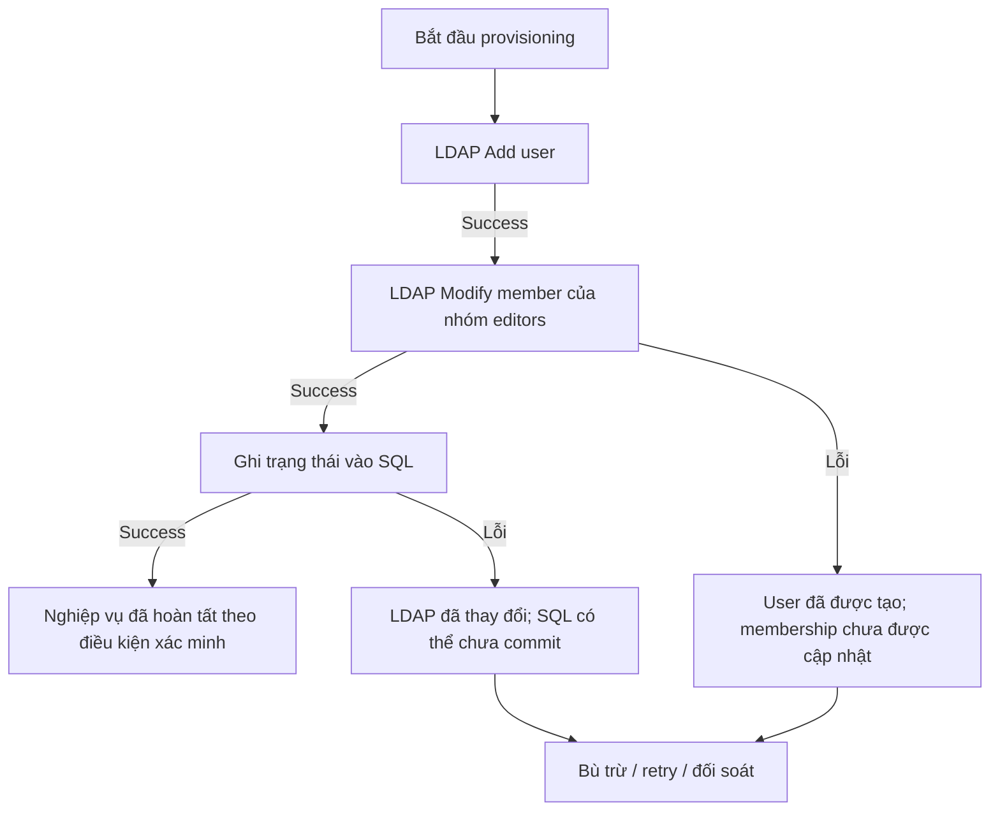
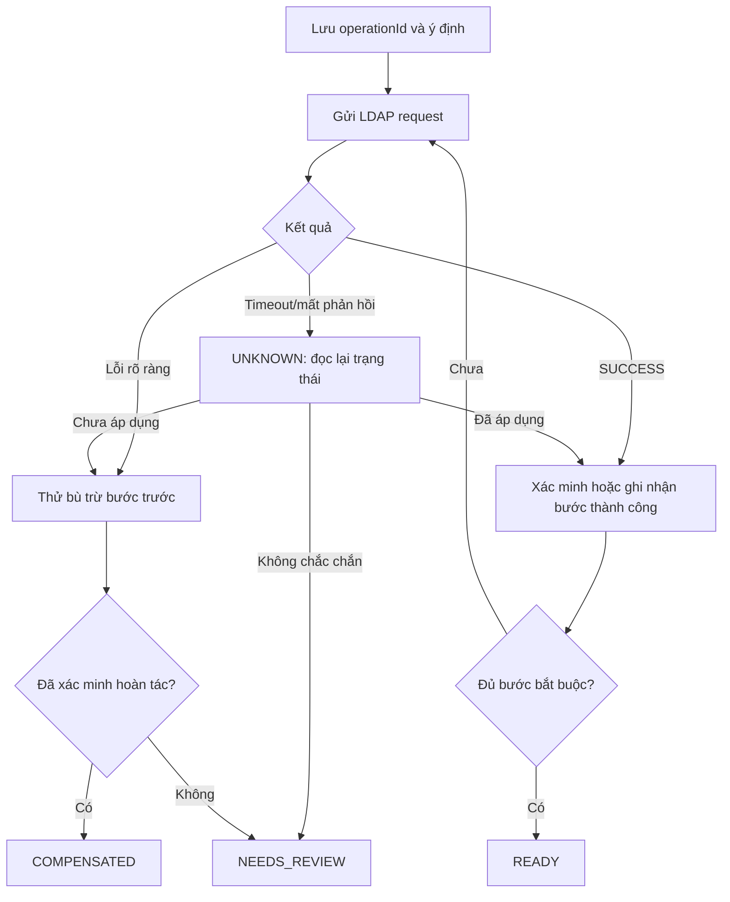
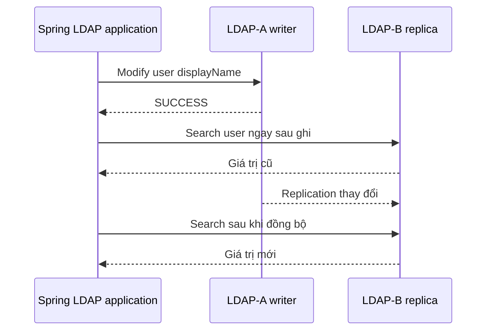

# Không hứa hẹn atomicity ngoài capability của directory

Khi phát triển ứng dụng **Spring LDAP**, người lập trình dễ nghĩ rằng một phương thức có `@Transactional` sẽ làm cho mọi thao tác với LDAP cùng thành công hoặc cùng rollback. Cách hiểu này có thể dẫn đến lỗi nghiêm trọng trong nghiệp vụ cấp tài khoản, thu hồi quyền và đồng bộ danh tính: một entry đã được thêm trong khi membership nhóm chưa được cập nhật, hoặc LDAP đã thay đổi nhưng database lại rollback.

Nguyên tắc quan trọng của chương **Transaction** là: **chỉ cam kết mức nguyên tử (*atomicity*) mà giao thức LDAP, máy chủ thư mục, client và cấu hình thực tế cùng hỗ trợ**. Nếu hệ thống chỉ hỗ trợ thao tác nguyên tử trên **một yêu cầu Modify của một entry**, ứng dụng không được mô tả chuỗi nhiều thao tác, nhiều entry, nhiều server hoặc nhiều hệ thống như một transaction ACID duy nhất.

Bài học vận dụng `LdapTemplate`, `LdapClient`, ODM, `ContextSource` và các cơ chế giao dịch liên quan trong Spring LDAP; đồng thời đưa ra cách xác minh capability của directory, thiết kế hợp đồng API, xử lý lỗi và kiểm thử truy cập thư mục an toàn.

## 1. Mục tiêu học tập

Sau bài này, người học có thể:

1. Phân biệt **atomicity**, **rollback**, **isolation**, **durability**, **replication consistency** và **idempotency**.
2. Chỉ rõ bảo đảm nguyên tử của một **LDAP ModifyRequest trên một entry** theo RFC 4511 và giới hạn khi thực hiện nhiều request.
3. Nhận biết LDAP Transactions extension (RFC 5805) là **tùy chọn** và cần được xác minh cả phía server lẫn phía client.
4. Giải thích vì sao `@Transactional`, `ContextSourceTransactionManager` và transaction synchronization không tự tạo atomic commit giữa LDAP với JDBC/JPA hoặc giữa nhiều LDAP server.
5. Thiết kế API và workflow không tuyên bố thành công khi còn bước chưa xác minh; xử lý các trạng thái `PENDING`, `PARTIAL` và `UNKNOWN`.
6. Xây dựng kiểm thử chứng minh giới hạn thực tế của directory, bao gồm lỗi lệnh thứ hai, timeout, failover, quyền truy cập và replication lag.

## 2. Đọc đúng những chữ “atomic” và “transaction”

**Atomicity** nghĩa là một nhóm thay đổi được xử lý **tất cả hoặc không thay đổi nào** trong phạm vi đã cam kết. Điều này khác các tính chất khác:

| Khái niệm | Câu hỏi cần trả lời | Ví dụ trong LDAP |
|---|---|---|
| Atomicity | Có thể thành công một phần trong **đơn vị thao tác đã cam kết** không? | Nhiều sửa đổi thuộc tính trong **cùng một ModifyRequest** của một entry |
| Rollback | Sau khi một bước đã thành công, hệ thống có cách hoàn tác không? | Gửi một Modify ngược hoặc Delete entry vừa Add |
| Isolation | Client khác có thể nhìn thấy trạng thái trung gian không? | Đọc thấy user đã tạo nhưng group chưa có member |
| Durability | Sau phản hồi thành công, dữ liệu được lưu bền vững theo chính sách nào? | Phụ thuộc bảo đảm và cấu hình server thư mục |
| Replication consistency | Khi một server nhận thay đổi, các server khác thấy khi nào? | LDAP-A trả SUCCESS nhưng LDAP-B vẫn trả dữ liệu cũ |
| Idempotency | Gửi lại thao tác sau lỗi mơ hồ có an toàn không? | Gửi lại Add có thể gặp `entryAlreadyExists` |

Các từ trên có liên quan nhưng **không thay thế nhau**. Một lần `Modify` nguyên tử trên một entry không tạo isolation giữa **nhiều request**. Một transaction bù trừ hoàn tất cũng không chứng minh các replica đã hội tụ. Một thao tác có thể thực thi lại an toàn không có nghĩa toàn bộ nghiệp vụ đã trở nên atomic.

### Phạm vi của lời cam kết

Cần ghi rõ **đơn vị** mà hệ thống đang bảo đảm:

- Một thuộc tính?
- Một yêu cầu `ModifyRequest`?
- Một entry?
- Nhiều entry trên cùng LDAP server?
- Nhiều server trong cùng cụm replication?
- Một nghiệp vụ gồm LDAP, SQL và hệ thống bên ngoài?

Không xác định đơn vị nghĩa là lời hứa “nguyên tử” thiếu nội dung kiểm chứng.

## 3. Ma trận capability: được phép dựa vào điều gì?

| Phạm vi hoặc tính năng | Bảo đảm có thể căn cứ | Những điều **không** được suy ra |
|---|---|---|
| Một `ModifyRequest` gồm nhiều thay đổi trên **một entry** | RFC 4511 quy định danh sách thay đổi của một yêu cầu Modify được áp dụng theo thứ tự, như **một thao tác nguyên tử** | Không làm nguyên tử các yêu cầu Modify tiếp theo |
| Hai `ModifyRequest` trên cùng entry | Mỗi request có kết quả riêng | Không có rollback chung mặc định |
| `Add` user rồi `Modify` group | Hai yêu cầu độc lập trong cách dùng LDAP thông thường | Không mặc nhiên “cùng thành công hoặc cùng thất bại” |
| `ModifyDN` và cập nhật các entry liên quan | Hành vi của từng thao tác/phần mở rộng và quy tắc server | Không bảo đảm mọi tham chiếu ứng dụng đều cập nhật nguyên tử |
| LDAP Transactions extension theo RFC 5805 | **Có thể** hỗ trợ transaction nhiều thao tác trong giới hạn extension nếu server và client triển khai | Không suy ra mọi LDAP server, Spring API hay mọi loại thao tác đều dùng được |
| Spring LDAP compensating transaction | Client thử thực hiện thao tác ngược khi rollback | Không phải rollback nguyên tử của server; có thể lỗi hoặc lộ trạng thái trung gian |
| `@Transactional` với JDBC/JPA | Manager đã chọn điều khiển transaction của database | LDAP không tự tham gia SQL transaction |
| `@TransactionalEventListener(AFTER_COMMIT)` | Chỉ chạy listener theo pha commit của transaction phù hợp | Không tạo atomic commit SQL–LDAP hoặc bảo đảm callback bền vững |
| LDAP replication | Thay đổi có thể được sao chép theo topology và chính sách server | Không bảo đảm tất cả replica nhìn thấy đồng thời |

**Điểm thực hành quan trọng:** Nếu một tính năng chỉ được nhà cung cấp server mô tả là “hỗ trợ transaction”, hãy tìm hiểu **đúng phạm vi** của bảo đảm: thao tác nào được phép, naming context nào áp dụng, các giới hạn số lượng/thời gian, kết quả khi crash và mối quan hệ với replication.

## 4. Bảo đảm rõ nhất: một ModifyRequest trên một entry

Theo LDAP RFC 4511, yêu cầu `Modify` chứa danh sách thay đổi được xử lý theo đúng thứ tự và **là một thao tác nguyên tử** trên entry đích. Nếu có một thay đổi làm yêu cầu không hợp lệ, server không được áp dụng riêng các thay đổi còn lại của **cùng request**.

Giả sử một entry có:

```ldif
dn: uid=lan,ou=people,dc=example,dc=org
objectClass: inetOrgPerson
uid: lan
cn: Lan Nguyen
sn: Nguyen
displayName: Lan Nguyen
telephoneNumber: 0900000000
```

Ứng dụng cần sửa `displayName` và `telephoneNumber` cùng lúc. Cách khai thác atomicity đã được LDAP định nghĩa là gộp chúng trong **một lần gọi** `LdapTemplate.modifyAttributes(...)` với nhiều `ModificationItem`.

```java
import javax.naming.Name;
import javax.naming.directory.BasicAttribute;
import javax.naming.directory.DirContext;
import javax.naming.directory.ModificationItem;

import org.springframework.ldap.core.LdapTemplate;
import org.springframework.ldap.support.LdapNameBuilder;
import org.springframework.stereotype.Service;

@Service
public class DirectoryProfileService {

    private final LdapTemplate ldapTemplate;

    public DirectoryProfileService(LdapTemplate ldapTemplate) {
        this.ldapTemplate = ldapTemplate;
    }

    public void updateContact(String uid, String name, String phone) {
        // Giả sử ContextSource có base dc=example,dc=org.
        Name relativeDn = LdapNameBuilder.newInstance("ou=people")
                .add("uid", uid)
                .build();

        ModificationItem[] changes = {
                new ModificationItem(
                        DirContext.REPLACE_ATTRIBUTE,
                        new BasicAttribute("displayName", name)),
                new ModificationItem(
                        DirContext.REPLACE_ATTRIBUTE,
                        new BasicAttribute("telephoneNumber", phone))
        };

        // Một LDAP ModifyRequest cho một entry.
        ldapTemplate.modifyAttributes(relativeDn, changes);
    }
}
```

Điều kiện thực thi: entry phải tồn tại, object class/schema cho phép thuộc tính, tài khoản bind phải có quyền thay đổi và giá trị đầu vào đã được kiểm tra phù hợp. `LdapNameBuilder` giúp tạo và escape thành phần DN; không ghép trực tiếp chuỗi do người dùng nhập vào DN.

### Sai khác nhỏ trong Java, sai khác lớn về bảo đảm

**Một request:**

```java
ldapTemplate.modifyAttributes(dn, new ModificationItem[] {
    replaceDisplayName,
    replaceTelephoneNumber
});
```

Nếu một sửa đổi trong request không hợp lệ, không được thành công riêng một phần sửa đổi của request đó.

**Hai request:**

```java
ldapTemplate.modifyAttributes(
    dn, new ModificationItem[] { replaceDisplayName });

ldapTemplate.modifyAttributes(
    dn, new ModificationItem[] { replaceTelephoneNumber });
```

Nếu lệnh thứ nhất thành công và lệnh thứ hai lỗi, thay đổi `displayName` **có thể còn nguyên** trên server.

Hai lời gọi ở trong cùng một phương thức Java, cùng một `LdapTemplate` hoặc cùng một kết nối không tự trở thành một đơn vị atomic. Việc thêm annotation `@Transactional` chỉ có hiệu quả theo **transaction manager, đường context và tính năng giao dịch cụ thể đã cấu hình**; không được suy rộng từ annotation.

### Thay đổi nhiều thuộc tính không có nghĩa thay đổi mọi thứ cùng lúc

Một `ModifyRequest` chỉ tác động đến **một DN đích**. Nó không cùng lúc tạo một user mới và sửa một group entry khác. Việc gộp thay đổi thuộc tính để đạt atomicity cấp entry là lựa chọn tốt khi đúng với mô hình dữ liệu, nhưng không thể dùng để giải quyết một thao tác liên entry mà giao thức không hỗ trợ theo cách đó.

## 5. Nghiệp vụ nhiều bước: một phần thành công là trạng thái có thật

Xét API tạo tài khoản và gán quyền:

1. `Add` user `uid=lan,ou=people,dc=example,dc=org`.
2. `Modify` nhóm `cn=editors,ou=groups,dc=example,dc=org` để thêm DN của Lan vào thuộc tính `member`.
3. Lưu trạng thái provisioning vào SQL.



| Lỗi xảy ra tại | Trạng thái có thể còn lại | Có được trả “tất cả đã rollback” không? |
|---|---|---|
| Add user bị từ chối rõ ràng | User không được tạo qua request lỗi | Không có căn cứ nói các hệ khác đã rollback |
| Modify group bị từ chối sau Add thành công | User tồn tại, chưa có membership mới | **Không** nếu chưa xác minh bù trừ |
| SQL commit thất bại sau khi hai lệnh LDAP thành công | LDAP đã thay đổi, SQL chưa lưu theo transaction | **Không** |
| LDAP timeout không nhận response | Không rõ server có chấp nhận request không | **Không**; phải đọc lại |
| Bù trừ Delete user thất bại | User có thể còn lại sau rollback logic | **Không** |
| Mọi bước thành công trên writer | Writer có trạng thái mới | Không được suy ra toàn bộ replica đã hội tụ |

### Ví dụ Java: hai thay đổi là hai request

```java
import javax.naming.Name;
import javax.naming.directory.Attributes;
import javax.naming.directory.BasicAttribute;
import javax.naming.directory.BasicAttributes;
import javax.naming.directory.DirContext;
import javax.naming.directory.ModificationItem;

import org.springframework.ldap.core.LdapTemplate;
import org.springframework.ldap.support.LdapNameBuilder;
import org.springframework.stereotype.Service;

@Service
public class DirectoryProvisioningService {

    private final LdapTemplate ldapTemplate;

    public DirectoryProvisioningService(LdapTemplate ldapTemplate) {
        this.ldapTemplate = ldapTemplate;
    }

    public void createUserAndGrantEditors(
            String uid, String commonName, String surname) {

        // Các DN truyền vào template là tương đối với
        // base dc=example,dc=org trên ContextSource.
        Name userDn = LdapNameBuilder.newInstance("ou=people")
                .add("uid", uid)
                .build();

        Name editorsDn = LdapNameBuilder.newInstance("ou=groups")
                .add("cn", "editors")
                .build();

        Name fullUserDn = LdapNameBuilder
                .newInstance("dc=example,dc=org")
                .add("ou", "people")
                .add("uid", uid)
                .build();

        Attributes attributes = new BasicAttributes(true);
        BasicAttribute classes = new BasicAttribute("objectClass");
        classes.add("top");
        classes.add("person");
        classes.add("organizationalPerson");
        classes.add("inetOrgPerson");
        attributes.put(classes);
        attributes.put("uid", uid);
        attributes.put("cn", commonName);
        attributes.put("sn", surname);

        // Request số 1: tạo entry người dùng.
        ldapTemplate.bind(userDn, null, attributes);

        // Request số 2: cập nhật một entry nhóm khác.
        ModificationItem addMember = new ModificationItem(
                DirContext.ADD_ATTRIBUTE,
                new BasicAttribute("member", fullUserDn.toString()));
        ldapTemplate.modifyAttributes(
                editorsDn, new ModificationItem[] { addMember });
    }
}
```

Ví dụ giả định người dùng chưa tồn tại, nhóm `editors` có schema chấp nhận `member`, các OU tồn tại và bind account đủ quyền. Một số directory dùng thuộc tính nhóm khác (ví dụ `uniqueMember`) nên cần điều chỉnh theo schema thực.

**Hợp đồng thực tế của phương thức này:** nếu cả hai lời gọi trở về thành công, writer đã xác nhận cả hai request; nếu một lời gọi ném lỗi, ứng dụng phải xác minh những request trước đó đã áp dụng gì. **Không thể hứa hai request atomic chỉ từ đoạn mã này**.

## 6. Kiểm tra capability của directory trước khi thiết kế transaction

Directory có thể cung cấp các tính năng qua chuẩn LDAP, extension và hành vi riêng của sản phẩm. **Không suy luận capability từ tên sản phẩm, từ việc dùng Spring LDAP hoặc từ một test duy nhất.**

### 6.1. Khảo sát root DSE và extension

LDAP root DSE thường công bố một số khả năng như `supportedExtension`, `supportedControl`, `supportedFeatures` và các naming context. Có thể đọc root DSE bằng công cụ LDAP client:

```bash
ldapsearch -x \
  -H "ldaps://ldap.example.org:636" \
  -s base -b "" \
  supportedExtension supportedControl supportedFeatures namingContexts
```

Ví dụ chỉ minh họa việc **đọc capability**. Tùy server và ACL, root DSE có thể không trả tất cả thuộc tính; một số máy chủ cần xác thực hoặc công bố capability theo cách riêng. Không in credential ra shell history, không tắt kiểm tra chứng chỉ TLS để “test cho nhanh”.

RFC 5805 mô tả **LDAP Transactions extension** với quy trình khởi tạo, gắn thao tác vào transaction và kết thúc transaction. Không đủ để chỉ biết server có extension: client phải **thực sự gửi các extended operation/control cần thiết**, và mọi thao tác nghiệp vụ phải nằm trong ranh giới extension cho phép.

**Cảnh báo:** `LdapTemplate` hay `LdapClient` không mặc nhiên kích hoạt RFC 5805. Việc thấy extension trong `supportedExtension` không chứng minh ứng dụng đang sử dụng extension.

### 6.2. Kiểm tra theo từng server và môi trường

Khi có nhiều node, cần kiểm tra capability và cấu hình của **những endpoint thực sự tham gia**:

- Server writer và replica có cùng phiên bản, schema, policy và quyền không?
- Có endpoint chỉ đọc, endpoint nhận ghi hay proxy định tuyến lại không?
- Một transaction phía server có giới hạn chỉ trong một connection hoặc naming context không?
- Server xử lý lỗi, mất kết nối, giới hạn thời gian và replication thế nào?
- Client/JNDI API đã hỗ trợ extension cần thiết chưa?
- Mọi lời gọi ứng dụng có đi qua đúng connection/context dùng cho transaction không?

Một tính năng được công bố bởi server A **không được tự động gán** cho B, nhất là khi cluster đang nâng cấp không đồng bộ hoặc failover đến một node có policy khác.

### 6.3. Bảng kiểm capability có bằng chứng

| Câu hỏi | Bằng chứng cần có | Nếu không có bằng chứng |
|---|---|---|
| Một Modify có nguyên tử trên entry đích? | Chuẩn RFC 4511, test thao tác hợp lệ và lỗi, hành vi server | Không suy rộng ra nhiều request |
| Transaction nhiều request có được hỗ trợ? | Tài liệu server, root DSE/extension, client implementation và integration test | Giả định **không có** transaction nhiều request |
| Rollback sau crash có được server bảo đảm? | Hợp đồng cụ thể của extension/sản phẩm và test lỗi | Thiết kế trạng thái `UNKNOWN`/đối soát |
| Replica có nhận thay đổi trước khi server trả SUCCESS? | Tài liệu replication và phép đo trên topology thật | Không hứa read-after-write giữa các replica |
| SQL và LDAP cùng commit nguyên tử? | Cơ chế điều phối transaction phân tán thật sự được tất cả tài nguyên hỗ trợ | Thiết kế workflow và trạng thái từng hệ |
| Bù trừ có thể thực hiện mọi thao tác ngược? | ACL/schema/đường kết nối và test rollback failure | Cần có quy trình phục hồi thủ công |

**Một hợp đồng sản phẩm chỉ nên chứa những bảo đảm có bằng chứng từ capability thực và phép thử phù hợp**, không viết theo kết quả mong muốn của người thiết kế.

## 7. Đúng vai trò của Spring Transaction và LDAP compensating transaction

### 7.1. `@Transactional` không tự chọn đúng tài nguyên

Trong ứng dụng có cả LDAP và SQL:

```java
@Transactional(transactionManager = "databaseTransactionManager")
public void updateEmployee() {
    // ... repository.save(...) thuộc SQL transaction
    // ... ldapTemplate.modifyAttributes(...) là LDAP request riêng
}
```

Chú thích chọn database transaction manager. Nếu `ldapTemplate.modifyAttributes(...)` thành công, nhưng transaction SQL rollback, thay đổi LDAP **có thể vẫn tồn tại**.

Nếu chỉ định `transactionManager = "ldapTransactionManager"` dùng `ContextSourceTransactionManager` phù hợp, cơ chế LDAP compensating transaction có thể **thử bù trừ** các lệnh đã thực hiện. Điều này khác rollback máy chủ: có nhiều yêu cầu ngược và có thể phát sinh lỗi trong quá trình bù trừ.

### 7.2. Cấu hình compensating transaction có điều kiện

Khi dự án sử dụng cơ chế này, thông thường:

- `ContextSourceTransactionManager` được tạo với `ContextSource` gốc.
- `TransactionAwareContextSourceProxy` bọc nguồn gốc.
- `LdapTemplate` (hoặc client được hỗ trợ) dùng **context đã bọc**.
- Phương thức service được gọi qua Spring AOP proxy để `@Transactional` thực sự áp dụng.
- Quy tắc rollback được cấu hình đúng với ngoại lệ của nghiệp vụ.

**Hạn chế bắt buộc phải công bố:**

1. Bù trừ là các thao tác LDAP mới, không có isolation giữa nhiều request.
2. Nếu network/ACL/schema thay đổi, thao tác ngược có thể thất bại.
3. Client khác có thể đã quan sát hoặc thay đổi entry trong lúc transaction logic diễn ra.
4. Dữ liệu đã đồng bộ sang replica có thể chỉ nhận được thao tác hoàn tác sau một khoảng trễ.
5. Bù trừ không tự tạo atomic commit chung giữa LDAP và SQL.

### 7.3. Transaction synchronization chỉ xác định thời điểm

`TransactionSynchronization` hoặc `@TransactionalEventListener(phase = AFTER_COMMIT)` có thể dùng để phát hành lệnh LDAP **sau khi SQL commit thành công**.

```java
@org.springframework.transaction.event.TransactionalEventListener(
    phase = org.springframework.transaction.event.TransactionPhase.AFTER_COMMIT
)
public void afterEmployeeCommitted(EmployeeChanged event) {
    // Đồng bộ LDAP sau khi transaction nguồn đã commit.
    // LDAP vẫn có thể lỗi; SQL không thể rollback tại thời điểm này.
}
```

Kể cả khi callback chạy thành công, nó không bảo đảm transaction giữa SQL và LDAP nguyên tử. Callback cũng không mặc nhiên được lưu bền vững nếu ứng dụng dừng giữa SQL commit và lúc xử lý callback.

Với dữ liệu quan trọng như identity và quyền truy cập, cần ghi một **outbox event trong cùng SQL transaction** và có worker xử lý, retry, đối soát thay vì dựa hoàn toàn vào callback trong bộ nhớ.

## 8. Khi không có atomicity nhiều request: thiết kế workflow an toàn

Nếu nghiệp vụ bắt buộc thực hiện nhiều yêu cầu LDAP, phải thừa nhận khả năng tồn tại **trạng thái trung gian**.

### 8.1. Mô hình trạng thái rõ ràng

Ví dụ chức năng cấp quyền có thể sử dụng:

| Trạng thái | Ý nghĩa cần kiểm chứng |
|---|---|
| `PENDING` | Đã tiếp nhận yêu cầu, chưa xác nhận các bước LDAP |
| `USER_CREATED` | Đã xác nhận entry user trên writer |
| `GROUP_UPDATED` | Đã xác nhận cập nhật membership trên writer |
| `READY` | Những điều kiện bắt buộc của nghiệp vụ đã được xác minh |
| `COMPENSATING` | Đang thử đưa các thay đổi về trạng thái an toàn |
| `PARTIAL` | Một số bước đã thành công nhưng có bước bắt buộc thất bại |
| `UNKNOWN` | Có request không rõ đã áp dụng do timeout hoặc mất phản hồi |
| `NEEDS_REVIEW` | Không thể tự đối soát/xử lý an toàn |

Các tên trạng thái này là **mẫu thiết kế ứng dụng**, không phải trạng thái có sẵn trong LDAP/Spring LDAP. Không nên chuyển sang `READY` chỉ vì không bắt gặp exception trong một đoạn code có nhiều side effect.

Nếu quyền editors là điều kiện trước khi truy cập hệ thống, phải quyết định hành vi trong `PENDING`/`PARTIAL`/`UNKNOWN` theo nguyên tắc **không cấp quyền khi chưa xác minh điều kiện bắt buộc**.

### 8.2. Nhật ký bước và bù trừ



Trước khi có thể bù trừ, ứng dụng cần biết **trạng thái trước thay đổi** và **ai sở hữu thay đổi**. Chẳng hạn:

- Nếu entry đã tồn tại trước operation, không được Delete entry chỉ để rollback nghiệp vụ mới.
- Nếu membership đã có từ trước, không được xóa nó như thao tác ngược.
- Nếu client khác vừa sửa `displayName` sau operation, khôi phục snapshot cũ có thể ghi đè thay đổi hợp lệ.
- Nếu Delete entry có thuộc tính không thể đọc lại, việc Add entry mới không chắc hoàn nguyên đầy đủ.

Đối với các thao tác cần khôi phục sau restart, nhật ký thao tác phải được lưu **bền vững**, có operation ID, bước, DN, trạng thái, kết quả kiểm chứng và số lần retry; không lưu bí mật không cần thiết. Kết quả LDAP và nhật ký SQL vẫn có thể có khoảng thời gian không đồng bộ: phải có cơ chế xử lý **UNKNOWN**.

### 8.3. Retry an toàn không đồng nghĩa atomicity

```text
send LDAP Add
  -> client timeout
  -> server có thể đã tạo entry
  -> retry Add mù quáng
  -> có thể nhận entryAlreadyExists
```

Thay vì coi timeout là thất bại chắc chắn, hãy đọc lại bằng endpoint ghi thích hợp rồi xác định:

- Entry đã tồn tại từ trước hay do operation này tạo?
- Giá trị thuộc tính đã đạt trạng thái mong muốn chưa?
- Có dấu vết operation/version để phân biệt thay đổi cũ và mới không?
- Có xung đột từ client khác hoặc thay đổi chưa sao chép xong không?

Với thuộc tính đơn trị, `REPLACE_ATTRIBUTE` bằng giá trị đích rõ ràng thường thuận lợi hơn cho retry so với thao tác cộng dồn. Với membership đa trị, chỉ Add/Delete đúng giá trị cần điều chỉnh, đọc trước khi ghi và cân nhắc assertion control nếu server/client hỗ trợ. **Read-then-write không tự cung cấp isolation**, vì client khác có thể ghi giữa hai thao tác.

## 9. Giới hạn xuyên nhiều LDAP server

Một LDAP server trả `SUCCESS` không đồng nghĩa tất cả server khác đã nhận thay đổi. Với topology writer và replica, có thể xuất hiện:



Sơ đồ mô tả **một khả năng**, không phải một thời hạn replication cụ thể. Mức nhất quán phụ thuộc server và cấu hình.

Cần phân biệt hai câu:

- “LDAP writer đã xác nhận thay đổi.” — có thể suy từ phản hồi SUCCESS hợp lệ của writer.
- “Tất cả LDAP server đã có cùng dữ liệu.” — **không thể suy** chỉ từ phản hồi SUCCESS của writer.

Bài toán thu hồi quyền đặc biệt nhạy cảm: một replica chậm cập nhật membership có thể tiếp tục trả giá trị cũ. Ứng dụng quyết định authorization phải có chính sách endpoint, độ mới, cache/token và hành vi an toàn khi chưa rõ trạng thái.

Ngay cả khi server hỗ trợ RFC 5805, không được tự suy ra giao dịch phía server **đồng thời commit trên mọi replica**. Phải kiểm tra bảo đảm replication độc lập.

## 10. Viết hợp đồng API trung thực với capability

Một lỗi thiết kế phổ biến là API trả:

```json
{
  "success": true,
  "message": "User và toàn bộ LDAP cluster đã cập nhật nguyên tử"
}
```

trong khi implementation chỉ gửi hai request độc lập tới một writer. Đây là **lời hứa sai phạm vi** và dễ khiến hệ thống gọi dựa trên trạng thái chưa được xác minh.

Với workflow gồm nhiều bước, có thể công bố trạng thái tường minh hơn:

```json
{
  "operationId": "onboard-2026-001",
  "status": "PENDING",
  "completedSteps": ["CREATE_USER"],
  "pendingSteps": ["ADD_GROUP_MEMBERSHIP"]
}
```

Khi đã xác minh các bước bắt buộc:

```json
{
  "operationId": "onboard-2026-001",
  "status": "READY",
  "verifiedOn": "ldap-writer",
  "details": "User và membership đã được kiểm tra trên endpoint ghi"
}
```

Các payload trên **chỉ minh họa hợp đồng ứng dụng**, không phải định dạng chuẩn LDAP. Nếu chỉ xác minh trên writer, trường `verifiedOn` phải thể hiện rõ điều đó; không nói “cluster đã đồng bộ” khi các replica chưa được kiểm tra.

Trong những nghiệp vụ an toàn, ứng dụng còn nên trả về **ID để truy vấn trạng thái** và hướng dẫn retry theo operation ID; tránh mỗi lần người dùng bấm lại tạo một nghiệp vụ mới.

### Phân biệt các mức cam kết thực tế

| Cách nói trong API/tài liệu | Chỉ dùng khi |
|---|---|
| “Yêu cầu Modify đã được server X chấp nhận” | Đã nhận phản hồi thành công từ X |
| “Hai bước LDAP đã hoàn tất trên writer” | Từng bước đã được xác nhận; nếu có điều kiện cần thiết, đã đọc lại writer |
| “Nghiệp vụ đã sẵn sàng” | Toàn bộ điều kiện bắt buộc để vận hành an toàn đã đạt |
| “Thay đổi đã đến replica Y” | Đã xác minh trạng thái/version trên Y |
| “Rollback thành công” | Đã kiểm tra lại trạng thái của mọi thay đổi cần phục hồi trong phạm vi tuyên bố |
| “Atomic giữa LDAP và SQL” | Chỉ khi có cơ chế thực sự hỗ trợ và kiểm chứng đúng phạm vi; đừng tuyên bố dựa vào `@Transactional` |
| “Chưa rõ kết quả” | Timeout/mất phản hồi hoặc trạng thái chưa thể xác minh, cần đối soát |

## 11. Checklist trước khi đưa một guarantee vào tài liệu kỹ thuật

- [ ] Đã xác định **đơn vị nguyên tử**: request, entry, nhiều entry, server hay nhiều hệ thống.
- [ ] Đã phân biệt tính chất của **LDAP RFC 4511** với extension hoặc behavior riêng của sản phẩm.
- [ ] Nếu cần transaction nhiều request, đã xác minh server và client cùng hỗ trợ extension/cơ chế đó, có test trên server triển khai.
- [ ] Đã xác định rõ transaction manager của Spring và `ContextSource` mà `LdapTemplate`/`LdapClient`/ODM sử dụng.
- [ ] Không giả định `@Transactional` của JPA sẽ rollback LDAP.
- [ ] Nếu dùng compensating transaction, đã kiểm thử cả trường hợp **thao tác ngược thất bại**.
- [ ] Đã xác định nơi phản hồi SUCCESS có ý nghĩa: writer nào, replica nào, naming context nào.
- [ ] Đã thiết kế timeout, trạng thái `UNKNOWN`, retry có điều kiện, kiểm tra trạng thái và đối soát.
- [ ] Quy trình cấp/thu hồi quyền không mặc định thành công khi LDAP chưa xác minh.
- [ ] Có TLS được xác thực, service account đủ quyền cần thiết nhưng không mở rộng ACL tùy tiện.
- [ ] API, log, tài liệu vận hành và dashboard dùng đúng mức cam kết đã được kiểm chứng.
- [ ] Có test chịu lỗi mạng, replication lag, failover và xung đột đồng thời khi ứng dụng phụ thuộc các tình huống này.

## 12. Kiểm thử khả năng thực tế của directory

Không dùng một mock `LdapTemplate` làm bằng chứng về atomicity. Mock chỉ xác nhận mã Java đã gọi phương thức nào; nó không thể chứng minh LDAP server đã áp dụng từng thay đổi, client khác thấy gì hay replica đã hội tụ.

### 12.1. Bộ kiểm thử chức năng và lỗi

| Ca thử | Thiết lập | Kết quả phải đánh giá |
|---|---|---|
| Một ModifyRequest hợp lệ | Thay đổi hai thuộc tính trên cùng entry | Cả hai thay đổi đã áp dụng |
| Một ModifyRequest có thành phần không hợp lệ | Thêm một thay đổi vi phạm schema/ACL trong cùng request | Không có thay đổi riêng lẻ nào của request lỗi được áp dụng |
| Hai ModifyRequest, lỗi ở request thứ hai | Request đầu hợp lệ; request sau bị từ chối | Request đầu có thể còn, không hứa rollback chung |
| Add user thành công, Modify group bị từ chối | Nhóm thiếu quyền ghi hoặc bị cấu hình lỗi | User có thể còn; xác minh có bù trừ và kết quả thực |
| Timeout khi Add hoặc Modify | Cắt phản hồi sau khi server có thể đã xử lý | Trạng thái `UNKNOWN`; đọc lại trước retry |
| Transaction bù trừ bị gián đoạn | Mất kết nối hoặc thiếu quyền khi hoàn tác | Có thể còn dữ liệu trung gian; phát hiện và đối soát |
| SQL rollback sau LDAP ghi | Gọi LDAP trong service JPA transaction, tạo lỗi SQL | LDAP không tự rollback cùng SQL |
| SQL commit, LDAP callback lỗi | Đồng bộ qua `AFTER_COMMIT` rồi gây lỗi LDAP | SQL vẫn đã commit; worker cần phục hồi |
| Writer A thành công, replica B chậm | Ghi A rồi đọc B trước và sau replication | Quan sát stale read và độ trễ |
| Hai writer sửa cùng entry | Tạo xung đột có kiểm soát | Phân tích quy tắc giải quyết xung đột của directory |

### 12.2. Quy trình đo và xác minh

1. Chuẩn bị một LDAP server thử nghiệm hoặc cụm replica, với schema và ACL tương đương môi trường thực tế.
2. Ghi lại **trạng thái trước** của user, group và thuộc tính liên quan.
3. Gửi đúng số lượng request dự kiến và gây lỗi ở một điểm đã xác định; ghi nhận DN, endpoint, mã kết quả và thời điểm.
4. Đọc lại dữ liệu bằng **một kết nối LDAP độc lập** tới server đã ghi, rồi đến replica nếu test có replication.
5. Với các ca timeout, không tự đánh dấu request là thất bại; so sánh trạng thái thực với trạng thái mong muốn.
6. Đánh giá chính sách retry, bù trừ, chống ghi đè và trạng thái nghiệp vụ cuối.
7. Dọn dữ liệu theo mã operation ID, chỉ xóa những entry được bài test tạo và sở hữu.

Tài liệu test cần phân biệt **“yêu cầu rollback đã phát”**, **“lệnh ngược trả SUCCESS”** và **“thư mục đã được xác minh ở trạng thái mong muốn”**.

### 12.3. Khung test có assertion đọc lại

```java
// Pseudocode theo cấu trúc JUnit: cần wiring LDAP test server,
// fixture và DirectoryProbe riêng cho môi trường thử nghiệm.
@Test
void failedSecondRequestDoesNotImplyAtomicRollback() {
    String uid = "atomicity-test-001";
    seedUser(uid);

    updateFirstAttributeSuccessfully(uid);

    assertThrows(
        RuntimeException.class,
        () -> updateSecondAttributeWithInvalidValue(uid));

    // Phải kiểm tra trạng thái thực; failure ở request thứ hai
    // không chứng minh request đầu đã rollback.
    assertTrue(directoryProbe.firstChangeIsStillPresent(uid));
}
```

Ví dụ là **khung bài kiểm thử**, không phải mã có thể chạy độc lập. Các hàm `seedUser`, `updateFirstAttributeSuccessfully`, `updateSecondAttributeWithInvalidValue` và `DirectoryProbe` cần được triển khai và phụ thuộc schema/server cụ thể. Không chỉ dừng ở `assertThrows`: điều cần chứng minh là trạng thái cuối trên thư mục.

## 13. Hướng thiết kế khi nghiệp vụ thật sự đòi hỏi “all or nothing”

Nếu yêu cầu “tạo user và gán group phải đồng thời có hiệu lực” không được directory bảo đảm ở mức nhiều entry, có thể cân nhắc thay đổi **mô hình nghiệp vụ**:

**Lựa chọn A — Thu hẹp đơn vị thay đổi.** Nếu thuộc tính phải cập nhật có thể thuộc **cùng một entry**, gộp trong một ModifyRequest. Chỉ thực hiện khi mô hình schema và ngữ nghĩa nghiệp vụ cho phép; không cố đưa dữ liệu không đúng nơi chỉ để né transaction.

**Lựa chọn B — Tài khoản có trạng thái chờ.** Tạo user ở trạng thái chưa được kích hoạt/cấp quyền, cập nhật membership, kiểm tra điều kiện rồi mới cho phép truy cập. Phải xác định trạng thái kích hoạt được hệ thống xác thực thực sự kiểm tra, cách xử lý replication và thao tác rollback nếu bước cuối lỗi.

**Lựa chọn C — Workflow có bù trừ và đối soát.** Ghi nhật ký bền vững các bước, thiết kế thao tác ngược có điều kiện, retry, phát hiện conflict và chuyển `NEEDS_REVIEW` khi không tự khôi phục được.

**Lựa chọn D — Transactional outbox giữa SQL và LDAP.** Khi SQL là nguồn dữ liệu chuẩn, lưu dữ liệu nghiệp vụ và sự kiện đồng bộ trong cùng SQL transaction; worker xử lý LDAP theo kiểu có thể lặp, xác minh và đối soát. Cách này đạt **ý định đồng bộ bền vững**, chấp nhận eventual consistency giữa các hệ thống.

**Lựa chọn E — Extension transaction có thật.** Chỉ áp dụng nếu đã xác minh đúng sản phẩm, đúng version, đúng client, đúng topology, giới hạn operation và cơ chế failure mà nghiệp vụ yêu cầu. Không viết mã giả định extension được sử dụng chỉ vì server có công bố hỗ trợ.

Mọi lựa chọn đều phải gắn với yêu cầu bảo mật. Với nghiệp vụ thu hồi quyền, “cấp quyền chưa đồng bộ” và “thu hồi quyền chưa đồng bộ” có mức độ rủi ro khác nhau; cần quy định hành vi an toàn phù hợp.

## 14. Bài tập thực hành

Triển khai chức năng **“Tạo nhân viên và gán quyền editors”** trên một LDAP server thử nghiệm:

1. Dùng `LdapTemplate` thực hiện một ModifyRequest với hai thuộc tính thuộc entry người dùng; cho một thuộc tính lỗi và kiểm tra toàn bộ request không áp dụng một phần.
2. Tách hai thay đổi thành **hai request**, gây lỗi ở request thứ hai và quan sát request đầu còn tồn tại.
3. Tạo user mới rồi thêm DN vào nhóm. Chặn thao tác Modify nhóm và mô tả dữ liệu còn lại nếu không bù trừ.
4. Cấu hình và kiểm thử `ContextSourceTransactionManager` với `TransactionAwareContextSourceProxy` nếu phiên bản Spring LDAP và môi trường có hỗ trợ; phân biệt rollback bù trừ với transaction ACID.
5. Đọc root DSE để thu thập capability, xác minh trong tài liệu server khả năng RFC 5805 nếu có. Chỉ kết luận hỗ trợ transaction nhiều request sau khi client sử dụng thực sự và test vượt qua.
6. Mô phỏng timeout ngay sau khi server nhận một request. Cài đặt trạng thái `UNKNOWN` và kiểm tra LDAP trước retry.
7. Viết hợp đồng API trả `PENDING`, `READY`, `PARTIAL` hoặc `NEEDS_REVIEW` dựa trên trạng thái đã xác minh.
8. Nếu có hai LDAP replica, kiểm tra khác biệt đọc/ghi và sửa tuyên bố thành công để phản ánh chính xác endpoint đã được kiểm tra.
9. Nếu có SQL, thiết kế outbox và nêu chính xác điều nó bảo đảm, điều nó không bảo đảm.

**Yêu cầu nộp bài:** Một bảng **claim → capability → bằng chứng → giới hạn**, ít nhất ba integration test có assertion trạng thái trên LDAP và phần giải thích về cách xử lý an toàn khi bù trừ hoặc đồng bộ không thành công.

## 15. Ghi nhớ

**Atomicity luôn có phạm vi.** Trong cách dùng LDAP thông thường, bảo đảm rõ nhất là một `ModifyRequest` gồm nhiều thay đổi trên **một entry**; một loạt lệnh LDAP, nhiều entry, nhiều replica hoặc một nghiệp vụ SQL–LDAP cần những cơ chế khác và không thể mặc nhiên nhận cùng bảo đảm.

Spring LDAP mang đến các API truy cập thư mục và hỗ trợ transaction bù trừ ở phía client; Spring Framework cho phép quản lý transaction SQL và đăng ký synchronization callback. Cả hai không tự biến hệ thống thành một **distributed ACID transaction**. Khi không có capability phù hợp, hãy thiết kế theo **trạng thái xác minh được, idempotency, bù trừ có điều kiện, retry, đối soát và hợp đồng API trung thực**.

### Tài liệu tham khảo

- [RFC 4511 — Lightweight Directory Access Protocol (LDAP): The Protocol](https://www.rfc-editor.org/rfc/rfc4511): ngữ nghĩa `Modify Operation` và các yêu cầu LDAP.
- [RFC 5805 — LDAP Transactions](https://www.rfc-editor.org/rfc/rfc5805): extension giao dịch tùy chọn cho LDAP server và client tương thích.
- [RFC 4533 — LDAP Content Synchronization Operation](https://www.rfc-editor.org/rfc/rfc4533): đồng bộ nội dung LDAP; không tự tạo phép đọc nhất quán mạnh.
- [Spring LDAP — Reference Documentation](https://docs.spring.io/spring-ldap/reference/): `ContextSource`, `LdapTemplate`, DN, LDAP access, transaction support theo phiên bản.
- [Spring Framework — Declarative Transaction Management](https://docs.spring.io/spring-framework/reference/data-access/transaction/declarative.html): phạm vi `@Transactional` và quy tắc rollback.
- [Spring Framework — Transaction-bound Events](https://docs.spring.io/spring-framework/reference/data-access/transaction/event.html): `@TransactionalEventListener` và các pha của transaction.
- Tài liệu **đúng sản phẩm LDAP đang triển khai**: khả năng giao dịch nhiều request, schema/ACL, replication, failover và giới hạn khi mất kết nối.
