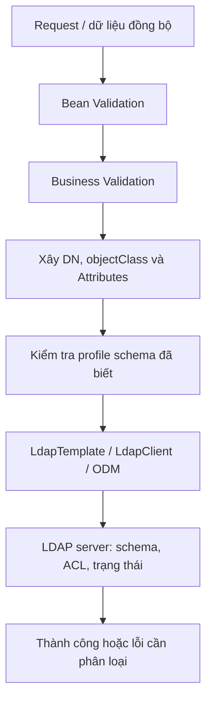

# Validation dữ liệu nghiệp vụ với schema validation

Khi ứng dụng làm việc với thư mục LDAP bằng **Spring LDAP**, một dữ liệu “hợp lệ” có thể mang nhiều ý nghĩa khác nhau. Một địa chỉ email đúng định dạng chưa chắc thuộc tên miền doanh nghiệp được phép; một entry thỏa mãn quy tắc tạo tài khoản chưa chắc thỏa LDAP schema; và một entry đúng schema vẫn có thể bị server từ chối vì thiếu quyền hoặc trùng DN. Vì vậy, **validation dữ liệu nghiệp vụ** và **schema validation** cần phối hợp, nhưng chúng không thể thay thế cho nhau.

Bài thuộc chương **Validation** của module **SPRING_LDAP**. Mục tiêu là thiết kế luồng kiểm tra khi tạo hoặc sửa entry qua `LdapTemplate`, `LdapClient` hoặc ODM: kiểm tra dữ liệu API, áp dụng quy tắc nghiệp vụ, đối chiếu object class/attribute với schema và xử lý kết quả từ LDAP server. Ví dụ minh họa sử dụng Java 17+, Jakarta Bean Validation và `LdapTemplate`; giả sử `ContextSource` đã cấu hình base DN `dc=example,dc=org`.

## 1. Ba lớp kiểm tra phục vụ ba mục đích khác nhau

Giả sử hệ thống quản lý nhân sự tạo tài khoản `inetOrgPerson` dưới `ou=people,dc=example,dc=org`. Request chứa `uid`, `cn`, `sn`, `mail` và cờ `emailNotificationsEnabled`.

| Lớp | Kiểm tra những gì? | Ví dụ | Ai quyết định? |
| --- | --- | --- | --- |
| **Input/Bean Validation** | Kiểu dữ liệu, `null`, chuỗi rỗng, độ dài, định dạng cơ bản | `uid` chỉ gồm ký tự cho phép; `cn` không rỗng; `mail` có dạng email | Hợp đồng API của ứng dụng |
| **Business Validation** | Quy tắc giữa các trường, trạng thái và ngữ cảnh nghiệp vụ | Bật nhận thông báo thì `mail` phải có; email tài khoản thuộc miền `example.org`; chỉ cho phép tạo trong nhánh `ou=people` | Miền nghiệp vụ và chính sách sản phẩm |
| **LDAP Schema Validation** | Object class, `MUST`/`MAY`, kiểu cú pháp attribute, số lượng giá trị, quy tắc schema | `inetOrgPerson` kế thừa `cn` và `sn` bắt buộc từ `person`; attribute `SINGLE-VALUE` không nhận nhiều giá trị | Schema của LDAP directory |

Ngoài ba lớp này, **LDAP server còn kiểm tra ACL, trạng thái thư mục và cạnh tranh đồng thời**. Các kiểm tra đó thường chỉ xác định chính xác được tại thời điểm thao tác.



Một nguyên tắc quan trọng: **kiểm tra sớm để phản hồi tốt và giảm lời gọi không cần thiết, nhưng luôn để server thực thi ràng buộc cuối cùng**.

### 1.1. Phân biệt “bắt buộc theo nghiệp vụ” và “bắt buộc theo schema”

Với schema phổ biến của `inetOrgPerson`:

- `cn` và `sn` là attribute bắt buộc (`MUST`) vì được kế thừa từ object class `person`.
- `uid` và `mail` thường là attribute được phép (`MAY`), nhưng ứng dụng mẫu **bắt buộc có `uid`** để làm RDN.
- `mail` chỉ **bắt buộc theo nghiệp vụ** khi `emailNotificationsEnabled=true`; nếu tắt thông báo, `mail` có thể không được cung cấp.
- `emailNotificationsEnabled` là dữ liệu quyết định quy tắc nghiệp vụ, **không nhất thiết là attribute LDAP**. Trong ví dụ, cờ này được xử lý tại ứng dụng và không ghi vào entry.

Có thể hình dung tập thuộc tính cần có trước khi tạo entry:

```text
RequiredLDAPAttributes =
    SchemaMUST(objectClass + chuỗi SUP)
    ∪ BusinessRequiredLDAPAttributes(context)
```

Đồng thời, tập attribute mà API cho phép ghi phải nằm trong **giao của những thuộc tính schema cho phép và allowlist của ứng dụng**. Tuy nhiên, việc có quyền ghi thật sự vẫn phụ thuộc ACL và các quy tắc phía server.

## 2. Vì sao một lớp validation không đủ?

Xét bốn tình huống sau:

| Input hoặc thao tác | Bean Validation | Business Validation | LDAP schema/server | Kết luận |
| --- | --- | --- | --- | --- |
| `mail=alice@external.org`, thông báo bật | Email có dạng hợp lệ | Từ chối vì không thuộc miền doanh nghiệp | Schema có thể cho phép `mail` | Lỗi nghiệp vụ |
| `uid=alice`, thiếu `sn` | Có thể qua nếu DTO thiếu annotation | Có thể không phát hiện | `person` yêu cầu `sn` | Lỗi schema cần bắt sớm |
| `uid=alice`, `cn` và `sn` đầy đủ, DN đã tồn tại | Qua | Qua | Server báo tên đã tồn tại | Lỗi trạng thái đồng thời/dữ liệu |
| Ghi thêm `employeeNumber` từ request tự do | Có thể có chuỗi hợp lệ | API có thể không cho phép sửa | Schema/ACL tùy directory | Kiểm soát bằng allowlist |

Vì vậy, không nên coi annotation `@Email` là kiểm tra chính sách tên miền, cũng không coi việc `@NotBlank` thành công là bằng chứng entry thỏa toàn bộ schema.

## 3. Thiết kế hợp đồng cho một kiểu entry cụ thể

Một profile cho `inetOrgPerson` nên mô tả rõ:

| Thành phần | Quy tắc của ứng dụng mẫu | Nguồn quy tắc |
| --- | --- | --- |
| DN của entry | `uid=<uid>,ou=people` tính từ base của `ContextSource` | Nghiệp vụ/phân vùng thư mục |
| Object classes | `top`, `person`, `organizationalPerson`, `inetOrgPerson` | Profile schema |
| `cn`, `sn` | Bắt buộc, không trắng, tối đa 128 ký tự theo API | Schema MUST + hợp đồng API |
| `uid` | Bắt buộc, 1–64 ký tự thuộc `[A-Za-z0-9._-]` | Nghiệp vụ/định danh RDN |
| `mail` | Tùy chọn; nếu có phải là email hợp lệ, thuộc `example.org` | Nghiệp vụ |
| Bật thông báo email | Phải có `mail` hợp lệ | Quy tắc giữa các trường |
| Tên attribute được ghi | Chỉ `objectClass`, `uid`, `cn`, `sn`, `mail` | Application allowlist |

Giới hạn 64/128 ký tự ở đây là **quy tắc ví dụ**, không phải giới hạn mặc định của LDAP. Schema directory thực tế còn có thể chứa các ràng buộc khác, kể cả quy tắc nội dung DIT hoặc schema mở rộng.

### 3.1. Kế thừa và kiểu object class

Trong LDAP, các lớp có thể là `ABSTRACT`, `STRUCTURAL` hoặc `AUXILIARY`. Một entry `inetOrgPerson` thuộc chuỗi kế thừa structural class:

```text
top [ABSTRACT]
  └─ person [STRUCTURAL]               MUST: cn, sn
      └─ organizationalPerson          kế thừa cn, sn
          └─ inetOrgPerson             kế thừa cn, sn
```

Để tính `MUST` đúng, cần xét cả các class cha trong `SUP`, không chỉ phần khai báo tại class cuối. `MAY` chỉ cho biết attribute có thể được schema cho phép: **không tự động cấp quyền cho API hoặc tài khoản dịch vụ**.

Thêm một auxiliary class cũng không phải cách hợp lệ để vượt qua kiểm tra theo ý muốn. Trước tiên phải xem schema server có hỗ trợ kết hợp class đó và các ràng buộc kèm theo không. Tương tự, không trộn các structural class không nằm trong một chuỗi kế thừa phù hợp.

## 4. Triển khai kết hợp Bean Validation và nghiệp vụ trong Java

Ví dụ dưới đây kiểm tra yêu cầu trong service **trước khi** gọi LDAP. Phần annotation dùng `jakarta.validation.*` (phù hợp với các ứng dụng Spring hiện đại sử dụng Jakarta Validation); cần có provider Bean Validation, chẳng hạn Hibernate Validator, để `Validator` hoạt động.

### 4.1. DTO thể hiện hợp đồng đầu vào

```java
import jakarta.validation.constraints.Email;
import jakarta.validation.constraints.NotBlank;
import jakarta.validation.constraints.Pattern;
import jakarta.validation.constraints.Size;

public record NewDirectoryPerson(
        @NotBlank
        @Pattern(regexp = "[A-Za-z0-9._-]{1,64}")
        String uid,

        @NotBlank
        @Size(max = 128)
        String cn,

        @NotBlank
        @Size(max = 128)
        String sn,

        @Email
        @Size(max = 254)
        String mail,

        boolean emailNotificationsEnabled
) {}
```

Các annotation xử lý ràng buộc đơn giản. Tuy nhiên, annotation `@Email` không thể tự nói rằng địa chỉ phải thuộc miền `example.org` hoặc chỉ bắt buộc khi bật thông báo. Đó là công việc của business validation.

Trong Spring MVC, controller có thể nhận `@Valid @RequestBody NewDirectoryPerson request` để phản hồi sớm cho request HTTP sai. Dù vậy, **service vẫn phải bảo vệ hợp đồng của mình** nếu còn được gọi từ batch job, message consumer hoặc luồng không qua HTTP.

### 4.2. Service chuẩn bị DN và Attributes sau khi validation

```java
import java.util.Locale;
import java.util.Set;
import jakarta.validation.ConstraintViolation;
import jakarta.validation.Validator;
import javax.naming.directory.Attribute;
import javax.naming.directory.Attributes;
import javax.naming.directory.BasicAttribute;
import javax.naming.directory.BasicAttributes;
import javax.naming.ldap.LdapName;

import org.springframework.ldap.core.LdapTemplate;
import org.springframework.ldap.support.LdapNameBuilder;

public final class DirectoryPersonService {
    private final Validator beanValidator;
    private final LdapTemplate ldapTemplate;

    public DirectoryPersonService(
            Validator beanValidator,
            LdapTemplate ldapTemplate) {
        this.beanValidator = beanValidator;
        this.ldapTemplate = ldapTemplate;
    }

    private record PreparedEntry(LdapName dn, Attributes attrs) {}

    public void create(NewDirectoryPerson request) {
        PreparedEntry prepared = prepare(request);
        // Chỉ có lời gọi server sau khi tất cả validation cục bộ qua.
        ldapTemplate.bind(prepared.dn(), null, prepared.attrs());
    }

    private PreparedEntry prepare(NewDirectoryPerson request) {
        if (request == null) {
            throw new IllegalArgumentException("Thiếu thông tin tài khoản");
        }

        Set<ConstraintViolation<NewDirectoryPerson>> violations =
                beanValidator.validate(request);
        if (!violations.isEmpty()) {
            throw new IllegalArgumentException(
                    "Dữ liệu không thỏa hợp đồng đầu vào");
        }

        // Business rule có điều kiện giữa hai trường.
        String mail = request.mail();
        boolean hasMail = mail != null && !mail.isBlank();
        if (request.emailNotificationsEnabled() && !hasMail) {
            throw new IllegalArgumentException(
                    "Phải có mail khi bật thông báo");
        }

        if (hasMail) {
            // Không tự ý sửa khoảng trắng/case của local-part.
            if (!mail.equals(mail.strip())) {
                throw new IllegalArgumentException(
                        "mail chứa khoảng trắng ở đầu hoặc cuối");
            }
            int at = mail.lastIndexOf('@');
            if (at < 1
                    || !mail.substring(at + 1)
                            .toLowerCase(Locale.ROOT)
                            .equals("example.org")) {
                throw new IllegalArgumentException(
                        "mail phải thuộc miền example.org");
            }
        }

        rejectControlChars(request.cn(), "cn");
        rejectControlChars(request.sn(), "sn");

        // App chọn object classes, không nhận class tùy ý từ request.
        Attributes attrs = new BasicAttributes(true);
        Attribute objectClasses = new BasicAttribute("objectClass");
        objectClasses.add("top");
        objectClasses.add("person");
        objectClasses.add("organizationalPerson");
        objectClasses.add("inetOrgPerson");
        attrs.put(objectClasses);
        attrs.put("uid", request.uid());
        attrs.put("cn", request.cn());
        attrs.put("sn", request.sn());
        if (hasMail) {
            attrs.put("mail", mail);
        }

        // Nhánh cố định, DN tương đối với base của ContextSource.
        LdapName relativeDn = LdapNameBuilder.newInstance()
                .add("ou", "people")
                .add("uid", request.uid())
                .build();

        return new PreparedEntry(relativeDn, attrs);
    }

    private static void rejectControlChars(String value, String field) {
        if (value.codePoints().anyMatch(Character::isISOControl)) {
            throw new IllegalArgumentException(
                    field + " chứa ký tự điều khiển");
        }
    }
}
```

Giả sử cấu hình `ContextSource` có `base=dc=example,dc=org`, `relativeDn` ở trên biểu diễn `uid=alice,ou=people`, không kèm base một lần nữa.

Ví dụ lời gọi hợp lệ:

```java
service.create(new NewDirectoryPerson(
        "alice",
        "Alice Nguyen",
        "Nguyen",
        "alice@example.org",
        true));
```

Nếu thay email thành `alice@partner.org`, `@Email` có thể vẫn cho qua vì đúng định dạng, nhưng lớp nghiệp vụ sẽ từ chối **trước khi `ldapTemplate.bind` chạy**. Nếu bỏ `sn`, `@NotBlank` phát hiện sớm ràng buộc cũng được `person` yêu cầu trong schema.

> **Giới hạn của ví dụ:** Service mô tả profile cố định của một ứng dụng. Nó không tự truy vấn toàn bộ LDAP schema, không xác minh tồn tại DN trước `bind`, cũng không cam kết server cho phép ghi. Việc không “kiểm tra trước” trùng DN tránh tạo cảm giác an toàn sai: hai luồng có thể cùng vượt qua kiểm tra tồn tại, và chỉ server mới phân xử kết quả `bind`.

## 5. Thêm schema validation cục bộ ở mức profile

Với ứng dụng chỉ có một vài loại entry, có thể duy trì một **schema profile đã biết** trong code:

| Profile | Object classes do service gán | MUST do schema | Required thêm theo ứng dụng | Attribute được API ghi |
| --- | --- | --- | --- | --- |
| Person | `top/person/organizationalPerson/inetOrgPerson` | `cn`, `sn` | `uid` | `uid`, `cn`, `sn`, `mail` |
| Group | `top/groupOfNames` | `cn`, `member` | Quy tắc nhóm thuộc phòng ban | `cn`, `member` |
| Organizational unit | `top/organizationalUnit` | `ou` | Mã OU hợp lệ theo tổ chức | `ou`, một số thuộc tính được cho phép |

Với profile Person, trình tự kiểm tra thường là:

1. **Xác định loại entry** được nghiệp vụ yêu cầu; service tự chọn bộ `objectClass`.
2. **Xác định các `MUST` kế thừa**: `cn` và `sn`.
3. **Hợp nhất quy tắc nghiệp vụ**: `uid` là bắt buộc; `mail` cần có nếu bật thông báo.
4. **Chỉ tạo attribute được cho phép**; không chuyển một `Map<String,Object>` từ request thành `Attributes` một cách trực tiếp.
5. **Kiểm tra số lượng và kiểu giá trị** theo hợp đồng và schema: một số attribute là `SINGLE-VALUE`, một số hỗ trợ nhiều giá trị.
6. **Xây DN từ giá trị RDN đã kiểm tra**; không ghép DN hoặc search filter bằng chuỗi.

Lưu ý khi diễn giải `MUST`: một attribute có thể có nhiều giá trị tùy định nghĩa `attributeType`; không được suy luận rằng mọi `MUST` đều chỉ có một giá trị. Ngược lại, attribute có `SINGLE-VALUE` cần tối đa một giá trị, kể cả khi chính tên attribute đó thuộc `MAY`.

### 5.1. Khác biệt giữa kiểm tra profile và phân tích schema đầy đủ

**Kiểm tra profile** là lựa chọn thực tế khi directory và kiểu entry được kiểm soát: dễ kiểm thử và giúp ứng dụng đưa ra lỗi sớm. Nhưng profile có thể lệch khi server thay đổi schema.

Nếu cần hỗ trợ nhiều directory hoặc schema mở rộng, ứng dụng có thể đọc **subschema** mà server công bố, thường tìm DN của schema qua attribute vận hành `subschemaSubentry`, rồi phân tích các định nghĩa `objectClasses`, `attributeTypes` và những ràng buộc liên quan. Khi làm như vậy cần tính chuỗi `SUP`, tên/OID/alias, `MUST`/`MAY`, `SINGLE-VALUE`, syntax và các quy tắc bổ sung được server hỗ trợ.

Tuy nhiên, không phải server nào cũng cấp quyền đọc schema hoặc cung cấp metadata giống nhau. Schema còn có thể thay đổi khi ứng dụng đang chạy. Dù cache schema, server vẫn là thẩm quyền cuối cùng; **không dùng schema cache làm bằng chứng chắc chắn cho phép ghi**.

## 6. Validation khi sửa entry: kiểm tra trạng thái sau thay đổi

Đối với thao tác **create**, ta kiểm tra tập attribute chuẩn bị ghi. Đối với **update**, bài toán khó hơn: kết quả cuối cùng có thể phụ thuộc entry đang tồn tại trên server.

Ví dụ:

- Xóa `sn` khỏi một `inetOrgPerson` có thể khiến entry không còn thỏa `MUST`.
- Đổi `mail` trong khi ứng dụng đang bật chức năng thông báo đòi hỏi cập nhật tính hợp lệ của cả hai điều kiện.
- Đổi `objectClass` có thể làm thay đổi tập `MUST`/`MAY` được phép; đây thường là thao tác quản trị cần quyền và kiểm tra riêng.
- Sửa `uid` khi `uid` là RDN không giống sửa một attribute thông thường; phải xem xét quy trình đổi tên DN và tính nhất quán của attribute đặt tên.

Mẫu tư duy cho update:

```text
Trạng thái entry dự kiến sau thay đổi
      = Trạng thái đọc được + tập thao tác modify

Kiểm tra domain invariants trên trạng thái dự kiến
      + Kiểm tra schema profile cho trạng thái đó
      -> Gửi modify / modifyDN
      -> Server đánh giá trạng thái thực tại thời điểm ghi
```

Đừng chỉ kiểm tra từng trường trong bản vá độc lập rồi bỏ qua các ràng buộc giữa chúng. Nếu ứng dụng cần kiểm tra nhất quán theo trạng thái hiện tại, phải thiết kế cho khả năng **dữ liệu thay đổi giữa lần đọc và lần ghi**. Có thể dùng cơ chế điều kiện/điều phối phù hợp với directory và nghiệp vụ nếu server hỗ trợ, nhưng không được giả định một thao tác đọc trước đó tạo ra transaction LDAP xuyên nhiều yêu cầu.

### 6.1. Giữ khác biệt giữa `null`, “không được gửi” và “xóa giá trị”

Trong API `PATCH`, ba ý nghĩa này thường khác nhau:

| Trạng thái field | Ý nghĩa có thể có trong API | Hành động cần quyết định rõ |
| --- | --- | --- |
| Không xuất hiện | Không thay đổi | Không tạo thao tác modify |
| Có giá trị hợp lệ | Thay bằng giá trị mới | Xác minh format, domain, schema trước khi gửi |
| Yêu cầu xóa | Xóa attribute | Cấm nếu là `MUST` hoặc vi phạm ràng buộc nghiệp vụ |

Nếu dùng DTO với tất cả field nullable, `null` rất dễ bị hiểu nhầm là “không thay đổi” hoặc “xóa”. Hãy biểu diễn rõ ý định của request; việc chọn quy tắc PATCH là trách nhiệm của API, không phải của LDAP schema.

## 7. Xử lý lỗi server sau validation

Một entry vượt qua mọi kiểm tra phía Java vẫn có thể thất bại ở LDAP server. Một số LDAP result code đáng chú ý:

| LDAP result code | Ý nghĩa thường gặp | Hướng xử lý |
| --- | --- | --- |
| `objectClassViolation` (65) | Vi phạm ràng buộc object class/MUST/MAY | Kiểm tra profile, schema server và dữ liệu ghi; sửa hợp đồng nếu thiếu |
| `constraintViolation` (19) | Vi phạm ràng buộc do server áp dụng | Xác định ràng buộc cụ thể; không mặc định lỗi chỉ do định dạng |
| `entryAlreadyExists` (68) | DN đích đã tồn tại | Xử lý xung đột tạo mới; không dựa vào kiểm tra tồn tại trước khi ghi |
| `insufficientAccessRights` (50) | Tài khoản LDAP không có quyền cần thiết | Xem lại ACL và quyền tài khoản dịch vụ |
| `noSuchObject` (32) | Entry hoặc ancestor cần thiết không tồn tại | Kiểm tra DN, parent, base và thay đổi đồng thời |

Spring LDAP có hệ thống chuyển đổi lỗi JNDI/LDAP sang exception của Spring LDAP. Tầng service hoặc adapter nên **phân loại theo nhóm lỗi thực tế**, thay vì bắt mọi exception rồi gán chung thành “request không hợp lệ”:

- **Lỗi hợp đồng request/nghiệp vụ**: có thể phản hồi cho caller với field và quy tắc bị vi phạm.
- **Lỗi xung đột**: phản hồi theo chính sách API, ví dụ trạng thái conflict cho DN đã tồn tại.
- **Lỗi schema**: nếu do request sai, làm rõ ràng buộc có thể sửa; nếu do sai lệch profile/configuration, cần điều tra ở tầng hệ thống.
- **Lỗi kết nối, TLS, bind, quyền truy cập**: chuyển cho xử lý vận hành phù hợp và không lộ thông tin nhạy cảm của directory.

Log nên chứa mã lỗi, operation, correlation ID và loại entry, không ghi mật khẩu, secret hoặc toàn bộ attribute chứa dữ liệu cá nhân. Không hiển thị thông điệp thô của LDAP server trực tiếp cho người dùng cuối nếu có thể làm lộ cấu trúc thư mục.

## 8. Kiểm thử phối hợp nhiều lớp validation

### 8.1. Unit test: trường hợp sai nghiệp vụ không gọi LDAP

Đoạn test dùng Jakarta Bean Validation với một provider, JUnit 5 và Mockito. Khi dữ liệu hợp lệ về cú pháp nhưng sai miền email, cần xác minh `LdapTemplate` không bị gọi:

```java
import jakarta.validation.Validation;
import jakarta.validation.Validator;
import org.junit.jupiter.api.Test;
import org.springframework.ldap.core.LdapTemplate;

import static org.junit.jupiter.api.Assertions.assertThrows;
import static org.mockito.Mockito.mock;
import static org.mockito.Mockito.verifyNoInteractions;

class DirectoryPersonServiceTest {
    @Test
    void validEmailSyntaxButWrongDomainNeverCallsLdap() {
        try (var factory =
                     Validation.buildDefaultValidatorFactory()) {
            Validator validator = factory.getValidator();
            LdapTemplate template = mock(LdapTemplate.class);
            var service =
                    new DirectoryPersonService(validator, template);

            assertThrows(IllegalArgumentException.class, () ->
                    service.create(new NewDirectoryPerson(
                            "alice", "Alice Nguyen", "Nguyen",
                            "alice@external.org", true)));

            verifyNoInteractions(template);
        }
    }
}
```

Thêm ca test với `mail=null` và `emailNotificationsEnabled=true` để xác minh ràng buộc giữa trường. Với `sn=""`, cần xác minh Bean Validation bắt lỗi. Những trường hợp này phải **dừng trước I/O**.

> Đoạn code dùng `ValidatorFactory` trong try-with-resources khi phiên bản Jakarta Validation/provider triển khai `AutoCloseable`; khi tích hợp vào Spring, thông thường framework quản lý bean `Validator`, không tạo factory cho từng request.

### 8.2. Bộ test case nên có

| Tình huống | Kỳ vọng ở ứng dụng | Cần test trên server? |
| --- | --- | --- |
| `uid` chứa dấu phẩy, `sn` thiếu | Bị Bean Validation từ chối, không gọi LDAP | Không |
| `mail` đúng cú pháp nhưng ngoài miền doanh nghiệp | Bị Business Validation từ chối | Không |
| Bật thông báo nhưng thiếu email | Bị Business Validation từ chối | Không |
| `uid/cn/sn` hợp lệ, không có `mail`, tắt thông báo | Qua validation cục bộ | Có, khi kiểm thử tạo entry |
| Entry thiếu `sn`, cố ý bypass validator bằng fixture LDAP | Server từ chối do schema `person` | Có |
| Attribute không thuộc object class/profile | Cục bộ từ chối theo allowlist; server có thể từ chối theo schema | Có cho schema thực |
| Tạo hai entry cùng DN đồng thời | Local validation có thể cùng qua; một thao tác gặp xung đột tại server | Có |
| Sửa entry xóa `sn` | Nên chặn trước I/O; server phải giữ bất biến schema | Có |
| Tài khoản dịch vụ không có quyền ghi | Kiểm tra cục bộ không đủ | Có, với tài khoản test có ACL phù hợp |

### 8.3. Integration test cần xác minh điều gì?

Sử dụng LDAP server dành cho test, với schema và ACL tương đương môi trường mục tiêu ở mức cần thiết. Kiểm tra đường đi từ `ContextSource` qua `LdapTemplate`/`LdapClient` đến server:

1. Tạo entry hợp lệ và đọc lại `objectClass`, `cn`, `sn`, `uid`.
2. Bypass validator ứng dụng bằng test fixture để xác minh server vẫn từ chối entry thiếu `MUST` và vi phạm kiểu/số lượng giá trị.
3. Thử các quy tắc nghiệp vụ ở lớp service để bảo đảm chúng chặn I/O; không buộc server chịu trách nhiệm về chính sách tên miền email.
4. Kiểm tra tạo trùng DN, thiếu parent, quyền đọc/ghi và thay đổi đồng thời.
5. Với schema mở rộng, đối chiếu profile ứng dụng với định nghĩa thực của directory và phát hiện sai lệch sau khi nâng cấp.

## 9. Checklist triển khai

- [ ] Phân loại từng ràng buộc thuộc **input**, **business** hay **LDAP schema**; xác định lớp chịu trách nhiệm.
- [ ] Dùng Bean Validation cho định dạng, `null`, độ dài; dùng service/domain validation cho quy tắc liên trường và ngữ cảnh.
- [ ] Định nghĩa profile object class cho từng loại entry; tính `MUST` kế thừa và attribute được phép.
- [ ] Không cho request gửi tùy ý `objectClass`, tên attribute hoặc DN; dựng các thành phần LDAP bằng API chuyên dụng.
- [ ] Thực hiện tất cả kiểm tra cục bộ trước lời gọi `LdapTemplate`, `LdapClient` hoặc ODM.
- [ ] Với update, xét **trạng thái entry sau thay đổi**, giữ phân biệt không cập nhật và xóa attribute.
- [ ] Không giả định kiểm tra tồn tại hoặc schema cache trước khi ghi loại bỏ cạnh tranh đồng thời.
- [ ] Bảo vệ thông tin nhạy cảm trong exception, response và log.
- [ ] Viết unit test xác minh đầu vào không hợp lệ không gọi server.
- [ ] Viết integration test với schema/ACL của LDAP test; xử lý đúng các lỗi phía server.

**Điểm cần nhớ:** Bean Validation trả lời “dữ liệu có đúng hợp đồng đầu vào không?”, business validation trả lời “thao tác này có phù hợp quy tắc của hệ thống không?”, còn LDAP schema validation trả lời “entry có phù hợp mô hình thư mục không?”. Trong Spring LDAP, kết hợp ba lớp trước và tại thời điểm gửi yêu cầu giúp ứng dụng phát hiện lỗi sớm mà vẫn tôn trọng server là nguồn xác nhận cuối cùng.
