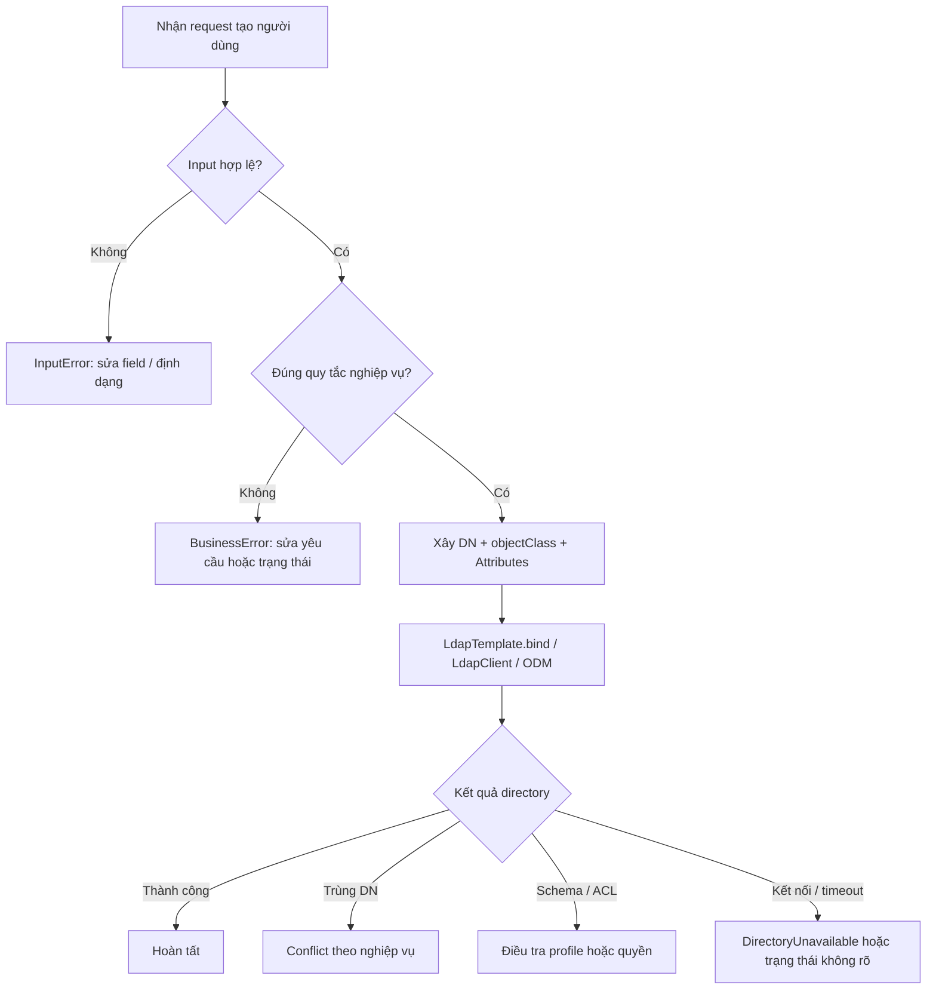

# Phân biệt lỗi input với lỗi directory

Trong ứng dụng dùng **Spring LDAP**, một thao tác không thành công có thể xuất phát từ dữ liệu người dùng sai, quy tắc nghiệp vụ bị vi phạm, schema của LDAP không chấp nhận entry, tài khoản dịch vụ thiếu quyền, hoặc server không thể kết nối. Nếu mọi tình huống đều bị chuyển thành thông báo chung “dữ liệu không hợp lệ”, người dùng sẽ không biết phải sửa gì, còn nhóm vận hành khó phát hiện lỗi thực sự.

Bài học thuộc chương **Validation** của module **SPRING_LDAP**, tập trung vào cách **phân biệt lỗi input với lỗi directory** khi sử dụng `ContextSource`, `LdapTemplate`, `LdapClient` hoặc ODM. Ví dụ giả định ứng dụng quản lý người dùng tại base DN `dc=example,dc=org`, dùng nhánh `ou=people` và object class `inetOrgPerson`. Các ví dụ Java minh họa Spring LDAP cùng Java 17+, không thay thế quy tắc schema hay chính sách quyền của LDAP server cụ thể.

## 1. Hai câu hỏi cần trả lời khi xảy ra lỗi

Không nên chỉ hỏi “exception tên gì?”. Hãy tách hai câu hỏi:

1. **Lỗi được phát hiện ở đâu?** Trước lời gọi mạng tại ứng dụng (input/domain validation), hay sau lời gọi tại LDAP server / đường truyền (directory failure)?
2. **Ai có thể khắc phục lỗi?** Người gọi API phải chỉnh request; nhà phát triển phải sửa mapping/schema profile; quản trị viên phải sửa ACL/cấu hình; hay hệ thống cần đợi directory phục hồi?

Hai trục này **không hoàn toàn trùng nhau**. Chẳng hạn, server trả `objectClassViolation` là **lỗi phát hiện tại directory**, nhưng nguyên nhân có thể là ứng dụng bỏ sót `sn` khi dựng entry. Tương tự, server trả `invalidCredentials` có thể là người dùng nhập sai mật khẩu **trong luồng đăng nhập**, hoặc là cấu hình mật khẩu tài khoản dịch vụ bị sai **trong luồng truy cập directory**.

| Tình huống | Nơi phát hiện | Nguyên nhân cần phân tích | Hành động phù hợp |
| --- | --- | --- | --- |
| `uid` rỗng hoặc chứa ký tự bị cấm | Ứng dụng | Input không đúng hợp đồng API | Trả lỗi có tên field, không gọi LDAP |
| DN do request cung cấp nằm ngoài nhánh được phép | Ứng dụng | Vi phạm chính sách phạm vi thao tác | Từ chối trước I/O; không dùng DN tùy ý |
| Tạo `inetOrgPerson` thiếu `sn` | Ứng dụng nếu validator đủ; nếu không thì server | Sai hợp đồng schema/profile | Chặn sớm; nếu server phát hiện thì xem lại mã dựng entry |
| DN đích đã tồn tại | LDAP server | Trạng thái directory hoặc yêu cầu tạo trùng | Xử lý xung đột hoặc tính idempotent theo nghiệp vụ |
| Tài khoản service bị từ chối quyền ghi | LDAP server | ACL/chính sách quyền | Điều tra quyền/cấu hình, không bắt client sửa `cn` |
| Kết nối TLS lỗi hoặc directory timeout | Kết nối/server | Hạ tầng, chứng chỉ, mạng hoặc tải | Log/monitor, xử lý lỗi phụ thuộc tạm thời |

**Nguyên tắc:** Mã lỗi LDAP mô tả kết quả mà server quan sát; lỗi trả cho người dùng cuối nên dựa trên **ngữ cảnh thao tác** và **nguyên nhân có thể khắc phục**, không dựa máy móc vào một chuỗi exception.

## 2. Luồng xử lý: phát hiện sớm, rồi phân loại phản hồi directory

Một luồng tạo người dùng nên trông như sau:



Một lỗi **input** là lỗi mà hợp đồng của ứng dụng có thể nhận biết **trước** lời gọi LDAP. Khi đã gửi request, những lỗi phát sinh từ server, mạng và việc giải mã phản hồi được ghi nhận ở **ranh giới directory adapter**. Sau đó service gán ý nghĩa nghiệp vụ cho lỗi: ví dụ một lỗi “đã tồn tại” có thể được trả thành xung đột tạo mới, trong khi lỗi schema thường cần nhà phát triển điều tra.

### 2.1. Input validation bao gồm những gì?

Với API tạo `inetOrgPerson`, các kiểm tra cục bộ có thể gồm:

- `uid`, `cn`, `sn` phải có giá trị; giới hạn độ dài và tập ký tự là chính sách do API định nghĩa.
- Chỉ cho phép tạo người dùng trong `ou=people`; ứng dụng tự xây DN bằng `LdapNameBuilder`.
- `cn` và `sn` phải được chuẩn bị cho schema `person`; `uid` dùng làm RDN theo chính sách ứng dụng.
- Trường `mail` nếu có phải đúng hợp đồng định dạng/miền nghiệp vụ.
- Không cho request tự gửi `objectClass`, tên attribute hay thuộc tính đặc quyền như `userPassword` khi endpoint không dành cho thao tác đó.
- Nếu dùng search, các giá trị filter phải được truyền qua API xây filter; không nối chuỗi biểu thức LDAP từ input thô.

Tầng này có thể dùng Jakarta Bean Validation (`@NotBlank`, `@Size`, `@Pattern`, `@Email`) kết hợp validator nghiệp vụ. **Đi qua Bean Validation chưa có nghĩa entry sẽ được server chấp nhận**: LDAP schema, ACL, DN tồn tại và cạnh tranh đồng thời vẫn phải được đánh giá sau đó.

### 2.2. Khi nào lỗi directory không phải lỗi input?

Ví dụ, một request hợp lệ yêu cầu tạo `uid=alice`, nhưng một luồng khác đã tạo entry đó trước. Ứng dụng không thể cam kết tránh xung đột chỉ bằng `lookup` trước `bind`: hai luồng vẫn có thể cùng thấy “chưa có” rồi cùng ghi. Đây là **xung đột trạng thái tại directory**, không phải lỗi định dạng `uid`.

Tương tự, server có thể trả schema violation dù `cn`/`sn` đã qua validation cục bộ: directory có schema mở rộng hoặc ứng dụng chọn sai object class. Không nên trả “người dùng nhập sai tên” khi bằng chứng chỉ ra **profile ứng dụng đã lệch schema triển khai**.

## 3. Những LDAP result code thường gặp và cách diễn giải

LDAP có các **result code** được chuẩn hóa cho phản hồi thao tác. Spring LDAP thường chuyển exception JNDI/LDAP thành các exception runtime tương ứng; tên exception cụ thể và khả năng nhận diện có thể phụ thuộc phiên bản thư viện, JNDI provider, loại server và cách adapter xử lý nguyên nhân gốc.

| LDAP result code | Mã số | Ý nghĩa điển hình | Phân loại ưu tiên ở ứng dụng |
| --- | ---: | --- | --- |
| `invalidDNSyntax` | 34 | DN gửi tới server có cú pháp không hợp lệ | Lỗi lập trình/xây DN nếu API đã phải validate; xem input path nếu DN được cho phép nhập trực tiếp |
| `objectClassViolation` | 65 | Thiếu MUST, class sai hoặc attribute không phù hợp schema | Sai schema profile/dữ liệu entry; điều tra trước khi quy trách nhiệm cho client |
| `constraintViolation` | 19 | Vi phạm ràng buộc phía server | Cần xem constraint cụ thể; có thể là nghiệp vụ server hoặc dữ liệu |
| `entryAlreadyExists` | 68 | DN được tạo đã tồn tại | Xung đột trạng thái; cân nhắc 409 với API tạo mới |
| `noSuchObject` | 32 | Entry hoặc ancestor cần thiết không tồn tại | Với tra cứu có thể là không tìm thấy; với tạo mới có thể parent/configuration sai |
| `insufficientAccessRights` | 50 | LDAP identity không đủ quyền thao tác | ACL/identity; thường là lỗi cấu hình service nếu service bind dùng tài khoản kỹ thuật |
| `invalidCredentials` | 49 | Bind không được chấp nhận | Đăng nhập người dùng: xác thực thất bại; bind tài khoản service: lỗi cấu hình/xác thực nội bộ |
| `timeLimitExceeded` | 3 | Vượt giới hạn thời gian xử lý phía server | Lỗi truy vấn/quota/tải; không tự động gán input sai |
| `sizeLimitExceeded` | 4 | Vượt giới hạn số kết quả trả về | Thiết kế search/paging hoặc policy server; có thể đã có kết quả từng phần |
| `busy` / `unavailable` | 51 / 52 | Server bận hoặc không sẵn sàng | Lỗi phụ thuộc/hạ tầng, đánh giá khả năng retry |
| `unwillingToPerform` | 53 | Server từ chối thực thi theo chính sách | Cần ngữ cảnh cụ thể; không mặc định là sai request |

**Lưu ý:** `noSuchObject` không nhất thiết xuất hiện khi một truy vấn tìm kiếm trả về **0 entry**. Tìm kiếm thành công với danh sách rỗng khác với việc gửi search base không tồn tại hoặc gặp lỗi LDAP. Khi `LdapTemplate.search(...)` trả danh sách rỗng, service cần diễn giải theo nghĩa nghiệp vụ; không tự bịa một exception directory.

### 3.1. Một result code có thể dẫn tới phản hồi API khác nhau

Trường hợp `invalidCredentials` minh họa rõ nhất:

```text
POST /login
  -> thử bind bằng danh tính người dùng
  -> LDAP invalidCredentials
  -> thất bại xác thực người dùng (ví dụ HTTP 401)

POST /users
  -> service dùng tài khoản ứng dụng để bind tới LDAP
  -> LDAP invalidCredentials
  -> sự cố credential/configuration của service
     (không trả 401 để yêu cầu client nhập lại mật khẩu LDAP của service)
```

Quy tắc phân loại phải biết **LDAP identity đang được dùng**, mục đích của operation và hợp đồng API. Điều này đặc biệt quan trọng khi Spring Security hoặc các quy trình xác thực LDAP sử dụng bind riêng, còn CRUD entry dùng một tài khoản dịch vụ khác.

## 4. Thiết kế mã lỗi của ứng dụng: rõ trách nhiệm, không rò rỉ thông tin

Một cách làm hữu ích là định nghĩa **các nhóm lỗi ổn định theo nghiệp vụ** thay cho việc để controller phụ thuộc trực tiếp vào nhiều exception của thư viện LDAP:

| Nhóm lỗi ứng dụng | Ví dụ điều kiện | Ai xử lý tiếp? | Khả năng retry tự động |
| --- | --- | --- | --- |
| `INPUT_INVALID` | `uid` sai format, `sn` trống | Client sửa request | Không, nếu request không đổi |
| `BUSINESS_RULE_VIOLATION` | Email không thuộc miền được phép | Client/nghiệp vụ | Không, nếu điều kiện không đổi |
| `ENTRY_CONFLICT` | Create gặp DN đã tồn tại | Client hoặc logic idempotency | Không retry mù quáng |
| `ENTRY_NOT_FOUND` | API cần sửa/xóa một entry đã mất | Client hoặc điều phối nghiệp vụ | Theo hợp đồng thao tác |
| `DIRECTORY_SCHEMA_MISMATCH` | LDAP từ chối object class/attribute do service dựng | Nhóm phát triển/vận hành | Không retry với payload y hệt |
| `DIRECTORY_PERMISSION_DENIED` | Tài khoản service không được ghi | Vận hành/ACL | Không retry cho đến khi quyền thay đổi |
| `DIRECTORY_UNAVAILABLE` | Kết nối/TLS/server bận | Hạ tầng/điều phối | Có điều kiện; nhất là cần thận trọng với ghi |
| `DIRECTORY_OPERATION_FAILED` | Lỗi directory chưa phân loại | Nhóm vận hành | Chỉ sau khi hiểu lỗi |

Những nhóm này có thể được biểu diễn thành enum, sealed type hoặc exception ứng dụng. Quan trọng hơn tên class là giữ **cause gốc** cho log nội bộ, kèm **mã lỗi ổn định** cho API và **thông điệp thân thiện** cho người dùng.

Ví dụ payload lỗi input:

```json
{
  "code": "INPUT_INVALID",
  "message": "Thông tin người dùng chưa hợp lệ",
  "fieldErrors": [
    { "field": "uid", "message": "Chỉ được dùng chữ, số, dấu chấm, gạch dưới và gạch ngang" }
  ]
}
```

Ví dụ payload khi directory tạm thời không truy cập được:

```json
{
  "code": "DIRECTORY_UNAVAILABLE",
  "message": "Chưa thể thực hiện yêu cầu lúc này",
  "correlationId": "req-7c21"
}
```

Giá trị `correlationId` ở trên chỉ để minh họa: ứng dụng nên tạo hoặc chuyển tiếp mã truy vết riêng, không lấy từ thông điệp lỗi LDAP. Không gửi nguyên `exception.getMessage()` về phía client vì nó có thể chứa DN, hostname, chi tiết bind, filter hoặc thông tin nhạy cảm.

## 5. Ví dụ Java: tách validation trước I/O khỏi phân loại lỗi LDAP

Ví dụ sau minh họa API **tạo** người dùng. Những giá trị giới hạn chỉ là **chính sách của ứng dụng mẫu**, không phải quy tắc chung của LDAP. Giả sử `ContextSource` đã có base `dc=example,dc=org` và entry `ou=people` tồn tại.

```java
import java.util.regex.Pattern;
import javax.naming.directory.Attribute;
import javax.naming.directory.Attributes;
import javax.naming.directory.BasicAttribute;
import javax.naming.directory.BasicAttributes;
import javax.naming.ldap.LdapName;

import org.springframework.ldap.CommunicationException;
import org.springframework.ldap.NameAlreadyBoundException;
import org.springframework.ldap.NamingException;
import org.springframework.ldap.NoPermissionException;
import org.springframework.ldap.SchemaViolationException;
import org.springframework.ldap.core.LdapTemplate;
import org.springframework.ldap.support.LdapNameBuilder;

public final class PersonDirectoryService {
    private static final Pattern UID =
            Pattern.compile("[A-Za-z0-9._-]{1,64}");

    private final LdapTemplate ldapTemplate;

    public PersonDirectoryService(LdapTemplate ldapTemplate) {
        this.ldapTemplate = ldapTemplate;
    }

    public record NewPerson(String uid, String cn, String sn) {}

    public enum FailureKind {
        ENTRY_CONFLICT,
        DIRECTORY_SCHEMA_MISMATCH,
        DIRECTORY_PERMISSION_DENIED,
        DIRECTORY_UNAVAILABLE,
        DIRECTORY_OPERATION_FAILED
    }

    public static final class DirectoryFailure extends RuntimeException {
        private final FailureKind kind;

        public DirectoryFailure(FailureKind kind, Throwable cause) {
            super(kind.name(), cause);
            this.kind = kind;
        }

        public FailureKind kind() {
            return kind;
        }
    }

    public void create(NewPerson input) {
        // Input validation và dựng entry đều chạy trước mạng.
        validateInput(input);

        LdapName relativeDn = LdapNameBuilder.newInstance()
                .add("ou", "people")
                .add("uid", input.uid())
                .build();

        Attributes attrs = new BasicAttributes(true);
        Attribute classes = new BasicAttribute("objectClass");
        classes.add("top");
        classes.add("person");
        classes.add("organizationalPerson");
        classes.add("inetOrgPerson");
        attrs.put(classes);
        attrs.put("uid", input.uid());
        attrs.put("cn", input.cn());
        attrs.put("sn", input.sn());

        try {
            ldapTemplate.bind(relativeDn, null, attrs);
        } catch (NameAlreadyBoundException ex) {
            throw new DirectoryFailure(FailureKind.ENTRY_CONFLICT, ex);
        } catch (SchemaViolationException ex) {
            throw new DirectoryFailure(
                    FailureKind.DIRECTORY_SCHEMA_MISMATCH, ex);
        } catch (NoPermissionException ex) {
            throw new DirectoryFailure(
                    FailureKind.DIRECTORY_PERMISSION_DENIED, ex);
        } catch (CommunicationException ex) {
            throw new DirectoryFailure(
                    FailureKind.DIRECTORY_UNAVAILABLE, ex);
        } catch (NamingException ex) {
            // Các lỗi LDAP còn lại: log/giám sát và phân loại thêm.
            throw new DirectoryFailure(
                    FailureKind.DIRECTORY_OPERATION_FAILED, ex);
        }
    }

    private static void validateInput(NewPerson input) {
        if (input == null || input.uid() == null
                || !UID.matcher(input.uid()).matches()) {
            throw new IllegalArgumentException("uid không hợp lệ");
        }
        requireText(input.cn(), "cn", 128);
        requireText(input.sn(), "sn", 128);
    }

    private static void requireText(
            String value, String field, int maxLength) {
        if (value == null || value.isBlank() || value.length() > maxLength
                || value.codePoints().anyMatch(Character::isISOControl)) {
            throw new IllegalArgumentException(field + " không hợp lệ");
        }
    }
}
```

Từ ví dụ này có ba kết quả khác nhau:

1. `uid="alice,ou=admins"`: `validateInput` ném `IllegalArgumentException` **trước khi gọi `LdapTemplate`**; đây là input error theo quy tắc đặt tên của API.
2. `uid="alice"` đã tồn tại: request có thể hoàn toàn hợp lệ, nhưng `bind` bị directory từ chối; service chuyển thành `ENTRY_CONFLICT`.
3. Cùng request hợp lệ nhưng service không có quyền ghi: `NoPermissionException` chuyển thành `DIRECTORY_PERMISSION_DENIED`; người gọi không thể sửa `uid` để giải quyết vấn đề ACL.

**Ranh giới kỹ thuật:** Danh sách `catch` minh họa nhóm exception thường dùng của Spring LDAP; khi triển khai cần xác minh phiên bản Spring LDAP, JNDI provider và cách thư viện chuyển đổi exception trong môi trường thực tế. Một số lỗi kết nối/TLS/timeout có thể được bọc trong loại exception khác hoặc xảy ra khi lấy connection; không giả định `CommunicationException` bao phủ mọi sự cố hạ tầng.

### 5.1. Trường hợp input bị phát hiện muộn tại server

Không phải mọi lỗi trả từ server đều là sự cố hạ tầng. Ví dụ, adapter gửi DN sai do ghép chuỗi hoặc bỏ sót `sn` do mapper lỗi, dẫn đến `invalidDNSyntax` hoặc `objectClassViolation`. Cách xử lý phù hợp là:

- Ghi nhận lỗi ở **directory boundary**, giữ nguyên cause để phân tích.
- Đối chiếu payload mà ứng dụng đã dựng với hợp đồng input và schema thực của server.
- Nếu caller thực sự được phép gửi dữ liệu đó và lỗi có thể sửa, ánh xạ thành lỗi validation nghiệp vụ với thông tin field **đã được kiểm soát**.
- Nếu do mapper, object class profile hoặc cấu hình sai, phân loại là **lỗi tích hợp**, không đổ lỗi cho người dùng.

Đây cũng là lý do nên có **integration test** xác nhận entry do ứng dụng dựng tương thích với schema directory được triển khai.

## 6. Ánh xạ lỗi sang HTTP/API một cách có ngữ cảnh

Bảng sau là **gợi ý**, không phải quy định bắt buộc cho mọi sản phẩm. API phải chọn mã trạng thái theo hợp đồng, bảo mật và khả năng tiết lộ sự tồn tại của entry.

| Lỗi miền nghiệp vụ/API | HTTP thường phù hợp | Lưu ý |
| --- | --- | --- |
| `INPUT_INVALID` | `400 Bad Request` hoặc `422 Unprocessable Content` | Chọn một quy ước nhất quán; trả field error nếu an toàn |
| `BUSINESS_RULE_VIOLATION` | `409 Conflict` hoặc `422` tùy quy tắc | Lỗi phụ thuộc trạng thái thường phù hợp 409 |
| `ENTRY_CONFLICT` khi tạo mới | `409 Conflict` | Không tự động ghi đè entry; cẩn trọng với khả năng lộ sự tồn tại |
| Entry mục tiêu không tồn tại | `404 Not Found` | Chỉ khi caller được phép biết kết quả; search rỗng không nhất thiết là 404 |
| Tài khoản người dùng xác thực thất bại | `401 Unauthorized` | Trong ngữ cảnh login, tránh thông báo chi tiết “user không tồn tại” |
| Tài khoản kỹ thuật bị LDAP từ chối | `500` hoặc `503`, tùy bản chất | Không mặc nhiên trả 401/403 cho client vì lỗi là quyền/cấu hình phía service |
| Schema mismatch do mapper hoặc cấu hình | `500 Internal Server Error` | Cần quan sát và sửa tích hợp; không khuyến khích client thử lại payload y hệt |
| Directory tạm unavailable | `503 Service Unavailable` | Chỉ đề xuất retry khi thao tác và trạng thái cho phép |
| Timeout hoặc kết quả ghi không xác định | `503`/`504` tùy kiến trúc gateway | Phải xem xét khả năng thao tác đã được server thực hiện |

Ví dụ, HTTP `403 Forbidden` từ endpoint thường thể hiện **caller của API** không có quyền. LDAP `insufficientAccessRights` lại có thể xảy ra với **tài khoản service** đã cấu hình sai ACL. Hai danh tính này khác nhau; chuyển thẳng LDAP 50 thành HTTP 403 có thể đánh lạc hướng người dùng và làm lộ chi tiết quyền nội bộ.

### 6.1. Lớp API chỉ nên phụ thuộc mã lỗi ứng dụng

Có thể tổ chức các thành phần như sau:

```text
HTTP / Message Consumer
  -> DTO + Input Validation
  -> Business Service
  -> Directory Adapter (Spring LDAP)
       -> map exception/result code thành lỗi domain ổn định
  -> API Exception Handler
       -> ánh xạ theo hợp đồng HTTP + thông điệp an toàn
```

Controller không cần biết chi tiết DN/JNDI hay tên class exception của provider. Ngược lại, adapter không nên quyết định duy nhất HTTP status vì cùng một LDAP lỗi có thể phục vụ nhiều endpoint với mục đích khác nhau.

## 7. Retry, timeout và nguy cơ trạng thái ghi không xác định

**Lỗi directory tạm thời không có nghĩa có thể retry mọi thao tác.** Cần phân biệt thao tác đọc và ghi:

- **Search/lookup**: thường có thể retry khi gặp sự cố mạng tạm thời, nếu đáp ứng giới hạn thời gian, paging và chính sách tải; chú ý kết quả có thể thay đổi giữa các lần đọc.
- **Create bằng `bind`**: sau một timeout, có khả năng server **đã tạo entry** nhưng phản hồi bị mất. Retry nguyên thao tác có thể nhận `entryAlreadyExists`; điều đó không tự chứng minh entry hiện có do cùng request tạo ra.
- **Modify/Delete/ModifyDN**: sau mất kết nối, trạng thái hoàn thành có thể không rõ; thao tác lặp lại có thể gây hiệu ứng khác, đặc biệt với thay đổi giá trị đa trị hoặc rename.
- **Schema violation / ACL denied / invalid input**: retry cùng dữ liệu thường không giải quyết được gì nếu nguyên nhân không thay đổi.

Với thao tác ghi quan trọng, nên thiết kế **idempotency ở cấp nghiệp vụ**: dùng định danh yêu cầu, kiểm tra trạng thái sau lỗi theo điều kiện quyền phù hợp hoặc cơ chế đồng bộ được directory hỗ trợ. Một thao tác `lookup` sau timeout chỉ giúp **đối chiếu trạng thái**, không mặc nhiên chứng minh có thể lặp lại an toàn trong mọi trường hợp.

### 7.1. Connection pooling và TLS làm chẩn đoán khác đi

Spring LDAP có thể dùng `ContextSource` kết hợp TLS và pooling. Khi lỗi xảy ra:

- Cần biết exception xuất hiện **trước bind**, khi lấy connection hay trong lời gọi LDAP thực sự.
- Lỗi certificate, hostname verification, TLS handshake hoặc truststore là vấn đề kết nối/bảo mật, không phải sai thuộc tính `cn` của user.
- Connection bị đóng, lỗi pool hay server failover có thể gây lỗi tạm thời nhưng cũng có thể làm kết quả **ghi không chắc chắn**.
- Không vô hiệu hóa kiểm tra chứng chỉ/TLS để “sửa nhanh” lỗi directory; việc này làm thay đổi mô hình an toàn của kết nối.

## 8. Log, quan sát và bảo vệ thông tin nhạy cảm

Ứng dụng cần đủ thông tin để phân tích nguyên nhân nhưng không ghi dữ liệu nhạy cảm. Một cấu trúc log an toàn có thể bao gồm:

```json
{
  "event": "ldap.operation.failed",
  "operation": "createPerson",
  "failureKind": "DIRECTORY_SCHEMA_MISMATCH",
  "ldapResultCode": 65,
  "correlationId": "req-7c21",
  "retryable": false
}
```

Các field là ví dụ, không có API tự động nào bảo đảm `ldapResultCode` luôn trích xuất được trong mọi phiên bản. Nếu không lấy được result code đáng tin cậy, ghi nhận loại exception và thông tin chẩn đoán đã làm sạch thay vì phỏng đoán một mã số.

Không log mật khẩu, bind secret, nguyên vẹn request chứa PII, hoặc gửi ra ngoài thông điệp LDAP có chứa DN, filter, host và thông tin ACL. Đối với trường hợp `invalidCredentials` trong luồng đăng nhập, thông báo nên trung tính để tránh tiết lộ tài khoản có tồn tại hay không. Dùng `correlationId` để liên kết lỗi client và log server; theo dõi tỷ lệ lỗi theo `failureKind` để phân biệt lỗi dữ liệu tăng đột biến với directory outage.

## 9. Kiểm thử tách lỗi input và lỗi directory

### 9.1. Unit test: input sai không bao giờ chạm LDAP

Một kiểm thử cần thiết là chứng minh kiểm tra dữ liệu được thực hiện **trước I/O**:

```java
import static org.junit.jupiter.api.Assertions.assertThrows;
import static org.mockito.Mockito.mock;
import static org.mockito.Mockito.verifyNoInteractions;

import org.junit.jupiter.api.Test;
import org.springframework.ldap.core.LdapTemplate;

class PersonDirectoryServiceTest {
    @Test
    void invalidUidDoesNotTouchLdap() {
        LdapTemplate template = mock(LdapTemplate.class);
        var service = new PersonDirectoryService(template);

        assertThrows(IllegalArgumentException.class, () ->
                service.create(new PersonDirectoryService.NewPerson(
                        "alice,ou=admins", "Alice", "Nguyen")));

        verifyNoInteractions(template);
    }

    @Test
    void missingSurnameDoesNotTouchLdap() {
        LdapTemplate template = mock(LdapTemplate.class);
        var service = new PersonDirectoryService(template);

        assertThrows(IllegalArgumentException.class, () ->
                service.create(new PersonDirectoryService.NewPerson(
                        "alice", "Alice", "")));

        verifyNoInteractions(template);
    }
}
```

### 9.2. Kiểm thử adapter và exception mapping

Với một `LdapTemplate` được mock, có thể giả lập trường hợp `bind` bị từ chối vì trùng DN và xác minh service trả **mã nghiệp vụ đúng**:

```java
import static org.junit.jupiter.api.Assertions.assertEquals;
import static org.junit.jupiter.api.Assertions.assertThrows;
import static org.mockito.ArgumentMatchers.any;
import static org.mockito.ArgumentMatchers.isNull;
import static org.mockito.Mockito.doThrow;
import static org.mockito.Mockito.mock;

import javax.naming.Name;
import javax.naming.directory.Attributes;
import org.junit.jupiter.api.Test;
import org.springframework.ldap.NameAlreadyBoundException;
import org.springframework.ldap.core.LdapTemplate;

class DirectoryErrorMappingTest {
    @Test
    void existingDnBecomesConflict() {
        LdapTemplate template = mock(LdapTemplate.class);
        doThrow(new NameAlreadyBoundException("already exists"))
                .when(template)
                .bind(any(Name.class), isNull(), any(Attributes.class));

        var service = new PersonDirectoryService(template);
        var failure = assertThrows(
                PersonDirectoryService.DirectoryFailure.class,
                () -> service.create(
                        new PersonDirectoryService.NewPerson(
                                "alice", "Alice", "Nguyen")));

        assertEquals(
                PersonDirectoryService.FailureKind.ENTRY_CONFLICT,
                failure.kind());
    }
}
```

Với cách tổ chức adapter riêng, có thể test `DirectoryWriter` giả thay vì mock `LdapTemplate` trực tiếp. Mục đích vẫn là xác minh **một exception phía LDAP được giữ cause và chuyển thành lỗi ứng dụng chính xác**, không nhầm với input validation.

### 9.3. Bảng tình huống kiểm thử tổng hợp

| Ca kiểm thử | Kết quả mong đợi | Loại kiểm thử |
| --- | --- | --- |
| `uid` không hợp lệ, `sn` rỗng | Lỗi input; 0 lần gọi `LdapTemplate` | Unit |
| DN dựng từ `uid` hợp lệ, object classes đầy đủ | Lời gọi `bind` nhận DN và attribute đúng | Unit/adapter |
| Server từ chối vì trùng DN | `ENTRY_CONFLICT`, giữ cause | Mock adapter + integration |
| Server từ chối do thiếu schema MUST | Phân loại schema mismatch, không giả làm “sai mật khẩu” | Integration với schema thật |
| Bind service sai credentials | Lỗi cấu hình/xác thực service, không thành HTTP 401 của user | Integration/cấu hình |
| LDAP ACL không cho ghi | `DIRECTORY_PERMISSION_DENIED`, không gán lỗi cho input | Integration với tài khoản test |
| Server unavailable trước khi request được gửi | Ghi nhận lỗi directory tạm thời | Integration/fault injection |
| Server hoàn tất create nhưng phản hồi bị mất | Xử lý trạng thái không chắc chắn, tránh retry ghi mù quáng | Integration/fault injection |
| Search thành công nhưng không có entry | Kết quả rỗng, xử lý theo mục đích endpoint | Unit + integration |
| Search base không tồn tại | Phân biệt `noSuchObject` với kết quả tìm kiếm rỗng | Integration |

Các integration test dùng directory riêng, dữ liệu giả và tài khoản có quyền phù hợp. Không nên cố ý làm gián đoạn hoặc thử sai ACL/schema trên LDAP production. Để kiểm thử lỗi mạng, có thể dùng môi trường cô lập và công cụ fault injection phù hợp với hệ thống.

## 10. Quy trình chẩn đoán một lỗi LDAP thực tế

Giả sử API tạo người dùng trả về thất bại với thông tin `objectClassViolation`:

1. **Xác định operation và identity:** API đang `bind` tạo entry hay đang `modify`? Tài khoản LDAP đang sử dụng là tài khoản service hay người dùng?
2. **Kiểm tra input validation:** `uid`, `cn`, `sn` và quy tắc nghiệp vụ đã được kiểm tra trước khi dựng `Attributes` chưa?
3. **Kiểm tra dữ liệu thực sự gửi:** DN tương đối với `ContextSource` có đúng nhánh? Object classes có đúng chuỗi kế thừa? Có thiếu `cn`/`sn`, thêm attribute ngoài schema, hay sai số lượng giá trị không?
4. **Đối chiếu schema server:** Directory có quy tắc bổ sung, auxiliary class, DIT content rule hoặc schema tùy chỉnh không?
5. **Phân loại nguyên nhân:** Nếu mapper không tạo trường MUST thì sửa ứng dụng; nếu request được phép cung cấp trường nhưng sai quy tắc, cập nhật validation và thông điệp; nếu server thay đổi schema, phối hợp vận hành và cập nhật profile.
6. **Bổ sung kiểm thử tái hiện:** Unit test cho validation và integration test với LDAP schema tương ứng để ngăn lỗi lặp lại.

Nếu lỗi là `insufficientAccessRights` hoặc TLS handshake failure thì chuyển hướng chẩn đoán sang identity, ACL, truststore và kết nối. Việc sửa regex của `uid` không giải quyết được các lỗi đó.

## 11. Checklist trước khi đưa hệ thống vào sử dụng

- [ ] Phân biệt **lỗi input được phát hiện tại ứng dụng** với **lỗi do directory/kết nối trả về**.
- [ ] Luôn xét **ngữ cảnh và trách nhiệm xử lý**, không chỉ tên exception hoặc LDAP result code.
- [ ] Validate DN, attribute, object class profile và quy tắc nghiệp vụ trước I/O.
- [ ] Tách adapter Spring LDAP khỏi lớp chuyển lỗi ra HTTP/message API.
- [ ] Có nhóm lỗi ứng dụng ổn định và giữ nguyên cause nội bộ để chẩn đoán.
- [ ] Đặc biệt phân biệt lỗi đăng nhập người dùng với lỗi bind bằng tài khoản service.
- [ ] Không chuyển thẳng LDAP 50 thành HTTP 403 khi ACL lỗi thuộc tài khoản kỹ thuật.
- [ ] Không coi search rỗng là `noSuchObject`; không coi schema violation luôn là lỗi người dùng.
- [ ] Không retry ghi mù quáng sau timeout; xác định cách xử lý trạng thái kết quả không chắc chắn.
- [ ] Theo dõi lỗi kết nối, TLS, pooling và directory unavailable trong vận hành.
- [ ] Không trả thông điệp lỗi LDAP thô hoặc ghi thông tin nhạy cảm vào log.
- [ ] Có unit test dừng trước I/O, test exception mapping và integration test với schema/ACL thực tế.

**Điểm cần nhớ:** Input validation quyết định request có phù hợp hợp đồng mà ứng dụng công bố hay không. Directory validation và lỗi directory phản ánh schema, quyền, trạng thái thư mục và khả năng kết nối tại thời điểm thao tác. Spring LDAP giúp ứng dụng giao tiếp với directory, còn **dịch đúng lỗi thành nguyên nhân và hành động khắc phục** là trách nhiệm của thiết kế service và API.
