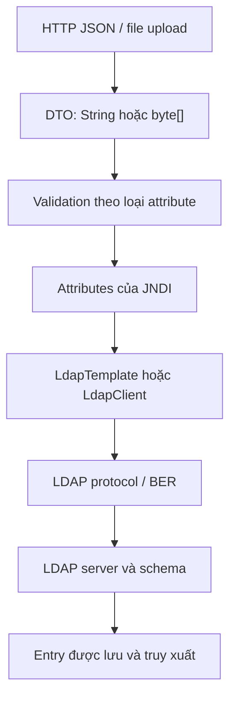

# Kiểm tra encoding và dữ liệu binary

Trong Spring LDAP, một entry có thể chứa văn bản Unicode như `cn`, `sn`, `description`, đồng thời chứa dữ liệu nhị phân như `jpegPhoto` hoặc chứng chỉ trong `userCertificate`. Hai nhóm giá trị này có cách biểu diễn, kiểm tra và xử lý lỗi khác nhau. Nếu ứng dụng dùng `String` cho dữ liệu ảnh, tự chuyển mọi giá trị thành UTF-8, hoặc nhầm Base64 trong LDIF với giá trị thực của attribute, dữ liệu có thể bị hỏng ngay trước khi đến LDAP server.

Bài thuộc chương **Validation** của module **SPRING_LDAP**. Mục tiêu là kiểm tra **encoding văn bản và dữ liệu binary trước khi gọi** `LdapTemplate`, `LdapClient` hoặc ODM, đồng thời giải thích cách server và JNDI quyết định biểu diễn thực tế. Ví dụ dùng Java 17+, một directory giả định với `ContextSource.base=dc=example,dc=org`, và tài khoản người dùng thuộc `ou=people`. Các kích thước giới hạn là chính sách minh họa của ứng dụng; cần xác minh schema, ACL, giới hạn server và yêu cầu bảo mật khi triển khai.

## 1. Trước hết, xác định attribute mang text hay bytes

LDAP không quy định mọi giá trị attribute đều là chuỗi. Schema gắn **attribute type** với **syntax** và matching rules; dữ liệu trên đường truyền LDAP được BER-encode, còn ý nghĩa của những octet phụ thuộc syntax. JNDI/Spring LDAP giúp ánh xạ những dữ liệu này sang kiểu Java mà ứng dụng sử dụng.

| Attribute thường gặp | Dữ liệu nghiệp vụ | Kiểu Java thường mong đợi | Lưu ý |
| --- | --- | --- | --- |
| `cn`, `sn`, `description` | Tên và mô tả người dùng | `String` | Xác nhận Unicode, độ dài và ký tự được phép theo API |
| `uid`, `mail` | Định danh và email | `String` | Format và giới hạn là chính sách ứng dụng; cần phân biệt với matching rule của server |
| `objectClass` | Tên các class của entry | Các giá trị `String` | Attribute đa giá trị, nhưng không phải bytes hình ảnh |
| `jpegPhoto` | Ảnh JPEG ở dạng byte | `byte[]` | Không được giải mã ảnh bằng `new String(bytes)` |
| `userCertificate` (có thể dùng transfer option `;binary`) | Chứng chỉ X.509 DER | `byte[]` | Kiểm tra cấu trúc chứng chỉ và ý nghĩa tin cậy theo mục đích sử dụng |
| Attribute binary tùy biến | Blob theo schema riêng | `byte[]`, tùy provider/config | Phải kiểm tra schema syntax và cách JNDI xác định binary attribute |

**Không suy kiểu dữ liệu chỉ từ tên giống “file”, “image” hay từ một giá trị Base64.** Một chuỗi Base64 vẫn là `String` cho đến khi ứng dụng chủ động decode theo hợp đồng. Ngược lại, dữ liệu JPEG thực cần được giữ dưới dạng `byte[]` trước khi lưu vào attribute phù hợp.

### 1.1. Một luồng dữ liệu có nhiều tầng encoding



Ở tầng HTTP, multipart upload thường mang **bytes** của tệp; JSON có thể mang **chuỗi Base64** theo hợp đồng API. Ở tầng Java, các thuộc tính văn bản dùng `String`, còn giá trị ảnh/chứng chỉ dùng `byte[]`. Nếu dữ liệu chuyển loại ở bất kỳ bước nào, phải kiểm tra quá trình chuyển đổi đó và giới hạn kích thước ở cả hai phía.

## 2. Encoding của văn bản Unicode

### 2.1. Đừng tự biến một Directory String thành `byte[]`

Ví dụ API nhận tên người dùng `"Nguyễn An"`. Với attribute `cn` có syntax văn bản phù hợp, ứng dụng thường truyền trực tiếp `String` vào JNDI:

```java
import javax.naming.directory.Attributes;
import javax.naming.directory.BasicAttributes;

Attributes attrs = new BasicAttributes(true);
attrs.put("cn", "Nguyễn An");
attrs.put("sn", "Nguyễn");
```

Không tự chuyển tên thành `byte[]` rồi gọi `attrs.put("cn", bytes)` với kỳ vọng LDAP sẽ tự biết đây là văn bản UTF-8. Làm như vậy có thể khiến provider xử lý sai kiểu giá trị, hoặc server từ chối do syntax. Tương tự, không dùng `new String(photoBytes)` để lưu ảnh trong một attribute văn bản.

LDAPv3 biểu diễn các giá trị Directory String bằng UTF-8 theo syntax tương ứng, nhưng ứng dụng Java nên làm việc ở mức **giá trị logic** và để provider LDAP thực hiện encoding giao thức. Với một attribute binary, chuyển `byte[]` qua `String` bằng charset là biến đổi **có khả năng mất dữ liệu**.

### 2.2. `String.length()`, code point và byte UTF-8 khác nhau

Java `String.length()` đếm **UTF-16 code unit**, không đếm số byte. Ký tự Unicode ngoài Basic Multilingual Plane có thể chiếm hai code unit. Một số ký tự trông giống nhau có thể có biểu diễn Unicode khác nhau (dạng dựng sẵn và dạng ký tự kết hợp).

```java
import java.nio.charset.StandardCharsets;

String name = "Nguyễn";

int utf16Units = name.length();
int codePoints = name.codePointCount(0, name.length());
int utf8Bytes = name.getBytes(StandardCharsets.UTF_8).length;
```

Khi đặt giới hạn, phải viết rõ đơn vị: **code unit**, **code point**, **grapheme cluster** hay **byte**. Một quy tắc “tên tối đa 100 ký tự” cần được xác định nhất quán trong API và UI; một giới hạn kích thước trong byte cần đo đúng byte. Những đơn vị này không thể thay thế cho nhau.

### 2.3. Kiểm tra encoding không đồng nghĩa chuẩn hóa tùy tiện

Unicode có các dạng normalization như NFC và NFD. Tùy nghiệp vụ, ứng dụng có thể chọn chuẩn hóa **những trường hiển thị** về một dạng ổn định trước khi lưu. Tuy nhiên:

- Phải xác định rõ chính sách trước khi chuẩn hóa; nếu chuẩn hóa làm thay đổi tên định danh, cần xem xét tương thích với dữ liệu và matching rules của LDAP server.
- Không tự động áp dụng case folding hoặc NFKC cho mọi thuộc tính: điều đó có thể thay đổi ý nghĩa của dữ liệu.
- Không chuẩn hóa, trim hoặc đổi mã hóa **mật khẩu/secret** một cách tùy tiện; quy tắc xử lý phụ thuộc cơ chế xác thực.
- Không giả định so sánh `String.equals` của Java luôn trùng với matching rule của một attribute trên server.

Ví dụ, nếu công ty quy định `displayName` phải theo NFC:

```java
import java.text.Normalizer;

String normalized = Normalizer.normalize(
        displayName, Normalizer.Form.NFC);
```

Đó là **quy tắc ứng dụng**, không phải một bước bắt buộc với mọi LDAP attribute.

### 2.4. Xử lý UTF-8 byte thô từ nguồn ngoài một cách nghiêm ngặt

Nếu API nhận bytes rồi mong muốn giải mã thành văn bản, hãy dùng decoder báo lỗi khi gặp chuỗi UTF-8 không hợp lệ, thay vì âm thầm thay các byte sai bằng ký tự thay thế:

```java
import java.nio.ByteBuffer;
import java.nio.charset.CharacterCodingException;
import java.nio.charset.CodingErrorAction;
import java.nio.charset.StandardCharsets;

static String decodeUtf8Strict(byte[] raw) {
    if (raw == null) {
        throw new IllegalArgumentException("Thiếu bytes văn bản");
    }
    var decoder = StandardCharsets.UTF_8.newDecoder()
            .onMalformedInput(CodingErrorAction.REPORT)
            .onUnmappableCharacter(CodingErrorAction.REPORT);
    try {
        return decoder.decode(ByteBuffer.wrap(raw)).toString();
    } catch (CharacterCodingException ex) {
        throw new IllegalArgumentException(
                "Dữ liệu không phải UTF-8 hợp lệ", ex);
    }
}
```

Với đầu vào đã có sẵn dưới dạng Java `String`, vẫn cần kiểm tra các chuỗi UTF-16 lỗi (ví dụ unpaired surrogate) nếu sau đó yêu cầu chuyển sang UTF-8 một cách không mất dữ liệu. Đừng dựa vào encoder dùng chế độ thay thế mặc định nếu việc bảo toàn dữ liệu là bắt buộc.

## 3. Dữ liệu binary trong LDAP và sự khác nhau với Base64

### 3.1. `byte[]` là giá trị binary, Base64 là một cách biểu diễn

Ví dụ một giá trị `jpegPhoto`:

```java
import javax.naming.directory.BasicAttribute;

byte[] jpegBytes = readValidatedUploadBytes();
BasicAttribute jpegPhoto =
        new BasicAttribute("jpegPhoto", jpegBytes);
```

Ở đây `jpegPhoto` chứa bytes, không phải chuỗi Base64. Khi xuất dữ liệu dưới dạng **LDIF**, một giá trị binary thường được biểu diễn bằng Base64 với cú pháp `::`:

```ldif
dn: uid=alice,ou=people,dc=example,dc=org
changetype: modify
replace: jpegPhoto
jpegPhoto:: /9j/4AAQSkZJRgABAQ...
-
```

Chuỗi trên chỉ minh họa tiền tố Base64, **không phải ảnh hoàn chỉnh**. Dấu `::` là một phần của cách biểu diễn LDIF; không phải hai dấu hai chấm xuất hiện trong giá trị attribute trên LDAP wire. Trong Java khi dùng `LdapTemplate`, không cần Base64-encode `jpegBytes` trước khi đưa vào `BasicAttribute`.

Nếu API JSON nhận một trường Base64, ứng dụng phải decode **một lần** theo hợp đồng, kiểm tra lỗi Base64, rồi kiểm tra kích thước và nội dung bytes. Không ghi trực tiếp chuỗi Base64 vào `jpegPhoto` và mặc định server sẽ tự decode.

### 3.2. Transfer option `;binary` và JNDI binary attributes

Một số attribute như chứng chỉ có thể xuất hiện dưới mô tả LDAP dạng `userCertificate;binary`. Đây là **binary transfer option** trong LDAP, không phải kiểu dữ liệu Java mới; khả năng sử dụng và cách biểu diễn phải theo schema/protocol/server.

JNDI LDAP provider có thể nhận biết một số attribute là binary. Với attribute tùy biến, cấu hình môi trường JNDI đôi khi cần chỉ rõ tên attribute có giá trị binary qua property `java.naming.ldap.attributes.binary`. Tên attribute, attribute option và cách provider nhận diện có thể khác giữa thư viện hoặc server. Vì vậy khi đọc thực tế cần kiểm tra kiểu object trả về, không đoán rằng `get()` chắc chắn luôn là `byte[]` cho mọi attribute.

Không thêm hậu tố `;binary` vào mọi attribute chỉ để ép code nhận được bytes. Hậu tố, syntax và cách transfer phải phù hợp định nghĩa attribute và directory mục tiêu.

### 3.3. Binary data không có “encoding UTF-8” bắt buộc

Ảnh JPEG, chứng chỉ DER và byte stream tùy biến là **octet sequences**. Nếu byte `0xFF` nằm trong dữ liệu ảnh, việc gọi `new String(bytes, UTF_8)` có thể sinh ký tự thay thế. Việc encode chuỗi đó trở lại UTF-8 sẽ không khôi phục bytes ban đầu.

Đừng biến một tệp binary thành `String` để tiện log, validate hoặc gửi LDAP. Duy trì `byte[]` hoặc luồng byte ở các tầng liên quan; chỉ dùng Base64 ở **ranh giới có hợp đồng yêu cầu** (ví dụ JSON/LDIF), và không log giá trị đó.

## 4. Validation một ảnh `jpegPhoto` trước khi ghi

Với ảnh đại diện người dùng, ứng dụng mẫu đặt các quy tắc sau:

1. Chỉ cho cập nhật `jpegPhoto` của `uid` hợp lệ dưới nhánh `ou=people`.
2. Dữ liệu phải có từ 4 byte đến **512 KiB**; giới hạn này là chính sách ứng dụng, không phải giới hạn chuẩn của LDAP.
3. Phải có dấu hiệu bắt đầu tệp JPEG: `FF D8 FF`.
4. Nếu yêu cầu xác minh **tệp ảnh thực sự có thể giải mã**, cần bước kiểm tra bằng bộ xử lý ảnh an toàn hơn trước khi cho lưu; kiểm tra magic bytes **không đủ** để chứng minh ảnh JPEG hợp lệ.
5. Request không được tự chỉ định tên attribute cần ghi, đường dẫn DN hay object class.
6. Tài khoản LDAP dùng để sửa ảnh phải có ACL cho phép thao tác; truyền thông directory cần dùng LDAPS hoặc StartTLS được cấu hình xác minh chứng chỉ đúng.

### 4.1. Ví dụ service Spring LDAP

```java
import java.util.regex.Pattern;
import javax.naming.directory.BasicAttribute;
import javax.naming.directory.DirContext;
import javax.naming.directory.ModificationItem;
import javax.naming.ldap.LdapName;

import org.springframework.ldap.core.LdapTemplate;
import org.springframework.ldap.support.LdapNameBuilder;

public final class DirectoryPhotoService {
    private static final Pattern UID =
            Pattern.compile("[A-Za-z0-9._-]{1,64}");
    private static final int MAX_JPEG_BYTES = 512 * 1024;

    private final LdapTemplate ldapTemplate;

    public DirectoryPhotoService(LdapTemplate ldapTemplate) {
        this.ldapTemplate = ldapTemplate;
    }

    public void replacePhoto(String uid, byte[] upload) {
        if (uid == null || !UID.matcher(uid).matches()) {
            throw new IllegalArgumentException("uid không hợp lệ");
        }
        if (upload == null || upload.length < 4
                || upload.length > MAX_JPEG_BYTES) {
            throw new IllegalArgumentException(
                    "Kích thước ảnh không hợp lệ");
        }

        // Copy trước khi validate và gửi để không dùng mảng mutable từ caller.
        byte[] jpeg = upload.clone();
        validateJpegSignature(jpeg);

        // ContextSource đã có base=dc=example,dc=org.
        LdapName personDn = LdapNameBuilder.newInstance()
                .add("ou", "people")
                .add("uid", uid)
                .build();

        ModificationItem replace = new ModificationItem(
                DirContext.REPLACE_ATTRIBUTE,
                new BasicAttribute("jpegPhoto", jpeg)
        );
        ldapTemplate.modifyAttributes(
                personDn, new ModificationItem[] { replace });
    }

    private static void validateJpegSignature(byte[] bytes) {
        if ((bytes[0] & 0xFF) != 0xFF
                || (bytes[1] & 0xFF) != 0xD8
                || (bytes[2] & 0xFF) != 0xFF) {
            throw new IllegalArgumentException(
                    "Ảnh không có header JPEG mong đợi");
        }
    }
}
```

Đường đi thực tế:

```text
Multipart/JPEG upload
   -> kiểm tra số byte
   -> clone bytes
   -> kiểm tra chữ ký tệp + policy nghiệp vụ
   -> kiểm tra nội dung ảnh nâng cao nếu cần
   -> xác định DN từ uid đã validate
   -> ModificationItem(REPLACE, jpegPhoto: byte[])
   -> LdapTemplate.modifyAttributes(...)
   -> server kiểm tra ACL/schema/trạng thái
```

**Giới hạn của ví dụ:** `FF D8 FF` mới là một kiểm tra header tối thiểu. Dữ liệu giả cũng có thể bắt đầu bằng các byte này. Nếu ảnh được render cho người dùng hoặc phải đáp ứng yêu cầu bảo mật, cần kiểm tra khả năng giải mã, định dạng thực, số pixel, kích thước sau giải nén, giới hạn CPU/bộ nhớ, cũng như cân nhắc tái mã hóa bằng thư viện ảnh được kiểm soát. Không mặc định kiểm tra magic bytes tương đương quét nội dung độc hại. Ngoài ra, clone đầu vào giúp tránh tham chiếu lại mảng caller, nhưng service vẫn cần kiểm soát vòng đời và tránh lộ `byte[]` sau khi đưa vào API khác.

### 4.2. Kiểm tra Base64 trước khi decode

Nếu endpoint nhận JSON với trường `jpegBase64`, cần giới hạn kích thước chuỗi trước khi giải mã, rồi tiếp tục dùng validator bytes như trên:

```java
import java.util.Base64;

static byte[] decodePhotoBase64(String encoded) {
    // Giới hạn trước decode để tránh tiêu thụ bộ nhớ quá mức.
    final int maxBase64Chars = 4 * ((512 * 1024 + 2) / 3);
    if (encoded == null || encoded.isEmpty()
            || encoded.length() > maxBase64Chars) {
        throw new IllegalArgumentException(
                "Base64 ảnh rỗng hoặc quá dài");
    }
    try {
        byte[] bytes = Base64.getDecoder().decode(encoded);
        if (bytes.length < 4 || bytes.length > 512 * 1024) {
            throw new IllegalArgumentException(
                    "Dung lượng ảnh không hợp lệ");
        }
        return bytes;
    } catch (IllegalArgumentException ex) {
        throw new IllegalArgumentException(
                "Base64 ảnh hoặc dung lượng không hợp lệ", ex);
    }
}
```

Hàm trên mới xác minh Base64 và giới hạn độ dài; **không xác nhận nội dung ảnh**. Sau đó vẫn gọi `replacePhoto(uid, bytes)` hoặc một validator nội dung chuyên biệt. Nếu không có yêu cầu JSON rõ ràng, multipart với bytes thường giúp tránh chi phí Base64 làm tăng kích thước truyền tải.

### 4.3. Xóa ảnh khác với ghi giá trị rỗng

Nếu người dùng muốn xóa ảnh, không nên mặc định gửi `jpegPhoto` với `new byte[0]`. Trong LDAP, **xóa attribute** và **ghi một giá trị binary có độ dài 0** là hai thao tác khác nhau; server có thể từ chối giá trị rỗng theo syntax/chính sách.

```java
ModificationItem removePhoto = new ModificationItem(
        DirContext.REMOVE_ATTRIBUTE,
        new BasicAttribute("jpegPhoto")
);
ldapTemplate.modifyAttributes(
        personDn, new ModificationItem[] { removePhoto });
```

Phải xác định trước điều kiện xóa theo nghiệp vụ và schema; nếu attribute không tồn tại, kết quả REMOVE có thể phụ thuộc trạng thái và cách directory xử lý.

## 5. Đọc binary attribute về Java một cách an toàn

Khi tra cứu ảnh, mapper nên kiểm tra **sự tồn tại của attribute, số lượng giá trị, kiểu dữ liệu và kích thước**:

```java
import javax.naming.directory.Attribute;
import javax.naming.directory.Attributes;
import org.springframework.ldap.core.AttributesMapper;

byte[] photo = ldapTemplate.lookup(
        personDn,
        (AttributesMapper<byte[]>) attrs -> {
            Attribute jpegPhoto = attrs.get("jpegPhoto");
            if (jpegPhoto == null || jpegPhoto.size() == 0) {
                return null; // Không có ảnh.
            }
            if (jpegPhoto.size() != 1) {
                throw new IllegalStateException(
                        "jpegPhoto nhiều giá trị ngoài hợp đồng");
            }
            Object value = jpegPhoto.get();
            if (!(value instanceof byte[] bytes)) {
                throw new IllegalStateException(
                        "JNDI không trả jpegPhoto dưới dạng byte[]");
            }
            if (bytes.length > 512 * 1024) {
                throw new IllegalStateException(
                        "Ảnh lưu trong directory vượt giới hạn API");
            }
            return bytes.clone();
        }
);
```

Nếu kết quả là `String` ngoài dự kiến, **không chuyển `String` ngược sang bytes rồi coi là dữ liệu gốc**. Hãy kiểm tra syntax attribute, JNDI binary attribute configuration, transfer option và cách provider map dữ liệu. Một mapper có thể phải xử lý nhiều cách biểu diễn khi phục vụ nhiều directory, nhưng việc chuyển đổi phải dựa vào hợp đồng có kiểm chứng.

Không trả Base64 trừ khi API yêu cầu. Với HTTP, một endpoint trả bytes theo `image/jpeg` có thể phù hợp hơn JSON Base64; cần đặt các header bảo mật và cache phù hợp, kiểm tra quyền đọc ảnh và chính sách dữ liệu cá nhân.

## 6. Chứng chỉ và binary attribute đặc biệt

`userCertificate` thường lưu chứng chỉ X.509 ở dạng DER. Kiểm tra `bytes.length > 0` là chưa đủ nếu ứng dụng sử dụng chứng chỉ để ra quyết định bảo mật.

```java
import java.io.ByteArrayInputStream;
import java.security.cert.CertificateException;
import java.security.cert.CertificateFactory;
import java.security.cert.X509Certificate;

static X509Certificate parseX509(byte[] der) {
    if (der == null || der.length == 0 || der.length > 64 * 1024) {
        throw new IllegalArgumentException(
                "Kích thước chứng chỉ không hợp lệ");
    }
    try {
        CertificateFactory factory =
                CertificateFactory.getInstance("X.509");
        var certificate = (X509Certificate) factory
                .generateCertificate(new ByteArrayInputStream(der));
        return certificate;
    } catch (CertificateException ex) {
        throw new IllegalArgumentException(
                "Không parse được chứng chỉ X.509", ex);
    }
}
```

**Parse thành công không chứng minh chứng chỉ đáng tin cậy.** Nếu dùng chứng chỉ cho xác thực/ủy quyền, phải có quy trình xác minh đường dẫn tin cậy, chữ ký, thời hạn, mục đích sử dụng, danh tính và thu hồi theo mô hình bảo mật cụ thể. Việc tải một chứng chỉ lên LDAP không biến nó thành chứng chỉ được tin cậy mặc định.

Với binary attribute tùy biến, schema có thể giới hạn syntax và số lượng giá trị; một số directory có giới hạn kích thước riêng cho entry hay attribute. Những ràng buộc đó phải được kiểm chứng trong môi trường test, không suy luận từ thuộc tính `jpegPhoto` hay `userCertificate`.

## 7. Encoding trong DN, search filter và LDIF là ba vấn đề riêng

Khi thao tác LDAP, có ba loại chuyển đổi dễ bị nhầm:

| Ngữ cảnh | Ví dụ | Cách xử lý đúng |
| --- | --- | --- |
| DN/RDN | `uid=an,ou=people` | Dựng từ thành phần bằng `LdapNameBuilder`/`Rdn`; escape DN theo cú pháp DN |
| Search filter | `(cn=Nguyễn An)` | Dùng `LdapQueryBuilder`, escape **assertion value** theo cú pháp filter |
| LDIF | `jpegPhoto:: /9j/...` | Hiểu Base64 là representation trong LDIF; giá trị binary ở Java là bytes |
| Văn bản trong attribute | `attrs.put("cn", "Nguyễn An")` | Giữ `String` đúng syntax text và để LDAP provider mã hóa |
| Bytes trong attribute | `attrs.put("jpegPhoto", bytes)` | Giữ `byte[]`, không ép qua UTF-8/String |

Ví dụ nhập `cn=An (QA)*`: nếu đưa vào một search filter equality, những ký tự `(`, `)`, `*` phải được xử lý như dữ liệu; nhưng vẫn cần validate chính sách độ dài và quyền truy vấn. Escape DN khác escape filter, và cả hai không phải bộ kiểm tra encoding của ảnh.

Không nhầm Base64 của giá trị binary với Base64 do LDIF dùng để biểu diễn **một giá trị văn bản có ký tự đặc biệt**. Cú pháp `::` có thể xuất hiện với cả giá trị text cần biểu diễn bằng Base64 trong LDIF; nó không tự chứng minh attribute là binary.

## 8. Lỗi thường gặp và cách phân loại

| Tình huống | Phát hiện ở đâu | Phản ứng phù hợp |
| --- | --- | --- |
| JSON chứa Base64 sai cú pháp | Adapter/API | Báo input không hợp lệ trước LDAP |
| Tệp ảnh vượt 512 KiB theo policy | Service validation | Chặn trước I/O; nêu giới hạn rõ ràng |
| Mảng bytes bắt đầu bằng header sai | Service validation | Chặn sớm; không coi định dạng đó là JPEG |
| Header đúng nhưng nội dung ảnh hỏng | Decoder nội dung hoặc tầng hiển thị | Bổ sung kiểm tra toàn bộ ảnh; không dựa header |
| `jpegPhoto` trả `String` ngoài dự kiến | JNDI mapper/configuration | Điều tra syntax/provider; không sửa mù bytes |
| Attribute sai syntax hoặc vượt constraint server | LDAP schema/server | Điều tra schema và payload; có thể gặp `invalidAttributeSyntax` (21) hoặc `constraintViolation` (19) |
| Attribute binary không được object class cho phép | LDAP schema/server | Có thể gặp `objectClassViolation` (65) |
| Tài khoản service không có quyền sửa ảnh | LDAP ACL | Có thể gặp `insufficientAccessRights` (50) |
| Kết nối LDAPS/StartTLS thất bại | Tầng transport | Kiểm tra truststore, chứng chỉ, hostname và cấu hình |
| Cập nhật thành công nhưng phản hồi timeout | Mạng/đồng thời | Xác minh trạng thái thực; tránh retry ghi mù quáng |

Đừng biến mọi lỗi directory thành thông báo “encoding không hợp lệ”. Các lỗi schema, ACL, timeout và input có nguyên nhân và trách nhiệm xử lý khác nhau. Khi ghi log, nên dùng operation, mã lỗi, kích thước dữ liệu, loại attribute và correlation ID; **không log nguyên ảnh, chứng chỉ, Base64, mật khẩu hoặc dữ liệu cá nhân không cần thiết**.

## 9. Kiểm thử trước I/O và kiểm thử với directory thật

### 9.1. Unit test: dữ liệu nhị phân sai không chạm LDAP

```java
import static org.junit.jupiter.api.Assertions.assertThrows;
import static org.mockito.Mockito.mock;
import static org.mockito.Mockito.verifyNoInteractions;

import org.junit.jupiter.api.Test;
import org.springframework.ldap.core.LdapTemplate;

class DirectoryPhotoServiceTest {
    @Test
    void oversizedImageStopsBeforeLdap() {
        LdapTemplate template = mock(LdapTemplate.class);
        var service = new DirectoryPhotoService(template);

        byte[] tooLarge = new byte[512 * 1024 + 1];
        assertThrows(IllegalArgumentException.class,
                () -> service.replacePhoto("alice", tooLarge));

        verifyNoInteractions(template);
    }

    @Test
    void wrongHeaderStopsBeforeLdap() {
        LdapTemplate template = mock(LdapTemplate.class);
        var service = new DirectoryPhotoService(template);

        byte[] notJpeg = new byte[] { 0x00, 0x01, 0x02, 0x03 };
        assertThrows(IllegalArgumentException.class,
                () -> service.replacePhoto("alice", notJpeg));

        verifyNoInteractions(template);
    }
}
```

### 9.2. Unit test: binary được giữ đúng kiểu `byte[]`

```java
import static org.junit.jupiter.api.Assertions.assertArrayEquals;
import static org.mockito.ArgumentMatchers.any;
import static org.mockito.Mockito.mock;
import static org.mockito.Mockito.verify;

import javax.naming.Name;
import javax.naming.directory.ModificationItem;
import org.junit.jupiter.api.Test;
import org.mockito.ArgumentCaptor;
import org.springframework.ldap.core.LdapTemplate;

class PhotoPayloadTest {
    @Test
    void passesByteArrayToJndiAttribute() throws Exception {
        LdapTemplate template = mock(LdapTemplate.class);
        var service = new DirectoryPhotoService(template);

        // Tối thiểu header hợp lệ cho bài test việc truyền byte[];
        // không dùng làm tệp ảnh JPEG hoàn chỉnh ở production.
        byte[] sample = {
                (byte) 0xFF, (byte) 0xD8, (byte) 0xFF, 0x00
        };
        service.replacePhoto("alice", sample);

        ArgumentCaptor<ModificationItem[]> changes =
                ArgumentCaptor.forClass(ModificationItem[].class);
        verify(template).modifyAttributes(
                any(Name.class), changes.capture());

        Object stored = changes.getValue()[0]
                .getAttribute().get();
        assertArrayEquals(sample, (byte[]) stored);
    }
}
```

Unit test này xác nhận service không vô tình biến ảnh thành `String` hoặc Base64. Nó không chứng minh server sẽ chấp nhận ảnh, schema và ACL; cần integration test.

### 9.3. Ma trận kiểm thử đề xuất

| Trường hợp | Kỳ vọng |
| --- | --- |
| Tên Unicode `Nguyễn An` được lưu qua attribute văn bản | Đọc lại đúng nội dung logic; không mất dấu |
| Dữ liệu UTF-8 byte bị lỗi | Decoder strict từ chối thay vì thay ký tự âm thầm |
| Ảnh `null`, rỗng hoặc quá 512 KiB | Từ chối trước I/O |
| Ảnh có header không phải JPEG | Từ chối trước I/O |
| Header JPEG hợp lệ nhưng tệp thực sự bị hỏng | Bộ kiểm tra nội dung nâng cao phát hiện nếu được yêu cầu |
| Ảnh hợp lệ được tạo thành `byte[]` | Mapper/JNDI nhận đúng kiểu, giá trị không bị đổi |
| LDIF export rồi import ảnh JPEG | Bytes sau khi round-trip khớp nếu công cụ hỗ trợ đúng |
| Đọc `jpegPhoto` mà attribute không có | Mapper trả trạng thái thiếu ảnh phù hợp |
| Custom binary attribute không được provider nhận diện | Test chỉ ra cấu hình JNDI/schema cần điều chỉnh |
| Xóa ảnh bằng REMOVE và ghi `byte[0]` | Hai ý nghĩa được phân biệt rõ |
| Schema/ACL từ chối ghi ảnh | Ứng dụng phân loại lỗi directory chính xác |
| Kết nối TLS thất bại | Không nhầm thành lỗi encoding của `jpegPhoto` |

Các integration test cần directory riêng với schema, provider, `ContextSource`, TLS và ACL đại diện cho môi trường mục tiêu. Không nên dùng LDAP production hoặc tài khoản quản trị để cố ý thử lỗi dữ liệu.

## 10. Checklist triển khai

- [ ] Xác định **syntax của từng attribute** trong schema trước khi chọn kiểu dữ liệu Java.
- [ ] Giữ các thuộc tính văn bản dưới dạng `String`; không tự ép thành bytes chỉ để gọi LDAP.
- [ ] Giữ dữ liệu ảnh/chứng chỉ dưới dạng `byte[]`; không chuyển binary thành `String` UTF-8.
- [ ] Phân biệt Base64 do hợp đồng JSON/LDIF yêu cầu với giá trị bytes thật.
- [ ] Kiểm tra Unicode, normalization (nếu có), ký tự không hợp lệ và đơn vị giới hạn độ dài.
- [ ] Decode UTF-8 nghiêm ngặt nếu nguồn đưa văn bản dưới dạng byte thô.
- [ ] Kiểm tra `null`, kích thước byte và định dạng thực của binary trước khi lưu.
- [ ] Giới hạn kích thước payload trước Base64 decode hoặc parse tệp lớn.
- [ ] Không coi magic bytes của ảnh là bằng chứng đầy đủ cho tính hợp lệ hoặc an toàn của tệp.
- [ ] Kiểm tra số lượng giá trị của attribute binary và cách JNDI provider ánh xạ kết quả.
- [ ] Dùng `LdapNameBuilder` cho DN và API xây LDAP filter đúng cú pháp; không trộn escape DN/filter với encoding dữ liệu.
- [ ] Duy trì LDAPS/StartTLS và xác minh chứng chỉ; kiểm soát ACL cho attribute nhạy cảm.
- [ ] Không log nội dung binary, Base64, mật khẩu hoặc dữ liệu riêng tư không cần thiết.
- [ ] Test input sai không gọi LDAP; test round-trip và lỗi schema/ACL trên directory thử nghiệm.

**Điểm cần nhớ:** Encoding đúng bắt đầu từ việc hiểu **attribute đang mang text hay bytes**. Spring LDAP/JNDI có thể chuyển dữ liệu giữa Java và LDAP nhưng không tự xác nhận kích thước, định dạng ảnh, tính đúng của UTF-8 nguồn ngoài hoặc chính sách nghiệp vụ. Kiểm tra trước I/O giúp phát hiện lỗi sớm; schema, ACL và trạng thái thực tế vẫn do LDAP server quyết định.
