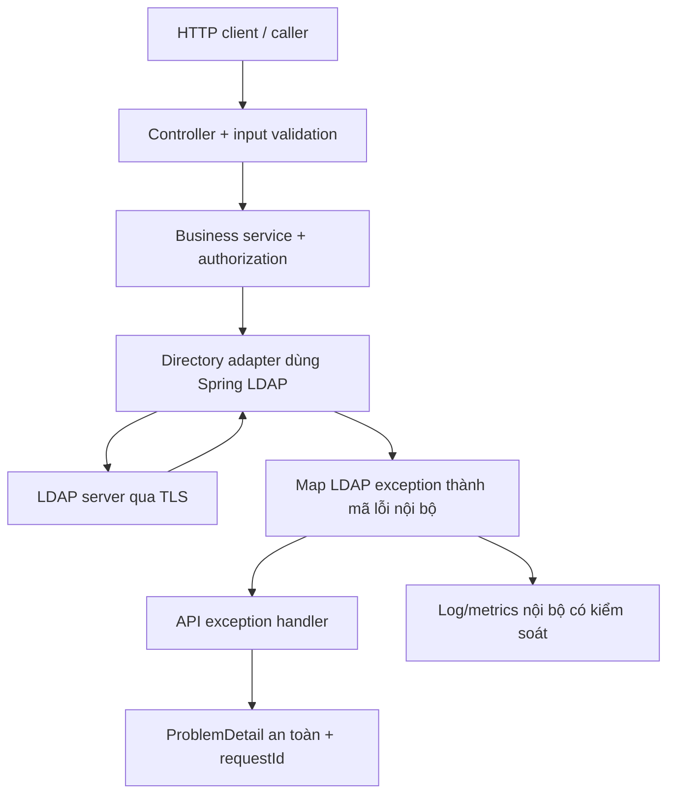

# Trả lỗi theo hợp đồng API mà không lộ cấu hình LDAP

Ứng dụng dùng **Spring LDAP** thường đứng giữa người gọi HTTP API và một dịch vụ thư mục. Khi LDAP từ chối thao tác, exception có thể chứa Distinguished Name (DN), search filter, tên máy chủ, thông tin bind, mã phản hồi hoặc diagnostic message. Nếu API trả trực tiếp `exception.getMessage()` cho client, ứng dụng có thể vô tình để lộ cấu trúc thư mục, danh tính tài khoản dịch vụ, chính sách phân quyền hay thông tin người dùng.

Bài học thuộc chương **Validation** của module **SPRING_LDAP**, giải quyết yêu cầu **trả lỗi theo hợp đồng API mà không lộ cấu hình LDAP**. Ta sẽ xây một hợp đồng lỗi ổn định, phân biệt lỗi input với lỗi directory, ánh xạ exception tại ranh giới `LdapTemplate`/`LdapClient`/ODM, tạo phản hồi HTTP an toàn và kiểm thử rằng dữ liệu nội bộ không xuất hiện trong phản hồi. Ví dụ dùng Java 17+, Spring LDAP và Spring Web hiện đại với `ProblemDetail`; giả định `ContextSource` đã có base DN `dc=example,dc=org`.

## 1. Hợp đồng lỗi API là gì?

Một hợp đồng lỗi API cho client biết **điều gì đã xảy ra ở mức nghiệp vụ, client có thể làm gì tiếp theo và cách liên hệ hỗ trợ**, thông qua những trường có nghĩa ổn định. Nó không bắt client hiểu LDAP result code hay cấu hình directory.

Ví dụ, khi `uid` sai định dạng:

```http
HTTP/1.1 400 Bad Request
Content-Type: application/problem+json
```

```json
{
  "type": "about:blank",
  "title": "Dữ liệu không hợp lệ",
  "status": 400,
  "detail": "Vui lòng kiểm tra các trường được chỉ ra.",
  "code": "INPUT_INVALID",
  "requestId": "req-7c21",
  "invalidParams": [
    {
      "name": "uid",
      "reason": "Mã tài khoản không đúng định dạng cho phép"
    }
  ]
}
```

Nếu directory không sẵn sàng, client nhận thông báo khác nhưng vẫn cùng cấu trúc:

```json
{
  "type": "about:blank",
  "title": "Dịch vụ tạm thời gián đoạn",
  "status": 503,
  "detail": "Chưa thể xác nhận kết quả xử lý. Hãy kiểm tra trạng thái trước khi gửi lại yêu cầu ghi.",
  "code": "DIRECTORY_UNAVAILABLE",
  "requestId": "req-7c22"
}
```

`requestId` chỉ là giá trị minh họa; ứng dụng phải tạo/kiểm soát mã truy vết thay vì sao chép tùy ý từ thông điệp lỗi LDAP. Với JSON theo mẫu `ProblemDetail`, `type`, `title`, `status`, `detail` là các trường chuẩn; `code`, `requestId`, `invalidParams` là **extension fields** do API quy định. Nếu API chọn cấu trúc JSON khác, nguyên tắc tách lỗi vẫn giữ nguyên.

### 1.1. Phân biệt thông tin được phép công bố và thông tin nội bộ

| Loại thông tin | Có thể trả cho client? | Ví dụ |
| --- | --- | --- |
| Mã lỗi API ổn định | Có | `INPUT_INVALID`, `ENTRY_CONFLICT` |
| Thông điệp nghiệp vụ đã kiểm soát | Có | “Mã tài khoản không đúng định dạng” |
| Tên field trong allowlist | Có, nếu đã được phép tiết lộ | `uid`, `cn`, `sn` |
| Mã truy vết độc lập với cấu hình LDAP | Có | `requestId` do ứng dụng gán |
| Hostname, port, URL LDAP | Không | `ldaps://directory.internal:636` |
| Base DN, bind DN, parent DN nhạy cảm | Không | `ou=staff,dc=internal,dc=example` |
| Toàn bộ search filter hoặc lỗi parser | Không | `(&(uid=...)(objectClass=...))` |
| Mật khẩu, bind secret, token, certificate private key | Tuyệt đối không | `userPassword`, mật khẩu service |
| Thông điệp thô của LDAP/JNDI exception | Không | `exception.getMessage()`, `rootCause.toString()` |
| LDAP result code và diagnostic message | Thường giữ nội bộ | `objectClassViolation (65)`, chi tiết schema |

Ngay cả khi một DN hoặc tên nhóm có vẻ “không bí mật”, chúng có thể tiết lộ cấu trúc phòng ban, môi trường triển khai hoặc sự tồn tại tài khoản. Chính sách trả lỗi cần đánh giá **caller đang được phép biết gì**.

## 2. Tách nguồn lỗi khỏi hành động mà client cần thực hiện

Đặc biệt quan trọng là phân biệt **lỗi được phát hiện trước I/O** với **lỗi do directory trả về sau I/O**. Một LDAP result code không tự quyết định HTTP status; ngữ cảnh thao tác và danh tính LDAP được dùng mới quyết định cách giải thích.

| Tình huống | Phân loại ứng dụng | HTTP gợi ý | Hành động phù hợp |
| --- | --- | --- | --- |
| `uid` rỗng, `cn` quá dài | `INPUT_INVALID` | 400 hoặc 422 | Client sửa field |
| Caller vi phạm quy tắc nghiệp vụ | `BUSINESS_RULE_VIOLATION` | 409 hoặc 422 tùy trường hợp | Client sửa yêu cầu hoặc chờ trạng thái hợp lệ |
| Tạo DN đã tồn tại | `ENTRY_CONFLICT` | 409 nếu được phép tiết lộ | Điều phối create, không ghi đè |
| Tra cứu thành công nhưng không có entry | Kết quả nghiệp vụ, có thể `ENTRY_NOT_FOUND` | 404 nếu phù hợp endpoint | Không nhầm với lỗi kết nối |
| Server trả `objectClassViolation` | `DIRECTORY_SCHEMA_MISMATCH` | Thường 500 nếu mapper/profile sai | Nhóm phát triển/vận hành điều tra |
| Tài khoản service không có quyền ghi LDAP | `DIRECTORY_PERMISSION_FAILURE` | Thường 500 | Vận hành kiểm tra ACL/service identity |
| Bind của tài khoản service sai mật khẩu | `DIRECTORY_AUTHENTICATION_FAILURE` | Thường 500 | Vận hành xử lý credential |
| Directory bận, mất kết nối hoặc timeout | `DIRECTORY_UNAVAILABLE` | Thường 503 | Xử lý phụ thuộc; xem khả năng ghi đã hoàn tất |
| Lỗi directory chưa phân loại | `DIRECTORY_OPERATION_FAILED` | 500 hoặc 502 theo kiến trúc | Điều tra bằng mã truy vết |

Mã HTTP trong bảng là **gợi ý thiết kế**. API cần nhất quán với hợp đồng bảo mật và nghiệp vụ. Ví dụ, một endpoint nhạy cảm có thể cố tình không cho người ngoài phân biệt “entry tồn tại” với “entry không tồn tại”.

### 2.1. Cùng LDAP result code nhưng hai kết quả API khác nhau

LDAP `invalidCredentials` (49) có thể xuất hiện ở:

- **Luồng đăng nhập:** ứng dụng thử xác thực người dùng bằng cơ chế LDAP phù hợp. Kết quả có thể là HTTP 401 với thông báo trung tính “Thông tin xác thực không hợp lệ”.
- **Luồng tạo người dùng:** `ContextSource` dùng tài khoản kỹ thuật để ghi entry, nhưng bind service thất bại. Đây là vấn đề cấu hình hoặc trạng thái dịch vụ, **không phải** lý do để trả 401 và yêu cầu caller nhập mật khẩu LDAP của tài khoản kỹ thuật.

Tương tự, LDAP `insufficientAccessRights` (50) trong thao tác bằng service account không nhất thiết là HTTP 403 dành cho người dùng API. **Quyền HTTP caller và ACL của LDAP service account là hai phạm vi kiểm tra khác nhau.**

## 3. Các ranh giới không được để lộ thông tin LDAP



Ở mỗi ranh giới:

1. **Controller** xác minh dữ liệu đầu vào và danh tính caller; không nhận trực tiếp DN/filter/object class tùy ý cho một API chỉ tạo người dùng.
2. **Business service** thực thi quyền và quy tắc nghiệp vụ trước khi gửi `LdapTemplate`.
3. **Directory adapter** thực hiện I/O với `ContextSource`; hiểu exception của Spring LDAP và chuyển chúng thành **mã lỗi ứng dụng** có ý nghĩa.
4. **API exception handler** chọn HTTP status và thông điệp cố định, **không đưa nguyên nhân exception lên response**.
5. **Observability** giữ metadata an toàn phục vụ điều tra. Nếu cần lưu chi tiết kỹ thuật nhạy cảm, dùng kênh log hạn chế quyền truy cập và chính sách dữ liệu phù hợp.

Mô hình này không đòi hỏi tất cả dự án phải có đúng năm class. Điều quan trọng là controller **không** tự phân tích chuỗi `LDAP: error code 65`, và lớp repository LDAP **không** tự quyết định mọi thông điệp hiển thị cho người dùng.

## 4. Ví dụ: chuyển lỗi Spring LDAP thành lỗi ứng dụng có mã ổn định

Ví dụ dưới đây tạo `inetOrgPerson` dưới `ou=people`. Các giới hạn `uid/cn/sn` là chính sách ứng dụng mẫu, không phải mặc định của LDAP. Giả sử `ContextSource` có base DN `dc=example,dc=org`, và parent `ou=people` đã tồn tại.

### 4.1. Adapter LDAP giữ cause nội bộ nhưng chỉ xuất mã lỗi

```java
import java.util.regex.Pattern;
import javax.naming.directory.Attribute;
import javax.naming.directory.Attributes;
import javax.naming.directory.BasicAttribute;
import javax.naming.directory.BasicAttributes;
import javax.naming.ldap.LdapName;

import org.springframework.ldap.AuthenticationException;
import org.springframework.ldap.CommunicationException;
import org.springframework.ldap.NameAlreadyBoundException;
import org.springframework.ldap.NamingException;
import org.springframework.ldap.NoPermissionException;
import org.springframework.ldap.SchemaViolationException;
import org.springframework.ldap.core.LdapTemplate;
import org.springframework.ldap.support.LdapNameBuilder;

enum DirectoryErrorCode {
    ENTRY_CONFLICT,
    DIRECTORY_SCHEMA_MISMATCH,
    DIRECTORY_PERMISSION_FAILURE,
    DIRECTORY_AUTHENTICATION_FAILURE,
    DIRECTORY_UNAVAILABLE,
    DIRECTORY_OPERATION_FAILED
}

final class DirectoryFailure extends RuntimeException {
    private final DirectoryErrorCode code;

    DirectoryFailure(DirectoryErrorCode code, Throwable cause) {
        super(code.name(), cause); // Cause chỉ dùng nội bộ.
        this.code = code;
    }

    DirectoryErrorCode code() {
        return code;
    }
}

final class InvalidPersonInput extends RuntimeException {
    InvalidPersonInput() {
        super("INPUT_INVALID");
    }
}

public final class PersonDirectoryGateway {
    private static final Pattern UID =
            Pattern.compile("[A-Za-z0-9._-]{1,64}");
    private final LdapTemplate template;

    public PersonDirectoryGateway(LdapTemplate template) {
        this.template = template;
    }

    public record NewPerson(String uid, String cn, String sn) {}

    public void create(NewPerson input) {
        validate(input); // Hoàn toàn không thực hiện I/O.

        LdapName relativeDn = LdapNameBuilder.newInstance()
                .add("ou", "people")
                .add("uid", input.uid())
                .build();

        Attributes attrs = new BasicAttributes(true);
        Attribute classes = new BasicAttribute("objectClass");
        classes.add("top");
        classes.add("person");
        classes.add("organizationalPerson");
        classes.add("inetOrgPerson");
        attrs.put(classes);
        attrs.put("uid", input.uid());
        attrs.put("cn", input.cn());
        attrs.put("sn", input.sn());

        try {
            template.bind(relativeDn, null, attrs);
        } catch (NameAlreadyBoundException ex) {
            throw new DirectoryFailure(
                    DirectoryErrorCode.ENTRY_CONFLICT, ex);
        } catch (SchemaViolationException ex) {
            throw new DirectoryFailure(
                    DirectoryErrorCode.DIRECTORY_SCHEMA_MISMATCH, ex);
        } catch (NoPermissionException ex) {
            throw new DirectoryFailure(
                    DirectoryErrorCode.DIRECTORY_PERMISSION_FAILURE, ex);
        } catch (AuthenticationException ex) {
            // Đây là bind tài khoản service cho CRUD, không phải login API.
            throw new DirectoryFailure(
                    DirectoryErrorCode.DIRECTORY_AUTHENTICATION_FAILURE, ex);
        } catch (CommunicationException ex) {
            throw new DirectoryFailure(
                    DirectoryErrorCode.DIRECTORY_UNAVAILABLE, ex);
        } catch (NamingException ex) {
            throw new DirectoryFailure(
                    DirectoryErrorCode.DIRECTORY_OPERATION_FAILED, ex);
        }
    }

    private static void validate(NewPerson input) {
        if (input == null || input.uid() == null
                || !UID.matcher(input.uid()).matches()) {
            throw new InvalidPersonInput();
        }
        validateText(input.cn());
        validateText(input.sn());
    }

    private static void validateText(String value) {
        if (value == null || value.isBlank() || value.length() > 128
                || value.codePoints().anyMatch(Character::isISOControl)) {
            throw new InvalidPersonInput();
        }
    }
}
```

`InvalidPersonInput` phản ánh một lỗi do ứng dụng tự phát hiện **trước I/O**. `DirectoryFailure` phản ánh kết quả đã được nhận biết sau khi dùng Spring LDAP; nó giữ `cause` để chẩn đoán bên trong nhưng chỉ công bố `code` cho lớp web.

Với những lỗi timeout, TLS, referral hoặc từ connection pool, exception cụ thể phụ thuộc phiên bản Spring LDAP và provider. Bảng `catch` chỉ là ví dụ nền tảng: cần kiểm tra những lỗi được bọc khác trong môi trường thực tế và phân loại chúng theo bản chất. Không dò `exception.getMessage().contains("error code 49")` vì chuỗi thông báo dễ thay đổi và có thể chứa thông tin nhạy cảm.

### 4.2. Gọi qua `LdapClient` hoặc ODM vẫn cần cùng hợp đồng lỗi

Nếu thay `LdapTemplate` bằng `LdapClient` hoặc ODM, nghiệp vụ và cấu trúc API error vẫn giữ nguyên. Chỉ adapter thay đổi cách đọc/ghi và cách bắt ngoại lệ phù hợp. Mapper ODM không biến các exception từ schema/ACL hoặc connection thành lỗi input một cách tự động; tầng ứng dụng vẫn phải xác định nguyên nhân và phản hồi an toàn.

Khi cần xác thực người dùng bằng LDAP, nên thiết kế đường xử lý riêng với quy tắc công bố lỗi riêng, tránh trộn exception từ **user authentication bind** với **service-account bind** cho CRUD.

## 5. Trả ProblemDetail bằng Spring Web

Spring Web hỗ trợ `ProblemDetail` để trả dữ liệu lỗi có cấu trúc. Controller có thể dùng `@Valid` cho DTO HTTP; service vẫn phải kiểm tra những lời gọi đến từ job hoặc message consumer không đi qua controller.

### 5.1. DTO cho HTTP và annotation validation

```java
import jakarta.validation.constraints.NotBlank;
import jakarta.validation.constraints.Pattern;
import jakarta.validation.constraints.Size;

public record CreatePersonRequest(
        @NotBlank
        @Pattern(regexp = "[A-Za-z0-9._-]{1,64}")
        String uid,
        @NotBlank @Size(max = 128) String cn,
        @NotBlank @Size(max = 128) String sn
) {}
```

Ví dụ controller sau chỉ minh họa đường đi của dữ liệu. Trong ứng dụng thực, kiểm tra **authentication, authorization, tenant scope** và các quy tắc nghiệp vụ phải nằm ở các tầng phù hợp trước khi gọi gateway:

```java
import jakarta.validation.Valid;
import org.springframework.http.HttpStatus;
import org.springframework.web.bind.annotation.PostMapping;
import org.springframework.web.bind.annotation.RequestBody;
import org.springframework.web.bind.annotation.RequestMapping;
import org.springframework.web.bind.annotation.ResponseStatus;
import org.springframework.web.bind.annotation.RestController;

@RestController
@RequestMapping("/api/people")
public final class PeopleController {
    private final PersonDirectoryGateway gateway;

    public PeopleController(PersonDirectoryGateway gateway) {
        this.gateway = gateway;
    }

    @PostMapping
    @ResponseStatus(HttpStatus.CREATED)
    public void create(@Valid @RequestBody CreatePersonRequest body) {
        gateway.create(new PersonDirectoryGateway.NewPerson(
                body.uid(), body.cn(), body.sn()));
    }
}
```

### 5.2. Exception handler: HTTP chỉ thấy mã lỗi đã được chọn trước

```java
import java.util.ArrayList;
import java.util.List;
import java.util.Map;

import jakarta.servlet.http.HttpServletRequest;
import org.springframework.http.HttpStatus;
import org.springframework.http.ProblemDetail;
import org.springframework.http.ResponseEntity;
import org.springframework.web.bind.MethodArgumentNotValidException;
import org.springframework.web.bind.annotation.ExceptionHandler;
import org.springframework.web.bind.annotation.RestControllerAdvice;

@RestControllerAdvice
public final class DirectoryApiExceptionHandler {

    @ExceptionHandler(InvalidPersonInput.class)
    public ResponseEntity<ProblemDetail> invalid(
            InvalidPersonInput ex, HttpServletRequest request) {
        return respond(HttpStatus.BAD_REQUEST, "Dữ liệu không hợp lệ",
                "Vui lòng kiểm tra thông tin gửi lên.",
                "INPUT_INVALID", request);
    }

    @ExceptionHandler(MethodArgumentNotValidException.class)
    public ResponseEntity<ProblemDetail> invalidDto(
            MethodArgumentNotValidException ex,
            HttpServletRequest request) {
        var response = respond(
                HttpStatus.BAD_REQUEST,
                "Dữ liệu không hợp lệ",
                "Vui lòng kiểm tra các trường được chỉ ra.",
                "INPUT_INVALID", request);

        // Chỉ công bố field/reason do ứng dụng định nghĩa, không lấy
        // rejectedValue hoặc thông điệp provider chứa input nhạy cảm.
        List<Map<String, String>> invalidParams = new ArrayList<>();
        ex.getBindingResult().getFieldErrors().forEach(fieldError -> {
            String field = fieldError.getField();
            String safeReason = switch (field) {
                case "uid" -> "Mã tài khoản không đúng định dạng cho phép";
                case "cn" -> "Tên hiển thị không hợp lệ";
                case "sn" -> "Họ không hợp lệ";
                default -> null;
            };
            if (safeReason != null) {
                invalidParams.add(
                        Map.of("name", field, "reason", safeReason));
            }
        });
        response.getBody().setProperty("invalidParams", invalidParams);
        return response;
    }

    @ExceptionHandler(DirectoryFailure.class)
    public ResponseEntity<ProblemDetail> directory(
            DirectoryFailure ex, HttpServletRequest request) {
        return switch (ex.code()) {
            case ENTRY_CONFLICT -> respond(
                    HttpStatus.CONFLICT,
                    "Không thể tạo mục",
                    "Định danh đã được sử dụng.",
                    "ENTRY_CONFLICT", request);
            case DIRECTORY_UNAVAILABLE -> respond(
                    HttpStatus.SERVICE_UNAVAILABLE,
                    "Dịch vụ tạm thời gián đoạn",
                    "Chưa thể xác nhận kết quả xử lý. "
                        + "Hãy kiểm tra trạng thái trước khi gửi lại yêu cầu ghi.",
                    "DIRECTORY_UNAVAILABLE", request);
            case DIRECTORY_SCHEMA_MISMATCH,
                 DIRECTORY_PERMISSION_FAILURE,
                 DIRECTORY_AUTHENTICATION_FAILURE,
                 DIRECTORY_OPERATION_FAILED -> respond(
                    HttpStatus.INTERNAL_SERVER_ERROR,
                    "Không thể xử lý yêu cầu",
                    "Đã xảy ra lỗi khi xử lý yêu cầu.",
                    "DIRECTORY_OPERATION_FAILED", request);
        };
    }

    private static ResponseEntity<ProblemDetail> respond(
            HttpStatus status,
            String title, String detail, String code,
            HttpServletRequest request) {
        ProblemDetail problem =
                ProblemDetail.forStatusAndDetail(status, detail);
        problem.setTitle(title);
        problem.setProperty("code", code);

        // Chỉ lấy ID do middleware tin cậy tạo/xác minh.
        Object trustedRequestId =
                request.getAttribute("verifiedRequestId");
        if (trustedRequestId instanceof String requestId
                && !requestId.isBlank()) {
            problem.setProperty("requestId", requestId);
        }
        return ResponseEntity.status(status).body(problem);
    }
}
```

Lớp handler không đọc `ex.getCause()`, `ex.getMessage()`, `DN`, `LDAP URL` hoặc nội dung diagnostic response để tạo body. `DirectoryFailure` vẫn giữ nguyên cause nội bộ để adapter hoặc middleware quan sát qua kênh an toàn. Với các lỗi không được handler này bao phủ, cần cấu hình error handling chung của ứng dụng bảo đảm **không tự động lộ stacktrace, exception message hoặc binding value**.

Trong ví dụ này, `ENTRY_CONFLICT` trả `409` vì endpoint tạo tài khoản được giả định **đã kiểm tra quyền và được phép tiết lộ sự tồn tại của định danh**. Với endpoint đăng nhập, tra cứu tài khoản hoặc tài nguyên đa tenant, có thể cần thông điệp khác hoặc không công bố sự tồn tại.

## 6. Phân loại LDAP result code nhưng không phát tán chúng

LDAP có các result code hữu ích cho chẩn đoán. Chúng giúp adapter hiểu tình huống, song thường không phải dữ liệu client cần biết.

| LDAP result code | Mã số | Ý nghĩa kỹ thuật | Cách API nên nhìn nhận |
| --- | ---: | --- | --- |
| `invalidDNSyntax` | 34 | DN có cú pháp không hợp lệ | Có thể là input không được kiểm tra hoặc lỗi dựng DN; xem nguồn trước khi trả lỗi |
| `objectClassViolation` | 65 | Entry vi phạm class/MUST/MAY | Thường điều tra mapper hoặc schema profile của service |
| `constraintViolation` | 19 | Vi phạm constraint server | Chưa đủ thông tin để mặc định coi là lỗi field |
| `entryAlreadyExists` | 68 | DN mới đã tồn tại | Có thể là xung đột nghiệp vụ, tùy quyền tiết lộ |
| `noSuchObject` | 32 | DN mục tiêu/ancestor không tồn tại | Có thể là 404 hoặc lỗi cấu hình parent DN |
| `insufficientAccessRights` | 50 | LDAP identity không đủ quyền | Nếu là service identity, lỗi nội bộ; không tự chuyển thành HTTP 403 |
| `invalidCredentials` | 49 | Bind không hợp lệ | Phụ thuộc là user-login hay service bind |
| `busy`, `unavailable` | 51, 52 | Server bận/không sẵn sàng | Cân nhắc 503, tránh retry ghi thiếu kiểm soát |
| `timeLimitExceeded`, `sizeLimitExceeded` | 3, 4 | Giới hạn truy vấn phía server | Chỉnh truy vấn/paging; không mặc định input sai |

Các mã này phụ thuộc kết quả server thực tế; lỗi TLS handshake, DNS, TCP hoặc connection pool có thể xảy ra **trước khi nhận được LDAP result code**. Nếu không có mã LDAP đáng tin cậy, đừng suy đoán bằng cách tìm chữ số trong exception message. Ghi nhận nhóm lỗi đã chuẩn hóa và dữ liệu quan sát phù hợp.

### 6.1. Search rỗng và lỗi `noSuchObject` khác nhau

Một `LdapTemplate.search(...)` trả danh sách rỗng có thể là truy vấn thành công nhưng không khớp entry nào. Điều đó **khác với** LDAP result code `noSuchObject` do search base không tồn tại. Với API tra cứu, kết quả rỗng có thể được chuyển thành `404` hoặc danh sách rỗng theo hợp đồng, nhưng không ghi log sai thành lỗi directory.

### 6.2. Schema violation là cơ hội bổ sung validation phía ứng dụng

Nếu server từ chối vì `inetOrgPerson` thiếu `sn`, lỗi có thể xuất phát từ DTO, mapper hoặc schema directory thay đổi. Sau khi điều tra nguyên nhân, nên bổ sung:

- Input validation cho trường do caller cung cấp.
- Kiểm tra profile `objectClass` và attribute bắt buộc trước lời gọi LDAP.
- Integration test với schema thực để phát hiện sai lệch.

Trong lúc chưa xác minh nguồn gốc, **không** tự chuyển `objectClassViolation` thành `400 INPUT_INVALID` rồi trả diagnostic thô cho client.

## 7. Bảo vệ khỏi rò rỉ cấu hình và thông tin người dùng

### 7.1. Những trường thường vô tình rò rỉ

| Nguồn | Dữ liệu có thể bị lộ | Giải pháp |
| --- | --- | --- |
| `exception.getMessage()` | DN, hostname, provider message, filter | Trả message cố định theo mã lỗi ứng dụng |
| Stacktrace đưa vào JSON | Class/package nội bộ, đường xử lý, endpoint directory | Tắt hiển thị stacktrace trong response production |
| Validation error lấy `rejectedValue` | Email, số điện thoại, thậm chí secret | Chỉ trả tên field và lý do an toàn |
| Log đầy đủ `Attributes` | `userPassword`, mail, member DN, dữ liệu cá nhân | Không log toàn bộ attributes; dùng allowlist |
| Log raw search filter | Identifier, input truy vấn và cấu trúc thư mục | Log tên thao tác và loại truy vấn thay vì filter |
| Header/error có LDAP URL | `ldap://...` hoặc `ldaps://...` | Không đưa endpoint nội bộ vào public response |
| Khác biệt lỗi cho tồn tại/không tồn tại user | Cho phép dò tài khoản | Dùng phản hồi trung tính trong luồng nhạy cảm |

Khi cấu hình Spring Boot, cần kiểm tra chế độ trả lỗi mặc định và bảo đảm không công bố exception message, binding errors hoặc stacktrace. Các setting ví dụ (cần đối chiếu phiên bản và tầng error handling):

```properties
server.error.include-message=never
server.error.include-binding-errors=never
server.error.include-stacktrace=never
```

Các setting trên không thay thế được một `@ExceptionHandler` tự xây nhưng trả `ex.getMessage()`. Phải kiểm tra **toàn bộ đường sinh response**, kể cả lỗi ở filter bảo mật, gateway, controller và xử lý lỗi chung.

### 7.2. Log gì để điều tra mà vẫn giữ bí mật?

Log có cấu trúc có thể chứa:

```json
{
  "event": "directory.operation.failed",
  "operation": "createPerson",
  "failureCode": "DIRECTORY_SCHEMA_MISMATCH",
  "requestId": "req-7c21",
  "ldapResultCode": 65
}
```

`ldapResultCode` là thuộc tính **chỉ ghi khi lấy được một cách đáng tin cậy** và log đã được phân quyền; đừng đưa nó sang response. Để điều tra sâu, có thể lưu cause/stacktrace trong kênh log nội bộ được bảo vệ, có thời hạn lưu giữ và lọc thông tin nhạy cảm. Không mặc định mọi trace đều an toàn: exception từ provider có thể mang cả DN, filter, hostname hoặc dữ liệu cụ thể.

`requestId` nên là định danh do middleware tin cậy sinh hoặc xác minh. Nếu chấp nhận một header từ client, cần giới hạn độ dài, ký tự và cách dùng trong log để tránh log injection. Không dùng mật khẩu, email hoặc DN làm mã tương quan.

## 8. Xử lý tình huống đặc biệt: đăng nhập, phân quyền, xung đột và timeout

### 8.1. Xác thực không được tiết lộ người dùng có tồn tại hay không

Với API đăng nhập, phân biệt công khai “không có tài khoản” và “mật khẩu sai” tạo cơ hội dò danh sách tài khoản. Thông điệp nên trung tính, ví dụ “Thông tin xác thực không hợp lệ”. Tùy kiến trúc, các tín hiệu phụ như thời gian phản hồi, mã HTTP hoặc hạn mức thử đăng nhập cũng cần kiểm tra để tránh lộ trạng thái. Không log nguyên mật khẩu hoặc filter chứa secret.

### 8.2. Quyền HTTP caller khác LDAP ACL

Nếu caller không đủ quyền theo chính sách API, service có thể trả `403` hoặc `404` theo thiết kế bảo mật. Nhưng nếu **tài khoản service** không đủ quyền ghi `jpegPhoto` hay `member`, việc trả `403` sẽ làm caller tưởng họ bị từ chối vì tài khoản của mình. Đây là lỗi kết nối giữa ứng dụng với directory và cần được xử lý như sự cố cấu hình/quyền nội bộ.

### 8.3. Tạo trùng DN và nguy cơ lộ sự tồn tại

`entryAlreadyExists` có thể chuyển thành `409 ENTRY_CONFLICT` khi người gọi được phép quản lý tài khoản đó. Với endpoint không cho phép kiểm tra user tồn tại, phải cân nhắc phản hồi trung tính. Nếu cần tính idempotency, ứng dụng phải thiết kế một cách xác định ý nghĩa yêu cầu lặp, tránh coi mọi `entryAlreadyExists` là “lệnh trước đó đã thành công”.

### 8.4. Sau timeout ghi, kết quả có thể không xác định

Nếu mất kết nối sau khi gửi `bind`, `modify` hoặc `modifyDN`, server **có thể đã hoàn tất thao tác** dù client không nhận được xác nhận. API nên diễn đạt trạng thái chưa chắc chắn và khuyến nghị kiểm tra trạng thái theo quy trình của hệ thống. Không tự động gắn `Retry-After` hay retry ghi mù quáng nếu chưa có cơ chế idempotency/đối chiếu kết quả. Ngược lại, nhiều thao tác đọc có thể retry theo giới hạn đã định.

## 9. Kiểm thử hợp đồng lỗi và chống rò rỉ

### 9.1. Unit test: input sai không gọi LDAP

```java
import static org.junit.jupiter.api.Assertions.assertThrows;
import static org.mockito.Mockito.mock;
import static org.mockito.Mockito.verifyNoInteractions;

import org.junit.jupiter.api.Test;
import org.springframework.ldap.core.LdapTemplate;

class PersonDirectoryGatewayTest {
    @Test
    void invalidUidRejectedBeforeIo() {
        LdapTemplate template = mock(LdapTemplate.class);
        var gateway = new PersonDirectoryGateway(template);

        assertThrows(InvalidPersonInput.class, () ->
                gateway.create(
                        new PersonDirectoryGateway.NewPerson(
                                "alice,ou=admins", "Alice", "Nguyen")));

        verifyNoInteractions(template);
    }
}
```

### 9.2. Unit test: exception LDAP được chuyển thành mã ổn định

```java
import static org.junit.jupiter.api.Assertions.assertEquals;
import static org.junit.jupiter.api.Assertions.assertThrows;
import static org.junit.jupiter.api.Assertions.assertSame;
import static org.mockito.ArgumentMatchers.any;
import static org.mockito.ArgumentMatchers.isNull;
import static org.mockito.Mockito.doThrow;
import static org.mockito.Mockito.mock;

import javax.naming.Name;
import javax.naming.directory.Attributes;
import org.junit.jupiter.api.Test;
import org.springframework.ldap.NameAlreadyBoundException;
import org.springframework.ldap.core.LdapTemplate;

class DirectoryExceptionMappingTest {
    @Test
    void duplicateDnMapsToConflictAndPreservesCause() {
        LdapTemplate template = mock(LdapTemplate.class);
        var ldapCause = new NameAlreadyBoundException(
                "Nội dung nội bộ giả lập: dc=secret,dc=internal");
        doThrow(ldapCause).when(template).bind(
                any(Name.class), isNull(), any(Attributes.class));

        var gateway = new PersonDirectoryGateway(template);
        DirectoryFailure failure = assertThrows(
                DirectoryFailure.class,
                () -> gateway.create(
                        new PersonDirectoryGateway.NewPerson(
                                "alice", "Alice", "Nguyen")));

        assertEquals(DirectoryErrorCode.ENTRY_CONFLICT, failure.code());
        assertSame(ldapCause, failure.getCause());
    }
}
```

Test trên chỉ xác nhận **adapter** giữ cause và tạo đúng mã. Cần test riêng lớp web để bảo đảm cause, DN và thông điệp thô **không xuất hiện trong JSON**. Một mã nghiệp vụ đúng nhưng handler trả thẳng `failure.getCause().getMessage()` vẫn là lỗi bảo mật.

### 9.3. Kiểm thử handler với exception chứa dữ liệu nhạy cảm giả

Trong cùng package của handler, có thể kiểm tra trực tiếp giá trị `ProblemDetail` được tạo ra từ lỗi đã map:

```java
import static org.junit.jupiter.api.Assertions.assertEquals;
import static org.junit.jupiter.api.Assertions.assertFalse;
import static org.junit.jupiter.api.Assertions.assertTrue;

import org.junit.jupiter.api.Test;
import org.springframework.http.HttpStatus;
import org.springframework.mock.web.MockHttpServletRequest;

class DirectoryApiExceptionHandlerTest {
    @Test
    void rawLdapMessageNeverAppearsInPublicError() {
        var handler = new DirectoryApiExceptionHandler();
        var request = new MockHttpServletRequest();
        request.setAttribute("verifiedRequestId", "req-test-42");

        var cause = new IllegalStateException(
                "ldaps://secret.internal:636 "
                    + "cn=service,dc=internal,dc=example");
        var failure = new DirectoryFailure(
                DirectoryErrorCode.DIRECTORY_PERMISSION_FAILURE, cause);

        var response = handler.directory(failure, request);
        var body = response.getBody();

        assertEquals(HttpStatus.INTERNAL_SERVER_ERROR,
                response.getStatusCode());
        assertEquals("DIRECTORY_OPERATION_FAILED",
                body.getProperties().get("code"));
        assertEquals("req-test-42",
                body.getProperties().get("requestId"));
        assertFalse(body.getDetail().contains("secret.internal"));
        assertFalse(body.getDetail().contains("cn=service"));
        assertTrue(body.getDetail().contains("xử lý yêu cầu"));
    }
}
```

Ở test đầy đủ với `MockMvc`, nên kiểm tra **JSON serialized thực** và các header, không chỉ `getDetail()`: tất cả field trong body (kể cả extension) không được chứa hostname, DN, filter hoặc secret giả. Đồng thời xác minh `Content-Type` và HTTP status phù hợp.

### 9.4. Ma trận kiểm thử cần có

| Tình huống | Phản hồi API mong đợi | Bằng chứng cần kiểm tra |
| --- | --- | --- |
| `uid` sai định dạng | `400 INPUT_INVALID` | Không có I/O LDAP; không echo input nhạy cảm |
| Request không có `sn` | `400 INPUT_INVALID` | Chỉ tên field/lý do an toàn |
| Tạo trùng DN khi được phép tiết lộ | `409 ENTRY_CONFLICT` | Không có DN/raw diagnostic trong response |
| Mapper tạo entry sai schema | `500 DIRECTORY_OPERATION_FAILED` ra ngoài | Log nội bộ có thể giữ mã nguyên nhân; response trung tính |
| Bind tài khoản service sai | Lỗi vận hành nội bộ | Không trả 401 yêu cầu client đổi mật khẩu |
| Service account thiếu quyền LDAP | Lỗi vận hành nội bộ | Không biến thành HTTP 403 của caller |
| Directory mất kết nối/TLS lỗi | `503 DIRECTORY_UNAVAILABLE` nếu phân loại được | Không trả hostname, port, truststore |
| Search thành công nhưng 0 kết quả | Empty/404 tùy API | Không dựng lỗi `noSuchObject` giả |
| Timeout sau yêu cầu ghi | Trạng thái không chắc chắn | Không hứa thao tác đã rollback; không retry mù quáng |
| Tài khoản không được phép biết entry tồn tại | Phản hồi trung tính | Không dò tồn tại qua mã lỗi/thời gian |
| Lỗi với cause chứa chuỗi `ldaps://...` hoặc `dc=internal` | JSON không có các chuỗi đó | Kiểm tra serialized body trong kiểm thử web |

## 10. Checklist trước khi phát hành

- [ ] Có bộ mã lỗi API ổn định độc lập với LDAP provider và tên exception.
- [ ] Phân biệt input/domain validation trước I/O với directory error sau I/O.
- [ ] Xác định HTTP status theo **ngữ cảnh thao tác và quyền của caller**.
- [ ] Tách lỗi bind người dùng khi đăng nhập khỏi lỗi bind tài khoản kỹ thuật.
- [ ] Chặn hoặc biên tập exception message, DN, filter, LDAP URL, bind DN, stacktrace và dữ liệu nhạy cảm trước response.
- [ ] Chỉ trả tên field từ allowlist và reason do API kiểm soát; không trả `rejectedValue`.
- [ ] Dùng `ProblemDetail` hoặc một JSON schema lỗi nhất quán; extension fields phải có ý nghĩa ổn định.
- [ ] Dùng mã truy vết do middleware tin cậy gán, kiểm soát dữ liệu đưa vào log.
- [ ] Không công khai sự tồn tại của tài khoản/entry trong endpoint nhạy cảm.
- [ ] Không giả định timeout ghi đồng nghĩa rollback; tránh retry thiếu kiểm soát.
- [ ] Quan sát lỗi trong nội bộ bằng code/operation/correlation ID, bảo vệ và giới hạn log chứa cause.
- [ ] Kiểm thử adapter map exception, handler trả JSON và kiểm thử tích hợp với schema/ACL của directory mục tiêu.

**Điểm cần nhớ:** LDAP exception là nguồn **chẩn đoán kỹ thuật**; API error là **hợp đồng giao tiếp và bảo mật** với client. Spring LDAP giúp truy cập directory, nhưng ứng dụng cần chủ động xác định nguyên nhân, mã lỗi và thông điệp phù hợp. Một phản hồi tốt cho biết người gọi cần làm gì tiếp theo mà không tiết lộ DN, search filter, tài khoản dịch vụ, cấu hình TLS hay chi tiết nội bộ của thư mục.
