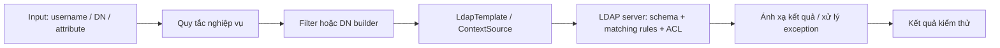

# Kiểm thử dữ liệu biên và ký tự đặc biệt

Ứng dụng sử dụng **Spring LDAP** thường nhận username, email, tên hiển thị, DN hoặc giá trị thuộc tính từ HTTP request, hàng đợi, biểu mẫu quản trị và hệ thống bên ngoài. Dữ liệu thực tế không phải lúc nào cũng giống ví dụ `uid=alice`: có thể chứa dấu sao, ngoặc, dấu phẩy, ký tự Unicode, dấu cách ở đầu/cuối, giá trị trống, chuỗi quá dài hoặc thuộc tính không tồn tại. Nếu không kiểm thử những trường hợp này, ứng dụng dễ trả sai kết quả tìm kiếm, tạo DN không hợp lệ, bỏ sót entry hoặc mở ra **LDAP filter injection**.

Bài học thuộc chương **Validation** của module **SPRING_LDAP**. Trọng tâm là xây dựng bộ kiểm thử dữ liệu biên khi thao tác với LDAP thông qua `ContextSource`, `LdapTemplate`, `LdapClient` hoặc ODM; bảo đảm đúng DN, schema, filter, xác thực, TLS, xử lý lỗi và vòng đời tài nguyên. Nội dung tập trung vào hành vi ứng dụng cần kiểm chứng, không giả định mọi LDAP server hoặc matching rule cho kết quả giống nhau.

## 1. Kiểm thử phải trả lời những câu hỏi gì?

Một hệ thống LDAP an toàn cần bảo đảm đồng thời:

1. **Tính đúng đắn:** giá trị có ký tự đặc biệt được hiểu là dữ liệu, không biến thành cú pháp điều khiển filter hoặc DN.
2. **Tính đầy đủ:** ứng dụng xử lý được các giá trị hợp lệ của directory, kể cả Unicode hoặc tên chứa dấu phẩy.
3. **Giới hạn rõ ràng:** giá trị rỗng, quá dài, sai định dạng hoặc không phù hợp quy tắc nghiệp vụ được từ chối có chủ đích.
4. **Đúng schema:** attribute không tồn tại, không có giá trị, có nhiều giá trị hoặc là dữ liệu nhị phân được xử lý đúng kiểu.
5. **Bảo mật:** dữ liệu từ client không mở rộng phạm vi tìm kiếm, làm thay đổi điều kiện filter, vượt quyền ACL hoặc bỏ qua kiểm tra mật khẩu.
6. **Khả năng phục hồi:** exception do dữ liệu khác với lỗi TLS, timeout, mất kết nối hoặc LDAP server không khả dụng; sau lỗi, context và `NamingEnumeration` được giải phóng.

Ba lớp cần kiểm tra riêng là **đầu vào ứng dụng**, **cú pháp LDAP được tạo ra** và **kết quả thực sự từ LDAP server**:



**Một test kiểm tra chuỗi filter được escape đúng không thay thế được integration test với LDAP server**. Ngược lại, một integration test chỉ thử `alice` chưa chứng minh builder chống được dữ liệu đặc biệt.

## 2. Phân biệt escaping cho filter và DN

Đây là nguyên tắc quan trọng nhất của bài học. LDAP **search filter** và **distinguished name (DN)** có cú pháp khác nhau; vì vậy escaping đúng ở định dạng này không được dùng thay cho định dạng kia.

### 2.1. Ký tự đặc biệt trong LDAP filter

Theo RFC 4515, khi một ký tự xuất hiện như **giá trị literal** bên trong assertion value của filter, các ký tự sau phải được escape:

| Ký tự dữ liệu | Vai trò có thể có trong filter | Biểu diễn escape trong assertion value |
|---|---|---|
| `*` | Wildcard trong substring/presence filter | `\2a` |
| `(` | Mở nhóm điều kiện | `\28` |
| `)` | Đóng nhóm điều kiện | `\29` |
| `\` | Ký tự mở đầu escape | `\5c` |
| NUL (U+0000) | Byte không hợp lệ nếu để nguyên trong filter string | `\00` |

Ví dụ, giá trị `a*b` phải được tìm như chuỗi literal `a*b`, không phải mọi `uid` bắt đầu bằng `a` và kết thúc bằng `b`:

```text
Giá trị username:       a*b
Filter được tạo an toàn: (uid=a\2ab)
Filter nguy hiểm:       (uid=a*b)
```

Các ký tự đặc biệt được escape theo byte UTF-8 khi cần; mã hex có thể khác cách viết hoa/thường nhưng cùng nghĩa. Không tự chèn chuỗi `\2a` trước/sau dữ liệu để tạo wildcard nếu ứng dụng đang muốn **so khớp chính xác**.

### 2.2. Ký tự đặc biệt trong DN

DN theo RFC 4514 có cú pháp `attribute=value` và các RDN được phân tách bằng dấu phẩy. Bên trong giá trị RDN, những ký tự như dấu phẩy, dấu cộng, dấu gạch chéo ngược, dấu nháy kép, dấu chấm phẩy và dấu cách đầu/cuối cần xử lý đúng theo quy tắc DN.

Ví dụ một tên có dấu phẩy:

```text
Giá trị CN:             Doe, Jane
DN không an toàn:       cn=Doe, Jane,ou=people,dc=example,dc=org
DN dạng escaped:        cn=Doe\, Jane,ou=people,dc=example,dc=org
```

Một số trường hợp DN cần đặc biệt chú ý:

| Dữ liệu RDN | Lý do cần kiểm thử |
|---|---|
| `Doe, Jane` | Dấu phẩy dễ bị hiểu là ranh giới giữa các RDN |
| `Dev+Ops` | Dấu cộng có ý nghĩa trong RDN đa trị |
| `A=B` | Dấu bằng có vai trò phân tách attribute và value |
| `#sample` | Dấu `#` đầu giá trị có ý nghĩa cú pháp |
| ` tên` hoặc `tên ` | Dấu cách đầu/cuối có quy tắc escaping riêng |
| `A\B` | Gạch chéo ngược là ký tự escape trong DN |
| `Lê, Hà` | Kết hợp Unicode và dấu phẩy |

Đừng lấy `LdapEncoder.filterEncode(...)` để escape một **DN**, hoặc dùng DN escaping để tạo **filter**. Với DN, hãy dùng đối tượng `LdapName`/`LdapNameBuilder`; với filter, dùng API xây dựng query/filter của Spring LDAP.

## 3. Viết filter an toàn bằng Spring LDAP

Ví dụ ứng dụng cần tìm `cn` theo `uid` trong nhánh `ou=people`. Tránh ghép filter trực tiếp từ đầu vào:

```java
// Không an toàn: username có thể chứa *, (, ), \ hoặc ký tự điều khiển.
String filter = "(uid=" + username + ")";
```

Thay vào đó, dùng `LdapQueryBuilder`:

```java
import java.util.List;
import org.springframework.ldap.core.AttributesMapper;
import org.springframework.ldap.core.LdapTemplate;
import org.springframework.ldap.query.LdapQuery;

import static org.springframework.ldap.query.LdapQueryBuilder.query;

public final class DirectoryLookupService {
    private final LdapTemplate ldapTemplate;

    public DirectoryLookupService(LdapTemplate ldapTemplate) {
        this.ldapTemplate = ldapTemplate;
    }

    public List<String> findCommonNames(String uid) {
        if (uid == null || uid.isBlank()) {
            throw new IllegalArgumentException("uid không được rỗng");
        }

        LdapQuery ldapQuery = query()
                .base("ou=people")
                .where("uid").is(uid);

        return ldapTemplate.search(
                ldapQuery,
                (AttributesMapper<String>) attrs -> {
                    if (attrs.get("cn") == null) {
                        return null; // Theo chính sách API, có thể thay bằng lỗi.
                    }
                    return (String) attrs.get("cn").get();
                });
    }
}
```

Trong ví dụ:

- `query().where("uid").is(uid)` tạo điều kiện bằng giá trị được escape theo filter, giúp dấu `*` hoặc `(` trong `uid` không trở thành toán tử LDAP.
- `base("ou=people")` xác định phạm vi tương đối với base DN đã cấu hình trên `LdapContextSource`, ví dụ `dc=example,dc=org`. Không nhận base DN từ request một cách tùy ý.
- `uid.isBlank()` là **quy tắc nghiệp vụ minh họa**, không phải luật rằng mọi LDAP attribute đều cấm khoảng trắng. Nếu schema ứng dụng cho phép `uid` toàn dấu cách, cần chính sách khác.
- Mapping trả `null` khi thiếu `cn` để minh họa việc thuộc tính có thể vắng mặt; API thực tế nên quy định rõ có loại bỏ giá trị này, trả `Optional`, trả lỗi dữ liệu hay trả DTO thiếu trường.

Một filter được escape đúng vẫn có thể gây truy vấn nặng nếu client được chọn `base` quá rộng, `scope` không giới hạn hoặc phép tìm kiếm trả hàng triệu entry. Escaping và **giới hạn truy vấn** là hai lớp phòng vệ khác nhau.

### Bài test đơn vị cho ký tự filter

Spring LDAP cung cấp `EqualsFilter`, có thể dùng để kiểm tra cách biểu diễn assertion value:

```java
import static org.junit.jupiter.api.Assertions.assertEquals;
import org.junit.jupiter.api.Test;
import org.springframework.ldap.filter.EqualsFilter;

class LdapFilterEscapingTest {
    @Test
    void starIsLiteralInEqualityFilter() {
        String encoded = new EqualsFilter("uid", "a*b").encode();
        assertEquals("(uid=a\\2ab)", encoded);
    }

    @Test
    void parenthesesAreLiteral() {
        String encoded = new EqualsFilter("uid", "a(b)").encode();
        assertEquals("(uid=a\\28b\\29)", encoded);
    }
}
```

Các assertion về định dạng hex ở trên minh họa cách encoding theo RFC 4515. Khi kiểm thử trên một version cụ thể, có thể so sánh chuỗi case-insensitive đối với hex hoặc kiểm tra **ngữ nghĩa tìm đúng literal trên LDAP server**, vì khác biệt về kiểu chữ hex không làm thay đổi filter. Không thay giá trị từ user bằng một biểu thức filter được nối chuỗi rồi chỉ kiểm thử nó với input thường.

## 4. Xây DN đúng để tránh sai cấu trúc

Với thao tác `lookup`, `bind` hoặc `modifyAttributes`, DN là một **tên có cấu trúc**, không phải chuỗi tùy ý. Dùng `LdapNameBuilder` để một giá trị như `Doe, Jane+Ops` được hiểu là một RDN value.

```java
import javax.naming.ldap.LdapName;
import org.springframework.ldap.support.LdapNameBuilder;

public class PersonDnFactory {
    public LdapName relativePersonDn(String uid) {
        if (uid == null || uid.isEmpty()) {
            throw new IllegalArgumentException("uid bắt buộc");
        }
        return LdapNameBuilder
                .newInstance("ou=people")
                .add("uid", uid)
                .build();
    }
}
```

Giả sử `uid` là `a,b+dev`. Builder tạo một `LdapName` có RDN mang nguyên giá trị, thay vì để `,` hoặc `+` từ dữ liệu trở thành dấu phân cách cấu trúc. Đừng so sánh DN bằng cách nối chuỗi, `split(",")` hoặc `replace("\\,", ",")` thủ công: những cách này dễ sai khi DN có escaping hoặc RDN đa trị.

**Lưu ý phân biệt:** tìm theo thuộc tính `uid` không đảm bảo RDN của entry thực sự là `uid=<giá trị>`. Directory có thể đặt RDN là `cn`, hoặc người dùng đã được chuyển DN. Nếu không biết chính xác cấu trúc, tìm DN thật từ directory theo thuộc tính đã được xác minh, rồi dùng DN đó cho `lookup` hoặc bind, thay vì tự dựng DN theo quy tắc giả định.

### Các phép thử DN quan trọng

1. Đưa vào `uid` chứa dấu phẩy, dấu cộng, dấu bằng, gạch chéo ngược và dấu cách đầu/cuối; xác minh builder giữ **một RDN value đúng**.
2. Parse lại chuỗi DN bằng `LdapName` và kiểm tra giá trị RDN khôi phục trùng dữ liệu đầu vào.
3. Thử một DN hợp lệ nhưng không tồn tại; cần xử lý `NameNotFoundException` hoặc kết quả tương ứng, không biến thành lỗi cú pháp.
4. Thử đầu vào có chuỗi nhìn như thêm nhánh `,ou=admins`; nó phải nằm trong giá trị RDN nếu được xử lý như dữ liệu.
5. Kiểm tra DN tương đối với base DN của `ContextSource` để tránh vô tình lặp `dc=example,dc=org` hai lần.

## 5. Ma trận đầu vào biên và kỳ vọng

Tạo ma trận cho **từng trường dữ liệu**, không chỉ một tập `username` chung. Các ký tự có thể hợp lệ với `cn` nhưng bị quy tắc ứng dụng cấm trong `uid`; quyết định của ứng dụng phải dựa trên schema và yêu cầu nghiệp vụ.

| Đầu vào | Ví dụ | Điều cần xác minh |
|---|---|---|
| `null` | Không truyền trường | Từ chối hoặc biểu diễn vắng mặt theo API; không gọi LDAP với giá trị ngoài ý muốn |
| Rỗng | `""` | Từ chối trong luồng đăng nhập/lookup yêu cầu định danh; không dùng làm query rộng |
| Toàn khoảng trắng | `"   "` | Chính sách `blank` rõ ràng; không âm thầm biến thành chuỗi khác |
| Khoảng trắng đầu/cuối | `" alice "` | Có trim hay giữ literal phải được quy định theo trường và matching rule |
| Wildcard | `"a*b"` hoặc `"*"` | Không biến thành substring/presence filter khi ý định là equality |
| Ngoặc | `"a(b)"` | Không làm thay đổi cấu trúc filter |
| Gạch chéo ngược | `"a\b"` | Escaping đúng ở filter và DN |
| Dấu phẩy, cộng, bằng | `"Doe, Jane+Ops=A"` | DN builder không tạo RDN ngoài ý muốn |
| Dấu `#` đầu giá trị | `"#alpha"` | DN serialization đúng quy tắc |
| Unicode có dấu | `"Nguyễn Thị Hà"` | UTF-8 và matching rule hoạt động như dự kiến |
| Ký tự bổ sung Unicode | `"a😀b"` | Không cắt hỏng cặp surrogate UTF-16 |
| Unicode kết hợp | `"é"` so với `"e" + dấu sắc tổ hợp` | Kết quả có thể phụ thuộc normalization và matching rule |
| NUL | U+0000 nằm giữa chuỗi | Không bị cắt chuỗi/ngầm biến thành cú pháp; có chính sách chấp nhận/từ chối |
| Ký tự điều khiển | Tab, LF, CR, ký tự không in | Quy tắc kiểm tra và log an toàn, không làm vỡ định dạng |
| Rất dài | 1, 128, 129, 10.000 ký tự | Giới hạn hợp lý trước truy vấn; lỗi không gây nghẽn server |
| Trùng định danh | Hai entry cùng giá trị thuộc tính login | Không tự lấy entry đầu tiên khi cần một danh tính duy nhất |
| Chữ hoa/chữ thường | `"ALICE"` và `"alice"` | Tuân thủ LDAP matching rule, không tự giả định so sánh case-sensitive |
| Emoji/ký tự ngoài BMP | `"𐐷"`, `"😀"` | Mã hóa Unicode và giới hạn chiều dài bằng code point/byte được hiểu đúng |
| Input độc hại có cấu trúc | `"*)(|(uid=*))"` | Không mở rộng điều kiện filter, không trả danh sách user hàng loạt |

**Một giá trị bị ứng dụng từ chối không phải là lỗi của LDAP.** Nếu chính sách chặn `*` trong username, hãy kiểm thử đúng ngoại lệ validation và xác nhận không gửi truy vấn. Nếu sản phẩm cho phép `*` là một phần `uid`, hãy kiểm thử tìm kiếm *literal* trên server.

## 6. Unicode, normalization và chiều dài dữ liệu

Với tiếng Việt, việc kiểm thử Unicode không thể bỏ qua. Một ký tự trông giống nhau có thể được biểu diễn bằng code point dựng sẵn hoặc một chữ cái cộng dấu tổ hợp. Ví dụ chữ `é` có thể là một ký tự U+00E9 hoặc `e` cộng U+0301.

Không nên tự động giả định LDAP server sẽ so khớp hai biểu diễn như nhau. LDAP schema và **matching rules** của từng thuộc tính quyết định tính tương đương khi so sánh; một số server hoặc backend có các quy tắc chuẩn hóa khác nhau.

Nếu ứng dụng cần chuẩn hóa đầu vào, phải xác định chính sách theo trường:

```java
import java.text.Normalizer;

String normalizedDisplayName =
        Normalizer.normalize(displayName, Normalizer.Form.NFC);
```

Đây là ví dụ **nếu nghiệp vụ quyết định áp dụng NFC** cho tên hiển thị. Không tự ý dùng normalization tương tự với **mật khẩu LDAP**, token, DN serialization hoặc các giá trị mà chuẩn hóa có thể làm đổi ý nghĩa. Không tự chuyển mọi username sang chữ thường hay `trim()` vô điều kiện nếu directory không cam kết cách so khớp tương ứng.

Một giới hạn `String.length()` trong Java đo **đơn vị UTF-16**, không phải số ký tự Unicode theo nghĩa code point hoặc số byte UTF-8. Nếu yêu cầu cho phép tối đa 128 code point:

```java
int codePoints = input.codePointCount(0, input.length());
if (codePoints > 128) {
    throw new IllegalArgumentException("Dữ liệu quá dài");
}
```

Cũng cần xem xét giới hạn kích thước **byte UTF-8** hoặc giới hạn schema/server nếu có. Các chuỗi chứa surrogate không hợp lệ cần được xử lý theo chính sách mã hóa đầu vào; không để logic cắt chuỗi làm hỏng cặp surrogate.

### Mật khẩu và Unicode

Mật khẩu là trường hợp đặc biệt. Chức năng xác thực phải kiểm tra chính xác credential mà user cung cấp theo cơ chế của LDAP server. **Không trim, lowercase hoặc chuẩn hóa mật khẩu tùy ý** trước bind. Kiểm thử mật khẩu Unicode, mật khẩu có dấu cách và mật khẩu chứa ký tự đặc biệt phải thực hiện qua kết nối TLS an toàn, theo chính sách của directory.

Mật khẩu rỗng cần được chặn trước khi thử LDAP simple bind: tùy server, bind với tên nhưng mật khẩu độ dài 0 có thể mang ngữ nghĩa unauthenticated/anonymous, không chứng minh người dùng đã xác thực thành công.

## 7. Schema, thuộc tính thiếu và nhiều giá trị

Một LDAP entry không phải lúc nào cũng có đủ mọi attribute. Một số trường là optional, có thể có nhiều giá trị hoặc có kiểu dữ liệu không phải chuỗi.

| Tình huống | Ví dụ | Kiểm thử |
|---|---|---|
| Thuộc tính không tồn tại | Entry không có `mail` | Mapper không gọi `attrs.get("mail").get()` một cách mù quáng |
| Thuộc tính có nhiều giá trị | `memberOf` hoặc `telephoneNumber` tùy schema | Xử lý từng giá trị, không chỉ phần tử đầu tiên nếu nghiệp vụ cần tất cả |
| Thuộc tính binary | `jpegPhoto`, `objectGUID` tùy server | Không cast `byte[]` thành `String` |
| Thuộc tính bắt buộc | `objectClass`, `sn` trong một số objectClass | Server có thể từ chối add/modify thiếu yêu cầu schema |
| Giá trị trùng | Thêm giá trị đã có vào attribute đa trị | Xác minh cách server báo lỗi và ứng dụng xử lý |
| Thuộc tính không được phép | Modify thuộc tính không thuộc objectClass hoặc không có ACL | Phân biệt schema violation và lỗi quyền |
| Attribute name sai | `unknownAttribute` | Xác minh lỗi schema, không coi là kết nối hỏng |
| Kết quả quá nhiều | Search không giới hạn | Áp dụng size limit/paging và xử lý partial results |

Đoạn mapper đọc an toàn thuộc tính tùy chọn:

```java
import javax.naming.NamingException;
import javax.naming.directory.Attribute;
import javax.naming.directory.Attributes;
import org.springframework.ldap.core.AttributesMapper;

public final class DisplayNameMapper implements AttributesMapper<String> {
    @Override
    public String mapFromAttributes(Attributes attrs) throws NamingException {
        Attribute cn = attrs.get("cn");
        if (cn == null || cn.size() == 0) {
            return null; // Quyết định theo hợp đồng API của ứng dụng.
        }
        Object value = cn.get();
        if (!(value instanceof String)) {
            throw new IllegalArgumentException("cn phải là chuỗi");
        }
        return (String) value;
    }
}
```

Đây là ví dụ phòng vệ khi mapper gặp dữ liệu không như dự kiến. Với `cn` bắt buộc theo schema ứng dụng, bạn có thể chọn ném một exception dữ liệu có thông điệp phù hợp thay vì trả `null`. Không dùng `toString()` một cách mù quáng với thuộc tính binary vì có thể tạo chuỗi vô nghĩa và che mất lỗi mapping.

## 8. Tạo integration test với LDAP server thử nghiệm

**Unit test** có thể kiểm tra input validation và builder. Nhưng các khác biệt về matching rule, schema, ACL, attribute binary và xử lý Unicode phải được kiểm tra trên **LDAP server thực tế hoặc server thử nghiệm có hành vi phù hợp**. Có thể sử dụng OpenLDAP, 389 Directory Server, AD lab hoặc embedded LDAP phục vụ kiểm thử; không giả định tất cả hỗ trợ cùng schema.

Chuẩn bị fixture trong nhánh riêng, ví dụ `ou=people,dc=example,dc=org`, với các tài khoản thử nghiệm:

| Fixture | Giá trị `uid` hoặc `cn` | Mục đích |
|---|---|---|
| User thông thường | `uid=alice` | Đường đi bình thường |
| Literal wildcard | `uid=a*b` nếu schema/server cho phép | Kiểm tra filter literal |
| Dấu ngoặc | `uid=a(b)` nếu schema/server cho phép | Kiểm tra filter escaping |
| Backslash | `uid=a\b` nếu schema/server cho phép | Kiểm tra escape đúng |
| Unicode | `cn=Nguyễn Thị Hà` | Đọc/ghi/so khớp ký tự có dấu |
| Dấu phẩy trong RDN | `cn=Doe\, Jane` | DN builder và lookup |
| Attribute thiếu | Không có `mail` | Mapper xử lý optional attribute |
| Attribute đa trị | Hai `telephoneNumber` | Đọc đủ các giá trị |
| Entry có quyền hạn chế | User bind không đọc được một attribute | Phân biệt lỗi ACL với dữ liệu vắng mặt |

Nếu schema của server không cho phép lưu `uid` có dấu `*` hoặc dấu ngoặc, đừng nới lỏng schema của production để phục vụ test. Hãy kiểm tra **chuỗi filter được encode** bằng unit test, và dùng một attribute thử nghiệm/fixture hợp lệ khác khi cần kiểm tra so khớp literal end-to-end.

### Ví dụ JUnit 5 kiểm tra input nguy hiểm không mở rộng truy vấn

Giả sử `DirectoryLookupService` ở trên được kết nối với **LDAP server test**, chứa `alice` và các entry cần thiết, và không có entry nào có literal uid như chuỗi tấn công:

```java
import static org.junit.jupiter.api.Assertions.*;
import java.util.List;
import org.junit.jupiter.api.Test;
import org.junit.jupiter.params.ParameterizedTest;
import org.junit.jupiter.params.provider.ValueSource;

class DirectoryLookupIntegrationTest {
    // Được khởi tạo bằng LdapTemplate trỏ đến LDAP server thử nghiệm.
    private DirectoryLookupService directoryLookupService;

    @ParameterizedTest
    @ValueSource(strings = {
            "*",
            "a*b",
            "a(b)",
            "a\\b",
            "*)(|(uid=*))"
    })
    void specialCharactersMustNotBroadenLookup(String uid) {
        // Fixture bảo đảm không có entry sở hữu chính xác các uid này.
        List<String> names = directoryLookupService.findCommonNames(uid);
        assertTrue(names.isEmpty());
    }

    @Test
    void missingUidIsRejectedBeforeLDAP() {
        assertThrows(IllegalArgumentException.class,
                () -> directoryLookupService.findCommonNames(""));
    }
}
```

Đây là **bộ khung integration test**, cần inject service và tạo fixture trước khi chạy. Assertion `isEmpty()` chỉ đúng khi dataset **không có UID literal tương ứng**; nếu có, hãy assert đúng entry mong đợi thay vì yêu cầu rỗng. Dùng `@ParameterizedTest` giúp thêm dữ liệu biên mà không lặp logic test. Đừng chỉ dựa vào “không ném exception”: một filter bị injection có thể vẫn chạy thành công nhưng trả **quá nhiều người dùng**.

### Kiểm thử DN bằng round-trip

Thay vì chỉ so chuỗi DN đã escape, có thể kiểm tra giá trị RDN sau khi build:

```java
import static org.junit.jupiter.api.Assertions.assertEquals;
import javax.naming.ldap.LdapName;
import org.junit.jupiter.api.Test;
import org.springframework.ldap.support.LdapNameBuilder;

class LdapDnTest {
    @Test
    void commaAndPlusRemainInsideRdnValue() throws Exception {
        String uid = "Doe, Jane+Ops";
        LdapName dn = LdapNameBuilder.newInstance("ou=people")
                .add("uid", uid)
                .build();

        LdapName parsed = new LdapName(dn.toString());
        assertEquals(dn, parsed);
        assertEquals(2, parsed.size());
        assertEquals(uid, parsed.getRdn(parsed.size() - 1).getValue());
        // Cả cấu trúc lẫn RDN value đều được giữ nguyên sau round-trip.
    }
}
```

Test này xác nhận DN tạo được có thể parse lại nhất quán, nhưng chưa tự nó chứng minh server chứa entry tương ứng. Để kiểm tra end-to-end, tạo entry lab có RDN hợp lệ rồi `lookup`/`modify` bằng chính DN được builder tạo.

## 9. Kiểm thử giới hạn, lỗi và an toàn truy cập

Kiểm thử dữ liệu biên còn liên quan đến hiệu năng và bảo mật. Một đầu vào được escape đúng vẫn có thể gây truy vấn rất nặng nếu quá dài, base DN quá rộng hoặc thời gian/khối lượng kết quả không bị giới hạn.

| Nhóm kiểm thử | Trường hợp | Kỳ vọng |
|---|---|---|
| Giới hạn input | Username 10.000 ký tự, chuỗi NUL, input chứa ký tự điều khiển | Có chính sách chấp nhận/từ chối rõ; không tạo lệnh không kiểm soát |
| Query scope | Client cố truyền base DN bên ngoài nhánh được phép | Không mở rộng phạm vi ngoài chính sách |
| Search size | Filter có nhiều kết quả | Trả phân trang/giới hạn kết quả; không tải toàn directory |
| Search timeout | Server phản hồi chậm | Nhận ngoại lệ hoặc xử lý deadline có kiểm soát |
| DN không tồn tại | `lookup` vào DN hợp lệ nhưng thiếu entry | Phân loại khác lỗi cú pháp DN |
| Filter sai cú pháp | Chuỗi filter do code tạo không hợp lệ | Báo lỗi lập trình, không tự retry vô hạn |
| Không đủ quyền | User/service account đọc hoặc sửa attribute ngoài ACL | Từ chối đúng; không thử bằng tài khoản mạnh hơn |
| TLS | Chứng chỉ sai, trust store không hợp lệ | Kết nối thất bại an toàn; không chuyển xuống cleartext |
| Kết nối gián đoạn | LDAP server restart, network reset | Tài nguyên được đóng; phân biệt với lỗi dữ liệu |
| Pooling | Context stale sau khoảng idle | Validator/exception xử lý phù hợp; không dùng lại context sai danh tính |
| User authentication | Mật khẩu rỗng, sai, có Unicode, account bị khóa | Không bỏ qua bind; kết quả khớp chính sách của server |

### Lỗi dữ liệu khác lỗi hạ tầng

Một DN không tồn tại, một filter sai hoặc thiếu quyền không tự chứng minh LDAP context đã mất kết nối. Ngược lại, `CommunicationException` hoặc lỗi TLS có thể làm phiên không dùng tiếp được. Với pool, cần phân loại lỗi để loại context hỏng theo chính sách mà không tạo lại kết nối vô ích cho mọi lỗi nghiệp vụ.

Đối với thao tác ghi `add`, `modifyAttributes` và `delete`, kiểm thử bằng entry lab. Nếu client bị timeout sau khi gửi lệnh, server có thể đã thực hiện thay đổi dù chưa trả phản hồi. **Không retry ghi mù quáng**; xác minh trạng thái từ một context còn hợp lệ và cân nhắc tính lặp an toàn của thao tác.

Với JNDI trực tiếp, luôn đóng `NamingEnumeration` và `DirContext` trong `finally`; với `LdapTemplate`, sử dụng các API quản lý vòng đời context phù hợp. Một test cố tình gây exception nên xác nhận không làm tăng mãi số context đang active trong pool.

### Kiểm thử auth và tránh lộ dữ liệu

Trong luồng đăng nhập, không được pool một context đã bind user A rồi dùng nó làm bằng chứng xác thực cho user B. Kiểm thử đăng nhập xen kẽ hai user với mật khẩu đúng/sai, khóa tài khoản, đổi mật khẩu và cả trường hợp LDAP server không sẵn sàng. Không trả công khai thông tin quá chi tiết giúp dò sự tồn tại của tài khoản.

Không log mật khẩu, toàn bộ DN nhạy cảm, giá trị `userPassword`, token hoặc full directory entry. Với username chứa LF/CR, kiểm tra log escaping để không bị tạo bản ghi giả. Metric chỉ nên dùng các nhãn có tập giá trị hữu hạn như loại thao tác và nhóm lỗi; tránh dùng toàn bộ input làm label.

## 10. Kế hoạch kiểm thử hoàn chỉnh và tiêu chí chấp nhận

Một quy trình kiểm thử lặp lại được có thể gồm:

1. **Chốt hợp đồng dữ liệu:** thuộc tính đăng nhập, schema, trường optional/multivalued, kích thước tối đa, quy tắc Unicode và phạm vi DN được phép.
2. **Tạo unit test cho parser/builder:** input filter `*`, `(`, `)`, `\`, NUL; DN có `,`, `+`, `#` đầu và dấu cách đầu/cuối.
3. **Tạo fixture integration:** entry ASCII, tiếng Việt, Unicode tổ hợp, attribute thiếu/đa trị, DN escaped và tài khoản thử nghiệm với quyền khác nhau.
4. **Chạy tìm kiếm/lookup:** kiểm tra kết quả đúng theo literal, không trả dư entry, không chọn tùy tiện DN trùng và không phụ thuộc thứ tự trả kết quả.
5. **Chạy thao tác ghi trên dữ liệu lab:** validate schema, escaping DN, quyền ACL và dọn trạng thái sau lỗi.
6. **Thử các giới hạn vận hành:** chuỗi dài, nhiều kết quả, timeout, LDAP server restart, TLS lỗi và context stale trong pool.
7. **Kiểm tra bảo mật đăng nhập:** mật khẩu rỗng/sai, user A/B xen kẽ, Unicode, trạng thái tài khoản; không có bypass do pooling.
8. **Ghi kết quả rõ ràng:** input đã che dữ liệu nhạy cảm, kỳ vọng, kết quả thực tế, loại lỗi, server/version, cấu hình TLS và cách tạo fixture.

### Tiêu chí hoàn thành

| Điều kiện | Dấu hiệu đạt |
|---|---|
| Filter escaping | Các ký tự đặc biệt được tìm như literal khi yêu cầu equality; input không sửa được cấu trúc filter |
| DN escaping | Dấu phẩy/cộng và khoảng trắng không làm sai ranh giới RDN |
| Unicode | Dữ liệu tiếng Việt và Unicode được xử lý theo matching rule/schema đã xác định |
| Validation | Giá trị thiếu, rỗng, quá dài hoặc ngoài chính sách được xử lý có chủ đích |
| Mapping | Entry thiếu trường, multivalued và binary không gây cast/NullPointerException ngoài dự kiến |
| Schema/ACL | Thao tác ngoài quyền hoặc sai schema thất bại đúng loại |
| Xác thực | Mật khẩu rỗng không được chấp nhận như user bind thành công; không trộn phiên giữa user |
| Độ tin cậy | Lỗi timeout/TLS/LDAP không làm rò rỉ context; truy vấn ghi không retry thiếu kiểm soát |
| Quan sát | Log, tracing và metric không chứa secret hoặc dữ liệu nhạy cảm |

### Câu hỏi tự kiểm tra

1. Vì sao ký tự `*` phải được xử lý khác nhau khi nó là wildcard hợp lệ và khi nó là dữ liệu `uid` literal?
2. Tại sao `\2a` của LDAP filter không thay thế được `\,` trong DN?
3. Nếu hai chuỗi Unicode trông giống nhau nhưng khác mã code point, kết quả tìm kiếm phụ thuộc vào đâu?
4. Khi entry không có `mail`, mapper nên phản ứng thế nào?
5. Vì sao việc parse lại DN thành công chưa chứng minh entry đó tồn tại trong LDAP server?
6. Tại sao test “không ném exception” là chưa đủ để phát hiện LDAP injection?
7. Một lỗi `NameNotFoundException` khác `CommunicationException` ở ý nghĩa nào với pool?
8. Vì sao phải kiểm thử mật khẩu rỗng trước khi LDAP bind và không tự động chuẩn hóa mật khẩu?

**Kết luận:** kiểm thử dữ liệu biên trong Spring LDAP phải bao gồm **filter, DN, Unicode, schema, kết quả mapping, xác thực và xử lý lỗi**. Dùng `LdapQueryBuilder` cho giá trị filter, `LdapNameBuilder` cho DN, kết hợp unit test với integration test và fixture LDAP rõ ràng. Một hệ thống chỉ thực sự đúng khi dữ liệu đặc biệt được xử lý như dữ liệu, truy vấn không vượt phạm vi dự kiến, lỗi được phân loại rõ và tài nguyên kết nối được giải phóng an toàn.

### Tài liệu tham khảo

- [Spring LDAP Reference Documentation](https://docs.spring.io/spring-ldap/reference/)
- [Spring LDAP API — LdapQueryBuilder](https://docs.spring.io/spring-ldap/docs/current/api/org/springframework/ldap/query/LdapQueryBuilder.html)
- [RFC 4515 — LDAP Search Filters](https://www.rfc-editor.org/rfc/rfc4515)
- [RFC 4514 — String Representation of Distinguished Names](https://www.rfc-editor.org/rfc/rfc4514)
- [RFC 4512 — Directory Information Models](https://www.rfc-editor.org/rfc/rfc4512)
- [RFC 4513 — LDAP Authentication and Security](https://www.rfc-editor.org/rfc/rfc4513)
