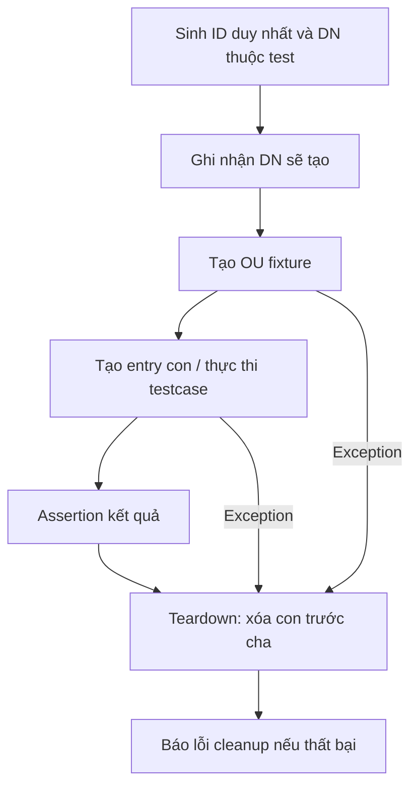

# Dọn dữ liệu test và cô lập test song song

Trong **Spring LDAP**, integration test thường tạo người dùng, nhóm, organizational unit (OU), sửa attribute, đổi DN hoặc xóa entry trên một LDAP server thật dành cho kiểm thử. Những thao tác này thay đổi trạng thái **bên ngoài JVM**. Nếu bài test kết thúc mà không dọn dữ liệu, lần chạy sau có thể gặp `entryAlreadyExists`, số lượng kết quả tìm kiếm thay đổi hoặc lỗi quyền không liên quan. Khi nhiều test chạy song song, hai ca dùng cùng một DN còn có thể xóa dữ liệu của nhau và tạo ra lỗi *flaky* khó tái hiện.

Bài học thuộc chương **Testing** của module **SPRING_LDAP**, trình bày cách thiết kế **dữ liệu test có chủ sở hữu, cô lập theo từng test và cleanup an toàn**. Các ví dụ tập trung vào `ContextSource`, `LdapTemplate` và JUnit 5; nguyên tắc cũng áp dụng với `LdapClient`, ODM, LDAP test container và pipeline CI. Giả định directory kiểm thử có base DN `dc=example,dc=org`. Mọi DN, tài khoản và số liệu dưới đây là giả định cho môi trường **test riêng**, không phải hướng dẫn thao tác trên LDAP production.

## 1. Vì sao LDAP integration test cần cleanup riêng?

Một test thông thường có thể dùng đối tượng Java trong bộ nhớ và được GC thu hồi sau khi hoàn tất. Với LDAP, thao tác như:

```java
ldapTemplate.bind(personDn, null, attributes);
```

đã ghi một entry lên server. JVM kết thúc, `@Transactional` ở một database khác rollback, hoặc Mockito reset **không làm LDAP entry biến mất**.

Các tình huống thường gặp:

| Hiện tượng | Nguyên nhân | Cách phòng tránh |
| --- | --- | --- |
| Chạy riêng thì xanh, chạy cả suite thì đỏ | Hai test cùng tạo `uid=alice` tại một DN | Mỗi test có OU hoặc directory riêng |
| Chạy lại pipeline gặp `entryAlreadyExists` | Dữ liệu của lần chạy trước không được xóa | Cleanup có guard + định danh lần chạy |
| Một test tìm thấy nhiều entry hơn dự kiến | Search vượt ra ngoài phạm vi fixture | Search base được giới hạn trong nhánh của test |
| Test A xóa entry mà test B đang dùng | Cleanup theo tên cố định hoặc subtree dùng chung | Mỗi test chỉ xóa tài nguyên tự sở hữu |
| Fail giữa setup khiến entry còn sót | Cleanup chỉ đặt sau assertion thành công | Dùng `@AfterEach`/`finally`, ghi nhận DN trước I/O |
| Test sửa schema hoặc ACL làm test khác thất bại | Dùng chung cấu hình cấp server | Directory riêng hoặc tuần tự hóa test có tác động toàn cục |

**Không mặc định có transaction bao trùm các lời gọi LDAP**. Một loạt `bind`, `modifyAttributes`, `rename` và `unbind` thông thường không được rollback tự động khi assertion thất bại.

## 2. Chọn cấp độ cô lập phù hợp

Cần phân biệt *test không gọi LDAP thật* với *test tích hợp trên LDAP thật*. Mỗi cấp có mức tin cậy và chi phí khác nhau.

| Cấp độ | Cách tổ chức | Phù hợp | Giới hạn |
| --- | --- | --- | --- |
| **Unit test** | Mock `LdapTemplate` hoặc cổng truy cập directory | Kiểm tra validation, DN, filter, xử lý exception | Không chứng minh schema, ACL, TLS hay search thật |
| **OU riêng mỗi test** | Tạo `ou=case-<id>,ou=tests` | CRUD/search trong cùng schema/server | Vẫn chia sẻ schema, ACL, tải và cấu hình server |
| **OU riêng mỗi worker/build** | `ou=run-<id>,ou=tests`, bên dưới có OU riêng mỗi test | Pipeline nhiều JVM hoặc CI job | Quản lý lifecycle phức tạp hơn; vẫn dùng chung server |
| **LDAP instance riêng mỗi suite/worker** | Container hoặc directory ephemeral | Kiểm thử xung đột, quản trị, cấu hình và hiệu ứng toàn server | Khởi động và cấp tài nguyên tốn kém hơn |
| **Server test chung có fixture bất biến** | Chỉ đọc dữ liệu seed với quyền hạn hạn chế | Một số bài kiểm thử tra cứu | Không thích hợp khi test có thao tác ghi hoặc thay đổi ACL |

**Mặc định thực tế:** với test CRUD thông thường, tạo **nhánh riêng cho mỗi test** và dọn toàn bộ tài nguyên thuộc nhánh đó. Với test thay schema, chính sách mật khẩu, server config, truststore, referral hoặc ACL dùng chung, **OU riêng là chưa đủ**; hãy dùng LDAP instance riêng hoặc điều phối chạy tuần tự.

## 3. Thiết kế cây dữ liệu test có chủ sở hữu

Giả sử người quản trị test đã tạo sẵn **một lần**, trong directory test:

```ldif
dn: ou=tests,dc=example,dc=org
objectClass: top
objectClass: organizationalUnit
ou: tests
```

Ứng dụng test dùng base DN `dc=example,dc=org`. Mỗi test tạo một nhánh riêng:

```text
dc=example,dc=org                     (base từ ContextSource)
└── ou=tests                           (nhánh test dùng chung, không xóa)
    ├── ou=case-8c1d...                (test A tự sở hữu)
    │   ├── uid=alice                  (fixture của A)
    │   └── cn=developers              (fixture của A)
    └── ou=case-f405...                (test B tự sở hữu)
        └── uid=alice                  (fixture của B, DN khác A)
```

Hai test đều có thể dùng RDN lá `uid=alice` vì **DN đầy đủ khác nhau**. Ví dụ:

```text
uid=alice,ou=case-8c1d,ou=tests,dc=example,dc=org
uid=alice,ou=case-f405,ou=tests,dc=example,dc=org
```

### 3.1. Quy tắc tạo định danh test

- Sinh tên nhánh không trùng, ví dụ `case-` cộng UUID. Nếu có nhiều pipeline/JVM, có thể thêm mã build/worker đã được chuẩn hóa vào tên.
- Đặt RDN bằng `LdapNameBuilder`, không nối DN bằng chuỗi từ input chưa được kiểm soát.
- Giữ **đúng một thư mục cha dùng chung** như `ou=tests` do môi trường test quản lý; từng test **không được xóa** cha này.
- Mỗi test chỉ tạo, tìm kiếm, sửa hoặc xóa entry trong OU thuộc sở hữu của nó, trừ những test được thiết kế riêng để xác minh quyền/phạm vi.
- **Không tái sử dụng dữ liệu người thật** và không dùng tài khoản quản trị production để chạy test.

Ví dụ dựng DN tương đối với `ContextSource.base`:

```java
import java.util.UUID;
import javax.naming.ldap.LdapName;
import org.springframework.ldap.support.LdapNameBuilder;

String caseId = "case-" + UUID.randomUUID()
        .toString().replace("-", "");

LdapName testOuDn = LdapNameBuilder.newInstance()
        .add("ou", "tests")
        .add("ou", caseId)
        .build();

LdapName personDn = LdapNameBuilder.newInstance(testOuDn)
        .add("uid", "alice")
        .build();
```

Khi `ContextSource` đã có base `dc=example,dc=org`, `testOuDn` ở trên là `ou=case-...,ou=tests`; không gắn base thêm lần nữa khi truyền vào `LdapTemplate.bind` hoặc `unbind`.

## 4. Vòng đời setup → test → teardown

Một vòng đời kiểm thử nên tách rõ việc chuẩn bị dữ liệu, thực thi assertion và dọn dữ liệu:



**Vì sao ghi nhận DN trước khi gọi server?** Nếu `bind` đã thành công nhưng connection bị mất trước khi client nhận phản hồi, ứng dụng có thể thấy exception dù entry thực sự tồn tại. Nếu chỉ đăng ký cleanup **sau** khi `bind` trả về, entry đó có thể bị bỏ sót. Với DN dự kiến do test tự chọn, có thể ghi nhận trước, rồi cleanup theo trạng thái thực tế.

### 4.1. Ví dụ đầy đủ với JUnit 5 và `LdapTemplate`

Giả sử dự án có **Spring Boot test context** cung cấp một bean `LdapTemplate` đã trỏ tới directory test, với parent `ou=tests` tồn tại. Ví dụ sử dụng `@SpringBootTest`; nếu ứng dụng không dùng Spring Boot, có thể dùng `@SpringJUnitConfig` với cấu hình tương đương.

```java
import static org.junit.jupiter.api.Assertions.assertEquals;

import java.util.ArrayList;
import java.util.Comparator;
import java.util.List;
import java.util.UUID;
import javax.naming.directory.Attribute;
import javax.naming.directory.Attributes;
import javax.naming.directory.BasicAttribute;
import javax.naming.directory.BasicAttributes;
import javax.naming.ldap.LdapName;

import org.junit.jupiter.api.AfterEach;
import org.junit.jupiter.api.BeforeEach;
import org.junit.jupiter.api.Test;
import org.springframework.beans.factory.annotation.Autowired;
import org.springframework.boot.test.context.SpringBootTest;
import org.springframework.ldap.NameNotFoundException;
import org.springframework.ldap.core.AttributesMapper;
import org.springframework.ldap.core.LdapTemplate;
import org.springframework.ldap.support.LdapNameBuilder;

@SpringBootTest
class IsolatedPersonDirectoryIT {

    private static final LdapName TESTS_PARENT =
            LdapNameBuilder.newInstance()
                    .add("ou", "tests").build();

    @Autowired
    private LdapTemplate ldapTemplate; // Trỏ tới LDAP TEST, không production.

    // JUnit 5 mặc định tạo instance test mới cho mỗi test method.
    private final List<LdapName> ownedDns = new ArrayList<>();
    private LdapName caseDn;

    @BeforeEach
    void createCaseOu() {
        String id = "case-" + UUID.randomUUID()
                .toString().replace("-", "");
        caseDn = LdapNameBuilder.newInstance(TESTS_PARENT)
                .add("ou", id)
                .build();

        Attributes ouAttrs = new BasicAttributes(true);
        Attribute classes = new BasicAttribute("objectClass");
        classes.add("top");
        classes.add("organizationalUnit");
        ouAttrs.put(classes);
        ouAttrs.put("ou", id);

        // Đăng ký TRƯỚC I/O để còn dọn khi phản hồi bind bị mất.
        registerOwnedDn(caseDn);
        ldapTemplate.bind(caseDn, null, ouAttrs);
    }

    @Test
    void createsAndReadsPersonInsideItsOwnOu() {
        LdapName personDn = LdapNameBuilder.newInstance(caseDn)
                .add("uid", "alice").build();

        Attributes attrs = new BasicAttributes(true);
        Attribute classes = new BasicAttribute("objectClass");
        classes.add("top");
        classes.add("person");
        classes.add("organizationalPerson");
        classes.add("inetOrgPerson");
        attrs.put(classes);
        attrs.put("uid", "alice");
        attrs.put("cn", "Alice Test");
        attrs.put("sn", "Test");

        registerOwnedDn(personDn);
        ldapTemplate.bind(personDn, null, attrs);

        String actualName = ldapTemplate.lookup(
                personDn,
                (AttributesMapper<String>)
                        entry -> (String) entry.get("cn").get());

        assertEquals("Alice Test", actualName);
    }

    @AfterEach
    void cleanupOwnedEntries() {
        if (caseDn == null) {
            return;
        }

        // Validate TOÀN BỘ phạm vi trước khi xóa bất kỳ entry nào.
        if (caseDn.equals(TESTS_PARENT)
                || !caseDn.startsWith(TESTS_PARENT)) {
            throw new IllegalStateException(
                    "DN gốc của test không an toàn để cleanup");
        }
        for (LdapName dn : ownedDns) {
            if (!dn.startsWith(caseDn)) {
                throw new IllegalStateException(
                        "Từ chối xóa DN ngoài nhánh của testcase");
            }
        }

        // DN sâu hơn được xóa trước để parent không còn children.
        List<LdapName> childrenFirst = ownedDns.stream()
                .distinct()
                .sorted(Comparator.comparingInt(LdapName::size).reversed())
                .toList();

        RuntimeException cleanupError = null;
        for (LdapName dn : childrenFirst) {
            try {
                ldapTemplate.unbind(dn);
            } catch (NameNotFoundException alreadyGone) {
                // Chỉ cho phép idempotent khi entry thực sự không tồn tại.
            } catch (RuntimeException ex) {
                if (cleanupError == null) {
                    cleanupError = new IllegalStateException(
                            "Không dọn hết LDAP fixture", ex);
                } else {
                    cleanupError.addSuppressed(ex);
                }
            }
        }
        if (cleanupError != null) {
            throw cleanupError; // Không âm thầm báo test PASS.
        }
    }

    private void registerOwnedDn(LdapName dn) {
        if (caseDn == null
                || !caseDn.startsWith(TESTS_PARENT)
                || !dn.startsWith(caseDn)) {
            throw new IllegalArgumentException(
                    "DN không thuộc test đang chạy");
        }
        ownedDns.add(dn);
    }
}
```

Ví dụ có những đặc điểm quan trọng:

1. **Mỗi test method có OU duy nhất** nên `uid=alice` không đụng DN của test khác. Mã dựa vào lifecycle **PER_METHOD mặc định** của JUnit Jupiter; không tự đổi thành `@TestInstance(PER_CLASS)` rồi cho nhiều method sửa chung `ownedDns` khi chạy parallel.
2. **Đăng ký trước thao tác ghi** để xử lý tình huống server đã nhận request nhưng client mất phản hồi.
3. **Xóa DN sâu hơn trước**: entry người dùng được xóa trước OU của test. Nếu LDAP báo OU còn child không được ghi nhận, cleanup sẽ thất bại rõ ràng thay vì quét/xóa bừa.
4. **Kiểm tra ranh giới** trước mọi lệnh xóa. `LdapName.startsWith` ở đây so sánh thành phần DN theo thứ tự JNDI, tức nhận biết nhánh tổ tiên tương ứng dù chuỗi DN được hiển thị từ RDN lá về gốc.
5. Chỉ bỏ qua `NameNotFoundException` cho entry đã không tồn tại; **không** bỏ qua lỗi quyền, kết nối, schema hay `notAllowedOnNonLeaf`.
6. `@AfterEach` giúp cleanup diễn ra sau testcase dù assertion ném lỗi. Nếu có nhiều lỗi teardown, đoạn code giữ các lỗi phụ bằng `addSuppressed` để phục vụ chẩn đoán.

**Giới hạn của ví dụ:** mã fixture chỉ tạo **một cấp entry con**. Khi test còn tạo nested OU, nhóm, alias hoặc rename, cần đăng ký mọi DN liên quan hoặc dùng cleanup subtree được bảo vệ riêng. Test thất bại trong lúc setup do cấu hình/ACL cũng có thể làm teardown thất bại; đó là dấu hiệu hạ tầng test không sẵn sàng, không nên bị nuốt đi.

## 5. Cleanup phải có ranh giới an toàn và dễ kiểm toán

Một thủ tục teardown không nên chỉ gọi “xóa tất cả entry match filter `(uid=*)`”. Filter không tự chứng minh quyền sở hữu dữ liệu; search base bị cấu hình sai có thể khiến test xóa entry ngoài phạm vi.

### 5.1. Những quy tắc bắt buộc

- **Tên nhánh có chủ sở hữu rõ ràng:** mỗi test có `caseId`; khi cần, thêm `runId` và `workerId` vào đường dẫn hoặc metadata phục vụ đối soát.
- **Không xóa root dùng chung:** `dc=example,dc=org`, `ou=tests`, và nhánh fixture của test khác là vùng cấm.
- **Không lấy DN cần xóa từ input thô** hay từ kết quả search không được giới hạn rồi đưa thẳng vào `unbind`.
- **Kiểm tra DN bằng cấu trúc:** parse bằng `LdapName`, xác minh thuộc nhánh của test; tránh dùng `String.endsWith` để kiểm tra subtree.
- **Xóa con trước cha:** LDAP thường từ chối xóa entry còn các subordinate entry; `unbind` thông thường không phải “xóa cây” tự động.
- **Log lỗi cleanup:** ghi `runId/caseId`, loại thao tác, mã lỗi đã chuẩn hóa; không log mật khẩu hoặc toàn bộ attribute.
- **Không dùng quyền quản trị quá rộng:** tài khoản test chỉ nên có quyền trên cây test.

### 5.2. Có nên dùng recursive delete?

Một số tiện ích hoặc API hỗ trợ thao tác xóa cây theo cách riêng, nhưng đó là lựa chọn **rủi ro cao** nếu truyền nhầm DN. Chỉ cân nhắc khi:

1. Directory dành riêng cho test hoặc DN subtree đã được xác minh thuộc nhánh duy nhất vừa tạo.
2. Công cụ xóa có kiểm tra root được phép và từ chối `ou=tests`/directory base.
3. Test không thể ghi ra ngoài subtree và toàn bộ tài khoản sử dụng đều chỉ có quyền test.
4. Chấp nhận rằng xóa cây có thể tác động cả dữ liệu chưa đăng ký bên trong nhánh đó; cần quan sát/log trước khi xóa.

Nếu chưa có những đảm bảo này, ưu tiên **registry DN đã tạo** và xóa cụ thể theo thứ tự. Một fixture orphan còn sót cần được báo cáo thay vì tự động mở rộng phạm vi xóa sang nhánh khác.

### 5.3. Xử lý rename và move DN

Khi testcase dùng `modifyDN` hoặc `LdapTemplate.rename`, DN của entry thay đổi. Registry chỉ lưu DN ban đầu có thể không đủ cho cleanup.

```text
Trước rename:
uid=alice,ou=case-123,ou=tests

Sau rename:
uid=alice-renamed,ou=case-123,ou=tests
```

Có thể đăng ký **cả DN đích trước khi rename** rồi dọn theo trạng thái thực tế, với kiểm tra ranh giới tương tự. Nếu test chuyển entry ra ngoài subtree thì cơ chế cô lập theo OU bị phá vỡ; test đó cần directory riêng hoặc fixture/teardown đặc biệt được kiểm soát. Khi rename làm thay đổi đường dẫn con, cleanup cần giải quyết các DN sau rename trước parent.

## 6. Chạy JUnit 5 song song mà không dùng chung dữ liệu mutable

JUnit Jupiter có thể chạy song song khi được cấu hình. Ví dụ file `junit-platform.properties` trong test resources:

```properties
junit.jupiter.execution.parallel.enabled=true
junit.jupiter.execution.parallel.mode.default=concurrent
junit.jupiter.execution.parallel.mode.classes.default=concurrent
```

Cấu hình này chỉ **bật lịch chạy concurrent**; nó **không tự cô lập LDAP state**. Test phải bảo đảm tài nguyên được chia sẻ là an toàn.

| Tài nguyên | Có thể chia sẻ khi chạy parallel? | Điều kiện |
| --- | --- | --- |
| Bean `LdapTemplate` dùng chung | Có thể, tùy cấu hình/provider | Mọi testcase giữ DN riêng; cấu hình kết nối không bị mutate |
| `ContextSource` cùng base/test credentials | Có thể, tùy môi trường | Không đổi cấu hình toàn cục giữa các test; kết nối/pool được cấu hình hợp lý |
| OU riêng mỗi test | Có | Không có test khác ghi/xóa OU đó |
| Danh sách `member`/entry dùng chung | Không nên | Nếu thực sự chia sẻ, cần test có chủ đích và kiểm soát cạnh tranh |
| Schema/ACL/password policy cấp server | Không an toàn khi thay song song | Dùng LDAP instance riêng hoặc khóa tài nguyên |
| Thư mục test chung `ou=tests` | Chia sẻ như **parent bất biến** | Không xóa/sửa parent trong từng test |

Một test thay đổi **tài nguyên toàn cục** có thể buộc phải chạy tuần tự:

```java
import org.junit.jupiter.api.Test;
import org.junit.jupiter.api.parallel.ResourceAccessMode;
import org.junit.jupiter.api.parallel.ResourceLock;

class DirectoryPolicyIT {
    @Test
    @ResourceLock(value = "ldap-global-policy",
                  mode = ResourceAccessMode.READ_WRITE)
    void updatesGlobalPolicyOnlyWhenIsolatedByScheduler() {
        // Chỉ chạy khi mọi test đụng policy toàn cục
        // đều dùng cùng resource lock này.
    }
}
```

`@ResourceLock` chỉ phối hợp **các test chạy trong cùng JUnit engine** có khai báo khóa tương ứng. Nó **không** khóa những JVM/CI job khác và không ngăn một ứng dụng bên ngoài thay đổi LDAP server. Đối với việc sửa schema/ACL, cô lập bằng server riêng vẫn đáng tin cậy hơn.

### 6.1. Không để lifecycle của test instance phá hỏng cô lập

Tránh những thiết kế như:

```java
// Ví dụ mô hình DỄ GÂY XUNG ĐỘT (không làm theo):
static String commonDn = "uid=alice,ou=people";
static List<String> createdDns = new ArrayList<>();
```

Nếu nhiều test ghi `commonDn`, cùng append/remove một registry tĩnh không đồng bộ, hoặc cùng dùng fixture `alice` nằm ở nhánh dùng chung, test vẫn có thể tranh chấp dù đặt tên method khác nhau. Chọn **state thuộc từng testcase**, giữ cấu hình LDAP read-only và tránh `@BeforeAll` tạo một entry mutable cho nhiều test cùng sửa.

## 7. CI nhiều job: thêm lớp cô lập theo lần chạy

Trong pipeline, `UUID` cho từng test thường đủ để tránh trùng DN, nhưng quản trị cleanup sẽ dễ hơn khi có **nhánh theo lần chạy**:

```text
ou=tests
  ├── ou=run-20261127-a1
  │   ├── ou=case-9bf...
  │   └── ou=case-717...
  └── ou=run-20261127-b2
      └── ou=case-f05...
```

Quy trình điển hình:

1. Pipeline tạo `runId` duy nhất (giới hạn ký tự và độ dài trước khi dùng làm RDN).
2. Một fixture cấp job tạo `ou=run-<id>` dưới `ou=tests`.
3. Mỗi test tạo OU con riêng rồi chỉ thao tác dưới OU đó.
4. Cleanup per-test xóa entry và OU của testcase; cleanup cấp job chỉ xóa nhánh **run của chính job** sau khi xác nhận không còn test đang chạy.
5. Nếu job bị kill trước teardown, một quy trình quản trị test riêng phát hiện **run cũ không còn hoạt động** và dọn sau thời gian lưu giữ xác định.

Chú ý: không thể kết luận một run đã chết **chỉ vì entry có timestamp cũ**. Pipeline có thể chạy lâu, tạm dừng hoặc đang retry. Quy trình dọn orphan cần đối chiếu trạng thái job/lease hoặc dấu hiệu có thẩm quyền khác trước khi xóa.

### 7.1. Khi nào dùng LDAP container riêng?

Container LDAP ephemeral đặc biệt hữu ích cho:

- Test schema khác nhau hoặc mở rộng attribute type.
- Test cấu hình TLS, xác thực bind, ACL và account lockout.
- Test hành vi referral, pooling hoặc kết nối lại theo từng cấu hình.
- Suite có nhiều thao tác ghi phức tạp, khó bảo đảm không chạm trạng thái của test khác.

Nếu dùng Testcontainers hoặc giải pháp container tương đương:

- Chốt phiên bản image và cấu hình schema/seed data; không phụ thuộc ngẫu nhiên vào server dùng chung.
- Chờ server thực sự sẵn sàng **nhận LDAP bind/search**, không chỉ chờ cổng TCP mở.
- Cấp endpoint/port động vào `ContextSource` của test context trước khi khởi tạo bean.
- Dùng credential giả; không mount dữ liệu production; không tái sử dụng persistent volume giữa các job trừ khi có chủ đích.
- Đóng container sau suite và vẫn quan sát cleanup thất bại. Dừng container không xóa dữ liệu trong volume lưu trữ ngoài nếu volume còn được giữ.

Container riêng không loại bỏ nhu cầu validate DN, schema hoặc test quyền. Nó chỉ giảm tương tác ngoài ý muốn giữa các suite và làm môi trường dễ tái tạo.

## 8. Cleanup khi thao tác lỗi và trạng thái không chắc chắn

Một số kết quả LDAP cần được phân biệt:

| Tình huống | Cách xử lý teardown |
| --- | --- |
| Test tạo entry xong rồi assertion thất bại | `@AfterEach` xóa DN đã ghi nhận |
| `bind` trả `entryAlreadyExists` | Kiểm tra DN thuộc nhánh riêng và lỗi là của test hiện tại; không xóa tài nguyên không thuộc sở hữu |
| `bind` timeout sau khi gửi request | DN đã đăng ký trước; teardown thử xóa trong nhánh sở hữu vì entry có thể tồn tại |
| `unbind` trả `NameNotFoundException` | Có thể xem là đã sạch **đối với DN cụ thể** |
| `unbind` trả `notAllowedOnNonLeaf` | Còn entry con; xác định fixture bị bỏ sót, không đổi sang xóa bừa toàn cây |
| Cleanup gặp lỗi bind/ACL/TLS/network | Báo thất bại và giữ thông tin chẩn đoán; không đánh dấu đã sạch |
| Test bị kill/JVM crash | `@AfterEach` không thể chạy; cần cleanup cấp job/orphan có kiểm soát |
| Test rename entry rồi bị timeout | Kiểm tra các DN dự kiến (cũ và mới) trong subtree riêng, không giả định rename thất bại |

Không nên retry teardown vô hạn. Với lỗi directory tạm thời, có thể retry **có giới hạn và backoff** nếu thao tác là idempotent trong phạm vi test, đồng thời dừng khi vượt thời gian cho phép. Một lần mất phản hồi không cho phép suy luận chắc chắn liệu server đã tạo/xóa entry hay chưa; vì vậy registry DN và khả năng đối chiếu trạng thái rất quan trọng.

### 8.1. Cleanup thất bại có nên làm test đỏ?

**Có, nếu test yêu cầu môi trường sạch để chạy lại hoặc chạy song song.** Nếu bỏ qua lỗi cleanup, một suite có thể báo xanh trong khi để lại hàng nghìn entry gây lỗi ở các lần chạy sau. Trình chạy test nên ghi nhận cả:

- **Lỗi assertion ban đầu** (nếu có);
- **Lỗi cleanup** ở `@AfterEach` hoặc extension;
- **Phạm vi fixture được phép dọn** và `runId/caseId` để kỹ sư có thể xử lý.

Không đè lỗi nghiệp vụ bằng chuỗi thông báo mới không chứa cause. Với JUnit Jupiter, lỗi trong callback teardown được báo như lỗi vòng đời; nên giữ dấu vết nguyên nhân và sử dụng suppressed exception khi cần.

## 9. Kiểm thử chính cơ chế cô lập và dọn dẹp

Đừng chỉ viết test cho CRUD. Cơ chế setup/teardown cũng cần test, vì đây là một phần quyết định độ tin cậy của suite.

### 9.1. Các test case nên có

| Ca kiểm thử | Điều phải quan sát |
| --- | --- |
| Tạo hai testcase với cùng `uid=alice` | Cả hai hoạt động độc lập nhờ OU khác nhau |
| Chạy nhiều testcase cùng lúc | Không có va chạm DN và không xóa entry của nhau |
| Một testcase thất bại assertion sau `bind` | Teardown vẫn xóa entry và OU của testcase |
| `bind` báo timeout sau khi server đã tạo entry | Registry vẫn có DN và teardown có thể dọn |
| Một child đã bị test xóa trước teardown | `NameNotFoundException` của child không làm cleanup fail |
| Parent còn subordinate không được đăng ký | Cleanup báo lỗi, không xóa nhầm toàn cây |
| Registry chứa DN nằm ngoài OU riêng | Guard từ chối **trước bất kỳ lệnh xóa nào** |
| Test rename entry | Registry cập nhật/ghi nhận DN mới để dọn đúng |
| LDAP service account bị thu quyền delete | Cleanup thất bại rõ ràng và log đúng loại lỗi |
| Hai CI job chạy chung server | Nhánh theo run/worker phân biệt, không can thiệp nhau |
| Crash khiến teardown không chạy | Quy trình orphan cleanup phát hiện theo trạng thái job và phạm vi sở hữu |
| Test schema/ACL trên server chung | Được cách ly bằng instance riêng hoặc chạy tuần tự có kiểm soát |

### 9.2. Kiểm tra ranh giới cleanup ngay cả khi không có LDAP thật

Để kiểm tra guard mà không cần truy cập mạng, nên tách logic chính sách ra một hàm thuần, ví dụ:

```java
import javax.naming.ldap.LdapName;

static void requireOwnedSubtree(
        LdapName sharedParent,
        LdapName caseRoot,
        LdapName candidate) {
    if (sharedParent == null || caseRoot == null
            || candidate == null
            || caseRoot.equals(sharedParent)
            || !caseRoot.startsWith(sharedParent)
            || !candidate.startsWith(caseRoot)) {
        throw new IllegalArgumentException(
                "Cleanup bị chặn: DN ngoài phạm vi test");
    }
}
```

Hàm này có thể được test với các DN sau:

```text
Cho phép:
  uid=alice,ou=case-abc,ou=tests
  ou=case-abc,ou=tests

Từ chối:
  ou=tests
  uid=alice,ou=case-def,ou=tests
  uid=alice,ou=people
```

Nếu các DN còn chứa base của `ContextSource`, cần dùng cùng cách biểu diễn **DN tương đối hoặc tuyệt đối** ở cả `sharedParent`, `caseRoot` và `candidate`. Không so sánh một DN tương đối với một DN tuyệt đối rồi cố giải thích kết quả bằng `String.endsWith`.

### 9.3. Bảo đảm fixture nhất quán cho những feature khác của Spring LDAP

Những test sau thường cần dữ liệu riêng:

- **Search/filter/paging:** chọn base dưới OU test; kiểm tra 0/1/nhiều kết quả trong nhánh; không tìm ngẫu nhiên trong toàn directory dùng chung.
- **ODM mapping:** dùng class/attribute phù hợp schema, kiểm tra round-trip đối tượng; entity ID phải khác DN của test khác.
- **Authentication:** tài khoản test và mật khẩu riêng; test khóa tài khoản có thể thay đổi trạng thái toàn server hoặc theo danh tính, nên cần mức cô lập cao hơn.
- **TLS/pooling:** test cấu hình và kết nối nên chạy trên instance hoặc cấu hình test chuyên biệt; không thay truststore/connection pool dùng chung trong lúc test khác dùng nó.
- **Multi-valued attribute:** nhiều test không cùng sửa `member` của một nhóm duy nhất trừ khi test *cố ý* kiểm tra concurrency.
- **ACL/security:** test được phép đọc/sửa/xóa nên chạy dưới danh tính với quyền xác định rõ; kiểm tra quyền thất bại không được làm hỏng teardown.

Đối với test cố tình sử dụng tài khoản **không có quyền delete**, nên tách một **cleanup identity** được giới hạn trên subtree test và chỉ sử dụng ở teardown, hoặc chạy trong instance riêng. Không cấp quyền quản trị LDAP production chỉ để làm test sạch.

## 10. Những anti-pattern cần tránh

| Anti-pattern | Vấn đề | Thay thế |
| --- | --- | --- |
| Mỗi test đều tạo `uid=test,ou=people` | Trùng DN khi chạy song song | OU/instance riêng |
| Dọn tất cả `(uid=test*)` trong cây chung | Có thể xóa dữ liệu của test khác | Registry DN + guard theo subtree |
| Chỉ cleanup khi test PASS | Để sót fixture khi assertion fail | `@AfterEach` hoặc `finally` |
| Đăng ký DN sau `bind` | Mất phản hồi có thể để entry orphan | Đăng ký DN dự kiến trước I/O |
| Xóa OU trước các entry con | LDAP từ chối vì còn subordinate | Xóa leaf-first |
| Bỏ qua mọi exception khi cleanup | Che lỗi quyền/kết nối và làm suite giả xanh | Chỉ bỏ qua not-found có chủ đích |
| Bật JUnit parallel rồi dùng chung fixture | Race không thể tái hiện ổn định | Cô lập theo test, giới hạn resource dùng chung |
| Tự coi `@Transactional` là rollback LDAP | LDAP không tự tham gia database transaction đó | Teardown tường minh |
| Chạy test ghi dữ liệu với LDAP production | Rủi ro xóa/sửa dữ liệu thật | Directory test riêng, guard môi trường và ACL |
| Orphan janitor xóa theo tuổi entry đơn thuần | Có thể xóa run đang chạy lâu | Đối chiếu trạng thái job/lease trước khi dọn |

## 11. Checklist cho suite Spring LDAP chạy ổn định

- [ ] Tất cả test có thao tác ghi chạy trên **directory test**, không dùng dữ liệu production.
- [ ] Cấu hình `ContextSource` của test có endpoint, TLS và credential được kiểm soát riêng.
- [ ] Có `ou=tests` dùng chung nhưng **không test nào được xóa/sửa** parent này.
- [ ] Mỗi test có `caseId` và OU riêng; các pipeline có `runId` khi cần quản trị orphan.
- [ ] Search base/scope được giới hạn theo nhánh mà test sở hữu.
- [ ] Ghi nhận mọi DN dự kiến tạo/rename **trước** thao tác để xử lý trạng thái không chắc chắn.
- [ ] Cleanup theo DN cấu trúc, kiểm tra ranh giới trước I/O và xóa con trước cha.
- [ ] Chỉ coi `NameNotFoundException` là trạng thái đã sạch của DN tương ứng; các lỗi khác phải được báo cáo.
- [ ] Tránh `static` fixture mutable, `PER_CLASS` state không đồng bộ và cùng sửa entry shared.
- [ ] Test sửa schema/ACL/chính sách server được chuyển sang instance riêng hoặc điều phối độc quyền.
- [ ] Có retry teardown có giới hạn khi cần; không giả định mất kết nối nghĩa thao tác chưa chạy.
- [ ] Test được cơ chế cleanup khi assertion fail, khi timeout, khi rename và khi registry chứa DN ngoài phạm vi.
- [ ] CI có cơ chế nhận diện fixture orphan sau crash và chỉ xóa khi xác minh run không còn hoạt động.
- [ ] Log đủ `runId/caseId`, operation và lỗi đã chuẩn hóa; không lộ password, bind secret hoặc dữ liệu cá nhân.

**Kết luận:** Integration test Spring LDAP chỉ đáng tin cậy khi trạng thái directory được quản lý như một tài nguyên bên ngoài có vòng đời riêng. **Cô lập bằng OU hoặc LDAP instance riêng, ghi nhận quyền sở hữu của DN, cleanup có guard và xóa leaf-first** giúp test chạy lại được, chạy song song ít va chạm và không phá hỏng dữ liệu của nhau. Các test động đến schema, ACL hoặc cấu hình toàn server cần mức cô lập cao hơn; không thể chỉ dựa vào một search filter hay `@AfterEach` đơn giản để đảm bảo an toàn.
