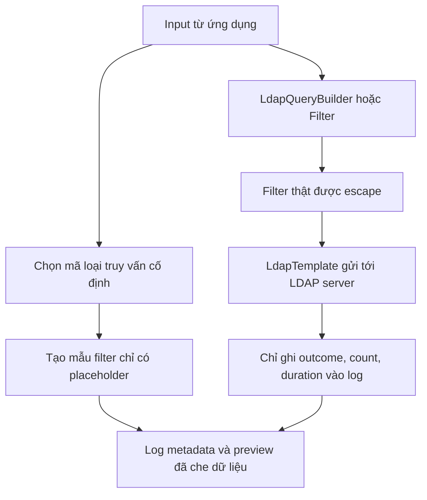

# Log filter LDAP đã encode nhưng không ghi dữ liệu nhạy cảm

Khi tìm kiếm bằng Spring LDAP trả về kết quả rỗng hoặc sai, lập trình viên thường muốn in LDAP filter ra log để kiểm tra dấu ngoặc, ký tự đặc biệt và điều kiện ghép `AND`/`OR`. Tuy nhiên, **filter đã encode vẫn có thể chứa nguyên vẹn tên đăng nhập, email, số nhân viên hoặc dữ liệu định danh**. Vì vậy, mục tiêu của debugging là quan sát được **cấu trúc và trạng thái của truy vấn** mà không đưa giá trị nhạy cảm vào hệ thống log.

Bài này áp dụng cho các truy vấn LDAP qua `LdapTemplate`, `LdapClient` hoặc các lớp repository/ODM của Spring LDAP. Ví dụ tập trung vào filter và logging; nguyên tắc tương tự cũng áp dụng khi xem lỗi cấu hình `ContextSource`, bind identity, TLS và quyền truy cập thư mục.

## 1. Encode filter giải quyết vấn đề cú pháp, không giải quyết bí mật dữ liệu

LDAP search filter dùng cú pháp như sau:

```ldap
(&(objectClass=inetOrgPerson)(uid=lan))
```

Ở đây `&` là phép AND; mỗi cặp ngoặc là một biểu thức lọc. Khi giá trị đến từ input, các ký tự đặc biệt phải được **escape theo RFC 4515** để server hiểu chúng là dữ liệu thay vì toán tử lọc.

| Ký tự trong giá trị | Biểu diễn đã escape trong LDAP filter |
|---|---|
| `*` | `\2a` |
| `(` | `\28` |
| `)` | `\29` |
| `\` | `\5c` |
| Byte NUL | `\00` |

Ví dụ với dữ liệu giả định, không phải thông tin người dùng thật:

```java
import org.springframework.ldap.filter.EqualsFilter;
import org.springframework.ldap.filter.Filter;

Filter filter = new EqualsFilter("uid", "an*(qa)");
String encoded = filter.encode();
// (uid=an\2a\28qa\29)
```

Dấu `*` và ngoặc của giá trị được escape, nên chúng không còn thay đổi cấu trúc filter. Nhưng ai đọc chuỗi `encoded` vẫn có thể nhận ra `an` và `qa`. Với email hoặc mã định danh thật, **encode không phải mã hóa bảo mật, ẩn danh hay che dữ liệu**.

Ba phép biến đổi thường bị nhầm lẫn:

| Phép biến đổi | Mục đích | Có thể ghi log giá trị thật không? |
|---|---|---|
| **LDAP filter escaping** (RFC 4515) | Giữ giá trị input không làm thay đổi cú pháp/filter logic | **Không**; dữ liệu vẫn có thể đọc được. |
| **DN escaping** (RFC 4514) | Biểu diễn đúng các ký tự đặc biệt trong Distinguished Name | **Không**; DN có thể chứa họ tên hoặc tài khoản. |
| **URL encoding** | Biểu diễn ký tự trong URL | **Không**; không bảo vệ bí mật hoặc thay thế LDAP escaping. |
| **Redaction/masking** | Thay giá trị thật bằng placeholder không nhạy cảm trong bản ghi chẩn đoán | **Có**, nếu toàn bộ trường được ghi đều đã được kiểm soát. |

**Không ghép filter thủ công** bằng `"(uid=" + uid + ")"`. Nên dùng `LdapQueryBuilder`, `EqualsFilter`, `LikeFilter` hoặc các kiểu `Filter` tương ứng để thư viện escape giá trị đúng mục đích. Không đưa tên thuộc tính, toán tử hay cấu trúc filter do người dùng nhập vào builder nếu chưa có danh sách cho phép: escape **giá trị** không tự động làm cho mọi thành phần truy vấn động trở nên an toàn.

## 2. Những dữ liệu không được xuất hiện trong log

Một dòng log dễ gây lộ dữ liệu là:

```java
// KHÔNG dùng trong môi trường có dữ liệu thật:
log.debug("LDAP query: {}", filter.encode());
log.debug("LDAP query object: {}", query);
log.error("LDAP search failed for uid={}", uid, exception);
```

Dòng thứ nhất ghi giá trị đã escape nhưng vẫn nhận diện được người dùng. Dòng thứ hai có thể vô tình gọi `toString()` của đối tượng truy vấn và hiển thị filter chứa input. Dòng thứ ba vừa ghi identifier, vừa có thể đưa thông tin DN, filter hoặc thuộc tính từ exception vào log. Logger tham số hóa bằng `{}` giúp định dạng log đúng cách; **nó không tự che PII**.

| Trường dữ liệu | Cách xử lý khi ghi log |
|---|---|
| Username, email, `uid`, số nhân sự, số điện thoại, giá trị thuộc tính tìm kiếm | Không ghi giá trị; thay bằng `[REDACTED]` ở bản xem trước hoặc chỉ ghi mã loại truy vấn. |
| Mật khẩu bind, secret, token, cookie, khóa TLS, thông tin xác thực | Tuyệt đối không ghi giá trị, kể cả bản encode hoặc rút gọn. |
| DN của user/entry, base DN động | Có thể chứa PII; dùng mã nhánh cố định như `baseId=people` nếu đủ để chẩn đoán. |
| Filter đầy đủ đã encode, `query.toString()`, raw LDAP request/response | Không ghi trong luồng log ứng dụng thông thường. |
| Thuộc tính entry trả về, toàn bộ exception message/stack trace | Có thể chứa dữ liệu thư mục; rà soát và giới hạn theo chính sách log. |
| Mã thao tác, mẫu điều kiện đã redacted, scope, outcome, thời gian, mã lỗi được chuẩn hóa | Thường hữu ích, với quyền truy cập và thời hạn lưu trữ phù hợp. |
| Số lượng kết quả | Hữu ích khi debug; cân nhắc quyền xem log vì con số có thể tiết lộ sự tồn tại của tài khoản/nhóm. |

**Nguyên tắc thực hành:** tạo một **biểu diễn chẩn đoán riêng** từ danh sách các trường đã được cho phép; đừng lấy chuỗi filter thật rồi cố xóa giá trị bằng regex. LDAP filter có thể lồng nhau, có escape hex và nhiều toán tử, nên regex thay thế dễ bỏ sót hoặc cắt nhầm dữ liệu.

## 3. Mẫu triển khai Spring LDAP: truy vấn đúng, log an toàn

Giả sử ứng dụng tìm tên hiển thị theo `uid`, và `ContextSource` đã đặt base `dc=example,dc=com`. Nhánh `ou=people` là **base tương đối** dùng cho `LdapTemplate`. Ta muốn kiểm tra truy vấn có chạy, chọn scope gì và trả bao nhiêu entry mà không đưa `uid` vào log.

Ví dụ Java sau sử dụng `LdapQueryBuilder` để tạo filter an toàn và ghi **mẫu filter đã thay giá trị**. Phần `filterShape` là chuỗi được định nghĩa trước, dùng **chỉ để chẩn đoán**, không phải filter gửi tới LDAP server:

```java
import java.util.List;
import javax.naming.directory.Attribute;
import javax.naming.directory.SearchControls;

import org.slf4j.Logger;
import org.slf4j.LoggerFactory;
import org.springframework.ldap.core.AttributesMapper;
import org.springframework.ldap.core.LdapTemplate;
import org.springframework.ldap.query.LdapQuery;
import org.springframework.ldap.query.LdapQueryBuilder;

public final class DirectoryLookup {
    private static final Logger log =
            LoggerFactory.getLogger(DirectoryLookup.class);

    private static final String FILTER_ID = "person.byUid.v1";
    private static final String FILTER_SHAPE =
            "(&(objectClass=inetOrgPerson)(uid=[REDACTED]))";

    private final LdapTemplate ldapTemplate;

    public DirectoryLookup(LdapTemplate ldapTemplate) {
        this.ldapTemplate = ldapTemplate;
    }

    public List<String> findDisplayNames(String uid) {
        if (uid == null || uid.trim().isEmpty()) {
            throw new IllegalArgumentException("uid is required");
        }

        // Giá trị uid được encode bởi LdapQueryBuilder.
        LdapQuery query = LdapQueryBuilder.query()
                .base("ou=people")
                .searchScope(SearchControls.ONELEVEL_SCOPE)
                .where("objectClass").is("inetOrgPerson")
                .and("uid").is(uid);

        long started = System.nanoTime();
        String outcome = "failed";
        int resultCount = -1;

        try {
            List<String> names = ldapTemplate.search(
                    query,
                    (AttributesMapper<String>) attrs -> {
                        Attribute cn = attrs.get("cn");
                        return cn == null ? "" : cn.get().toString();
                    });

            outcome = "ok";
            resultCount = names.size();
            return names;
        } finally {
            // Không log uid, query, names, bind DN hay exception message.
            long elapsedMs = (System.nanoTime() - started) / 1_000_000L;
            log.debug(
                    "ldap.search filterId={} filterShape={} baseId={} " +
                    "scope={} outcome={} count={} elapsedMs={}",
                    FILTER_ID, FILTER_SHAPE, "people",
                    "ONELEVEL", outcome, resultCount, elapsedMs);
        }
    }
}
```

Điểm cần đọc kỹ:

1. `LdapQueryBuilder.where(...).is(uid)` xây điều kiện đẳng thức và escape **giá trị** `uid`; nó không yêu cầu tự nối chuỗi.
2. `filterId=person.byUid.v1` là định danh cố định của loại truy vấn; `FILTER_SHAPE` giữ cấu trúc AND và tên thuộc tính nhưng dùng `[REDACTED]`. Chuỗi này là **bản mô tả sau che dữ liệu**, không phải nội dung truy vấn thật.
3. `baseId=people` là mã logic không chứa DN cá nhân; `scope=ONELEVEL` giúp phát hiện nhanh trường hợp quét sai độ sâu thư mục.
4. `outcome` và `elapsedMs` hỗ trợ phân biệt truy vấn thất bại với truy vấn trả về 0 kết quả. `count=-1` biểu thị chưa có kết quả vì lỗi, khác với `count=0`.
5. Ví dụ cố ý không log `names`. Những chuỗi được trả về từ mapper phục vụ logic ứng dụng và có thể chứa PII; không vì được ánh xạ bằng `LdapTemplate` mà trở thành dữ liệu công khai.

Nếu nghiệp vụ yêu cầu tìm cả các OU con, cần chọn `SearchControls.SUBTREE_SCOPE` theo cây thư mục thực tế và cập nhật giá trị scope dùng trong log. Nếu cần diễn giải lỗi, ánh xạ exception thành **mã lỗi đã chuẩn hóa** bằng danh sách cho phép thay vì ghi nguyên `exception.getMessage()`. Ví dụ có thể dùng các mã như `LDAP_AUTH_FAILED`, `LDAP_BASE_NOT_FOUND`, `LDAP_TIMEOUT`, `LDAP_SEARCH_FAILED`; hãy giữ nguyên exception cho tầng xử lý phù hợp nhưng kiểm soát chặt việc serializing nó ra log.

## 4. Muốn có “filter đã encode” trong log thì tạo bản redacted riêng

Trong một số trường hợp, việc nhìn đúng dấu ngoặc, AND/OR và escape của filter hữu ích hơn chỉ biết `filterId`. Khi đó có thể **dựng một filter mẫu riêng với placeholder**, rồi gọi `encode()` trên mẫu này. Tuyệt đối không gọi `encode()` trên input thật để gửi vào logger.

```java
import org.springframework.ldap.filter.AndFilter;
import org.springframework.ldap.filter.EqualsFilter;
import org.springframework.ldap.filter.Filter;

// Chỉ chứa các hằng số được kiểm soát; không có dữ liệu người dùng.
Filter safePreview = new AndFilter()
        .and(new EqualsFilter("objectClass", "inetOrgPerson"))
        .and(new EqualsFilter("uid", "[REDACTED]"));

String redactedEncodedPreview = safePreview.encode();
log.debug("ldap.search filterId={} filterPreview={}",
          "person.byUid.v1", redactedEncodedPreview);

// Ví dụ nội dung log:
// ldap.search filterId=person.byUid.v1
// filterPreview=(&(objectClass=inetOrgPerson)(uid=[REDACTED]))
```

Đây là **một filter mẫu đã encode và đã che giá trị**, không phải bản chụp truy vấn thật. Bản xem trước giúp kiểm tra cấu trúc, nhưng **không chứng minh** một giá trị input cụ thể đã được escape đúng: muốn kiểm tra ký tự đặc biệt, hãy dùng giá trị giả trong bài test thay vì ghi lại dữ liệu thật. Nếu sản phẩm có nhiều điều kiện tìm kiếm tùy chọn, có thể ghi danh sách các điều kiện **được kích hoạt** bằng nhãn cố định (ví dụ `hasDepartmentCondition=true`) và mã dạng filter như `person.byUidAndDepartment.v2`. Chỉ áp dụng bản xem trước khi chắc chắn mọi phần của nó là literal an toàn; tránh đưa ngay cả giá trị constant vào log nếu nó là tenant ID, nhóm nhạy cảm hoặc điều kiện bảo mật nội bộ.

Mô hình luồng dữ liệu khuyến nghị:



Hai nhánh có trách nhiệm khác nhau: **nhánh gửi truy vấn** phải đúng dữ liệu và an toàn cú pháp; **nhánh logging** chỉ được chứa những giá trị chẩn đoán đã cho phép. Không ghi filter thật vào cả hai nhánh.

## 5. Debug theo triệu chứng mà không cần lộ input

| Biểu hiện | Trường an toàn nên theo dõi | Hướng kiểm tra |
|---|---|---|
| `count=0`, `outcome=ok` | `filterId`, `baseId`, `scope` | Kiểm tra base DN hiệu lực, scope `ONELEVEL`/`SUBTREE` và điều kiện nghiệp vụ. |
| `outcome=failed` | Mã lỗi đã chuẩn hóa, `elapsedMs`, request/trace ID nội bộ | Phân biệt timeout, thiếu quyền, bind sai hoặc base không tồn tại. |
| Filter có dấu ngoặc sai | `filterPreview` được tạo từ hằng số bằng `Filter.encode()` | So sánh cấu trúc builder và toán tử logic; không in chuỗi với dữ liệu thật. |
| Tìm nhầm nhiều entry | `baseId`, `scope`, `count` (nếu được phép) | Xem phạm vi quá rộng, filter thiếu điều kiện hoặc điều kiện OR sai. |
| Log có xuống dòng hoặc ký tự lạ | Tên thao tác và các field được cho phép | Rà soát nơi ghi trực tiếp input hoặc exception. Escape filter chưa đủ chống log injection. |
| Chỉ lỗi trên môi trường production | Mã cấu hình môi trường không nhạy cảm, thời gian, mã lỗi | Kiểm tra `ContextSource`, TLS, LDAP ACL và chính sách log theo môi trường; không bật ghi dump request chứa PII. |

Một bản ghi chẩn đoán an toàn có thể trông như sau:

```text
ldap.search filterId=person.byUid.v1 baseId=people scope=ONELEVEL
filterShape="(&(objectClass=inetOrgPerson)(uid=[REDACTED]))"
outcome=ok count=0 elapsedMs=18 traceId=4c8e...
```

`traceId` nên do hệ thống tạo, không phải email, session token, username hoặc chuỗi do client tùy ý gửi. Khi phân tích sự cố, có thể nối các bản ghi theo trace ID và `filterId` thay vì đưa định danh người dùng vào log.

## 6. Các bẫy bảo mật và vận hành cần tránh

### Escape không phải masking

`String encoded = filter.encode();` chỉ xử lý cú pháp filter. Việc dùng Base64, URL encoding hoặc hash thông thường trên email/`uid` cũng không đủ để coi dữ liệu đã được ẩn danh. Với giá trị có tập khả năng nhỏ hoặc dễ đoán, hash không có khóa có thể bị dò lại. Nếu thật sự cần tương quan cùng một giá trị giữa các request, phải thiết kế riêng cơ chế pseudonymization có khóa, giới hạn mục đích, quyền truy cập và thời hạn lưu; không triển khai bằng cách thêm `hashCode()` hoặc SHA-256 trực tiếp vào log.

### Log nguyên exception có thể tiết lộ DN

Không mặc định coi `log.error("...", ex)` là an toàn: message và stack trace từ LDAP/JNDI/framework có thể chứa đường dẫn DN, filter hoặc thông tin kết nối. Ở tầng request, ghi mã lỗi được chuẩn hóa và trace ID; nếu cần giữ stack trace để điều tra sự cố, sử dụng kênh hạn chế quyền và rà soát nội dung theo chính sách vận hành. Đặc biệt không log bind password, secret trong cấu hình `ContextSource` hoặc dữ liệu riêng từ bản ghi LDAP.

### Bật DEBUG của framework phải xem nội dung thực tế

Các logger trong hệ sinh thái `org.springframework.ldap` và JNDI có thể cung cấp nhiều chi tiết tùy phiên bản hoặc lớp tích hợp. Trước khi bật mức DEBUG/TRACE ở hệ thống dùng dữ liệu thật, hãy kiểm tra những message nào được phát ra và liệu chúng chứa filter, DN hoặc thuộc tính cá nhân. Mức log của ứng dụng an toàn không bảo đảm logger thấp hơn cũng an toàn. Giới hạn quyền truy cập, thời gian lưu và khả năng tìm kiếm của hệ thống log.

### Redact sau khi log không đáng tin cậy

Không trông chờ pipeline xử lý log sẽ luôn che dữ liệu sau khi ứng dụng đã phát ra. Dữ liệu có thể tồn tại trong console, sidecar, buffer, exporter, APM hoặc bản lưu trung gian trước khi tới bộ lọc. **Giảm dữ liệu ở điểm phát sinh log** là lớp bảo vệ quan trọng nhất.

## 7. Checklist thực hành

Trong một LDAP server kiểm thử với dữ liệu giả, chạy ba tình huống: `uid` bình thường; `uid` chứa dấu `*`, ngoặc hoặc dấu `\`; và truy vấn không có kết quả. Với mỗi tình huống, kiểm tra rằng kết quả tìm kiếm phản ánh dữ liệu mong đợi và log chỉ chứa các field đã cho phép.

- [ ] Filter gửi server được tạo bằng `LdapQueryBuilder`/`Filter`, có escape giá trị theo RFC 4515.
- [ ] Log không có `uid`, email, mật khẩu, bind DN, entry DN, thuộc tính kết quả hoặc filter thật.
- [ ] Bản xem trước filter được tạo từ placeholder/hằng số, và không dùng để thực thi truy vấn.
- [ ] Log phân biệt `outcome=ok, count=0` với `outcome=failed`; scope và mã nhánh đúng cấu hình.
- [ ] Tình huống input chứa ký tự xuống dòng và dấu ngoặc không tạo ra bản ghi log giả hoặc lộ input.
- [ ] Log cấp framework, exception handling, MDC, tracing và exporter cũng được kiểm tra cùng chính sách.
- [ ] Quyền đọc log và thời gian lưu phù hợp với độ nhạy của metadata còn được ghi.

Một truy vấn Spring LDAP an toàn cần **encode filter đúng khi gửi đến LDAP** và **ghi log bản mô tả đã che dữ liệu** khi debug. Giữ riêng hai biểu diễn đó giúp điều tra lỗi filter, scope, quyền truy cập hoặc kết nối mà không vô tình biến hệ thống logging thành nơi lưu dữ liệu thư mục nhạy cảm.
