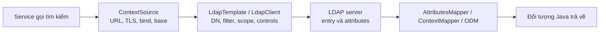
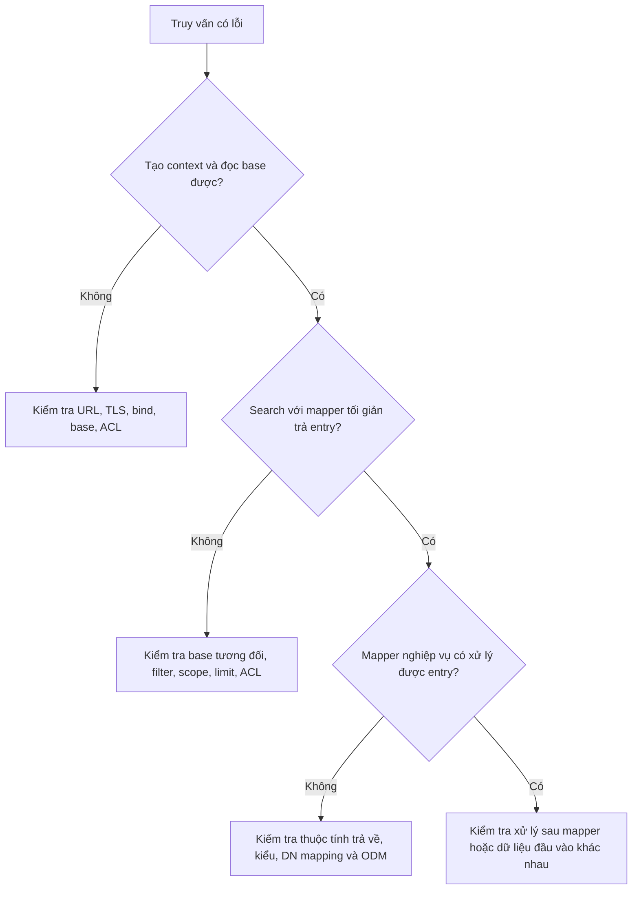

# Khoanh vùng lỗi ở ContextSource, template hay mapper trong Spring LDAP

Một lời gọi `LdapTemplate.search(...)` có thể thất bại vì không kết nối được LDAP server, vì truy vấn sai phạm vi hoặc vì mã chuyển đổi entry sang đối tượng Java bị lỗi. Ba tình huống này đôi khi đều xuất hiện ở tầng service dưới dạng “không tìm được người dùng”, nhưng cách sửa hoàn toàn khác nhau.

Trong Spring LDAP, có thể hình dung đường đi của một truy vấn:



Mục tiêu khi debug là xác định **giai đoạn sớm nhất chưa hoạt động đúng**. Đừng thay đồng thời cấu hình kết nối, filter và mapper: làm vậy sẽ khó biết nguyên nhân thực sự của vấn đề.

## 1. Nhìn dấu hiệu để chọn lớp cần kiểm tra

| Giai đoạn | Trách nhiệm chính | Dấu hiệu lỗi thường gặp | Cần chứng minh |
|---|---|---|---|
| **`ContextSource`** | Cung cấp `DirContext` với URL, xác thực, base DN và cấu hình kết nối | Không kết nối, lỗi TLS, bind thất bại, kết nối chập chờn | Ứng dụng tạo được context và thao tác LDAP tối thiểu dưới đúng danh tính hay không. |
| **`LdapTemplate` / `LdapClient`** | Gửi thao tác LDAP với base, filter, scope và search controls | Không tìm thấy entry, filter sai, nhầm nhánh hoặc giới hạn tìm kiếm | Truy vấn đơn giản có tìm được đúng entry trước khi thực hiện ánh xạ nghiệp vụ không. |
| **`AttributesMapper` / `ContextMapper` / ODM** | Chuyển thuộc tính LDAP hoặc context thành DTO/entity Java | `NullPointerException`, sai kiểu, thiếu field, giá trị mapping sai | Cùng entry đó có đọc và chuyển đổi được các thuộc tính thực sự trả về không. |
| **Logic sau khi tìm kiếm** | Lọc, sắp xếp, kết hợp hoặc kiểm tra quyền ở ứng dụng | LDAP trả về entry nhưng service trả danh sách rỗng | Có bước xử lý sau mapper làm mất kết quả không. |

**Điểm phân biệt:** `ContextSource` hoạt động không có nghĩa là filter đúng; `LdapTemplate` trả về entry không có nghĩa là mapper đúng; mapper đúng cũng không bảo đảm service giữ nguyên kết quả.

Ví dụ xuyên suốt bài dùng cây thư mục giả định:

```text
dc=example,dc=com
├── ou=people
│   ├── uid=lan
│   └── ou=partners
│       └── uid=minh
└── ou=system
    └── uid=reader
```

Giả sử `ContextSource.base = dc=example,dc=com`, tài khoản bind là `uid=reader,ou=system,dc=example,dc=com` và ta muốn tìm `uid=lan` bên dưới `ou=people`. Các tên và tài khoản chỉ minh họa; cần dùng server thử nghiệm và thông tin xác thực được cấp an toàn.

## 2. Chuẩn bị một phép kiểm tra có thể lặp lại

Trước khi sửa, ghi lại thông tin chẩn đoán ở dạng đã che dữ liệu:

- `operationId`: mã nghiệp vụ cố định, ví dụ `directory.findPersonByUid`.
- `connectionId`: mã cấu hình kết nối đã được kiểm soát, không ghi URL chứa credential.
- `baseId` và **base DN hiệu lực** đã xác nhận bằng cấu hình; tránh đưa DN người dùng vào log.
- `filterId`, `scope`, giới hạn thời gian và số lượng kết quả.
- `resultCount` hoặc `outcome`, thời gian thực hiện và **mã lỗi được chuẩn hóa**.
- `traceId` do hệ thống tạo, dùng để ghép các bước của một truy vấn.

Không in nguyên `uid`, filter chứa giá trị thật, bind password, entry DN cá nhân hoặc toàn bộ đối tượng `Attributes` vào log. Khi cần so sánh hai lần chạy, giữ nguyên server, bind identity, base, scope và filter kiểm thử; chỉ đổi **một biến**.

Bảng kiểm tra đầu tiên có thể thực hiện độc lập theo thứ tự:



Các câu trả lời “có” chỉ chứng minh phép thử tương ứng, không tự động xác nhận mọi quyền, mọi entry hoặc mọi truy vấn khác.

## 3. Kiểm tra `ContextSource`: kết nối, bind và base

`ContextSource` quản lý cách ứng dụng lấy context LDAP. Với `LdapContextSource`, những giá trị nên đối chiếu với cấu hình **đang chạy** gồm:

| Cấu hình | Ý nghĩa khi debug |
|---|---|
| `url`/`urls` | Đúng hostname, cổng và môi trường LDAP; `ldap://`/`ldaps://` có đúng với server không. |
| `base` | DN gốc tương đối cho thao tác qua `LdapTemplate`; sai base có thể gây `No such object`. |
| `userDn` và thông tin bind | Tài khoản ứng dụng có xác thực thành công và có quyền tìm/đọc hay không. |
| TLS/StartTLS và truststore | Kiểm tra xác thực chứng chỉ, hostname, CA tin cậy và chính sách TLS. |
| Timeout, referral, pooling | Kết nối treo, referral chưa được xử lý hoặc context cũ có thể gây lỗi không ổn định. |

Ví dụ kiểm tra tối thiểu, dùng `ContextSource` thực sự được inject cho ứng dụng:

```java
import javax.naming.NamingException;
import javax.naming.directory.DirContext;
import org.springframework.ldap.core.ContextSource;

public final class LdapConnectionProbe {
    private final ContextSource contextSource;

    public LdapConnectionProbe(ContextSource contextSource) {
        this.contextSource = contextSource;
    }

    public void verifyConfiguredBase() throws NamingException {
        DirContext context = contextSource.getReadOnlyContext();
        try {
            // Thử một thao tác LDAP thực để kiểm tra base có thể đọc.
            context.getAttributes("", new String[] {"objectClass"});
        } finally {
            context.close();
        }
    }
}
```

Phép thử này kiểm tra nhiều hơn việc Spring tạo bean thành công: nó buộc context thực hiện thao tác trên entry tương ứng với base đã cấu hình. Tuy nhiên, **không nên kết luận “kết nối hỏng” chỉ từ việc đọc base thất bại**. Nếu tài khoản không được phép xem entry base, phép đọc có thể bị từ chối dù network và bind đều đúng. Tách kết quả thành “không lấy được context”, “lấy được context nhưng không đọc được base” và “đọc được base”.

Phân tích lỗi theo thời điểm:

1. Không lấy được context: kiểm tra DNS, URL, cổng, firewall, TLS và bind; so sánh với client LDAP độc lập.
2. Lấy được context nhưng thao tác `getAttributes` lỗi: kiểm tra base DN, ACL, trạng thái directory/referral và quyền đọc.
3. Kết nối đôi khi thành công, đôi khi lỗi: đo timeout, server được chọn trong danh sách URLs, trạng thái network và pooling; tránh giả định mọi request dùng cùng server hoặc cùng context.

Thông báo như `AuthenticationException`, `CommunicationException`, lỗi bắt tay SSL hoặc `NameNotFoundException` có thể xuất hiện dưới dạng exception đã được Spring LDAP dịch/bao bọc. Đọc **loại exception và nguyên nhân gốc**, nhưng không đưa message có thể chứa credential, DN hay filter vào log công khai.

## 4. Kiểm tra `LdapTemplate`: search tối giản, chưa dùng mapper nghiệp vụ

Sau khi context có thể thực hiện thao tác phù hợp, kiểm tra **đúng truy vấn LDAP** với một mapper rất đơn giản. Mapper dưới đây chỉ trả `Boolean.TRUE` cho mỗi entry được server tìm thấy; nó không truy cập `uid`, `cn` hay tạo đối tượng nghiệp vụ.

```java
import java.util.List;
import org.springframework.ldap.core.AttributesMapper;
import org.springframework.ldap.core.LdapTemplate;
import org.springframework.ldap.query.LdapQuery;
import org.springframework.ldap.query.LdapQueryBuilder;
import org.springframework.ldap.query.SearchScope;

public final class LdapSearchProbe {
    private final LdapTemplate ldapTemplate;

    public LdapSearchProbe(LdapTemplate ldapTemplate) {
        this.ldapTemplate = ldapTemplate;
    }

    public int countMatches(String uid) {
        LdapQuery query = LdapQueryBuilder.query()
                .base("ou=people")
                .searchScope(SearchScope.ONELEVEL)
                .where("uid").is(uid);

        List<Boolean> matches = ldapTemplate.search(
                query,
                (AttributesMapper<Boolean>) attributes -> Boolean.TRUE);

        return matches.size();
    }
}
```

Ở đây `uid` được đưa vào `LdapQueryBuilder` qua toán tử `is` để được escape như một **giá trị filter**. Phương thức `LdapQueryBuilder.searchScope(...)` nhận enum `SearchScope` (ví dụ `SearchScope.ONELEVEL`); overload `LdapTemplate.search(..., int searchScope, ...)` khác mới nhận hằng số `SearchControls.ONELEVEL_SCOPE` của JNDI. Đoạn code không in `uid` hoặc query ra log. Nếu trả về số phần tử lớn hơn 0, có bằng chứng rằng **base + scope + filter + quyền tìm kiếm** đã tìm được entry trong điều kiện của phép thử. Nếu vẫn trả về 0, mã ánh xạ thuộc tính nghiệp vụ **chưa phải điểm nghi vấn chính**, bởi mapper tối giản không phụ thuộc field nào.

Một số câu hỏi quan trọng trong lớp tìm kiếm:

- **Base DN hiệu lực là gì?** Nếu `ContextSource.base` đã là `dc=example,dc=com`, thì `.base("ou=people")` tìm dưới `ou=people,dc=example,dc=com`. Đừng đặt trùng hậu tố DN đầy đủ trong tham số tương đối.
- **Scope có đi đúng độ sâu?** `ONELEVEL_SCOPE` chỉ xét entry con trực tiếp; `uid=minh` ở dưới `ou=partners` cần `SUBTREE_SCOPE` hoặc đổi base sang `ou=partners,ou=people`.
- **Filter có khớp dữ liệu và schema?** Tránh giả định mọi entry đều có `uid`; đối chiếu `objectClass` và thuộc tính thực trên server.
- **Giới hạn có cắt kết quả?** Rà soát `SearchControls`/`LdapQuery` về size/time limit, attributes được yêu cầu và cách xử lý referral.
- **Có lỗi quyền ở lúc search?** Bind được chưa chắc được phép tìm nhánh đó; ACL có thể làm kết quả rỗng hoặc trả lỗi tùy server.

Để kiểm tra bên ngoài Spring trên **server kiểm thử**, dùng cùng bind identity và DN đầy đủ với `ldapsearch`:

```bash
ldapsearch -LLL -x \
  -H ldaps://ldap.example.com:636 \
  -D "uid=reader,ou=system,dc=example,dc=com" -W \
  -b "ou=people,dc=example,dc=com" \
  -s one "(uid=lan)" dn
```

`-W` yêu cầu nhập mật khẩu riêng, tránh đặt secret vào câu lệnh; TLS cần xác thực chứng chỉ đúng. `-b` của `ldapsearch` ở ví dụ là **DN đầy đủ**, trong khi `.base("ou=people")` của Spring LDAP là đường dẫn tương đối với `ContextSource.base`.

Nếu `ldapsearch` tìm thấy Lan nhưng `LdapTemplate` trả 0, hãy đối chiếu từng yếu tố: endpoint thực tế, danh tính bind, base hiệu lực, filter, scope, alias/referral, giới hạn, quyền truy cập và chính sách TLS. Đừng kết luận mapper sai khi query tối giản vẫn không thấy entry.

## 5. Kiểm tra `AttributesMapper`: entry đã tìm thấy nhưng DTO sai

Khi phép search tối giản tìm thấy entry mà ứng dụng lại lỗi hoặc trả dữ liệu sai, đưa **mapper nghiệp vụ** vào phép kiểm tra. Mapper chỉ nhìn thấy các thuộc tính mà server cho phép trả về và client đã yêu cầu; `attrs.get("cn")` có thể là `null` ngay cả khi entry tồn tại.

```java
import java.util.List;
import javax.naming.directory.Attribute;
import javax.naming.directory.Attributes;
import org.springframework.ldap.core.AttributesMapper;
import org.springframework.ldap.core.LdapTemplate;
import org.springframework.ldap.query.LdapQuery;
import org.springframework.ldap.query.LdapQueryBuilder;
import org.springframework.ldap.query.SearchScope;

record PersonRow(String uid, String displayName) {}

public final class PersonReader {
    private final LdapTemplate ldapTemplate;

    public PersonReader(LdapTemplate ldapTemplate) {
        this.ldapTemplate = ldapTemplate;
    }

    public List<PersonRow> findByUid(String uid) {
        LdapQuery query = LdapQueryBuilder.query()
                .base("ou=people")
                .searchScope(SearchScope.ONELEVEL)
                .attributes("uid", "cn")
                .where("uid").is(uid);

        return ldapTemplate.search(
                query,
                (AttributesMapper<PersonRow>) this::mapPerson);
    }

    private PersonRow mapPerson(Attributes attrs)
            throws javax.naming.NamingException {
        Attribute uid = attrs.get("uid");
        Attribute cn = attrs.get("cn");

        if (uid == null || cn == null) {
            throw new IllegalStateException(
                    "LDAP entry missing required attributes");
        }

        return new PersonRow(
                uid.get().toString(),
                cn.get().toString());
    }
}
```

Mẫu này yêu cầu Java hỗ trợ `record` (Java 16+). Tùy ứng dụng có thể thay `record` bằng POJO. Những điểm dễ gây lỗi:

| Triệu chứng mapping | Giả thuyết cần kiểm tra |
|---|---|
| `attrs.get("cn") == null` | Entry không có `cn`, ACL ẩn thuộc tính, hoặc `returningAttributes` đã loại `cn`. |
| `get()` trả giá trị ngoài dự kiến | Thuộc tính đa giá trị; thứ tự và ý nghĩa “giá trị đầu tiên” không luôn ổn định. |
| `ClassCastException` | Thuộc tính là kiểu binary/collection khác kỳ vọng, mapper ép kiểu sai. |
| Java field bị `null` dù LDAP đã có dữ liệu | Tên thuộc tính trong mapper sai hoặc ODM mapping không tương ứng schema. |
| Mapper ném exception nhưng phép search tối giản có kết quả | Lỗi nằm ở xử lý entry/attributes hoặc giả định DTO; kiểm tra stack trace trong môi trường kiểm thử. |
| Search trả danh sách đúng nhưng service trả rỗng | Có thể có `stream().filter(...)`, phân trang hoặc điều kiện nghiệp vụ sau mapper. |

**Phải so sánh cùng một truy vấn.** Nếu phiên bản dùng mapper nghiệp vụ yêu cầu tập thuộc tính khác với phiên bản tối giản, sự khác biệt có thể đến từ `returningAttributes` hoặc ACL chứ chưa hẳn do code mapper. Thử yêu cầu đúng các field nghiệp vụ (`uid`, `cn`) rồi dùng mapper chỉ trả `true`; nếu tìm thấy entry nhưng `cn` vắng mặt, hãy kiểm tra schema và quyền đọc trước khi kết luận bug Java.

Đối với `ContextMapper` hoặc **ODM**, cũng phải tách bước nhận entry và bước tạo entity. `ContextMapper` có thể truy cập ngữ cảnh và DN của entry; ODM còn có quy tắc annotation (như `@Entry`, `@Attribute`, `@Id`), constructor và kiểu dữ liệu. Khi ODM không tạo được entity, hãy kiểm tra tên thuộc tính, objectClass phù hợp, annotation và cách biểu diễn DN. Không thay kết nối hay filter nếu bước tìm entry thấp hơn đã thành công với cùng tham số.

## 6. Đọc mã lỗi để giảm số giả thuyết

| Lỗi/biểu hiện | Vùng nghi vấn đầu tiên | Hành động ưu tiên |
|---|---|---|
| Không kết nối/SSL handshake/timeout | `ContextSource`, network, TLS, server | Thử thao tác LDAP tối thiểu và kiểm tra chứng chỉ, URL, timeout. |
| LDAP **49** — `invalidCredentials` | Xác thực/bind | Kiểm tra bind DN và cơ chế cung cấp secret; không log mật khẩu. |
| LDAP **32** — `noSuchObject` | Base DN hoặc entry không tồn tại/không nhìn thấy | Tính lại base hiệu lực; thử base-scope trên nhánh đúng bằng tài khoản phù hợp. |
| LDAP **87** — `filterError` | Cú pháp filter hoặc tạo query | Dùng `LdapQueryBuilder`, thử filter hằng số trên dữ liệu giả. |
| LDAP **50** — `insufficientAccessRights` | Quyền của bind identity | Kiểm tra ACL và quyền đọc; không khắc phục bằng cách mở rộng scope. |
| LDAP **3/4** — time/size limit exceeded | `LdapTemplate`, server controls, tập kết quả | Giảm phạm vi, xem limit và cách xử lý kết quả từng phần. |
| `PartialResultException` | Referral hoặc kết quả không đầy đủ | So sánh referral handling và cấu hình server giữa hai client. |
| Query tối giản có kết quả, mapper ném `NullPointerException` | `AttributesMapper`/`ContextMapper`/ODM | Xem tên/kiểu/mức truy cập của thuộc tính thực nhận. |
| Query có kết quả, mapper đúng, service rỗng | Logic sau mapper | Kiểm tra post-filter và nghiệp vụ của caller. |

Spring LDAP có thể chuyển các exception của JNDI thành exception runtime của chính thư viện; một vài trường hợp còn được bọc lại bởi lớp service. Dùng **cause chain** để định vị nguồn gốc, nhưng không dựa hoàn toàn vào chuỗi thông báo hoặc suy luận rằng một mã LDAP duy nhất chỉ có một nguyên nhân.

## 7. Ví dụ điều tra một lỗi thực tế

**Tình huống:** API trả HTTP 404 khi tìm `uid=minh`. Cấu hình `ContextSource.base` là `dc=example,dc=com`, search base là `ou=people` và scope là `SearchScope.ONELEVEL`.

1. Kiểm tra `getReadOnlyContext()` và đọc một thuộc tính của base: thành công với service account. Khả năng lỗi kết nối/bind cho phép thử này được loại trừ.
2. Chạy search tối giản với `SearchScope.ONELEVEL`: nhận `0`. Mapper ứng dụng chưa được gọi nên không phải nguyên nhân trực tiếp của phép thử.
3. Giữ nguyên bind/filter/base, đổi sang `SearchScope.SUBTREE` trên nhánh thử nghiệm: nhận `1`. Entry `uid=minh` nằm sâu dưới `ou=partners`.
4. Chạy mapper nghiệp vụ với `SearchScope.SUBTREE`: nhận đối tượng nhưng `displayName` sai. Kiểm tra `cn` được trả về và quy tắc chọn giá trị của thuộc tính đa giá trị.
5. Giữ scope đúng nghiệp vụ và sửa mapper cho `cn`. Kiểm tra lại từng bước để tách hai lỗi độc lập: **scope quá hẹp** và **mapping thuộc tính không phù hợp**.

Trong trường hợp khác, nếu ngay bước 1 báo lỗi TLS, tập trung điều tra truststore, hostname, CA và endpoint trước. Không có lý do sửa mapper khi chưa thiết lập được thao tác directory.

## 8. Kiểm thử theo từng lớp để lỗi dễ tái hiện

| Mức kiểm thử | Dữ liệu | Cần chứng minh |
|---|---|---|
| **Unit test mapper** | `BasicAttributes`/`BasicAttribute` tạo trong bộ nhớ | Mapper xử lý field thiếu, field đa giá trị và kiểu dữ liệu không đúng như thế nào. |
| **Integration test LDAP** | Directory thử nghiệm chứa cây DN và entry cố định | `ContextSource` bind được; `LdapTemplate` tìm đúng base/filter/scope; mapper nhận đúng thuộc tính. |
| **Kiểm thử cấu hình môi trường** | Endpoint và secret được cấp theo chính sách | TLS/StartTLS, referral, timeout và ACL hoạt động đúng với service account thực. |
| **Kiểm thử service** | Response đã biết từ tầng LDAP (hoặc test double) | Không có lọc/ngắt kết quả ngoài ý muốn sau mapper. |

Ví dụ unit test cho trường hợp thiếu `cn` có thể tách khỏi LDAP server hoàn toàn bằng cách gọi trực tiếp hàm ánh xạ nhận `Attributes`:

```java
import javax.naming.directory.Attributes;
import javax.naming.directory.BasicAttribute;
import javax.naming.directory.BasicAttributes;

Attributes attrs = new BasicAttributes(true);
attrs.put(new BasicAttribute("uid", "lan"));
// Không thêm cn: phép thử phải kích hoạt nhánh thiếu thuộc tính.

// Có thể đưa hàm mapPerson sang một mapper riêng để unit test trực tiếp.
// Tránh kiểm thử tình huống này bằng cách thay credential hoặc gọi server thật.
```

Đối với dữ liệu thật, hạn chế log DN, filter, thuộc tính LDAP và message lỗi nguyên vẹn. Ghi mã bước (`context-probe`, `search-probe`, `mapper`), kết quả và trace ID giúp quan sát đủ mà vẫn giữ dữ liệu nhạy cảm trong luồng xử lý được cấp phép.

## 9. Bài thực hành tự kiểm tra

Trên một LDAP server kiểm thử có cây thư mục giả định ở đầu bài, thực hiện các phép thử sau:

1. **Sai endpoint:** chuyển endpoint trong cấu hình kiểm thử sang một cổng không có LDAP server. Xác định lỗi nào xảy ra trước khi search/mapper được gọi.
2. **Sai search scope:** tìm `uid=minh` với `SearchScope.ONELEVEL` tại `ou=people`, sau đó với `SearchScope.SUBTREE`. Giải thích vì sao count thay đổi.
3. **Thiếu thuộc tính:** bỏ `cn` khỏi danh sách thuộc tính yêu cầu hoặc dùng một entry kiểm thử không có field tùy chọn. So sánh mapper `Boolean.TRUE` với mapper nghiệp vụ cần `cn`.
4. **Sai base:** với `ContextSource.base = dc=example,dc=com`, vô tình cung cấp `ou=people,dc=example,dc=com` làm base tương đối. Tính DN hiệu lực và xác định phép kiểm tra nào bộc lộ lỗi.
5. **Lỗi sau mapper:** để mapper trả đúng một DTO nhưng service lọc mất DTO. Ghi rõ bằng chứng giúp phân biệt service với LDAP.

Với mỗi tình huống, ghi lại **thao tác thấp nhất thành công**, **thao tác đầu tiên thất bại**, **tham số khác biệt** và **cách khắc phục tối thiểu**. Đây là cách hiệu quả để khoanh vùng lỗi Spring LDAP mà không thay nhiều lớp cùng lúc.

> **Ghi nhớ:** xác minh `ContextSource` bằng thao tác directory tối thiểu; xác minh `LdapTemplate` bằng search với mapper không phụ thuộc thuộc tính; sau đó mới đưa `AttributesMapper`, `ContextMapper` hoặc ODM vào kiểm tra. Dùng cùng dữ liệu, danh tính và tham số qua các phép thử để kết luận lớp nào thực sự gây lỗi.
