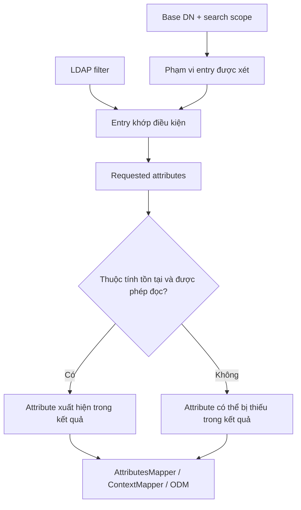
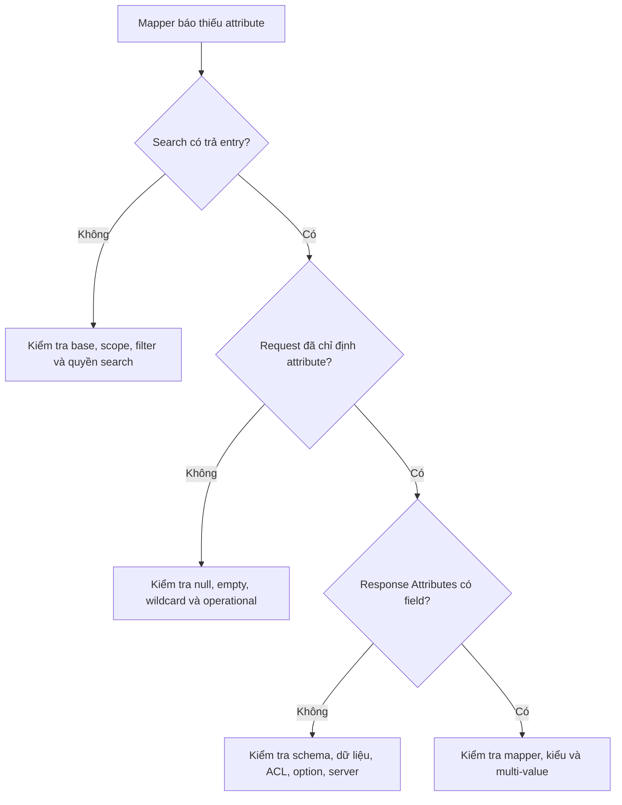

# Kiểm tra attribute trả về khác với attribute được yêu cầu trong Spring LDAP

Bạn tìm được một entry bằng `LdapTemplate`, nhưng `attrs.get("mail")` trả về `null` dù filter đã dùng email; hoặc ứng dụng nhận `cn` và `uid` mà thiếu `modifyTimestamp`. Đây chưa chắc là lỗi mapper. Trong LDAP, **điều kiện tìm kiếm**, **danh sách thuộc tính muốn nhận**, **dữ liệu thực sự tồn tại** và **quyền được đọc dữ liệu** là bốn yếu tố độc lập.

Bài debugging này hướng dẫn cách xác định chính xác thuộc tính nào đã được yêu cầu, thuộc tính nào server thực sự trả về và vì sao chúng khác nhau trong Spring LDAP. Ta sẽ dùng `LdapTemplate`, `LdapQueryBuilder`, `SearchControls` và `ldapsearch` để khoanh vùng; các nguyên tắc cũng hữu ích khi làm việc với `LdapClient`, `ContextMapper` hoặc ODM.

## 1. Phân biệt filter, danh sách thuộc tính yêu cầu và tập trả về

Giả sử máy chủ có entry thử nghiệm:

```text
dn: uid=lan,ou=people,dc=example,dc=com
objectClass: inetOrgPerson
uid: lan
cn: Lan Nguyen
sn: Nguyen
mail: lan@example.test
description: Demo account
modifyTimestamp: 20261127090000Z
```

Giá trị `modifyTimestamp` trong ví dụ biểu diễn một **operational attribute** do server quản lý; khả năng đọc thuộc tính này phụ thuộc implementation và quyền của tài khoản bind.

Hai phần của truy vấn LDAP có mục đích khác nhau:

- **Filter** `(&(objectClass=inetOrgPerson)(uid=lan))` chọn entry thỏa điều kiện.
- **Requested attributes** như `cn`, `mail` quyết định những thuộc tính mà client muốn server gửi lại cho mỗi entry đã chọn.

Một truy vấn có thể tìm thấy entry vì `uid=lan` nhưng response **không chứa `uid`** nếu chỉ yêu cầu `cn` và `mail`. Ngược lại, đưa `mail` vào danh sách yêu cầu **không tạo ra `mail`** nếu entry thiếu thuộc tính hoặc tài khoản không được phép đọc.



**Tách hai câu hỏi khi debug:**

1. *Có entry nào khớp truy vấn không?* Kiểm tra số entry trả về với mapper đơn giản.
2. *Entry đó có các attribute mà code cần không?* Kiểm tra response attributes và mapping, không tự suy ra từ filter.

## 2. Cách yêu cầu thuộc tính trong LDAP và JNDI

LDAP cho phép client chỉ rõ tập thuộc tính muốn nhận. Các giá trị đặc biệt thường dùng:

| Danh sách yêu cầu | Ý nghĩa trong LDAP | Lưu ý khi debug |
|---|---|---|
| Không chỉ định danh sách (mặc định của search) | Thông thường trả về các **user attributes** | Không mặc định bao gồm mọi operational attribute. |
| `cn`, `mail` | Yêu cầu đích danh hai thuộc tính | Nếu chỉ một field xuất hiện, cần kiểm tra schema, dữ liệu và ACL. |
| `*` | Yêu cầu tất cả các **user attributes** được phép trả về | Có thể tạo phản hồi lớn và lộ nhiều dữ liệu; dùng trên server thử nghiệm. |
| `+` | Yêu cầu tất cả các **operational attributes** được phép trả về theo hỗ trợ của server | Được quy định bởi RFC 3673; không phải server nào cũng hỗ trợ đồng nhất. |
| `*` cùng `+` | Yêu cầu cả user và operational attributes | Dùng để kiểm chứng trong môi trường được kiểm soát, không mặc định ở production. |
| `1.1` | Chỉ báo **không yêu cầu thuộc tính nào** khi dùng một mình | DN có thể vẫn xuất hiện; khi đi cùng tên thuộc tính khác, quy tắc xử lý khác. |

Trong JNDI, `SearchControls#setReturningAttributes(String[])` có các trạng thái cần phân biệt:

```java
import javax.naming.directory.SearchControls;

SearchControls controls = new SearchControls();

// null: không chỉ định giới hạn tập thuộc tính; thường lấy user attributes.
controls.setReturningAttributes(null);

// Mảng rỗng: chỉ yêu cầu entry, không yêu cầu attribute.
controls.setReturningAttributes(new String[0]);

// Chỉ yêu cầu hai attribute cụ thể.
controls.setReturningAttributes(new String[] {"cn", "mail"});

// Cú pháp chọn đặc biệt theo khả năng server hỗ trợ.
controls.setReturningAttributes(new String[] {"*", "+"});
```

Đừng nhầm `new String[0]` với `null`: chúng có ý nghĩa khác nhau. Ngoài ra, `SearchControls` còn chứa `searchScope`, giới hạn số entry, thời gian và các tùy chọn khác; nếu search không trả entry nào, việc thay danh sách attribute chưa giải quyết được filter hay scope sai.

Một số tên attribute được server biểu diễn bằng tên khác hoặc kèm **option**, chẳng hạn `userCertificate;binary` hay `cn;lang-vi`. Tên thuộc tính LDAP về bản chất không phân biệt hoa thường; khi so sánh metadata cần xử lý attribute description theo schema/option thay vì chỉ so sánh chuỗi nguyên xi.

## 3. Ví dụ Spring LDAP: nhìn chính xác request và response

Giả sử `ContextSource` đã được cấu hình với base `dc=example,dc=com`, còn entry `uid=lan` là con trực tiếp của `ou=people`. Trong `LdapQueryBuilder`, `.base("ou=people")` là base **tương đối** so với `ContextSource.base`.

Đoạn mã sau yêu cầu đúng `cn` và `mail`, sau đó trả về **trạng thái có/không có** của các thuộc tính. Mapper không tự ghi tên người dùng, email hoặc các giá trị riêng tư vào log.

```java
import java.util.List;
import org.springframework.ldap.core.AttributesMapper;
import org.springframework.ldap.core.LdapTemplate;
import org.springframework.ldap.query.LdapQuery;
import org.springframework.ldap.query.LdapQueryBuilder;
import org.springframework.ldap.query.SearchScope;

record AttributePresence(boolean hasCn, boolean hasMail, boolean hasUid) {}

public final class AttributeProbe {
    private final LdapTemplate ldapTemplate;

    public AttributeProbe(LdapTemplate ldapTemplate) {
        this.ldapTemplate = ldapTemplate;
    }

    public List<AttributePresence> inspect(String uid) {
        LdapQuery query = LdapQueryBuilder.query()
                .base("ou=people")
                .searchScope(SearchScope.ONELEVEL)
                .attributes("cn", "mail")
                .where("uid").is(uid);

        return ldapTemplate.search(
                query,
                (AttributesMapper<AttributePresence>) attrs ->
                        new AttributePresence(
                                attrs.get("cn") != null,
                                attrs.get("mail") != null,
                                attrs.get("uid") != null));
    }
}
```

Với entry có đủ quyền đọc, phép kiểm thử dự kiến:

```text
Số entry: 1
hasCn  = true
hasMail = true
hasUid = false  // uid dùng trong filter, nhưng KHÔNG được yêu cầu trả về.
```

Nếu `hasMail=false`, không được kết luận ngay là mapper hỏng: thuộc tính có thể không tồn tại, bị ACL che, có tên/option khác hoặc server bỏ qua yêu cầu do cấu hình đặc thù. Nếu số entry bằng **0**, mapper chưa được gọi; quay lại kiểm tra base, scope, filter, bind identity trước.

**Chú ý API:** `LdapQueryBuilder.searchScope(...)` dùng enum `SearchScope.ONELEVEL`/`SUBTREE`. Khi dùng overload `LdapTemplate.search(...)` nhận đối tượng `SearchControls`, scope dùng hằng số JNDI `SearchControls.ONELEVEL_SCOPE`. Hai kiểu scope khác nhau về API nhưng mô tả cùng phạm vi tìm kiếm.

## 4. Kiểm tra bằng `SearchControls` để loại trừ lỗi builder

Khi nghi ngờ bộ dựng `LdapQuery`, có thể xây trực tiếp `SearchControls` trên dữ liệu **giả và cố định** trong môi trường kiểm thử:

```java
import java.util.List;
import javax.naming.directory.SearchControls;
import org.springframework.ldap.core.AttributesMapper;
import org.springframework.ldap.core.LdapTemplate;

SearchControls controls = new SearchControls();
controls.setSearchScope(SearchControls.ONELEVEL_SCOPE);
controls.setReturningAttributes(new String[] {"uid", "cn", "mail"});

List<Boolean> found = ldapTemplate.search(
        "ou=people",        // Relative to ContextSource.base
        "(uid=lan)",        // Hằng số thử nghiệm; không ghép input người dùng
        controls,
        (AttributesMapper<Boolean>) attrs ->
                attrs.get("uid") != null && attrs.get("cn") != null);
```

Đoạn kiểm tra này trả `Boolean` cho từng entry, vì vậy `found.size()` là số entry còn `found.get(0)` (nếu có) cho biết hai thuộc tính mong đợi có mặt cùng nhau hay không. Nó giúp tách **tập entry tìm được** ra khỏi **thuộc tính nhận được**. Trong code production, dùng builder/`Filter` để escape giá trị từ người dùng, tránh nối LDAP filter thủ công.

Nếu hai cách gọi trả attribute khác nhau, so sánh toàn bộ tham số: base, filter, scope, `returningAttributes`, referral, size/time limit và danh tính bind. Thay mapper có thể làm khác kết quả Java, nhưng mapper không thể tự làm xuất hiện thuộc tính mà LDAP server chưa gửi.

## 5. Xác định những attribute thực sự được trả về

Đôi khi ta muốn biết **tên** các attribute nhận được, thay vì chỉ kiểm tra những tên đã biết. Trong môi trường kiểm thử, `Attributes.getIDs()` có thể liệt kê các attribute ID mà JNDI cung cấp.

```java
import java.util.LinkedHashSet;
import java.util.Set;
import javax.naming.NamingEnumeration;
import javax.naming.directory.Attributes;

public static Set<String> attributeIds(Attributes attributes)
        throws javax.naming.NamingException {
    Set<String> ids = new LinkedHashSet<>();

    NamingEnumeration<String> names = attributes.getIDs();
    try {
        while (names.hasMore()) {
            ids.add(names.next());
        }
    } finally {
        names.close();
    }

    return ids;
}
```

Hàm trả tập **tên attribute**, không chứa giá trị. Tuy vậy, trong production, ngay cả tên attribute tùy biến, số lượng field hoặc sự hiện diện của một field nhạy cảm cũng có thể tiết lộ thông tin. Nên chỉ ghi trạng thái theo danh sách tên đã được phê duyệt, ví dụ `expectedCn=true`, `returnedCn=false`, hoặc so sánh trong một integration test rồi assert kết quả. Tránh in nguyên object `Attributes`, toàn bộ entry, DN hoặc filter có dữ liệu thật.

Để chẩn đoán một entry, sử dụng phép so sánh:

```text
requested: cn, mail, uid
returned : cn, uid
missing  : mail
extra    : (không có)
```

“Missing” ở đây có nghĩa **không có trong response**, không chứng minh entry gốc không chứa attribute. “Extra” cũng cần xem liệu client thực sự đã gửi chỉ danh sách mong muốn hay dùng wildcard/`null`. Một số thư viện mapping có thể thêm thuộc tính kỹ thuật vào request; hãy xác minh request hiệu lực trước khi suy luận rằng server trả dữ liệu ngoài yêu cầu.

## 6. Đối chiếu với `ldapsearch` bằng cùng tài khoản

Nếu ứng dụng thiếu `mail`, hãy chạy truy vấn độc lập tới cùng server LDAP. Trong ví dụ dưới đây, DN của base là **đầy đủ** (khác với base tương đối trong `LdapTemplate`):

```bash
ldapsearch -LLL -x \
  -H ldaps://ldap.example.com:636 \
  -D "uid=reader,ou=system,dc=example,dc=com" -W \
  -b "ou=people,dc=example,dc=com" \
  -s one "(uid=lan)" cn mail uid
```

`-W` yêu cầu nhập mật khẩu tương tác; không đưa mật khẩu vào shell history. Dùng LDAPS với xác thực chứng chỉ máy chủ và CA phù hợp. Chỉ chạy với dữ liệu/tài khoản mà bạn được phép kiểm tra.

Để khảo sát khác biệt giữa user và operational attributes, có thể chạy trên directory thử nghiệm:

```bash
# User attributes (theo quyền của bind identity)
ldapsearch -LLL -x -H ldaps://ldap.example.com:636 \
  -D "uid=reader,ou=system,dc=example,dc=com" -W \
  -b "uid=lan,ou=people,dc=example,dc=com" \
  -s base "(objectClass=*)" "*"

# Yêu cầu một operational attribute cụ thể
ldapsearch -LLL -x -H ldaps://ldap.example.com:636 \
  -D "uid=reader,ou=system,dc=example,dc=com" -W \
  -b "uid=lan,ou=people,dc=example,dc=com" \
  -s base "(objectClass=*)" modifyTimestamp
```

Nếu `ldapsearch` và ứng dụng cùng lấy đúng server, cùng bind identity, DN, scope và attribute selection mà khác kết quả, hãy kiểm tra referral, schema, ACL và đặc tính client. Đừng so sánh một lệnh `ldapsearch` bind bằng tài khoản quản trị với ứng dụng dùng tài khoản chỉ đọc: sự khác biệt quyền có thể giải thích toàn bộ hiện tượng.

## 7. Những nguyên nhân phổ biến khiến request khác response

| Triệu chứng | Khả năng cần kiểm tra | Phép thử có ích |
|---|---|---|
| Trả entry nhưng mapper nhận `null` với `mail` | Entry thiếu `mail`, quyền đọc hạn chế, requested list loại `mail` | Yêu cầu `mail` tường minh trên cùng entry; so sánh bằng service account. |
| Có `uid` trong filter nhưng không có trong mapper | `uid` không nằm trong `returningAttributes` | Thêm `uid` vào danh sách yêu cầu; giữ filter và scope. |
| Không thấy `modifyTimestamp` khi dùng mặc định hoặc `*` | Operational attribute không tự được gửi cùng user attributes | Yêu cầu `modifyTimestamp` hoặc thử `+` nếu server hỗ trợ. |
| Mapper trả không có thuộc tính nào dù tìm thấy entry | `new String[0]`, `1.1` hoặc cài đặt thuộc tính trả về rỗng | Kiểm tra `SearchControls.getReturningAttributes()` và request thực tế. |
| `cn` có giá trị nhưng app bảo thiếu | Mapper tìm sai attribute ID/option, lỗi chuyển kiểu, mapping ODM không đúng | Kiểm tra `getIDs()`, tên theo schema, annotation và kiểu dữ liệu. |
| Chỉ thiếu field với một số tài khoản bind | ACL/visibility khác nhau giữa các danh tính | Chạy cùng truy vấn với hai tài khoản kiểm thử được cấp phép; đối chiếu chính sách quyền. |
| Kết quả khác giữa server LDAP/Active Directory | Schema, đặc tính operational/constructed attribute, giới hạn provider | Xác nhận loại directory, attribute đặc thù và tài liệu server. |
| Attribute đa giá trị bị mất hoặc sai giá trị | Mapper dùng `get()` và bỏ qua các giá trị khác | Dùng `Attribute.getAll()`, xử lý kiểu dữ liệu và ý nghĩa thứ tự. |
| Entry không có trong response | Filter, base DN, scope hoặc ACL tìm kiếm | Dùng mapper `Boolean.TRUE` và xác minh số entry trước khi debug attribute. |

### 7.1. Schema, alias, option và thuộc tính đa giá trị

Tên attribute có thể có alias hoặc option; đồng nhất tên dựa trên schema của directory và kiểm tra cả chuỗi ID thực tế khi nghi ngờ. Đặc biệt, `userCertificate;binary` có thể được trả với option; thao tác `attrs.get("userCertificate")` không nhất thiết tương đương trong mọi provider. Một số directory trả về giá trị dạng byte array thay vì chuỗi. Không dùng `toString()` cho binary data hoặc ép kiểu mọi giá trị sang `String`.

Với multi-value attribute, `get()` chỉ lấy một giá trị; muốn đọc đầy đủ, lặp `getAll()` trong mapper và đóng `NamingEnumeration` sau khi dùng. LDAP không bảo đảm thứ tự nghiệp vụ của mọi multi-value attribute; nếu cần thứ tự phải có quy tắc do ứng dụng định nghĩa.

### 7.2. Operational và constructed attributes

`modifyTimestamp`, `createTimestamp` hoặc `entryUUID` là ví dụ thường thấy, nhưng tập thuộc tính vận hành phụ thuộc server. Một số thuộc tính là **constructed/computed**, có thể chỉ được trả khi yêu cầu đích danh hoặc chỉ ở scope/điều kiện cụ thể. Không mặc định `*` hoặc `+` bảo đảm lấy được toàn bộ thông tin từ mọi server.

Riêng Microsoft Active Directory có các giới hạn đặc thù khi trả **thuộc tính liên kết đa giá trị rất lớn**; server có thể gửi các tên có dạng `member;range=0-1499` thay vì trả ngay một `member` chứa tất cả giá trị. Khoảng range và hành vi phụ thuộc server/cấu hình; nếu gặp dấu `;range=...`, cần xử lý ranged retrieval theo cơ chế của AD thay vì kết luận dữ liệu đã mất. Đây là trường hợp riêng của AD, không phải quy tắc chung cho mọi LDAP server.

### 7.3. ACL và kết quả rỗng có thể trông giống nhau

ACL có thể khiến thuộc tính được phép tìm bằng filter nhưng không được phép **đọc giá trị** trong response; chính sách cụ thể phụ thuộc máy chủ và rule. Vì vậy, một entry khớp `(uid=lan)` không chứng minh `uid` sẽ hiển thị trong response. Không tự nâng quyền, không ghi giá trị nhạy cảm vào log để “chứng minh” ACL. Hãy so sánh bằng danh tính kiểm thử được cho phép và ghi nhận trạng thái hiện diện theo yêu cầu tối thiểu.

## 8. Quy trình debug đề xuất

1. **Khóa các điều kiện tìm kiếm.** Ghi mã cấu hình endpoint, base DN hiệu lực, filter ID, scope và bind identity đã được phép sử dụng. Xác minh ứng dụng có tìm đúng entry hay không.
2. **Chụp danh sách thuộc tính muốn nhận trong code.** Xem `LdapQueryBuilder.attributes(...)`, `SearchControls.getReturningAttributes()`, wildcard, `null` hay mảng rỗng; đừng dựa trên suy đoán từ mapper.
3. **Tạo bản so sánh an toàn.** Kiểm tra sự hiện diện của tên thuộc tính đã được cho phép trong `Attributes`, không ghi giá trị thật. Phân biệt 0 entry với 1 entry nhưng 0 attribute.
4. **Xác minh trên LDAP client độc lập.** Giữ nguyên server, bind DN, filter, scope và danh sách thuộc tính. Thử một attribute thiếu bằng cách yêu cầu đích danh.
5. **Điều tra server/schema/ACL.** Nếu độc lập vẫn thiếu, kiểm tra entry thật sự có field không, field thuộc user/operational, quyền đọc, alias/option, provider-specific behavior.
6. **Cuối cùng mới xem mapper/ODM.** Nếu response đã có thuộc tính nhưng DTO mất hoặc sai, xem mapper, kiểu dữ liệu, quy tắc null, multi-value, annotation `@Attribute`/`@Id` và việc request field nào.

Sơ đồ rút gọn để dùng khi gặp sự cố:



## 9. Bài thực hành trên directory thử nghiệm

Với entry `uid=lan` có `uid`, `cn`, `mail` và tài khoản bind có quyền đọc các field đó, thực hiện:

| Truy vấn | Kết quả dự kiến và cách giải thích |
|---|---|
| `filter=(uid=lan)`, request `cn` | Tìm được entry; có `cn`, không được kỳ vọng có `uid` trong response. |
| Cùng filter, request `cn,uid` | Có thể đọc cả `cn` và `uid` nếu có quyền. |
| Cùng filter, request mảng rỗng | Vẫn có thể xác định entry khớp, nhưng không nhận thuộc tính. |
| Cùng filter, request `modifyTimestamp` | Chỉ nhận nếu server cung cấp và bind account được phép đọc. |
| Cùng filter, request `mail` dưới account không được đọc `mail` | Có thể thiếu `mail` hoặc nhận lỗi theo chính sách server; kiểm tra ACL. |
| Cùng filter, mapper chỉ đọc `displayName` trong khi request `cn` | Mapper sẽ không tự đổi `cn` thành `displayName` nếu không có quy tắc mapping. |

**Tự trả lời:** Nếu `attrs.get("mail") == null`, ba bằng chứng nào cần có trước khi sửa Java mapper? Gợi ý: một bằng chứng về **entry**, một bằng chứng về **attribute đã yêu cầu**, và một bằng chứng về **response thực tế dưới đúng quyền bind**.

Sau khi thử, ghi một bảng chẩn đoán ngắn như sau mà không điền PII:

```text
operationId : people.findByUid
baseId      : people
scope       : ONELEVEL
entryCount  : 1
requested   : [cn, mail]
present     : [cn]
missing     : [mail]
nextCheck   : schema / ACL / original entry
```

Mấu chốt của bài debugging: **tìm thấy entry**, **yêu cầu attribute** và **nhận được attribute** là ba trạng thái khác nhau. Trong Spring LDAP, hãy xác nhận `returningAttributes` trước, quan sát `Attributes` nhận được rồi mới kiểm tra `AttributesMapper`, `ContextMapper` hoặc ODM. Cách làm này giúp sửa đúng lớp lỗi mà không vô tình mở rộng quyền đọc hay ghi dữ liệu thư mục nhạy cảm vào log.
