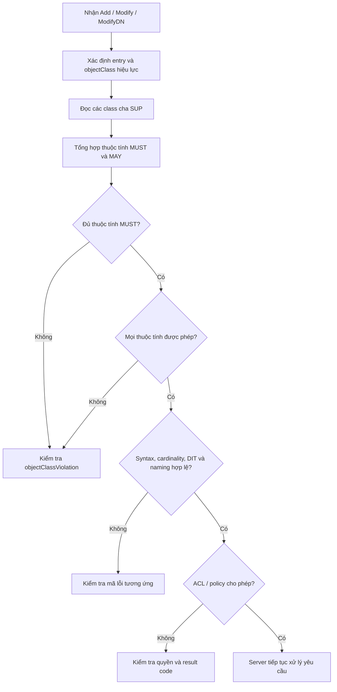
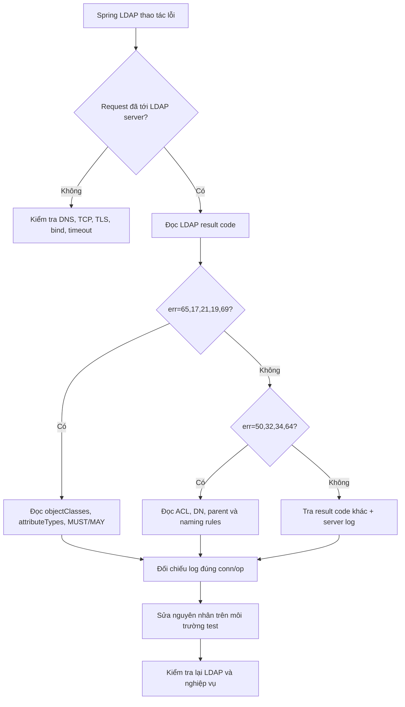

# Phân tích lỗi schema bằng object class và server log

Khi một thao tác `bind`, `modifyAttributes` hoặc `rename` thất bại trong **Spring LDAP**, thông báo “schema violation” chỉ là điểm bắt đầu. Muốn tìm nguyên nhân, người phát triển phải đối chiếu **object class của entry**, định nghĩa thuộc tính trong schema, DN đang thao tác, **LDAP result code** và thông tin tương ứng trong **log của máy chủ thư mục**. Sửa mã Java mà không biết server đang từ chối quy tắc nào dễ làm lỗi lặp lại hoặc khiến ứng dụng gửi dữ liệu sai.

Bài thuộc chương **Debugging** của module **SPRING_LDAP**. Người học dùng `LdapTemplate`, `LdapClient` hoặc ODM để truy cập directory, đồng thời áp dụng kiến thức về DN, schema, filter, `ContextSource`, TLS, quyền truy cập và kiểm thử. Trọng tâm là quy trình chẩn đoán **có bằng chứng**: tái hiện lỗi → xác định yêu cầu bị từ chối → đọc schema → đối chiếu server log → sửa đúng nguyên nhân → kiểm tra lại.

> **Nguyên tắc:** Không được suy ra “thiếu object class” chỉ vì client thấy lỗi LDAP. Cùng một thao tác có thể thất bại do thuộc tính bắt buộc bị thiếu, thuộc tính không được phép, cú pháp sai, quyền truy cập, DN không hợp lệ hoặc quy tắc riêng của directory. Mã lỗi và log giúp phân biệt các trường hợp đó.

## 1. Mục tiêu học tập

Sau bài này, bạn có thể:

1. Giải thích các thành phần của LDAP schema: `objectClasses`, `attributeTypes`, kế thừa `SUP`, `MUST`, `MAY`, loại structural/auxiliary/abstract và quy tắc bổ sung của directory.
2. Phân biệt lỗi **thiếu thuộc tính bắt buộc**, **thuộc tính không được phép**, **sai cú pháp**, **không hợp lệ khi đổi object class** và **lỗi ACL/DN**.
3. Đọc và đối chiếu LDAP result code như `objectClassViolation (65)`, `invalidAttributeSyntax (21)`, `undefinedAttributeType (17)`, `constraintViolation (19)` và `insufficientAccessRights (50)`.
4. Truy vấn entry thực tế, tìm `subschemaSubentry`, xem định nghĩa schema và kiểm tra các object class kế thừa.
5. Phân tích server log theo thời điểm, kết nối, operation ID, DN, loại lệnh, result code và thông báo schema.
6. Tái hiện lỗi bằng Java và công cụ LDAP trên **môi trường kiểm thử**, sửa dữ liệu hoặc schema đúng cách và xác minh sau sửa.
7. Giữ an toàn khi debug: kết nối TLS, quyền tối thiểu, không lộ bind password, bí mật và dữ liệu nhạy cảm trong log.

## 2. Schema quyết định entry hợp lệ như thế nào?

LDAP schema mô tả kiểu đối tượng và thuộc tính của directory. Một entry được xác định bằng **Distinguished Name (DN)**, ví dụ:

```ldif
dn: uid=lan,ou=people,dc=example,dc=org
objectClass: top
objectClass: person
objectClass: organizationalPerson
objectClass: inetOrgPerson
uid: lan
cn: Lan Tran
sn: Tran
displayName: Lan Tran
mail: lan@example.org
```

Entry này dùng chuỗi object class chuẩn thường gặp:

```text
top (ABSTRACT)
  └── person (STRUCTURAL)
        └── organizationalPerson (STRUCTURAL)
              └── inetOrgPerson (STRUCTURAL)
```

Khi một class kế thừa class cha, các yêu cầu thuộc tính của class cha vẫn áp dụng. Ví dụ, `person` yêu cầu `cn` và `sn`; do `inetOrgPerson` kế thừa từ `person` qua `organizationalPerson`, một entry `inetOrgPerson` cũng cần thỏa các yêu cầu này. Cấu trúc thực tế còn phụ thuộc cách schema được máy chủ tải, quy tắc đặt tên, DIT content rules và chính sách riêng.

### Các khái niệm cần đọc đúng

| Thành phần | Vai trò khi debug | Ví dụ |
|---|---|---|
| `objectClass` | Cho biết entry đang thuộc các loại đối tượng nào | `person`, `inetOrgPerson` |
| `SUP` | Class cha; mang theo các ràng buộc được kế thừa | `inetOrgPerson SUP organizationalPerson` |
| `MUST` | Thuộc tính bắt buộc; xét cả class cha | `person MUST ( sn $ cn )` |
| `MAY` | Thuộc tính được phép có, không bắt buộc | `mail`, `displayName` trong schema `inetOrgPerson` thông thường |
| `STRUCTURAL` | Class mô tả loại entry cơ bản | `person` và lớp con |
| `AUXILIARY` | Có thể mở rộng thuộc tính cho structural class nếu directory cho phép | Tùy schema triển khai |
| `ABSTRACT` | Class dùng làm nền tảng cho kế thừa | `top` |
| `attributeTypes` | Mô tả cú pháp, matching rule, cardinality và các đặc tính thuộc tính | `telephoneNumber`, `uid` |
| `SINGLE-VALUE` | Thuộc tính chỉ nhận một giá trị theo schema | Phải kiểm tra định nghĩa cụ thể |
| `subschemaSubentry` | DN của entry công bố schema áp dụng | Thường trỏ đến một subschema entry |

**Lưu ý:** `MAY` nghĩa là thuộc tính **được phép xuất hiện**, không có nghĩa bất kỳ chuỗi giá trị nào cũng hợp lệ. Giá trị vẫn phải tuân thủ syntax, matching rule, hạn chế kích thước, ACL và các quy tắc bổ sung.

### Quy trình đánh giá một entry



Sơ đồ là **mô hình chẩn đoán**, không khẳng định server luôn kiểm tra các điều kiện đúng thứ tự này. Một máy chủ có thể phát hiện quyền truy cập trước khi kiểm tra schema, hoặc trả mã lỗi khác nhau tùy hành vi triển khai.

## 3. Các lỗi schema thường gặp và cách nhận diện

### 3.1. Thiếu thuộc tính MUST

Entry `person` thiếu `sn`:

```ldif
dn: uid=lan,ou=people,dc=example,dc=org
objectClass: top
objectClass: person
objectClass: organizationalPerson
objectClass: inetOrgPerson
uid: lan
cn: Lan Tran
# Thiếu sn
```

Một server thực thi schema phù hợp có thể từ chối thao tác Add với `objectClassViolation (65)` và thông báo tương tự “required attribute sn missing”. **Câu chữ cụ thể không được chuẩn hóa cho mọi server**.

**Cách sửa:** bổ sung `sn` với giá trị hợp lệ và xác minh schema thực tế. Không bỏ bớt object class một cách tùy tiện để lách yêu cầu nghiệp vụ.

### 3.2. Thuộc tính không được object class cho phép

Giả sử ứng dụng gửi thuộc tính tùy biến `teamCode` nhưng server chưa định nghĩa attribute type này. Máy chủ có thể trả `undefinedAttributeType (17)`. Nếu `teamCode` đã được định nghĩa nhưng **không xuất hiện trong MUST/MAY hiệu lực**, một server có thể trả `objectClassViolation (65)`.

Hai tình huống khác nhau:

- **Không có attribute type:** cần đăng ký schema hợp lệ (nếu được phép), hoặc dùng thuộc tính chuẩn/thích hợp sẵn có.
- **Có attribute type nhưng object class không cho phép:** cần chọn class/auxiliary class hoặc DIT content rule phù hợp với thiết kế directory.

Không nên cố giải quyết bằng cách gửi cùng thuộc tính với tên khác nếu chưa kiểm tra schema; LDAP hỗ trợ tên và OID, và cách đặt alias có quy tắc riêng.

### 3.3. Giá trị sai cú pháp

Ví dụ attribute type được khai báo theo cú pháp số nguyên nhưng client gửi chuỗi không thể phân tích thành số. Server có thể trả `invalidAttributeSyntax (21)`. Với thuộc tính giới hạn số giá trị hoặc độ dài, có thể nhận `constraintViolation (19)`, `objectClassViolation (65)` hoặc mã chuyên biệt tùy quy tắc và sản phẩm.

**Cách sửa:** đọc định nghĩa `attributeTypes` của thuộc tính đó, kiểm tra `SYNTAX`, `SINGLE-VALUE`, ràng buộc độ dài và cơ chế chuẩn hóa. Không chỉ nhìn datatype Java: một giá trị là `String` trong Java không có nghĩa nó hợp lệ theo LDAP syntax.

### 3.4. Thay đổi object class không hợp lệ

Một entry thường có một chuỗi structural class phù hợp. Thử ghép hai structural class không tương thích, chẳng hạn biến user `inetOrgPerson` thành đồng thời `groupOfNames` bằng một Modify, có thể bị từ chối bởi schema. Thay đổi structural object class sau khi entry được tạo cũng có thể bị directory cấm, có thể trả `objectClassModsProhibited (69)` hoặc lỗi khác.

**Cách sửa:** xác định loại entry cần tạo ngay từ đầu. Nếu yêu cầu thực tế là gán user vào nhóm, phải **Modify entry nhóm** (ví dụ thuộc tính `member`), thay vì thêm `groupOfNames` vào entry người dùng.

### 3.5. DN và quy tắc cây thư mục

Ngay cả khi object class và thuộc tính hợp lệ, entry vẫn có thể bị từ chối do:

- DN sai cú pháp: `invalidDNSyntax (34)`.
- Parent DN không tồn tại: thường là `noSuchObject (32)`.
- Vị trí trong cây hoặc naming rule không hợp lệ: `namingViolation (64)` hoặc mã khác.
- RDN không phù hợp với yêu cầu đặt tên của server.
- DIT structure rule/content rule giới hạn loại entry và thuộc tính theo nhánh.

Không nên chữa mọi lỗi Add bằng cách thêm object class. Hãy kiểm tra **DN đầy đủ, parent DN và các quy tắc cấu trúc**.

### 3.6. Quyền và chính sách server

Nếu tài khoản ứng dụng không có quyền Add dưới OU hoặc không có quyền Modify thuộc tính, server có thể trả `insufficientAccessRights (50)`. Một số directory cố tình giảm độ chi tiết của lỗi để không tiết lộ schema hoặc sự tồn tại của entry cho tài khoản ít quyền. Tùy sản phẩm, kết quả có thể là `unwillingToPerform (53)` hoặc một thông báo tương tự.

**Cách sửa:** so sánh kết quả với tài khoản thử nghiệm có quyền được kiểm soát trên môi trường test; kiểm tra ACL, chính sách password và quyền trên parent/entry/attribute. Không tự mở rộng quyền service account trong production chỉ để “làm hết lỗi”.

## 4. Bảng tra LDAP result code khi phân tích schema

| Result code | Tên LDAP | Hướng điều tra ban đầu |
|---:|---|---|
| **65** | `objectClassViolation` | Thiếu MUST, có thuộc tính không được MAY/MUST cho phép, class không tương thích, ràng buộc schema khác |
| **21** | `invalidAttributeSyntax` | Giá trị không hợp syntax/matching rule của attribute type |
| **17** | `undefinedAttributeType` | Thuộc tính chưa được schema định nghĩa hoặc tên/OID không nhận diện |
| **19** | `constraintViolation` | Giới hạn khác của schema/policy, cardinality, giá trị hoặc server constraint |
| **69** | `objectClassModsProhibited` | Cố sửa object class theo cách directory không cho phép |
| **64** | `namingViolation` | Vị trí, tên hoặc quy tắc naming/DIT không hợp lệ |
| **34** | `invalidDNSyntax` | DN không parse được theo cú pháp |
| **32** | `noSuchObject` | Entry hoặc parent đích không tìm thấy tại endpoint được hỏi |
| **50** | `insufficientAccessRights` | ACL không cho phép thao tác/thuộc tính |
| **20** | `attributeOrValueExists` | Thêm giá trị đã tồn tại; thường gặp ở thao tác ADD |
| **16** | `noSuchAttribute` | Thao tác yêu cầu thuộc tính/giá trị chưa có |
| **53** | `unwillingToPerform` | Directory từ chối do chính sách hoặc điều kiện vận hành; cần log server |

**Không xem bảng như một ánh xạ tuyệt đối.** Cùng một dữ liệu có thể chạm nhiều quy tắc; server quyết định mã lỗi khi xử lý. Ưu tiên đọc **mã số**, thao tác, DN, trạng thái entry và thông báo server tương ứng. Nội dung exception của Spring LDAP không nhất thiết chứa toàn bộ chi tiết log phía server.

## 5. Thu thập bằng chứng từ phía Spring LDAP

Khi một thao tác LDAP thất bại, hãy ghi nhận tối thiểu:

1. **Tác vụ:** `Add`, `Modify`, `Delete`, `ModifyDN` hoặc `Search`.
2. **Đích:** DN **tương đối** dùng trong `LdapTemplate` và base DN của `ContextSource`, từ đó suy ra DN đầy đủ.
3. **Endpoint:** LDAP URL thực tế hoặc backend server nhận request, đặc biệt nếu có load balancer, replica hoặc failover.
4. **Thời gian/correlation ID:** để tìm đúng dòng log server.
5. **Schema liên quan:** các object class, tên thuộc tính, số lượng giá trị và sự có mặt của MUST; không cần ghi giá trị bí mật.
6. **Exception:** tên class, chuỗi cause nếu được phép, LDAP result code có thể trích xuất từ provider hoặc log.
7. **Trạng thái trước/sau:** đọc lại entry bằng một LDAP client độc lập nếu request có khả năng đã được áp dụng.

### Ngoại lệ trong Java

Với `LdapTemplate`, lỗi từ JNDI thường được chuyển thành các exception **unchecked** trong hệ thống exception của Spring LDAP; loại exception cụ thể và cách lấy mã kết quả phụ thuộc phiên bản Spring LDAP, JNDI provider và máy chủ. Ví dụ JNDI có `javax.naming.directory.SchemaViolationException`, nhưng đừng chỉ dựa vào tên exception client để kết luận server đang vi phạm chính xác quy tắc nào.

Đoạn minh họa dưới đây tránh log dữ liệu nhạy cảm. Logger và `operationId` là hạ tầng ứng dụng cần cung cấp:

```java
import org.springframework.ldap.core.LdapTemplate;
import org.springframework.stereotype.Service;

@Service
public class DirectoryWriteService {

    private final LdapTemplate ldapTemplate;
    private static final org.slf4j.Logger log =
            org.slf4j.LoggerFactory.getLogger(DirectoryWriteService.class);

    public DirectoryWriteService(LdapTemplate ldapTemplate) {
        this.ldapTemplate = ldapTemplate;
    }

    public void createUser(
            javax.naming.Name relativeDn,
            javax.naming.directory.Attributes attributes,
            String operationId) {

        try {
            ldapTemplate.bind(relativeDn, null, attributes);
        } catch (RuntimeException ex) {
            log.warn(
                "LDAP Add failed; operationId={}, exceptionType={}",
                operationId, ex.getClass().getName());

            // Để tầng xử lý lỗi quyết định mã phản hồi và đối soát.
            // Không âm thầm bỏ qua exception.
            throw ex;
        }
    }
}
```

Với hệ thống cần chẩn đoán chi tiết, có thể lưu **mã result code, DN đã được lọc nhạy cảm và server ID** trong kênh log bảo mật có phân quyền. Không ghi toàn bộ `Attributes`, giá trị `userPassword`, mật khẩu bind, token hoặc stack trace chứa dữ liệu đầu vào nhạy cảm vào log công khai.

### Tìm sai khác giữa DN tương đối và DN đầy đủ

Nếu `ContextSource` có base `dc=example,dc=org`:

```java
Name relativeDn = LdapNameBuilder.newInstance("ou=people")
        .add("uid", "lan")
        .build();
```

thì `LdapTemplate` thao tác trên entry tương ứng bên dưới base. Không tự ghép base hai lần thành `uid=lan,ou=people,dc=example,dc=org,dc=example,dc=org`. Khi chẩn đoán `noSuchObject` hoặc `namingViolation`, cần xem DN đầy đủ mà server thực sự nhận, không chỉ đoạn DN xuất hiện trong mã Java.

## 6. Đọc entry và schema từ directory

### 6.1. Đọc objectClass của entry thực tế

Với máy chủ hỗ trợ giao thức LDAP chuẩn và công cụ dòng lệnh `ldapsearch`, có thể truy vấn entry bằng DN chính xác. Ví dụ dùng **LDAPS** và yêu cầu nhập mật khẩu từ terminal:

```bash
ldapsearch -LLL -x \
  -H "ldaps://ldap.example.org:636" \
  -D "cn=diagnostics,ou=service-accounts,dc=example,dc=org" -W \
  -b "uid=lan,ou=people,dc=example,dc=org" -s base \
  "(objectClass=*)" objectClass cn sn uid mail displayName
```

Kiểm tra:

- `objectClass` thực tế có những giá trị nào?
- Entry đã có thuộc tính MUST chưa, có giá trị đúng định dạng chưa?
- Thuộc tính đang gây lỗi có tồn tại hoặc đã có giá trị trước đó chưa?
- Có đúng server và đúng naming context không?
- Tài khoản đọc có quyền thấy các thuộc tính cần điều tra không?

**Không thấy thuộc tính qua Search không nhất thiết chứng minh nó không tồn tại:** ACL có thể ẩn một số thuộc tính, và thuộc tính vận hành thường không tự xuất hiện trong danh sách thuộc tính mặc định.

### 6.2. Tìm subschemaSubentry

Schema áp dụng cho entry có thể được công bố thông qua thuộc tính vận hành `subschemaSubentry`. Một bước khảo sát thường gặp là đọc root DSE:

```bash
ldapsearch -LLL -x \
  -H "ldaps://ldap.example.org:636" \
  -D "cn=diagnostics,ou=service-accounts,dc=example,dc=org" -W \
  -b "" -s base "(objectClass=*)" \
  subschemaSubentry namingContexts supportedFeatures
```

Tùy triển khai, có thể cần đọc `subschemaSubentry` từ **entry cụ thể** vì những phần của directory có thể tham chiếu schema khác nhau. Không hardcode `cn=subschema` nếu chưa đọc được DN mà server công bố.

Khi đã biết DN subschema (ví dụ minh họa `cn=Subschema`), truy vấn định nghĩa:

```bash
ldapsearch -LLL -x \
  -H "ldaps://ldap.example.org:636" \
  -D "cn=diagnostics,ou=service-accounts,dc=example,dc=org" -W \
  -b "cn=Subschema" -s base "(objectClass=*)" \
  objectClasses attributeTypes dITContentRules
```

Kết quả có thể dài. Trong môi trường có quyền và công cụ phù hợp, lọc định nghĩa theo **tên hoặc OID** của class/attribute đang điều tra. Nếu server không công bố schema theo cách này, phải dùng công cụ quản trị và tài liệu đúng sản phẩm, phiên bản đang chạy.

### 6.3. Đọc định nghĩa object class

Một đoạn định nghĩa schema minh họa có thể có dạng:

```text
( 2.5.6.6 NAME 'person'
  SUP top STRUCTURAL
  MUST ( sn $ cn )
  MAY ( userPassword $ telephoneNumber $ seeAlso $ description ) )
```

Từ đó suy ra `person` yêu cầu `sn`, `cn` và cho phép một số thuộc tính tùy chọn. Khi class con có `SUP person` qua chuỗi kế thừa, những thuộc tính MUST đó vẫn bắt buộc.

Đối với một lỗi bất kỳ, hãy:

1. Tìm định nghĩa **class trực tiếp** được khai báo.
2. Lần theo mọi `SUP` cần thiết.
3. Lập tập hợp `MUST` và `MAY` hiệu lực.
4. Đối chiếu với các thuộc tính của entry đang Add/Modify.
5. Kiểm tra `attributeTypes` để biết syntax, `SINGLE-VALUE`, usage và đặc điểm của thuộc tính.
6. Kiểm tra DIT content/structure/naming rule hoặc chính sách riêng nếu schema thông thường đã hợp lệ nhưng server vẫn từ chối.

Đối với entry user chuẩn, `inetOrgPerson` thường kế thừa `organizationalPerson` và `person`. `uid` thường là thuộc tính được phép trong `inetOrgPerson`, nhưng không thay thế `cn`/`sn` bắt buộc từ `person`.

## 7. Đọc server log và ghép đúng request

Thông tin phía client cho biết **lệnh thất bại**, còn log phía server thường giúp xác định **vì sao server từ chối**. Cách mở log và mức chi tiết phụ thuộc hệ LDAP:

| Hệ directory | Nguồn điều tra thường gặp | Ghi chú |
|---|---|---|
| OpenLDAP `slapd` | Log service/journald/syslog theo cấu hình loglevel | Mức log và định dạng tùy triển khai |
| 389 Directory Server | Access log, error log của instance directory | Nên ghép connection/operation ID trong access log với lỗi server |
| Active Directory Domain Services | Event Viewer, log Directory Service và công cụ chẩn đoán AD phù hợp | Log không mặc nhiên ghi từng LDAP operation ở mức chi tiết; có thể cần cơ chế diagnostics được phê duyệt |
| Directory thương mại/managed LDAP | Nhật ký truy cập, auditing và hệ thống quan sát của nhà cung cấp | Tên trường, result code và mức chi tiết khác nhau |

Không bật chế độ log cực chi tiết trên production mà chưa đánh giá tác động hiệu năng và nguy cơ lộ dữ liệu. Khi cần tăng mức log để tái hiện, thực hiện trong thời gian giới hạn, có quyền phù hợp và hoàn nguyên cấu hình.

### Log minh họa (không phải mẫu chuẩn của một sản phẩm)

```text
2026-11-27T10:00:12Z server=ldap-a conn=217 op=14
  ADD dn="uid=lan,ou=people,dc=example,dc=org"
2026-11-27T10:00:12Z server=ldap-a conn=217 op=14
  RESULT err=65 detail="required attribute sn missing"
```

Trong ví dụ **giả định** trên:

- `server=ldap-a` xác định endpoint xử lý.
- `conn=217` và `op=14` ghép request với response trên server.
- `ADD` và DN cho biết entry đích.
- `err=65` là object class violation.
- `detail` gợi ý quy tắc đang bị vi phạm: `sn` bắt buộc.

Câu chữ và cấu trúc log thực tế có thể khác; một số log không hiện đầy đủ chi tiết vì chính sách bảo mật hoặc mức logging.

### Quy trình ghép log đáng tin cậy

1. **Xác định thời điểm lỗi** từ request application, kèm timezone; đồng bộ clock giữa các server bằng cơ chế vận hành phù hợp.
2. **Xác định server thực** đang xử lý, nhất là khi `ContextSource` đi qua load balancer hoặc cấu hình nhiều URL.
3. Tìm theo **connection ID, operation ID, DN, loại thao tác** hoặc correlation ID nếu hạ tầng có tích hợp.
4. Xem **response/result code** và thông báo server, đồng thời đọc các log server liên quan đến schema/ACL trong cùng khoảng thời gian.
5. Đối chiếu với **payload đã lọc bí mật** mà application gửi và trạng thái entry trước khi ghi.
6. Tránh dùng một dòng log thuộc request khác hoặc server khác để kết luận lỗi của request đang điều tra.
7. Tái hiện trên môi trường test sau khi đã tìm nguyên nhân giả định.

Một kết nối có thể xử lý nhiều request, và operation ID có thể chỉ có ý nghĩa trong phạm vi một connection hoặc server. Vì vậy, **ghép kết hợp server + connection + operation + timestamp**, không dùng operation ID đứng một mình.

## 8. Ví dụ lỗi Spring LDAP: thiếu `sn` khi Add `inetOrgPerson`

Ví dụ sau cố ý tạo entry sai schema. Để tránh ghi dữ liệu lỗi vào directory thật, chỉ chạy nó trong **môi trường kiểm thử** đã seed OU và account phù hợp.

### 8.1. Phiên bản lỗi

```java
import javax.naming.Name;
import javax.naming.directory.Attributes;
import javax.naming.directory.BasicAttribute;
import javax.naming.directory.BasicAttributes;

import org.springframework.ldap.core.LdapTemplate;
import org.springframework.ldap.support.LdapNameBuilder;
import org.springframework.stereotype.Service;

@Service
public class DirectoryUserService {

    private final LdapTemplate ldapTemplate;

    public DirectoryUserService(LdapTemplate ldapTemplate) {
        this.ldapTemplate = ldapTemplate;
    }

    public void createUserWithoutSurname(String uid, String commonName) {
        Name relativeDn = LdapNameBuilder.newInstance("ou=people")
                .add("uid", uid)
                .build();

        Attributes attrs = new BasicAttributes(true);
        BasicAttribute classes = new BasicAttribute("objectClass");
        classes.add("top");
        classes.add("person");
        classes.add("organizationalPerson");
        classes.add("inetOrgPerson");

        attrs.put(classes);
        attrs.put("uid", uid);
        attrs.put("cn", commonName);
        // Cố ý thiếu "sn" dù person yêu cầu.

        ldapTemplate.bind(relativeDn, null, attrs);
    }
}
```

Với schema chuẩn của `person`, lỗi dự kiến là từ chối vì thiếu `sn`. Tuy vậy, **mã và thông điệp thực phải lấy từ LDAP server đang thử**; một số server có thể thêm kiểm tra khác nên lỗi đầu tiên được trả về không giống dự kiến.

### 8.2. Phiên bản sửa đúng

```java
public void createValidUser(String uid,
                            String commonName,
                            String surname) {
    Name relativeDn = LdapNameBuilder.newInstance("ou=people")
            .add("uid", uid)
            .build();

    Attributes attrs = new BasicAttributes(true);
    BasicAttribute classes = new BasicAttribute("objectClass");
    classes.add("top");
    classes.add("person");
    classes.add("organizationalPerson");
    classes.add("inetOrgPerson");

    attrs.put(classes);
    attrs.put("uid", uid);
    attrs.put("cn", commonName);
    attrs.put("sn", surname); // Bổ sung thuộc tính MUST.

    ldapTemplate.bind(relativeDn, null, attrs);
}
```

Hai phương thức minh họa chỉ khác một điểm có ý nghĩa: **giá trị thuộc tính bắt buộc**. Phương thức sửa đúng không có nghĩa mọi server chắc chắn chấp nhận: còn cần parent DN tồn tại, object classes được server hỗ trợ, ACL cho phép Add, RDN hợp lệ, dữ liệu không trùng và các ràng buộc bổ sung.

### 8.3. Khi sửa profile vẫn báo objectClassViolation

Giả sử một entry hiện có đã hợp lệ nhưng code này bị từ chối:

```java
ModificationItem change = new ModificationItem(
    DirContext.ADD_ATTRIBUTE,
    new BasicAttribute("teamCode", "ENG"));
ldapTemplate.modifyAttributes(
    userDn, new ModificationItem[] { change });
```

Cần phân biệt:

- `teamCode` **chưa được định nghĩa trong schema** → có thể nhận `undefinedAttributeType (17)`.
- `teamCode` đã được định nghĩa nhưng **không được class hiệu lực cho phép** → có thể nhận `objectClassViolation (65)`.
- `teamCode` có syntax giới hạn khác hoặc thuộc tính chỉ dành cho thao tác của server → có thể nhận lỗi syntax, constraint, operation not permitted hoặc policy tùy sản phẩm.

Thay object class một cách tùy tiện để “mở khóa” thuộc tính có thể phá mô hình dữ liệu. Cần thảo luận với người quản trị schema và sử dụng class/attribute phù hợp với nghiệp vụ.

## 9. Debug schema bằng LDIF: tách lỗi Java khỏi lỗi server

Nếu nghi ngờ cách `LdapTemplate` xây dựng `Attributes` sai, có thể tái hiện bằng LDIF trên **test directory**. Điều này giúp tách lỗi serialization của client khỏi quy tắc schema phía server.

### LDIF minh họa cố tình thiếu thuộc tính bắt buộc

```ldif
dn: uid=lan-test,ou=people,dc=example,dc=org
changetype: add
objectClass: top
objectClass: person
objectClass: organizationalPerson
objectClass: inetOrgPerson
uid: lan-test
cn: Lan Test
```

Chạy qua một LDAP client hỗ trợ LDIF trên môi trường thử nghiệm, ví dụ:

```bash
ldapmodify -x \
  -H "ldaps://ldap-test.example.org:636" \
  -D "cn=test-writer,ou=service-accounts,dc=example,dc=org" -W \
  -f missing-sn.ldif
```

Nếu server từ chối vì thiếu `sn`, hãy **tạo LDIF hợp lệ khác** có thuộc tính:

```ldif
sn: Test
```

Đảm bảo UID/DN test chưa tồn tại trước khi chạy lại, hoặc chủ động dọn entry do test tạo. Nếu file đầu đã vô tình thành công vì máy chủ tắt kiểm tra schema, không được kết luận “`sn` không bắt buộc trên mọi LDAP server”. Kiểm tra xem schema validation có đang được kích hoạt và server có dùng đúng schema mong đợi không.

**Không đem file LDIF chứa dữ liệu thật hoặc mật khẩu vào hệ thống log công khai.** Các ví dụ test nên sử dụng giá trị giả và tài khoản thử có quyền hạn hẹp.

## 10. Phân biệt lỗi client, schema server và ACL

Một lỗi báo về từ `LdapTemplate` có thể bắt nguồn từ nhiều tầng:



### Nếu không thấy request trong access log

Đừng vội thay object class. Có thể client chưa kết nối tới server vì:

- URL/port sai, DNS hoặc firewall chặn.
- TLS handshake lỗi do truststore, hostname hoặc chứng chỉ.
- Client bị bind thất bại trước khi gửi thao tác ghi.
- ContextSource bị định tuyến đến server khác.
- Timeout/network interruption hoặc mức logging chưa ghi lại operation.

Hãy kiểm tra lớp kết nối/bind với hạ tầng vận hành, rồi tìm lại **đúng endpoint**. Bật TLS đúng chuẩn là yêu cầu bảo mật; không tắt kiểm tra chứng chỉ chỉ để có log.

### Nếu server trả `insufficientAccessRights (50)`

Kiểm tra ACL theo:

1. Bind identity thực sự sử dụng bởi `ContextSource`.
2. Quyền trên parent DN khi Add hoặc Move.
3. Quyền trên entry và thuộc tính khi Modify.
4. Quy tắc đặc biệt cho operational attribute, password hoặc group membership.
5. Quy tắc khác nhau giữa các server nếu có replication/failover.

Tài khoản có quyền Search chưa chắc có quyền Add/Modify. Tài khoản admin test chạy thành công chỉ chứng minh **quyền và policy có vai trò**, không chứng minh schema của entry đã đúng cho principal sản xuất.

## 11. Rủi ro thường gặp khi dùng ODM và LdapClient

### 11.1. LDAP ODM không tự sinh schema hợp lệ

Với Spring LDAP ODM, một class Java ánh xạ entry có thể dùng annotation như `@Entry`, `@Id`, `@Attribute`. Nhưng Java object **không tự chứng minh** server cho phép mọi thuộc tính mà mapper gửi.

Ví dụ class Java khai báo một trường `teamCode` không làm thuộc tính đó xuất hiện trong `attributeTypes` hoặc `MAY` của LDAP server. Nếu không phù hợp schema, thao tác lưu vẫn bị từ chối.

Hãy kiểm tra:

- Mapping object class thực của entry và các object class mapper yêu cầu.
- Thuộc tính bắt buộc của class cha có được mapper gửi khi Add không.
- Các giá trị null/rỗng được mapper biểu diễn ra sao.
- Thao tác update có thay thế/xóa giá trị ảnh hưởng tới MUST không.
- DN do mapper tạo có đúng base, RDN và các ký tự escape không.

### 11.2. LdapClient vẫn phải tuân theo schema server

`LdapClient` cung cấp API hướng fluent để thực hiện thao tác LDAP; việc đổi API từ `LdapTemplate` sang `LdapClient` không thay đổi quy tắc schema. Nếu server trả `objectClassViolation`, phải phân tích entry/object class/result code y như với JNDI hoặc LDAP CLI.

### 11.3. Template sửa thuộc tính theo kiểu REPLACE hoặc REMOVE

Một lệnh `REPLACE_ATTRIBUTE` có thể vô tình thay toàn bộ giá trị của thuộc tính bắt buộc bằng tập rỗng, hoặc `REMOVE_ATTRIBUTE` có thể loại bỏ thuộc tính MUST cuối cùng. Trong trường hợp đó, server có thể từ chối ngay một yêu cầu Modify dù entry đang hợp lệ trước khi gọi.

Khi debug Modify, phải ghi lại **loại thao tác trên từng ModificationItem**:

| Operation | Ngữ nghĩa cơ bản | Lỗi có thể gặp |
|---|---|---|
| `ADD_ATTRIBUTE` | Thêm giá trị/thuộc tính | Trùng giá trị, thuộc tính không được phép, syntax |
| `REPLACE_ATTRIBUTE` | Thay tập giá trị của thuộc tính | Xóa tình cờ giá trị MUST, vi phạm SINGLE-VALUE, syntax |
| `REMOVE_ATTRIBUTE` | Xóa thuộc tính hoặc giá trị | Xóa thuộc tính MUST, giá trị không tồn tại, ACL |

Các tên hằng trên là cách biểu diễn từ API JNDI; mapping sang LDAP Modify operation tương ứng phải được kiểm tra theo hành vi client thực tế.

## 12. Checklist xử lý sự cố theo thứ tự

Khi nhận một lỗi schema trong hệ thống đang chạy, thực hiện lần lượt:

1. **Khoanh vùng:** xác định môi trường, endpoint server, thời điểm, thao tác và DN đích.
2. **Đảm bảo an toàn:** dùng tài khoản chẩn đoán được cấp quyền, kết nối TLS; ẩn giá trị cá nhân/secret trong log.
3. **Lấy mã lỗi:** ghi LDAP result code và exception chain ở mức được phép; đừng chỉ ghi thông điệp Java tổng quát.
4. **Ghép server log:** tìm đúng connection ID, operation ID, timestamp và DN; kiểm tra nguyên nhân cụ thể.
5. **Đọc trạng thái entry:** xem objectClass, thuộc tính hiện có, parent DN và khả năng hiện diện của giá trị đang Add/Remove.
6. **Đọc schema:** lấy `subschemaSubentry`, `objectClasses`, `attributeTypes` và theo dõi SUP/MUST/MAY.
7. **Phân biệt tầng lỗi:** schema, syntax, ACL, naming, TLS/bind hay server policy.
8. **Tái hiện trên test:** gửi request tối thiểu qua Java hoặc LDIF; không thử sửa schema trên production để chẩn đoán.
9. **Sửa đúng nơi:** dữ liệu đầu vào, mapping, object class hợp lệ, DN, ACL hoặc schema extension đã được duyệt.
10. **Kiểm tra lại:** đọc entry sau thao tác, xác minh thuộc tính bắt buộc, kiểm thử nghiệp vụ và ghi kết quả đối chiếu.
11. **Phòng ngừa:** thêm kiểm tra dữ liệu đầu vào, fixture schema test và cảnh báo log theo result code.

### Bảng quyết định nhanh

| Quan sát | Hướng kiểm tra ưu tiên |
|---|---|
| Error 65 sau Add user | `cn`/`sn`, class cha, thuộc tính không cho phép |
| Error 65 sau Modify | Có xóa MUST không, class/attribute hiện hành, content rules |
| Error 17 với custom field | Attribute type có được định nghĩa trên server không |
| Error 21 khi ghi giá trị | Syntax và chuẩn hóa giá trị theo attribute type |
| Error 69 khi sửa objectClass | Structural object class và chính sách Modify |
| Error 50 khi Add vào OU | Quyền trên parent DN và identity bind |
| Error 32 khi Add | Parent DN, base DN và backend đúng chưa |
| Error 34/64 | Cú pháp DN, RDN, quy tắc naming/DIT |
| Không thấy request trong log | Đúng endpoint, TLS, bind, logging level và network chưa |
| Lỗi chỉ ở một LDAP node | Schema/ACL/version/replication hoặc routing khác nhau giữa node |

## 13. Kiểm thử tích hợp xác minh chẩn đoán

Mock một `LdapTemplate` để ném `SchemaViolationException` chỉ cho biết code Java xử lý exception ra sao. Nó **không chứng minh** server thực sự kiểm tra schema hoặc báo lỗi đúng quy tắc. Cần dùng LDAP server dành cho integration test với schema validation được bật và entry fixture có cấu trúc thực tế.

### Bộ ca kiểm thử đề xuất

| Ca kiểm thử | Thiết lập | Kết quả cần xác minh |
|---|---|---|
| Entry hợp lệ | `inetOrgPerson` có `cn`, `sn` và attribute syntax hợp lệ | Add thành công, đọc lại entry chính xác |
| Thiếu MUST | Entry tương tự nhưng bỏ `sn` | Server từ chối; entry không được tạo |
| Unknown attribute | Add/Modify attribute không được định nghĩa | Server trả lỗi thích hợp, không có ghi một phần |
| Attribute không thuộc MAY/MUST | Attribute đã định nghĩa nhưng class không cho phép | Server từ chối theo schema |
| Sai syntax | Gửi giá trị không hợp attribute type của fixture | Server từ chối đúng loại lỗi |
| Xóa MUST | Remove `sn` khỏi entry `person` đang hợp lệ | Modify bị từ chối, `sn` cũ vẫn có |
| Structural class không hợp lệ | Thử đổi class theo cấu trúc server cấm | Server từ chối, entry giữ trạng thái hợp lệ |
| Thiếu quyền | Bind bằng principal không được phép Modify | Phân biệt ACL lỗi với schema lỗi |
| DN sai | Gửi base/RDN sai hoặc parent không tồn tại | Phân biệt naming/noSuchObject |
| Nhiều sửa đổi trong **cùng** ModifyRequest | Một phần sửa đúng, một phần vi phạm schema | Toàn bộ request bị từ chối, không áp dụng riêng phần sửa đúng |

Các test cần đọc lại trạng thái entry bằng một LDAP connection độc lập để xác minh. Với môi trường test in-memory, **kiểm tra schema validation đã bật**: một số cấu hình mặc định của server test có thể bỏ qua schema, khiến ca âm tính thành công sai.

### Khung kiểm thử JUnit minh họa

```java
// Phác thảo: DirectoryUserService, directoryProbe và LDAP test server
// phải được cấu hình cho integration test; không phải code độc lập.
@Test
void missingSurnameIsRejectedByDirectorySchema() {
    String uid = "schema-test-001";

    assertThrows(
        RuntimeException.class,
        () -> directoryUserService.createUserWithoutSurname(
            uid, "Schema Test"));

    // Kiểm tra bằng một ContextSource/connection độc lập.
    assertFalse(directoryProbe.exists(
        "uid=" + uid + ",ou=people,dc=example,dc=org"));
}
```

`assertThrows(RuntimeException.class)` chỉ minh họa hành vi lỗi và còn khá rộng. Trong dự án thực tế, nên kiểm tra **mã LDAP server trả về** hoặc loại exception ánh xạ đã xác nhận của phiên bản đang sử dụng, kết hợp log và assertion trạng thái. Để test không phụ thuộc vào thứ tự lỗi, fixture nên cố tình vi phạm **một ràng buộc duy nhất** tại mỗi ca.

### Kiểm thử log và quan sát

- Khởi tạo operation ID cho mỗi thao tác.
- Tạo một lỗi schema chủ đích trên test server.
- Xác định trong log dòng chứa DN/operation ID đúng với request.
- Xác nhận mã lỗi, thời điểm và server nhận request.
- Đánh giá log không chứa password/credential hoặc giá trị nhạy cảm.
- Tắt mức log tăng cường sau khi test và lưu lại các dữ kiện cần thiết, không giữ bản dump dữ liệu cá nhân.

## 14. Tối ưu cách thiết kế để ít lỗi schema

### 14.1. Kiểm tra dữ liệu trước khi gửi LDAP

Khi chuẩn bị entry `inetOrgPerson`:

- Bảo đảm những thuộc tính MUST phù hợp với class đã chọn có giá trị hợp lệ.
- Không gửi trường thuộc tính tùy biến nếu schema hiện tại chưa hỗ trợ.
- Phân biệt thuộc tính đơn trị và đa trị; tránh đưa nhiều giá trị vào thuộc tính `SINGLE-VALUE`.
- Kiểm tra giá trị có phù hợp cú pháp, độ dài và policy riêng không.
- Dựng DN bằng API tạo DN có escape đúng; không nối chuỗi đầu vào trực tiếp.

Kiểm tra ở tầng application giúp trả thông báo dễ hiểu, nhưng **không thay thế validation phía server**, vì schema và ACL có thể thay đổi hoặc khác nhau giữa các endpoint.

### 14.2. Kiểm soát thay đổi schema

Thêm custom attribute type hoặc auxiliary object class là thay đổi thuộc **hạ tầng directory**. Nên có quy trình:

1. Xác định tên/OID và ý nghĩa nghiệp vụ không trùng định nghĩa đã có.
2. Đánh giá syntax, matching rule, MUST/MAY và quan hệ SUP.
3. Triển khai schema theo hướng dẫn nhà cung cấp lên các server liên quan.
4. Kiểm thử tương thích ứng dụng hiện có, migration và replication.
5. Có kế hoạch rollback schema/migration theo khả năng sản phẩm; không giả định mọi schema change đều dễ đảo ngược.

Không nên thay đổi object class của entry production chỉ để né một ngoại lệ từ Java. Chọn schema đúng từ mô hình dữ liệu và kiểm chứng trên test trước khi triển khai.

### 14.3. Nhất quán giữa nhiều server

Nếu lỗi “schema violation” chỉ xảy ra khi failover, có thể **server A và B đang có schema/version/ACL khác nhau**, hoặc request bị định tuyến vào naming context khác. Một replication data stream không nhất thiết tự đồng bộ mọi thiết lập schema hay policy tùy sản phẩm. Cần xem log ở server thực sự xử lý request và so sánh capability/configuration của các node.

Một thay đổi thành công trên A không chứng minh B đã nhận cùng schema hoặc đã sao chép entry. Không được dùng một lần Search ở replica làm bằng chứng duy nhất cho thao tác Add vừa thực hiện trên writer.

## 15. Câu hỏi tự kiểm tra

1. Vì sao `inetOrgPerson` vẫn cần `sn` dù bản định nghĩa class trực tiếp có thể không nhắc lại nó trong `MUST`?
2. Khác biệt giữa “attribute type chưa tồn tại” và “attribute type có nhưng object class không cho phép” là gì?
3. Nếu nhận mã 65 sau `modifyAttributes`, cần kiểm tra `ModificationItem` nào có khả năng làm mất thuộc tính MUST?
4. Tại sao response phía client không thay thế được server log khi cần biết lý do từ chối cụ thể?
5. Nếu log chỉ có `conn=10 op=3`, vì sao chưa đủ để ghép duy nhất với một request trong cụm nhiều server?
6. Một tài khoản admin test thực hiện Add thành công nhưng application bind account bị từ chối với mã 50 cho biết điều gì?
7. Nếu một test `inetOrgPerson` thiếu `sn` vẫn Add thành công, cần xác minh gì về server test trước khi sửa tài liệu schema?
8. Vì sao `LdapClient` hay ODM không thể tự giải quyết lỗi `undefinedAttributeType` khi server chưa khai báo field?
9. Trước khi tăng mức logging trên production, cần xem xét những rủi ro gì về dữ liệu, quyền và hiệu năng?
10. Làm thế nào để kiểm chứng sau lỗi một yêu cầu Modify gồm nhiều thay đổi vẫn giữ tính nguyên tử ở cấp entry?

## 16. Bài tập thực hành: tìm nguyên nhân từ log

Giả sử một service onboarding dùng Spring LDAP gửi lệnh Add:

```ldif
dn: uid=an,ou=people,dc=example,dc=org
objectClass: top
objectClass: person
objectClass: organizationalPerson
objectClass: inetOrgPerson
uid: an
cn: An Nguyen
mail: an@example.org
```

Application nhận một lỗi được bọc thành runtime exception. Ở server thử nghiệm có log:

```text
server=ldap-test-1 conn=801 op=33 ADD
  dn="uid=an,ou=people,dc=example,dc=org"
server=ldap-test-1 conn=801 op=33 RESULT err=65
  detail="object class person requires attribute sn"
```

Thực hiện:

1. Xác định **mã lỗi**, object class liên quan và thuộc tính MUST bị thiếu.
2. Đọc subschema của server để xác minh quan hệ `inetOrgPerson → organizationalPerson → person`.
3. Sửa LDIF bằng cách thêm `sn: Nguyen`; chạy lại với DN test được chuẩn bị sạch.
4. Thử thêm thuộc tính tùy biến chưa có trong `attributeTypes`; quan sát result code và so sánh với mã 65.
5. Dùng `LdapTemplate` viết ca Modify trên một entry hợp lệ gồm hai `ModificationItem`, một sửa đổi sai schema; kiểm chứng không có thay đổi một phần.
6. Đổi bind principal sang tài khoản chỉ được đọc, thử Modify và ghi lại mã lỗi quyền truy cập; giải thích vì sao không được chẩn đoán thành lỗi object class.
7. Ghép log ứng dụng và server theo timestamp, connection/operation ID và endpoint; báo cáo kết quả **không** chứa mật khẩu, credential hay dữ liệu không cần thiết.

Báo cáo nên có bảng **triệu chứng → LDAP result code → bằng chứng schema/log → nguyên nhân → thay đổi đã thực hiện → kết quả đọc lại**, và chỉ đánh dấu hoàn thành khi test xác nhận entry hợp lệ sau sửa.

## 17. Ghi nhớ

Phân tích lỗi schema trong Spring LDAP phải xuất phát từ **trạng thái và luật của directory**, không chỉ từ tên exception Java. Đọc `objectClass` của entry, lần theo `SUP` để xác định `MUST/MAY` hiệu lực, kiểm tra `attributeTypes`/syntax và đối chiếu **LDAP result code cùng server log đúng request**. Phân biệt lỗi schema với lỗi DN, ACL, TLS và chính sách directory trước khi thay đổi mã.

Một lỗi được sửa đúng khi có **bằng chứng từ server**, thay đổi tối thiểu tương ứng với nguyên nhân và bài kiểm thử đọc lại dữ liệu thành công. Giữ các bước chẩn đoán trên môi trường thử nghiệm khi có thể, bảo vệ thông tin nhạy cảm và kiểm soát mọi thay đổi schema hoặc log trên hệ thống thực tế.

### Tài liệu tham khảo

- [RFC 4512 — LDAP: Directory Information Models](https://www.rfc-editor.org/rfc/rfc4512): entry, object class, attribute type, schema, subschema và mô hình thông tin.
- [RFC 4511 — LDAP: The Protocol](https://www.rfc-editor.org/rfc/rfc4511): Add, Modify, Search và LDAP result codes.
- [RFC 4517 — LDAP: Syntaxes and Matching Rules](https://www.rfc-editor.org/rfc/rfc4517): cú pháp và matching rule của attribute.
- [RFC 2798 — Definition of the inetOrgPerson LDAP Object Class](https://www.rfc-editor.org/rfc/rfc2798): `inetOrgPerson` và các thuộc tính liên quan.
- [Spring LDAP — Reference Documentation](https://docs.spring.io/spring-ldap/reference/): `ContextSource`, `LdapTemplate`, LDAP client, ODM và xử lý exception.
- Tài liệu vận hành **đúng phiên bản directory server** đang dùng (OpenLDAP, 389 Directory Server, Active Directory hoặc sản phẩm tương ứng): cách đọc schema, ACL, access/error log và mức logging hỗ trợ.
