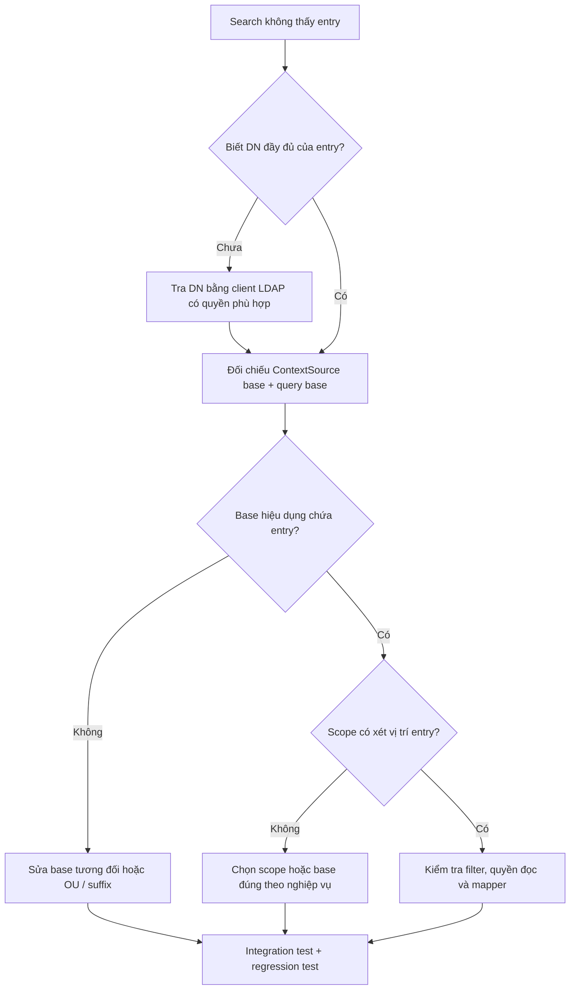

# Chẩn đoán entry không tìm thấy do base hoặc scope

Khi ứng dụng **Spring LDAP** trả về danh sách rỗng dù người quản trị nhìn thấy entry trong thư mục, nguyên nhân có thể nằm ở **base DN** (điểm bắt đầu tìm kiếm) hoặc **search scope** (phạm vi tìm kiếm). Truy vấn hoàn toàn hợp lệ vẫn có thể không chạm tới entry cần tìm. Đây là một tình huống debugging điển hình trong quá trình dùng `LdapTemplate`, `LdapClient` hoặc ODM, đặc biệt khi `ContextSource` đã khai báo sẵn một base DN.

Bài học hướng dẫn xác định **DN đầy đủ của entry**, phân biệt base của `LdapContextSource` với base của truy vấn, kiểm tra `OBJECT_SCOPE`, `ONELEVEL_SCOPE` và `SUBTREE_SCOPE`, sau đó xác nhận chẩn đoán bằng integration test có LDAP server thực sự xử lý truy vấn. Đồng thời, ta sẽ tách lỗi vị trí tìm kiếm khỏi những nguyên nhân khác như filter, schema, quyền đọc, kết nối TLS, pooling hoặc lỗi mapping. Mục tiêu là sửa **đúng base/scope gây ra vấn đề** thay vì tùy tiện mở rộng mọi truy vấn ra toàn bộ thư mục.

## 1. Nhận biết: không có kết quả khác với base không tồn tại

Xét một tình huống: ứng dụng cần tìm tài khoản `uid=external`, nhưng đoạn code sau trả danh sách rỗng:

```java
List<String> found = ldapTemplate.search(
        query()
                .base("ou=people")
                .searchScope(SearchControls.ONELEVEL_SCOPE)
                .where("uid").is("external"),
        (AttributesMapper<String>) attributes ->
                (String) attributes.get("uid").get()
);
```

Nếu `external` nằm dưới `ou=contractors,ou=people`, nó **không phải con trực tiếp** của `ou=people`. Server có thể trả trạng thái tìm kiếm thành công với **0 entry**: không có lỗi kết nối, nhưng scope đã loại entry ra khỏi vùng xét.

Cần phân biệt ba hiện tượng:

| Hiện tượng quan sát | Giải thích có thể | Hướng kiểm tra tiếp |
| --- | --- | --- |
| Search thành công, trả `[]` | Base tồn tại nhưng không có entry phù hợp trong phạm vi, filter không khớp hoặc quyền đọc bị giới hạn | Xác minh DN đầy đủ, scope, filter và danh tính bind |
| Search/lookup báo `NameNotFoundException` hoặc LDAP `noSuchObject (32)` | Base/DN không tồn tại hoặc không nhìn thấy theo hành vi server | Kiểm tra suffix, OU cha, cách ghép DN và quyền |
| Search trả entry nhưng DTO trống/sai | Entry có thể đã được tìm thấy; lỗi ở phần mapper hoặc các attribute được trả về | Kiểm tra `AttributesMapper`/`ContextMapper` và danh sách thuộc tính yêu cầu |

**Lưu ý:** cách Spring LDAP xử lý `NameNotFoundException` có thể chịu ảnh hưởng từ cấu hình phiên bản/thuộc tính bỏ qua lỗi và hành vi server. Một server có ACL cũng có thể cố ý che giấu sự tồn tại của entry. Đừng dùng riêng việc “có exception” hay “không có exception” để kết luận nguyên nhân khi chưa xem DN, scope và tài khoản đang bind.

## 2. Xác định đúng DN đầy đủ trong DIT

**DIT** (*Directory Information Tree*) là cây các entry LDAP. Mỗi entry có một **DN** (*Distinguished Name*) xác định vị trí của nó trong cây. Giả sử thư mục test có cấu trúc:

```text
dc=example,dc=org
├── ou=people
│   ├── uid=an
│   ├── uid=binh
│   └── ou=contractors
│       └── uid=external
└── ou=groups
    └── cn=developers
```

DN đầy đủ của người dùng ngoài là:

```text
uid=external,ou=contractors,ou=people,dc=example,dc=org
```

Các thành phần có vai trò khác nhau:

| Thành phần DN | Ý nghĩa |
| --- | --- |
| `uid=external` | RDN của entry người dùng |
| `ou=contractors` | OU trực tiếp chứa entry |
| `ou=people` | OU cha cao hơn |
| `dc=example,dc=org` | Naming context/suffix của thư mục mẫu |

Nếu chỉ dựa trên giá trị `uid=external` mà không xác minh OU cha, người phát triển rất dễ tìm nhầm dưới `ou=people` với phạm vi một cấp.

**Cách thu thập chứng cứ:** sử dụng công cụ quản trị LDAP hoặc một LDAP client có quyền phù hợp để tra cứu entry, ghi lại DN đầy đủ và đối chiếu với DIT thực tế. Với dữ liệu người dùng, chỉ lưu DN hoặc thuộc tính tối thiểu cần thiết để chẩn đoán; không trích xuất mật khẩu, dữ liệu nhạy cảm hoặc toàn bộ thư mục vào log.

## 3. Phân biệt ContextSource base và search base

Trong Spring LDAP, `LdapContextSource` có thể khai báo một base DN dùng chung:

```java
LdapContextSource contextSource = new LdapContextSource();
contextSource.setUrl("ldap://127.0.0.1:1389");
contextSource.setBase("dc=example,dc=org");
contextSource.setUserDn("cn=Directory Manager");
contextSource.setPassword("test-only-password");
contextSource.afterPropertiesSet();

LdapTemplate ldapTemplate = new LdapTemplate(contextSource);
```

Đoạn này minh họa cấu hình với **địa chỉ và credential giả của môi trường test**. Với các API `LdapTemplate` sử dụng context trên, DN hoặc search base mà code ứng dụng truyền vào thông thường là **DN tương đối với** `dc=example,dc=org`.

Ví dụ:

| Cấu hình `ContextSource.setBase(...)` | Base truyền cho `query().base(...)` | Base DN hiệu dụng trong thư mục |
| --- | --- | --- |
| `dc=example,dc=org` | `ou=people` | `ou=people,dc=example,dc=org` |
| `dc=example,dc=org` | `ou=contractors,ou=people` | `ou=contractors,ou=people,dc=example,dc=org` |
| `dc=example,dc=org` | DN tương đối rỗng | `dc=example,dc=org` |
| `dc=example,dc=org` | `ou=people,dc=example,dc=org` | Có nguy cơ ghép **lặp suffix**, dẫn tới DN không tồn tại |
| Base rỗng | `ou=people,dc=example,dc=org` | Chính DN đầy đủ đó, nếu server cho phép |

Một lỗi thường gặp là lấy nguyên DN đầy đủ từ công cụ LDAP và đặt thẳng vào `query().base(...)` trong khi `ContextSource` đã mang cùng suffix. Kết quả có thể tương đương:

```text
ou=people,dc=example,dc=org,dc=example,dc=org
```

DN này không trỏ tới OU mong muốn.

**Quy tắc khi debug:** xác định base đang cấu hình tại `ContextSource` trước; sau đó mới kết luận chuỗi base tại repository là tương đối hay đầy đủ. Không tự nối hay cắt DN bằng `String.split(",")`, vì dấu phẩy có thể xuất hiện trong giá trị RDN đã được escape. Dùng `LdapName` và `LdapNameBuilder` hoặc API dựng DN thích hợp.

## 4. Ba search scope và vị trí chúng thực sự xét

JNDI `SearchControls` định nghĩa ba mức scope:

| Scope | Đánh giá entry nào? | Bao gồm chính base? | Bao gồm cháu/chắt? |
| --- | --- | --- | --- |
| `OBJECT_SCOPE` | Chỉ một entry tại base | Có | Không |
| `ONELEVEL_SCOPE` | Chỉ các con **trực tiếp** của base | Không | Không |
| `SUBTREE_SCOPE` | Base và mọi hậu duệ của base | Có | Có |

Giả sử base là `ou=people,dc=example,dc=org` và filter là `(objectClass=inetOrgPerson)`. Theo DIT ở phần 2:

| Scope | UID dự kiến |
| --- | --- |
| `OBJECT_SCOPE` | Không có: bản thân `ou=people` là một `organizationalUnit` |
| `ONELEVEL_SCOPE` | `an`, `binh` |
| `SUBTREE_SCOPE` | `an`, `binh`, `external` |

Nếu đổi **base** thành `uid=an,ou=people,dc=example,dc=org` và filter thành `(uid=an)`, `OBJECT_SCOPE` lại trả về chính entry `an`. Vì vậy luôn phải xem **base + scope + filter** như một bộ tham số thống nhất.

### Dấu hiệu phân biệt lỗi scope

Khi tìm `external` với base `ou=people`:

```text
ONELEVEL_SCOPE
ou=people
├── uid=an       ← Được xét
├── uid=binh     ← Được xét
└── ou=contractors  ← Được xét như entry con,
    └── uid=external  ← KHÔNG được xét


SUBTREE_SCOPE
ou=people
├── uid=an       ← Được xét
├── uid=binh     ← Được xét
└── ou=contractors  ← Được xét
    └── uid=external  ← Được xét
```

Tìm với `(uid=external)` dưới `ONELEVEL_SCOPE` trả 0 entry hoàn toàn phù hợp với LDAP. Chuyển sang `SUBTREE_SCOPE` có thể sửa được truy vấn, **nếu yêu cầu nghiệp vụ thật sự cần tìm sâu**. Nếu nghiệp vụ chỉ cho phép người dùng trực thuộc một OU, việc mở rộng scope có thể vô tình trả những người dùng không nên xuất hiện. Một lựa chọn khác là đổi base thành đúng nhánh `ou=contractors,ou=people` và giữ `ONELEVEL_SCOPE`.

## 5. Quy trình chẩn đoán có thể lặp lại

Khi nhận báo cáo “entry có trên LDAP nhưng ứng dụng không tìm thấy”, hãy thực hiện các bước theo thứ tự dưới đây. Mỗi bước cần một bằng chứng cụ thể thay vì thay đổi nhiều thuộc tính cùng lúc.

1. **Ghi nhận yêu cầu thực tế:** truy vấn được gọi từ chức năng nào, UID/nhóm cần tìm là gì, thời điểm và môi trường nào đang chạy. Không ghi mật khẩu hoặc token.
2. **Đo DN đầy đủ của entry mục tiêu:** dùng client quản trị LDAP với thông tin kết nối đúng môi trường. Kiểm tra OU cha, RDN và suffix.
3. **Kiểm tra `ContextSource`:** xác nhận LDAP URL, `setBase(...)`, danh tính bind và cấu hình có thể bị profile/environment override.
4. **Tính base hiệu dụng:** đối chiếu `query().base(...)` hoặc base trong `LdapTemplate.search(...)` với base của `ContextSource`. Phát hiện suffix bị ghép hai lần hoặc OU sai.
5. **Kiểm tra scope:** entry nằm ngay base, là con trực tiếp hay hậu duệ sâu hơn? So sánh với `OBJECT_SCOPE`, `ONELEVEL_SCOPE`, `SUBTREE_SCOPE`.
6. **Tạm kiểm tra bằng filter đủ rộng nhưng có giới hạn:** trong môi trường kiểm thử, dùng `(objectClass=inetOrgPerson)` hoặc một filter đáng tin cậy để xác định có entry nào nằm trong vùng tìm kiếm hay không. Luôn giữ base/scope nhỏ, không trích xuất toàn thư mục production.
7. **Kiểm tra filter nghiệp vụ:** dùng `LdapQueryBuilder` và kiểm tra tên thuộc tính, kiểu giá trị, escape, schema và matching rule. Nếu chỉ một UID không ra kết quả, vấn đề có thể không nằm ở base/scope.
8. **Xác minh quyền và mapping:** bind bằng đúng tài khoản ứng dụng; một ACL có thể lọc ẩn entry/thuộc tính. Nếu search đã tìm thấy entry mà DTO bị trống, xem lại mapper.
9. **Thay đổi đúng một biến và chạy lại test:** sửa base hoặc scope theo cấu trúc DN và yêu cầu nghiệp vụ; thêm regression test để tránh tái phát.

Có thể diễn đạt cây quyết định:



Nếu môi trường có replication, referral hoặc search limit, một entry cũng có thể không xuất hiện do **điểm kết nối** hoặc chính sách server. Cây trên nhằm khoanh vùng base/scope trước, không khẳng định mọi trường hợp không thấy entry đều do hai yếu tố này.

## 6. Ví dụ JUnit 5: tái hiện và sửa lỗi base/scope trên LDAP server thật

Integration test nên dùng **server LDAP thực sự thực thi search**. Ví dụ này sử dụng UnboundID In-Memory Directory Server, `LdapContextSource` và `LdapTemplate` thật; không mock `DirContext`. Mỗi test có server riêng để không phụ thuộc dữ liệu test khác.

Yêu cầu: Java 17+, Spring LDAP Core, JUnit Jupiter và UnboundID LDAP SDK. Với dự án đã có BOM hoặc dependency management:

```groovy
dependencies {
    implementation 'org.springframework.ldap:spring-ldap-core'
    testImplementation 'org.junit.jupiter:junit-jupiter'
    testImplementation 'com.unboundid:unboundid-ldapsdk'
}

tasks.named('test') {
    useJUnitPlatform()
}
```

Nếu dự án không quản lý version tập trung, hãy khai báo phiên bản tương thích cho từng dependency. Tạo file `src/test/java/com/example/ldap/LdapBaseScopeDebugTest.java`:

```java
package com.example.ldap;

import static org.junit.jupiter.api.Assertions.assertEquals;
import static org.junit.jupiter.api.Assertions.assertThrows;
import static org.junit.jupiter.api.Assertions.assertTrue;
import static org.springframework.ldap.query.LdapQueryBuilder.query;

import com.unboundid.ldap.listener.InMemoryDirectoryServer;
import com.unboundid.ldap.listener.InMemoryDirectoryServerConfig;
import com.unboundid.ldap.listener.InMemoryListenerConfig;
import com.unboundid.ldap.sdk.Attribute;
import com.unboundid.ldap.sdk.Entry;
import java.net.InetAddress;
import java.util.List;
import java.util.Set;
import javax.naming.directory.SearchControls;
import javax.naming.ldap.LdapName;
import org.junit.jupiter.api.AfterEach;
import org.junit.jupiter.api.BeforeEach;
import org.junit.jupiter.api.Test;
import org.springframework.ldap.core.AttributesMapper;
import org.springframework.ldap.core.LdapTemplate;
import org.springframework.ldap.core.support.LdapContextSource;

class LdapBaseScopeDebugTest {

    private static final String SUFFIX = "dc=example,dc=org";
    private static final String PEOPLE = "ou=people," + SUFFIX;
    private static final String ADMIN_DN = "cn=Directory Manager";
    private static final String PASSWORD = "test-only-password";

    private InMemoryDirectoryServer server;
    private LdapTemplate ldap;

    private static Entry person(String dn, String uid) {
        return new Entry(
                dn,
                new Attribute("objectClass", "top", "person",
                        "organizationalPerson", "inetOrgPerson"),
                new Attribute("uid", uid),
                new Attribute("cn", "Person " + uid),
                new Attribute("sn", uid)
        );
    }

    @BeforeEach
    void setUp() throws Exception {
        InMemoryDirectoryServerConfig config =
                new InMemoryDirectoryServerConfig(SUFFIX);

        config.setListenerConfigs(
                InMemoryListenerConfig.createLDAPConfig(
                        "ldap-test",
                        InetAddress.getByName("127.0.0.1"),
                        0,
                        null
                )
        );
        config.addAdditionalBindCredentials(ADMIN_DN, PASSWORD);

        server = new InMemoryDirectoryServer(config);
        try {
            server.startListening();

            // Fixture DIT có con trực tiếp và một người ở nhánh sâu hơn.
            server.addEntries(
                    new Entry(SUFFIX,
                            new Attribute("objectClass", "top", "domain"),
                            new Attribute("dc", "example")),

                    new Entry(PEOPLE,
                            new Attribute("objectClass", "top",
                                    "organizationalUnit"),
                            new Attribute("ou", "people")),

                    person("uid=an," + PEOPLE, "an"),
                    person("uid=binh," + PEOPLE, "binh"),

                    new Entry("ou=contractors," + PEOPLE,
                            new Attribute("objectClass", "top",
                                    "organizationalUnit"),
                            new Attribute("ou", "contractors")),

                    person("uid=external,ou=contractors," + PEOPLE,
                            "external"),

                    new Entry("ou=groups," + SUFFIX,
                            new Attribute("objectClass", "top",
                                    "organizationalUnit"),
                            new Attribute("ou", "groups"))
            );

            LdapContextSource source = new LdapContextSource();
            source.setUrl(
                    "ldap://127.0.0.1:" + server.getListenPort());
            source.setBase(SUFFIX);
            source.setUserDn(ADMIN_DN);
            source.setPassword(PASSWORD);
            source.setPooled(false);
            source.afterPropertiesSet();

            ldap = new LdapTemplate(source);
        } catch (Exception ex) {
            server.shutDown(true);
            throw ex;
        }
    }

    @AfterEach
    void tearDown() {
        if (server != null) {
            server.shutDown(true);
        }
    }

    private List<String> searchUids(String relativeBase, int scope) {
        return ldap.search(
                query()
                        .base(relativeBase)
                        .searchScope(scope)
                        .where("objectClass").is("inetOrgPerson"),
                (AttributesMapper<String>) attrs ->
                        (String) attrs.get("uid").get()
        );
    }

    @Test
    void oneLevelFromPeopleDoesNotReachNestedUser() {
        List<String> found =
                searchUids("ou=people", SearchControls.ONELEVEL_SCOPE);

        assertEquals(2, found.size());
        assertEquals(Set.of("an", "binh"), Set.copyOf(found));
    }

    @Test
    void subtreeFromPeopleIncludesNestedUser() {
        List<String> found =
                searchUids("ou=people", SearchControls.SUBTREE_SCOPE);

        assertEquals(3, found.size());
        assertEquals(
                Set.of("an", "binh", "external"), Set.copyOf(found));
    }

    @Test
    void oneLevelFromCorrectNestedBaseFindsExternalUser() {
        List<String> found = searchUids(
                "ou=contractors,ou=people",
                SearchControls.ONELEVEL_SCOPE);

        assertEquals(List.of("external"), found);
    }

    @Test
    void anExistingButWrongBaseReturnsNoUserEntries() {
        List<String> found =
                searchUids("ou=groups", SearchControls.SUBTREE_SCOPE);

        assertTrue(found.isEmpty());
    }

    @Test
    void objectScopeCanLocateAnExactUserDn() {
        List<String> found = searchUids(
                "uid=an,ou=people", SearchControls.OBJECT_SCOPE);

        assertEquals(List.of("an"), found);
    }

    @Test
    void lookupOfMissingExactDnFails() throws Exception {
        LdapName missing =
                new LdapName("uid=unknown,ou=people");

        assertThrows(
                org.springframework.ldap.NameNotFoundException.class,
                () -> ldap.lookup(missing)
        );
    }
}
```

### Cách đọc kết quả các test

| Test | Mô phỏng nguyên nhân | Kết luận |
| --- | --- | --- |
| `oneLevelFromPeopleDoesNotReachNestedUser` | Base đúng nhánh tổng nhưng scope quá hẹp | Chỉ thấy hai user con trực tiếp |
| `subtreeFromPeopleIncludesNestedUser` | Giữ base, đổi scope thành subtree | Thấy cả user lồng sâu |
| `oneLevelFromCorrectNestedBaseFindsExternalUser` | Giữ scope một cấp, đổi sang base của entry cần tìm | Chỉ thấy `external` |
| `anExistingButWrongBaseReturnsNoUserEntries` | Base trỏ sang OU có thật nhưng không có user | Search hợp lệ vẫn trả rỗng |
| `objectScopeCanLocateAnExactUserDn` | Dùng base là DN của entry | Chỉ xét entry đó |
| `lookupOfMissingExactDnFails` | Lookup DN chính xác không tồn tại | Phát hiện lỗi địa chỉ khác với tập kết quả rỗng |

Quan trọng nhất là **không có một “scope đúng” cho tất cả nghiệp vụ**. Nếu chỉ được tìm người dùng trực thuộc OU, `ONELEVEL_SCOPE` là chủ ý đúng; để tìm cộng tác viên thuộc OU con, đổi base sang `ou=contractors,ou=people` có thể phù hợp hơn mở toàn bộ subtree.

Ngoài ra, kiểm thử này xác minh hành vi của **UnboundID với fixture hiện tại**. ACL, referral, schema, matching rule và hành vi search trên server sản xuất có thể khác; muốn bảo đảm với Active Directory hoặc OpenLDAP có cấu hình đặc thù, cần thử lại trên môi trường tương thích.

## 7. Tách base/scope khỏi filter, quyền đọc và mapping

Sau khi chứng minh entry nằm trong phạm vi, vẫn có những nguyên nhân khiến kết quả không như mong đợi.

### 7.1 Filter đúng cú pháp nhưng không khớp dữ liệu

Ví dụ:

```java
ldapTemplate.search(
        query()
                .base("ou=people")
                .searchScope(SearchControls.SUBTREE_SCOPE)
                .where("uid").is("external"),
        (AttributesMapper<String>) attrs ->
                (String) attrs.get("uid").get()
);
```

Nếu test bằng `(objectClass=inetOrgPerson)` tìm thấy user nhưng filter `(uid=external)` không tìm thấy, hãy kiểm tra tên thuộc tính, giá trị và matching rule. Dùng `LdapQueryBuilder` để escape ký tự đặc biệt trong input; không ghép filter trực tiếp từ chuỗi do người dùng nhập.

Một phép kiểm tra filter có ích là so sánh: cùng base và cùng scope, thử một filter chắc chắn khớp với entry test (chẳng hạn `(objectClass=inetOrgPerson)`) rồi thử filter nghiệp vụ. Chỉ chạy phép kiểm tra rộng này trong **vùng dữ liệu test được giới hạn**, tránh quét LDAP production trên diện rộng.

### 7.2 Không nhìn thấy entry do ACL

Server có thể áp dụng quyền search/read theo **DN của tài khoản bind**. Account quản trị có thể tìm thấy một entry, nhưng service account lại không thấy hoặc chỉ đọc được một số thuộc tính. Đừng tự ý đổi sang admin credential để “sửa lỗi” production. Hãy chạy test với **cùng danh tính mà ứng dụng sử dụng**, kiểm tra ACL của môi trường test hoặc nhờ người quản trị xác minh quyền tối thiểu cần thiết.

Kết quả rỗng có thể là tác dụng của ACL; tùy server và policy, lỗi quyền cũng có thể xuất hiện dưới dạng exception. Chỉ test base/scope trên account quản trị không chứng minh app account có đủ quyền.

### 7.3 Mapper hoặc danh sách thuộc tính trả về có vấn đề

Có trường hợp server đã trả entry nhưng mã Java đọc sai trường. Ví dụ mapper giả định entry nào cũng có `uid`, trong khi search scope bao gồm cả entry `ou=people` (không có `uid`) khi filter quá rộng.

Tách lớp kiểm thử:

- Unit test `AttributesMapper` với `BasicAttributes` cho trường hợp thiếu/đa giá trị.
- Integration test filter/scope trả đúng **tập DN/UID** trên LDAP server.
- Test service xác nhận DTO cuối cùng được xây dựng đúng từ kết quả mapper.

Nếu dùng `ContextMapper` hoặc ODM, kiểm tra thêm DN tương đối và annotation `@Id`, `@Entry`, `@Attribute`. ODM mapping đúng chưa bảo đảm một search base khác vẫn tìm được entry.

## 8. Logging và quan sát khi debug

Bật log ở mức phù hợp trên **môi trường kiểm thử** có thể giúp kiểm tra cấu hình `ContextSource`, truy vấn và lỗi:

```yaml
logging:
  level:
    org.springframework.ldap: DEBUG
```

Đây là cấu hình **Spring Boot**, áp dụng khi ứng dụng thực sự dùng Spring Boot logging. Các phiên bản Spring LDAP và logger backend khác nhau có thể ghi mức chi tiết khác nhau; không nên mặc định DEBUG luôn in đầy đủ filter hoặc search base. Nếu chưa có đủ thông tin, thêm log **do ứng dụng kiểm soát** ở lớp repository, chỉ ghi các trường được phép.

Một bản ghi chẩn đoán có thể gồm:

```text
requestId=ldap-debug-42
contextBase=dc=example,dc=org
queryBase=ou=people
scope=ONELEVEL
filterTemplate=(uid={value})
resultCount=0
bindIdentity=service-reader
```

**Không ghi** password, token, thông tin bind bí mật, thuộc tính nhạy cảm hoặc filter chứa dữ liệu cá nhân chưa được xử lý. Nếu cần so sánh UID, dùng mã định danh test hoặc giá trị được che/ẩn theo quy định của hệ thống. Cũng không giả định rằng JNDI/Spring LDAP sẽ ghi đúng các trường trên tự động; mẫu này minh họa **dạng log mong muốn** khi ứng dụng bổ sung instrumentation thích hợp.

### Bảng tra cứu nhanh các biểu hiện

| Biểu hiện | Hướng điều tra đầu tiên |
| --- | --- |
| Search dưới `ou=groups` trả 0 user nhưng dưới `ou=people` có | Sai base |
| ONELEVEL không tìm thấy user ở `ou=contractors` | Scope một cấp quá hẹp cho entry lồng sâu |
| OBJECT_SCOPE ở `ou=people` không trả user | Scope chỉ xét chính OU |
| `noSuchObject (32)` sau khi chuyển DN từ công cụ admin vào code | ContextSource có thể đã gắn suffix, hoặc thiếu OU cha |
| Search theo objectClass ra kết quả nhưng filter UID không ra | Filter, attribute, schema/matching rule |
| Admin tìm thấy, service account không tìm thấy | ACL/search permission |
| Search trả entry nhưng mapper lỗi | Dữ liệu attribute hoặc mapping |
| Chỉ production sai, embedded LDAP đúng | Khác suffix, data, ACL, referral, schema hoặc cấu hình environment |

Khi chẩn đoán hệ thống nhiều LDAP server hoặc có replication, hãy ghi nhận **endpoint thực tế** mà ứng dụng truy cập. Một entry mới tạo có thể chưa được đồng bộ tới node đang nhận search; đây là vấn đề khác với scope. Với referral hoặc giới hạn search, cần hiểu chính sách thực thi truy vấn của server thay vì suy mọi kết quả rỗng thành sai base.

## 9. Bài tập thực hành

1. Tạo DIT gồm `ou=people`, `ou=contractors,ou=people` và `ou=groups`. Seed ít nhất hai người dùng con trực tiếp và một người dùng thuộc OU lồng sâu.
2. Viết test so sánh chính xác tập UID trả về từ `ONELEVEL_SCOPE` và `SUBTREE_SCOPE` khi base là `ou=people`.
3. Đổi base sang `ou=contractors,ou=people` nhưng giữ `ONELEVEL_SCOPE`. Giải thích vì sao entry `external` xuất hiện.
4. Đặt `ContextSource.setBase("dc=example,dc=org")`. Thử đưa DN đầy đủ vào `query().base(...)` trong **server test** để quan sát vấn đề gắn suffix, rồi sửa lại bằng DN tương đối.
5. Dùng `OBJECT_SCOPE` với base là DN của một người dùng và với base là một OU, so sánh kết quả dưới filter `(uid=an)`.
6. Giữ nguyên base/scope, lần lượt dùng filter `(objectClass=inetOrgPerson)` và filter theo UID; lập luận khi nào cần điều tra filter thay vì phạm vi tìm kiếm.
7. Chạy cùng phép tìm kiếm bằng account test có quyền hạn khác nhau trên server có ACL; so sánh kết quả và phân biệt thiếu quyền đọc với sai base.
8. Viết một log chẩn đoán chỉ gồm context base, query base, scope, dạng filter đã che giá trị và số kết quả. Không ghi mật khẩu hoặc dữ liệu nhạy cảm.

**Tiêu chí hoàn thành:** người học có thể dựng lại DN đầy đủ từ DIT, tính đúng base hiệu dụng khi có `LdapContextSource.setBase(...)`, phân biệt `OBJECT_SCOPE`/`ONELEVEL_SCOPE`/`SUBTREE_SCOPE`, tái hiện trường hợp “entry có thật nhưng không thấy” bằng JUnit 5 và LDAP server test, chứng minh một cách sửa base/scope phù hợp với nghiệp vụ, và biết khi nào phải chuyển hướng điều tra sang filter, ACL hoặc mapping.

